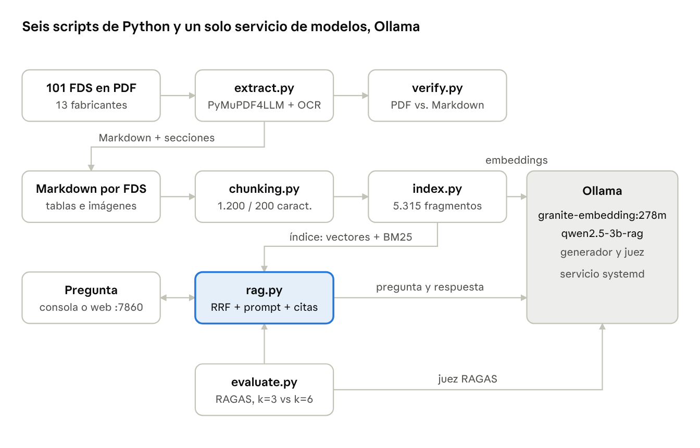
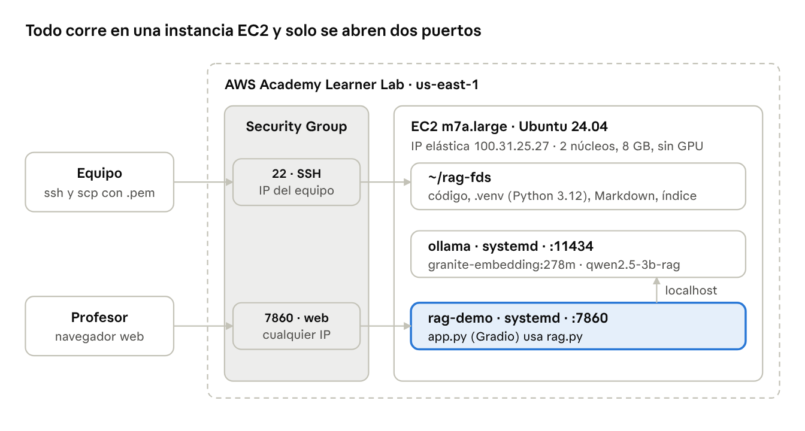

# RAG sobre Fichas de Datos de Seguridad (FDS) de pinturas

**Grupo:** Sofia Londoño, Mateo Arrubla, Leonardo Diazgranados y Camilo Cometa · Parcial final de NLP

Sistema de generación aumentada por recuperación (RAG) 100 % open source y autoalojado (Ollama en una instancia AWS EC2, sin APIs externas) para consultar las FDS del
sector de pinturas suministradas en el parcial: extrae los PDF a Markdown con trazabilidad (documento, página,
sección, imágenes), indexa fragmentos por sección, responde con citas verificables e indica cuando la evidencia es
insuficiente. Incluye la evaluación con RAGAS (Faithfulness, Context Precision, Context Recall) comparando
top-k = 3 frente a top-k = 6 con un LLM evaluador local.

## 1. Arquitectura

**Diagrama de componentes** (qué hace cada script y cómo se conectan con Ollama):



**Diagrama de despliegue en AWS** (instancia EC2, Security Group, IP elástica y servicios):



La demo web queda publicada en `http://100.31.25.27:7860` mientras el Learner Lab y la instancia están encendidos
(servicio `aws/rag-demo.service`).

Flujo de datos detallado:

```
data/pdfs/<carpeta>/*.pdf   (p. ej. FDS 2018/, FDS 2019/ …)
        │  src/extract.py   PyMuPDF4LLM (layout + tablas) + Tesseract OCR (spa+eng)
        ▼
output/md/<doc_id>/<doc_id>.md   ← front-matter (fabricante, producto, versión, sha256) + marcas <!-- pagina: N -->
          images/ images.csv      ← imágenes con rutas relativas, página, sección, OCR, tabla asociada (solo con evidencia)
          sections.json           ← 16 secciones: presente / ausente_en_original_probable / fallo_extraccion / no_determinado
        │  src/verify.py    tokens críticos (números, CAS, H/P, unidades) PDF vs MD + PNG de la página para revisión visual
        ▼
        │  src/chunking.py  bloques → fragmentos por sección (1200 car., solape 200), tablas enteras
        │  src/index.py     embeddings granite-embedding:278m (Ollama) → matriz NumPy normalizada (con caché)
        ▼
output/index/ (chunks.jsonl, embeddings.npy, index_meta.json)
        │  src/rag.py       consulta → denso + BM25 + prioridad de sección (fusión RRF) → top-k (filtro por producto/fabricante)
        │                   → prompt con fragmentos numerados [n] + metadatos → qwen2.5:3b-instruct (Ollama, T=0)
        ▼
respuesta con citas [n] → fabricante · producto · versión · documento · página · sección
        │  src/evaluate.py  12 preguntas fijas × {A_k3, B_k6} → RAGAS con evaluador local (Ollama /v1)
        ▼
output/eval/ (results.csv/json, summary.csv/md, sin_respuesta.csv, casos_revision.csv, evaluator_info.json)
```

| Componente | Elección | Justificación (desempeño / costo / complejidad) |
|---|---|---|
| PDF → Markdown | `pymupdf4llm` 2.1 (modo layout) | Conserva títulos, listas y tablas en Markdown; da cajas por página (permite asociar imagen↔tabla por geometría); CPU, rápido; OCR integrado con Tesseract para páginas escaneadas. Docling/Marker dan tablas algo mejores pero exigen PyTorch y modelos de varios GB. |
| OCR | Tesseract `spa+eng` | Open source, sin GPU. Se aplica a páginas sin capa de texto y al texto visible de las imágenes. |
| Embeddings | `granite-embedding:278m` vía Ollama (2 hilos) | Multilingüe (incluye español), 768 dim, 512 tokens, 563 MB. Se probó `bge-m3` (1024 dim, 8k): en t3.large medía ~52 s por lote de 16 → ~5 h para ~5.300 fragmentos, más que una sesión de 4 h del Learner Lab; granite requiere ~3,5× menos cómputo. Con GPU se recomienda bge-m3. |
| Recuperación | Híbrida: denso + BM25, fusión RRF (k=60) | BM25 captura coincidencias exactas (nombres de producto, N.º CAS, frases H/P, N.º ONU) que un modelo de embeddings pequeño puede perder; RRF no requiere calibrar escalas. Configurable (`retrieval.mode`). |
| Almacén vectorial | NumPy (búsqueda exacta) | Con decenas de FDS (miles de fragmentos) la búsqueda exacta es instantánea; no hay servidor que operar y es reproducible. |
| Generador | `qwen2.5-3b-rag` = `qwen2.5:3b-instruct` (Q4_K_M, 1,9 GB) con 2 hilos y contexto 8192 (`aws/modelos_cpu.sh`) | Cabe en 8 GB sin GPU junto con el modelo de embeddings; temperatura 0 y semilla fija. Con GPU: `qwen2.5:7b-instruct`. |
| Evaluador RAGAS | mismo modelo en Ollama (API compatible OpenAI) con `llm_factory` | Sin APIs pagas; un solo modelo cargado ahorra memoria. Limitación: un juez de 3B es ruidoso y puede favorecer a su propio estilo; si el hardware lo permite, usar un juez distinto/mayor (p. ej. `qwen2.5:14b`) y mantenerlo igual en ambas configuraciones. |

Todos los parámetros están en `config.yaml`.

## 2. Instalación

Requisitos: Python ≥ 3.11, [Ollama](https://ollama.com) y Tesseract con español.

```bash
# Tesseract: Ubuntu: sudo apt install tesseract-ocr tesseract-ocr-spa
#            macOS:  brew install tesseract tesseract-lang
#            Windows: instalador de UB Mannheim, marcar "Spanish" y añadir tesseract.exe al PATH
python -m venv .venv && source .venv/bin/activate     # Windows: .venv\Scripts\activate
pip install -r requirements.txt
pip freeze > requirements-lock.txt                     # entorno exacto usado por el grupo

bash aws/modelos_cpu.sh          # granite-embedding:278m + qwen2.5-3b-rag (2 hilos, ctx 8192)
```

### 2.1 Despliegue en AWS (EC2)

Todo el proyecto (extracción, índice, Ollama, evaluación y demo) corre dentro de **una sola instancia EC2**; desde el
portátil solo se usa SSH. Así `config.yaml` no cambia (`localhost:11434`) y el puerto de Ollama nunca se expone a
internet (Ollama no tiene autenticación).

| Opción | Instancia | Modelo generador/evaluador | Comentario |
|---|---|---|---|
| Recomendada | `g4dn.xlarge` (4 vCPU, 16 GB, GPU T4 16 GB) | `qwen2.5:7b-instruct` | AMI con driver NVIDIA (p. ej. *Deep Learning Base OSS Nvidia Driver GPU AMI (Ubuntu)*) |
| Sin GPU | `m5.xlarge` / `t3.xlarge` (4 vCPU, 16 GB) | `qwen2.5:7b-instruct` (lento) o `qwen2.5:3b-instruct` | AMI Ubuntu 24.04; la evaluación RAGAS en CPU puede tardar horas |
| Mínima | `t3.large` (8 GB) | `qwen2.5:3b-instruct` | Solo si no hay otra opción |

Disco: 40 GB gp3 (modelos ~6 GB + entorno Python). Security group: **solo puerto 22** desde su IP.

**Configuración usada por el grupo (AWS Academy Learner Lab):** el laboratorio solo permite tamaños hasta *large*
(sin GPU), región us-east-1, key pair `vockey` (llave `labsuser.pem` en *AWS Details*), IP elástica para no cambiar de
dirección entre sesiones.

| Etapa | Instancia | Tiempo medido |
|---|---|---|
| Extracción de 101 FDS (1.134 páginas) | `t3.large` (2 vCPU = 1 núcleo físico, 8 GB) | 37,5 min |
| Embeddings de 5.315 fragmentos con `granite-embedding:278m` | `t3.large` | 84 min (`bge-m3` medía ~52 s por lote de 16 → ~5 h, descartado) |
| Respuesta k=3 / k=6 | `m7a.large` (2 vCPU = 2 núcleos físicos AMD EPYC 9R14, 8 GB) | 28 s / 42 s por pregunta |
| Evaluación RAGAS (10 preguntas) k=3 / k=6 | `m7a.large` | 31 min / 53 min |

Se pasó de `t3.large` a `m7a.large` (Detener → Cambiar el tipo de instancia → Iniciar; disco e IP se conservan) porque
en las t3 cada 2 vCPU son 1 núcleo con 2 hilos y Ollama no ganaba con el segundo hilo: una respuesta bajó de 193 s a 45 s.
`setup_ec2.sh` fija `OLLAMA_CONTEXT_LENGTH=8192` (la API compatible OpenAI que usa RAGAS no permite fijar el contexto por
petición). Cuando la sesión del laboratorio termina, la instancia se detiene: `src.index` y `src.evaluate generate/score`
guardan su avance y, al relanzarlos, **retoman** donde quedaron (`--fresh` rehace todo). Detalle en
`output/reports/hardware.json`.

```bash
# En su portátil: subir el repo y las FDS
scp -i llave.pem -r rag-fds ubuntu@<IP>:~/
ssh -i llave.pem ubuntu@<IP>

# En la instancia
cd rag-fds && bash aws/setup_ec2.sh                         # GPU o ≥16 GB RAM
#   o: GEN_MODEL=qwen2.5:3b-instruct bash aws/setup_ec2.sh  # CPU con poca RAM
source .venv/bin/activate
tmux new -s rag                                             # los pasos largos sobreviven a desconexiones
python -m src.extract && python -m src.verify && python -m src.index
python -m src.evaluate all && python -m src.hardware        # hardware.json incluye el tipo de instancia EC2

# Demo desde el portátil (túnel SSH, sin abrir puertos):
ssh -i llave.pem -L 7860:localhost:7860 ubuntu@<IP>   # luego en la instancia: python app.py → http://localhost:7860
# Traer resultados al portátil para el repositorio:
scp -i llave.pem -r ubuntu@<IP>:~/rag-fds/output ubuntu@<IP>:~/rag-fds/data/manifest.csv ./rag-fds/
```

Consumo a documentar: tipo de instancia, horas encendida × precio por hora, tiempos de `hardware.json`.

## 3. Ejecución

```bash
# 0) Poner las FDS en data/pdfs/<carpeta>/<archivo>.pdf (p. ej. las carpetas por año FDS 2018 … FDS 2025).
#    El fabricante se detecta del texto de la Sección 1 (columna fabricante del manifiesto; SIN_IDENTIFICAR si no se halla).
python -m src.extract            # PDF → Markdown, imágenes, secciones, manifiesto, reporte de extracción
#    → completar a mano en data/manifest.csv: procedencia, fecha_recepcion; corregir producto/versión si hace falta
#      y volver a correr extract (los valores manuales se conservan)
python -m src.verify             # verificación automática + PNG por FDS → revisar y llenar resultado_manual
python -m src.index              # fragmentos + embeddings (con caché: si se interrumpe, al relanzar retoma)
python -m src.rag "¿Cuál es el punto de inflamación de <producto>?" --k 4
python -m src.rag                # modo interactivo;  --fabricante X / --producto Y para filtrar
python app.py                    # demo web opcional (pip install -r requirements-demo.txt)

# Evaluación
python -m src.evaluate dev --questions eval/dev_questions.yaml   # ajuste con preguntas de desarrollo
python -m src.evaluate check     # valida eval/questions.yaml (6/4/2, ≥4 secciones, evidencia)
python -m src.evaluate smoke     # prueba el evaluador local con 2 casos
python -m src.evaluate all       # genera (k=3 y k=6), puntúa y reporta
python -m src.hardware           # hardware, versiones, memoria de modelos y tiempos → output/reports/hardware.json
```

Prueba de integración sin modelos (FDS sintéticas + Ollama simulado): `bash tests/run_smoke.sh`.

## 4. Extracción y fidelidad documental

* **Formato.** Un `.md` por FDS con front-matter (doc_id, archivo, fabricante, producto, versión, fecha de revisión,
  páginas, SHA-256) y una marca `<!-- pagina: N -->` al inicio de cada página. Tablas en Markdown; encabezados y pies
  se conservan (suelen traer versión y fecha).
* **Procedencia y versión.** `data/manifest.csv`: los campos `producto`, `version` y `fecha_revision` se detectan
  automáticamente (columna `campos_auto` indica cuáles) y deben confirmarse; `procedencia` y `fecha_recepcion` se llenan a mano.
* **Secciones (16).** Se detectan encabezados del tipo "SECCIÓN 8", "8. CONTROLES…", "Epígrafe 8" con palabras clave por
  sección y orden creciente. Estado por sección en `sections.json`:
  * `presente` (con página);
  * `fallo_extraccion`: el encabezado está en el texto nativo del PDF pero no en el Markdown;
  * `ausente_en_original_probable`: no está ni en el Markdown ni en el texto del PDF (confirmar mirando el PDF);
  * `no_determinado`: la FDS tiene páginas escaneadas y no se puede descartar un fallo de OCR.
  Nunca se completa contenido por inferencia.
* **Verificación.** `src/verify.py` compara por página los tokens críticos (números, N.º CAS, frases H/P, N.º ONU,
  unidades) del texto nativo del PDF con los del Markdown (`output/reports/errores_extraccion.csv`) y elige al menos
  una tabla o bloque con datos por FDS (prioridad secciones 3, 9, 8), calcula su cobertura y guarda el PNG de la
  página (`verificacion_bloques.csv`, `verificacion.md`). El grupo compara visualmente y registra el resultado.
* **Imágenes.** Se guardan en `images/` y se enlazan con ruta relativa; `images.csv` registra página, sección, bbox,
  texto OCR y `tabla_asociada` **solo** cuando la caja de la imagen se solapa con la de una tabla detectada.
  Limitación: los pictogramas SGA se conservan como imagen, pero el OCR no los interpreta (rombo + símbolo sin texto);
  el sistema solo responde sobre pictogramas si el texto de la FDS los nombra (p. ej. "GHS02").

## 5. RAG y trazabilidad

* **Chunking.** Unidad = bloque (párrafo, tabla completa, imagen + OCR). Los bloques se agrupan hasta
  `chunk_size = 1200` caracteres sin cruzar el límite de una sección; solapamiento de `200` caracteres (bloques
  finales del fragmento anterior); las tablas largas se cortan por filas repitiendo el encabezado. Cada fragmento lleva
  una cabecera `[Fabricante | Producto | Versión | Sección]` que se incluye en el embedding para distinguir productos
  con textos casi idénticos (frecuente en FDS de un mismo fabricante).
* **Recuperación.** Híbrida: similitud coseno con `granite-embedding:278m` + BM25 léxico + una lista que prioriza
  la sección típica del dato pedido (p. ej. "punto de inflamación" → S9, "número ONU" → S14, "CAS" → S3), fusionadas
  con RRF (k=60); `top_k` configurable. Si la pregunta nombra uno o más productos/fabricantes del
  manifiesto, la búsqueda se restringe a esas FDS y, si son varias, se reparte k entre ellas (para que una comparación
  no recupere un solo producto). Este comportamiento es idéntico en ambas configuraciones evaluadas.
* **Generación.** Prompt de sistema con reglas: citar cada oración con [n], copiar valores y unidades tal cual, no usar
  conocimiento externo, separar por producto y responder exactamente *"No hay evidencia suficiente en las FDS
  recuperadas para responder."* cuando no haya soporte.
* **Citas faltantes.** Si el modelo de 3B no escribe las citas, el sistema añade `[n]` al fragmento que contiene los
  datos (números, CAS, códigos) de cada oración y lo marca con un aviso; nunca cita sin coincidencia de datos.
* **Salida.** Respuesta + lista de fuentes (fabricante, producto, versión, documento, página o rango, sección, similitud,
  si fue citada). Se marcan avisos si la respuesta no tiene citas o cita fragmentos inexistentes.

## 6. Evaluación con RAGAS

* `eval/questions.yaml`: 12 preguntas fijas (6 directas, 4 de integración/comparación, 2 sin respuesta), productos y
  secciones identificados, referencia verificada contra el PDF y evidencia (doc_id, página, sección, fragmento).
* Configuraciones definidas antes de evaluar: **A_k3** (top-k = 3) y **B_k6** (top-k = 6). Corpus, chunking,
  embeddings, generador, prompt y evaluador constantes (se registra `config_hash`).
* Métricas (API `ragas.metrics.collections`, ragas 0.4.4) sobre las 10 respondibles: `Faithfulness`,
  `ContextPrecisionWithReference`, `ContextRecall`. Cada métrica se calcula por muestra con reintentos; un fallo del
  evaluador se guarda como `NaN` + mensaje en `<métrica>_error` y se reporta como fallo (no como 0).
* Salidas: `results.csv/json` (user_input, retrieved_contexts en orden, response, reference, fuentes, puntuaciones),
  `summary.csv/md` (promedio y casos válidos por métrica y configuración), `sin_respuesta.csv` (revisión de Q11–Q12),
  `casos_revision.csv` (2 casos de menor puntaje + 1 adicional, con columnas para comprobar citas contra el PDF),
  `evaluator_info.json` (versiones, modelos y parámetros).
* Los puntajes de un juez local de 3B (qwen2.5:3b) orientan la comparación pero requieren revisión manual; 10 preguntas no
  demuestran superioridad general de una configuración.

## 7. Limitaciones y mitigaciones

| Limitación | Mitigación |
|---|---|
| Tablas complejas (celdas combinadas, tablas partidas entre páginas) pueden desordenarse | Verificación token a token + revisión visual de una tabla por FDS; errores registrados |
| OCR de páginas escaneadas introduce errores (p. ej. "Didxido" por "Dióxido", celdas perdidas) | Páginas marcadas como OCR en el front-matter y en cada cita ("Texto obtenido por OCR"); secciones `no_determinado` |
| Pictogramas no interpretables | Se conservan como imagen enlazada; no se infieren |
| FDS casi idénticas entre productos/versiones | Cabecera de metadatos en cada fragmento + filtro por producto + citas con versión |
| El LLM puede omitir citas o responder con conocimiento propio | Prompt restrictivo, T=0, verificación de citas y aviso; respuesta estándar de evidencia insuficiente |
| Detección de productos por coincidencia de nombre | Filtros explícitos `--producto/--fabricante` y en la demo |
| Juez RAGAS local ruidoso, prompts de RAGAS en inglés | Mismo juez en ambas configuraciones, fallos como NaN, revisión manual de casos |

## 8. Resultados

| Métrica (10 preguntas respondibles) | k = 3 | k = 6 |
|---|---|---|
| Faithfulness | **0,583** | 0,483 |
| Context Precision | **0,983** | 0,968 |
| Context Recall | 0,967 | 0,967 |
| Casos válidos / fallos del evaluador | 10 / 0 | 10 / 0 |

Configuración seleccionada: **k = 3**. Las 2 preguntas sin respuesta se reconocieron como tales en ambas
configuraciones. Extracción: 89/101 FDS con las 16 secciones, 20 secciones con fallo de extracción y 1 ausente en el
original, 101 bloques verificados (87 OK, 14 para revisión visual). Análisis completo en el informe (`report/`),
resultados por pregunta en `output/eval/results.csv` y verificación de citas contra los PDF en
`output/eval/verificacion_citas/`.

## 9. Estructura del repositorio

```
config.yaml              parámetros únicos
src/extract.py           PDF → Markdown, imágenes, secciones, manifiesto
src/verify.py            verificación de la extracción
src/mdparse.py           lectura del Markdown en bloques con página/sección
src/chunking.py          estrategia de fragmentación
src/index.py             embeddings e índice
src/rag.py               recuperación, generación y citas (CLI)
src/evaluate.py          evaluación RAGAS
src/hardware.py          hardware y consumo
app.py                   demo web (Gradio, puerto 7860)
aws/                     instalación en EC2 y servicio systemd de la demo
docs/diagramas/          diagramas de componentes y de despliegue
eval/questions.yaml      12 preguntas de evaluación
eval/dev_questions.yaml  preguntas de desarrollo
data/manifest.csv        procedencia y versión de cada FDS
output/md/               Markdown + imágenes de todas las FDS (entregable 2)
output/reports/          extracción, verificación, hardware
output/eval/             resultados de evaluación (entregable 3)
report/INFORME.pdf       informe (máx. 2 páginas)
tests/                   FDS sintéticas, Ollama simulado y prueba de integración
```
