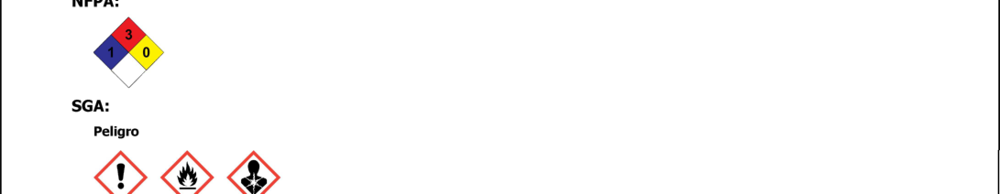
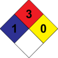
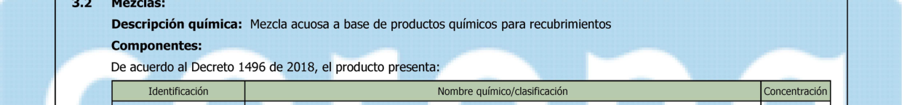
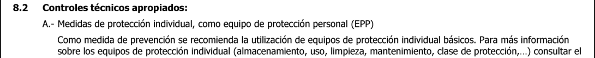
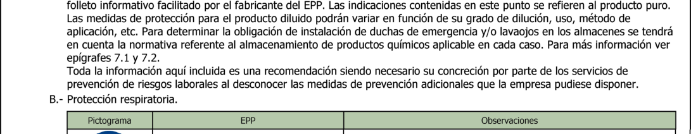
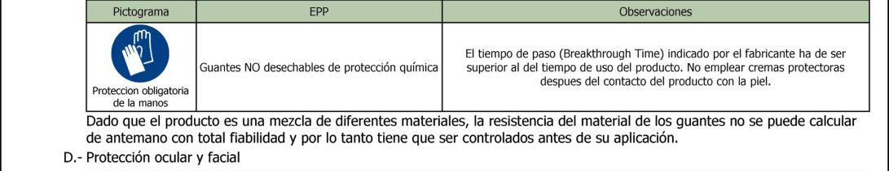
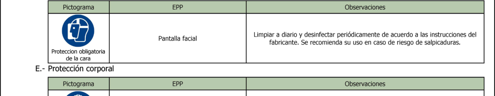
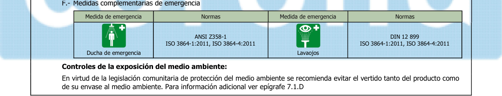
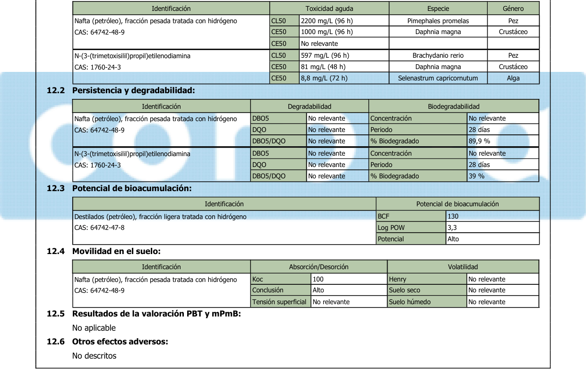
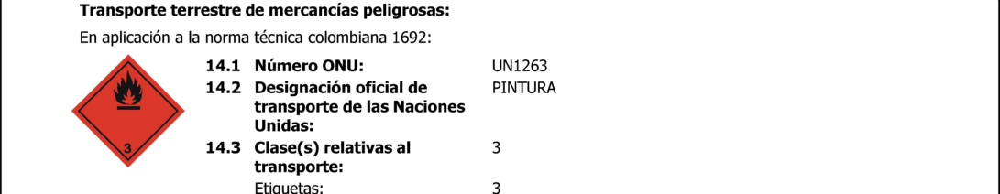

<!-- pagina: 1 -->
Ficha de datos de seguridad según Decreto 1496 de 2018 

> Imagen (pág. 1). Sin texto legible por OCR; contenido gráfico no interpretado.

## **407141521 - RECUBRIMIENTO ANTIGRAFFITI** 

> Imagen (pág. 1). Sin texto legible por OCR; contenido gráfico no interpretado.

## SECCIÓN 1: IDENTIFICACIÓN DEL PRODUCTO 

**1.1 Identificador SGA del producto:** 407141521 - RECUBRIMIENTO ANTIGRAFFITI **1.2 Uso recomendado del producto químico y restricciones:** Usos pertinentes: Recubrimiento, protección y decoración para sustratos al exterior. Usos desaconsejados: Todo aquel uso no especificado en este epígrafe ni en el epígrafe 7.3 **1.3 Datos sobre el proveedor:** CORLANC S.A.S. Carrera 48 N° 72 sur 01 Avenida Las Vegas 055450 Sabaneta - Antioquia - Colombia Tfno.: +57-4-3787800 materialesypinturascorona@corona.com.co https://www.corona.co **1.4 Número de teléfono para emergencias:** CISTEMA - ARL SURA 018000511414 - 0314055911 

## SECCIÓN 2: IDENTIFICACIÓN DEL PELIGRO O PELIGROS 

> Imagen (pág. 1). OCR automático, revisar: «2.1 Clasi NFPA: Salud: 1 ción de la sustancia o de la mezcla:»

<!-- Start of picture text -->
2.1 Clasificación de la sustancia o de la mezcla: NFPA: Salud: 1 <!-- End of picture text -->

> Imagen (pág. 1). OCR automático, revisar: «IMAmaDIIda Inestabilidad: 0 Especiales: No relevante SGA: La clasificación del producto se ha realizado conforme con al decreto 1496 de 2018, por el cual se adopta el Sistema Globalmente Armonizado de Clasificación y Etiquetado de Productos Químicos y se dictan otras disposiciones en materia de»

<!-- Start of picture text -->
Inflamabilidad: 3 Inestabilidad: 0 Especiales: No relevante SGA: La clasificación del producto se ha realizado conforme con al decreto 1496 de 2018, por el cual se adopta el Sistema Globalmente Armonizado de Clasificación y Etiquetado de Productos Químicos y se dictan otras disposiciones en materia de <!-- End of picture text -->

> Imagen (pág. 1). OCR automático, revisar: «seguridad química. Carc. 1B: Carcinogenicidad, Categoría 1B, H350 Trrit. oc, 2: Irritación ocular, categoría 2, H319 Lig. Infl. 3: Líquidos inflamables, Categoria 3, H226 Muta. 1B: Mutageneidad en células germinales, Categoria 1B, H340 Sens. Cut. 1: Sensibilización cutánea, Categoría 1, H317 Tox. Agud. 5: Toxicidad aguda por contacto con la piel, Categoria 5, H313 Tox. Asp. 1: Peligro por aspiración, Categoría 1, H304 LI AAA AA AA AAA A Inc Inc rancaine de nridencia:»

<!-- Start of picture text -->
seguridad química. Carc. 1B: Carcinogenicidad, Categoría 1B, H350 Trrit. oc, 2: Irritación ocular, categoria 2, H319 Liq. Infl. 3: Líquidos inflamables, Categoría 3, H226 Muta. 1B: Mutageneidad en células germinales, Categoría 1B, H340 Sens. Cut. 1: Sensibilización cutánea, Categoría 1, H317 Tox. Agud. 5: Toxicidad aguda por contacto con la piel, Categoría 5, H313 Tox. Asp. 1: Peligro por aspiración, Categoría 1, H304 2.2 Elementos de las etiquetas del SGA, incluidos los consejos de prudencia: <!-- End of picture text -->

> Imagen (pág. 1). OCR automático, revisar: «e arts tada bel ee y rg >-—. > r* =»

> Imagen (pág. 1). Sin texto legible por OCR; contenido gráfico no interpretado.

<!-- Start of picture text -->
NFPA: Y SGA: Peligro <!-- End of picture text -->

> Imagen (pág. 1). Sin texto legible por OCR; contenido gráfico no interpretado.

**Indicaciones de peligro:** Carc. 1B: H350 - Puede provocar cáncer Irrit. oc. 2: H319 - Provoca irritación ocular grave Liq. Infl. 3: H226 - Líquido y vapores inflamables Muta. 1B: H340 - Puede provocar defectos genéticos Sens. Cut. 1: H317 - Puede provocar una reacción cutánea alérgica Tox. Agud. 5: H313 - Puede ser nocivo en contacto con la piel Tox. Asp. 1: H304 - Puede ser mortal en caso de ingestión y de penetración en las vías respiratorias **Consejos de prudencia:** 

- CONTINÚA EN LA SIGUIENTE PÁGINA - 

Emisión: 25/07/2019            Versión: 1 

**Página 1/11** 

<!-- pagina: 2 -->
Ficha de datos de seguridad según Decreto 1496 de 2018 

> Imagen (pág. 2). Sin texto legible por OCR; contenido gráfico no interpretado.

## **407141521 - RECUBRIMIENTO ANTIGRAFFITI** 

> Imagen (pág. 2). Sin texto legible por OCR; contenido gráfico no interpretado.

## SECCIÓN 2: IDENTIFICACIÓN DEL PELIGRO O PELIGROS (continúa) 

P101: Si se necesita consultar a un médico, tener a mano el recipiente o la etiqueta del producto P102: Mantener fuera del alcance de los niños P210: Mantener alejado del calor, superficies calientes, chispas llamas al descubierto y otras fuentes de ignición. No fumar P264: Lavarse cuidadosamente después de la manipulación P280: Usar guantes/ropa de protección/equipo de protección para los ojos/la cara P305+P351+P338: EN CASO DE CONTACTO CON LOS OJOS: Enjuagar con agua cuidadosamente durante varios minutos. Quitar las lentes de contacto cuando estén presentes y pueda hacerse con facilidad. Proseguir con el lavado P370+P378: En caso de incendio: Utilizar extintor de polvo ABC para la extinción P501: Eliminar el contenido/recipiente mediante el sistema de recogida selectiva habilitado en su municipio **Sustancias que contribuyen a la clasificación** N-butil-N-((trietoxisilil)metil)butan-1-amina; Destilados (petróleo), fracción ligera tratada con hidrógeno; Nafta (petróleo), fracción pesada tratada con hidrógeno; N-(3-(trimetoxisilil)propil)etilenodiamina **2.3 Otros peligros que no conducen a una clasificación:** No relevante 

## SECCIÓN 3: COMPOSICIÓN/INFORMACIÓN SOBRE LOS COMPONENTES 

> Imagen (pág. 2). OCR automático, revisar: «3.1 Sustancias: No aplicable»

<!-- Start of picture text -->
3.1 Sustancias: No aplicable <!-- End of picture text -->

> Imagen (pág. 2). OCR automático, revisar: «De eee Descripción química: Mezcla acuosa a base de productos químicos para recubrimientos Componentes: De acuerdo al Decreto 1496 de 2018, el producto presenta: Identificación Nombre ql»

<!-- Start of picture text -->
3.2 Mezclas: Descripción química: Mezcla acuosa a base de productos químicos para recubrimientos Componentes: De acuerdo al Decreto 1496 de 2018, el producto presenta: <!-- End of picture text -->

**N-(3-(trimetoxisilil)propil)etilenodiamina** CAS: 1760-24-3 **1 - <10 %** Para ampliar información sobre la peligrosidad de la sustancias consultar las secciones 8, 11, 12, 15 y 16. La clasificación respecto <u>A</u> Les. Oc. 1: H318; Sens. Cut. 1: H317; Tox. Agud. 5: H303 - Peligro ~~eee~~ Carcinogenicidad de las sustancias se ha establecido en función de las monografías de la IARC adecuandola al sistema de clasificación SGA, para información sobre la clasificación IARC consulte la sección 11. 

## SECCIÓN 4: PRIMEROS AUXILIOS 

### **4.1 Descripción de los primeros auxilios necesarios:** 

Los síntomas como consecuencia de una intoxicación pueden presentarse con posterioridad a la exposición, por lo que, en caso de duda, exposición directa al producto químico o persistencia del malestar solicitar atención médica, mostrándole la FDS de este producto. **Por inhalación:** 

Se trata de un producto que no contiene sustancias clasificadas como peligrosas por inhalación, sin embargo, en caso de síntomas de intoxicación sacar al afectado de la zona de exposición y proporcionarle aire fresco. Solicitar atención médica si los síntomas se agravan o persisten. 

### **Por contacto con la piel:** 

Quitar la ropa y los zapatos contaminados, aclarar la piel o duchar al afectado si procede con abundante agua fría y jabón neutro. En caso de afección importante acudir al médico. Si el producto produce quemaduras o congelación, no se debe quitar la ropa debido a que podría empeorar la lesión producida si esta se encuentra pegada a la piel. En el caso de formarse ampollas en la piel, éstas nunca deben reventarse ya que aumentaría el riesgo de infección. **Por contacto con los ojos:** Enjuagar los ojos con abundante agua a temperatura ambiente al menos durante 15 minutos. Evitar que el afectado se frote o cierre los ojos. En el caso de que el accidentado use lentes de contacto, éstas deben retirarse siempre que no estén pegadas a los ojos, de otro modo podría producirse un daño adicional. En todos los casos, después del lavado, se debe acudir al médico lo más rápidamente posible con la FDS del producto. **Por ingestión/aspiración:** 

- CONTINÚA EN LA SIGUIENTE PÁGINA - 

Emisión: 25/07/2019            Versión: 1 

**Página 2/11** 

<!-- pagina: 3 -->
Ficha de datos de seguridad según Decreto 1496 de 2018 **407141521 - RECUBRIMIENTO ANTIGRAFFITI** SECCIÓN 4: PRIMEROS AUXILIOS (continúa) ~~au~~ 

## **407141521 - RECUBRIMIENTO ANTIGRAFFITI** 

> Imagen (pág. 3). Sin texto legible por OCR; contenido gráfico no interpretado.

   - Requerir asistencia médica inmediata, mostrándole la FDS de este producto. No inducir al vómito, en el caso de que se produzca mantener inclinada la cabeza hacia delante para evitar la aspiración. En el caso de pérdida de consciencia no administrar nada por vía oral hasta la supervisión del médico. Enjuagar la boca y la garganta, ya que existe la posibilidad de que hayan sido afectadas en la ingestión. Mantener al afectado en reposo. 

- **4.2 Síntomas/efectos más importantes, agudos o retardados:** Los efectos agudos y retardados son los indicados en las secciones 2 y 11. 

- **4.3 Indicación de la necesidad de recibir atención médica inmediata y, en su caso, de tratamiento especial:** No relevante 

SECCIÓN 5: MEDIDAS DE LUCHA CONTRA INCENDIOS **5.1 Medios de extinción apropiados:** Emplear preferentemente extintores de polvo polivalente (polvo ABC), alternativamente utilizar espuma física o extintores de dióxido de carbono (CO2). NO SE RECOMIENDA emplear agua a chorro como agente de extinción. **5.2 Peligros específicos del producto químico:** Como consecuencia de la combustión o descomposición térmica se generan subproductos de reacción que pueden resultar altamente tóxicos y, consecuentemente, pueden presentar un riesgo elevado para la salud. **5.3 Medidas especiales que deben tomar los equipos de lucha contra incendios:** En función de la magnitud del incendio puede hacerse necesario el uso de ropa protectora completa y equipo de respiración autónomo. Disponer de un mínimo de instalaciones de emergencia o elementos de actuación (mantas ignífugas, botiquín portátil,...). **Disposiciones adicionales:** Actuar conforme el Plan de Emergencia Interior y las Fichas Informativas sobre actuación ante accidentes y otras emergencias. Suprimir cualquier fuente de ignición. En caso de incendio, refrigerar los recipientes y tanques de almacenamiento de productos susceptibles a inflamación, explosión o BLEVE como consecuencia de elevadas temperaturas. Evitar el vertido de los productos empleados en la extinción del incendio al medio acuático. ~~<u>o</u>~~ 

SECCIÓN 6: MEDIDAS QUE DEBEN TOMARSE EN CASO DE VERTIDO ACCIDENTAL **6.1 Precauciones personales, equipo protector y procedimiento de emergencia:** Aislar las fugas siempre y cuando no suponga un riesgo adicional para las personas que desempeñen esta función. Evacuar la zona y mantener a las personas sin protección alejadas. Ante el contacto potencial con el producto derramado se hace obligatorio el uso de elementos de protección personal (ver sección 8). Evitar de manera prioritaria la formación de mezclas vapor-aire inflamables, ya sea mediante ventilación o el uso de un agente inertizante. Suprimir cualquier fuente de ignición. Eliminar las cargas electroestáticas mediante la interconexión de todas las superficies conductoras sobre las que se puede formar electricidad estática, y estando a su vez el conjunto conectado a tierra. **6.2 Precauciones relativas al medio ambiente:** Producto no clasificado como peligroso para el medioambiente. Mantener el producto alejado de los desagües y de las aguas superficiales y subterráneas. **6.3 Métodos y materiales para la contención y limpieza de vertidos:** Se recomienda: Absorber el vertido mediante arena o absorbente inerte y trasladarlo a un lugar seguro. No absorber en serrín u otros absorbentes combustibles. Para cualquier consideración relativa a la eliminación consultar la sección 13. **6.4 Referencias a otras secciones:** Ver secciones 8 y 13. ~~<u>a</u>~~ SECCIÓN 7: MANIPULACIÓN Y ALMACENAMIENTO **7.1 Precauciones que se deben tomar para garantizar una manipulación segura:** A.- Precauciones generales Cumplir con la legislación vigente en materia de prevención de riesgos laborales. Mantener los recipientes herméticamente cerrados. Controlar los derrames y residuos, eliminándolos con métodos seguros (sección 6). Evitar el vertido libre desde el recipiente. Mantener orden y limpieza donde se manipulen productos peligrosos. B.- Recomendaciones técnicas para la prevención de incendios y explosiones. ~~o~~ - CONTINÚA EN LA SIGUIENTE PÁGINA - Emisión: 25/07/2019            Versión: 1 **Página 3/11** 

<!-- pagina: 4 -->
Ficha de datos de seguridad según Decreto 1496 de 2018 

> Imagen (pág. 4). Sin texto legible por OCR; contenido gráfico no interpretado.

## **407141521 - RECUBRIMIENTO ANTIGRAFFITI** 

> Imagen (pág. 4). Sin texto legible por OCR; contenido gráfico no interpretado.

## SECCIÓN 7: MANIPULACIÓN Y ALMACENAMIENTO (continúa) 

Trasvasar en lugares bien ventilados, preferentemente mediante extracción localizada. Controlar totalmente los focos de ignición (teléfonos móviles, chispas,…) y ventilar en las operaciones de limpieza. Evitar la existencia de atmósferas peligrosas en el interior de recipientes, aplicando en lo posible sistemas de inertización. Trasvasar a velocidades lentas para evitar la generación de cargas electroestáticas. Ante la posibilidad de existencia de cargas electroestáticas: asegurar una perfecta conexión equipotencial, utilizar siempre tomas de tierras, no emplear ropa de trabajo de fibras acrílicas, empleando preferiblemente ropa de algodón y calzado conductor. Cumplir con los requisitos esenciales de seguridad para equipos  y con las disposiciones mínimas para la protección de la seguridad y salud de los trabajadores. Consultar la sección 10 sobre condiciones y materias que deben evitarse. 

- C.- Recomendaciones técnicas para prevenir riesgos ergonómicos y toxicológicos. Para control de exposición consultar la sección 8. No comer, beber ni fumar en las zonas de trabajo; lavarse las manos después de cada utilización, y despojarse de prendas de vestir y equipos de protección contaminados antes de entrar en las zonas para comer. 

- D.- Recomendaciones técnicas para prevenir riesgos medioambientales 

Se recomienda disponer de material absorbente en las proximidades del producto (ver epígrafe 6.3) 

- **7.2 Condiciones de almacenamiento seguro, incluidas cualesquiera incompatibilidades:** 

A.- Medidas técnicas de almacenamiento Tª mínima: 5 ºC Tª máxima: 30 ºC Tiempo máximo: 12 meses 

B.- Condiciones generales de almacenamiento. 

- Evitar fuentes de calor, radiación, electricidad estática y el contacto con alimentos. Para información adicional ver epígrafe 10.5 

- **7.3 Usos específicos finales:** 

   - Salvo las indicaciones ya especificadas no es preciso realizar ninguna recomendación especial en cuanto a los usos de este producto. 

## SECCIÓN 8: CONTROLES DE EXPOSICIÓN/PROTECCIÓN PERSONAL 

> Imagen (pág. 4). OCR automático, revisar: «8.1 Parámetros de control: Sustancias cuyos valores límite de exposición profesional han de controlarse en el ambiente de trabajo (ACGIH): No existen valores límites ambientales para las sustancias que constituyen el producto.»

<!-- Start of picture text -->
8.1 Parámetros de control: Sustancias cuyos valores límite de exposición profesional han de controlarse en el ambiente de trabajo (ACGIH): No existen valores límites ambientales para las sustancias que constituyen el producto. <!-- End of picture text -->

> Imagen (pág. 4). OCR automático, revisar: «8.2 Controles técnicos apropiados: A.- Medidas de protección individual, como equipo de protección personal (EPP) Como medida de prevención se recomienda la utilización de equipos de protección individual básicos. Para más información sobre los equipos de protección individual (almacenamiento, uso, limpieza, mantenimiento, clase de protección,...) consultar el»

<!-- Start of picture text -->
8.2 Controles técnicos apropiados: A.- Medidas de protección individual, como equipo de protección personal (EPP) Como medida de prevención se recomienda la utilización de equipos de protección individual básicos. Para más información sobre los equipos de protección individual (almacenamiento, uso, limpieza, mantenimiento, clase de protección,...) consultar el <!-- End of picture text -->

> Imagen (pág. 4). OCR automático, revisar: «folleto informativo facilitado por el fabricante del EPP. Las indicaciones contenidas en este punto se refieren al producto puro. Las medidas de protección para el producto diluido podrán variar en función de su grado de dilución, uso, método de aplicación, etc. Para determinar la obligación de instalación de duchas de emergencia y/o lavaojos en los almacenes se tendrá en cuenta la normativa referente al almacenamiento de productos químicos aplicable en cada caso. Para más información ver epígrafes 7.1 y 7.2. Toda la información aquí incluida es una recomendación siendo necesario su concreción por parte de los servicios de prevención de riesgos laborales al desconocer las medidas de prevención adicionales que la empresa pudiese disponer. B.- Protección respiratoria. Pictograma Observaciones»

<!-- Start of picture text -->
folleto informativo facilitado por el fabricante del EPP. Las indicaciones contenidas en este punto se refieren al producto puro. Las medidas de protección para el producto diluido podrán variar en función de su grado de dilución, uso, método de aplicación, etc. Para determinar la obligación de instalación de duchas de emergencia y/o lavaojos en los almacenes se tendrá en cuenta la normativa referente al almacenamiento de productos químicos aplicable en cada caso. Para más información ver epígrafes 7.1 y 7.2. Toda la información aquí incluida es una recomendación siendo necesario su concreción por parte de los servicios de prevención de riesgos laborales al desconocer las medidas de prevención adicionales que la empresa pudiese disponer. B.- Protección respiratoria. ara A <!-- End of picture text -->

Reemplazar cuando se detecte olor o sabor del contaminante en el interior de la Máscara autofiltrante para gases y vapores máscara o adaptador facial. Cuando el contaminante no tiene buenas propiedades Proteccion obligatoria de aviso se recomienda el uso de equipos aislantes. del las vias respiratorias 

C.- Protección específica de las manos. 

- CONTINÚA EN LA SIGUIENTE PÁGINA - 

Emisión: 25/07/2019            Versión: 1 

**Página 4/11** 

<!-- pagina: 5 -->
Ficha de datos de seguridad según Decreto 1496 de 2018 

> Imagen (pág. 5). Sin texto legible por OCR; contenido gráfico no interpretado.

## **407141521 - RECUBRIMIENTO ANTIGRAFFITI** 

> Imagen (pág. 5). Sin texto legible por OCR; contenido gráfico no interpretado.

SECCIÓN 8: CONTROLES DE EXPOSICIÓN/PROTECCIÓN PERSONAL (continúa) 

> Imagen (pág. 5). OCR automático, revisar: «El tiempo de paso (Breakthrough Time) indicado por el fabricante ha de ser ¡Guantes NO desechables de protección química superior al del tiempo de uso del producto. No emplear cremas protectoras E despues del contacto del producto con la piel. de la manos Dado que el producto es una mezcla de diferentes materiales, la resistencia del material de los guantes no se puede calcular de antemano con total fiabilidad y por lo tanto tiene que ser controlados antes de su aplicación. D.- Protección ocular y facial»

<!-- Start of picture text -->
rana  JJe O] El tiempo de paso (Breakthrough Time) indicado por el fabricante ha de ser [Guantes NO desechables de protección quimica] superior al del tiempo de uso del producto. No emplear cremas protectoras Proteccion obligatoria despues del contacto del producto con la piel. de la manos Dado que el producto es una mezcla de diferentes materiales, la resistencia del material de los guantes no se puede calcular de antemano con total fiabilidad y por lo tanto tiene que ser controlados antes de su aplicación. D.- Protección ocular y facial <!-- End of picture text -->

> Imagen (pág. 5). OCR automático, revisar: «Pictograma EPP Observaciones (Ay add Limpiar a diario y desinfectar periódicamente de acuerdo a las instrucciones del fabricante. Se recomienda su uso en caso de riesgo de salpicaduras. Proteccion obligatoria de la cara Protección corporal Pictograma EPP Observaciones y a»

<!-- Start of picture text -->
CN A OA" (Ay, Paella focal Limpiarfabricante. a diario ySe desinfectarrecomiendaperiódicamentesu uso en caso de acuerdode riesgo adelassalpicaduras. instrucciones del Proteccion obligatoria de la cara E.- Protección corporal rana JOe O] <!-- End of picture text -->

> Imagen (pág. 5). OCR automático, revisar: «QU Prenda de protección frente a riesgos químicos, | Uso exclusivo en el trabajo. Limpiar periódicamente de acuerdo a las instrucciones»

<!-- Start of picture text -->
Prenda de protección frente a riesgos químicos, | Uso exclusivo en el trabajo. Limpiar periódicamente de acuerdo a las instrucciones <!-- End of picture text -->

> Imagen (pág. 5). OCR automático, revisar: «Proteccion obligatoria del cuerpo ae | anuestabica e ignituga Gel fabricante. Calzado de seguridad contra riesgo químico, con propiedades antiestáticas y resistencia al Reemplazar las botas ante cualquier indicio de deterioro. calor Proteccion obligatoria de los pies»

<!-- Start of picture text -->
antiestatica e ignifuga del fabricante. Proteccion obligatoria del cuerpo Calzado de seguridad contra riesgo químico, con propiedades antiestáticas y resistencia al Reemplazar las botas ante cualquier indicio de deterioro. calor Proteccion obligatoria delos pies <!-- End of picture text -->

> Imagen (pág. 5). OCR automático, revisar: «F.- Medidas complementarias de emergencia Medida de emergencia Normas Medida de emergencia Normas O+ ANSI Z358-1 DIN 12 899 1SO 3864-1:2011, ISO 3864-4:2011 150 3864-1:2011, ISO 3864-4: Ducha de emergencia Lavaojos Controles de la exposición del medio ambiente: En virtud de la legislación comunitaria de protección del medio ambiente se recomienda evitar el vertido tanto del producto como de su envase al medio ambiente. Para información adicional ver epígrafe 7.1.D»

<!-- Start of picture text -->
F.- Medidas complementarias de emergencia ANSI Z358-1 DIN 12 899 ISO 3864-1:2011, ISO 3864-4:2011 ISO 3864-1:2011, ISO 3864-4:2011 Ducha de emergencia Lavaojos Controles de la exposición del medio ambiente: En virtud de la legislación comunitaria de protección del medio ambiente se recomienda evitar el vertido tanto del producto como de su envase al medio ambiente. Para información adicional ver epígrafe 7.1.D <!-- End of picture text -->

SECCIÓN 9: PROPIEDADES FÍSICAS Y QUÍMICAS Y CARACTERÍSTICAS DE SEGURIDAD 

|**9.1**|**Información de propiedades físicas y químicas**|**básicas:**|
|---|---|---|
||Para completar la información ver la ficha técnica/ho **Aspecto físico:**|ja de especificaciones del producto.|
||Estado físico a 20 ºC:|Líquido|
||Aspecto:|Cristalino|
||Color:|Incoloro|
||Olor:|Característico|
||Umbral olfativo:|No relevante *|
||**Volatilidad:**||
||Temperatura de ebullición a presión atmosférica:|211 ºC|
||Presión de vapor a 20 ºC:|209 Pa|
||Presión de vapor a 50 ºC:|1158,31 Pa  (1,16 kPa)|
||Tasa de evaporación a 20 ºC:|No relevante *|
||*No relevante debido a la naturaleza del producto, no aportando|información característica de su peligrosidad.|

- CONTINÚA EN LA SIGUIENTE PÁGINA - 

Emisión: 25/07/2019            Versión: 1 

**Página 5/11** 

<!-- pagina: 6 -->
||Fich   |a de datos de seguridad ú Dt 1496 d 2018 |
|---|---|---|
|SECC |**407141521 - R** s IÓN 9: PROPIEDADES FÍSICAS YQUÍMICAS |**ECUBRIMIENTO ANTIGRAFFITI** gn ecreo  e Y CARACTERÍSTICAS DE SEGURIDAD(continúa) |
||**Caracterización del producto:** ||
||Densidad a 20 ºC: |981,6 kg/m³ |
||Densidad relativa a 20 ºC:   |0,982   |
||Viscosidad dinámica a 20 ºC: |6,59 cP |
||Viscosidad cinemática a 20 ºC: |6,51 cSt |
||Viscosidad cinemática a 40 ºC: |<20,5 cSt |
||Concentración: |No relevante * |
||pH: |No relevante * |
||Densidad de vapor a 20 ºC: |No relevante * |
||Coeficiente de reparto n-octanol/agua a 20 ºC: |No relevante * |
||Solubilidad en agua a 20 ºC: |No relevante * |
||Propiedad de solubilidad: |No relevante * |
||Temperatura de descomposición: |No relevante * |
|| Punto de fusión/punto de congelación: |No relevante * |
||Propiedades explosivas: |No relevante * |
||Propiedades comburentes: |No relevante * |
||**Inflamabilidad:** ||
||Punto de inflamación: |54 ºC |
||Inflamabilidad (sólido, gas):   |No relevante *   |
||Temperatura de auto-inflamación: |410 ºC |
||Límite de inflamabilidad inferior: |No determinado |
||Límite de inflamabilidad superior: |>110 % Volumen |
||**Explosividad:** ||
||Límite inferior de explosividad: |No relevante * |
||Límite superior de explosividad: |No relevante * |
|**9.2** | **Información adicional:** ||
||Tensión superficial a 20 ºC: |No relevante * |
||Índice de refracción: |No relevante * |
|SECC **10.1** **10.2** **10.3** **10.4** |*No relevante debido a la naturaleza del producto, no aportand IÓN 10: ESTABILIDAD Y REACTIVIDAD **Reactividad:** No se esperan reacciones peligrosas si se cumplen sección 7. **Estabilidad química:** Estable químicamente bajo las condiciones indicada **Posibilidad de reacciones peligrosas:** Bajo las condiciones indicadas no se esperan reacci **Condiciones que deben evitarse:** Aplicables para manipulación y almacenamiento a t |o información característica de su peligrosidad. las instrucciones técnicas de almacenamiento de productos químicos. Ver s de almacenamiento, manipulación y uso. ones peligrosas que puedan producir una presión o temperaturas excesivas. emperatura ambiente: |
|| Choque y fricción Contacto con el aire | Calentamiento Luz Solar Humedad |
||No aplicable No aplicable |Riesgo de inflamación Evitar incidencia directa No aplicable |
|**10.5** |**Materiales incompatibles:** ||
||Ácidos Agua |Materias comburentes Materias combustibles Otros |
||Evitar ácidos fuertes No aplicable |Evitar incidencia directa No aplicable Evitar alcalis o bases fuertes |
|**10.6** |**Productos de descomposición peligrosos:** ||
|Emisión: |25/07/2019            Versión: 1 - CONTIN|**Página 6/** ÚA EN LA SIGUIENTE PÁGINA -|

**Página 6/11** 

<!-- pagina: 7 -->
Ficha de datos de seguridad según Decreto 1496 de 2018 

> Imagen (pág. 7). Sin texto legible por OCR; contenido gráfico no interpretado.

## **407141521 - RECUBRIMIENTO ANTIGRAFFITI** 

> Imagen (pág. 7). Sin texto legible por OCR; contenido gráfico no interpretado.

## SECCIÓN 10: ESTABILIDAD Y REACTIVIDAD (continúa) 

Ver epígrafe 10.3, 10.4 y 10.5 para conocer los productos de descomposición específicamente. En dependencia de las condiciones de descomposición, como consecuencia de la misma pueden liberarse mezclas complejas de sustancias químicas: dióxido de carbono (CO2), monóxido de carbono y otros compuestos orgánicos. 

## SECCIÓN 11: INFORMACIÓN TOXICOLÓGICA 

### **11.1 Información sobre las posibles vías de exposición:** 

No se dispone de datos experimentales del producto en si mismos relativos a las propiedades toxicológicas 

### **Efectos peligrosos para la salud:** 

- En caso de exposición repetitiva, prolongada o a concentraciones superiores a las establecidas por los límites de exposición profesionales, pueden producirse efectos adversos para la salud en función de la vía de exposición: A- Ingestión (efecto agudo): -   Toxicidad aguda: A la vista de los datos disponibles, no se cumplen los criterios de clasificación, sin embargo, presenta sustancias clasificadas como peligrosas por ingestión. Para más información ver sección 3. -   Corrosividad/Irritabilidad: A la vista de los datos disponibles, no se cumplen los criterios de clasificación, no presentando sustancias clasificadas como peligrosas por este efecto. Para más información ver sección 3. 

- B- Inhalación (efecto agudo): -   Toxicidad aguda: A la vista de los datos disponibles, no se cumplen los criterios de clasificación, no presentando sustancias clasificadas como peligrosas por inhalación. Para más información ver sección 3. -   Corrosividad/Irritabilidad: A la vista de los datos disponibles, no se cumplen los criterios de clasificación, no presentando sustancias clasificadas como peligrosas por este efecto. Para más información ver sección 3. 

- C- Contacto con la piel y los ojos (efecto agudo): -   Contacto con la piel: Principalmente puede presentar efectos nocivos para la salud si el producto es absorbido vía cutánea. Para más información sobre efectos secundarios por contacto con la piel ver sección 2. -   Contacto con los ojos: Produce lesiones oculares tras contacto. 

- D- Efectos CMR (carcinogenicidad, mutagenicidad y toxicidad para la reproducción): -   Carcinogenicidad: La exposición a este producto puede causar cáncer. Para más información sobre posibles efectos específicos sobre la salud ver sección 2. IARC: Nafta (petróleo), fracción pesada tratada con hidrógeno (1) -   Mutagenicidad: La exposición a este producto puede causar alteraciones genéticas. Para más información sobre posibles efectos específicos sobre la salud ver sección 2. -   Toxicidad para la reproducción: A la vista de los datos disponibles, no se cumplen los criterios de clasificación, no presentando sustancias clasificadas como peligrosas por este efecto. Para más información ver sección 3. 

- E- Efectos de sensibilización: -   Respiratoria: A la vista de los datos disponibles, no se cumplen los criterios de clasificación, no presentando sustancias clasificadas como peligrosas con efectos sensibilizantes. Para más información ver secciónes 2, 3 y 15. -   Cutánea: El contacto prolongado con la piel puede derivar en EPPsodios de dermatitis alérgicas de contacto. 

- F- Toxicidad específica en determinados órganos (STOT)-exposición única: A la vista de los datos disponibles, no se cumplen los criterios de clasificación, no presentando sustancias clasificadas como peligrosas por este efecto. Para más información ver sección 3. 

- G- Toxicidad específica en determinados órganos (STOT)-exposición repetida: -   Toxicidad específica en determinados órganos (STOT)-exposición repetida: A la vista de los datos disponibles, no se cumplen los criterios de clasificación, no presentando sustancias clasificadas como peligrosas por este efecto. Para más información ver sección 3. -   Piel: A la vista de los datos disponibles, no se cumplen los criterios de clasificación, no presentando sustancias clasificadas como peligrosas por este efecto. Para más información ver sección 3. 

- H- Peligro por aspiración: La ingesta de una dosis considerable puede producir daño pulmonar. 

**Información adicional:** 

No relevante 

**Información toxicológica específica de las sustancias:** 

- CONTINÚA EN LA SIGUIENTE PÁGINA - 

Emisión: 25/07/2019            Versión: 1 

**Página 7/11** 

<!-- pagina: 8 -->
Ficha de datos de seguridad según Decreto 1496 de 2018 

# ~~<u>oom</u>~~ 

## **407141521 - RECUBRIMIENTO ANTIGRAFFITI** 

## SECCIÓN 11: INFORMACIÓN TOXICOLÓGICA (continúa) 

> Imagen (pág. 8). Sin texto legible por OCR; contenido gráfico no interpretado.

<!-- Start of picture text -->
+ <!-- End of picture text -->

|Identificación|To|xicidad aguda|Género|
|---|---|---|---|
|Nafta (petróleo), fracción pesada tratada con hidrógeno|DL50 oral|15000 mg/kg|Rata|
|CAS: 64742-48-9|DL50 cutánea|3160 mg/kg|Conejo|
||CL50 inhalación|No relevante||
|N-(3-(trimetoxisilil)propil)etilenodiamina|DL50 oral|2413 mg/kg|Rata|
|CAS: 1760-24-3|DL50 cutánea|No relevante||
||CL50 inhalación|No relevante||

## SECCIÓN 12: INFORMACIÓN ECOTOXICOLÓGICA 

No se disponen de datos experimentales de la mezcla en sí misma relativos a las propiedades ecotoxicológicas. 

- **12.1 Toxicidad:** 

> Imagen (pág. 8). OCR automático, revisar: «12.2 12.3 12.4 12.5 12.6 Identificación Toxicidad aguda Especie Género Nafta (petróleo), fracción pesada tratada con hidrógeno cuso [2200 mg/L (96 h) Pimephales promelas Pez CAS: 64742-48-9 CE50 [1000 mg/L (96 h) Daphnia magna Crustáceo [CESO [No relevante N-(3-trimetoxisill)propil)etilenodiamina [CL50 [597 mg/L (96 h) Brachydanio rerio Pez CAS: 1760-24-3 ICESO [81 mg/L (48 h) Daphnia magna Crustáceo ceso [8,8 mg/L (72 h) Selenastrum capricornutum ‘Alga Persistencia y degradabilidad: Identificación Degradabilidad Biodegradabilidad Nafta (petróleo), fracción pesada tratada con hidrógeno — [DBOS No relevante [Concentración No relevante CAS: 64742-48-9 DQO. No relevante Periodo. 28 días DBOS/DQO No relevante % Biodegradado 189,9 % IN-(3-(trimetoxisil!)propil)etilenodiamina DBOS No relevante [Concentración No relevante CAS: 1760-24-3 DQO. No relevante Periodo. 28 días DBOS/DQO No relevante % Biodegradado [39 % Potencial de bioacumulación: Identificación Potencial de bioacumulación Destilados (petróleo), fracción ligera tratada con hidrógeno BCF 130 CAS: 64742-47-8 Log POW 3,3 Potencial Alto Movilidad en el suelo: Identificación Absorción/Desorción Volatilidad Nafta (petróleo), fracción pesada tratada con hidrógeno | Koc 100 Henry No relevante CAS: 64742-48-9 [Conclusión Alto Suelo seco No relevante [Tensión superficial [No relevante Suelo húmedo No relevante Resultados de la valoración PBT y mPmB: No aplicable Otros efectos adversos: No descritos»

<!-- Start of picture text -->
Identificación Toxicidad aguda Especie Género Nafta (petróleo), fracción pesada tratada con hidrógeno CL50 2200 mg/L (96 h) Pimephales promelas Pez CAS: 64742-48-9 CE50 1000 mg/L (96 h) Daphnia magna Crustáceo CE50 No relevante N-(3-(trimetoxisilil)propil)etilenodiamina CL50 597 mg/L (96 h) Brachydanio rerio Pez CAS: 1760-24-3 CE50 81 mg/L (48 h) Daphnia magna Crustáceo CE50 8,8 mg/L (72 h) Selenastrum capricornutum Alga 12.2 Persistencia y degradabilidad: Identificación Degradabilidad Biodegradabilidad Nafta (petróleo), fracción pesada tratada con hidrógeno DBO5 No relevante Concentración No relevante CAS: 64742-48-9 DQO No relevante Periodo 28 días DBO5/DQO No relevante % Biodegradado 89,9 % N-(3-(trimetoxisilil)propil)etilenodiamina DBO5 No relevante Concentración No relevante CAS: 1760-24-3 DQO No relevante Periodo 28 días DBO5/DQO No relevante % Biodegradado 39 % 12.3 Potencial de bioacumulación: r== Identificación Potencial de bioacumulación Destilados (petróleo), fracción ligera tratada con hidrógeno BCF 130 CAS: 64742-47-8 Log POW 3,3 Potencial Alto == 12.4 Movilidad en el suelo: Identificación Absorción/Desorción Volatilidad Nafta (petróleo), fracción pesada tratada con hidrógeno Koc 100 Henry No relevante CAS: 64742-48-9 Conclusión Alto Suelo seco No relevante IN Tensión superficial No relevante Suelo húmedo No relevante 12.5 Resultados de la valoración PBT y mPmB: — == == No aplicable 12.6 Otros efectos adversos: No descritos <!-- End of picture text -->

SECCIÓN 13: INFORMACIÓN RELATIVA A LA ELIMINACIÓN DE LOS PRODUCTOS **13.1 Métodos de eliminación: Gestión del residuo (eliminación y valorización):** Consultar al gestor de residuos autorizado las operaciones de valorización y eliminación. En el caso de que el envase haya estado en contacto directo con el producto se gestionará del mismo modo que el propio producto, en caso contrario se gestionará como residuo no peligroso. Se desaconseja su vertido a cursos de agua. Ver epígrafe 6.2. **Disposiciones legislativas relacionadas con la gestión de residuos:** Legislación relacionada con la gestión de residuos: ~~o~~ 

- CONTINÚA EN LA SIGUIENTE PÁGINA - Emisión: 25/07/2019            Versión: 1 **Página 8/11** 

<!-- pagina: 9 -->
Ficha de datos de seguridad según Decreto 1496 de 2018 

> Imagen (pág. 9). Sin texto legible por OCR; contenido gráfico no interpretado.

## **407141521 - RECUBRIMIENTO ANTIGRAFFITI** 

> Imagen (pág. 9). Sin texto legible por OCR; contenido gráfico no interpretado.

## SECCIÓN 13: INFORMACIÓN RELATIVA A LA ELIMINACIÓN DE LOS PRODUCTOS (continúa) 

Decreto 4741 de 2005, Por el cual se reglamenta parcialmente la prevención y el manejo de los residuos o desechos peligrosos generados en el marco de la gestión integral 

## SECCIÓN 14: INFORMACIÓN RELATIVA AL TRANSPORTE 

> Imagen (pág. 9). OCR automático, revisar: «Transporte terrestre de mercancías peligrosas: En aplicación a la norma técnica colombiana 1692: 14.1 Número ONU: 14.2 Designación oficial de transporte de las Naciones Unidas: 14.3 Clase(s) relativas al transporte: Etiauetas: UN1263 PINTURA»

<!-- Start of picture text -->
Transporte terrestre de mercancías peligrosas: En aplicación a la norma técnica colombiana 1692: 14.1 Número ONU: UN1263 14.2 Designación oficial de PINTURA transporte de las Naciones Unidas: 14.3 Clase(s) relativas al 3 transporte: Etiquetas: 3 <!-- End of picture text -->

> Imagen (pág. 9). OCR automático, revisar: «14.4 Grupo de Ill embalaje/envasado si se aplica: 14.5 Riesgos ambientales: No 14.6 Precauciones especiales para el usuario Draniadador fein. Pao cane amnfnraña O»

<!-- Start of picture text -->
14.4 Grupo de Ill embalaje/envasado si se aplica: 14.5 Riesgos ambientales: No 14.6 Precauciones especiales para el usuario Propiedades físico-químicas; ver epígrafe 9 <!-- End of picture text -->

> Imagen (pág. 9). OCR automático, revisar: «ee ee ee ee ee e 14.7 Transporte a granel con No relevante arreglo al anexo II de MARPOL 73/78 y al Código alpino»

<!-- Start of picture text -->
14.7 Transporte a granel con No relevante arreglo al anexo II de MARPOL 73/78 y al Código <!-- End of picture text -->

|**14.1**|**Número ONU:**|UN1263|
|---|---|---|
|**14.2**|**Designación oficial de** **transporte de las Naciones**|PINTURA|
||**Unidas:**||
|**14.3**|**Clase(s) relativas al** **transporte:**|3|
||Etiquetas:|3|
|**14.4**|**Grupo de** **embalaje/envasado si se** **aplica:**|III|
|**14.5**|**Riesgos ambientales:**|No|
|**14.6**|Propiedades físico-químicas: **Precauciones especiales para**|ver epígrafe 9 **el usuario**|
|**14.7**|**Transporte a granel con** **arreglo al anexo II de** **MARPOL 73/78 y al Código** **IBC:**|No relevante|
|**Transporte aéreo de**|**mercancías peligrosas:**||
|En aplicación al IATA/OA|CI 2019:||

- CONTINÚA EN LA SIGUIENTE PÁGINA - 

Emisión: 25/07/2019            Versión: 1 

**Página 9/11** 

<!-- pagina: 10 -->
- Ficha de datos de seguridad según Decreto 1496 de 2018 

- **407141521 - RECUBRIMIENTO ANTIGRAFFITI** 

- SECCIÓN 14: INFORMACIÓN RELATIVA AL TRANSPORTE (continúa) **14.1 Número ONU:** UN1263 **14.2 Designación oficial de** PINTURA **transporte de las Naciones Unidas:** 

- **14.3 Clase(s) relativas al** 3 **transporte:** Etiquetas: 3 

- **14.4 Grupo de** III **embalaje/envasado si se aplica:** 

- **14.5 Riesgos ambientales:** No **14.6 Precauciones especiales para el usuario** Propiedades físico-químicas: ver epígrafe 9 

- **14.7 Transporte a granel con** No relevante **arreglo al anexo II de MARPOL 73/78 y al Código IBC:** 

- ~~<u>==</u>~~ SECCIÓN 15: INFORMACIÓN SOBRE LA REGLAMENTACIÓN **15.1 Disposiciones específicas sobre seguridad, salud y medio ambiente para el producto de que se trate:** NTP (National Toxicology Program): No relevante **Disposiciones particulares en materia de protección de las personas o el medio ambiente:** Se recomienda emplear la información recopilada en esta hoja de datos de seguridad de materiales como datos de entrada en una evaluación de riesgos de las circunstancias locales con el objeto de establecer las medidas necesarias de prevención de riesgos para el manejo, utilización, almacenamiento y eliminación de este producto. **Otras legislaciones:** Resolución 0312 de 2019 – Nuevos estándares mínimos del SG-SST CONPES 3868 - Política de gestión del riesgo asociado al uso de sustancias químicas. Decreto 1079 de 2015 - decreto único reglamentario del sector transporte NTC 1692 -Transporte de mercancías peligrosas. Definiciones, clasificación, marcado, etiquetado y rotulado NTC 4532- Transporte de mercancías peligrosas. Tarjetas de emergencia para transporte de materiales. Elaboración Decreto número 4741 de 2005 Decreto 1299 de 2008 -Reglamenta departamento de gestión ambiental de empresas a nivel industrial estado Decreto 321 de 1999  - Adopta el Plan Nacional de Contingencia contra derrames de hidrocarburos, derivados y sustancias nocivas. NTC 4702 - 1 -Embalaje y Envases para Transporte de Mercancías Peligrosas Clase 1. Explosivos NTC 4702 - 2 - Embalaje y Envases para Transporte de Mercancías Peligrosas Clase 2. Gases NTC 4702 - 3 - Embalaje y Envases para Transporte de Mercancías Peligrosas Clase 3. Líquidos Inflamables NTC 4702 - 4 - Embalaje y Envases para Transporte de Mercancías Peligrosas Clase 4. Sólidos Inflamables, Sustancias que presentan riesgo de combustión espontánea, sustancias que en contacto con el agua desprenden gases inflamables. NTC 4702 - 5 - Embalaje y Envases para Transporte de Mercancías Peligrosas Clase 5. Sustancias Comburentes y Peróxidos Orgánicos NTC 4702 - 6 - Embalaje y Envases para Transporte de Mercancías Peligrosas Clase 6. Sustancias Tóxicas e Infecciosas NTC 4702 - 8 - Embalaje y Envases para Transporte de Mercancías Peligrosas Clase 8. Sustancias Corrosivas NTC 4702 - 9 - Embalaje y Envases para Transporte de Mercancías Peligrosas Clase 9. Sustancias Peligrosas varias 

- ~~<u>o</u>~~ SECCIÓN 16: OTRAS INFORMACIONES **Legislación aplicable a fichas de datos de seguridad:** 

Esta hoja de datos de seguridad de materiales se ha desarrollado de acuerdo a la norma técnica colombiana NTC 4435:2010 **Textos de las frases legislativas contempladas en la sección 2:** H340: Puede provocar defectos genéticos H350: Puede provocar cáncer H317: Puede provocar una reacción cutánea alérgica H313: Puede ser nocivo en contacto con la piel H304: Puede ser mortal en caso de ingestión y de penetración en las vías respiratorias H226: Líquido y vapores inflamables H319: Provoca irritación ocular grave 

- CONTINÚA EN LA SIGUIENTE PÁGINA - 

Emisión: 25/07/2019            Versión: 1 

**Página 10/11** 

<!-- pagina: 11 -->
Ficha de datos de seguridad según Decreto 1496 de 2018 

**407141521 - RECUBRIMIENTO ANTIGRAFFITI** 

> Imagen (pág. 11). Sin texto legible por OCR; contenido gráfico no interpretado.

> Imagen (pág. 11). Sin texto legible por OCR; contenido gráfico no interpretado.

## SECCIÓN 16: OTRAS INFORMACIONES (continúa) 

**Textos de las frases legislativas contempladas en la sección 3:** Las frases indicadas no se refieren al producto en sí, son sólo a título informativo y hacen referencia a los componentes individuales que aparecen en la sección 3 **SGA:** Carc. 1B: H350 - Puede provocar cáncer Les. Oc. 1: H318 - Provoca lesiones oculares graves Muta. 1B: H340 - Puede provocar defectos genéticos Sens. Cut. 1: H317 - Puede provocar una reacción cutánea alérgica Tox. Agud. 5: H303 - Puede ser nocivo en caso de ingestión Tox. Agud. 5: H313 - Puede ser nocivo en contacto con la piel Tox. Asp. 1: H304 - Puede ser mortal en caso de ingestión y de penetración en las vías respiratorias **Consejos relativos a la formación:** Se recomienda formación mínima en materia de prevención de riesgos laborales al personal que va a manipular este producto, con la finalidad de facilitar la comprensión e interpretación de esta hoja de datos de seguridad de materiales, así como del etiquetado del producto. **Principales fuentes bibliográficas:** Instituto Colombiano de Normas Técnicas y Certificación (ICONTEC) IARC:Agencia Internacional para la Investigación sobre Cáncer OSHA:Occupational Safety and Health Administration, U.S Department of Labor NTP:National Toxicology Program TOXNET: Toxicology data network **Abreviaturas y acrónimos:** IMDG: Código Marítimo Internacional de Mercancías Peligrosas IATA: Asociación Internacional de Transporte Aéreo OACI: Organización de Aviación Civil Internacional DQO:Demanda Quimica de oxígeno DBO5:Demanda biológica de oxígeno a los 5 días BCF: factor de bioconcentración DL50: dosis letal 50 CL50: concentración letal 50 EC50: concentración efectiva 50 Log POW: logaritmo coeficiente partición octanol-agua Koc: coeficiente de partición del carbono orgánico 

La información contenida en esta ficha de datos de seguridad está fundamentada en fuentes, conocimientos técnicos y legislación vigente a nivel europeo y estatal, no pudiendo garantizar la exactitud de la misma. Esta información no es posible considerarla como una garantía de las propiedades del producto, se trata simplemente de una descripción en cuanto a los requerimientos en materia de seguridad. La metodología y condiciones de trabajo de los usuarios de este producto se encuentran fuera de nuestro conocimiento y control, siendo siempre responsabilidad última del usuario tomar las medidas necesarias para adecuarse a las exigencias legislativas en cuanto a manipulación, almacenamiento, uso y eliminación de productos químicos. La información de esta ficha de datos de seguridad de materiales únicamente se refiere a este producto, el cual no debe emplearse con fines distintos a los que se especifican. 

FIN DE LA FICHA DE DATOS DE SEGURIDAD 

Emisión: 25/07/2019            Versión: 1 

**Página 11/11** 
