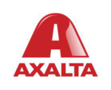
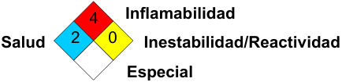

<!-- pagina: 1 -->
US : ESPAÑOL 

> Imagen (pág. 1). Sin texto legible por OCR; contenido gráfico no interpretado.

||**FICHA DE DATOS DE SEGURIDAD** |
|---|---|
|**Sección 1. Identifi** |**cación** ~~N~~|
|**Identificador del producto** |**:** 983 |
|**Nombre del producto**|Tufcote 3.5 HH - Aluminum **:**|
|**Fecha de emisión**|**:** 2/28/2020|
|**Uso recomendado de la sust**   **Versión**|**ancia química peligrosa o mezcla, y restricciones de uso**    **:** 2|
|**Usos identificados**|Componente de recubrimiento para uso profesional. **:**|
|**Usos contraindicados**|Para uso industrial solo por parte de profesionales capacitados. No está a la venta ni es usado por los consumidores. **:**|
|**Datos del proveedor o** **fabricante**|**:** Axalta Coating Systems, LLC Two Commerce Square, 2001 Market Street Suite 3600 Philadelphia, PA  19109 USA|
|**Información de productos**|855-6AXALTA|
|**Número de teléfono en** **caso de emergencia** |(CHEMTREC) - 800-424-9300 **:** |
|**Sección 2. Identifi** ~~[~~|**cación de los peligros** ~~oT~~|
|**Estado OSHA/ HCS** |**:** Este material es considerado como peligroso por la Norma de Comunicación de Riesgos de la OSHA (29 CFR 1910.1200). |
|**Clasificación de la** **sustancia química** **peligrosa o mezcla**|LÍQUIDOS INFLAMABLES - Categoría 2 IRRITACIÓN CUTÁNEA - Categoría 2 IRRITACIÓN OCULAR - Categoría 2A SENSIBILIZACIÓN CUTÁNEA - Categoría 1 CARCINOGENICIDAD - Categoría 2 TOXICIDAD ESPECÍFICA DE ÓRGANOS BLANCO (EXPOSICIÓN ÚNICA) (Efecto narcótico) - Categoría 3 **:**|
|**Elementos de las etiquetas d**|**el SGA**|
|**Pictogramas de peligro**|**:** ~~O~~Oh|
|**Palabra de advertencia**|**:** Peligro|
|**Indicaciones de peligro**|**:** H225 - Líquido y vapores muy inflamables. H319 - Provoca irritación ocular grave. H315 - Provoca irritación cutánea. H317 - Puede provocar una reacción cutánea alérgica. H351 - Susceptible de provocar cáncer. H336 - Puede provocar somnolencia o vértigo.|

Fecha de emisión : 2/28/2020 

1/14 

Versión : 2 

<!-- pagina: 2 -->
ESPAÑOL 

US : 

Tufcote 3.5 HH - Aluminum 

983 

# **Sección 2. Identificación de los peligros** 

|**Consejos de prudencia**||
|---|---|
|**Prevención**|**:** P201 - Procurarse las instrucciones antes del uso. P202 - No manipular antes de haber leído y comprendido todas las precauciones de seguridad. P280 - Usar guantes de protección. Usar protección para los ojos o la cara. Usar ropa protectora. P210 - Mantener alejado del calor, chispas, llamas al descubierto, superficies calientes y otras fuentes de ignición. No fumar. P241 - Todos los equipos eléctricos, de ventilación, de iluminación y para la manipulación de materiales deben ser antideflagrantes. P242 - No utilizar herramientas que produzcan chispas.|
||P243 - Tomar medidas de precaución contra las descargas electrostáticas. P233 - Mantener el recipiente herméticamente cerrado. P271 - Utilizar sólo al aire libre o en un lugar bien ventilado. P261 - Evitar respirar vapor.|
||P264 - Lavarse cuidadosamente las manos después de la manipulación. P272 (OSHA) - No se debe permitir que la ropa de trabajo contaminada se deje fuera del lugar de trabajo.|
|**Intervención/Respuesta**|**:** P308 + P313 - En caso de exposición demostrada o supuesta: Buscar atención médica. P304 + P340 + P312 - En caso de inhalación: Transportar a la persona al aire libre y mantenerla en una posición que le facilite la respiración. Llamar a un centro de toxicología o a un médico si la persona se siente mal. P303 + P361 + P353 - En caso de contacto con la piel (o el pelo): Quitar inmediatamente toda la ropa contaminada. Enjuagar la piel con agua o ducharse. P302 + P352 + P363 - En caso de contacto con la piel: Lavar con abundante agua y jabón. Lavar la ropa contaminada antes de volverla a usar. P333 + P313 - En caso de irritación cutánea o sarpullido: Buscar atención médica. P305 + P351 + P338 - En caso de contacto con los ojos: Enjuagar con agua cuidadosamente durante varios minutos. Quitar los lentes de contacto, cuando estén presentes y pueda hacerse con facilidad. Proseguir con el lavado. P337 + P313 - Si la irritación ocular persiste: Buscar atención médica.|
|**Almacenamiento**|**:** P405 - Guardar bajo llave. P403 - Almacenar en un lugar bien ventilado. P235 - Mantener fresco.|
|**Eliminación**|**:** P501 - Eliminar el contenido y recipiente conforme a todas las reglamentaciones locales, regionales, nacionales e internacionales.|
|**Peligros no clasificados en** **otra parte**|**:** No se conoce ninguno.|

# **Sección 3. Composición / información sobre los componentes** 

|**Sustancia/mezcla** **:** Mezcla|||
|---|---|---|
|**Nombre de ingrediente**|**%**|**Número CAS**|
|propanona|≥25 - ≤38|67-64-1|
|destilado (petróleo), hidrotratado ligero|≥10 - ≤25|64742-47-8|
|heptan-2-ona|≤10|110-43-0|
|nafta disolvente (petroleo), fraccion aromatica ligera (<0,1% benceno)|≤2.5|64742-95-6|
|2-butanona-oxima|≤0.3|96-29-7|

Si alguna concentración se presenta como un rango, es para proteger la confidencialidad o debido a variación en los lotes. 

**No hay ningún ingrediente adicional presente que, bajo el conocimiento actual del proveedor y en las concentraciones aplicables, sea clasificado como de riesgo para la salud o el medio ambiente y por lo tanto deban ser reportados en esta sección.** 

**Los límites de exposición laboral, en caso de existir, figuran en la sección 8.** 

Fecha de emisión : 2/28/2020 

2/14 

Versión : 2 

<!-- pagina: 3 -->
US : ESPAÑOL 

Tufcote 3.5 HH - Aluminum 

983 

# **Sección 4. Primeros auxilios** 

|**Descripción de los primero**|**s auxilios**|
|---|---|
|**Contacto con los ojos**|Enjuagar los ojos inmediatamente con mucha agua, levantando ocasionalmente los párpados superior e inferior.  Verificar si la víctima lleva lentes de contacto y en este caso, retirárselas.  Continúe enjuagando por lo menos por 10 minutos.  Procurar atención médica. **:**|
|**Por inhalación**|Transportar la víctima al aire libre y mantenerla en reposo en una posición que le facilite la respiración.  Si se sospecha que los vapores continúan presentes, la persona encargada del rescate deberá usar una máscara adecuada o un aparato de respiración autónoma.  Si no hay respiración, ésta es irregular u ocurre un paro respiratorio, el personal capacitado debe proporcionar respiración artificial u oxígeno.  Puede ser peligroso para la persona que proporcione ayuda dar respiración boca a boca. Procurar atención médica.  Si es necesario, llame a un Centro de Control de Envenenamiento o a un médico.  Si está inconsciente, coloque en posición de recuperación y obtenga atención médica inmediatamente.  Asegure una buena circulación de aire.  Aflojar todo lo que pudiera estar apretado, como el cuello de una camisa, una corbata, un cinturón. **:**|
|**Contacto con la piel**|Lavar con abundante agua y jabón.  Quítese la ropa y calzado contaminados.  Lave bien la ropa contaminada con agua antes de quitársela, o use guantes.  Continúe enjuagando por lo menos por 10 minutos.  Procurar atención médica.  En el caso de que existan quejas o síntomas, evite otras exposiciones.  Lavar la ropa antes de volver a usarla.  Limpiar el calzado completamente antes de volver a usarlo. **:**|
|**Ingestión**|Lave la boca con agua.  Retirar las prótesis dentales si es posible.  Transportar la víctima al aire libre y mantenerla en reposo en una posición que le facilite la respiración. Si se ha ingerido el material y la persona expuesta está consciente, proporcione cantidades pequeñas de agua para beber.  Deténgase si la persona expuesta se siente descompuesta porque vomitar sería peligroso.  No inducir al vómito a menos que lo indique expresamente el personal médico.  En caso de vómito, se debe mantener la cabeza baja de manera que el vómito no entre en los pulmones.  Procurar atención médica.  Si es necesario, llame a un Centro de Control de Envenenamiento o a un médico.  No suministrar nada por vía oral a una persona inconsciente.  Si está inconsciente, coloque en posición de recuperación y obtenga atención médica inmediatamente.  Asegure una buena circulación de aire.  Aflojar todo lo que pudiera estar apretado, como el cuello de una camisa, una corbata, un cinturón. **:**|
|**Síntomas y efectos más im**|**portantes, agudos o crónicos**|
|**Efectos agudos potenciale**|**s en la salud**|
|**Contacto con los ojos**|Provoca irritación ocular grave. **:**|
|**Por inhalación**|**:** Puede causar una depresión del sistema nervioso central (SNC).  Puede provocar somnolencia o vértigo.|
|**Contacto con la piel**|**:** Provoca irritación cutánea.  Puede provocar una reacción cutánea alérgica.|
|**Ingestión**|Puede causar una depresión del sistema nervioso central (SNC). **:**|
|**Signos/síntomas de sobre**| **exposición**|
|**Contacto con los ojos**|**:** Los síntomas adversos pueden incluir los siguientes: dolor o irritación lagrimeo enrojecimiento|
|**Por inhalación**|Los síntomas adversos pueden incluir los siguientes: náusea o vómito dolor de cabeza somnolencia/cansancio **:**|
||mareo/vértigo inconsciencia|

Fecha de emisión : 2/28/2020 

3/14 

Versión : 2 

<!-- pagina: 4 -->
ESPAÑOL 

US : 

Tufcote 3.5 HH - Aluminum 

983 

# **Sección 4. Primeros auxilios** 

|**Contacto con la piel** **Ingestión**|Ningún dato específico. Los síntomas adversos pueden incluir los siguientes: irritación enrojecimiento **:** **:**|
|---|---|
|**Indicación de la necesidad de**|**recibir atención médica inmediata y, en su caso, de tratamiento especial**|
|**Notas para el médico** **Tratamientos específicos**|**:** Tratar sintomáticamente.  Contactar un especialista en tratamientos de envenenamientos inmediatamente si se ha ingerido o inhalado una gran cantidad. **:** No hay un tratamiento específico.|
|**Protección del personal de** **primeros auxilios**|**:** No se tomará ninguna medida que implique algún riesgo personal o que no contemple el entrenamiento adecuado.  Si se sospecha que los vapores continúan presentes, la persona encargada del rescate deberá usar una máscara adecuada o un aparato de respiración autónoma.  Puede ser peligroso para la persona que proporcione ayuda dar respiración boca a boca.  Lave bien la ropa contaminada con agua antes de quitársela, o use guantes.|
|**Vea la sección 11 para la Info**|**rmación Toxicológica**|
|**Sección 5. Medida** **Medios de extinción**|**s contra incendios**|
|**Medios de extinción** **apropiados**|Utilizar polvo químico seco,CO₂,agua pulverizada o espuma (neblina). **:**|
|**Medios no apropiados de** **extinción**|No usar chorro de agua. **:**|
|**Peligros específicos de la** **sustancia química** **peligrosa o mezcla**|Líquido y vapores muy inflamables.  Los residuos líquidos que se filtran en el alcantarillado pueden causar un riesgo de incendio o de explosión.  En caso de incendio o calentamiento, ocurrirá un aumento de presión y el recipiente estallará, con el riesgo de que ocurra una explosión.  El vapor o gas es más pesado que el aire y se extenderá por el suelo.  Los vapores pueden acumularse en areas bajas o cerradas o desplazarse una distancia considerable hacia la fuente de encendido y producir un retroceso de llama. **:**|
|**Productos de** **descomposición térmica** **peligrosos**|Los productos de descomposición pueden incluir los siguientes materiales: dióxido de carbono monóxido de carbono óxido/óxidos metálico/metálicos **:**|
|**Medidas especiales que** **deberán seguir los grupos** **de combate contra incendio**|En caso de incendio, aísle rápidamente la zona evacuando a todas las personas de las proximidades del lugar del incidente.  No se tomará ninguna medida que implique algún riesgo personal o que no contemple el entrenamiento adecuado.  Desplazar los contenedores lejos del incendio si esto puede hacerse sin riesgo.  Use agua pulverizada para refrigerar los envases expuestos al fuego. **:**|
|**Equipo de protección**|Los bomberos deben llevar equipo de protección apropiado y un equipo de respiración **:**|
|**especial para los bomberos**|autónomo con una máscara facial completa que opere en modo de presión positiva.|

Fecha de emisión : 2/28/2020 

4/14 

Versión : 2 

<!-- pagina: 5 -->
US : ESPAÑOL Tufcote 3.5 HH - Aluminum 

983 

|**Sección 6. Medidas** **accidental**|**que deben tomarse en caso de derrame o fuga**|
|---|---|
|**Precauciones personales, equi**|**po de protección y procedimiento de emergencia**|
|**:**  **Para personal de no** **emergencia**|No se tomará ninguna medida que implique algún riesgo personal o que no contemple el entrenamiento adecuado.  Evacuar los alrededores.  No deje que entre el personal innecesario y sin protección.  No toque o camine sobre el material derramado.  Apagar todas las fuentes de ignición.  No permitir el uso de bengalas, fumar, o el encendido de llamas en el área de peligro.  Evite respirar vapor o neblina.  Proporcione ventilación adecuada.  Llevar un aparato de respiración apropiado cuando el sistema de ventilación sea inadecuado.  Llevar puestos equipos de protección personal adecuados.|
|**Para el personal de** **respuesta a emergencias** **:**|Si fuera necesario usar ropa especial para hacer frente al derrame, se tomará en cuenta la información de la Sección 8 sobre los materiales adecuados y no adecuados. Consultar también la información bajo "Para personal de no emergencia".|
|**Precauciones relativas al** **medio ambiente** **:**|Evite la dispersión del material derramado, su contacto con el suelo, el medio acuático, los desagües y las alcantarillas.  Informe a las autoridades pertinentes si el producto ha causado polución medioambiental (alcantarillas, canales, tierra o aire).|
|**Métodos y materiales para la co**|**ntención y limpieza de derrames o fugas**|
|**Derrame pequeño** **:**|Detener la fuga si esto no presenta ningún riesgo.  Retire los envases del área del derrame.  Use herramientas a prueba de chispas y equipo a prueba de explosión.  Diluir con agua y fregar si es soluble en agua.  Alternativamente, o si es insoluble en agua, absorber con un material seco inerte y colocar en un contenedor de residuos adecuado. Disponga por medio de un contratista autorizado para la disposición.|
|**Gran derrame** **:**|Detener la fuga si esto no presenta ningún riesgo.  Retire los envases del área del derrame.  Use herramientas a prueba de chispas y equipo a prueba de explosión. Aproximarse al vertido en el sentido del viento.  Evite la entrada en alcantarillas, canales de agua, sótanos o áreas reducidas.  Trate los derrames en una planta de tratamiento de aguas residuales o proceda tal como se indica a continuación.  Detener y recoger los derrames con materiales absorbentes no combustibles, como arena, tierra, vermiculita o tierra de diatomeas, y colocar el material en un envase para desecharlo de acuerdo con las normativas locales (ver la Sección 13).  Disponga por medio de un contratista autorizado para la disposición.  El material absorbente contaminado puede presentar el mismo riesgo que el producto derramado.  Nota: Véase la Sección 1 para información de contacto de emergencia y la Sección 13 para eliminación de desechos.|
|**Sección 7. Manejo y**|**almacenamiento**|
|**Precauciones que se deben tom**|**ar para garantizar un manejo seguro**|
|**Medidas de protección** **:**|Use el equipo de protección personal adecuado (vea la Sección 8).  Las personas con antecedentes de sensibilización cutánea no deben trabajar en ningún proceso en el que se utilice este producto.  Evítese la exposición - recábense instrucciones especiales antes del uso.  No manipular antes de haber leído y comprendido todas las precauciones de seguridad.  No introducir en ojos o en la piel o ropa.  No ingerir.  Evite respirar vapor o neblina.  Use sólo con ventilación adecuada.  Llevar un aparato de respiración apropiado cuando el sistema de ventilación sea inadecuado.  No entre en áreas de almacenamiento y espacios cerrados a menos que estén ventilados adecuadamente.  Mantener en el recipiente original o en uno alternativo autorizado hecho de material compatible, conservar herméticamente cerrado cuando no esté en uso.  Mantener alejado del calor, chispas, llamas al descubierto, o de cualquier otra fuente de ignición.  Use equipo eléctrico (de ventilación, iluminación y manipulación de materiales) a prueba de explosiones.  No utilizar herramientas que produzcan chispas. Evitar la acumulación de cargas electrostáticas.  Los envases vacíos retienen resíduos del producto y pueden ser peligrosos.  No vuelva a usar el envase.|

Fecha de emisión : 2/28/2020 

5/14 

Versión : 2 

<!-- pagina: 6 -->
ESPAÑOL 

US : 

Tufcote 3.5 HH - Aluminum 

983 

# **Sección 7. Manejo y almacenamiento** 

## **Orientaciones sobre higiene ocupacional general** 

- **:** Está prohibido comer, beber o fumar en los lugares donde se manipula, almacena o trata este producto.  Las personas que trabajan con este producto deberán lavarse las manos y la cara antes comer, beber o fumar.  Quitar la ropa contaminada y el equipo de protección antes de entrar a las áreas de comedor.  Véase también la Sección 8 acerca de la información adicional sobre las medidas higiénicas. 

## **Condiciones de almacenamiento seguro, incluida cualquier incompatibilidad** 

**Código de almacenimiento** 

- **:** Conservar de acuerdo con las normas locales.  Almacenar en un área separada y homologada.  Almacenar en el contenedor original protegido de la luz directa del sol en un área seca, fresca y bien ventilada, separado de materiales incompatibles (ver Sección 10) y comida y bebida.  Guardar bajo llave.  Eliminar todas las fuentes de ignición.  Mantener separado de materiales oxidantes.  Mantener el contenedor bien cerrado y sellado hasta el momento de usarlo.  Los envases que han sido abiertos deben cerrarse cuidadosamente y mantenerse en posición vertical para evitar derrames. No almacenar en contenedores sin etiquetar.  Utilícese un envase de seguridad adecuado para evitar la contaminación del medio ambiente.  Consulte la Sección 10 para obtener información acerca de los materiales no compatibles previo al manejo o uso. 

- **:** IB 

# **Sección 8. Controles de exposición / protección personal** 

## **<mark>Parámetros de control Límites de exposición laboral</mark>** 

|**Nombre de ingrediente**|**Límites de exposición**|
|---|---|
|propanona|**ACGIH TLV (Estados Unidos, 3/2018).** TWA: 250 ppm 8 horas. STEL: 500 ppm 15 minutos. **OSHA PEL 1989 (Estados Unidos, 3/1989).** TWA: 750 ppm 8 horas. TWA: 1800 mg/m³ 8 horas. STEL: 1000 ppm 15 minutos. STEL: 2400 mg/m³ 15 minutos. **NIOSH REL (Estados Unidos, 10/2016).** TWA: 250 ppm 10 horas. TWA: 590 mg/m³ 10 horas. **OSHA PEL (Estados Unidos, 5/2018).** TWA: 1000 ppm 8 horas. TWA: 2400 mg/m³ 8 horas.|
|destilado (petróleo), hidrotratado ligero|**ACGIH TLV (Estados Unidos, 3/2018). Absorbido a** **través de la piel.** TWA: 200 mg/m³, (as total hydrocarbon vapor) 8 horas.|
|heptan-2-ona|**ACGIH TLV (Estados Unidos, 3/2018).** TWA: 50 ppm 8 horas. TWA: 233 mg/m³ 8 horas. **OSHA PEL 1989 (Estados Unidos, 3/1989).** TWA: 100 ppm 8 horas. TWA: 465 mg/m³ 8 horas. **NIOSH REL (Estados Unidos, 10/2016).** TWA: 100 ppm 10 horas. TWA: 465 mg/m³ 10 horas. **OSHA PEL (Estados Unidos, 5/2018).**|

Fecha de emisión : 2/28/2020 

6/14 

Versión : 2 

<!-- pagina: 7 -->
ESPAÑOL 

US : 

Tufcote 3.5 HH - Aluminum 

983 

# **Sección 8. Controles de exposición / protección personal** 

TWA: 100 ppm 8 horas. TWA: 465 mg/m³ 8 horas. 

nafta disolvente (petroleo), fraccion aromatica ligera Ninguno. (<0,1% benceno) 2-butanona-oxima **AIHA WEEL (Estados Unidos, 5/2018). Sensibilizante por contacto con la piel.** TWA: 10 ppm 8 horas. 

- **Controles técnicos :** Use sólo con ventilación adecuada.  Utilizar recintos de proceso, sistemas de **apropiados** ventilación locales, u otros procedimientos de ingeniería para mantener la exposición del obrero a los contaminantes aerotransportados por debajo de todos los límites recomendados o estatutarios.  Los controles de ingeniería también deben mantener el gas, vapor o polvo por debajo del menor límite de explosión.  Utilizar equipo de ventilación anti-explosión. 

- **Control de la exposición :** Emisiones de los equipos de ventilación o de procesos de trabajo deben ser evaluados **medioambiental** para verificar que cumplen con los requisitos de la legislación de protección del medio ambiente.  En algunos casos será necesario el uso de eliminadores de humo, filtros o modificaciones del diseño del equipo del proceso para reducir las emisiones a un nivel aceptable. 

|**Medidas de protección indivi**|**dual**|
|---|---|
|**Medidas higiénicas**|Lave las manos, antebrazos y cara completamente después de manejar productos químicos, antes de comer, fumar y usar el lavabo y al final del período de trabajo.  Usar las técnicas apropiadas para remover ropa contaminada.  La ropa de trabajo contaminada no debe salir del lugar de trabajo.  Lavar las ropas contaminadas antes de volver a usarlas.  Verifique que las estaciones de lavado de ojos y duchas de seguridad se encuentren cerca de las estaciones de trabajo. **:**|
|**Protección de los ojos y la** **cara**|Equipo protector ocular que cumpla con las normas aprobadas debe ser usado cuando una evaluación del riesgo indique que es necesario para evitar toda exposición a salpicaduras del líquido, lloviznas, gases o polvos.  Si existe la posibilidad de contacto con el producto se debe usar el siguiente equipo de protección, a menos que la evaluación del riesgo exija un grado superior de protección:  gafas protectoras contra salpicaduras químicas. **:**|
|**Protección de la piel**||
|**Protección de las manos**|Guantes impermeables y resistentes a productos químicos que cumplan con las normas aprobadas deben ser usados siempre que se manejen productos químicos si una evaluación del riesgo indica que es necesario.  Teniendo en cuenta los parámetros especificados por el fabricante de los guantes, se debe verificar durante el uso si aún mantienen sus propiedades protectoras.  Es preciso tener presente que el tiempo de penetración para el material de los guantes puede ser diferente en cada fabricante.  En el caso de mezclas formadas por varias sustancias no se puede estimar con exactitud el periodo de tiempo de protección de los guantes. **:**|
|**Protección del cuerpo**|Antes de utilizar este producto se debe seleccionar equipo protector personal para el cuerpo basándose en la tarea a ejecutar y los riesgos involucrados y debe ser aprobado por un especialista.  Cuando existe riesgo de ignición debido a la electricidad estática, se requiere el uso de ropa antiestática de protección.  Para obtener el máximo nivel de protección contra descargas electrostáticas es preciso usar overoles, botas y guantes antiestáticos. **:**|
|**Otro tipo de protección** **para la piel**|**:** Antes de manipular este producto se debe elegir el calzado apropiado y cualquier otra medida adicional de protección de la piel basadas en la tarea que se realice y los riesgos asociados, para lo cual se contará con la aprobación de un especialista.|

Fecha de emisión : 2/28/2020 

7/14 

Versión : 2 

<!-- pagina: 8 -->
ESPAÑOL 

US : 

Tufcote 3.5 HH - Aluminum 

983 

# **Sección 8. Controles de exposición / protección personal** 

**Protección de las vías :** Con base en el riesgo y el potencial de la exposición, seleccione un respirador que **respiratorias** cumpla la norma o la certificación apropiada.  Los respiradores se deben usar de acuerdo con un programa de protección respiratoria para asegurar el ajuste adecuado, la capacitación y otros aspectos importantes de uso. 

# **Sección 9. Propiedades físicas y químicas** 

|**Apariencia**||
|---|---|
|**Estado físico**|Líquido. **:**|
|**Color**|Aluminum. **:**|
|**Olor**|No disponible. **:**|
|**Umbral del olor**|No disponible. **:**|
|**pH**|No aplicable. **:**|
|**Punto de fusión**|No aplicable. **:**|
|**Punto de ebullición**|**:** No aplicable.|
|**Punto de inflamación**|Vaso cerrado: -5.556°C (22°F) **:**|
|**Velocidad de evaporación**|No disponible. **:**|
|**Inflamabilidad (sólido o gas)**|**:** No disponible.|
|**Límites máximo y mínimo**|**:** Punto mínimo: 2.1%|
|**de explosión** **(inflamabilidad)**|Punto maximo: 12.8%|
|**Presión de vapor**|32 kPa (240 mm Hg) [temperatura ambiente] **:**|
|**Densidad de vapor**|2 [Aire= 1] **:**|
|**Densidad relativa**|1.081 g/cm³ **:**|
|**Solubilidad**|Soluble en los siguientes materiales: agua fría. **:**|
|**Solubilidad en agua**|**:** No disponible.|
|**Coeficiente de partición: n-** **octanol/agua**|No disponible. **:**|
|**Temperatura de ignición** **espontánea**|230°C (446°F) **:**|
|**Temperatura de** **descomposición**|**:** No aplicable.|
|**Viscosidad**|No disponible. **:**|
|**Tiempo de flujo (ISO 2431)**|**:** No disponible.|

# **Sección 10. Estabilidad y reactividad** 

|**Reactividad**|**:** No existen resultados específicos de ensayos respecto a la reactividad del este producto o sus ingredientes.|
|---|---|
|**Estabilidad química**|El producto es estable. **:**|
|**Posibilidad de reacciones** **peligrosas**|**:** En condiciones normales de almacenamiento y uso, no ocurre reacción peligrosa.|
|**Condiciones que deberán** **evitarse**|Evitar todas las fuentes posibles de ignición (chispa o llama).  No someta a presión, corte, suelde, suelde con latón,  taladre, esmerile o exponga los envases al calor o fuentes térmicas.  No permita que el vapor se acumule en áreas bajas o cerradas. **:**|
|**Materiales incompatibles**|Reactivo o incompatible con los siguientes materiales: materiales oxidantes **:**|

Fecha de emisión : 2/28/2020 

8/14 

Versión : 2 

<!-- pagina: 9 -->
US : ESPAÑOL 

Tufcote 3.5 HH - Aluminum 

983 

# **Sección 10. Estabilidad y reactividad** 

**Productos de :** Bajo condiciones normales de almacenamiento y uso, no se deben producir productos **descomposición peligrosos** de descomposición peligrosos. 

# **Sección 11. Información toxicológica** 

## **<mark>Información sobre efectos toxicológicos Toxicidad aguda</mark>** 

|**Nombre de producto o** **ingrediente**|**Resultado**|**Especies**|**Dosis**|**Exposición**|
|---|---|---|---|---|
|propanona|CL50 Por inhalación Vapor|Rata|21 mg/l|4 horas|
||DL50 Cutánea|Conejo|2001 mg/kg|-|
||DL50 Oral|Rata|5800 mg/kg|-|
|heptan-2-ona|CL50 Por inhalación Vapor|Rata|16.8 mg/l|4 horas|
||DL50 Cutánea|Conejo|10332 mg/kg|-|
||DL50 Oral|Rata|1600 mg/kg|-|
|nafta disolvente (petroleo), fraccion aromatica ligera (<0,1% benceno)|DL50 Cutánea|Conejo|3492 mg/kg|-|
||DL50 Oral|Rata|8400 mg/kg|-|
|2-butanona-oxima|DL50 Oral|Rata|930 mg/kg|-|

## **<mark>Irritación/Corrosión</mark>** 

|**Nombre de producto o** **ingrediente**|**Resultado**|**Especies**|**Puntuación **|**Exposición**|**Observación**|
|---|---|---|---|---|---|
|propanona|Ojos - Irritante leve Ojos - Irritante leve Ojos - Irritante moderado Ojos - Irritante fuerte Piel - Irritante leve Piel - Irritante leve|Humano Conejo Conejo Conejo Conejo Conejo|- - - - - -|186300 parts per million 10 microliters 24 horas 20 milligrams 20 milligrams 24 horas 500 milligrams 395 milligrams|- - - - - -|
|heptan-2-ona 2-butanona-oxima|Piel - Irritante leve Ojos - Irritante fuerte|Conejo Conejo|- -|24 horas 14 milligrams 100 microliters|- -|

## **<mark>Sensibilización</mark>** 

No disponible. 

## **<mark>Mutagenicidad</mark>** 

No disponible. 

## **<mark>Carcinogenicidad</mark>** 

No disponible. 

## **<mark>Toxicidad reproductiva</mark>** 

Fecha de emisión : 2/28/2020 

9/14 

Versión : 2 

<!-- pagina: 10 -->
ESPAÑOL 

US : 

Tufcote 3.5 HH - Aluminum 

983 

# **Sección 11. Información toxicológica** 

No disponible. 

## **<mark>Teratogenicidad</mark>** 

No disponible. 

## **<mark>Toxicidad específica de órganos blanco (exposición única)</mark>** 

|**Nombre**|**Categoría**|**Ruta de** **exposición**|**Órganos vitales**|
|---|---|---|---|
|propanona destilado (petróleo), hidrotratado ligero heptan-2-ona nafta disolvente (petroleo), fraccion aromatica ligera (<0,1% benceno)|Categoría 3 Categoría 3 Categoría 3 Categoría 3 Categoría 3|No aplicable. No aplicable. No aplicable. No aplicable. No aplicable.|Efecto narcótico Efecto narcótico Efecto narcótico Efecto narcótico Irritación de las vías respiratorias|

## **<mark>Toxicidad específica de órganos blanco (exposiciones repetidas)</mark>** 

No disponible. 

|**Peligro de aspiración**||
|---|---|
|**Nombre**|**Resultado**|
|destilado (petróleo), hidrotratado ligero|PELIGRO POR ASPIRACIÓN - Categoría 1 |
|nafta disolvente (petroleo), fraccion aromatica ligera (<0,1% benceno)|PELIGRO POR ASPIRACIÓN - Categoría 1|

|**Información sobre las** **posibles vías de ingreso**|**:** No disponible.|
|---|---|
|**Efectos agudos potenciales**|**en la salud**|
|**Contacto con los ojos**|Provoca irritación ocular grave. **:**|
|**Por inhalación**|**:** Puede causar una depresión del sistema nervioso central (SNC).  Puede provocar somnolencia o vértigo.|
|**Contacto con la piel**|**:** Provoca irritación cutánea.  Puede provocar una reacción cutánea alérgica.|
|**Ingestión**|Puede causar una depresión del sistema nervioso central (SNC). **:**|
|**Síntomas relacionados con**|**las características físicas, químicas y toxicológicas**|
|**Contacto con los ojos**|**:** Los síntomas adversos pueden incluir los siguientes: dolor o irritación lagrimeo enrojecimiento|
|**Por inhalación**|Los síntomas adversos pueden incluir los siguientes: náusea o vómito dolor de cabeza somnolencia/cansancio mareo/vértigo inconsciencia **:**|
|**Contacto con la piel**|Los síntomas adversos pueden incluir los siguientes: irritación enrojecimiento **:**|
|**Ingestión**|Ningún dato específico. **:**|

|**Efectos inmediatos y retardados, así como efectos crónicos producidos por una exposición a corto y largo plazo**|
|---|
|**Exposición a corto plazo**|

Fecha de emisión : 2/28/2020 

10/14 

Versión : 2 

<!-- pagina: 11 -->
US : ESPAÑOL 

Tufcote 3.5 HH - Aluminum 

983 

# **Sección 11. Información toxicológica** 

|**Efectos potenciales** **inmediatos**|**:** No disponible.|
|---|---|
|**Efectos potenciales** **retardados**|**:** No disponible.|
|**Exposición a largo plazo**||
|**Efectos potenciales** **inmediatos**|**:** No disponible.|
|**Efectos potenciales** **retardados**|**:** No disponible.|
|**Efectos crónicos potencial**|**es en la salud**|
|No disponible.||
|**Generales**|Una vez que la persona esté sensibilizada, puede ocurrir una reacción alérgica severa si posteriormente se expone incluso a muy bajos niveles. **:**|
|**Carcinogenicidad**|Susceptible de provocar cáncer.  El riesgo de cáncer depende de la duración y el grado de exposición. **:**|
|**Mutagenicidad**|No se conocen efectos significativos o riesgos críticos. **:**|
|**Teratogenicidad**|No se conocen efectos significativos o riesgos críticos. **:**|
|**Efectos de desarrollo**|**:** No se conocen efectos significativos o riesgos críticos.|
|**Efectos de fertilidad**|**:** No se conocen efectos significativos o riesgos críticos.|

## **<mark>Medidas numéricas de toxicidad (tales como estimaciones de toxicidad aguda) Estimaciones de toxicidad aguda</mark>** 

|**Ruta**|**Valor ETA (estimación de toxicidad aguda** **según GHS)**|
|---|---|
|Oral|27761.28 mg/kg|
|Cutánea|6658.69 mg/kg|
|Inhalación (vapores)|291.49 mg/l|

# **Sección 12. Información ecotoxicológica** 

No hay datos sobre el producto en sí.  No debe permitirse que el producto entre en los desagües o cursos de agua 

# **Sección 13. Información relativa a la eliminación de los productos** 

**Métodos de eliminación** 

- **:** Se debe evitar o minimizar la generación de desechos cuando sea posible.  La eliminación de este producto, sus soluciones y cualquier derivado deben cumplir siempre con los requisitos de la legislación de protección del medio ambiente y eliminación de desechos y todos los requisitos de las autoridades locales.  Disponga del sobrante y productos no reciclables por medio de un contratista autorizado para la disposición.  Los residuos no se deben tirar por la alcantarilla sin tratar a menos que sean compatibles con los requisitos de todas las autoridades con jurisdicción.  Los envases desechados se deben reciclar.  Sólo se deben contemplar la incineración o el enterramiento cuando el reciclaje no sea factible.  Elimínense los residuos del producto y sus recipientes con todas las precauciones posibles.  Se tendrá cuidado cuando se manipulen recipientes vacíos que no se hayan limpiado o enjuagado.  Los envases vacíos o los revestimentos pueden retener residuos del producto.  El vapor de los residuos del producto puede crear un ambiente altamente inflamable o explosivo dentro del recipiente.  No recortar, soldar o triturar los recipientes usados a menos que se hayan limpiado a fondo en su interior.  Evite la dispersión del material derramado, su 

Fecha de emisión : 2/28/2020 

11/14 

Versión : 2 

<!-- pagina: 12 -->
ESPAÑOL 

US : 

Tufcote 3.5 HH - Aluminum 

983 

# **Sección 13. Información relativa a la eliminación de los productos** 

contacto con el suelo, el medio acuático, los desagües y las alcantarillas. 

# **Sección 14. Información relativa al transporte** 

||**Clasificación** **DOT**|**Clasificación** **para el TDG**|**Clasificación de** **México**|**IMDG**|**IATA**|
|---|---|---|---|---|---|
|**Número ONU**|UN1263|UN1263|UN1263|UN1263|UN1263|
|**Designación** **oficial de** **transporte**|PINTURA|PINTURA|PINTURA|PINTURA|PINTURA|
|**Clase(s)** **relativas al** **transporte**|3|3|3|3|3|
|**Grupo de** **embalaje**|II|II|II|II|II|
|**Riesgos** **ambientales**|No.|No.|No.|No.|No.|

- **<mark>Información adicional</mark> Clasificación DOT :** **<mark>Previsiones especiales</mark>** <mark>3</mark> 83 **Clasificación para el TDG :** Product classified as per the following sections of the Transportation of Dangerous Goods Regulations: 2.18-2.19 (Class 3). 

- **Precauciones especiales : Transporte dentro de las instalaciones de usuarios:** siempre transporte en **para el usuario** recipientes cerrados que estén verticales y seguros. Asegurar que las personas que transportan el producto conocen qué hacer en caso de un accidente o derrame. 

## **Transporte a granel con :** No disponible. **arreglo al anexo II de MARPOL y al Código IBC** 

La descripción real del envío de este producto puede variar en función de varios factores, incluyendo, entre otros, el volumen de material, el tamaño del contenedor, el modo de transporte y el uso de las exenciones o excepciones que se encuentran en las regulaciones aplicables. La información proporcionada en la Sección 14 es una posible descripción de envío para este producto. Consulte a su especialista en envíos o proveedor para obtener la información de asignación apropiada. 

# **Sección 15. Información Reglamentaria** 

**Clean Air Act  Section 112 :** Listado **(b) Hazardous Air Pollutants (HAPs)** **<mark>SARA 304 RQ</mark>** 

**SARA 304 RQ :** No aplicable. **<mark>SARA 311/312</mark>** 

Fecha de emisión : 2/28/2020 

12/14 

Versión : 2 

<!-- pagina: 13 -->
ESPAÑOL 

US : 

Tufcote 3.5 HH - Aluminum 

983 

# **Sección 15. Información Reglamentaria** 

**Clasificación** 

**:** LÍQUIDOS INFLAMABLES - Categoría 2 IRRITACIÓN CUTÁNEA - Categoría 2 IRRITACIÓN OCULAR - Categoría 2A SENSIBILIZACIÓN CUTÁNEA - Categoría 1 CARCINOGENICIDAD - Categoría 2 TOXICIDAD ESPECÍFICA DE ÓRGANOS BLANCO (EXPOSICIÓN ÚNICA) (Efecto narcótico) - Categoría 3 

## **<mark>SARA 313</mark>** 

||**Nombre del producto**|**Número CAS**|**%**|
|---|---|---|---|
|**Formulario R -**|aluminio en polvo (estabilizado)|7429-90-5|≥25 - ≤50|
|**Requisitos de informes**||||
|**Notificación del** **proveedor**|aluminio en polvo (estabilizado)|7429-90-5|≥25 - ≤50|

Las notificaciones de SARA 313 no se deben remover de la hoja de datos de seguridad FDS y toda copia y distribución de las mismas debe incluir copia y distribución del aviso adjunto a las copias de HDS que sean distribuidas. 

## **<mark>Lista de inventario</mark>** 

**Canadá :** Todos los componentes están listados o son exentos. **Estados Unidos :** No determinado. 

# **Sección 16. Otra información incluidas las relativas a la preparación y actualización de las hojas de datos de seguridad** 

**<mark>Hazardous Material Information System (Estados Unidos)</mark>** 

|**Salud**|*|2|
|---|---|---|
|**Inflamabilidad**||3|
|**Riesgos físicos**||0|

**Precaución: Las clasificaciones de HMIS® se basan en una escala de clasificación del 0 al 4, donde 0 representa los peligros o riesgos mínimos y 4 representa los peligros o riesgos significativos. Aunque las clasificaciones de HMIS® y la etiqueta asociada no se requieren en las SDS o en los productos que salen de una instalación bajo la sección 29, artículos 1910.1200 de CFR, el preparador podría optar por proporcionarlas. Las clasificaciones de HMIS® se deben utilizar con un programa de HMIS® completamente implementado. HMIS® es una marca registrada y una marca de servicio de American Coatings Association, Inc.** 

**El cliente es responsable de determinar el código PPE para este material. Para obtener más información sobre los códigos del Equipo de protección personal (Personal Protective Equipment, PPE) de HMIS®, consulte el Manual de implementación de HMIS®.** 

## **<mark>National Fire Protection Association (Estados Unidos)</mark>** 

> Imagen (pág. 13). OCR automático, revisar: «Inflamabilidad Salud Inestabilidad/Reactividad Especial»

<!-- Start of picture text -->
4 Inflamabilidad Salud 2 0 Inestabilidad/Reactividad Especial <!-- End of picture text -->

**Reimpreso con permiso del estándar NFPA 704-2001, Identificación de los riesgos de materiales para respuesta ante casos de emergencia (Identification of the Hazards of Materials for Emergency Response) Copyright ©1997, Asociación Nacional de Protección contra Incendios (National Fire Protection Association, NFPA), Quincy, MA 02269. Este material reimpreso no es la postura completa y oficial de la Asociación Nacional de Protección contra Incendios en el tema al que se hace referencia, la cual está representada solamente por el estándar completo.** 

**Copyright ©2001, Asociación Nacional de Protección contra Incendios, Quincy, MA 02269. Este sistema de advertencia está diseñado para ser interpretado y aplicado solamente por personas debidamente capacitadas para identificar riesgos de incendio, de reactividad y contra la salud representados por sustancias químicas. El usuario es derivado a determinado número limitado de sustancias químicas con clasificaciones recomendadas en los códigos NFPA 49 y NFPA 325, los cuales se utilizarán solamente como lineamientos. Independientemente de que las sustancias químicas estén o no clasificadas por la NFPA, cualquier persona que utilice los sistemas 704 para clasificar sustancias químicas lo hace bajo su propio riesgo.** 

## **<mark>Historial</mark>** 

Fecha de emisión : 2/28/2020 

13/14 

Versión : 2 

<!-- pagina: 14 -->
ESPAÑOL 

US : 

Tufcote 3.5 HH - Aluminum 

983 

# **Sección 16. Otra información incluidas las relativas a la preparación y actualización de las hojas de datos de seguridad** 

**Fecha de emisión :** 2/28/2020 **Versión :** 2 

Administración de productos y cumplimiento regulatorio. **Explicación de Abreviaturas :** ETA = Estimación de Toxicidad Aguda SGA = Sistema Globalmente Armonizado IATA = Asociación de Transporte Aéreo Internacional IBC = Contenedor Intermedio para Productos a Granel IMDG = Código Marítimo Internacional de Mercancías Peligrosas Log Kow = logaritmo del coeficiente de reparto octanol/agua MARPOL = Convenio Internacional para Prevenir la Contaminación por los Buques, 1973 con el Protocolo de 1978. ("Marpol" = polución marina) ONU = Organización de las Naciones Unidas 

**Indica la información que ha cambiado desde la edición de la versión anterior.** 

## **<mark>Aviso al lector</mark>** 

**Este producto está destinado exclusivamente para uso industrial.** 

**Se cree que el contenido de la Ficha de datos de seguridad (SDS) es exacto a la fecha de su publicación, pero está sujeto a cambios a medida que Axalta Coatings Systems, LLC o cualquiera de sus subsidiarias o afiliadas (Axalta) reciban nueva información. Esta SDS puede incorporar información proporcionada a Axalta por sus proveedores. Los usuarios deben asegurarse de consultar la versión más actualizada de la SDS. Los usuarios son responsables de seguir las precauciones identificadas en esta SDS. Es responsabilidad de los usuarios cumplir con todas las leyes y reglamentos aplicables a la manipulación, uso y eliminación seguros del producto. Los usuarios de los productos Axalta deben leer toda la información relevante del producto antes de utilizarlo, y hacer su propia determinación en cuanto a la idoneidad de los productos para el uso previsto. A menos que la ley aplicable exija lo contrario, AXALTA NO OTORGA GARANTÍAS, EXPRESAS O IMPLÍCITAS, INCLUYENDO, ENTRE OTROS, NINGUNA GARANTÍA IMPLÍCITA DE COMERCIALIZACIÓN O ADECUACIÓN A UN PROPÓSITO EN PARTICULAR. La información sobre esta SDS se refiere únicamente al producto específico establecido en la Sección 1, Identificación, y no se refiere a su posible uso en combinación con cualquier otro material o en cualquier proceso específico. Si este producto se va a utilizar en combinación con otros productos, Axalta le recomienda que lea y comprenda las SDS de todos los productos antes de su uso.** 

**© 2018 Axalta Coating Systems, LLC y todas sus afiliadas. Todos los derechos reservados. Solo se pueden hacer copias para aquellos que utilicen los productos de Axalta Coating Systems.** 

Fecha de emisión : 2/28/2020 

14/14 

Versión : 2 
