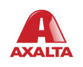
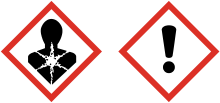

<!-- pagina: 1 -->
MX : ESPAÑOL 

> Imagen (pág. 1). Sin texto legible por OCR; contenido gráfico no interpretado.

**FICHA DE DATOS DE SEGURIDAD SECCIÓN 1. Identificación de la sustancia química peligrosa o mezcla y del proveedor o fabricante** ~~OOOO~~ **Identificador del producto :** 1250057530 **Nombre del producto :** IW140 .750L TRANSPARENTE KRISTALITY **Fecha de emisión :** 5/6/2020 **Versión :** 1 

**<mark>Uso recomendado de la sustancia química peligrosa o mezcla, y restricciones de uso</mark> Usos identificados :** Componente de recubrimiento para uso profesional. **Usos contraindicados :** Para uso industrial solo por parte de profesionales capacitados. No está a la venta ni es usado por los consumidores. **Datos del proveedor o :** Axalta Coating Systems Mexico, S. de R.L. de C.V. **fabricante** Industria Eléctrica #10 Col. Industrial Barrientos Tlalnepantla, Estado de México CP 54015 Mexico +52 5366 4700 

**Número de teléfono en** 

**:** SETIQ 01-800-00-214-00 

**caso de emergencia** 

# ~~2)~~ **SECCIÓN 2: Identificación de los peligros** 

**Clasificación de la :** LÍQUIDOS INFLAMABLES - Categoría 2 **sustancia química** TOXICIDAD AGUDA (dérmica) - Categoría 5 **peligrosa o mezcla** TOXICIDAD AGUDA (inhalación) - Categoría 4 IRRITACIÓN CUTÁNEA - Categoría 2 IRRITACIÓN OCULAR - Categoría 2A SENSIBILIZACIÓN CUTÁNEA - Categoría 1 CARCINOGENICIDAD - Categoría 2 TOXICIDAD PARA LA REPRODUCCIÓN (Fertilidad) - Categoría 2 TOXICIDAD PARA LA REPRODUCCIÓN (Feto) - Categoría 2 TOXICIDAD ESPECÍFICA DE ÓRGANOS BLANCO (EXPOSICIÓN ÚNICA) (Irritación de las vías respiratorias) - Categoría 3 TOXICIDAD ESPECÍFICA DE ÓRGANOS BLANCO (EXPOSICIÓN ÚNICA) (Efecto narcótico) - Categoría 3 TOXICIDAD ESPECÍFICA DE ÓRGANOS BLANCO (EXPOSICIONES REPETIDAS) - Categoría 2 

**<mark>Elementos de las etiquetas del SGA</mark> Pictogramas de peligro : Palabra de advertencia :** 

**:** Peligro 

> Imagen (pág. 1). Sin texto legible por OCR; contenido gráfico no interpretado.

<!-- Start of picture text -->
OD <!-- End of picture text -->

Fecha de emisión : 5/6/2020 

1/16 

Versión : 1 

<!-- pagina: 2 -->
MX : ESPAÑOL 

IW140 .750L TRANSPARENTE KRISTALITY 

1250057530 

## **SECCIÓN 2: Identificación de los peligros** 

|**Indicaciones de peligro**|**:** H225 - Líquido y vapores muy inflamables. H332 - Nocivo si se inhala. H313 - Puede ser nocivo en contacto con la piel. H319 - Provoca irritación ocular grave. H315 - Provoca irritación cutánea. H317 - Puede provocar una reacción cutánea alérgica. H361 - Susceptible de perjudicar la fertilidad o dañar al feto. H351 - Susceptible de provocar cáncer. H335 - Puede irritar las vías respiratorias. H336 - Puede provocar somnolencia o vértigo. H373 - Puede provocar daños en los órganos tras exposiciones prolongadas o repetidas.|
|---|---|
|**Consejos de prudencia**||
|**Prevención**|**:** P201 - Procurarse las instrucciones antes del uso.  P202 - No manipular antes de haber leído y comprendido todas las precauciones de seguridad.  P280 - Usar guantes de protección. Usar ropa protectora. Usar protección para los ojos o la cara. P210 - Mantener alejado del calor, chispas, llamas al descubierto, superficies calientes y otras fuentes de ignición. No fumar.  P271 - Utilizar sólo al aire libre o en un lugar bien ventilado.  P260 - No respirar vapor.  P264 - Lavarse cuidadosamente las manos después de la manipulación.  P272 - La ropa de trabajo contaminada no debe salir del lugar de trabajo.|
|**Intervención/Respuesta**|**:** P314 - Buscar atención médica si la persona se siente mal.  P308 + P313 - En caso de exposición demostrada o supuesta: Buscar atención médica.  P304 + P340 + P312 - En caso de inhalación: Transportar a la persona al aire libre y mantenerla en una posición que le facilite la respiración. Llamar a un centro de toxicología o a un médico si la persona se siente mal.  P303 + P361 + P353 - En caso de contacto con la piel (o el pelo): Quitar inmediatamente toda la ropa contaminada. Enjuagar la piel con agua.  P302 + P352 + P312 + P362 + P364 - En caso de contacto con la piel: Lavar con abundante agua y jabón. Llamar a un centro de toxicología o a un médico si la persona se siente mal. Quitar la ropa contaminada y lavarla antes de volverla a usar.  P333 + P313 - En caso de irritación cutánea o sarpullido: Buscar atención médica.  P305 + P351 + P338 - En caso de contacto con los ojos: Enjuagar con agua cuidadosamente durante varios minutos. Quitar los lentes de contacto, cuando estén presentes y pueda hacerse con facilidad. Proseguir con el lavado. P337 + P313 - Si la irritación ocular persiste: Buscar atención médica.|
|**Almacenamiento**|**:** P405 - Guardar bajo llave.|
|**Eliminación**|**:** P501 - Eliminar el contenido y recipiente conforme a todas las reglamentaciones locales, regionales, nacionales e internacionales.|
|**Otros peligros que no** **contribuyen en la** **clasificación**|**:** No se conoce ninguno.|

## **SECCIÓN 3: Composición / información sobre los componentes** 

|**Sustancia/mezcla** **:** Mezcla|||
|---|---|---|
|**Nombre de ingrediente**|**%**|**Número CAS**|
|xileno|≥25 - ≤50|1330-20-7|
|Tolueno|≥10 - ≤25|108-88-3|
|Acetato de n-butilo|≥10 - ≤25|123-86-4|
|etilbenceno|≤10|100-41-4|
|acetato de etilo|≤3|141-78-6|
|sebacato de bis(1,2,2,6,6-pentametil-4-piperidilo)|≤0.3|41556-26-7|

Fecha de emisión : 5/6/2020 

2/16 

Versión : 1 

<!-- pagina: 3 -->
ESPAÑOL 

IW140 .750L TRANSPARENTE KRISTALITY 

1250057530 

MX : 

## **SECCIÓN 3: Composición / información sobre los componentes** 

Si alguna concentración se presenta como un rango, es para proteger la confidencialidad o debido a variación en los lotes. 

**No hay ningún ingrediente adicional presente que, bajo el conocimiento actual del proveedor y en las concentraciones aplicables, sea clasificado como de riesgo para la salud o el medio ambiente y por lo tanto deban ser reportados en esta sección.** 

**Los límites de exposición laboral, en caso de existir, figuran en la sección 8.** 

## **SECCIÓN 4: Primeros auxilios** 

|**Contacto con los ojos** **Descripción de los primero**|Enjuagar los ojos inmediatamente con mucha agua, levantando ocasionalmente los párpados superior e inferior.  Verificar si la víctima lleva lentes de contacto y en este caso, retirárselas.  Continúe enjuagando por lo menos por 10 minutos.  Procurar atención médica. **:** **s auxilios**|
|---|---|
|**Por inhalación**|Transportar la víctima al aire libre y mantenerla en reposo en una posición que le facilite la respiración.  Si se sospecha que los vapores continúan presentes, la persona encargada del rescate deberá usar una máscara adecuada o un aparato de respiración autónoma.  Si no hay respiración, ésta es irregular u ocurre un paro respiratorio, el personal capacitado debe proporcionar respiración artificial u oxígeno.  Puede ser peligroso para la persona que proporcione ayuda dar respiración boca a boca.  Procurar atención médica.  Si es necesario, llame a un Centro de Control de Envenenamiento o a un médico.  Si está inconsciente, coloque en posición de recuperación y obtenga atención médica inmediatamente. Asegure una buena circulación de aire.  Aflojar todo lo que pudiera estar apretado, como el cuello de una camisa, una corbata, un cinturón. **:**|
|**Contacto con la piel**|Lavar con abundante agua y jabón.  Quítese la ropa y calzado contaminados.  Lave bien la ropa contaminada con agua antes de quitársela, o use guantes.  Continúe enjuagando por lo menos por 10 minutos.  Procurar atención médica.  Si es necesario, llame a un Centro de Control de Envenenamiento o a un médico.  En el caso de que existan quejas o síntomas, evite otras exposiciones.  Lavar la ropa antes de volver a usarla.  Limpiar el calzado completamente antes de volver a usarlo. **:**|
|**Ingestión**|Lave la boca con agua.  Retirar las prótesis dentales si es posible.  Transportar la víctima al aire libre y mantenerla en reposo en una posición que le facilite la respiración.  Si se ha ingerido el material y la persona expuesta está consciente, proporcione cantidades pequeñas de agua para beber.  Deténgase si la persona expuesta se siente descompuesta porque vomitar sería peligroso.  No inducir al vómito a menos que lo indique expresamente el personal médico.  En caso de vómito, se debe mantener la cabeza baja de manera que el vómito no entre en los pulmones.  Procurar atención médica.  Si es necesario, llame a un Centro de Control de Envenenamiento o a un médico.  No suministrar nada por vía oral a una persona inconsciente.  Si está inconsciente, coloque en posición de recuperación y obtenga atención médica inmediatamente.  Asegure una buena circulación de aire. Aflojar todo lo que pudiera estar apretado, como el cuello de una camisa, una corbata, un cinturón. **:**|
|**Síntomas y efectos más im**|**portantes, agudos o crónicos**|
|**Efectos agudos potencial**|**es en la salud**|
|**Contacto con los ojos**|Provoca irritación ocular grave. **:**|
|**Por inhalación**|**:** Nocivo si se inhala.  Puede causar una depresión del sistema nervioso central (SNC).  Puede provocar somnolencia o vértigo.  Puede irritar las vías respiratorias.|
|**Contacto con la piel**|**:** Puede ser nocivo en contacto con la piel.  Provoca irritación cutánea.  Puede provocar una reacción cutánea alérgica.|

Fecha de emisión : 5/6/2020 

3/16 

Versión : 1 

<!-- pagina: 4 -->
MX : ESPAÑOL IW140 .750L TRANSPARENTE KRISTALITY 

1250057530 

|**SECCIÓN 4: Prime**|**ros auxilios**|
|---|---|
|**Ingestión**|Puede causar una depresión del sistema nervioso central (SNC). **:**|
|**Signos/síntomas de sobreex**|**posición**|
|**Contacto con los ojos**|**:** Los síntomas adversos pueden incluir los siguientes: dolor o irritación lagrimeo enrojecimiento|
|**Por inhalación**|Los síntomas adversos pueden incluir los siguientes: irritación del tracto respiratorio tos náusea o vómito dolor de cabeza somnolencia/cansancio mareo/vértigo inconsciencia reducción de peso fetal incremento de muertes fetales malformaciones esqueléticas **:**|
|**Contacto con la piel**|Los síntomas adversos pueden incluir los siguientes: irritación enrojecimiento reducción de peso fetal incremento de muertes fetales malformaciones esqueléticas **:**|
|**Ingestión**|Los síntomas adversos pueden incluir los siguientes: reducción de peso fetal incremento de muertes fetales malformaciones esqueléticas **:**|
|**Indicación de la necesidad de**|**recibir atención médica inmediata y, en su caso, de tratamiento especial**|
|**Notas para el médico** **Tratamientos específicos**|**:** Tratar sintomáticamente.  Contactar un especialista en tratamientos de envenenamientos inmediatamente si se ha ingerido o inhalado una gran cantidad. **:** No hay un tratamiento específico.|
|**Protección del personal de** **primeros auxilios** **Vea la sección 11 para la Info**|**:** No se tomará ninguna medida que implique algún riesgo personal o que no contemple el entrenamiento adecuado.  Si se sospecha que los vapores continúan presentes, la persona encargada del rescate deberá usar una máscara adecuada o un aparato de respiración autónoma.  Puede ser peligroso para la persona que proporcione ayuda dar respiración boca a boca.  Lave bien la ropa contaminada con agua antes de quitársela, o use guantes. **rmación Toxicológica**|
|**SECCIÓN 5: Medid**|**as contra incendios**|
|**Medios de extinción**||
|**Medios de extinción** **apropiados**|Utilizar polvo químico seco,CO₂,agua pulverizada o espuma (neblina). **:**|
|**Medios no apropiados de** **extinción**|No usar chorro de agua. **:**|
|**Peligros específicos de la** **sustancia química** **peligrosa o mezcla**|Líquido y vapores muy inflamables.  Los residuos líquidos que se filtran en el alcantarillado pueden causar un riesgo de incendio o de explosión.  En caso de incendio o calentamiento, ocurrirá un aumento de presión y el recipiente estallará, con el riesgo de que ocurra una explosión. **:**|

Fecha de emisión : 5/6/2020 

4/16 

Versión : 1 

<!-- pagina: 5 -->
ESPAÑOL 

IW140 .750L TRANSPARENTE KRISTALITY 

1250057530 

MX : 

## **SECCIÓN 5: Medidas contra incendios** 

|**Productos de** **descomposición térmica** **peligrosos**|Los productos de descomposición pueden incluir los siguientes materiales: dióxido de carbono monóxido de carbono **:**|
|---|---|
|**Medidas especiales que** **deberán seguir los grupos** **de combate contra incendio**|En caso de incendio, aísle rápidamente la zona evacuando a todas las personas de las proximidades del lugar del incidente.  No se tomará ninguna medida que implique algún riesgo personal o que no contemple el entrenamiento adecuado. Desplazar los contenedores lejos del incendio si esto puede hacerse sin riesgo. Use agua pulverizada para refrigerar los envases expuestos al fuego. **:**|
|**Equipo de protección** **especial para los bomberos**|Los bomberos deben llevar equipo de protección apropiado y un equipo de respiración autónomo con una máscara facial completa que opere en modo de presión positiva. **:**|
|**SECCIÓN 6: Medid** **accidental** **Precauciones personales, eq**|**as que deben tomarse en caso de derrame o fuga** **uipo de protección y procedimiento de emergencia**|
|**Para personal de no** **emergencia**|**:** No se tomará ninguna medida que implique algún riesgo personal o que no contemple el entrenamiento adecuado.  Evacuar los alrededores.  No deje que entre el personal innecesario y sin protección.  No toque o camine sobre el material derramado.  Apagar todas las fuentes de ignición.  No permitir el uso de bengalas, fumar, o el encendido de llamas en el área de peligro.  Evite respirar vapor o neblina.  Proporcione ventilación adecuada.  Llevar un aparato de respiración apropiado cuando el sistema de ventilación sea inadecuado.  Llevar puestos equipos de protección personal adecuados.|
|**Para el personal de** **respuesta a emergencias**|**:** Si fuera necesario usar ropa especial para hacer frente al derrame, se tomará en cuenta la información de la Sección 8 sobre los materiales adecuados y no adecuados.  Consultar también la información bajo "Para personal de no emergencia".|
|**Precauciones relativas al** **medio ambiente**|**:** Evite la dispersión del material derramado, su contacto con el suelo, el medio acuático, los desagües y las alcantarillas.  Informe a las autoridades pertinentes si el producto ha causado polución medioambiental (alcantarillas, canales, tierra o aire).|
|**Métodos y materiales para la**|**contención y limpieza de derrames o fugas**|
|**Derrame pequeño**|Detener la fuga si esto no presenta ningún riesgo.  Retire los envases del área del derrame.  Use herramientas a prueba de chispas y equipo a prueba de explosión. Diluir con agua y fregar si es soluble en agua.  Alternativamente, o si es insoluble en agua, absorber con un material seco inerte y colocar en un contenedor de residuos adecuado.  Disponga por medio de un contratista autorizado para la disposición. **:**|
|**Gran derrame**|Detener la fuga si esto no presenta ningún riesgo.  Retire los envases del área del derrame.  Use herramientas a prueba de chispas y equipo a prueba de explosión. Aproximarse al vertido en el sentido del viento.  Evite la entrada en alcantarillas, canales de agua, sótanos o áreas reducidas.  Trate los derrames en una planta de tratamiento de aguas residuales o proceda tal como se indica a continuación. Detener y recoger los derrames con materiales absorbentes no combustibles, como arena, tierra, vermiculita o tierra de diatomeas, y colocar el material en un envase para desecharlo de acuerdo con las normativas locales (ver la Sección 13). Disponga por medio de un contratista autorizado para la disposición.  El material absorbente contaminado puede presentar el mismo riesgo que el producto derramado.  Nota: Véase la Sección 1 para información de contacto de emergencia **:**|

Fecha de emisión : 5/6/2020 

5/16 

Versión : 1 

<!-- pagina: 6 -->
ESPAÑOL 

IW140 .750L TRANSPARENTE KRISTALITY 

1250057530 

MX : 

## **SECCIÓN 6: Medidas que deben tomarse en caso de derrame o fuga accidental** 

y la Sección 13 para eliminación de desechos. 

## **SECCIÓN 7: Manejo y almacenamiento** 

- **<mark>Precauciones que se deben tomar para garantizar un manejo seguro</mark> Medidas de protección :** Use el equipo de protección personal adecuado (vea la Sección 8).  Las personas con antecedentes de sensibilización cutánea no deben trabajar en ningún proceso en el que se utilice este producto.  Evítese la exposición - recábense instrucciones especiales antes del uso.  Evite la exposición durante el embarazo.  No manipular antes de haber leído y comprendido todas las precauciones de seguridad.  No introducir en ojos o en la piel o ropa.  No respire los vapores o nieblas.  No ingerir. Use sólo con ventilación adecuada.  Llevar un aparato de respiración apropiado cuando el sistema de ventilación sea inadecuado.  No entre en áreas de almacenamiento y espacios cerrados a menos que estén ventilados adecuadamente.  Mantener en el recipiente original o en uno alternativo autorizado hecho de material compatible, conservar herméticamente cerrado cuando no esté en uso.  Mantener alejado del calor, chispas, llamas al descubierto, o de cualquier otra fuente de ignición.  Use equipo eléctrico (de ventilación, iluminación y manipulación de materiales) a prueba de explosiones.  No utilizar herramientas que produzcan chispas.  Evitar la acumulación de cargas electrostáticas.  Los envases vacíos retienen resíduos del producto y pueden ser peligrosos.  No vuelva a usar el envase. 

- **Orientaciones sobre :** Está prohibido comer, beber o fumar en los lugares donde se manipula, almacena o **higiene ocupacional** trata este producto.  Las personas que trabajan con este producto deberán lavarse **general** las manos y la cara antes comer, beber o fumar.  Quitar la ropa contaminada y el equipo de protección antes de entrar a las áreas de comedor.  Véase también la Sección 8 acerca de la información adicional sobre las medidas higiénicas. 

- **Condiciones de :** Conservar de acuerdo con las normas locales.  Almacenar en un área separada y **almacenamiento seguro,** homologada.  Almacenar en el contenedor original protegido de la luz directa del sol **incluida cualquier** en un área seca, fresca y bien ventilada, separado de materiales incompatibles (ver **incompatibilidad** Sección 10) y comida y bebida.  Guardar bajo llave.  Eliminar todas las fuentes de ignición.  Mantener separado de materiales oxidantes.  Mantener el contenedor bien cerrado y sellado hasta el momento de usarlo.  Los envases que han sido abiertos deben cerrarse cuidadosamente y mantenerse en posición vertical para evitar derrames.  No almacenar en contenedores sin etiquetar.  Utilícese un envase de seguridad adecuado para evitar la contaminación del medio ambiente.  Consulte la Sección 10 para obtener información acerca de los materiales no compatibles previo al manejo o uso. 

- **Código de almacenimiento :** IB 

## **SECCIÓN 8: Controles de exposición / protección personal** 

**<mark>Parámetros de control Límites de exposición laboral</mark>** 

Fecha de emisión : 5/6/2020 

6/16 

Versión : 1 

<!-- pagina: 7 -->
MX : ESPAÑOL 

IW140 .750L TRANSPARENTE KRISTALITY 

1250057530 

## **SECCIÓN 8: Controles de exposición / protección personal** 

|**Nombre de ingrediente**|**Límites de exposición**|
|---|---|
|xileno Tolueno|**NOM-010-STPS-2014 (México, 4/2016).** VLE-CT: 150 ppm 15 minutos. VLE-PPT: 100 ppm 8 horas. **NOM-010-STPS-2014 (México, 4/2016).** VLE-PPT: 20 ppm 8 horas.|
|Acetato de n-butilo|**NOM-010-STPS-2014 (México, 4/2016).** VLE-PPT: 150 ppm 8 horas. VLE-CT: 200 ppm 15 minutos.|
|etilbenceno acetato de etilo|**NOM-010-STPS-2014 (México, 4/2016).** VLE-PPT: 20 ppm 8 horas. **NOM-010-STPS-2014 (México, 4/2016).** VLE-PPT: 400 ppm 8 horas.|

- **Controles técnicos :** Use sólo con ventilación adecuada.  Utilizar recintos de proceso, sistemas de **apropiados** ventilación locales, u otros procedimientos de ingeniería para mantener la exposición del obrero a los contaminantes aerotransportados por debajo de todos los límites recomendados o estatutarios.  Los controles de ingeniería también deben mantener el gas, vapor o polvo por debajo del menor límite de explosión. Utilizar equipo de ventilación anti-explosión. 

- **Control de la exposición :** Emisiones de los equipos de ventilación o de procesos de trabajo deben ser **medioambiental** evaluados para verificar que cumplen con los requisitos de la legislación de protección del medio ambiente.  En algunos casos será necesario el uso de eliminadores de humo, filtros o modificaciones del diseño del equipo del proceso para reducir las emisiones a un nivel aceptable. 

### **<mark>Medidas de protección individual</mark>** 

- **Medidas higiénicas :** Lave las manos, antebrazos y cara completamente después de manejar productos químicos, antes de comer, fumar y usar el lavabo y al final del período de trabajo. Usar las técnicas apropiadas para remover ropa contaminada.  La ropa de trabajo contaminada no debe salir del lugar de trabajo.  Lavar las ropas contaminadas antes de volver a usarlas.  Verifique que las estaciones de lavado de ojos y duchas de seguridad se encuentren cerca de las estaciones de trabajo. 

- **Protección de los ojos y la :** Equipo protector ocular que cumpla con las normas aprobadas debe ser usado **cara** cuando una evaluación del riesgo indique que es necesario para evitar toda exposición a salpicaduras del líquido, lloviznas, gases o polvos.  Si existe la posibilidad de contacto con el producto se debe usar el siguiente equipo de protección, a menos que la evaluación del riesgo exija un grado superior de protección:  gafas protectoras contra salpicaduras químicas. 

### **<mark>Protección de la piel</mark>** 

- **Protección de las manos :** Guantes impermeables y resistentes a productos químicos que cumplan con las normas aprobadas deben ser usados siempre que se manejen productos químicos si una evaluación del riesgo indica que es necesario.  Teniendo en cuenta los parámetros especificados por el fabricante de los guantes, se debe verificar durante el uso si aún mantienen sus propiedades protectoras.  Es preciso tener presente que el tiempo de penetración para el material de los guantes puede ser diferente en cada fabricante.  En el caso de mezclas formadas por varias sustancias no se puede estimar con exactitud el periodo de tiempo de protección de los guantes. 

Fecha de emisión : 5/6/2020 

7/16 

Versión : 1 

<!-- pagina: 8 -->
ESPAÑOL 

IW140 .750L TRANSPARENTE KRISTALITY 

1250057530 

MX : 

## **SECCIÓN 8: Controles de exposición / protección personal** 

|**Protección del cuerpo**|Antes de utilizar este producto se debe seleccionar equipo protector personal para el cuerpo basándose en la tarea a ejecutar y los riesgos involucrados y debe ser aprobado por un especialista.  Cuando existe riesgo de ignición debido a la electricidad estática, se requiere el uso de ropa antiestática de protección.  Para obtener el máximo nivel de protección contra descargas electrostáticas es preciso usar overoles, botas y guantes antiestáticos. **:**|
|---|---|
|**Otro tipo de protección** **para la piel**|**:** Antes de manipular este producto se debe elegir el calzado apropiado y cualquier otra medida adicional de protección de la piel basadas en la tarea que se realice y los riesgos asociados, para lo cual se contará con la aprobación de un especialista.|
|**Protección de las vías** **respiratorias**|Con base en el riesgo y el potencial de la exposición, seleccione un respirador que cumpla la norma o la certificación apropiada.  Los respiradores se deben usar de acuerdo con un programa de protección respiratoria para asegurar el ajuste adecuado, la capacitación y otros aspectos importantes de uso. **:**|

## **SECCIÓN 9: Propiedades físicas y químicas** 

### **Apariencia** 

|**Estado físico**|Líquido. **:**|
|---|---|
|**Color**|Transparent. **:**|
|**Olor**|No disponible. **:**|
|**Umbral del olor**|No disponible. **:**|
|**pH**|No aplicable. **:**|
|**Punto de fusión**|No aplicable. **:**|
|**Punto de ebullición**|**:** No aplicable.|
|**Punto de inflamación**|Vaso cerrado: 15.48°C (59.9°F) **:**|
|**Velocidad de evaporación**|No disponible. **:**|
|**Inflamabilidad (sólido o gas)**|**:** No disponible.|
|**Límites máximo y mínimo**|**:** Punto mínimo: 1%|
|**de explosión** **(inflamabilidad)**|Punto maximo: 7.5%|
|**Presión de vapor**|1.3 kPa (9.7 mm Hg) [temperatura ambiente] **:**|
|**Densidad de vapor**|No disponible. **:**|
|**Densidad relativa**|0.926 g/cm³ **:**|
|**Solubilidad**|Muy poco soluble en los siguientes materiales: agua fría. **:**|
|**Coeficiente de partición: n-** **octanol/agua**|No disponible. **:**|
|**Temperatura de ignición** **espontánea**|415°C (779°F) **:**|
|**Temperatura de** **descomposición**|**:** No aplicable.|
|**Viscosidad**|No disponible. **:**|
|**Tiempo de flujo (ISO 2431)**|**:** No disponible.|
|**Peso molecular**|**:** No aplicable.|

Fecha de emisión : 5/6/2020 

8/16 

Versión : 1 

<!-- pagina: 9 -->
ESPAÑOL 

IW140 .750L TRANSPARENTE KRISTALITY 

1250057530 

MX : 

## **SECCIÓN 10: Estabilidad y reactividad** 

### **Reactividad** 

**Estabilidad química Posibilidad de reacciones peligrosas Condiciones que deberán evitarse** 

   - **:** No existen resultados específicos de ensayos respecto a la reactividad del este producto o sus ingredientes. 

      - El producto es estable. 

   - **:** 

   - **:** En condiciones normales de almacenamiento y uso, no ocurre reacción peligrosa. 

   - **:** Evitar todas las fuentes posibles de ignición (chispa o llama).  No someta a presión, corte, suelde, suelde con latón,  taladre, esmerile o exponga los envases al calor o fuentes térmicas. 

- **Materiales incompatibles :** Reactivo o incompatible con los siguientes materiales: materiales oxidantes 

- **Productos de :** Bajo condiciones normales de almacenamiento y uso, no se deben producir **descomposición peligrosos** productos de descomposición peligrosos. 

## **SECCIÓN 11: Información toxicológica** 

**<mark>Información sobre efectos toxicológicos</mark>** 

### **<mark>Toxicidad aguda</mark>** 

|**Nombre de producto o** **ingrediente**|**Resultado**|**Especies**|**Dosis**|**Exposición**|
|---|---|---|---|---|
|xileno Tolueno Acetato de n-butilo etilbenceno acetato de etilo|CL50 Por inhalación Gas. DL50 Oral CL50 Por inhalación Vapor DL50 Cutánea DL50 Oral TDLo Cutánea CL50 Por inhalación Vapor DL50 Cutánea DL50 Oral DL50 Cutánea DL50 Oral CL50 Por inhalación Vapor DL50 Cutánea DL50 Oral|Rata Rata Rata Rata Rata Rata Rata Conejo Rata Conejo Rata Rata Conejo Rata|5000 ppm 4300 mg/kg 49 g/m³ 5001 mg/kg 5001 mg/kg 26.4 mg/kg 21.1 mg/l >17600 mg/kg 10768 mg/kg >5000 mg/kg 3500 mg/kg 22.6 mg/l 20001 mg/kg 5620 mg/kg|4 horas - 4 horas - - - 4 horas - - - - 4 horas - -|

### **<mark>Irritación/Corrosión</mark>** 

|**Nombre de producto o** **ingrediente**|**Resultado**|**Especies**|**Puntuación **|**Exposición**|**Observación**|
|---|---|---|---|---|---|
|xileno Tolueno etilbenceno|Ojos - Irritante leve Ojos - Irritante fuerte Piel - Irritante leve Piel - Irritante moderado Piel - Irritante moderado Piel - Irritante leve Piel - Irritante leve Piel - Irritante leve|Conejo Conejo Rata Conejo Conejo Cerdo Conejo Conejo|- - - - - - - -|87 milligrams 24 horas 5 milligrams 8 horas 60 microliters 24 horas 500 milligrams 100 Percent 24 horas 250 microliters 435 milligrams 24 horas 15 milligrams|- - - - - - - -|
|**Sensibilización**||||||

Fecha de emisión : 5/6/2020 

9/16 

Versión : 1 

<!-- pagina: 10 -->
ESPAÑOL 

IW140 .750L TRANSPARENTE KRISTALITY 

1250057530 

MX : 

## **SECCIÓN 11: Información toxicológica** 

No disponible. 

### **<mark>Mutagenicidad</mark>** 

No disponible. 

### **<mark>Carcinogenicidad</mark>** 

No disponible. 

### **<mark>Toxicidad reproductiva</mark>** 

No disponible. 

### **<mark>Teratogenicidad</mark>** 

No disponible. 

### **<mark>Toxicidad específica de órganos blanco (exposición única)</mark>** 

|**Nombre**|**Categoría**|**Ruta de** **exposición**|**Órganos vitales**|
|---|---|---|---|
|xileno|Categoría 3|No aplicable.|Irritación de las vías respiratorias|
|Tolueno|Categoría 3|No aplicable.| Efecto narcótico|
|Acetato de n-butilo acetato de etilo|Categoría 3 Categoría 3|No aplicable. No aplicable.|Efecto narcótico Efecto narcótico|

### **<mark>Toxicidad específica de órganos blanco (exposiciones repetidas)</mark>** 

|**Nombre**|**Categoría**|**Ruta de** **exposición**|**Órganos vitales**|
|---|---|---|---|
|Tolueno etilbenceno|Categoría 2 Categoría 2|No determinado No determinado|No determinado No determinado|
|**Peligro de aspiración**||||
|**Nombre**||**Resultado**||
|xileno Tolueno etilbenceno||PELIGRO POR ASPIR PELIGRO POR ASPIR PELIGRO POR ASPIR|ACIÓN - Categoría 1 ACIÓN - Categoría 1 ACIÓN - Categoría 1|

- **Información sobre las :** No disponible. **posibles vías de ingreso** **<mark>Efectos agudos potenciales en la salud</mark> Contacto con los ojos :** Provoca irritación ocular grave. **Por inhalación :** Nocivo si se inhala.  Puede causar una depresión del sistema nervioso central (SNC).  Puede provocar somnolencia o vértigo.  Puede irritar las vías respiratorias. 

- **Contacto con la piel :** Puede ser nocivo en contacto con la piel.  Provoca irritación cutánea.  Puede provocar una reacción cutánea alérgica. 

- **Ingestión :** Puede causar una depresión del sistema nervioso central (SNC). 

### **<mark>Síntomas relacionados con las características físicas, químicas y toxicológicas</mark>** 

**Contacto con los ojos :** Los síntomas adversos pueden incluir los siguientes: dolor o irritación lagrimeo enrojecimiento 

Fecha de emisión : 5/6/2020 

10/16 

Versión : 1 

<!-- pagina: 11 -->
ESPAÑOL 

IW140 .750L TRANSPARENTE KRISTALITY 

1250057530 

MX : 

## **SECCIÓN 11: Información toxicológica** 

|**Por inhalación**|Los síntomas adversos pueden incluir los siguientes: **:**|
|---|---|
||irritación del tracto respiratorio tos náusea o vómito dolor de cabeza somnolencia/cansancio mareo/vértigo inconsciencia reducción de peso fetal incremento de muertes fetales malformaciones esqueléticas|
|**Contacto con la piel**|Los síntomas adversos pueden incluir los siguientes: irritación enrojecimiento **:**|
||reducción de peso fetal incremento de muertes fetales malformaciones esqueléticas|
|**Ingestión**|Los síntomas adversos pueden incluir los siguientes: reducción de peso fetal **:**|
||incremento de muertes fetales malformaciones esqueléticas|
|**Efectos inmediatos y retard** **plazo**|**ados, así como efectos crónicos producidos por una exposición a corto y largo**|
|**Exposición a corto plazo**||
|**Efectos potenciales**|**:** No disponible.|
|**inmediatos**||
|**Efectos potenciales**|**:** No disponible.|
|**retardados**||
|**Exposición a largo plazo**||
|**Efectos potenciales** **inmediatos**|**:** No disponible.|
|**Efectos potenciales** **retardados**|**:** No disponible.|
|**Efectos crónicos potencial**|**es en la salud**|
|No disponible.||
|**Generales**|Puede provocar daños en los órganos tras exposiciones prolongadas o repetidas. Una vez que la persona esté sensibilizada, puede ocurrir una reacción alérgica severa si posteriormente se expone incluso a muy bajos niveles. **:**|
|**Carcinogenicidad**|Susceptible de provocar cáncer.  El riesgo de cáncer depende de la duración y el grado de exposición. **:**|
|**Mutagenicidad**|No se conocen efectos significativos o riesgos críticos. **:**|
|**Teratogenicidad**|Susceptible de dañar al feto. **:**|
|**Efectos de desarrollo**|**:** No se conocen efectos significativos o riesgos críticos.|
|**Efectos de fertilidad**|**:** Susceptible de perjudicar la fertilidad.|

### **<mark>Medidas numéricas de toxicidad (tales como estimaciones de toxicidad aguda) Estimaciones de toxicidad aguda</mark>** 

Fecha de emisión : 5/6/2020 

11/16 

Versión : 1 

<!-- pagina: 12 -->
MX : ESPAÑOL 

IW140 .750L TRANSPARENTE KRISTALITY 

1250057530 

## **SECCIÓN 11: Información toxicológica** 

|**Ruta**|**Valor ETA (estimación de toxicidad** **aguda según GHS)**|
|---|---|
|Oral|11392.5 mg/kg|
|Cutánea|3815.23 mg/kg|
|Inhalación (gases)|17341.95 ppm|
|Inhalación (vapores)|151.64 mg/l|

## **SECCIÓN 12: Información ecotoxicológica** 

### **<mark>Toxicidad</mark>** 

|**Nombre de producto o** **ingrediente**|**Resultado**|**Especies**|**Exposición**|
|---|---|---|---|
|xileno Tolueno|EC50 3.82 mg/l Agudo CL50 13400 µg/l Agua fresca Agudo EC50 12500 µg/l Agua fresca|Crustáceos - Penaeus monodon Pez - Pimephales promelas Algas - Pseudokirchneriella subcapitata|48 horas 96 horas 72 horas|
||Agudo EC50 11600 µg/l Agua fresca Agudo EC50 5.56 mg/l Agua fresca|Crustáceos - Gammarus pseudolimnaeus - Adulto Dafnia - Daphnia magna - Neonato|48 horas 48 horas|
||Agudo CL50 5500 µg/l Agua fresca|Pez - Oncorhynchus kisutch - Alevín|96 horas|
||Crónico NOEC 2 mg/l Agua fresca|Dafnia - Daphnia magna|21 días|
|Acetato de n-butilo etilbenceno|Agudo CL50 185000 µg/l Agua de mar Agudo CL50 13.3 mg/l Agua de mar|Pez - Menidia beryllina Crustáceos - Artemia sp. - Nauplio|96 horas 48 horas|
||Agudo CL50 13.9 mg/l Agua fresca|Dafnia - Daphnia magna - Neonato|48 horas|
|acetato de etilo|Agudo EC50 2500000 µg/l Agua fresca Agudo CL50 750000 µg/l Agua fresca Agudo CL50 154000 µg/l Agua fresca Agudo CL50 212500 µg/l Agua fresca Crónico NOEC 2400 µg/l Agua fresca Crónico NOEC 75.6 mg/l Agua fresca|Algas - Selenastrum sp. Crustáceos - Gammarus pulex Dafnia - Daphnia cucullata Pez - Heteropneustes fossilis Dafnia - Daphnia magna Pez - Pimephales promelas - Embrión|96 horas 48 horas 48 horas 96 horas 21 días 32 días|

### **<mark>Persistencia y degradabilidad</mark>** 

|**Nombre de producto o** **ingrediente**|**Prueba**|**Resultado**||**Dosis**|**Inóculo**|
|---|---|---|---|---|---|
|xileno|OECD 301 F|90 % - 28 días||-|-|
|**Nombre de producto o** **ingrediente**|**Período acuáti**|**co**|**Fotólisis**||**Biodegradabilidad**|
|xileno Tolueno|- -||- -||Fácil Fácil|

### **<mark>Potencial de bioacumulación</mark>** 

Fecha de emisión : 5/6/2020 

12/16 

Versión : 1 

<!-- pagina: 13 -->
ESPAÑOL 

IW140 .750L TRANSPARENTE KRISTALITY 

1250057530 

MX : 

## **SECCIÓN 12: Información ecotoxicológica** 

|**Nombre de producto o**|**LogPow**|**FBC**|**Potencial**|
|---|---|---|---|
|**ingrediente**||||
|xileno|3.12|8.1 a 25.9|bajo|
|Tolueno|2.73|90|bajo|
|Acetato de n-butilo|2.3|-|bajo|
|etilbenceno|3.6|-|bajo|
|acetato de etilo|0.71|30|bajo|

**<mark>Movilidad en el suelo</mark> Coeficiente de partición :** No disponible. **tierra/agua (KOC)** 

**Otros efectos adversos :** No se conocen efectos significativos o riesgos críticos. 

## **SECCIÓN 13: Información relativa a la eliminación de los productos** 

**Métodos de eliminación** 

- **:** Se debe evitar o minimizar la generación de desechos cuando sea posible.  La eliminación de este producto, sus soluciones y cualquier derivado deben cumplir siempre con los requisitos de la legislación de protección del medio ambiente y eliminación de desechos y todos los requisitos de las autoridades locales. Disponga del sobrante y productos no reciclables por medio de un contratista autorizado para la disposición.  Los residuos no se deben tirar por la alcantarilla sin tratar a menos que sean compatibles con los requisitos de todas las autoridades con jurisdicción.  Los envases desechados se deben reciclar.  Sólo se deben contemplar la incineración o el enterramiento cuando el reciclaje no sea factible. Elimínense los residuos del producto y sus recipientes con todas las precauciones posibles.  Se tendrá cuidado cuando se manipulen recipientes vacíos que no se hayan limpiado o enjuagado.  Los envases vacíos o los revestimentos pueden retener residuos del producto.  El vapor de los residuos del producto puede crear un ambiente altamente inflamable o explosivo dentro del recipiente.  No recortar, soldar o triturar los recipientes usados a menos que se hayan limpiado a fondo en su interior.  Evite la dispersión del material derramado, su contacto con el suelo, el medio acuático, los desagües y las alcantarillas. 

## **SECCIÓN 14: Información relativa al transporte** 

||**Clasificación** **DOT**|**Clasificación** **para el TDG**|**Clasificación de** **México**|**IMDG**|**IATA**|
|---|---|---|---|---|---|
|**Número ONU**|UN1263|UN1263|UN1263|UN1263|UN1263|
|**Designación** **oficial de** **transporte**|PINTURA|PINTURA|PINTURA|PINTURA|PINTURA|
|**Clase(s)** **relativas al** **transporte**|3|3|3|3|3|
|**Grupo de** **embalaje**|II|II|II|II|II|

Fecha de emisión : 5/6/2020 

13/16 

Versión : 1 

<!-- pagina: 14 -->
ESPAÑOL 

IW140 .750L TRANSPARENTE KRISTALITY 

1250057530 

MX : 

|**SECCIÓN 14: Infor**|**mación relativa al transporte**|
|---|---|
|**Riesgos** **ambientales** No.|No. No. No. No.|
|**Información adicional**||
|**Clasificación DOT**|**Previsiones** **especiales**383 **:**|
|**Clasificación para el TDG**|Product classified as per the following sections of the Transportation of Dangerous Goods Regulations: 2.18-2.19 (Class 3). **:**|
|**Precauciones especiales** **para el usuario**|**Transporte dentro de las instalaciones de usuarios:**siempre transporte en recipientes cerrados que estén verticales y seguros. Asegurar que las personas que transportan el producto conocen qué hacer en caso de un accidente o derrame. **:**|

### **Transporte a granel con :** No disponible. **arreglo al anexo II de MARPOL y al Código IBC** 

La descripción real del envío de este producto puede variar en función de varios factores, incluyendo, entre otros, el volumen de material, el tamaño del contenedor, el modo de transporte y el uso de las exenciones o excepciones que se encuentran en las regulaciones aplicables. La información proporcionada en la Sección 14 es una posible descripción de envío para este producto. Consulte a su especialista en envíos o proveedor para obtener la información de asignación apropiada. 

## **SECCIÓN 15: Información Reglamentaria** 

**<mark>Regulaciones Internacionales National Fire Protection Association (Estados Unidos)</mark>** 

### 4 **Inflamabilidad Salud** 2 0 **Inestabilidad/Reactividad Especial** 

**Reimpreso con permiso del estándar NFPA 704-2001, Identificación de los riesgos de materiales para respuesta ante casos de emergencia (Identification of the Hazards of Materials for Emergency Response) Copyright ©1997, Asociación Nacional de Protección contra Incendios (National Fire Protection Association, NFPA), Quincy, MA 02269. Este material reimpreso no es la postura completa y oficial de la Asociación Nacional de Protección contra Incendios en el tema al que se hace referencia, la cual está representada solamente por el estándar completo.** 

**Copyright ©2001, Asociación Nacional de Protección contra Incendios, Quincy, MA 02269. Este sistema de advertencia está diseñado para ser interpretado y aplicado solamente por personas debidamente capacitadas para identificar riesgos de incendio, de reactividad y contra la salud representados por sustancias químicas. El usuario es derivado a determinado número limitado de sustancias químicas con clasificaciones recomendadas en los códigos NFPA 49 y NFPA 325, los cuales se utilizarán solamente como lineamientos. Independientemente de que las sustancias químicas estén o no clasificadas por la NFPA, cualquier persona que utilice los sistemas 704 para clasificar sustancias químicas lo hace bajo su propio riesgo.** 

**<mark>Lista de inventario</mark> Canadá :** Al menos un componente no está listado. **Estados Unidos :** Al menos un componente no está listado. 

Fecha de emisión : 5/6/2020 

14/16 

Versión : 1 

<!-- pagina: 15 -->
ESPAÑOL 

IW140 .750L TRANSPARENTE KRISTALITY 

1250057530 

MX : 

## **SECCIÓN 16: Otra información incluidas las relativas a la preparación y actualización de las hojas de datos de seguridad** 

**<mark>Hazardous Material Information System (Estados Unidos)</mark>** 

**Salud** * 2 **Inflamabilidad** 3 **Riesgos físicos** 0 

**Precaución: Las clasificaciones de HMIS® se basan en una escala de clasificación del 0 al 4, donde 0 representa los peligros o riesgos mínimos y 4 representa los peligros o riesgos significativos. Las clasificaciones de HMIS® se deben utilizar con un programa de HMIS® completamente implementado. HMIS® es una marca registrada y una marca de servicio de American Coatings Association, Inc.** 

**El cliente es responsable de determinar el código PPE para este material. Para obtener más información sobre los códigos del Equipo de protección personal (Personal Protective Equipment, PPE) de HMIS®, consulte el Manual de implementación de HMIS®.** 

### **<mark>Historial</mark>** 

**Fecha de emisión :** 5/6/2020 **Versión :** 1 Administración de productos y cumplimiento regulatorio. **Explicación de Abreviaturas :** ETA = Estimación de Toxicidad Aguda FBC = Factor de Bioconcentración SGA = Sistema Globalmente Armonizado IATA = Asociación de Transporte Aéreo Internacional IBC = Contenedor Intermedio para Productos a Granel IMDG = Código Marítimo Internacional de Mercancías Peligrosas Log Kow = logaritmo del coeficiente de reparto octanol/agua MARPOL = Convenio Internacional para Prevenir la Contaminación por los Buques, 1973 con el Protocolo de 1978. ("Marpol" = polución marina) ONU = Organización de las Naciones Unidas **Indica la información que ha cambiado desde la edición de la versión anterior.** 

**<mark>Aviso al lector</mark>** 

**Este producto está destinado exclusivamente para uso industrial.** 

**Se cree que el contenido de la Ficha de datos de seguridad (SDS) es exacto a la fecha de su publicación, pero está sujeto a cambios a medida que Axalta Coatings Systems, LLC o cualquiera de sus subsidiarias o afiliadas (Axalta) reciban nueva información. Esta SDS puede incorporar información proporcionada a Axalta por sus proveedores. Los usuarios deben asegurarse de consultar la versión más actualizada de la SDS. Los usuarios son responsables de seguir las precauciones identificadas en esta SDS. Es responsabilidad de los usuarios cumplir con todas las leyes y reglamentos aplicables a la manipulación, uso y eliminación seguros del producto.** 

**Los usuarios de los productos Axalta deben leer toda la información relevante del producto antes de utilizarlo, y hacer su propia determinación en cuanto a la idoneidad de los productos para el uso previsto. A menos que la ley aplicable exija lo contrario, AXALTA NO OTORGA GARANTÍAS, EXPRESAS O IMPLÍCITAS, INCLUYENDO, ENTRE OTROS, NINGUNA GARANTÍA IMPLÍCITA DE COMERCIALIZACIÓN O ADECUACIÓN A UN PROPÓSITO EN PARTICULAR. La información sobre esta SDS se refiere únicamente al producto específico establecido en la Sección 1, Identificación, y no se refiere a su posible uso en combinación con cualquier otro material o en cualquier proceso específico. Si este producto se va a utilizar en combinación con otros productos, Axalta le recomienda que lea y comprenda las SDS de todos los productos antes de su uso.** 

La información se considera correcta, pero no es exhaustiva y se utilizará únicamente como guía, la cual se basa en el conocimiento actual de la sustancia química o mezcla y es aplicable a las precauciones de seguridad apropiadas para el producto.f 

Fecha de emisión : 5/6/2020 

15/16 

Versión : 1 

<!-- pagina: 16 -->
ESPAÑOL 

IW140 .750L TRANSPARENTE KRISTALITY 

1250057530 

MX : 

## **SECCIÓN 16: Otra información incluidas las relativas a la preparación y actualización de las hojas de datos de seguridad** 

**© 2018 Axalta Coating Systems, LLC y todas sus afiliadas. Todos los derechos reservados. Solo se pueden hacer copias para aquellos que utilicen los productos de Axalta Coating Systems.** 

Fecha de emisión : 5/6/2020 

16/16 

Versión : 1 
