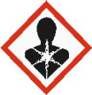

<!-- pagina: 1 -->
## **FICHA DE DATOS DE SEGURIDAD (MSDS)** 

> Imagen (pág. 1). OCR automático, revisar: «BUILDING TRUST»

SikaWall®-401 Pintura Texturizada 

### **SECCION 1: Identificación de la sustancia o la mezcla y de la sociedad o la empresa** 

**1.1 Identificación del producto** 

**Nombre del producto:** SikaWall®-401 Pintura Texturizada Código: 100000029129 

#### **1.2 Usos pertinentes identificados de la sustancia o de la mezcla y usos desaconsejados** 

**Uso del producto** : Recubrimiento elástico impermeable para acabados texturizados de uso interior y exterior. 

**1.3 Datos del proveedor de la ficha de datos de seguridad Fabricante/ Distribuidor:** Sika Colombia S.A.S. Vereda Canavita km 20.5 Autopista Norte Tocancipá, Cundinamarca Colombia col.sika.com **Número de Teléfono:** (+571) 878 – 6333 **Número de Fax:** (+571) 878 – 6666 **Dirección de email del responsable:** controlcalidad.lab@co.sika.com **de esta FDS 1.4 En caso de emergencia:** CISPROQUIM Bogotá: 2886012 / 9191919 Resto del país: 01 8000 916012 

# **SECCION 2: Identificación de los peligros** ~~OO)~~ 

**2.1 Clasificación de la sustancia o de la mezcla Clasificación SGA** 

Toxicidad sistémica específica de órganos blanco - Exposiciones repetidas: 

Categoría 2 (Riñón, Hígado) 

Peligro a corto plazo (agudo) para el medio ambiente acuático: 

Categoría 3 

**2.2 Elementos de la etiqueta Pictogramas de peligro:** 

> Imagen (pág. 1). Sin texto legible por OCR; contenido gráfico no interpretado.

#### **Indicaciones de peligro:** 

#### Atención 

**Indicaciones de peligro** : 

H373 Puede provocar daños en los órganos (Pulmones) tras exposiciones prolongadas o repetidas si se inhala. 

H412 Nocivo para los organismos acuáticos, con efectos nocivos duraderos. 

1/8 

Fecha de emisión: 17.06.2020 

MSDS no. 1649 

<!-- pagina: 2 -->
SikaWall®-401 Pintura Texturizada 

**Consejos de prudencia** : 

**Prevención** : 

P260 No respirar el polvo/ el humo/ el gas/ la niebla/ los vapores/ el aerosol. P273 No dispersar en el medio ambiente. 

#### **Intervención:** 

P314 Consultar a un médico si la persona se encuentra mal. **Eliminación:** P501 Eliminar el contenido/ recipiente en una planta de eliminación de residuos aprobada. 

#### **Otros peligros que no: conducen a una clasificación** 

Ninguna conocida 

### **SECCION 3: Composición /información sobre los componentes** 

**Sustancia/preparado:** Mezcla **Familia química/:** Mezcla de compuestos de Calcio, Yeso, agregados y aditivos. 

|**Nombre delproducto o ingrediente Identificadores**|**Concentración(%w/w)**|
|---|---|
|Dióxido de titanio CAS: 13463-67-7|5% - 10%|
|Etanodiol|1% - 5%|
|CAS: 107-21-1||
|Diuron CAS: 330-54-1|0,025% - 0,1%|
|2-octil-2H-isotiazol-3-ona (OIT) CAS: 26530-20-1|0,025% - 0,025%|
|Mezcla de: 5-cloro-2-metil-2H-isotiazol-3-ona CAS: 55965-84-9|0,025% - 0,025%|

No hay ningún ingrediente adicional presente que, bajo el conocimiento actual del proveedor y en las concentraciones aplicables, sea clasificado como de riesgo para la salud o el medio ambiente, como PBT o mPmB o tenga asignado un límite de exposición laboral y por lo tanto deban ser reportados en esta sección. 

**SECCION 4: Primeros auxilios** 

|**4.1 Descripción de los primeros auxili** Recomendaciones generales:|**os** Sin riesgos que requieran medidas especiales de primeros auxilios.|
|---|---|
|Si es inhalado:|Trasladarse a un espacio abierto.|
|En caso de contacto con la piel:|Retirar inmediatamente la ropa y zapatos contaminados. Eliminar lavando con jabón y mucha agua.|
|En caso de contacto con los ojos:|Retirar las lentillas. Manténgase el ojo bien abierto mientras se lava. Si persiste la irritación de los ojos, consultar a un especialista.|
|Por ingestión:|Lavar la boca con agua y después beber agua abundante. No dar leche ni bebidas alcohólicas. Nunca debe administrarse nada por la boca a una persona inconsciente.|

Fecha de emisión: 17.06.2020 

2/8 

MSDS no. 1649 

<!-- pagina: 3 -->
SikaWall®-401 Pintura Texturizada 

Principales síntomas y efectos, No se conocen efectos significativos o riesgos. agudos y retardados: Ver la Sección 11 para obtener información detallada sobre la salud y los síntomas. Notas para el médico: Tratar sintomáticamente. 

#### **SECCION 5: Medidas de lucha contra incendios** 

|**5.1 Medios de extinción**||
|---|---|
|**Punto de inflamación:**|No aplica.|
|**Medios de extinción** **Apropiados:**|Usar un agente de extinción adecuado para el incendio circundante.|
|**Medios de extinción no** **Apropiados:**|No se conoce ninguno.|
|**5.2 Peligros específicos derivados de** **Peligros derivados de la** **sustancia o mezcla:**|**la sustancia o la mezcla** No aplicable.|
|**Productos de**|No se conocen productos de combustión peligrosos.|
|**descomposición térmica** **peligrosos**:||
|**SECCION 6: Medidas en caso**|**de vertido accidental**|
|**6.1 Precauciones personales, equipo**|**de protección y procedimientos de emergencia**|
|**Para el personal que no** **forma parte de los** **servicios de emergencia:**|No se debe realizar ninguna acción que suponga un riesgo personal o sin formación adecua- da.  Evacuar los alrededores.  No permitir el acceso a personal innecesario y sin protección. No tocar o caminar sobre el material derramado.  Evitar respirar vapor o neblina. Proporcionar ventilación adecuada.  Llevar un aparato de respiración apropiado cuando el sistema de ventilación sea inadecuado.  Llevar puesto un equipo de protección individual adecuado.|
|**6.2 Precauciones relativas** **al medio ambiente:**|Evitar la dispersión del material derramado, su contacto con el suelo, las vías fluviales, las tuberías de desagüe y las alcantarillas. Informar a las autoridades pertinentes si el producto ha causado contaminación medioambiental (alcantarillas, vías fluviales, suelo o aire).|
|**6.3 Métodos y material de** **contención y de limpieza**|Recoger y preparar la eliminación sin originar polvo. Guardar en contenedores apropiados y cerrados para su eliminación.|
|**SECCIÓN 7: Manipulación y a**|**lmacenamiento**|
|**7.1 Precauciones para una manipula** Indicaciones para la protección contra incendio y explosión:|**ción segura** Evitar la formación de polvo.  Debe disponer de extracción adecuada en aquellos lugares en los que se forma polvo.|
|Consejos para una manipulación segura:|Evitar sobrepasar los límites dados de exposición profesional (ver sección 8). Evitar el contacto con los ojos, la piel o la ropa. Equipo de protección individual, ver sección 8.|
||No fumar, no comer ni beber durante el trabajo. Cuando se manejen productos químicos, siga las medidas estándar de higiene.|

3/8 

Fecha de emisión: 17.06.2020 

MSDS no. 1649 

<!-- pagina: 4 -->
SikaWall®-401 Pintura Texturizada 

Condiciones para el almacenaje Almacenar en el envase original. seguro: Manténgase el recipiente en un lugar bien ventilado. Observar las indicaciones de la etiqueta. Almacenar de acuerdo con la reglamentación local. 

### **SECCIÓN 8: Controles de exposición/protección individual** 

La información recogida en esta sección contiene consejos e indicaciones generales. La información que se proporciona está basada en los usos habituales anticipados para el producto. Puede ser necesario tomar medidas adicionales para su manipulación a granel u otros usos que pudieran aumentar de manera significativa la exposición de los trabajadores o la liberación al medio ambiente. 

|**Componentes** **No. CAS**|**Tipo de valor (Forma de exposición)**|**Parámetros de control /** **Concentraciónpermisible** **Base**|
|---|---|---|
|Dióxido de titanio 13463-67-7|TWA (fracción inhalable)|10 mg/m3 ACGIH|
|etanodiol 107-21-1|STEL (fracción inhalable, aerosol) STEL (Vapor)|10 mg/m3 50 ppm ACGIH|
||TWA(fracción inhalable)|25ppm|
|**Medidas de protección individual**|||
|**Medidas higiénicas:**|Manipular con las precauciones de higi seguridad. No comer ni beber durante su utilizació No fumar durante su utilización. Lávense las manos antes de los descans|ene industrial adecuadas, y respetar las prácticas de n. os y después de terminar la jornada laboral.|
|**Protección de los ojos/la Cara:**|Equipo de protección ocular que cum cuando la evaluación del riesgo indica q|pla con estándares aprobados debe ser utilizado ue es necesario.|
|**Protección de la piel**|||
|**Protección de las manos:**|Guantes químico-resistentes e imper deben ser utilizados cuando se manejen que es necesario.|meables que cumplan con estándares aprobados productos químicos y la evaluación del riesgo indica|
|**Protección corporal:**|Elegir la protección para el cuerpo segú de sustancias peligrosas, y el lugar espe|n sus características, la concentración y la cantidad cífico de trabajo.|
|**Protección respiratoria:**|Utilizar protección respiratoria a menos menos que la evaluación de la exposici las pautas recomendadas. La clase de filtro para el respirador prevista del contaminante (gas/vapo manejar el producto. Si se excede respiratorio autónomo.|que exista una ventilación de escape adecuada o a ón indique que el nivel de exposición está dentro de debe ser adecuada para la concentración máxima r/aerosol/particulados) que puede presentarse al esta concentración, se debe utilizar un aparato|

### **SECCIÓN 9: Propiedades físicas y químicas** 

|**9.1 Información sobre propie** **Aspecto**|**dades físicas y químicas básicas**|
|---|---|
|**Estado físico:**|Líquido viscoso|
|**Color:**|Blanco|
|**Olor:**|Característico|
|**Umbral olfativo:**|No disponible|
|**pH:**|7,9 ± 1|

4/8 

Fecha de emisión: 17.06.2020 

MSDS no. 1649 

<!-- pagina: 5 -->
SikaWall®-401 Pintura Texturizada 

|**Punto de fusión/punto de**||
|---|---|
|**Congelación:**|No disponible|
|**Punto inicial de ebullición e**||
|**intervalo de ebullición:**|No disponible|
|**Punto de inflamación:**|No aplicable|
|**Tasa de evaporación**|No disponible|
|**Inflamabilidad (sólido, gas):**|No disponible|
|**Tiempo de Combustión:**|No aplicable|
|**Velocidad de Combustión:**|No aplicable|
|**Límites superior/inferior de**||
|**inflamabilidad o de explosividad:**|No aplicable|
|**Presión de vapor:**|No aplicable|
|**Densidad de vapor:**|No disponible|
|**Densidad aparente:**|1.2 g/cm3 ± 0.03 g/cm3 (20 °C)|
|**Densidad relativa:**|No disponible|
|**Solubilidad(es):**|El producto es soluble|
|**Coeficiente de reparto noctanol/agua:**|No disponible|
|**Temperatura de autoinflamación:**|No aplicable|
|**Temperatura de descomposición:**|No disponible|
|**Viscosidad:**|No disponible|
|**Propiedades explosivas:**|No disponible|
|**Propiedades comburentes:**|No disponible|

#### **9.2 Información adicional** 

Ninguna información adicional 

### **SECCIÓN 10: Estabilidad y reactividad** 

|**10.1 Reactividad:**|No hay datos de ensayo disponibles sobre la reactividad de este producto o sus componentes.|
|---|---|
|**10.2 Estabilidad química:**|El producto es estable.|
|**10.3 Posibilidad de reacciones** **peligrosas:**|En condiciones normales de almacenamiento y uso, no se producen reacciones peligrosas.|
|**10.4 Condiciones que deben**|Ningún dato específico.|
|**evitarse:**||
|**10.5 Materiales incompatibles:**|Ningún dato específico.|
|**10.6 Productos de descomposición**|En condiciones normales de almacenamiento y uso, no se deberían formar productos de|
|**peligrosos:**|descomposición peligrosos.|

### **SECCIÓN 11: Información toxicológica** 

#### **11.1 Información sobre los efectos toxicológicos** 

#### **Toxicidad aguda** 

Sin datos disponibles 

5/8 

Fecha de emisión: 17.06.2020 

MSDS no. 1649 

<!-- pagina: 6 -->
SikaWall®-401 Pintura Texturizada 

### **SECCIÓN 12: Información Ecológica** 

**12.1 Toxicidad Componentes: Diurón (ISO):** Factor-M (Toxicidad acuática aguda): 10 Factor-M (Toxicidad acuática crónica): 10 **2-octil-2H-isotiazol-3-ona (OIT):** Factor-M (Toxicidad acuática aguda): 10 Factor-M (Toxicidad acuática crónica): 1 **Mezcla de: 5-cloro-2-metil-2H-isotiazol-3-ona [EC no. 247-500-7] y 2-metil-2H-isotiazol-3-ona [EC no. 220-239-6] (3:1) (C(M)IT/MIT):** Factor-M (Toxicidad acuática aguda): 100 Factor-M (Toxicidad acuática crónica): 100 **12.2 Persistencia y degradabilidad Conclusión/resumen:** No disponible. 

**12.3 Potencial de bioacumulación** 

**Conclusión/resumen:** No disponible. 

**12.4 Movilidad en el suelo Coeficiente de partición:** No disponible. **tierra/agua (KOC)** 

**MOVILIDAD:** No disponible. 

#### **12.5 Resultados de la valoración PBT y mPmB** 

**PBT:** No aplicable **mPmB:** No aplicable. **12.6 Otros efectos adversos** No se conocen efectos significativos o riesgos críticos. 

### **SECCIÓN 13: Consideraciones relativas a la eliminación** 

**13.1 Métodos para el tratamiento de residuos Producto Métodos de eliminación:** 

Evitar o minimizar la generación de residuos cuando sea posible. La eliminación de este producto, sus soluciones y cualquier derivado deben cumplir siempre con los requisitos de la legislación de protección del medio ambiente y eliminación de desechos y todos los requisitos de las autoridades locales. Desechar los sobrantes y productos no reciclables por medio de un contratista autorizado a su eliminación.  Los residuos no se deben tirar por la alcantarilla sin tratar a menos que sean compatibles con los requisitos de todas las autoridades con jurisdicción.  Enterrar o hidratar con agua.  El producto endurecido se puede desechar como escombro. 

**Empaquetado:** 

Envases/embalajes totalmente vacíos pueden destinarse a reciclaje. Envases/ embalajes que no pueden ser limpiados deben ser eliminados de la misma forma que la sustancia contenida. 

6/8 

Fecha de emisión: 17.06.2020 

MSDS no. 1649 

<!-- pagina: 7 -->
SikaWall®-401 Pintura Texturizada 

### **SECCIÓN 14: Información relativa al transporte** 

||**ADR/RID-ADN**|**IMDG**|**IATA**|
|---|---|---|---|
|**14.1 Número ONU**|No regulado.|No regulado.|No regulado.|
|**14.2 Designación oficial de** **transporte de las Naciones** **Unidas**||||
|**14.3 Clase(s) de peligro para** **el transporte**|**-**|**-**|**-**|
|**14.4 Grupo de embalaje **|**-**|**-**|**-**|
|**14.5 Peligros para el medio** **ambiente**|**No**|**No**|**No**|
|**14.6 Información adicional**|**-**|**-**|**-**|

#### **14.7 Transporte a granel:** No disponible 

**con arreglo al anexo II del Convenio Marpol 73/78 y del Código IBC** 

**SECCIÓN 15: Información reglamentaria** 

**15.1 Reglamentación y legislación en materia de seguridad, salud y medio ambiente específicos para la sustancia o la mezcla Reglamento de la UE (CE) nº. 1907/2006 (REACH) Anexo XIV - Lista de sustancias sujetas a autorización** 

#### **Anexo XIV** 

Ninguno de los componentes está listado. 

**Sustancias altamente preocupantes** 

Ninguno de los componentes está listado. 

**Contenido de COV (EU):** VOC (w/w): 0% 

#### **_Legislación nacional_** 

NTC 1692:1998, Transporte de mercancías peligrosas. Clasificación, etiquetado y rotulado. 

Norma técnica NTC-ISO 5500 gestión del transporte de carga terrestre. 

Ley 55 del 2 de julio de 1993, Convenio número 170 y la Recomendación número 177 sobre la Seguridad en la Utilización de los Productos Químicos en el Trabajo. 

Decreto 1609 de 2002 Por el cual se reglamenta el manejo y transporte terrestre automotor de mercancías peligrosas por carretera. 

#### **_Clase de almacenamiento:_** 

NTC 3972:1996, Transporte de mercancías peligrosas clase 9. Sustancias peligrosas varias. Transporte terrestre por carretera. Requisitos generales para el transporte. Segregación. 

#### **15.2 Evaluación de la seguridad química** No hay datos disponibles 

|**SECCIÓN 16: Otra Información**|
|---|

|Indica la información que ha ca|mbiado desde la edición de la versión anterior.|
|---|---|
|**Abreviaturas y acrónimos:**|ETA = Estimación de Toxicidad Aguda|
||CLP = Reglamento sobre Clasificación, Etiquetado y Envasado [Reglamento (CE) No 1272/2008]|
||DNEL = Nivel sin efecto derivado|
||Indicación EUH = Indicación de Peligro específica del CLP PNEC = Concentración Prevista Sin Efecto|

7/8 

Fecha de emisión: 17.06.2020 

MSDS no. 1649 

<!-- pagina: 8 -->
SikaWall®-401 Pintura Texturizada 

RRN = Número de Registro REACH 

#### <u>Aviso al lector</u> 

**_La información contenida en esta ficha de datos de seguridad corresponde a nuestro nivel de conocimiento en el momento de su publicación.  Quedan excluidas todas las garantías.  Se aplicarán nuestras condiciones generales de venta en vigor. Por favor, consulte la Hoja de Datos del Producto antes de su uso y procesamiento._** 

8/8 

Fecha de emisión: 17.06.2020 

MSDS no. 1649 
