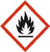
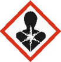
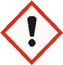

<!-- pagina: 1 -->
**FICHA DE DATOS DE SEGURIDAD (MSDS)** 

> Imagen (pág. 1). Sin texto legible por OCR; contenido gráfico no interpretado.

<!-- Start of picture text -->
BUILDING TRUST ON <!-- End of picture text -->

Esmalte Uretano AR Comp. A 

# **SECCION 1: Identificación de la sustancia o la mezcla y de la sociedad o la empresa** 

|**1.1 Identificación del producto**|
|---|
|**Nombre del producto:** Esmalte Uretano AR Comp. A Código: 100000020025|
|**1.2 Usos pertinentes identificados de la sustancia o de la mezcla y usos desaconsejados**|
|**Uso del producto**:  Recubrimiento para superficies metálicas.|
|**1.3 Datos del proveedor de la ficha de datos de seguridad**|
|**Fabricante/ Distribuidor:** Sika Colombia S.A.S. Vereda Canavita km 20.5 Autopista Norte Tocancipá, Cundinamarca Colombia col.sika.com|
|**Número de Teléfono:** (+571) 878 – 6333|
|**Número de Fax:** (+571) 878 – 6666|
|**Dirección de email del responsable:** controlcalidad.lab@co.sika.com **de esta FDS**|
|**1.4 En caso de emergencia:** CISPROQUIM Bogotá: 2886012 / 2886355 Resto del país: 01 8000 916012|

# **SECCION 2: Identificación de los peligros** 

|**2.1 Clasificación de la sustancia o de la**|**mezcla**|
|---|---|
|**Clasificación SGA**||
|**Líquidos inflamables:**|Categoría 3|
|**Corrosión o irritación cutáneas:**|Categoría 3|
|**Sensibilización cutánea:**|Categoría 1|
|**Toxicidad específica en determinados** **órganos – exposición única:**|Categoría 3 (Sistema nervioso central)|
|**Peligro de aspiración:**|Categoría 1|
|**Peligro a corto plazo (agudo) para el me** **ambiente acuático:**|**dio** Categoría 3|
|**Peligro a largo plazo (crónico) para el m** **ambiente acuático:**|**edio** Categoría 3|

1/11 

Fecha de emisión: 07.01.2020 

MSDS no. 1115 

<!-- pagina: 2 -->
Esmalte Uretano AR Comp. A 

## **2.2 Elementos de la etiqueta GHS Pictogramas de peligro:** 

> Imagen (pág. 2). Sin texto legible por OCR; contenido gráfico no interpretado.

> Imagen (pág. 2). Sin texto legible por OCR; contenido gráfico no interpretado.

> Imagen (pág. 2). Sin texto legible por OCR; contenido gráfico no interpretado.

## **Palabra de advertencia:** 

## **Peligro** 

**Indicaciones de peligro:** H226 Líquidos y vapores inflamables. H304 Puede ser mortal en caso de ingestión y penetración en las vías respiratorias. H316 Provoca una leve irritación cutánea. H317 Puede provocar una reacción alérgica en la piel. H336 Puede provocar somnolencia o vértigo. H412 Nocivo para los organismos acuáticos, con efectos nocivos duraderos. **Consejos de prudencia: Prevención:** 

## **Consejos de prudencia:** 

P201 Procurarse las instrucciones antes del uso. P202 No manipular antes de haber leído y comprendido todas las precauciones de seguridad. P210 Mantener alejado del calor, de superficies calientes, de chispas, de llamas abiertas y de cualquier otra fuente de ignición.  No fumar. P233 Mantener el recipiente herméticamente cerrado. P240 Toma de tierra y enlace equipotencial del recipiente y del equipo receptor. P241 Utilizar material eléctrico/ de ventilación/ iluminación/antideflagrante. P242 No utilizar herramientas que produzcan chispas. P243 Tomar medidas de precaución contra las descargas electrostáticas. P260 No respirar el polvo/ el humo/ el gas/ la niebla/ los vapores/ el aerosol. P271 Utilizar únicamente en exteriores o en un lugar bien ventilado. P272 Las prendas de trabajo contaminadas no podrán sacarse del lugar de trabajo. P273 Evitar su liberación al medio ambiente. P280 Llevar guantes/ prendas/ gafas/ máscara de protección. 

**Intervención:** 

P301 + P310 EN CASO DE INGESTIÓN: Llamar inmediatamente a un CENTRO DE TOXICOLOGÍA/médico. P303 + P361 + P353 EN CASO DE CONTACTO CON LA PIEL (o el pelo): Quitar inmediatamente toda la ropa contaminada.  Enjuagar la piel con agua. P304 + P340 + P312 EN CASO DE INHALACIÓN: Transportar a la persona al aire libre y mantenerla en una posición que le facilite la respiración. Llamar a un CENTRO DE TOXICOLOGÍA/médico si la persona se encuentra mal. 

P308 + P313 EN CASO DE exposición demostrada o supuesta: consultar a un médico. P331 NO provocar el vómito. P333 + P313 En caso de irritación o erupción cutánea: Consultar a un médico. P362 + P364 Quitar las prendas contaminadas y lavarlas antes de volver a usarlas. P370 + P378 En caso de incendio: Utilizar arena seca, producto químico seco o espuma resistente al alcohol para la extinción. 

**Almacenamiento:** 

P403 + P233 Almacenar en un lugar bien ventilado. Mantener el recipiente cerrado herméticamente. 

P403 + P235 Almacenar en un lugar bien ventilado. Mantener en lugar fresco. P405 Guardar bajo llave. **Eliminación:** 

P501 Eliminar el contenido/ el recipiente en una planta de eliminación de residuos autorizada. 

## **2.3 Ingredientes peligrosos** 

Acetato de butilo 

2/11 

Fecha de emisión: 07.01.2020 

MSDS no. 1115 

<!-- pagina: 3 -->
Esmalte Uretano AR Comp. A 

# **SECCION 3: Composición /información sobre los componentes** 

**Sustancia/preparado:** Mezcla **Familia química/:** Poliacrilato conteniendo solventes 

|**Nombre delproducto o ingrediente Identificadores**|%|
|---|---|
|Acetato de butilo|10% - 20%|
|CAS: 123-86-4||
|Xileno|5% - 10%|
|CAS: 1330-20-7||
|nafta disolvente (petróleo), fracción aromática ligera|2% - 5%|
|CAS: 64742-95-6||
|Etilbenceno|1% - 5%|
|CAS: 100-41-4||
|sebacato de metilo y 1,2,2,6,6-pentametil-4-piperidilo|0.25% - 1%|
|CAS: 82919-37-7||
|Metacrilato de metilo|0.1% - 1%|
|CAS: 80-62-6||

No hay ningún ingrediente adicional presente que, bajo el conocimiento actual del proveedor y en las concentraciones aplicables, sea clasificado como de riesgo para la salud o el medio ambiente, como PBT o mPmB o tenga asignado un límite de exposición laboral y por lo tanto deban ser reportados en esta sección. 

**SECCION 4: Primeros auxilios** 

|**4.1 Descripción de los primeros auxilios**||
|---|---|
|**Recomendaciones generales**:|Retirar a la persona de la zona peligrosa. Consultar a un médico. Mostrar esta ficha de seguridad al doctor que esté de servicio.|
|**Si es inhalado**:|Trasladarse a un espacio abierto. Consultar a un médico después de una exposición importante.|
|**En caso de contacto con la piel**:|Quítese inmediatamente la ropa y zapatos contaminados. Eliminar lavando con jabón y mucha agua. Si los síntomas persisten consultar a un médico.|
|**En caso de contacto con los ojos:**|Retirar las lentillas. Manténgase el ojo bien abierto mientras se lava. Si persiste la irritación de los ojos, consultar a un especialista.|
|**Por ingestión:**|Lavar la boca con agua y después beber agua abundante. No provocar el vómito. No dar leche ni bebidas alcohólicas. Nunca debe administrarse nada por la boca a una persona inconsciente.|
|**4.2 Principales síntomas y efectos,** **agudos y retardados:**|Riesgo de daño serio a los pulmones (por aspiración). Efectos sensibilizantes Aspiración puede causar edema pulmonar y neumonía. Reacciones alérgicas|

3/11 

Fecha de emisión: 07.01.2020 

MSDS no. 1115 

<!-- pagina: 4 -->
Esmalte Uretano AR Comp. A 

Pérdida de balance Vértigo Ver la Sección 11 para obtener información detallada sobre la  salud y los síntomas. **4.3 Notas para el médico:** Tratar sintomáticamente.  Contactar un especialista en tratamientos de envenenamientos inmediatamente si se ha ingerido o inhalado una gran cantidad. **Tratamientos específicos:** No hay un tratamiento específico. 

# **SECCION 5: Medidas de lucha contra incendios** 

**5.1 Medios de extinción Características inflamables Punto de inflamación:** 23 °C Método: Copa cerrada **Medios de extinción** Utilizar polvos químicos secos, CO₂, agua pulverizada (niebla de agua) o espuma. **Apropiados: Medios de extinción no** Agua **apropiados:** No use un chorro compacto de agua ya que puede dispersar y extender el fuego. **5.2 Peligros específicos derivados de la sustancia o la mezcla Peligros derivados de la** La presión puede aumentar y el contenedor puede explotar en caso de calentamiento o **sustancia o mezcla:** incendio. **Productos de** Los productos de descomposición pueden incluir los siguientes materiales **descomposición térmica** dióxido de carbono **peligrosos** : monóxido de carbono **5.3 Recomendaciones para el personal de lucha contra incendios Medidas especiales que** En caso de incendio, aislar rápidamente la zona, evacuando a todas las personas de las **deben tomar los equipos** proximidades del lugar del incidente.  Este material es nocivo para organismos acuáticos. **de lucha contra incendios:** Se debe impedir que el agua de extinción de incendios contaminada con este material entre en vías de agua, drenajes o alcantarillados. **Equipo de protección** Los bomberos deben llevar equipo de protección apropiado y un equipo de respiración **especial para el personal** autónomo con una máscara facial completa que opere en modo de presión positiva. **de lucha contra incendios** : Las prendas para bomberos (incluidos cascos, guantes y botas  de protección) conformes a la norma europea EN 469 proporcionan un nivel básico de protección en caso de incidente químico. 

**SECCION 6: Medidas en caso de vertido accidental 6.1 Precauciones personales, equipo de protección y procedimientos de emergencia Para el personal que no** No se debe realizar ninguna acción que suponga un riesgo personal o sin formación adecuada. **forma parte de los** Evacuar los alrededores.  No permitir el ingreso de personal innecesario y sin protección. **servicios de emergencia:** No tocar o caminar sobre el material derramado.  Evitar respirar vapor o neblina. Proporcionar ventilación adecuada.  Llevar un aparato de respiración apropiado cuando el sistema de ventilación sea inadecuado.  Llevar puesto un equipo de protección individual adecuado. 

4/11 

Fecha de emisión: 07.01.2020 

MSDS no. 1115 

<!-- pagina: 5 -->
Esmalte Uretano AR Comp. A 

**Para el personal de** Si se necesitan prendas especiales para gestionar el vertido, tomar en cuenta las informacio- **emergencia** : nes recogidas en la Sección 8 en relación con los materiales adecuados y no adecuados. Consultar también en la Sección 8 la información adicional sobre medidas higiénicas. 

**6.2 Precauciones relativas** Evitar la dispersión del material derramado, su contacto con el suelo, las vías fluviales, las **al medio ambiente:** tuberías de desagüe y las alcantarillas. Informar a las autoridades pertinentes si el producto ha causado contaminación medioambiental (alcantarillas, vías fluviales, suelo o aire). Material contaminante del agua. 

**6.3 Métodos y material de** Detener la fuga si esto no presenta ningún riesgo. Retirar los envases del área del derrame. **contención y de limpieza** Evitar que se introduzca en alcantarillas, canales de agua, sótanos o áreas reducidas. Detener y recoger los derrames con materiales absorbentes no combustibles, como arena, tierra, vermiculita o tierra de diatomeas, y colocar el material en un envase para desecharlo de acuerdo con las normativas locales (ver Sección 13). **6.4 Referencia a otras** Consultar en la Sección 1 la información de contacto en caso de emergencia. **Secciones** Consultar en la Sección 8 la información relativa a equipos de protección personal apropiados. Consultar en la Sección 13 la información adicional relativa al tratamiento de residuos. 

# **SECCIÓN 7: Manipulación y almacenamiento** 

**7.1 Precauciones para una manipulación segura Medidas de protección:** Utilizar un equipo a prueba de explosiones. Mantener alejado del calor/ de chispas/ de llamas al descubierto/ de superficies calientes. Tomar medidas de precaución contra la acumulación de cargas electrostáticas. **Información relativa a** No respirar los vapores ni la niebla de la pulverización. **higiene en el trabajo de** Evitar sobrepasar los límites dados de exposición profesional (ver sección 8). **forma general** Evitar todo contacto con los ojos, la piel o la ropa. Ver sección 8 para el equipo de protección personal. Las personas que hayan tenido problemas de sensibilización de la piel, asma, alergias, enfermedades respiratorias crónicas o recurrentes, no deben ser empleadas en ninguna parte del proceso en la cual esté utilizada esta preparación. Fumar, comer y beber debe prohibirse en el área de aplicación. Tomar medidas de precaución contra las descargas electrostáticas. Abrir el tambor con precaución, ya que el contenido puede estar presurizado. Adoptar las acciones necesarias para evitar descargas de electricidad estática (que podrían ocasionar la inflamación de los vapores orgánicos). Cuando se manejen productos químicos, siga las medidas estándar de higiene. 

## **7.2 Condiciones de almacenamiento seguro, incluidas posibles incompatibilidades** 

Almacenar en el envase original.  Mantener en un lugar bien ventilado. 

Los contenedores que se abren deben ser cuidadosamente resellados y mantenerlos en posición vertical para evitar fugas. Observar las indicaciones de la etiqueta.  Almacenar en conformidad con la reglamentación local. 

**7.3 Usos específicos finales Recomendaciones:** No disponible. **Soluciones específicas del:** No disponible. **sector industrial** 

5/11 

Fecha de emisión: 07.01.2020 

MSDS no. 1115 

<!-- pagina: 6 -->
Esmalte Uretano AR Comp. A 

# **SECCIÓN 8: Controles de exposición/protección individual** 

La información recogida en esta sección contiene consejos e indicaciones generales. La información que se proporciona está basada en los usos habituales anticipados para el producto. Puede ser necesario tomar medidas adicionales para su manipulación a granel u otros usos que pudieran aumentar de manera significativa la exposición de los trabajadores o la liberación al medio ambiente. 

|**8.1 Parámetros de control** **Límites de exposiciónprofesional**|||
|---|---|---|
|**Nombre delproducto o ingrediente**|**Valores límite de la exposición**|**Bases**|
|Acetato de n-butilo CAS: 123-86-4|TWA: 50 ppm STEL: 150 ppm.|ACGIH ACGIH|
|Xileno|TWA: 100 ppm|ACGIH|
|CAS: 1330-20-7|STEL: 150ppm|ACGIH|
|**Procedimientos** **recomendados de control:**|Si este producto contiene ingredientes con pervisión personal, del ambiente de trabaj ventilación o de otras medidas de control respiratoria. Se debe hacer referencia al Estándar Euro exposición por inhalación a agentes quími métodos de determinación de sustancias p|límites de exposición, puede ser necesaria la su- o o biológica para determinar la efectividad de la y/o la necesidad de usar un equipo de protección peo EN 689 para los métodos de evaluación de la cos y a las recomendaciones nacionales sobre los eligrosas.|
|**Valores DNEL/DMEL** No hay valores DEL disponibles. **Valor PNEC** No hay valores PEC disponibles.|||
|**8.2 Controles de la exposición** **Controles técnicos**|Si la operación genera polvo, humos, gas, ventilación local, u otros controles de inge contaminantes aerotransportados por d estatutarios.|vapor o llovizna, use cercamientos del proceso, niería para mantener la exposición del obrero a los ebajo de todos los límites recomendados o|
|**Medidas de protección individual**|||
|**Medidas higiénicas:**|Lavar las manos, antebrazos y cara c químicos, antes de comer, fumar y usar el l Usar las técnicas apropiadas para eliminar Lavar las ropas contaminadas antes de volv|ompletamente después de manejar productos avabo y al final del período de trabajo. ropa contaminada. er a usarlas.|
|**Protección de los ojos/la Cara:**|Se debe usar un equipo protector ocular q evaluación del riesgo indique que es neces del líquido, lloviznas, gases o polvos.|ue cumpla con las normas aprobadas cuando una ario, a fin de evitar toda exposición a salpicaduras|
|**Protección de la piel**|||
|**Protección de las manos:**|Si una evaluación del riesgo indica que resistentes e impenetrables que cumplan c productos químicos. Número de referencia Adecuados para periodos cortos o para pro butilo/nitrilo. (0,4 mm), tiempo de detecci Adecuado para exposición permanente: G min.|es necesario, se deben usar guantes químico- on las normas aprobadas siempre que se manejen EN 374. tección contra salpicaduras: Guantes de goma de ón <30 min. Desechar los guantes contaminados. uantes Vitón (0,4mm), tiempo de detección >30|

6/11 

Fecha de emisión: 07.01.2020 

MSDS no. 1115 

<!-- pagina: 7 -->
Esmalte Uretano AR Comp. A 

**Protección corporal:** Antes de utilizar este producto se debe seleccionar equipo protector personal para el cuerpo basándose en la tarea a ejecutar y los riesgos involucrados y debe ser aprobado por un especialista. Recomendado: Protección preventiva de la piel con pomada protectora. 

**Otro tipo de protección** Se debe elegir el calzado adecuado y cualquier otra medida de protección cutánea necesaria **Cutánea:** dependiendo de la tarea que se lleve a cabo y de los riesgos implicados. Tales medidas deben ser aprobadas por un especialista antes de proceder a la manipulación de este producto. **Protección respiratoria:** Utilice protección respiratoria a menos que exista una ventilación de escape adecuada o que la evaluación de la exposición indique que el nivel de exposición está dentro de las pautas recomendadas. Se debe seleccionar el respirador en base a los niveles de exposición reales o previstos, a la peligrosidad del producto y al grado de seguridad de funcionamiento del respirador elegido. Filtro de vapor orgánico (Tipo A) A1: < 1000 ppm; A2: < 5000 ppm; A3: < 10000 ppm **Controles de exposición** Se deben verificar las emisiones de los equipos de ventilación o de los procesos de trabajo **Medioambiental:** para verificar que cumplen con los requisitos de la legislación de protección del medioambiente. En algunos casos para reducir las emisiones hasta un nivel aceptable, será necesario usar depuradores de humo, filtros o modificar el diseño del equipo del proceso. 

**SECCIÓN 9: Propiedades físicas y químicas** 

**9.1 Información sobre propiedades físicas y químicas básicas Aspecto Estado físico:** Líquido viscoso **Color:** Varios **Olor:** A Solvente **Umbral olfativo:** No disponible **pH:** No disponible **Punto de fusión/punto de Congelación:** No disponible **Punto inicial de ebullición e intervalo de ebullición:** No disponible **Punto de inflamación:** 23 °C - 37.8 °C copa cerrada (ASTM D3278) **Tasa de evaporación** No disponible **Inflamabilidad (sólido, gas):** No disponible **Tiempo de Combustión:** No aplicable **Velocidad de Combustión:** No aplicable **Límite superior de explosividad:** 7 %(v) **Límites inferior de explosividad:** 1 %(v) **Presión de vapor:** 12,4989 hPa (9,375 mmHg) **Densidad de vapor:** No disponible **Densidad:** ~1.19 g/cm³ (20°C) **Densidad relativa:** No disponible **Solubilidad(es):** El producto no es soluble en agua **Coeficiente de reparto noctanol/agua:** No disponible **Temperatura de autoinflamación:** 333 °C **Temperatura de descomposición:** No disponible **Viscosidad:** No disponible **Propiedades explosivas:** No disponible **Propiedades comburentes:** No disponible 

7/11 

Fecha de emisión: 07.01.2020 

MSDS no. 1115 

<!-- pagina: 8 -->
Esmalte Uretano AR Comp. A 

## **9.2 Información adicional** 

Ninguna información adicional 

# **SECCIÓN 10: Estabilidad y reactividad** 

|**10.1 Reactividad:**|No hay datos de ensayo disponibles sobre la reactividad de este producto o sus componentes.|
|---|---|
|**10.2 Estabilidad química:**|El producto es estable.|
|**10.3 Posibilidad de reacciones** **peligrosas:**|En condiciones normales de almacenamiento y uso, no se producen reacciones peligrosas. Los vapores pueden formar una mezcla explosiva con el aire.|
|**10.4 Condiciones que deben** **evitarse:**|Calor, llamas y chispas.|
|**10.5 Materiales incompatibles:**|Ningún dato específico|
|**10.6 Productos de descomposición** **peligrosos:**|En condiciones normales de almacenamiento y uso, no se deberían formar productos de descomposición peligrosa.|
|**SECCIÓN 11: Información toxic** **11.1 Información sobre los efectos toxic** **Toxicidad aguda** **Acetato de n-butilo:** Toxicidad oral aguda: DL50 Oral (Rata): Toxicidad aguda por inhalación: CL50 (Ra Toxicidad cutánea aguda:|**ológica** **ológicos** > 5.000 mg/kg ta): 23,4 mg/l Tiempo de exposición: 4 h Prueba de atmosfera: vapor DL50 cutánea (Conejo): > 5.000 mg/kg|

**Xileno:** Toxicidad oral aguda: DL50 Oral (Rata): 3.523 mg/kg Toxicidad cutánea aguda: DL50 cutánea (Conejo): 1.700 mg/kg 

## **Nafta disolvente (petróleo), fracción aromática ligera:** 

Toxicidad oral aguda: DL50 Oral (Rata): > 2.000 mg/kg Toxicidad cutánea aguda: DL50 cutánea (Conejo): > 2.000 mg/kg 

**Metacrilato de metilo:** Toxicidad oral aguda: DL50 Oral (Rata): > 5.000 mg/kg Toxicidad aguda por inhalación: CL50 (Rata): 29,8 mg/l Tiempo de exposición: 4 h Toxicidad dérmica aguda: LD50 Dérmico (Conejo): > 5.000 mg/kg 

# **SECCIÓN 12: Información Ecológica** 

**12.1 Toxicidad Acetato de n-butilo:** Toxicidad para las algas: CE50 (Desmodesmus subspicatus (alga verde)): 647,7 mg/l Tiempo de exposición: 72 h 

8/11 

Fecha de emisión: 07.01.2020 

MSDS no. 1115 

<!-- pagina: 9 -->
Esmalte Uretano AR Comp. A 

**Xileno:** Toxicidad para los peces: CL50 (Oncorhynchus mykiss (Trucha irisada)): 3,3 mg/l Tiempo de exposición: 96 h **Nafta disolvente (petróleo), fracción aromática ligera:** Toxicidad para las algas: (Pseudokirchneriella subcapitata (alga verde)): 2,6 - 2,9 mg/l Tiempo de exposición: 72 h **Metacrilato de metilo:** Toxicidad para peces: CL50 (Oncorhynchus mykiss (trucha irisada)): > 79 mg/l Tiempo de exposición: 96 h Método: Directrices de prueba OECD 203 NOEC (Danio rerio (pez zebra)): 9,4 mg/l Toxicidad para la dafnia y otros invertebrados acuáticos: CE50 (Daphnia magna (Pulga de mar grande)): 69 mg/l Tiempo de exposición: 48 h Método: Directriz de Prueba de la OCDE 202 NOEC: 37 mg/l Tiempo de exposición: 21 d Método: Directriz de Prueba de la OCDE 202 **12.2 Persistencia y degradabilidad Conclusión/resumen:** No disponible. **12.3 Potencial de bioacumulación Conclusión/resumen:** No disponible. **12.4 Movilidad en el suelo Coeficiente de partición:** No disponible. **tierra/agua (KOC) MOVILIDAD:** No disponible. **12.5 Resultados de la valoración PBT y mPmB PBT:** No aplicable **mPmB:** No aplicable. 

**12.6 Otros efectos adversos:** Nocivo para los organismos acuáticos, con efectos nocivos duraderos. 

# **SECCIÓN 13: Consideraciones relativas a la eliminación** 

**13.1 Métodos para el tratamiento de residuos Producto Métodos de eliminación:** Evitar o minimizar la generación de residuos cuando sea posible. La eliminación de este producto, sus soluciones y cualquier derivado deben cumplir siempre con los requisitos de la legislación de protección del medio ambiente y eliminación de desechos y todos los requisitos de las autoridades locales. Desechar los sobrantes y productos no reciclables por medio de un contratista autorizado a su eliminación.  Los residuos no se deben tirar por la alcantarilla sin tratar a menos que sean compatibles con los requisitos de todas las autoridades con jurisdicción.  Incinerar. 

**Empaquetado:** Envases/ embalajes que no pueden ser limpiados deben ser eliminados de la misma forma que la sustancia contenida.  No reutilizar los recipientes vacíos.  No quemar, ni utilizar un soplete de corte, en el envase vacío. 

9/11 

Fecha de emisión: 07.01.2020 

MSDS no. 1115 

<!-- pagina: 10 -->
|Esmalte Uretano AR Comp. A |||~~O~~|
|---|---|---|---|
|**SECCIÓN 14: Información** |**relativa al transporte**  ||~~T~~|
||**ADR/RID-ADN**|**IMDG**|**IATA**|
|**14.1 Número ONU** |UN1263 |UN1263 |UN1263 |
|**14.2 Designación oficial de** **transporte de las Naciones** **Unidas** ~~ee~~ |Pintura ~~ee~~|Pintura ~~ee~~ |Pintura ~~|~~ |
|**14.3 Clase(s) de peligro para** **el transporte**  ~~_~~ |3  |3    |3  ~~p~~ |
|**14.4 Grupo de embalaje **   |III   |III    |III   |
|**14.5 Peligros para el medio** **ambiente**  |No  |No   |No  |
|**14.6 Información adicional**  |**Previsiones especiales** 640(E)  |**Emergency schedules (EmS)** F-E, S-E    |-   |
||**Código para túneles** **(E)**  |||
|**Código de clasificación** |F1  |||
|**14.7 Transporte a granel:**No dis **con arreglo al anexo II del** **Convenio Marpol 73/78 y del** **Código IBC** |ponible  |||
|**SECCIÓN 15: Informació** |**n reglamentaria** |||
|**15.1 Reglamentación y legislació** **Reglamento de la UE (CE) nº. 19** **Anexo XIV - Lista de sustancias s** |**n en materia de seguridad, sal** **07/2006 (REACH)** **ujetas a autorización** |**ud y medio ambiente específicos p** |**ara la sustancia o la mezcla** |

## **Anexo XIV** 

Ninguno de los componentes está listado. 

**Sustancias altamente preocupantes** 

Ninguno de los componentes está listado. 

**Contenido de COV (EU):** VOC (w/w): 13.22% 

## **_Legislación nacional_** 

NTC 1692:1998, Transporte de mercancías peligrosas. Clasificación, etiquetado y rotulado. 

Norma técnica NTC-ISO 5500 gestión del transporte de carga terrestre. 

Ley 55 del 2 de julio de 1993, Convenio número 170 y la Recomendación número 177 sobre la Seguridad en la Utilización de los Productos Químicos en el Trabajo. 

Decreto 1609 de 2002 Por el cual se reglamenta el manejo y transporte terrestre automotor de mercancías peligrosas por carretera. 

## **_Clase de almacenamiento:_** 

NTC 3972:1996, Transporte de mercancías peligrosas clase 9. Sustancias peligrosas varias. Transporte terrestre por carretera. Requisitos generales para el transporte. Segregación. 

## **15.2 Evaluación de la seguridad química:** 

No hay datos disponibles 

10/11 

Fecha de emisión: 07.01.2020 

MSDS no. 1115 

<!-- pagina: 11 -->
Esmalte Uretano AR Comp. A 

# **SECCIÓN 16: Otra Información** 

Indica la información que ha cambiado desde la edición de la versión anterior. **Abreviaturas y acrónimos:** ETA = Estimación de Toxicidad Aguda CLP = Reglamento sobre Clasificación, Etiquetado y Envasado [Reglamento (CE) No 1272/2008] DNEL = Nivel sin efecto derivado Indicación EUH = Indicación de Peligro específica del CLP PNEC = Concentración Prevista Sin Efecto RRN = Número de Registro REACH 

## <u>Aviso al lector</u> 

**_La información contenida en esta ficha de datos de seguridad corresponde a nuestro nivel de conocimiento en el momento de su publicación.  Quedan excluidas todas las garantías. Se aplicaran nuestras condiciones generales de venta en vigor. Por favor, consulte la Hoja de Datos del Producto antes de su uso y procesamiento._** 

11/11 

Fecha de emisión: 07.01.2020 

MSDS no. 1115 
