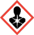
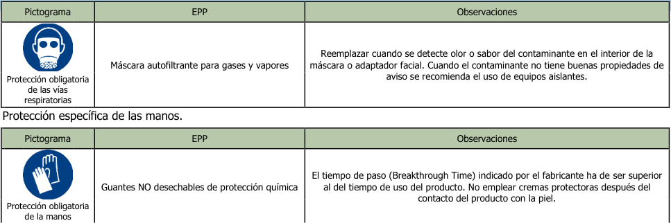
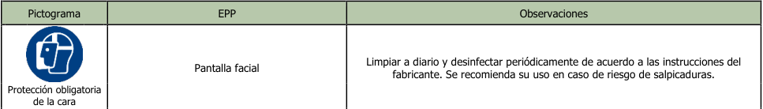
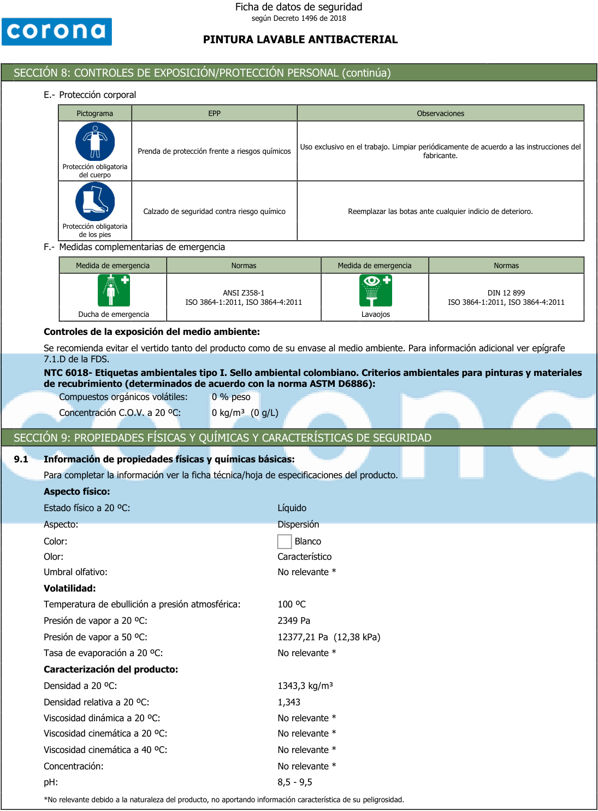
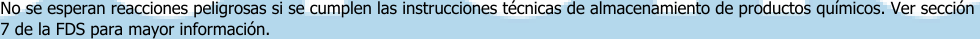
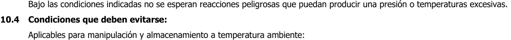
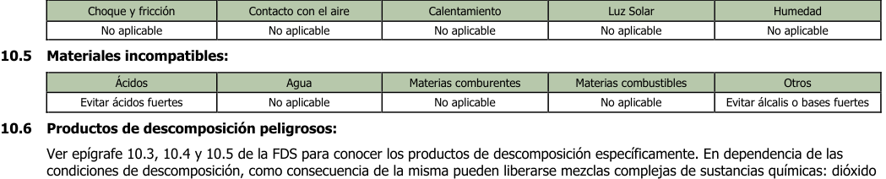

<!-- pagina: 1 -->
Ficha de datos de seguridad según Decreto 1496 de 2018 

> Imagen (pág. 1). Sin texto legible por OCR; contenido gráfico no interpretado.

<!-- Start of picture text -->
[corona] <!-- End of picture text -->

# **PINTURA LAVABLE ANTIBACTERIAL** 

# SECCIÓN 1: IDENTIFICACIÓN DEL PRODUCTO 

- **1.1 Identificador SGA del producto:** PINTURA LAVABLE ANTIBACTERIAL 

- **1.2 Uso recomendado del producto químico y restricciones:** Usos pertinentes: Pintura decorativa Usos desaconsejados: Todo aquel uso no especificado en este epígrafe ni en el epígrafe 7.3 

**1.3 Datos sobre el proveedor:** CORLANC S.A.S. Carrera 48 N° 72 sur 01 Avenida Las Vegas 055450 Sabaneta - Antioquia - Colombia Tfno.: +57-4-3787800 materialesypinturascorona@corona.com.co https://www.corona.co **1.4 Número de teléfono para emergencias:** CISTEMA - ARL SURA 018000511414 - 0314055911 

# SECCIÓN 2: IDENTIFICACIÓN DEL PELIGRO O PELIGROS 

**2.1 Clasificación de la sustancia o de la mezcla: NFPA:** Salud: 1 Inflamabilidad: 0 Inestabilidad: 0 Especiales: No relevante **SGA:** 

La clasificación del producto se ha realizado conforme con al decreto 1496 de 2018, por el cual se adopta el Sistema Globalmente Armonizado de Clasificación y Etiquetado de Productos Químicos y se dictan otras disposiciones en materia de seguridad química. Acuático agudo. 2: Peligrosidad aguda para el medio ambiente acuático, Categoría 2, H401 Acuático crónico. 3: Peligrosidad crónica para el medio ambiente acuático, Categoría 3, H412 Carc. 2: Carcinogenicidad, Categoría 2, H351 **2.2 Elementos de las etiquetas del SGA, incluidos los consejos de prudencia: NFPA:** e 

**SGA: Atención** 

> Imagen (pág. 1). Sin texto legible por OCR; contenido gráfico no interpretado.

> Imagen (pág. 1). Sin texto legible por OCR; contenido gráfico no interpretado.

> Imagen (pág. 1). Sin texto legible por OCR; contenido gráfico no interpretado.

> Imagen (pág. 1). Sin texto legible por OCR; contenido gráfico no interpretado.

> Imagen (pág. 1). Sin texto legible por OCR; contenido gráfico no interpretado.

> Imagen (pág. 1). Sin texto legible por OCR; contenido gráfico no interpretado.

> Imagen (pág. 1). Sin texto legible por OCR; contenido gráfico no interpretado.

> Imagen (pág. 1). Sin texto legible por OCR; contenido gráfico no interpretado.

> Imagen (pág. 1). Sin texto legible por OCR; contenido gráfico no interpretado.

**Indicaciones de peligro:** Acuático agudo. 2: H401 - Tóxico para los organismos acuáticos Acuático crónico. 3: H412 - Nocivo para los organismos acuáticos, con efectos nocivos duraderos Carc. 2: H351 - Susceptible de provocar cáncer (Inhalación) **Consejos de prudencia:** P101: Si se necesita consultar a un médico, tener a mano el recipiente o la etiqueta del producto P102: Mantener fuera del alcance de los niños P201: Procurarse las instrucciones antes del uso P202: No manipular antes de haber leído y comprendido todas las precauciones de seguridad P273: No dispersar en el medio ambiente P308+P313: EN CASO DE exposición demostrada o supuesta: consultar a un médico P405: Guardar bajo llave P501: Eliminar el contenido/recipiente mediante el sistema de recogida selectiva habilitado en su municipio **Sustancias que contribuyen a la clasificación** Dioxido de titanio (diámetro aerodinámico ≤ 10 μm) 

- CONTINÚA EN LA SIGUIENTE PÁGINA - 

Emisión: 22/11/2019            Revisión: 10/09/2020            Versión: 2 (sustituye a 1) 

**Página 1/10** 

<!-- pagina: 2 -->
Ficha de datos de seguridad según Decreto 1496 de 2018 

> Imagen (pág. 2). Sin texto legible por OCR; contenido gráfico no interpretado.

# **PINTURA LAVABLE ANTIBACTERIAL** 

# SECCIÓN 2: IDENTIFICACIÓN DEL PELIGRO O PELIGROS (continúa) 

|**2.3** SECC|**Otros peligros que no conducen a una clasificación:** No relevante IÓN 3: COMPOSICIÓN/INFORMACIÓN SOBRE LOS COMPONENTES||
|---|---|---|
|**3.1**|**Sustancias:** No aplicable||
|**3.2**|**Mezclas:**||
||**Descripción química:**Mezcla acuosa a base de aditivos, cargas, coalescentes, pigmentos y resinas **Componentes:** De acuerdo al Decreto 1496 de 2018, el producto presenta:     | |
||Identificación Nombre químico/clasificación ~~PT~~ |Concentración  |
||**Agua** CAS: 7732-18-5 ~~EE~~|**25 - <50 %** ~~E~~|
||**Dioxido de titanio (diámetro aerodinámico ≤ 10 μm)** CAS: 13463-67-7 Carc. 2: H351 - Atención   ~~A~~|**10 - <25 %**  |
||**Copolimero de etileno-acetato de vinilo** CAS: 24937-78-8 ~~A~~|**10 - <25 %** |
||**Piedra caliza** CAS: 1317-65-3  ~~A~~  |**10 - <25 %**   |
||**Caolin** CAS: 1332-58-7  ~~INO~~   |**2.5 - <10 %**  |
||**Caolín, calcinado** CAS: 92704-41-1   ~~alA~~ ~~oEa~~|**2.5 - <10 %** |
|SECC|Para ampliar información sobre la peligrosidad de las sustancias consultar las secciones 11, 12 y 16. La clasificación respe Carcinogenicidad de las sustancias se ha establecido en función de las monografías de la IARC adecuándola al sistema de SGA, para información sobre la clasificación IARC consulte la sección 11. IÓN 4: PRIMEROS AUXILIOS     |cto clasificación |
|**4.1**|**Descripción de los primeros auxilios necesarios:**||
||Los síntomas como consecuencia de una intoxicación pueden presentarse con posterioridad a la exposición, por lo que, e duda, exposición directa al producto químico o persistencia del malestar solicitar atención médica, mostrándole la FDS de producto. **Por inhalación:**|n caso de este|
||Se trata de un producto que no contiene sustancias clasificadas como peligrosas por inhalación, sin embargo, en caso de intoxicación sacar al afectado de la zona de exposición y proporcionarle aire fresco. Solicitar atención médica si los sínto agravan o persisten. **Por contacto con la piel:**|síntomas de mas se|
||En caso de contacto se recomienda limpiar la zona afecta con agua por arrastre y con jabón neutro. En caso de alteracio piel (escozor, rojez, sarpullidos, ampollas…), acudir a consulta médica con esta Ficha de Datos de Seguridad **Por contacto con los ojos:**|nes en la|
||Se trata de un producto que no contiene sustancias clasificadas como peligrosas en contacto con los ojos. Enjuagar dura 15 minutos con abundante agua a temperatura ambiente, evitando que el afectado se frote o cierre los ojos. **Por ingestión/aspiración:**|nte al menos|
||En caso de ingestión, solicitar asistencia médica inmediata mostrando la FDS de este producto.||
|**4.2**|**Síntomas/efectos más importantes, agudos o retardados:** Los efectos agudos y retardados son los indicados en las secciones 2 y 11 de la FDS.||
|**4.3**|**Indicación de la necesidad de recibir atención médica inmediata y, en su caso, de tratamiento especial:** No relevante||

- CONTINÚA EN LA SIGUIENTE PÁGINA - 

Emisión: 22/11/2019            Revisión: 10/09/2020            Versión: 2 (sustituye a 1) 

**Página 2/10** 

<!-- pagina: 3 -->
Ficha de datos de seguridad según Decreto 1496 de 2018 

**PINTURA LAVABLE ANTIBACTERIAL** 

> Imagen (pág. 3). Sin texto legible por OCR; contenido gráfico no interpretado.

# SECCIÓN 5: MEDIDAS DE LUCHA CONTRA INCENDIOS 

- **5.1 Medios de extinción apropiados:** 

   - Producto no inflamable bajo condiciones normales de almacenamiento, manipulación y uso. En caso de inflamación como consecuencia de manipulación, almacenamiento o uso indebido emplear preferentemente extintores de polvo polivalente (polvo ABC). NO SE RECOMIENDA emplear agua a chorro como agente de extinción. 

- **5.2 Peligros específicos del producto químico:** 

   - Como consecuencia de la combustión o descomposición térmica se generan subproductos de reacción que pueden resultar altamente tóxicos y, consecuentemente, pueden presentar un riesgo elevado para la salud. 

- **5.3 Medidas especiales que deben tomar los equipos de lucha contra incendios:** 

En función de la magnitud del incendio puede hacerse necesario el uso de ropa protectora completa y equipo de respiración autónomo. Disponer de un mínimo de instalaciones de emergencia o elementos de actuación (mantas ignífugas, botiquín portátil,...). 

## **Disposiciones adicionales:** 

Actuar conforme el Plan de Emergencia Interior y las Fichas Informativas sobre actuación ante accidentes y otras emergencias. Suprimir cualquier fuente de ignición. En caso de incendio, refrigerar los recipientes y tanques de almacenamiento de productos susceptibles a inflamación, explosión o BLEVE como consecuencia de elevadas temperaturas. Evitar el vertido de los productos empleados en la extinción del incendio al medio acuático. 

# SECCIÓN 6: MEDIDAS QUE DEBEN TOMARSE EN CASO DE VERTIDO ACCIDENTAL 

- **6.1 Precauciones personales, equipo protector y procedimiento de emergencia:** 

Aislar las fugas siempre y cuando no suponga un riesgo adicional para las personas que desempeñen esta función. Ante la exposición potencial con el producto derramado se hace obligatorio el uso de elementos de protección personal (ver sección 8). Evacuar la zona y mantener a las personas sin protección alejadas. 

- **6.2 Precauciones relativas al medio ambiente:** 

Evitar a toda costa cualquier tipo de vertido al medio acuático. Contener adecuadamente el producto absorbido/recogido en recipientes herméticamente precintables. Notificar a la autoridad competente en el caso de exposición al público en general o al medioambiente. 

- **6.3 Métodos y materiales para la contención y limpieza de vertidos:** 

   - Se recomienda: 

Absorber el vertido mediante arena o absorbente inerte y trasladarlo a un lugar seguro. No absorber en serrín u otros absorbentes combustibles. Para cualquier consideración relativa a la eliminación consultar la sección 13. 

- **6.4 Referencias a otras secciones:** Ver secciones 8 y 13. 

# SECCIÓN 7: MANIPULACIÓN Y ALMACENAMIENTO 

- **7.1 Precauciones que se deben tomar para garantizar una manipulación segura:** 

   - A.- Precauciones generales 

Cumplir con la legislación vigente en materia de prevención de riesgos laborales. Mantener los recipientes herméticamente cerrados. Controlar los derrames y residuos, eliminándolos con métodos seguros (sección 6). Evitar el vertido libre desde el recipiente. Mantener orden y limpieza donde se manipulen productos peligrosos. 

- B.- Recomendaciones técnicas para la prevención de incendios y explosiones. 

   - Producto no inflamable bajo condiciones normales de almacenamiento, manipulación y uso. Se recomienda trasvasar a velocidades lentas para evitar la generación de cargas electroestáticas que pudieran afectar a productos inflamables. Consultar la sección 10 sobre condiciones y materias que deben evitarse. 

- C.- Recomendaciones técnicas para prevenir riesgos ergonómicos y toxicológicos. 

Para control de exposición consultar la sección 8. No comer, beber ni fumar en las zonas de trabajo; lavarse las manos después de cada utilización, y despojarse de prendas de vestir y equipos de protección contaminados antes de entrar en las zonas para comer. 

   - D.- Recomendaciones técnicas para prevenir riesgos medioambientales 

      - Debido a la peligrosidad de este producto para el medio ambiente se recomienda manipularlo dentro de un área que disponga de barreras de control de la contaminación en caso de vertido, así como disponer de material absorbente en las proximidades del mismo 

- **7.2 Condiciones de almacenamiento seguro, incluidas cualesquiera incompatibilidades:** 

   - A.- Medidas técnicas de almacenamiento 

- CONTINÚA EN LA SIGUIENTE PÁGINA - 

Emisión: 22/11/2019            Revisión: 10/09/2020            Versión: 2 (sustituye a 1) 

**Página 3/10** 

<!-- pagina: 4 -->
Ficha de datos de seguridad según Decreto 1496 de 2018 

> Imagen (pág. 4). Sin texto legible por OCR; contenido gráfico no interpretado.

<!-- Start of picture text -->
[corona <!-- End of picture text -->

# **PINTURA LAVABLE ANTIBACTERIAL** 

# SECCIÓN 7: MANIPULACIÓN Y ALMACENAMIENTO (continúa) 

Temperatura mínima: 5 ºC Temperatura máxima: 30 ºC Tiempo máximo: 6 meses 

- B.- Condiciones generales de almacenamiento. 

Evitar fuentes de calor, radiación, electricidad estática y el contacto con alimentos. Para información adicional ver epígrafe 10.5 

## **7.3 Usos específicos finales:** 

Salvo las indicaciones ya especificadas no es preciso realizar ninguna recomendación especial en cuanto a los usos de este producto. 

# <mark>SECCIÓN 8: CONTROLES DE EXPOSICIÓN/PROTECCIÓN PERSONAL</mark> 

- **8.1 Parámetros de control:** 

Sustancias cuyos valores límite de exposición profesional han de controlarse en el ambiente de trabajo (ACGIH): 

||Identificación|Valores límite ambientales|
|---|---|---|
||Dioxido de titanio (diámetro aerodinámico ≤ 10 μm)|TLV-TWA 10 mg/m³|
||CAS: 13463-67-7|TLV-STEL|
||Piedra caliza|TLV-TWA 10 mg/m³|
||CAS: 1317-65-3|TLV-STEL 20 mg/m³|
||Caolin|TLV-TWA 2 mg/m³|
||CAS: 1332-58-7|TLV-STEL|
|**8.2**|**Controles técnicos apropiados:**||

- A.- Medidas de protección individual, como equipo de protección personal (EPP) 

Como medida de prevención se recomienda la utilización de equipos de protección individual básicos. Para más información sobre los equipos de protección individual (almacenamiento, uso, limpieza, mantenimiento, clase de protección,…) consultar el folleto informativo facilitado por el fabricante del EPP. Las indicaciones contenidas en este punto se refieren al producto puro. Las medidas de protección para el producto diluido podrán variar en función de su grado de dilución, uso, método de aplicación, etc. Para determinar la obligación de instalación de duchas de emergencia y/o lavaojos en los almacenes se tendrá en cuenta la normativa referente al almacenamiento de productos químicos aplicable en cada caso. Para más información ver epígrafes 7.1 y 7.2 de la FDS. 

Toda la información aquí incluida es una recomendación siendo necesario su concreción por parte de los servicios de prevención de riesgos laborales al desconocer las medidas de prevención adicionales que la empresa pudiese disponer. 

## B.- Protección respiratoria. 

> Imagen (pág. 4). OCR automático, revisar: «Pictograma EPP Observaciones Reemplazar cuando se detecte olor o sabor del contaminante en el interior de la Máscara autofiltrante para gases y vapores — | máscara o adaptador facial. Cuando el contaminante no tiene buenas propiedades de Protección obligatoria aviso se recomienda el uso de equipos aislantes. de las vías respiratorias. Protección específica de las manos. Pictograma EPP Observaciones El tiempo de paso (Breakthrough Time) indicado por el fabricante ha de ser superior ¡Guantes NO desechables de protección química | al del tiempo de uso del producto. No emplear cremas protectoras después del » contacto del producto con la piel. Protección obligatoria de la manos»

<!-- Start of picture text -->
Pictograma  EPP  Observaciones Reemplazar cuando se detecte olor o sabor del contaminante en el interior de la Máscara autofiltrante para gases y vapores  máscara o adaptador facial. Cuando el contaminante no tiene buenas propiedades de Protección obligatoria  aviso se recomienda el uso de equipos aislantes. de las vías respiratorias C.- Protección específica de las manos. Pictograma  EPP  Observaciones El tiempo de paso (Breakthrough Time) indicado por el fabricante ha de ser superior Guantes NO desechables de protección química  al del tiempo de uso del producto. No emplear cremas protectoras después del contacto del producto con la piel. Protección obligatoria de la manos <!-- End of picture text -->

C.- Protección específica de las manos. 

Dado que el producto es una mezcla de diferentes materiales, la resistencia del material de los guantes no se puede calcular de antemano con total fiabilidad y por lo tanto tiene que ser controlados antes de su aplicación. 

<!-- Start of picture text -->
D.- Protección ocular y facial <!-- End of picture text -->

> Imagen (pág. 4). OCR automático, revisar: «Pictograma EPP Observaciones Protección obligatoria de la cara Pantalla facial Limpiar a diario y desinfectar periódicamente de acuerdo a las instrucciones del fabricante. Se recomienda su uso en caso de riesgo de salpicaduras.»

<!-- Start of picture text -->
Pictograma  EPP  Observaciones Pantalla facial  Limpiar a diario y desinfectar periódicamente de acuerdo a las instrucciones del fabricante. Se recomienda su uso en caso de riesgo de salpicaduras. Protección obligatoria de la cara <!-- End of picture text -->

- CONTINÚA EN LA SIGUIENTE PÁGINA - 

Emisión: 22/11/2019            Revisión: 10/09/2020            Versión: 2 (sustituye a 1) 

**Página 4/10** 

<!-- pagina: 5 -->

> Imagen (pág. 5). OCR automático, revisar: «CCIÓN E.- Protección corporal CONTROLES DE EXPOSICI Ficha de datos de seguridad según Decreto 1496 de 2018 PINTURA LAVABLE ANTIBACTERIAL Pictograma EPP Observaciones Protección obligatoria del cuerpo Prenda de protección frente a riesgos químicos Uso exclusivo en el trabajo. Limpiar periódicamente de acuerdo a las instrucciones del fabricante. Protección obligatoria de los pies Calzado de seguridad contra riesgo químico Reemplazar las botas ante cualquier indicio de deterioro. 7 Medidas complementarias de emergencia Medida de emergencia Normas Medida de emergencia Normas + ANSI Z358-1 DIN 12 899 150 3864-1:2011, ISO 3864-4:2011 1SO 3864-1:2011, ISO 3864-4:2011 Ducha de emergencia Lavaojos Controles de la exposición del medio ambiente: Se recomienda evitar el vertido tanto del producto como de su envase al medio ambiente. Para información adicional ver epígrafe 7.1.D de la FDS. NTC 6018- Etiquetas ambientales tipo I. Sello ambiental colombiano. Criterios ambientales para pinturas y materiales de recubrimiento (determinados de acuerdo con la norma ASTM D6886): Compuestos orgánicos volátiles: Concentración C.O.V. a 20 °C: SECCIÓN PROPIEDADES FÍSICAS Y QUÍMICAS Y CARACTERÍSTICAS DE 0% peso 0 kg/m? (0 g/L) 9.1 Información de propiedades físicas y químicas básicas: Para completar la información ver la ficha técnica/hoja de especificaciones del producto. Aspecto físico: Estado físico a 20 °C: Aspecto: Color: Olor: Umbral olfativo: Volatilidad: Temperatura de ebullición a presión atmosférica: Presión de vapor a 20 °C: Presión de vapor a 50 °C: Tasa de evaporación a 20 °C: Caracterización del producto: Densidad a 20 °C: Densidad relativa a 20 °C: Viscosidad dinámica a 20 °C: Viscosidad cinemática a 20 °C: Viscosidad cinemática a 40 °C: Concentración: ph: Líquido Dispersión Blanco Característico No relevante * 100 °C 2349 Pa 12377,21 Pa (12,38 kPa) No relevante * 1343,3 kg/m? 1,343 No relevante * No relevante * No relevante * No relevante * 8,5 - 9,5 *No relevante debido a la naturaleza del producto, no aportando información característica de su peligrosidad. URIDAD»

<!-- Start of picture text -->
Ficha de datos de seguridad según Decreto 1496 de 2018  PINTURA LAVABLE ANTIBACTERIAL SECCIÓN 8: CONTROLES DE EXPOSICIÓN/PROTECCIÓN PERSONAL (continúa) E.- Protección corporal Pictograma  EPP  Observaciones Uso exclusivo en el trabajo. Limpiar periódicamente de acuerdo a las instrucciones del Prenda de protección frente a riesgos químicos  fabricante. Protección obligatoria [corona] C del cuerpo  M Calzado de seguridad contra riesgo químico  Reemplazar las botas ante cualquier indicio de deterioro. Protección obligatoria CA de los pies F.- Medidas complementarias de emergencia Medida de emergencia  Normas  Medida de emergencia  Normas ANSI Z358-1  DIN 12 899 ISO 3864-1:2011, ISO 3864-4:2011  ISO 3864-1:2011, ISO 3864-4:2011 A Ducha de emergencia  Lavaojos Controles de la exposición del medio ambiente: Se recomienda evitar el vertido tanto del producto como de su envase al medio ambiente. Para información adicional ver epígrafe 7.1.D de la FDS. NTC 6018- Etiquetas ambientales tipo I. Sello ambiental colombiano. Criterios ambientales para pinturas y materiales de recubrimiento (determinados de acuerdo con la norma ASTM D6886): Compuestos orgánicos volátiles:  0 % peso Concentración C.O.V. a 20 ºC:  0 kg/m³  (0 g/L) SECCIÓN 9: PROPIEDADES FÍSICAS Y QUÍMICAS Y CARACTERÍSTICAS DE SEGURIDAD 9.1  Información de propiedades físicas y químicas básicas: Para completar la información ver la ficha técnica/hoja de especificaciones del producto. Aspecto físico: Estado físico a 20 ºC:  Líquido Aspecto:  Dispersión Color:  Blanco Olor:  Característico Umbral olfativo:  No relevante * Volatilidad: Temperatura de ebullición a presión atmosférica:  100 ºC Presión de vapor a 20 ºC:  2349 Pa Presión de vapor a 50 ºC:  12377,21 Pa  (12,38 kPa) Tasa de evaporación a 20 ºC:  No relevante * Caracterización del producto: Densidad a 20 ºC:  1343,3 kg/m³ Densidad relativa a 20 ºC:  1,343 Viscosidad dinámica a 20 ºC:  No relevante * Viscosidad cinemática a 20 ºC:  No relevante * Viscosidad cinemática a 40 ºC:  No relevante * Concentración:  No relevante * pH:  8,5 - 9,5 *No relevante debido a la naturaleza del producto, no aportando información característica de su peligrosidad. <!-- End of picture text -->

- CONTINÚA EN LA SIGUIENTE PÁGINA - 

Emisión: 22/11/2019            Revisión: 10/09/2020            Versión: 2 (sustituye a 1) 

**Página 5/10** 

<!-- pagina: 6 -->

> Imagen (pág. 6). Sin texto legible por OCR; contenido gráfico no interpretado.

<!-- Start of picture text -->
Ficha de datos de seguridad <!-- End of picture text -->

<!-- Start of picture text -->
según Decreto 1496 de 2018 <!-- End of picture text -->

> Imagen (pág. 6). OCR automático, revisar: «No se esperan reacciones peligrosas si se cumplen las instrucciones tecnicas de almacenamiento de productos químicos. Ver sección 7 de la FDS para mayor información.»

<!-- Start of picture text -->
No se esperan reacciones peligrosas si se cumplen las instrucciones técnicas de almacenamiento de productos químicos. Ver sección 7 de la FDS para mayor información. <!-- End of picture text -->

> Imagen (pág. 6). OCR automático, revisar: «Bajo las condiciones indicadas no se esperan reacciones peligrosas que puedan producir una presión o temperaturas excesivas. 10.4 Condiciones que deben evitarse: Aplicables para manipulación y almacenamiento a temperatura ambiente:»

<!-- Start of picture text -->
Bajo las condiciones indicadas no se esperan reacciones peligrosas que puedan producir una presión o temperaturas excesivas. 10.4 Condiciones que deben evitarse: Aplicables para manipulación y almacenamiento a temperatura ambiente: <!-- End of picture text -->

> Imagen (pág. 6). OCR automático, revisar: «Choque y fricción Contacto con el aire Calentamiento Luz Solar Humedad No aplicable No aplicable No aplicable No aplicable No aplicable 10.5 Materiales incompatibles: Ácidos Agua Materias comburentes Materias combustibles Otros Evitar ácidos fuertes No aplicable No aplicable No aplicable Evitar álcalis o bases fuertes 10.6 Productos de descompo: Ver epígrafe 10.3, 10.4 y 10.5 de la FDS para conocer los productos de descomposición específicamente. En dependencia de las condiciones de descomposición, como consecuencia de la misma pueden liberarse mezclas complejas de sustancias químicas: dióxido mn peligrosos:»

<!-- Start of picture text -->
Choque y fricción  Contacto con el aire  Calentamiento  Luz Solar  Humedad No aplicable plicable licable  No aplicable plicable licable  No aplicable plicable licable  No aplicable plicable licable  No aplicable plicable licable 10.5 Materiales incompatibles: Ácidos  Agua  Materias comburentes  Materias combustibles  Otros Evitar ácidos fuertes  No aplicable  No aplicable  No aplicable  Evitar álcalis o bases fuertes 10.6 Productos de descomposición peligrosos:  oe| Ver epígrafe 10.3, 10.4 y 10.5 de la FDS para conocer los productos de descomposición específicamente. En dependencia de las condiciones de descomposición, como consecuencia de la misma pueden liberarse mezclas complejas de sustancias químicas: dióxido <!-- End of picture text -->

<!-- Start of picture text -->
Emisión: 22/11/2019            Revisión: 10/09/2020            Versión: 2 (sustituye a 1) <!-- End of picture text -->

**PINTURA LAVABLE ANTIBACTERIAL** 

SECCIÓN 9: PROPIEDADES FÍSICAS Y QUÍMICAS Y CARACTERÍSTICAS DE SEGURIDAD (continúa) Densidad de vapor a 20 ºC: No relevante * Coeficiente de reparto n-octanol/agua a 20 ºC: No relevante * Solubilidad en agua a 20 ºC: No relevante * Propiedad de solubilidad: No relevante * Temperatura de descomposición: No relevante * Punto de fusión/punto de congelación: No relevante * Propiedades explosivas: No relevante * Propiedades comburentes: No relevante * **Inflamabilidad:** Punto de inflamación: No inflamable (>93 ºC) Inflamabilidad (sólido, gas): No relevante * Temperatura de auto-inflamación: 330 ºC Límite de inflamabilidad inferior: No relevante * Límite de inflamabilidad superior: No relevante * **Explosividad:** Límite inferior de explosividad: No relevante * Límite superior de explosividad: No relevante * **9.2 Información adicional:** Tensión superficial a 20 ºC: No relevante * Índice de refracción: No relevante * *No relevante debido a la naturaleza del producto, no aportando información característica de su peligrosidad. SECCIÓN 10: ESTABILIDAD Y REACTIVIDAD **10.1 Reactividad:** No se esperan reacciones peligrosas si se cumplen las instrucciones técnicas de almacenamiento de productos químicos. Ver sección 7 de la FDS para mayor información. **10.2 Estabilidad química:** Estable químicamente bajo las condiciones indicadas de almacenamiento, manipulación y uso. **10.3 Posibilidad de reacciones peligrosas:** Bajo las condiciones indicadas no se esperan reacciones peligrosas que puedan producir una presión o temperaturas excesivas. **10.4 Condiciones que deben evitarse:** Aplicables para manipulación y almacenamiento a temperatura ambiente: Choque y fricción Contacto con el aire Calentamiento Luz Solar Humedad No aplicable plicable licable No aplicable plicable licable No aplicable plicable licable No aplicable plicable licable No aplicable plicable licable **10.5 Materiales incompatibles:** Ácidos Agua Materias comburentes Materias combustibles Otros Evitar ácidos fuertes No aplicable No aplicable No aplicable Evitar álcalis o bases fuertes **10.6 Productos de descomposición peligrosos:** ~~oe|~~ Ver epígrafe 10.3, 10.4 y 10.5 de la FDS para conocer los productos de descomposición específicamente. En dependencia de las condiciones de descomposición, como consecuencia de la misma pueden liberarse mezclas complejas de sustancias químicas: dióxido de carbono (CO2), monóxido de carbono y otros compuestos orgánicos. SECCIÓN 11: INFORMACIÓN TOXICOLÓGICA **11.1 Información sobre las posibles vías de exposición:** No se dispone de datos experimentales del producto en sí mismo relativos a las propiedades toxicológicas ~~<u>=</u>~~ 

- CONTINÚA EN LA SIGUIENTE PÁGINA - **Página 6/10** 

<!-- pagina: 7 -->
Ficha de datos de seguridad según Decreto 1496 de 2018 

**PINTURA LAVABLE ANTIBACTERIAL** 

> Imagen (pág. 7). Sin texto legible por OCR; contenido gráfico no interpretado.

# SECCIÓN 11: INFORMACIÓN TOXICOLÓGICA (continúa) 

**Efectos peligrosos para la salud:** 

- En caso de exposición repetitiva, prolongada o a concentraciones superiores a las establecidas por los límites de exposición profesionales, pueden producirse efectos adversos para la salud en función de la vía de exposición: A- Ingestión (efecto agudo): -   Toxicidad aguda: A la vista de los datos disponibles, no se cumplen los criterios de clasificación, no presentando sustancias clasificadas como peligrosas por ingestión. Para más información ver sección 3. -   Corrosividad/Irritabilidad: A la vista de los datos disponibles, no se cumplen los criterios de clasificación, no presentando sustancias clasificadas como peligrosas por este efecto. Para más información ver sección 3. 

- B- Inhalación (efecto agudo): -   Toxicidad aguda: A la vista de los datos disponibles, no se cumplen los criterios de clasificación, no presentando sustancias clasificadas como peligrosas por inhalación. Para más información ver sección 3. -   Corrosividad/Irritabilidad: A la vista de los datos disponibles, no se cumplen los criterios de clasificación, no presentando sustancias clasificadas como peligrosas por este efecto. Para más información ver sección 3. 

- C- Contacto con la piel y los ojos (efecto agudo): -   Contacto con la piel: A la vista de los datos disponibles, no se cumplen los criterios de clasificación, no presentando sustancias clasificadas como peligrosas por contacto con la piel. Para más información ver sección 3. -   Contacto con los ojos: A la vista de los datos disponibles, no se cumplen los criterios de clasificación, no presentando sustancias clasificadas como peligrosas por este efecto. Para más información ver sección 3. 

- D- Efectos CMR (carcinogenicidad, mutagenicidad y toxicidad para la reproducción): 

-   Carcinogenicidad: La exposición a este producto puede causar cáncer. Para más información sobre posibles efectos específicos sobre la salud ver sección 2. IARC: Dioxido de silicio (1 % < RCS < 10 %) (3); Dioxido de titanio (diámetro aerodinámico ≤ 10 μm) (2B); Cuarzo (RCS < 1 %) (1) 

-   Mutagenicidad: A la vista de los datos disponibles, no se cumplen los criterios de clasificación, no presentando sustancias clasificadas como peligrosas por este efecto. Para más información ver sección 3. -   Toxicidad para la reproducción: A la vista de los datos disponibles, no se cumplen los criterios de clasificación, no presentando sustancias clasificadas como peligrosas por este efecto. Para más información ver sección 3. E- Efectos de sensibilización: -   Respiratoria: A la vista de los datos disponibles, no se cumplen los criterios de clasificación, no presentando sustancias clasificadas como peligrosas con efectos sensibilizantes. Para más información ver secciones 2, 3 y 15 de la FDS. -   Cutánea: A la vista de los datos disponibles, no se cumplen los criterios de clasificación, no presentando sustancias clasificadas como peligrosas por este efecto. Para más información ver sección 3. F- Toxicidad específica en determinados órganos (STOT)-exposición única: A la vista de los datos disponibles, no se cumplen los criterios de clasificación, no presentando sustancias clasificadas como peligrosas por este efecto. Para más información ver sección 3. G- Toxicidad específica en determinados órganos (STOT)-exposición repetida: -   Toxicidad específica en determinados órganos (STOT)-exposición repetida: A la vista de los datos disponibles, no se cumplen los criterios de clasificación, no presentando sustancias clasificadas como peligrosas por este efecto. Para más información ver sección 3. -   Piel: A la vista de los datos disponibles, no se cumplen los criterios de clasificación, no presentando sustancias clasificadas como peligrosas por este efecto. Para más información ver sección 3. H- Peligro por aspiración: 

A la vista de los datos disponibles, no se cumplen los criterios de clasificación, no presentando sustancias clasificadas como peligrosas por este efecto. Para más información ver sección 3. **Información adicional:** 

CAS 13463-67-7 Dióxido de Titanio: IARC lista esta sustancia como un posible carcinógeno humano (grupo 2B), indicando que hay suficientes evidencias para considerarlo carcinógeno en animales pero insuficientes para considerarlo como carcinógeno para seres humanos. 

La monografía de IARC para esta sustancia indica que no hay exposición significativa al dióxido de titanio durante el uso normal de productos en los que dióxido de titanio está unido permanentemente a otros materiales, tales como pinturas (Ref: Monografía IARC, Vol. 93, 2010). 

El lijado repetido de las superficies de película seca puede producir riesgo de sobreexposición al polvo dependiendo de la duración y nivel de lijado, para evitarla deben tomarse las medidas de protección adecuadas. **Información toxicológica específica de las sustancias:** 

- CONTINÚA EN LA SIGUIENTE PÁGINA - Emisión: 22/11/2019            Revisión: 10/09/2020            Versión: 2 (sustituye a 1) **Página 7/10** Ficha de datos de seguridad 

<!-- pagina: 8 -->
según Decreto 1496 de 2018 

# **PINTURA LAVABLE ANTIBACTERIAL** 

# SECCIÓN 11: INFORMACIÓN TOXICOLÓGICA (continúa) 

|Identificación|Tox|icidad aguda|Género|
|---|---|---|---|
|Dioxido de titanio (diámetro aerodinámico ≤ 10 μm)|DL50 oral|10000 mg/kg|Rata|
|CAS: 13463-67-7|DL50 cutánea|10000 mg/kg|Conejo|
||CL50 inhalación|No relevante||
|Caolin|DL50 oral|5100 mg/kg|Rata|
|CAS: 1332-58-7|DL50 cutánea|5100 mg/kg|Rata|
||CL50 inhalación|No relevante||
|Piedra caliza|DL50 oral|5100 mg/kg|Rata|
|CAS: 1317-65-3|DL50 cutánea|No relevante||
||CL50 inhalación|No relevante||

# SECCIÓN 12: INFORMACIÓN ECOTOXICOLÓGICA 

No se disponen de datos experimentales de la mezcla en sí misma relativos a las propiedades ecotoxicológicas. 

## **12.1 Toxicidad:** 

|Identificación||Toxicidad aguda|Especie|Género|
|---|---|---|---|---|
|Caolin|CL50|No relevante|||
|CAS: 1332-58-7|CE50|1100 mg/L (48 h)|Daphnia pulex|Crustáceo|
||CE50|No relevante|||
|**12.2 Persistencia y degradabilidad:** No disponible|||||
|**12.3 Potencial de bioacumulación:**|||||
|No determinado|||||
|**12.4 Movilidad en el suelo:**|||||
|No determinado|||||
|**12.5 Resultados de la valoración PBT y mPmB:**|||||
|No aplicable|||||
|**12.6 Otros efectos adversos:** No descritos|||||

|SECCIÓN 13: INFORMACIÓN RELATIVA A LA ELIMINACIÓN DE LOS PRODUCTOS ||
|---|---|
|**13.1 Métodos de eliminación:** **Gestión del residuo (eliminación y valorización):** Consultar al gestor de residuos autorizado las operaciones de valorización y eliminación. En el caso de que el envase h contacto directo con el producto se gestionará del mismo modo que el propio producto, en caso contrario se gestionar no peligroso. Se desaconseja su vertido a cursos de agua. Ver epígrafe 6.2. **Disposiciones legislativas relacionadas con la gestión de residuos:** Legislación relacionada con la gestión de residuos: Decreto 1076 de 2015 (Decreto único reglamentario del Sector Ambiente y Desarrollo Sostenible) SECCIÓN 14: INFORMACIÓN RELATIVA AL TRANSPORTE ~~=—~~|aya estado en á como residuo |
|Este producto no está regulado para su transporte SECCIÓN 15: INFORMACIÓN SOBRE LA REGLAMENTACIÓN **15.1 Disposiciones específicas sobre seguridad, salud y medio ambiente para el producto de que se trate:** NTP (National Toxicology Program): No relevante ||
|- CONTINÚA EN LA SIGUIENTE PÁGINA - ||
|Emisión: 22/11/2019            Revisión: 10/09/2020            Versión: 2 (sustituye a 1) |**Página 8/10** |

<!-- pagina: 9 -->
Ficha de datos de seguridad según Decreto 1496 de 2018 

> Imagen (pág. 9). Sin texto legible por OCR; contenido gráfico no interpretado.

# **PINTURA LAVABLE ANTIBACTERIAL** 

# SECCIÓN 15: INFORMACIÓN SOBRE LA REGLAMENTACIÓN (continúa) 

**Disposiciones particulares en materia de protección de las personas o el medio ambiente:** Se recomienda emplear la información recopilada en esta hoja de datos de seguridad de materiales como datos de entrada en una evaluación de riesgos de las circunstancias locales con el objeto de establecer las medidas necesarias de prevención de riesgos para el manejo, utilización, almacenamiento y eliminación de este producto. **Otras legislaciones:** Resolución 0312 de 2019 – Nuevos estándares mínimos del SG-SST CONPES 3868 - Política de gestión del riesgo asociado al uso de sustancias químicas. Decreto 1079 de 2015 - Decreto único reglamentario del sector transporte NTC 1692 -Transporte de mercancías peligrosas. Definiciones, clasificación, marcado, etiquetado y rotulado NTC 4532- Transporte de mercancías peligrosas. Tarjetas de emergencia para transporte de materiales. Elaboración Decreto número 4741 de 2005 Decreto 1299 de 2008 -Reglamenta departamento de gestión ambiental de empresas a nivel industrial estado Decreto 321 de 1999  - Adopta el Plan Nacional de Contingencia contra derrames de hidrocarburos, derivados y sustancias nocivas. NTC 4702 - 1 -Embalaje y Envases para Transporte de Mercancías Peligrosas Clase 1. Explosivos NTC 4702 - 2 - Embalaje y Envases para Transporte de Mercancías Peligrosas Clase 2. Gases NTC 4702 - 3 - Embalaje y Envases para Transporte de Mercancías Peligrosas Clase 3. Líquidos Inflamables NTC 4702 - 4 - Embalaje y Envases para Transporte de Mercancías Peligrosas Clase 4. Sólidos Inflamables, Sustancias que presentan riesgo de combustión espontánea, sustancias que en contacto con el agua desprenden gases inflamables. NTC 4702 - 5 - Embalaje y Envases para Transporte de Mercancías Peligrosas Clase 5. Sustancias Comburentes y Peróxidos Orgánicos NTC 4702 - 6 - Embalaje y Envases para Transporte de Mercancías Peligrosas Clase 6. Sustancias Tóxicas e Infecciosas NTC 4702 - 8 - Embalaje y Envases para Transporte de Mercancías Peligrosas Clase 8. Sustancias Corrosivas NTC 4702 - 9 - Embalaje y Envases para Transporte de Mercancías Peligrosas Clase 9. Sustancias Peligrosas varias 

# SECCIÓN 16: OTRAS INFORMACIONES 

**Legislación aplicable a fichas de datos de seguridad:** Esta hoja de datos de seguridad de materiales se ha desarrollado de acuerdo a la norma técnica colombiana NTC 4435:2010 **Textos de las frases legislativas contempladas en la sección 2:** H351: Susceptible de provocar cáncer (Inhalación) H401: Tóxico para los organismos acuáticos H412: Nocivo para los organismos acuáticos, con efectos nocivos duraderos **Textos de las frases legislativas contempladas en la sección 3:** Las frases indicadas no se refieren al producto en sí, son sólo a título informativo y hacen referencia a los componentes individuales que aparecen en la sección 3 **SGA:** Carc. 2: H351 - Susceptible de provocar cáncer (Inhalación) **Consejos relativos a la formación:** Se recomienda formación mínima en materia de prevención de riesgos laborales al personal que va a manipular este producto, con la finalidad de facilitar la comprensión e interpretación de esta hoja de datos de seguridad de materiales, así como del etiquetado del producto. **Principales fuentes bibliográficas:** Instituto Colombiano de Normas Técnicas y Certificación (ICONTEC). IARC: Agencia Internacional para la Investigación sobre Cáncer. OSHA: Occupational Safety and Health Administration, U.S Department of Labor. NTP: National Toxicology Program. TOXNET: Toxicology data network. **Abreviaturas y acrónimos:** IMDG: Código Marítimo Internacional de Mercancías Peligrosas IATA: Asociación Internacional de Transporte Aéreo OACI: Organización de Aviación Civil Internacional DQO:Demanda Química de Oxígeno DBO5:Demanda Biológica de Oxígeno a los 5 días BCF: Factor de bioconcentración DL50: Dosis letal 50 CL50: Concentración Letal 50 EC50: Concentración Efectiva 50 Log POW: Logaritmo Coeficiente Partición Octanol-Agua Koc: Coeficiente de Partición del Carbono Orgánico 

- CONTINÚA EN LA SIGUIENTE PÁGINA - 

Emisión: 22/11/2019            Revisión: 10/09/2020            Versión: 2 (sustituye a 1) 

**Página 9/10** 

<!-- pagina: 10 -->
Ficha de datos de seguridad según Decreto 1496 de 2018 

> Imagen (pág. 10). Sin texto legible por OCR; contenido gráfico no interpretado.

<!-- Start of picture text -->
corona <!-- End of picture text -->

# **PINTURA LAVABLE ANTIBACTERIAL** 

La información contenida en esta ficha de datos de seguridad está fundamentada en fuentes, conocimientos técnicos y legislación vigente a nivel europeo y estatal, no pudiendo garantizar la exactitud de la misma. Esta información no es posible considerarla como una garantía de las propiedades del producto, se trata simplemente de una descripción en cuanto a los requerimientos en materia de seguridad. La metodología y condiciones de trabajo de los usuarios de este producto se encuentran fuera de nuestro conocimiento y control, siendo siempre responsabilidad última del usuario tomar las medidas necesarias para adecuarse a las exigencias legislativas en cuanto a manipulación, almacenamiento, uso y eliminación de productos químicos. La información de esta ficha de datos de seguridad de materiales únicamente se refiere a este producto, el cual no debe emplearse con fines distintos a los que se especifican. 

FIN DE LA FICHA DE DATOS DE SEGURIDAD 

> Imagen (pág. 10). Sin texto legible por OCR; contenido gráfico no interpretado.

Emisión: 22/11/2019            Revisión: 10/09/2020            Versión: 2 (sustituye a 1) **Página 10/10** 
