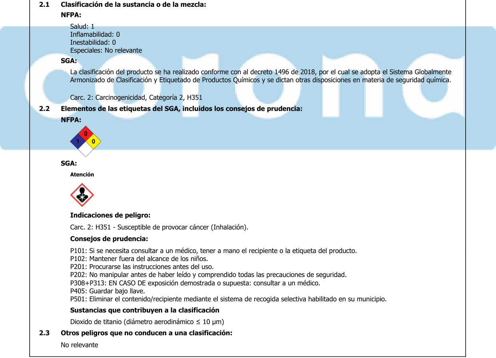
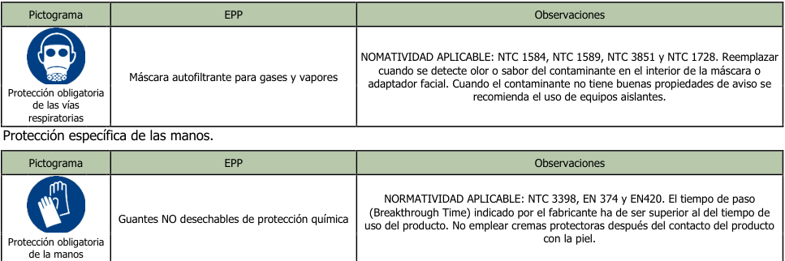
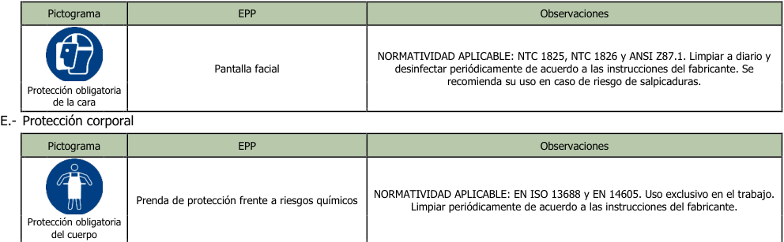
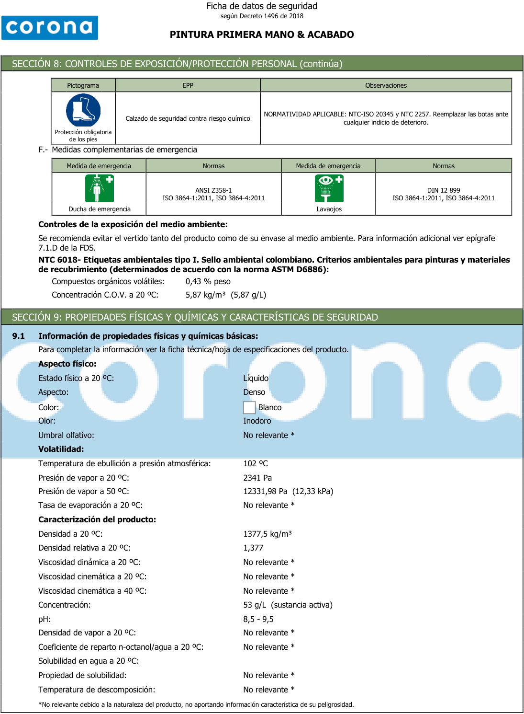
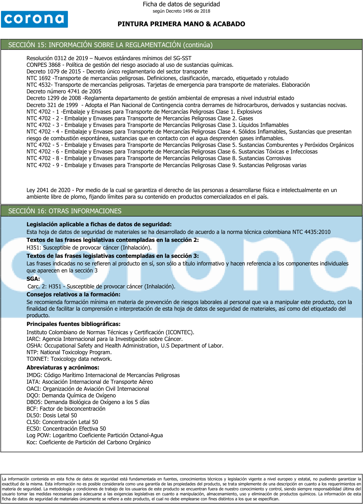

<!-- pagina: 1 -->
Ficha de datos de seguridad según Decreto 1496 de 2018 

> Imagen (pág. 1). Sin texto legible por OCR; contenido gráfico no interpretado.

<!-- Start of picture text -->
corona <!-- End of picture text -->

# **PINTURA PRIMERA MANO & ACABADO** 

# SECCIÓN 1: IDENTIFICACIÓN DEL PRODUCTO 

**1.1 Identificador SGA del producto:** PINTURA PRIMERA MANO & ACABADO **Otros medios de identificación:** No relevante **1.2 Uso recomendado del producto químico y restricciones:** Usos pertinentes: Pintura decorativa Usos desaconsejados: Todo aquel uso no especificado en este epígrafe ni en el epígrafe 7.3 **1.3 Datos sobre el proveedor:** CORLANC S.A.S. Carrera 48 N° 72 sur 01 Avenida Las Vegas 055450 Sabaneta - Antioquia - Colombia Tfno.: +57-4-3787800 materialesypinturascorona@corona.com.co https://www.corona.co **1.4 Número de teléfono para emergencias:** CISTEMA - ARL SURA 018000511414 - 0314055911 

# SECCIÓN 2: IDENTIFICACIÓN DEL PELIGRO O PELIGROS 

> Imagen (pág. 1). OCR automático, revisar: «2.1 Clasificación de la sustancia o de la mezcla: NFPA: Salud: 1 Inflamabilidad: 0 Inestabilidad: 0 Especiales: No relevante SGA: La clasificación del producto se ha realizado conforme con al decreto 1496 de 2018, por el cual se adopta el Sistema Globalmente Armonizado de Clasificación y Etiquetado de Productos Químicos y se dictan otras disposiciones en materia de seguridad química. Carc. 2: Carcinogenicidad, Categoría 2, H351 2.2 Elementos de las etiquetas del SGA, incluidos los consejos de prudencia: NFPA: Y SGA: Atención Indicaciones de peligro: Carc. 2: H351 - Susceptible de provocar cáncer (Inhalación). Consejos de prudencia: P101: Si se necesita consultar a un médico, tener a mano el recipiente o la etiqueta del producto. P102: Mantener fuera del alcance de los niños. P201: Procurarse las instrucciones antes del uso. P202: No manipular antes de haber leído y comprendido todas las precauciones de seguridad. P308+P313: EN CASO DE exposición demostrada o supuesta: consultar a un médico. P405: Guardar bajo llave. P501: Eliminar el contenido/recipiente mediante el sistema de recogida selectiva habilitado en su municipio. Sustancias que contribuyen a la clasificación Dioxido de titanio (diámetro aerodinámico < 10 ym) 2.3 Otros peligros que no conducen a una clasificación: No relevante»

<!-- Start of picture text -->
2.1  Clasificación de la sustancia o de la mezcla: NFPA: Salud: 1 Inflamabilidad: 0 Inestabilidad: 0 Especiales: No relevante SGA: La clasificación del producto se ha realizado conforme con al decreto 1496 de 2018, por el cual se adopta el Sistema Globalmente Armonizado de Clasificación y Etiquetado de Productos Químicos y se dictan otras disposiciones en materia de seguridad química. Carc. 2: Carcinogenicidad, Categoría 2, H351 2.2  Elementos de las etiquetas del SGA, incluidos los consejos de prudencia: NFPA: e SGA: Atención Indicaciones de peligro: Carc. 2: H351 - Susceptible de provocar cáncer (Inhalación). Consejos de prudencia: P101: Si se necesita consultar a un médico, tener a mano el recipiente o la etiqueta del producto. P102: Mantener fuera del alcance de los niños. P201: Procurarse las instrucciones antes del uso. P202: No manipular antes de haber leído y comprendido todas las precauciones de seguridad. P308+P313: EN CASO DE exposición demostrada o supuesta: consultar a un médico. P405: Guardar bajo llave. P501: Eliminar el contenido/recipiente mediante el sistema de recogida selectiva habilitado en su municipio. Sustancias que contribuyen a la clasificación Dioxido de titanio (diámetro aerodinámico ≤ 10 μm) 2.3  Otros peligros que no conducen a una clasificación: No relevante <!-- End of picture text -->

- CONTINÚA EN LA SIGUIENTE PÁGINA - 

Emisión: 05/06/2019            Revisión: 24/11/2021            Versión: 3 (sustituye a 2) 

**Página 1/9** 

<!-- pagina: 2 -->
Ficha de datos de seguridad según Decreto 1496 de 2018 

> Imagen (pág. 2). Sin texto legible por OCR; contenido gráfico no interpretado.

# **PINTURA PRIMERA MANO & ACABADO** 

# SECCIÓN 3: COMPOSICIÓN/INFORMACIÓN SOBRE LOS COMPONENTES 

- **3.1 Sustancias:** 

No aplicable 

- **3.2 Mezclas:** 

**Descripción química:** Mezcla acuosa a base de aditivos, cargas, coalescentes, pigmentos y resinas 

## **Componentes:** 

De acuerdo al Decreto 1496 de 2018, el producto presenta: 

||Identificación|Nombre químico/clasificación Concentración|
|---|---|---|
|CAS:|13463-67-7|**Dioxido de titanio (diámetro aerodinámico ≤ 10 μm)** **2.5 - <10 %** Carc. 2: H351 - Atención|

Para ampliar información sobre la peligrosidad de las sustancias consultar las secciones 11, 12 y 16. La clasificación respecto Carcinogenicidad de las sustancias se ha establecido en función de las monografías de la IARC adecuándola al sistema de clasificación SGA, para información sobre la clasificación IARC consulte la sección 11. 

# SECCIÓN 4: PRIMEROS AUXILIOS 

## **4.1 Descripción de los primeros auxilios necesarios:** 

Los síntomas como consecuencia de una intoxicación pueden presentarse con posterioridad a la exposición, por lo que, en caso de duda, exposición directa al producto químico o persistencia del malestar solicitar atención médica, mostrándole la FDS de este producto. 

## **Por inhalación:** 

Se trata de un producto que no contiene sustancias clasificadas como peligrosas por inhalación, sin embargo, en caso de síntomas de intoxicación sacar al afectado de la zona de exposición y proporcionarle aire fresco. Solicitar atención médica si los síntomas se agravan o persisten. 

## **Por contacto con la piel:** 

En caso de contacto se recomienda limpiar la zona afecta con agua por arrastre y con jabón neutro. En caso de alteraciones en la piel (escozor, rojez, sarpullidos, ampollas…), acudir a consulta médica con esta Ficha de Datos de Seguridad **Por contacto con los ojos:** 

Se trata de un producto que no contiene sustancias clasificadas como peligrosas en contacto con los ojos. Enjuagar durante al menos 15 minutos con abundante agua a temperatura ambiente, evitando que el afectado se frote o cierre los ojos. 

**Por ingestión/aspiración:** 

En caso de ingestión, solicitar asistencia médica inmediata mostrando la FDS de este producto. 

- **4.2 Síntomas/efectos más importantes, agudos o retardados:** 

Los efectos agudos y retardados son los indicados en las secciones 2 y 11 de la FDS. 

- **4.3 Indicación de la necesidad de recibir atención médica inmediata y, en su caso, de tratamiento especial:** No relevante 

# SECCIÓN 5: MEDIDAS DE LUCHA CONTRA INCENDIOS 

- **5.1 Medios de extinción apropiados:** 

**Medios de extinción apropiados:** 

Producto no inflamable bajo condiciones normales de almacenamiento, manipulación y uso. En caso de inflamación como consecuencia de manipulación, almacenamiento o uso indebido emplear preferentemente extintores de polvo polivalente (polvo ABC). 

## **Medios de extinción no apropiados:** 

No relevante 

- **5.2 Peligros específicos del producto químico:** 

Como consecuencia de la combustión o descomposición térmica se generan subproductos de reacción que pueden resultar altamente tóxicos y, consecuentemente, pueden presentar un riesgo elevado para la salud. 

- **5.3 Medidas especiales que deben tomar los equipos de lucha contra incendios:** 

En función de la magnitud del incendio puede hacerse necesario el uso de ropa protectora completa y equipo de respiración autónomo. Disponer de un mínimo de instalaciones de emergencia o elementos de actuación (mantas ignífugas, botiquín portátil,...). 

- CONTINÚA EN LA SIGUIENTE PÁGINA - 

Emisión: 05/06/2019            Revisión: 24/11/2021            Versión: 3 (sustituye a 2) 

**Página 2/9** 

<!-- pagina: 3 -->
Ficha de datos de seguridad según Decreto 1496 de 2018 

> Imagen (pág. 3). Sin texto legible por OCR; contenido gráfico no interpretado.

# **PINTURA PRIMERA MANO & ACABADO** 

# SECCIÓN 5: MEDIDAS DE LUCHA CONTRA INCENDIOS (continúa) 

**Disposiciones adicionales:** 

Actuar conforme el Plan de Emergencia Interior y las Fichas Informativas sobre actuación ante accidentes y otras emergencias. Suprimir cualquier fuente de ignición. En caso de incendio, refrigerar los recipientes y tanques de almacenamiento de productos susceptibles a inflamación, explosión o BLEVE como consecuencia de elevadas temperaturas. Evitar el vertido de los productos empleados en la extinción del incendio al medio acuático. 

# SECCIÓN 6: MEDIDAS QUE DEBEN TOMARSE EN CASO DE VERTIDO ACCIDENTAL 

## **6.1 Precauciones personales, equipo protector y procedimiento de emergencia:** 

Aislar las fugas siempre y cuando no suponga un riesgo adicional para las personas que desempeñen esta función. Ante la exposición potencial con el producto derramado se hace obligatorio el uso de elementos de protección personal (ver sección 8 de la FDS). Evacuar la zona y mantener a las personas sin protección alejadas. 

- **6.2 Precauciones relativas al medio ambiente:** 

Producto no clasificado como peligroso para el medioambiente. Mantener el producto alejado de los desagües y de las aguas superficiales y subterráneas. 

- **6.3 Métodos y materiales para la contención y limpieza de vertidos:** Se recomienda: Absorber el vertido mediante arena o absorbente inerte y trasladarlo a un lugar seguro. No absorber en serrín u otros absorbentes combustibles. Para cualquier consideración relativa a la eliminación consultar la sección 13 de la FDS. 

- **6.4 Referencias a otras secciones:** 

Absorber el vertido mediante arena o absorbente inerte y trasladarlo a un lugar seguro. No absorber en serrín u otros absorbentes combustibles. Para cualquier consideración relativa a la eliminación consultar la sección 13 de la FDS. 

Ver secciones 8 y 13. 

# SECCIÓN 7: MANIPULACIÓN Y ALMACENAMIENTO 

**7.1 Precauciones que se deben tomar para garantizar una manipulación segura:** A.- Precauciones generales Cumplir con la legislación vigente en materia de prevención de riesgos laborales. Mantener los recipientes herméticamente cerrados. Controlar los derrames y residuos, eliminándolos con métodos seguros (sección 6 de la FDS). Evitar el vertido libre desde el recipiente. Mantener orden y limpieza donde se manipulen productos peligrosos. B.- Recomendaciones técnicas para la prevención de incendios y explosiones. Producto no inflamable bajo condiciones normales de almacenamiento, manipulación y uso. Se recomienda trasvasar a velocidades lentas para evitar la generación de cargas electroestáticas que pudieran afectar a productos inflamables. Consultar la sección 10 de la FDS sobre condiciones y materias que deben evitarse. 

- C.- Recomendaciones técnicas para prevenir riesgos ergonómicos y toxicológicos. 

Para control de exposición consultar la sección 8 de la FDS. No comer, beber ni fumar en las zonas de trabajo lavarse las manos después de cada utilización, y despojarse de prendas de vestir y equipos de protección contaminados antes de entrar en las zonas para comer. D.- Recomendaciones técnicas para prevenir riesgos medioambientales Se recomienda disponer de material absorbente en las proximidades del producto (ver epígrafe 6.3 de la FDS para mayor información) **7.2 Condiciones de almacenamiento seguro, incluidas cualesquiera incompatibilidades:** A.- Medidas técnicas de almacenamiento Temperatura mínima: 5 ºC Temperatura máxima: 30 ºC Tiempo máximo: 12 meses B.- Condiciones generales de almacenamiento. 

Evitar fuentes de calor, radiación, electricidad estática y el contacto con alimentos. Para información adicional ver epígrafe 10.5 

- **7.3 Usos específicos finales:** 

Salvo las indicaciones ya especificadas no es preciso realizar ninguna recomendación especial en cuanto a los usos de este producto. 

- CONTINÚA EN LA SIGUIENTE PÁGINA - 

Emisión: 05/06/2019            Revisión: 24/11/2021            Versión: 3 (sustituye a 2) 

**Página 3/9** 

<!-- pagina: 4 -->
Ficha de datos de seguridad según Decreto 1496 de 2018 

> Imagen (pág. 4). Sin texto legible por OCR; contenido gráfico no interpretado.

# **PINTURA PRIMERA MANO & ACABADO** 

# SECCIÓN 8: CONTROLES DE EXPOSICIÓN/PROTECCIÓN PERSONAL 

## **8.1 Parámetros de control:** 

Sustancias cuyos valores límite de exposición profesional han de controlarse en el ambiente de trabajo: 

OSHA (Tablas Z): 

|Identificación|Valores límite|ambientales|
|---|---|---|
|Dioxido de titanio (diámetro aerodinámico ≤ 10 μm)|8-hour TWA PEL|15 mg/m³|
|CAS: 13463-67-7 IH:|Ceiling Values - TWA PEL||
|Identificación|Valores límite|ambientales|
|Dioxido de titanio (diámetro aerodinámico ≤ 10 μm)|TLV-TWA|10 mg/m³|
|CAS: 13463-67-7|TLV-STEL||

## ACGIH: 

## **8.2 Controles técnicos apropiados:** 

- A.- Medidas de protección individual, como equipo de protección personal (EPP) 

Realizar la identificación de los peligros y la valoración de los riesgos de acuerdo a la Guia técnica colombiana GTC 45. Como medida de prevención se recomienda la utilización de equipos de protección individual básicos. Para más información sobre los equipos de protección individual (almacenamiento, uso, limpieza, mantenimiento, clase de protección,…) consultar el folleto informativo facilitado por el fabricante del EPP. Las indicaciones contenidas en este punto se refieren al producto puro. Las medidas de protección para el producto diluido podrán variar en función de su grado de dilución, uso, método de aplicación, etc. Para determinar la obligación de instalación de duchas de emergencia y/o lavaojos en los almacenes se tendrá en cuenta la normativa referente al almacenamiento de productos químicos aplicable en cada caso. Para más información ver epígrafes 7.1 y 7.2 de la FDS. 

Toda la información aquí incluida es una recomendación siendo necesario su concreción por parte de los servicios de prevención de riesgos laborales al desconocer las medidas de prevención adicionales que la empresa pudiese disponer. 

- B.- Protección respiratoria. 

> Imagen (pág. 4). OCR automático, revisar: «Pictograma EPP Observaciones Protección obligatoria de las vías respiratorias Máscara autofiltrante para gases y vapores NOMATIVIDAD APLICABLE: NTC 1584, NTC 1589, NTC 3851 y NTC 1728. Reemplazar cuando se detecte olor o sabor del contaminante en el interior de la máscara o adaptador facial. Cuando el contaminante no tiene buenas propiedades de aviso se recomienda el uso de equipos aislantes. Protección específica de las manos. Pictograma EPP Observaciones Protección obligatoria de la manos ¡Guantes NO desechables de protección química NORMATIVIDAD APLICABLE: NTC 3398, EN 374 y EN420. El tiempo de paso (Breakthrough Time) indicado por el fabricante ha de ser superior al del tiempo de uso del producto. No emplear cremas protectoras después del contacto del producto con la piel.»

<!-- Start of picture text -->
Pictograma  EPP  Observaciones NOMATIVIDAD APLICABLE: NTC 1584, NTC 1589, NTC 3851 y NTC 1728. Reemplazar cuando se detecte olor o sabor del contaminante en el interior de la máscara o Máscara autofiltrante para gases y vapores adaptador facial. Cuando el contaminante no tiene buenas propiedades de aviso se Protección obligatoria  recomienda el uso de equipos aislantes. de las vías respiratorias C.- Protección específica de las manos. Pictograma  EPP  Observaciones NORMATIVIDAD APLICABLE: NTC 3398, EN 374 y EN420. El tiempo de paso (Breakthrough Time) indicado por el fabricante ha de ser superior al del tiempo de Guantes NO desechables de protección química uso del producto. No emplear cremas protectoras después del contacto del producto Protección obligatoria  con la piel. de la manos <!-- End of picture text -->

C.- Protección específica de las manos. 

Dado que el producto es una mezcla de diferentes materiales, la resistencia del material de los guantes no se puede calcular de antemano con total fiabilidad y por lo tanto tiene que ser controlados antes de su aplicación. 

- D.- Protección ocular y facial 

> Imagen (pág. 4). OCR automático, revisar: «Pictograma EPP Observaciones (dy) NORMATIVIDAD APLICABLE: NTC 1825, NTC 1826 y ANSI 287.1. Limpiar a diario y Pantalla facial desinfectar periódicamente de acuerdo a las instrucciones del fabricante. Se . recomienda su uso en caso de riesgo de salpicaduras. Protección obligatoria dela cara Protección corporal Pictograma EPP Observaciones Protección obligatoria del cuerpo Prenda de protección frente a riesgos químicos NORMATIVIDAD APLICABLE: EN ISO 13688 y EN 14605. Uso exclusivo en el trabajo. Limpiar periódicamente de acuerdo a las instrucciones del fabricante.»

<!-- Start of picture text -->
Pictograma  EPP  Observaciones NORMATIVIDAD APLICABLE: NTC 1825, NTC 1826 y ANSI Z87.1. Limpiar a diario y Pantalla facial  desinfectar periódicamente de acuerdo a las instrucciones del fabricante. Se recomienda su uso en caso de riesgo de salpicaduras. Protección obligatoria de la cara E.- Protección corporal Pictograma  EPP  Observaciones NORMATIVIDAD APLICABLE: EN ISO 13688 y EN 14605. Uso exclusivo en el trabajo. Prenda de protección frente a riesgos químicos Limpiar periódicamente de acuerdo a las instrucciones del fabricante. Protección obligatoria del cuerpo <!-- End of picture text -->

- CONTINÚA EN LA SIGUIENTE PÁGINA - 

Emisión: 05/06/2019            Revisión: 24/11/2021            Versión: 3 (sustituye a 2) 

**Página 4/9** 

<!-- pagina: 5 -->

> Imagen (pág. 5). OCR automático, revisar: «Ficha de datos de seguridad según Decreto 1496 de 2018 PINTURA PRIMERA MANO & ACABADO DE EXPOSICIÓN/PROTECCIÓN PERSONAL (continúa) Pictograma EPP Observaciones Calzado de seguridad contra riesgo químico | NORMATIVIDAD APLICABLE: NTC-1SO 20345 y NTC 2257. Reemplazar las botas ante seguri ra riesgo quil cualquier indicio de deterioro. Protección obligatoria de los pies F.- Medidas complementarias de emergencia Medida de emergencia Normas Medida de emergencia Normas ANSI 2358-1 DIN 12 899 150 3864-1:2011, ISO 3864-4:2011 1SO 3864-1:2011, ISO 3864-4:2011 Ducha de emergencia Lavaojos Controles de la exposición del medio ambiente: Se recomienda evitar el vertido tanto del producto como de su envase al medio ambiente. Para información adicional ver epígrafe 7.1.D de la FDS. NTC 6018- Etiquetas ambientales tipo I. Sello ambiental colombiano. Criterios ambientales para pinturas y materiales de recubrimiento (determinados de acuerdo con la norma ASTM D6886): Compuestos orgánicos volátiles: Concentración C.O.V. a 20 °C: 0,43 % peso 5,87 kg/m? (5,87 g/L) SECCION 9: PROPIEDADES FISICAS Y QUIMICAS Y CARACTERISTICAS DE 9.1 Información de propiedades físicas y químicas básicas: Para completar la información ver la ficha técnica/hoja de especificaciones del producto. Aspecto físico: Estado físico a 20 °C: Líquido Aspecto: Denso Color: Blanco Olor: Inodoro Umbral olfativo: No relevante * Volatilidad: Temperatura de ebullición a presión atmosférica: 102 °C Presión de vapor a 20 °C: 2341 Pa Presión de vapor a 50 °C: Tasa de evaporación a 20 °C: Caracterización del producto: Densidad a 20 °C: Densidad relativa a 20 °C: Viscosidad dinámica a 20 °C: Viscosidad cinemática a 20 °C: Viscosidad cinemática a 40 °C: Concentración: ph: Densidad de vapor a 20 °C: Coeficiente de reparto n-octanol/agua a 20 °C: Solubilidad en agua a 20 °C: Propiedad de solubilidad: Temperatura de descomposición: 12331,98 Pa (12,33 kPa) No relevante * 1377,5 kg/m? 1,377 No relevante * No relevante * No relevante * 53 g/L (sustancia activa) 8,5 - 9,5 No relevante * No relevante * No relevante * No relevante * *No relevante debido a la naturaleza del producto, no aportando información característica de su peligrosidad.»

<!-- Start of picture text -->
Ficha de datos de seguridad según Decreto 1496 de 2018 [corona PINTURA PRIMERA MANO & ACABADO SECCIÓN 8: CONTROLES DE EXPOSICIÓN/PROTECCIÓN PERSONAL (continúa) Pictograma  EPP  Observaciones NORMATIVIDAD APLICABLE: NTC-ISO 20345 y NTC 2257. Reemplazar las botas ante Calzado de seguridad contra riesgo químico cualquier indicio de deterioro. Protección obligatoria CAI de los pies F.- Medidas complementarias de emergencia Medida de emergencia  Normas  Medida de emergencia  Normas ANSI Z358-1  DIN 12 899 ISO 3864-1:2011, ISO 3864-4:2011  ISO 3864-1:2011, ISO 3864-4:2011 Ducha de emergencia  Lavaojos Controles de la exposición del medio ambiente:  ee| Se recomienda evitar el vertido tanto del producto como de su envase al medio ambiente. Para información adicional ver epígrafe 7.1.D de la FDS. NTC 6018- Etiquetas ambientales tipo I. Sello ambiental colombiano. Criterios ambientales para pinturas y materiales de recubrimiento (determinados de acuerdo con la norma ASTM D6886): Compuestos orgánicos volátiles:  0,43 % peso Concentración C.O.V. a 20 ºC:  5,87 kg/m³  (5,87 g/L) SECCIÓN 9: PROPIEDADES FÍSICAS Y QUÍMICAS Y CARACTERÍSTICAS DE SEGURIDAD 9.1  Información de propiedades físicas y químicas básicas: Para completar la información ver la ficha técnica/hoja de especificaciones del producto. Aspecto físico: Estado físico a 20 ºC:  Líquido Aspecto:  Denso Color:  Blanco Olor:  Inodoro Umbral olfativo:  No relevante * Volatilidad: Temperatura de ebullición a presión atmosférica:  102 ºC Presión de vapor a 20 ºC:  2341 Pa Presión de vapor a 50 ºC:  12331,98 Pa  (12,33 kPa) Tasa de evaporación a 20 ºC:  No relevante * Caracterización del producto: Densidad a 20 ºC:  1377,5 kg/m³ Densidad relativa a 20 ºC:  1,377 Viscosidad dinámica a 20 ºC:  No relevante * Viscosidad cinemática a 20 ºC:  No relevante * Viscosidad cinemática a 40 ºC:  No relevante * Concentración:  53 g/L  (sustancia activa) pH:  8,5 - 9,5 Densidad de vapor a 20 ºC:  No relevante * Coeficiente de reparto n-octanol/agua a 20 ºC:  No relevante * Solubilidad en agua a 20 ºC: Propiedad de solubilidad:  No relevante * Temperatura de descomposición:  No relevante * *No relevante debido a la naturaleza del producto, no aportando información característica de su peligrosidad. <!-- End of picture text -->

- CONTINÚA EN LA SIGUIENTE PÁGINA - 

Emisión: 05/06/2019            Revisión: 24/11/2021            Versión: 3 (sustituye a 2) 

**Página 5/9** 

<!-- pagina: 6 -->
Ficha de datos de seguridad 

según Decreto 1496 de 2018 

> Imagen (pág. 6). Sin texto legible por OCR; contenido gráfico no interpretado.

- No se esperan reacciones peligrosas si se cumplen las instrucciones técnicas de almacenamiento de productos químicos. Ver sección 7 de la FDS para mayor información. 

Bajo las condiciones indicadas no se esperan reacciones peligrosas ni polimerización peligrosa que puedan producir una presión o 

|Choque y fricción |Contacto con el aire |Calentamiento |Luz Solar |Humedad |
|---|---|---|---|---|
|No aplicable |No aplicable |No aplicable |No aplicable |No aplicable |
|**Materiales incompatible** Ácidos  |**s:** Agua  |Materias comburentes  |Materias combustibles  |Otros  |
|Evitar ácidos fuertes  |No aplicable  |No aplicable  |No aplicable  |Evitar álcalis o bases fuertes  |

- Ver epígrafe 10.3, 10.4 y 10.5 de la FDS para conocer los productos de descomposición específicamente. En dependencia de las condiciones de descomposición, como consecuencia de la misma pueden liberarse mezclas complejas de sustancias químicas: dióxido de carbono (CO2), monóxido de carbono y otros compuestos orgánicos. 

**PINTURA PRIMERA MANO & ACABADO** 

SECCIÓN 9: PROPIEDADES FÍSICAS Y QUÍMICAS Y CARACTERÍSTICAS DE SEGURIDAD (continúa) Punto de fusión/punto de congelación: No relevante * Propiedades explosivas: No relevante * Propiedades comburentes: No relevante * **Inflamabilidad:** Punto de inflamación: No inflamable (>93 ºC) Calor de combustión: No relevante * Inflamabilidad (sólido, gas): No relevante * Temperatura de auto-inflamación: 330 ºC Límite de inflamabilidad inferior: No relevante * Límite de inflamabilidad superior: No relevante * **Explosividad:** Límite inferior de explosividad: No relevante * Límite superior de explosividad: No relevante * **9.2 Información adicional:** Tensión superficial a 20 ºC: No relevante * Índice de refracción: No relevante * *No relevante debido a la naturaleza del producto, no aportando información característica de su peligrosidad. SECCIÓN 10: ESTABILIDAD Y REACTIVIDAD **10.1 Reactividad:** No se esperan reacciones peligrosas si se cumplen las instrucciones técnicas de almacenamiento de productos químicos. Ver sección 7 de la FDS para mayor información. **10.2 Estabilidad química:** Estable químicamente bajo las condiciones indicadas de almacenamiento, manipulación y uso. **10.3 Posibilidad de reacciones peligrosas:** Bajo las condiciones indicadas no se esperan reacciones peligrosas ni polimerización peligrosa que puedan producir una presión o temperaturas excesivas. **10.4 Condiciones que deben evitarse:** Aplicables para manipulación y almacenamiento a temperatura ambiente: Choque y fricción Contacto con el aire Calentamiento Luz Solar Humedad No aplicable No aplicable No aplicable No aplicable No aplicable **10.5 Materiales incompatibles:** Ácidos Agua Materias comburentes Materias combustibles Otros ~~|~~ Evitar ácidos fuertes No aplicable No aplicable No aplicable Evitar álcalis o bases fuertes **10.6 Productos de descomposición peligrosos:** Ver epígrafe 10.3, 10.4 y 10.5 de la FDS para conocer los productos de descomposición específicamente. En dependencia de las condiciones de descomposición, como consecuencia de la misma pueden liberarse mezclas complejas de sustancias químicas: dióxido de carbono (CO2), monóxido de carbono y otros compuestos orgánicos. SECCIÓN 11: INFORMACIÓN TOXICOLÓGICA **11.1 Información sobre las posibles vías de exposición:** No se dispone de datos experimentales del producto en sí mismo relativos a las propiedades toxicológicas **Efectos peligrosos para la salud:** En caso de exposición repetitiva, prolongada o a concentraciones superiores a las establecidas por los límites de exposición profesionales, pueden producirse efectos adversos para la salud en función de la vía de exposición: A- Ingestión (efecto agudo): ~~<u>sz</u>~~ 

- CONTINÚA EN LA SIGUIENTE PÁGINA - **Página 6/9** 

Emisión: 05/06/2019            Revisión: 24/11/2021            Versión: 3 (sustituye a 2) 

<!-- pagina: 7 -->
Ficha de datos de seguridad según Decreto 1496 de 2018 

> Imagen (pág. 7). Sin texto legible por OCR; contenido gráfico no interpretado.

# **PINTURA PRIMERA MANO & ACABADO** 

# SECCIÓN 11: INFORMACIÓN TOXICOLÓGICA (continúa) 

   - Toxicidad aguda: A la vista de los datos disponibles, no se cumplen los criterios de clasificación, no presentando sustancias clasificadas como peligrosas por ingestión. Para más información ver sección 3 de la FDS. 

   - Corrosividad/Irritabilidad: A la vista de los datos disponibles, no se cumplen los criterios de clasificación, no presentando sustancias clasificadas como peligrosas por este efecto. Para más información ver sección 3 de la FDS. 

- B- Inhalación (efecto agudo): 

   - Toxicidad aguda: A la vista de los datos disponibles, no se cumplen los criterios de clasificación, no presentando sustancias clasificadas como peligrosas por inhalación. Para más información ver sección 3 de la FDS. 

   - Corrosividad/Irritabilidad: A la vista de los datos disponibles, no se cumplen los criterios de clasificación, no presentando sustancias clasificadas como peligrosas por este efecto. Para más información ver sección 3 de la FDS. 

- C- Contacto con la piel y los ojos (efecto agudo): 

   - Contacto con la piel: A la vista de los datos disponibles, no se cumplen los criterios de clasificación, no presentando sustancias clasificadas como peligrosas por contacto con la piel. Para más información ver sección 3 de la FDS. 

   - Contacto con los ojos: A la vista de los datos disponibles, no se cumplen los criterios de clasificación, no presentando sustancias clasificadas como peligrosas por este efecto. Para más información ver sección 3 de la FDS. 

- D- Efectos CMR (carcinogenicidad, mutagenicidad y toxicidad para la reproducción): 

   - Carcinogenicidad: La exposición a este producto puede causar cáncer. Para más información sobre posibles efectos específicos sobre la salud ver sección 2 de la FDS. 

IARC: White mineral oil, <=20.5mm2/s (40ºC) (3); Dioxido de titanio (diámetro aerodinámico ≤ 10 μm) (2B); Destilados (petróleo), fracción ligera tratada con hidrógeno (3) 

   - Mutagenicidad: A la vista de los datos disponibles, no se cumplen los criterios de clasificación, no presentando sustancias clasificadas como peligrosas por este efecto. Para más información ver sección 3 de la FDS. 

   - Toxicidad para la reproducción: A la vista de los datos disponibles, no se cumplen los criterios de clasificación, no presentando sustancias clasificadas como peligrosas por este efecto. Para más información ver sección 3 de la FDS. 

- E- Efectos de sensibilización: 

   - Respiratoria: A la vista de los datos disponibles, no se cumplen los criterios de clasificación, no presentando sustancias clasificadas como peligrosas con efectos sensibilizantes. Para más información ver secciones 2, 3 y 15 de la FDS. 

   - Cutánea: A la vista de los datos disponibles, no se cumplen los criterios de clasificación, no presentando sustancias clasificadas como peligrosas por este efecto. Para más información ver sección 3 de la FDS. 

- F- Toxicidad específica en determinados órganos (STOT)-exposición única: 

A la vista de los datos disponibles, no se cumplen los criterios de clasificación, no presentando sustancias clasificadas como peligrosas por este efecto. Para más información ver sección 3 de la FDS. 

- G- Toxicidad específica en determinados órganos (STOT)-exposición repetida: 

   - Toxicidad específica en determinados órganos (STOT)-exposición repetida: A la vista de los datos disponibles, no se cumplen los criterios de clasificación, no presentando sustancias clasificadas como peligrosas por este efecto. Para más información ver sección 3 de la FDS. 

   - Piel: A la vista de los datos disponibles, no se cumplen los criterios de clasificación, no presentando sustancias clasificadas como peligrosas por este efecto. Para más información ver sección 3 de la FDS. 

- H- Peligro por aspiración: 

A la vista de los datos disponibles, no se cumplen los criterios de clasificación, no presentando sustancias clasificadas como peligrosas por este efecto. Para más información ver sección 3 de la FDS. 

## **Información adicional:** 

CAS 13463-67-7 Dióxido de Titanio: IARC lista esta sustancia como un posible carcinógeno humano (grupo 2B), indicando que hay suficientes evidencias para considerarlo carcinógeno en animales pero insuficientes para considerarlo como carcinógeno para seres humanos. 

La monografía de IARC para esta sustancia indica que no hay exposición significativa al dióxido de titanio durante el uso normal de productos en los que dióxido de titanio está unido permanentemente a otros materiales, tales como pinturas (Ref: Monografía IARC, Vol. 93, 2010). 

El lijado repetido de las superficies de película seca puede producir riesgo de sobreexposición al polvo dependiendo de la duración y nivel de lijado, para evitarla deben tomarse las medidas de protección adecuadas. 

## **Información toxicológica específica de las sustancias:** 

|Identificación|To|xicidad aguda|Género|
|---|---|---|---|
|Dioxido de titanio (diámetro aerodinámico ≤ 10 μm)|DL50 oral|10000 mg/kg|Rata|
|CAS: 13463-67-7|DL50 cutánea|10000 mg/kg|Conejo|
||CL50 inhalación|No relevante||

- CONTINÚA EN LA SIGUIENTE PÁGINA - 

Emisión: 05/06/2019            Revisión: 24/11/2021            Versión: 3 (sustituye a 2) 

**Página 7/9** 

<!-- pagina: 8 -->
Ficha de datos de seguridad según Decreto 1496 de 2018 **PINTURA PRIMERA MANO & ACABADO** <mark>SECCIÓN 12: INFORMACIÓN ECOTOXICOLÓGICA</mark> No se disponen de datos experimentales de la mezcla en sí misma relativos a las propiedades ecotoxicológicas. **12.1 Toxicidad:** No determinado **12.2 Persistencia y degradabilidad:** No disponible **12.3 Potencial de bioacumulación:** No determinado **12.4 Movilidad en el suelo:** No determinado **12.5 Resultados de la valoración PBT y mPmB:** No aplicable **12.6 Otros efectos adversos:** No descritos SECCIÓN 13: INFORMACIÓN RELATIVA A LA ELIMINACIÓN DE LOS PRODUCTOS **13.1 Métodos de eliminación: Gestión del residuo (eliminación y valorización):** Consultar al gestor de residuos autorizado las operaciones de valorización y eliminación. En el caso de que el envase haya estado en contacto directo con el producto se gestionará del mismo modo que el propio producto, en caso contrario se gestionará como residuo no peligroso. Se desaconseja su vertido a cursos de agua. Ver epígrafe 6.2. **Disposiciones legislativas relacionadas con la gestión de residuos:** Legislación relacionada con la gestión de residuos: Decreto 1076 de 2015 (Decreto único reglamentario del Sector Ambiente y Desarrollo Sostenible) ~~<u>—</u>~~ SECCIÓN 14: INFORMACIÓN RELATIVA AL TRANSPORTE Este producto no está regulado para su transporte SECCIÓN 15: INFORMACIÓN SOBRE LA REGLAMENTACIÓN **15.1 Disposiciones específicas sobre seguridad, salud y medio ambiente para el producto de que se trate:** NTP (National Toxicology Program): No relevante **Disposiciones particulares en materia de protección de las personas o el medio ambiente:** Se recomienda emplear la información recopilada en esta hoja de datos de seguridad de materiales como datos de entrada en una evaluación de riesgos de las circunstancias locales con el objeto de establecer las medidas necesarias de prevención de riesgos para el manejo, utilización, almacenamiento y eliminación de este producto. **Otras legislaciones:** ~~2~~ 

- CONTINÚA EN LA SIGUIENTE PÁGINA - 

Emisión: 05/06/2019            Revisión: 24/11/2021            Versión: 3 (sustituye a 2) 

**Página 8/9** 

<!-- pagina: 9 -->

> Imagen (pág. 9). OCR automático, revisar: «Ficha de datos de seguridad según Decreto 1496 de 2018 [COrona| PINTURA PRIMERA MANO 8: ACABADO CCIÓN 15: INFORMACION SOBRE LA REGLAMENTACIÓN (con úa) Resolución 0312 de 2019 — Nuevos estándares mínimos del SG-SST CONPES 3868 - Política de gestión del riesgo asociado al uso de sustancias químicas. Decreto 1079 de 2015 - Decreto único reglamentario del sector transporte NTC 1692 Transporte de mercancías peligrosas. Definiciones, clasificación, marcado, etiquetado y rotulado NTC 4532- Transporte de mercancías peligrosas. Tarjetas de emergencia para transporte de materiales. Elaboración Decreto número 4741 de 2005 Decreto 1299 de 2008 -Reglamenta departamento de gestión ambiental de empresas a nivel industrial estado Decreto 321 de 1999 - Adopta el Plan Nacional de Contingencia contra derrames de hidrocarburos, derivados y sustancias nocivas. NTC 4702 - 1 -Embalaje y Envases para Transporte de Mercancías Peligrosas Clase 1. Explosivos NTC 4702 - 2 - Embalaje y Envases para Transporte de Mercancías Peligrosas Clase 2. Gases NTC 4702 - 3 - Embalaje y Envases para Transporte de Mercancías Peligrosas Clase 3. Líquidos Inflamables NTC 4702 - 4 - Embalaje y Envases para Transporte de Mercancías Peligrosas Clase 4. Sólidos Inflamables, Sustancias que presentan riesgo de combustión espontánea, sustancias que en contacto con el agua desprenden gases inflamables. NTC 4702 - 5 - Embalaje y Envases para Transporte de Mercancías Peligrosas Clase 5. Sustancias Comburentes y Peróxidos Orgánicos NTC 4702 - 6 - Embalaje y Envases para Transporte de Mercancías Peligrosas Clase 6. Sustancias Tóxicas e Infecciosas NTC 4702 - 8 - Embalaje y Envases para Transporte de Mercancías Peligrosas Clase 8. Sustancias Corrosivas NTC 4702 - 9 - Embalaje y Envases para Transporte de Mercancías Peligrosas Clase 9. Sustancias Peligrosas varias Ley 2041 de 2020 - Por medio de la cual se garantiza el derecho de las personas a desarrollarse física e intelectualmente en un ambiente libre de plomo, fijando limites para su contenido en productos comercializados en el pais. Legislación aplicable a fichas de datos de seguridad: Esta hoja de datos de seguridad de materiales se ha desarrollado de acuerdo a la norma técnica colombiana NTC 4435:2010 Textos de las frases legislativas contempladas en la sección 2: H351: Susceptible de provocar cáncer (Inhalación). Textos de las frases legislativas contempladas en la sección 3: Las frases indicadas no se refieren al producto en sí, son sólo a título informativo y hacen referencia a los componentes individuales que aparecen en la sección 3 SGA: Carc. 2: H351 - Susceptible de provocar cáncer (Inhalación). Consejos relativos a la formación: Se recomienda formación mínima en materia de prevención de riesgos laborales al personal que va a manipular este producto, con la finalidad de facilitar la comprensión e interpretación de esta hoja de datos de seguridad de materiales, así como del etiquetado del producto. Principales fuentes bibliográficas: Instituto Colombiano de Normas Técnicas y Certificación (ICONTEC). TARC: Agencia Internacional para la Investigación sobre Cáncer. OSHA: Occupational Safety and Health Administration, U.S Department of Labor. NTP: National Toxicology Program. TOXNET: Toxicology data network. Abreviaturas y acrónimos: IMDG: Código Marítimo Internacional de Mercancías Peligrosas IATA: Asociación Internacional de Transporte Aéreo OACI: Organización de Aviación Civil Internacional DQO: Demanda Química de Oxígeno DBO5: Demanda Biológica de Oxígeno a los 5 días BCF: Factor de bioconcentración DL5O: Dosis Letal 50 CL50: Concentración Letal 50 EC50: Concentración Efectiva 50 Log POW: Logaritmo Coeficiente Partición Octanol-Agua Koc: Coeficiente de Partición del Carbono Orgánico La información contenida en esta ficha de datos de seguridad está fundamentada en fuentes, conocimientos técnicos y legislación vigente a nivel europeo y estatal, no pudiendo garantizar la exactitud de la misma. Esta información no es posible considerarla como una garantía de las propiedades del producto, se trata simplemente de una descripción en cuanto a los requerimientos en| materia de seguridad. La metodología y condiciones de trabajo de los usuarios de este producto se encuentran fuera de nuestro conocimiento y control, siendo siempre responsabilidad última del usuario tomar las medidas necesarias para adecuarse a las exigencias legislativas en cuanto a manipulación, almacenamiento, uso y eliminación de productos químicos. La información de esta ficha de datos de seguridad de materiales únicamente se refiere a este producto, el cual no debe emplearse con fines distintos a los que se especifican,»

<!-- Start of picture text -->
Ficha de datos de seguridad según Decreto 1496 de 2018 PINTURA PRIMERA MANO & ACABADO SECCIÓN 15: INFORMACIÓN SOBRE LA REGLAMENTACIÓN (continúa) Resolución 0312 de 2019 – Nuevos estándares mínimos del SG-SST CONPES 3868 - Política de gestión del riesgo asociado al uso de sustancias químicas. Decreto 1079 de 2015 - Decreto único reglamentario del sector transporte NTC 1692 -Transporte de mercancías peligrosas. Definiciones, clasificación, marcado, etiquetado y rotulado NTC 4532- Transporte de mercancías peligrosas. Tarjetas de emergencia para transporte de materiales. Elaboración Decreto número 4741 de 2005 Decreto 1299 de 2008 -Reglamenta departamento de gestión ambiental de empresas a nivel industrial estado Decreto 321 de 1999  - Adopta el Plan Nacional de Contingencia contra derrames de hidrocarburos, derivados y sustancias nocivas. NTC 4702 - 1 -Embalaje y Envases para Transporte de Mercancías Peligrosas Clase 1. Explosivos NTC 4702 - 2 - Embalaje y Envases para Transporte de Mercancías Peligrosas Clase 2. Gases NTC 4702 - 3 - Embalaje y Envases para Transporte de Mercancías Peligrosas Clase 3. Líquidos Inflamables NTC 4702 - 4 - Embalaje y Envases para Transporte de Mercancías Peligrosas Clase 4. Sólidos Inflamables, Sustancias que presentan riesgo de combustión espontánea, sustancias que en contacto con el agua desprenden gases inflamables. NTC 4702 - 5 - Embalaje y Envases para Transporte de Mercancías Peligrosas Clase 5. Sustancias Comburentes y Peróxidos Orgánicos NTC 4702 - 6 - Embalaje y Envases para Transporte de Mercancías Peligrosas Clase 6. Sustancias Tóxicas e Infecciosas NTC 4702 - 8 - Embalaje y Envases para Transporte de Mercancías Peligrosas Clase 8. Sustancias Corrosivas NTC 4702 - 9 - Embalaje y Envases para Transporte de Mercancías Peligrosas Clase 9. Sustancias Peligrosas varias Ley 2041 de 2020 - Por medio de la cual se garantiza el derecho de las personas a desarrollarse física e intelectualmente en un ambiente libre de plomo, fijando límites para su contenido en productos comercializados en el país. o SECCIÓN 16: OTRAS INFORMACIONES Legislación aplicable a fichas de datos de seguridad: Esta hoja de datos de seguridad de materiales se ha desarrollado de acuerdo a la norma técnica colombiana NTC 4435:2010 Textos de las frases legislativas contempladas en la sección 2: H351: Susceptible de provocar cáncer (Inhalación). Textos de las frases legislativas contempladas en la sección 3: Las frases indicadas no se refieren al producto en sí, son sólo a título informativo y hacen referencia a los componentes individuales que aparecen en la sección 3 SGA: Carc. 2: H351 - Susceptible de provocar cáncer (Inhalación). Consejos relativos a la formación: Se recomienda formación mínima en materia de prevención de riesgos laborales al personal que va a manipular este producto, con la finalidad de facilitar la comprensión e interpretación de esta hoja de datos de seguridad de materiales, así como del etiquetado del producto. Principales fuentes bibliográficas: Instituto Colombiano de Normas Técnicas y Certificación (ICONTEC). IARC: Agencia Internacional para la Investigación sobre Cáncer. OSHA: Occupational Safety and Health Administration, U.S Department of Labor. NTP: National Toxicology Program. TOXNET: Toxicology data network. Abreviaturas y acrónimos: IMDG: Código Marítimo Internacional de Mercancías Peligrosas IATA: Asociación Internacional de Transporte Aéreo OACI: Organización de Aviación Civil Internacional DQO: Demanda Química de Oxígeno DBO5: Demanda Biológica de Oxígeno a los 5 días BCF: Factor de bioconcentración DL50: Dosis Letal 50 CL50: Concentración Letal 50 EC50: Concentración Efectiva 50 Log POW: Logaritmo Coeficiente Partición Octanol-Agua Koc: Coeficiente de Partición del Carbono Orgánico La información contenida en esta ficha de datos de seguridad está fundamentada en fuentes, conocimientos técnicos y legislación vigente a nivel europeo y estatal, no pudiendo garantizar la exactitud de la misma. Esta información no es posible considerarla como una garantía de las propiedades del producto, se trata simplemente de una descripción en cuanto a los requerimientos en materia de seguridad. La metodología y condiciones de trabajo de los usuarios de este producto se encuentran fuera de nuestro conocimiento y control, siendo siempre responsabilidad última del usuario tomar las medidas necesarias para adecuarse a las exigencias legislativas en cuanto a manipulación, almacenamiento, uso y eliminación de productos químicos. La información de esta ficha de datos de seguridad de materiales únicamente se refiere a este producto, el cual no debe emplearse con fines distintos a los que se especifican. =m <!-- End of picture text -->

FIN DE LA FICHA DE DATOS DE SEGURIDAD **Página 9/9** 

Emisión: 05/06/2019            Revisión: 24/11/2021            Versión: 3 (sustituye a 2) 
