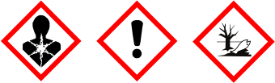

<!-- pagina: 1 -->
# **HOJA DE DATOS DE SEGURIDAD** 

> Imagen (pág. 1). Sin texto legible por OCR; contenido gráfico no interpretado.

<!-- Start of picture text -->
| <!-- End of picture text -->

**Fecha de emisión 28 Julio 2021** 

**Versión 5** 

**Sección 1. Identificación del producto y la compañía** ~~PT~~ **Nombre del producto :** PITT-CHAR XP BASE WHITE **Código del producto :** 00393292 **Otros medios de :** No disponible. **identificación Tipo de producto :** Líquido. 

**<mark>Uso recomendado de la sustancia química peligrosa o mezcla, y restricciones de uso</mark>** 

|Revestimiento. Pinturas. Materi **Usos identificados** ~~p~~|ales relacionados con las pinturas. ~~d~~|
|---|---|
|**Restricciones de uso**  |**Motivo**  |
|No aplicable. |~~AA~~|
|**Datos del proveedor o** **fabricante:**||
|**Proveedor**|**:** PPG Industries Colombia Ltda Calle 51 # 40-13 Municipio de Itagüí Antioquia, Colombia (57) (4) 3787400 (Porteria)|
|**Dirección de Email:**|**:** HazComLatam@ppg.com|
|**Número de teléfono en caso** **de emergencia**|**:** Colombia: 01 8000 916012 (CISPROQUIM) + 571 288 6012 (CISPROQUIM) Ecuador: 1800-59-3005 (CISPROQUIM) Peru: 080-050-847 (CISPROQUIM)|

|**Sección 2. Ident** |**ificación de los peligros** ~~Po~~||
|---|---|---|
|**Clasificación de la** **sustancia química** **peligrosa o mezcla** **Órganos diana** |TOXICIDAD AGUDA (oral) - Categoría 5 IRRITACIÓN CUTÁNEA - Categoría 3 IRRITACIÓN OCULAR - Categoría 2A SENSIBILIZACIÓN CUTÁNEA - Categoría 1 TOXICIDAD PARA LA REPRODUCCIÓN - Categoría 2 PELIGRO (AGUDO) PARA EL MEDIO AMBIENTE ACUÁTICO - Categoría 2 PELIGRO (A LARGO PLAZO) PARA EL MEDIO AMBIENTE ACUÁTICO - Categoría 2 **:** **:** Contiene material que puede causar daño a los órganos siguientes: tracto respiratorio superior, piel, ojos. ||
||**Spanish (MX)** **Colombia** ~~OO~~ ~~7~~|**_1/15_**  ~~]~~|

<!-- pagina: 2 -->
**Código 00393292 Nombre del producto** 

**Fecha de emisión** 

**Versión** 

**28 Julio 2021** 

**5** 

**PITT-CHAR XP BASE WHITE** 

## **Sección 2. Identificación de los peligros** 

Porcentaje de la mezcla que consiste en ingredientes de toxicidad oral aguda desconocida: 27.1 % 

Porcentaje de la mezcla consistente de ingrediente(s) con peligros desconocidos para el medio ambiente acuático: 30.1 % 

**<mark>Elementos de las etiquetas del SGA</mark>** 

**Pictogramas de peligro** 

**:** 

> Imagen (pág. 2). Sin texto legible por OCR; contenido gráfico no interpretado.

- **Palabra de advertencia :** Atención **Indicaciones de peligro :** Puede ser nocivo en caso de ingestión. Provoca una leve irritación cutánea. Puede provocar una reacción cutánea alérgica. Provoca irritación ocular grave. 

Susceptible de perjudicar la fertilidad o dañar al feto. Tóxico para los organismos acuáticos, con efectos nocivos duraderos. 

**Consejos de prudencia Prevención** 

   - **:** Procurarse las instrucciones antes del uso.  Usar guantes de protección, ropa de protección e equipo de protección para la cara o los ojos.  No dispersar en el medio ambiente.  Evitar respirar vapor. 

- **Intervención/Respuesta :** Recoger los vertidos.  En caso de exposición demostrada o supuesta: Consultar a un médico.  Quitar la ropa contaminada y lavarla antes de volverla a usar.  En caso de contacto con la piel: Lavar con abundante agua.  En caso de irritación cutánea o sarpullido: Consultar a un médico.  En caso de contacto con los ojos: Enjuagar con agua cuidadosamente durante varios minutos. Quitar los lentes de contacto, cuando estén presentes y pueda hacerse con facilidad. Proseguir con el lavado.  Si la irritación ocular persiste: Consultar a un médico. 

- **Almacenamiento :** No aplicable. **Eliminación :** Eliminar el contenido y recipiente conforme a todas las reglamentaciones locales, regionales, nacionales e internacionales. 

**Otros peligros que no contribuyen en la clasificación** 

- **:** No se conoce ninguno. 

## **Sección 3. Composición / información sobre los componentes** 

**Sustancia/mezcla :** Mezcla **Otros medios de :** No disponible. **identificación** 

**<mark>Número CAS/otros identificadores</mark>** 

**Número CAS :** No aplicable. 

**Spanish (MX) Colombia** 

**_2/15_** 

<!-- pagina: 3 -->
**Código 00393292 Nombre del producto PITT-CHAR XP BASE WHITE** 

**Fecha de emisión 28 Julio 2021** 

**Versión** 

**5** 

## **Sección 3. Composición / información sobre los componentes** 

|**Nombre de ingrediente**|**%**|**Número CAS**|
|---|---|---|
|undecaóxido de hexaboro y dicinc|20 - <30|12767-90-7|
|Dodecanedioic acid, polymer with 2,2'-[1,4-butanediylbis(oxymethylene)] bis[oxirane], (chloromethyl)oxirane, 4,4'-(1-methylethylidene)bis[phenol], nonanedioic acid and 2,2'-oxybis[ethanol]|20 - <30|139651-91-5|
|Borate(5-), bis[μ-oxotetraoxodiborato(4-)]-, ammonium tetrahydrogen, dihydrate, (T-4)-|15 - <20|12046-04-7|
|phosphorous oxychloride, reaction products with propylene oxide|12.5 - <15|1244733-77-4|
|2,2'-[(1-metiletiliden)bis(4,1-fenilenoximetilen)]bisoxirano|7 - <10|1675-54-3|
|ácidos polifosfóricos, sales de amonio|3 - <5|68333-79-9|
|Vidrio, óxido, sustancias químicas|1 - <2|65997-17-3|

**No hay ningún ingrediente adicional presente que, bajo el conocimiento actual del proveedor y en las concentraciones aplicables, sea clasificado como de riesgo para la salud o el medio ambiente y por lo tanto deban ser reportados en esta sección.** 

**Los límites de exposición laboral, en caso de existir, figuran en la sección 8.** 

**Código SUB indica substancias sin número CAS registrados.** 

## **Sección 4. Primeros auxilios** 

|**Descripción de los primeros auxilios**|
|---|

- **Contacto con los ojos :** Quítese los lentes de contacto, lavar inmediatamente con abundante agua fresca y limpia, manteniendo los párpados separados durante al menos 10 minutos y busque atención médica inmediata. 

- **Por inhalación :** Traslade al aire libre. Mantenga a la persona caliente y en reposo. Si no hay respiración, ésta es irregular u ocurre un paro respiratorio, el personal capacitado debe proporcionar respiración artificial u oxígeno. 

- **Contacto con la piel :** Quítese la ropa y calzado contaminados. Lavar perfectamente la piel con agua y jabón, o con un limpiador cutáneo reconocido. NO utilizar disolventes ni diluyentes. 

- **Ingestión :** En caso de ingestión, acúdase inmediatamente al médico y muéstrele la etiqueta o el envase. Mantenga a la persona caliente y en reposo. No provocar el vómito. 

|**Indicación de la necesidad de**|**recibir atención médica inmediata y, en su caso, de tratamiento especial**|
|---|---|
|**Notas para el médico**|**:** En caso de inhalación de productos de descomposición en un incendio, los|
|**Tratamientos específicos**|**:** síntomas pueden tardarse en aparecer.  La persona expuesta puede necesitar ser mantenida bajo vigilancia médica por 48 horas. No hay un tratamiento específico.|
|**Protección del personal de** **primeros auxilios**|**:**   No se tomará ninguna medida que implique algún riesgo personal o que no contemple el entrenamiento adecuado.  Puede ser peligroso para la persona que proporcione ayuda dar respiración boca a boca.  Lave bien la ropa contaminada con agua antes de quitársela, o use guantes.|
|**Efectos agudos potenciales e**|**n la salud**|
|**Contacto con los ojos**|**:** Provoca irritación ocular grave.|
|**Por inhalación**|**:** No se conocen efectos significativos o riesgos críticos.|
|**Contacto con la piel** **Ingestión**|**:** Provoca una leve irritación cutánea.  Puede provocar una reacción cutánea alérgica. **:** Puede ser nocivo en caso de ingestión.|

**Vea la sección 11 para la Información Toxicológica** 

**Spanish (MX) Colombia** **_3/15_** 

<!-- pagina: 4 -->
**Código 00393292 Nombre del producto PITT-CHAR XP BASE WHITE** 

**Fecha de emisión 28 Julio 2021** 

**Versión** 

**5** 

## **Sección 5. Medidas contra incendios** 

|**Medios de extinción** **Medios de extinción** **apropiados** **Medios no apropiados de** **extinción**|Use un agente de extinción adecuado para el incendio circundante. No se conoce ninguno. **:** **:**|
|---|---|
|**Peligros específicos de la** **sustancia química** **peligrosa o mezcla**|En caso de incendio o calentamiento, ocurrirá un aumento de presión y el recipiente estallará, con el riesgo de que ocurra una explosión.  Este material es tóxico para la vida acuática con efectos de larga duración.  Se debe impedir que el agua de extinción de incendios contaminada con este material entre en vías de agua, drenajes o alcantarillados. **:**|
|**Productos de** **descomposición térmica** **peligrosos**|Los productos de descomposición pueden incluir los siguientes materiales: óxidos de carbono óxidos del nitrógeno óxidos del fósforo compuestos halógenos. óxido/óxidos metálico/metálicos **:**|
|**Equipo de protección** **especial para los** **bomberos** **Medidas especiales que** **deberán seguir los grupos** **de combate contra** **incendio**|En caso de incendio, aísle rápidamente la zona evacuando a todas las personas de las proximidades del lugar del incidente.  No se tomará ninguna medida que implique algún riesgo personal o que no contemple el entrenamiento adecuado. Los bomberos deben llevar equipo de protección apropiado y un equipo de respiración autónomo con una máscara facial completa que opere en modo de presión positiva. **:** **:**|
|**Sección 6. Medid** **accidental** **Precauciones personales, e**|**as que deben tomarse en caso de derrame o fuga** **quipo de protección y procedimiento de emergencia**|
|**Para personal de no** **emergencia** **Para el personal de** **respuesta a emergencias**|**:** No se tomará ninguna medida que implique algún riesgo personal o que no contemple el entrenamiento adecuado.  Evacuar los alrededores.  No deje que entre el personal innecesario y sin protección.  No toque o camine sobre el material derramado.  Evite respirar vapor o neblina.  Proporcione ventilación adecuada. Llevar un aparato de respiración apropiado cuando el sistema de ventilación sea inadecuado.  Llevar puestos equipos de protección personal adecuados. **:** Si fuera necesario usar ropa especial para hacer frente al derrame, se tomará en cuenta la información de la Sección 8 sobre los materiales adecuados y no adecuados.  Consultar también la información bajo "Para personal de no emergencia".|
|**Precauciones relativas al** **medio ambiente**|**:** Evite la dispersión del material derramado, su contacto con el suelo, el medio acuático, los desagües y las alcantarillas.  Informe a las autoridades pertinentes si el producto ha causado polución medioambiental (alcantarillas, canales, tierra o aire).  Material contaminante del agua.  Puede ser dañino para el medio ambiente si es liberado en cantidades grandes.  Recoger los vertidos.|

**<mark>Métodos y materiales para la contención y limpieza de derrames o fugas</mark>** 

|**Spanish (MX)**|**Colombia** **_4/15_**|
|---|---|

<!-- pagina: 5 -->
**Código 00393292 Nombre del producto** 

**Fecha de emisión** 

**Versión** 

**28 Julio 2021** 

**5** 

**PITT-CHAR XP BASE WHITE** 

## **Sección 6. Medidas que deben tomarse en caso de derrame o fuga accidental** 

**Derrame pequeño** 

**Gran derrame** 

- **:** Detener la fuga si esto no presenta ningún riesgo.  Retire los envases del área del derrame.  Diluir con agua y fregar si es soluble en agua.  Alternativamente, o si es insoluble en agua, absorber con un material seco inerte y colocar en un contenedor de residuos adecuado.  Disponga por medio de un contratista autorizado para la disposición. 

- **:** Detener la fuga si esto no presenta ningún riesgo.  Retire los envases del área del derrame.  Aproximarse al vertido en el sentido del viento.  Evite la entrada en alcantarillas, canales de agua, sótanos o áreas reducidas.  Trate los derrames en una planta de tratamiento de aguas residuales o proceda tal como se indica a continuación.  Detener y recoger los derrames con materiales absorbentes no combustibles, como arena, tierra, vermiculita o tierra de diatomeas, y colocar el material en un envase para desecharlo de acuerdo con las normativas locales (ver la Sección 13).  Disponga por medio de un contratista autorizado para la disposición. El material absorbente contaminado puede presentar el mismo riesgo que el producto derramado.  Nota: Véase la Sección 1 para información de contacto de emergencia y la Sección 13 para eliminación de desechos. 

## **Sección 7. Manejo y almacenamiento** 

- **Precauciones que se deben :** Use el equipo de protección personal adecuado (vea la Sección 8).  Las personas **tomar para garantizar un** con antecedentes de sensibilización cutánea no deben trabajar en ningún proceso **manejo seguro** en el que se utilice este producto.  Evítese la exposición - recábense instrucciones especiales antes del uso.  Evite la exposición durante el embarazo.  No manipular antes de haber leído y comprendido todas las precauciones de seguridad.  No introducir en ojos o en la piel o ropa.  No ingerir.  Evite respirar vapor o neblina.  No dispersar en el medio ambiente.  Si durante el uso normal el material representara un peligro respiratorio, garantice ventilación adecuada o use un respirador apropiado.  Mantener en el recipiente original o en uno alternativo autorizado hecho de material compatible, conservar herméticamente cerrado cuando no esté en uso. Los envases vacíos retienen resíduos del producto y pueden ser peligrosos.  No vuelva a usar el envase. 

- **Condiciones de :** Almacénese en el siguiente rango de temperatura: 0 a 35°C (32 a 95°F). **almacenamiento seguro,** Conservar de acuerdo con las normas locales.  Almacenar en el contenedor **incluida cualquier** original protegido de la luz directa del sol en un área seca, fresca y bien ventilada, **incompatibilidad** separado de materiales incompatibles (ver Sección 10) y comida y bebida. Guardar bajo llave.  Mantener el contenedor bien cerrado y sellado hasta el momento de usarlo.  Los envases que han sido abiertos deben cerrarse cuidadosamente y mantenerse en posición vertical para evitar derrames.  No almacenar en contenedores sin etiquetar.  Utilícese un envase de seguridad adecuado para evitar la contaminación del medio ambiente.  Consulte la Sección 10 para obtener información acerca de los materiales no compatibles previo al manejo o uso. 

**Spanish (MX) Colombia** **_5/15_** 

<!-- pagina: 6 -->
**Código 00393292 Nombre del producto PITT-CHAR XP BASE WHITE** 

**Fecha de emisión 28 Julio 2021** 

**Versión** 

**5** 

## **Sección 8. Controles de exposición / protección personal** 

|**Parámetros de control** **Límites de exposición laboral**||
|---|---|
|**Nombre de ingrediente**|**Límites de exposición**|
|undecaóxido de hexaboro y dicinc|**ACGIH TLV (Estados Unidos, 1/2013).** TWA: 10 mg/m³, (Polvo y nieblas) Estado: TWA: 3 mg/m³, (Polvo y nieblas) Estado: Fracción respirable|
|Borate(5-), bis[μ-oxotetraoxodiborato(4-)]-, ammonium tetrahydrogen, dihydrate, (T-4)- Vidrio, óxido, sustancias químicas|**ACGIH TLV (Estados Unidos).** TWA: 3 mg/m³ Estado: Polvo respirable TWA: 10 mg/m³ Estado: inhalable dust **ACGIH TLV (Estados Unidos).** TWA: 1 f/cc Estado: Fibra de vidrio en filamentos continuos TWA: 5 mg/m³, (Inhalable) Estado: Fibra de vidrio en filamentos continuos TWA: 3 mg/m³ Estado: Respirable TWA: 10 mg/m³ Estado: Total dust **ACGIH TLV (Estados Unidos, 3/2020).** TWA: 5 mg/m³ 8 horas. Estado: Fracción inhalable TWA: 1 f/cc 8 horas. Estado: Respirable fibers: length greater than 5 uM; aspect ratio equal to or greater than 3:1 as determined by the membrane filter method at 400-450X magnification (4-mm objective) phase contrast illumination.|

|**Procedimientos de control** **recomendados**|Si este producto contiene ingredientes con límites de exposición, puede ser necesaria la supervisión personal, del ambiente de trabajo o biológica para determinar la efectividad de la ventilación o de otras medidas de control y/o la necesidad de usar equipo respiratorio protector.  Se debe hacer referencia a las normas adecuadas de monitoreo.  También se requiere hacer referencia a los documentos guía nacionales sobre los métodos para la determinación de sustancias peligrosas. **:**|
|---|---|
|**Controles técnicos** **apropiados**|**:** Si la operación genera polvo, humos, gas, vapor o llovizna, use cercamientos del proceso, ventilación local, u otros controles de ingeniería para mantener la exposición del obrero a los contaminantes aerotransportados por debajo de todos los límites recomendados o estatutarios.|
|**Control de la exposición** **medioambiental**|**:** Emisiones de los equipos de ventilación o de procesos de trabajo deben ser evaluados para verificar que cumplen con los requisitos de la legislación de protección del medio ambiente.  En algunos casos será necesario el uso de eliminadores de humo, filtros o modificaciones del diseño del equipo del proceso para reducir las emisiones a un nivel aceptable.|

### **<mark>Medidas de protección individual</mark>** 

|**Spanish (MX)**|**Colombia** **_6/15_**|
|---|---|

<!-- pagina: 7 -->
**Código 00393292 Nombre del producto** 

**Fecha de emisión** 

**Versión** 

**28 Julio 2021** 

**5** 

**PITT-CHAR XP BASE WHITE** 

## **Sección 8. Controles de exposición / protección personal** 

|**Medidas de higiene**|Lave las manos, antebrazos y cara completamente después de manejar productos químicos, antes de comer, fumar y usar el lavabo y al final del período de trabajo. Usar las técnicas apropiadas para remover ropa contaminada.  La ropa de trabajo contaminada no debe salir del lugar de trabajo.  Lavar las ropas contaminadas antes de volver a usarlas.  Verifique que las estaciones de lavado de ojos y duchas de seguridad se encuentren cerca de las estaciones de trabajo. **:**|
|---|---|
|**Protección de los ojos** **Protección de la piel**|Gafas protectoras contra salpicaduras químicas. **:**|
|**Protección de las manos**|Guantes impermeables y resistentes a productos químicos que cumplan con las normas aprobadas deben ser usados siempre que se manejen productos químicos si una evaluación del riesgo indica que es necesario.  Teniendo en cuenta los parámetros especificados por el fabricante de los guantes, se debe verificar durante el uso si aún mantienen sus propiedades protectoras.  Es preciso tener presente que el tiempo de penetración para el material de los guantes puede ser diferente en cada fabricante.  En el caso de mezclas formadas por varias sustancias no se puede estimar con exactitud el periodo de tiempo de protección de los guantes. **:**|
|**Guantes**|caucho butílico **:**|
|**Protección del cuerpo**|Antes de utilizar este producto se debe seleccionar equipo protector personal para el cuerpo basándose en la tarea a ejecutar y los riesgos involucrados y debe ser aprobado por un especialista. **:**|
|**Otro tipo de protección** **para la piel**|**:** Antes de manipular este producto se debe elegir el calzado apropiado y cualquier otra medida adicional de protección de la piel basadas en la tarea que se realice y los riesgos asociados, para lo cual se contará con la aprobación de un especialista.|
|**Protección de las vías** **respiratorias**|La selección del respirador se debe basar en el conocimiento previo de los  niveles, los riesgos de producto y los límites de trabajo de seguridad del respirador seleccionado.  Si los trabajadores están expuestos a concentraciones superiores al límite de exposición, deben utilizar respiradores certificados adecuados.  Use un respirador purificador de aire o con suministro de aire, que esté ajustado apropiadamente y que cumpla con las normas aprobadas si una evaluación de riesgo indica que es necesario. **:**|

## **Sección 9. Propiedades físicas y químicas** 

|**Apariencia**|||||
|---|---|---|---|---|
|**Estado físico**|Líquido. **:**||||
|**Color**|Blanco hueso. **:**||||
|**Olor**|Característico. **:**||||
|**pH**|No aplicable. **:**||||
|**Punto de fusión**|No disponible. **:**||||
|**Punto de ebullición**|**:** >37.78°C (>100°F)||||
|**Punto de inflamación**|Vaso cerrado: No aplicable. **:**||||
|**Velocidad de evaporación**|No disponible. **:**||||
|**Inflamabilidad (sólido o gas)**|**:** No disponible.||||
|**Límites máximo y mínimo**|**:** No disponible.||||
|**de explosión** **(inflamabilidad)**|||||
|**Presión de vapor**|No disponible. **:**||||
|**Densidad de vapor**|No disponible. **:**||||
|**Densidad relativa**|1.47 **:**||||
|**Solubilidad**|Insoluble en los siguientes mat **:**|eriales: agua fría.|||
|||**Spanish (MX)**|**Colombia**|**_7/15_**|

<!-- pagina: 8 -->
**Código 00393292 Nombre del producto** 

**Fecha de emisión** 

**Versión** 

**28 Julio 2021** 

**5** 

**PITT-CHAR XP BASE WHITE** 

## **Sección 9. Propiedades físicas y químicas** 

**Coeficiente de partición: n- :** No aplicable. **octanol/agua Temperatura de ignición :** No disponible. **espontánea Temperatura de :** No disponible. **descomposición Viscosidad :** 

- **:** No disponible. 

- **:** No disponible. 

- **:** Cinemática (40°C (104°F)): >21 mm2 /s (>21 cSt) 

## **Sección 10. Estabilidad y reactividad** 

**Reactividad** 

- **:** No existen resultados específicos de ensayos respecto a la reactividad del este producto o sus ingredientes. 

**Estabilidad química** 

- **:** El producto es estable. 

**Posibilidad de reacciones peligrosas** 

- **:** En condiciones normales de almacenamiento y uso, no ocurre reacción peligrosa. 

**Condiciones que deberán evitarse** 

- **:** Si es expuesto a altas temperaturas puede producir productos de descomposición peligrosos. 

**Materiales incompatibles** 

- **:** Mantener siempre alejado de los materiales siguientes para evitar reacciones exotérmicas violentas: agentes oxidantes, bases fuertes, ácidos fuertes. 

**Productos de descomposición peligrosos** 

- **:** Dependiendo de las condiciones, los productos de descomposición pueden incluir los siguientes materiales:  óxidos de carbono  óxidos del nitrógeno  óxidos del fósforo compuestos halógenos.  óxido/óxidos metálico/metálicos 

## **Sección 11. Información toxicológica** 

### **<mark>Información sobre efectos toxicológicos</mark>** 

### **<mark>Toxicidad aguda</mark>** 

|**Nombre del producto o** **ingrediente**|**Resultado**|**Especies**|**Dosis**|**Exposición**|
|---|---|---|---|---|
|undecaóxido de hexaboro y dicinc|CL50 Por inhalación Polvo y nieblas DL50 Cutánea DL50 Oral|Rata Conejo Rata|>5 mg/l >5000 mg/kg >5000 mg/kg|4 horas - -|
|Borate(5-), bis[μ- oxotetraoxodiborato(4-)]-, ammonium tetrahydrogen, dihydrate, (T-4)-|DL50 Cutánea DL50 Oral|Conejo Rata|>2000 mg/kg 4200 mg/kg|- -|
|phosphorous oxychloride, reaction products with propylene oxide|CL50 Por inhalación Polvo y nieblas DL50 Cutánea DL50 Oral|Rata Conejo Rata|>7 mg/l >2000 mg/kg 630 a 2000 mg/ kg|4 horas - -|
|2,2'-[(1-metiletiliden)bis (4,1-fenilenoximetilen)] bisoxirano|DL50 Cutánea|Conejo|23000 mg/kg|-|
|||**Spanish (MX)**|**Colombia**|**_8/15_**|

<!-- pagina: 9 -->
**Código 00393292 Nombre del producto PITT-CHAR XP BASE WHITE** 

**Fecha de emisión** 

**Versión** 

**28 Julio 2021** 

**5** 

## **Sección 11. Información toxicológica** 

|ácidos polifosfóricos, sales de amonio|DL50 Oral DL50 Oral|Rata Rata||1500 4.74|0 mg/kg - g/kg -||
|---|---|---|---|---|---|---|
|**Conclusión/Resumen** **Irritación/Corrosión** |**:**  No existen datos dispon|ibles sobre la|mezcla|en sí.|||
|**Nombre del producto o** **ingrediente**|**Resultado**|**Especies**|**Punt**|**uación **|**Exposición**|**Observación**|
|undecaóxido de hexaboro y dicinc 2,2'-[(1-metiletiliden)bis (4,1-fenilenoximetilen)] bisoxirano|Ojos - Opacidad corneal Ojos - Enrojecimiento de la conjuntiva Ojos - Irritante leve Piel - Eritema/Escama Piel - Edema Piel - Irritante leve|Conejo Conejo Conejo Conejo Conejo Conejo|33 0.4 - 0.8 0.5 -||24 horas 0.083g 24 horas 24 horas 4 horas 4 horas 4 horas|74 horas - - - - -|
|**Conclusión/Resumen** **Piel** **Ojos** **Respiratoria** **Sensibilización**|**:** **:** **:** No existen datos dispon No existen datos dispon No existen datos dispon|ibles sobre la ibles sobre la ibles sobre la|mezcla mezcla mezcla|en sí. en sí. en sí.|||

|**Nombre del producto o**|**Ruta de**|**Especies**|**Resultado**|
|---|---|---|---|
|**ingrediente**|**exposición**|||
|2,2'-[(1-metiletiliden)bis|piel|Ratón|Sensibilizante|
|(4,1-fenilenoximetilen)] bisoxirano||||

|**Conclusión/Resumen**|
|---|

|**Mutagenicidad** **Piel** **Respiratoria**|**:** **:** No exist No exist|en datos en datos|disponibles sobre la mezcla en sí. disponibles sobre la mezcla en sí.|
|---|---|---|---|
|No disponible.||||
|**Carcinogenicidad** No disponible. **Conclusión/Resumen**|**:** No exist|en datos|disponibles sobre la mezcla en sí.|
|**Conclusión/Resumen** **Grado de riesgo** |**:** No exist |en datos |disponibles sobre la mezcla en sí. |
|**Nombre del producto o** **ingrediente**|**OSHA**|**IARC**|**NTP**|
|2,2'-[(1-metiletiliden)bis (4,1-fenilenoximetilen)] bisoxirano Vidrio, óxido, sustancias químicas|- -|3 3|- -|

**Carcinógeno Código de** 

**clasificación:** 

**Colombia** **_9/15_** 

**Spanish (MX)** 

<!-- pagina: 10 -->
**Código 00393292 Nombre del producto PITT-CHAR XP BASE WHITE** 

**Fecha de emisión** 

**Versión** 

**28 Julio 2021** 

**5** 

## **Sección 11. Información toxicológica** 

**IARC: 1, 2A, 2B, 3, 4** 

**NTP:  Conocido como carcinógeno humano; Se anticipa razonablemente que sea un carcinógeno humano OSHA:  + No listado/No regulado:  -** 

### **<mark>Toxicidad reproductiva</mark>** 

|**Nombre del producto o** **ingrediente**|**Toxicidad** **materna**|**Fertilidad**|**Tóxico para** **el desarrollo**|**Especies**|**Dosis**|**Exposición**|
|---|---|---|---|---|---|---|
|undecaóxido de hexaboro y dicinc|Positivo|Positivo|Positivo|Rata|Oral: 375 mg/kg|90 días; 7 días por semana|

**Conclusión/Resumen :** No existen datos disponibles sobre la mezcla en sí. **<mark>Teratogenicidad</mark>** No disponible. **Conclusión/Resumen :** No existen datos disponibles sobre la mezcla en sí. **<mark>Toxicidad específica de órganos blanco (exposición única)</mark>** No disponible. 

**<mark>Toxicidad específica de órganos blanco (exposiciones repetidas)</mark>** No disponible. **<mark>Órganos diana</mark> :** Contiene material que puede causar daño a los órganos siguientes: tracto respiratorio superior, piel, ojos. 

**<mark>Peligro de aspiración</mark>** No disponible. 

|**Información sobre las** **posibles vías de ingreso**|**:** No disponible.|
|---|---|
|**Efectos agudos potenciales**|**en la salud**|
|**Contacto con los ojos**|Provoca irritación ocular grave. **:**|
|**Por inhalación**|**:** No se conocen efectos significativos o riesgos críticos.|
|**Contacto con la piel**|**:** Provoca una leve irritación cutánea.  Puede provocar una reacción cutánea alérgica.|
|**Ingestión**|Puede ser nocivo en caso de ingestión. **:**|
|**Síntomas relacionados con**|**las características físicas, químicas y toxicológicas**|
|**Contacto con los ojos**|**:** Los síntomas adversos pueden incluir los siguientes: dolor o irritación lagrimeo enrojecimiento|
|**Por inhalación**|Los síntomas adversos pueden incluir los siguientes: reducción de peso fetal incremento de muertes fetales malformaciones esqueléticas **:**|

**Spanish (MX) Colombia** **_10/15_** 

<!-- pagina: 11 -->
**Código 00393292 Nombre del producto** 

**Fecha de emisión** 

**Versión** 

**28 Julio 2021** 

**5** 

**PITT-CHAR XP BASE WHITE** 

## **Sección 11. Información toxicológica** 

|**Contacto con la piel**|Los síntomas adversos pueden incluir los siguientes: irritación enrojecimiento reducción de peso fetal incremento de muertes fetales malformaciones esqueléticas **:**|
|---|---|
|**Ingestión**|Los síntomas adversos pueden incluir los siguientes: reducción de peso fetal incremento de muertes fetales malformaciones esqueléticas **:**|
|**Efectos inmediatos y retard** **plazo**|**ados, así como efectos crónicos producidos por una exposición a corto y largo**|
|**Conclusión/Resumen**|No existen datos disponibles sobre la mezcla en sí.  El contacto del líquido con los ojos puede causar irritación y lesiones reversibles.  La ingestión puede causar náuseas, diarrea y vómitos.  De esta manera se toma en cuenta, cuando se conocen, los efectos retardados e inmediatos, así como también los efectos crónicos de los componentes provocados por la exposición a corto y largo plazo por vía oral, por inhalación y a través de la piel y el contacto con los ojos. **:**|
|**Exposición a corto plazo**||
|**Efectos potenciales** **inmediatos**|**:** No existen datos disponibles sobre la mezcla en sí.|
|**Efectos potenciales** **retardados**|**:** No existen datos disponibles sobre la mezcla en sí.|
|**Exposición a largo plazo**||
|**Efectos potenciales** **inmediatos**|**:** No existen datos disponibles sobre la mezcla en sí.|
|**Efectos potenciales** **retardados**|**:** No existen datos disponibles sobre la mezcla en sí.|
|**Efectos crónicos potencial**|**es para la salud**|
|No disponible.||
|**Generales**|Una vez que la persona esté sensibilizada, puede ocurrir una reacción alérgica severa si posteriormente se expone incluso a muy bajos niveles. **:**|
|**Carcinogenicidad**|No se conocen efectos significativos o riesgos críticos. **:**|
|**Mutagenicidad**|No se conocen efectos significativos o riesgos críticos. **:**|
|**Toxicidad reproductiva**|Susceptible de perjudicar la fertilidad o dañar al feto. **:**|
|**Medidas numéricas de toxic**|**idad (tales como estimaciones de toxicidad aguda)**|
|**Estimaciones de toxicidad**|**aguda**|

**Spanish (MX) Colombia** **_11/15_** 

<!-- pagina: 12 -->
**Código 00393292 Nombre del producto PITT-CHAR XP BASE WHITE** 

**Fecha de emisión** 

|**28 Julio 2021** **Versión** **5**|
|---|

## **Sección 11. Información toxicológica** 

|**Nombre de producto o ingrediente**|**Oral (mg/** **kg)**|**Cutánea** **(mg/kg)**|**Inhalación** **(gases)** **(ppm)**|**Inhalación** **(vapores)** **(mg/l)**|**Inhalación** **(polvos y** **nieblas)** **(mg/l)**|
|---|---|---|---|---|---|
|PITT-CHAR XP BASE WHITE Borate(5-), bis[μ-oxotetraoxodiborato(4-)]-, ammonium tetrahydrogen, dihydrate, (T-4)- phosphorous oxychloride, reaction products with propylene oxide 2,2'-[(1-metiletiliden)bis(4,1-fenilenoximetilen)] bisoxirano ácidos polifosfóricos, sales de amonio|2363.5 4200 500 15000 4740|5067.8 2500 2500 23000 N/A|N/A N/A N/A N/A N/A|N/A N/A N/A N/A N/A|N/A N/A N/A N/A N/A|

**Otra información :** No disponible. 

## **Sección 12. Información ecotoxicológica** 

|**Toxicidad** ||||
|---|---|---|---|
|**Nombre del producto o** **ingrediente**|**Resultado**|**Especies**|**Exposición**|
|undecaóxido de hexaboro y dicinc|Agudo EC50 76 mg/l Agudo CL50 2.17 mg/l|Dafnia - Daphnia magna Pez - Salmo gairdneri|48 horas 96 horas|
|Borate(5-), bis[μ- oxotetraoxodiborato(4-)]-, ammonium tetrahydrogen, dihydrate, (T-4)- phosphorous oxychloride, reaction products with propylene oxide|Agudo CL50 >100 mg/l EC50 82 mg/l EC50 131 mg/l CL50 56.2 mg/l NOEC 32 mg/l|Pez Algas Dafnia Pez Dafnia|96 horas 72 horas 48 horas 96 horas 48 horas|
|2,2'-[(1-metiletiliden)bis (4,1-fenilenoximetilen)] bisoxirano|Agudo CL50 1.8 mg/l Agua fresca Crónico NOEC 0.3 mg/l|Dafnia - daphnia magna Dafnia|48 horas 21 días|
|ácidos polifosfóricos, sales de amonio|Agudo EC50 730.5 mg/l Agua fresca|Dafnia - Daphnia magna - Neonato|48 horas|

### **<mark>Persistencia y degradabilidad</mark>** 

|**Nombre del producto o**|**Período acuático**|**Fotólisis**|**Biodegradabilidad**|
|---|---|---|---|
|**ingrediente**||||
|2,2'-[(1-metiletiliden)bis (4,1-fenilenoximetilen)] bisoxirano|-|-|No inmediatamente|

### **<mark>Potencial de bioacumulación</mark>** 

**Spanish (MX) Colombia** **_12/15_** 

<!-- pagina: 13 -->
**Código 00393292 Nombre del producto PITT-CHAR XP BASE WHITE** 

**Fecha de emisión** 

**Versión** 

**28 Julio 2021** 

**5** 

## **Sección 12. Información ecotoxicológica** 

|**Nombre del producto o** **ingrediente**|**LogPow**|**FBC**|**Potencial**|
|---|---|---|---|
|undecaóxido de hexaboro y dicinc|-|60960|alta|
|phosphorous oxychloride, reaction products with propylene oxide|2.68|-|bajo|

**<mark>Movilidad en el suelo</mark> Coeficiente de partición :** No disponible. **tierra/agua (KOC)** 

**Otros efectos adversos** 

**:** No se conocen efectos significativos o riesgos críticos. 

## **Sección 13. Información relativa a la eliminación de los productos** 

**Métodos de eliminación** 

- **:** Se debe evitar o minimizar la generación de desechos cuando sea posible.  La eliminación de este producto, sus soluciones y cualquier derivado deben cumplir siempre con los requisitos de la legislación de protección del medio ambiente y eliminación de desechos y todos los requisitos de las autoridades locales. Disponga del sobrante y productos no reciclables por medio de un contratista autorizado para la disposición.  Los residuos no se deben tirar por la alcantarilla sin tratar a menos que sean compatibles con los requisitos de todas las autoridades con jurisdicción.  Los envases desechados se deben reciclar.  Sólo se deben contemplar la incineración o el enterramiento cuando el reciclaje no sea factible. Elimínense los residuos del producto y sus recipientes con todas las precauciones posibles.  Se tendrá cuidado cuando se manipulen recipientes vacíos que no se hayan limpiado o enjuagado.  Los envases vacíos o los revestimentos pueden retener residuos del producto.  Evite la dispersión del material derramado, su contacto con el suelo, el medio acuático, los desagües y las alcantarillas. 

## **Sección 14. Información relativa al transporte** 

||**UN**|**Brasil (ANTT)**|**IMDG**|**IATA**|
|---|---|---|---|---|
|**Número ONU**|UN3082|UN3082|UN3082|UN3082|
|**Designación** **oficial de** **transporte**|SUBSTANCIA LIQUIDA POTENCIALMENTE PELIGROSA PARA EL MEDIO AMBIENTE, N.E.P. (undecaóxido de hexaboro y dicinc, 2,2'- [(1-metiletiliden)bis (4,1-fenilenoximetilen)] bisoxirano)|SUBSTANCIA LIQUIDA POTENCIALMENTE PELIGROSA PARA EL MEDIO AMBIENTE, N.E.P. (undecaóxido de hexaboro y dicinc, 2,2'- [(1-metiletiliden)bis (4,1-fenilenoximetilen)] bisoxirano)|ENVIRONMENTALLY HAZARDOUS SUBSTANCE, LIQUID, N.O.S. (hexaboron dizinc undecaoxide, bis-[4- (2,3-epoxipropoxi) phenyl]propane)|ENVIRONMENTALLY HAZARDOUS SUBSTANCE, LIQUID, N.O.S. (hexaboron dizinc undecaoxide, bis-[4- (2,3-epoxipropoxi) phenyl]propane)|
|**Clase(s) relativas** **al transporte**|9|9|9|9|
|**Grupo de embalaje**|III|III|III|III|
|||**S**|**panish (MX)** **Colombia**|**_13/15_**|

<!-- pagina: 14 -->
**Código 00393292 Nombre del producto** 

**Fecha de emisión 28 Julio 2021** 

**Versión** 

**5** 

**PITT-CHAR XP BASE WHITE** 

## **Sección 14. Información relativa al transporte** 

|**Riesgos** **ambientales**|Sí.|Sí.|Yes.|Yes.|
|---|---|---|---|---|
|**Sustancias** **contaminantes** **marinas**|No aplicable.|No aplicable.|(hexaboron dizinc undecaoxide, bis-[4- (2,3-epoxipropoxi) phenyl]propane)|Not applicable.|

### **Información adicional** 

- **UN :** Este producto no está regulado como un bien peligroso cuando se transporta en tamaños de ≤5 L o ≤5 kg, siempre y cuando los empaques cumplan con las disposiciones generales de 4.1.1.1, 4.1.1.2 y 4.1.1.4 a 4.1.1.8. 

- **Brasil :** Este producto no está regulado como un bien peligroso cuando se transporta en tamaños de ≤5 L o ≤5 kg, siempre y cuando los empaques cumplan con las disposiciones generales de 4.1.1.1, 4.1.1.2 y 4.1.1.4 a 4.1.1.8. 

- **Risk number :** 90 

- **IMDG :** This product is not regulated as a dangerous good when transported in sizes of ≤5 L or ≤5 kg, provided the packagings meet the general provisions of 4.1.1.1, 4.1.1.2 and 4.1.1.4 to 4.1.1.8. 

- **IATA :** Este producto no está regulado como un bien peligroso cuando se transporta en tamaños de ≤5 L o ≤5 kg, siempre y cuando los empaques cumplan con las disposiciones generales de 5.0.2.4.1, 5.0.2.6.1.1 y 5.0.2.8. 

- **Precauciones especiales : Transporte dentro de las instalaciones de usuarios:** siempre transporte en **para el usuario** recipientes cerrados que estén verticales y seguros. Asegurar que las personas que transportan el producto conocen qué hacer en caso de un accidente o derrame. 

**Transporte a granel de acuerdo con instrumentos IMO** 

- **:** No aplicable. 

## **Sección 15. Información Reglamentaria** 

**Disposiciones específicas sobre seguridad, salud y medio ambiente para las sustancias químicas peligrosas o mezclas de que se trate** 

**:** No hay reglamentos nacionales y/o regionales conocidos que se apliquen a este producto (incluyendo sus ingredientes). 

## **Sección 16. Otra informaciones** 

### **<mark>Historial</mark>** 

**Fecha de la edición : 5/3/2021 anterior Versión : 5** 

- **: 5** EHS 

**Spanish (MX) Colombia** **_14/15_** 

<!-- pagina: 15 -->
**Código 00393292 Nombre del producto PITT-CHAR XP BASE WHITE** 

**Fecha de emisión** 

**Versión** 

**28 Julio 2021** 

**5** 

## **Sección 16. Otra informaciones** 

**Explicación de Abreviaturas :** ADN = Acuerdo Europeo Relativo al Transporte Internacional de Mercancías Peligrosas por Vía Navegable Interior ADR = Acuerdo Europeo sobre el Transporte Internacional de Mercancias Peligrosas por Carretera ETA = Estimación de Toxicidad Aguda FBC = Factor de Bioconcentración SGA = Sistema Globalmente Armonizado IATA = Asociación de Transporte Aéreo Internacional IMDG = Código Marítimo Internacional de Mercancías Peligrosas Log Kow = logaritmo del coeficiente de reparto octanol/agua MARPOL = Convenio Internacional para Prevenir la Contaminación por los Buques, 1973 con el Protocolo de 1978. ("Marpol" = polución marina) RID = Reglamento de Transporte Internacional de Mercancías Peligrosas por Ferrocarril ONU = Organización de las Naciones Unidas **Referencias :** ABNT NBR 14725-4: 2014 ANTT - National Land Transportation Agency 

### **Indica la información que ha cambiado desde la edición de la versión anterior.** **<mark>Negador</mark>** 

**_La información contenida en esta hoja de datos está basada en el  conocimiento científico y técnico presente. El propósito de esta información es atraer atención hacia aspectos de salud y seguridad y relacionados con los productos proporcionados por PPG, y  recomendar medidas preventivas para su manejo y almacenamiento. No se ofrece ninguna garantía con respecto a las propiedades de los productos. No se acepta ninguna responsabilidad por cualquier falla en el cumplimiento de las medidas preventivas descritas en esta hoja de datos o por cualquier uso indebido de los productos._** 

**Spanish (MX) Colombia** **_15/15_** 
