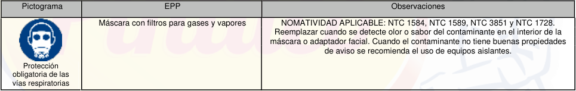
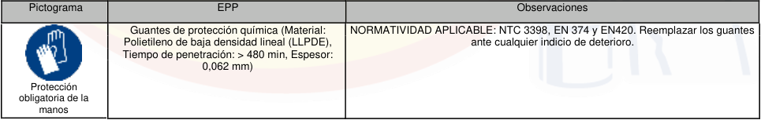
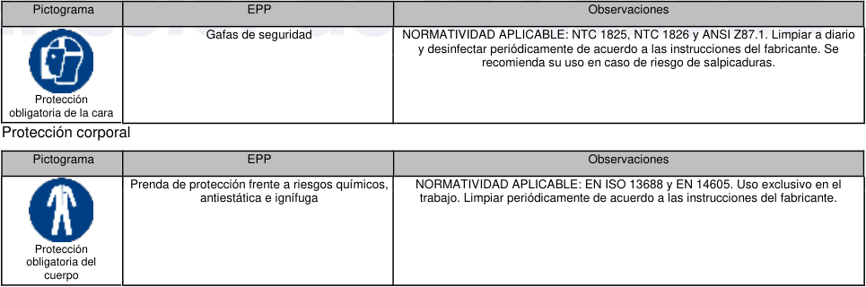
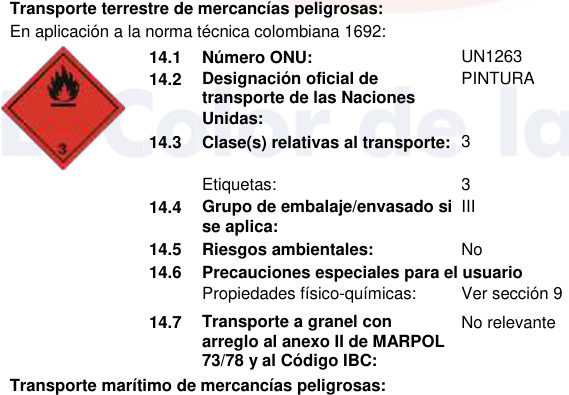

<!-- pagina: 1 -->
Ficha de datos de seguridad según Decreto 1496 de 2018 y Resolución 773 de 2021 

> Imagen (pág. 1). OCR automático, revisar: «NE Ne El Color de la Calidad”»

# **PINTURA EPOXICA BASE SOLVENTE BLANCO 13580 10014492** 

# <mark>SECCIÓN 1: IDENTIFICACIÓN DEL PRODUCTO</mark> 

- **1.1 Identificador SGA del producto:** PINTURA EPOXICA BASE SOLVENTE BLANCO 13580 10014492 

   - **Otros medios de identificación:** 

   - No relevante 

- **1.2 Uso recomendado del producto químico y restricciones:** Usos pertinentes: Pintura. Uso exclusivo usuario profesional. Usos desaconsejados: Todo aquel uso no especificado en este epígrafe ni en el epígrafe 7.3 

**1.3 Datos sobre el proveedor:** Pintuco Autopista Medellín Bogotá Km 37 Vía Belén Rionegro Km 1 054040 Rionegro - Antioquia - Colombia Tfno.: 57 4 569 81 00 contacto@pintuco.com http://www.pintuco.com **1.4 Número de teléfono para emergencias:** CISTEMA SURA Colombia al 018000 51 14 14, fuera de Colombia (0574) 4444578 

# <mark>SECCIÓN 2: IDENTIFICACIÓN DEL PELIGRO O PELIGROS</mark> 

**2.1 Clasificación de la sustancia o de la mezcla: SGA:** La clasificación del producto se ha realizado conforme con al decreto 1496 de 2018 y la Resolución 773 de 2021, por el cual se adopta el Sistema Globalmente Armonizado de Clasificación y Etiquetado de Productos Químicos y se dictan otras disposiciones en materia de seguridad química. Irrit. Cut. 2: Irritación cutánea, categoría 2, H315 Irrit. oc. 2: Irritación ocular, categoría 2, H319 Liq. Infl. 3: Líquidos inflamables, Categoría 3, H226 Sens. Cut. 1: Sensibilización cutánea, Categoría 1, H317 Tox. Agud. 4: Toxicidad aguda por inhalación, Categoría 4, H332 Tox. Agud. 5: Toxicidad aguda por ingestión, Categoría 5, H303 

- **2.2 Elementos de las etiquetas del SGA, incluidos los consejos de prudencia: SGA: Atención** 

## **Indicaciones de peligro:** 

Irrit. Cut. 2: H315 - Provoca irritación cutánea. Irrit. oc. 2: H319 - Provoca irritación ocular grave. Liq. Infl. 3: H226 - Líquido y vapores inflamables. Sens. Cut. 1: H317 - Puede provocar una reacción cutánea alérgica. Tox. Agud. 4: H332 - Nocivo si se inhala. Tox. Agud. 5: H303 - Puede ser nocivo en caso de ingestión. 

## **Consejos de prudencia:** 

P210: Mantener alejado del calor, superficies calientes, chispas llamas al descubierto y otras fuentes de ignición. No fumar. P280: Usar guantes de protección/equipo de protección para la cara/ropa de protección/protección respiratoria/calzado de protección. P302+P352: EN CASO DE CONTACTO CON LA PIEL: Lavar con abundante agua. P304+P340: EN CASO DE INHALACIÓN: Transportar a la persona al aire libre y mantenerla en una posición que le facilite la respiración. P305+P351+P338: EN CASO DE CONTACTO CON LOS OJOS: Enjuagar con agua cuidadosamente durante varios minutos. Quitar las lentes de contacto cuando estén presentes y pueda hacerse con facilidad. Proseguir con el lavado. P370+P378: En caso de incendio: Utilizar extintor de polvo ABC para la extinción. P403+P235: Almacenar en un lugar bien ventilado. Mantener fresco. P501: Eliminar el contenido/recipiente de acuerdo con la normativa sobre residuos peligrosos o envases y residuos de envases respectivamente. **2.3 Otros peligros que no conducen a una clasificación:** No relevante 

- CONTINÚA EN LA SIGUIENTE PÁGINA - 

Emisión: 20/09/2021            Versión: 1 

**Página 1/14** 

<!-- pagina: 2 -->
Ficha de datos de seguridad según Decreto 1496 de 2018 y Resolución 773 de 2021 

> Imagen (pág. 2). OCR automático, revisar: «NE Ne El Color de la Calidad”»

# **PINTURA EPOXICA BASE SOLVENTE BLANCO 13580 10014492** 

# <mark>SECCIÓN 3: COMPOSICIÓN/INFORMACIÓN SOBRE LOS COMPONENTES</mark> 

- **3.1 Sustancias:** 

No aplicable 

- **3.2 Mezclas:** 

**Descripción química:** Mezcla a base de productos químicos 

## **Componentes:** 

De acuerdo al Decreto 1496 de 2018 y la Resolución 773 de 2021, el producto presenta: 

||Identificación|Nombre químico/clasificación|Concentración|
|---|---|---|---|
|CAS:|25036-25-3|**Copolimero epoxy epicloridrina/Bisfenol A (700 < MW < 1100)**|**10 - <25 %**|
|CAS:|1330-20-7|**Xileno**|**10 - <25 %**|
|CAS:|13463-67-7|**Dioxido de titanio**|**2.5 - <10 %**|
|CAS:|111-76-2|**2-butoxietanol**|**2.5 - <10 %**|
|CAS:|78-83-1|**2-Metilpropan-1-ol**|**2.5 - <10 %**|
|CAS:|100-41-4|**Etilbenceno**|**2.5 - <10 %**|

Para ampliar información sobre la peligrosidad de las sustancias consultar las secciones 11, 12 y 16. La clasificación respecto Carcinogenicidad de las sustancias se ha establecido en función de las monografías de la IARC adecuándola al sistema de clasificación SGA, para información sobre la clasificación IARC consulte la sección 11. 

# <mark>SECCIÓN 4: PRIMEROS AUXILIOS</mark> 

- **4.1 Descripción de los primeros auxilios necesarios:** 

Los síntomas como consecuencia de una intoxicación pueden presentarse con posterioridad a la exposición, por lo que, en caso de duda, exposición directa al producto químico o persistencia del malestar solicitar atención médica, mostrándole la FDS de este producto. 

## **Por inhalación:** 

Sacar al afectado del lugar de exposición, suministrarle aire limpio y mantenerlo en reposo. En casos graves como parada cardiorespiratoria, se aplicarán técnicas de respiración artificial (respiración boca a boca, masaje cardíaco, suministro de oxígeno, etc.) requiriendo asistencia médica inmediata. 

## **Por contacto con la piel:** 

Quitar la ropa y los zapatos contaminados, aclarar la piel o duchar al afectado si procede con abundante agua fría y jabón neutro. En caso de afección importante acudir al médico. Si el producto produce quemaduras o congelación, no se debe quitar la ropa debido a que podría empeorar la lesión producida si esta se encuentra pegada a la piel. En el caso de formarse ampollas en la piel, éstas nunca deben reventarse ya que aumentaría el riesgo de infección. 

## **Por contacto con los ojos:** 

Enjuagar los ojos con abundante agua a temperatura ambiente al menos durante 15 minutos. Evitar que el afectado se frote o cierre los ojos. En el caso de que el accidentado use lentes de contacto, éstas deben retirarse siempre que no estén pegadas a los ojos, de otro modo podría producirse un daño adicional. En todos los casos, después del lavado, se debe acudir al médico lo más rápidamente posible con la FDS del producto. 

## **Por ingestión/aspiración:** 

No inducir al vómito, en el caso de que se produzca mantener inclinada la cabeza hacia delante para evitar la aspiración. Mantener al afectado en reposo. Enjuagar la boca y la garganta, ya que existe la posibilidad de que hayan sido afectadas en la ingestión. 

- **4.2 Síntomas/efectos más importantes, agudos o retardados:** 

Los efectos agudos y retardados son los indicados en las secciones 2 y 11 de la FDS. 

- **4.3 Indicación de la necesidad de recibir atención médica inmediata y, en su caso, de tratamiento especial:** No relevante 

# <mark>SECCIÓN 5: MEDIDAS DE LUCHA CONTRA INCENDIOS</mark> 

- CONTINÚA EN LA SIGUIENTE PÁGINA - 

Emisión: 20/09/2021            Versión: 1 

**Página 2/14** 

<!-- pagina: 3 -->
Ficha de datos de seguridad según Decreto 1496 de 2018 y Resolución 773 de 2021 

> Imagen (pág. 3). OCR automático, revisar: «NE Ne El Color de la Calidad”»

# **PINTURA EPOXICA BASE SOLVENTE BLANCO 13580** 

# **10014492** 

# <mark>SECCIÓN 5: MEDIDAS DE LUCHA CONTRA INCENDIOS (continúa)</mark> 

- **5.1 Medios de extinción apropiados:** 

## **Medios de extinción apropiados:** 

- Emplear preferentemente extintores de polvo polivalente (polvo ABC), alternativamente utilizar espuma física o extintores de dióxido de carbono (CO2). 

## **Medios de extinción no apropiados:** 

NO SE RECOMIENDA emplear agua a chorro como agente de extinción. 

- **5.2 Peligros específicos del producto químico:** 

Como consecuencia de la combustión o descomposición térmica se generan subproductos de reacción que pueden resultar altamente tóxicos y, consecuentemente, pueden presentar un riesgo elevado para la salud. 

- **5.3 Medidas especiales que deben tomar los equipos de lucha contra incendios:** 

En función de la magnitud del incendio puede hacerse necesario el uso de ropa protectora completa y equipo de respiración autónomo. Disponer de un mínimo de instalaciones de emergencia o elementos de actuación (mantas ignífugas, botiquín portátil,...). 

## **Disposiciones adicionales:** 

Actuar conforme el Plan de Emergencia Interior y las Fichas Informativas sobre actuación ante accidentes y otras emergencias. Suprimir cualquier fuente de ignición. En caso de incendio, refrigerar los recipientes y tanques de almacenamiento de productos susceptibles a inflamación, explosión como consecuencia de elevadas temperaturas. Evitar el vertido de los productos empleados en la extinción del incendio al medio acuático. 

# <mark>SECCIÓN 6: MEDIDAS QUE DEBEN TOMARSE EN CASO DE VERTIDO ACCIDENTAL</mark> 

- **6.1 Precauciones personales, equipo protector y procedimiento de emergencia:** 

## **Para el personal que no forma parte de los servicios de emergencia:** 

Aislar las fugas siempre y cuando no suponga un riesgo adicional para las personas que desempeñen esta función. Evacuar la zona y mantener a las personas sin protección alejadas. Ante el contacto potencial con el producto derramado se hace obligatorio el uso de elementos de protección personal (ver sección 8 de la FDS). Evitar de manera prioritaria la formación de mezclas vapor-aire inflamables, ya sea mediante ventilación o el uso de un agente inertizante. Suprimir cualquier fuente de ignición. Eliminar las cargas electroestáticas mediante la interconexión de todas las superficies conductoras sobre las que se puede formar electricidad estática, y estando a su vez el conjunto conectado a tierra. 

## **Para el personal de emergencia:** 

Ver sección 8 de la FDS. 

- **6.2 Precauciones relativas al medio ambiente:** 

Producto no clasificado como peligroso para el medioambiente. Mantener el producto alejado de los desagües y de las aguas superficiales y subterráneas. 

- **6.3 Métodos y materiales para la contención y limpieza de vertidos:** 

Se recomienda: 

Absorber el vertido mediante arena o absorbente inerte y trasladarlo a un lugar seguro. No absorber en serrín u otros absorbentes combustibles. Para cualquier consideración relativa a la eliminación consultar la sección 13 de la FDS. 

- **6.4 Referencias a otras secciones:** 

Ver secciones 8 y 13. 

# <mark>SECCIÓN 7: MANIPULACIÓN Y ALMACENAMIENTO</mark> 

## **7.1 Precauciones que se deben tomar para garantizar una manipulación segura:** 

- A.- Precauciones generales 

Cumplir con la legislación vigente en materia de prevención de riesgos laborales. Mantener los recipientes herméticamente cerrados. Controlar los derrames y residuos, eliminándolos con métodos seguros (sección 6 de la FDS). Evitar el vertido libre desde el recipiente. Mantener orden y limpieza donde se manipulen productos peligrosos. 

- B.- Recomendaciones técnicas para la prevención de incendios y explosiones. 

- CONTINÚA EN LA SIGUIENTE PÁGINA - 

Emisión: 20/09/2021            Versión: 1 

**Página 3/14** 

<!-- pagina: 4 -->
Ficha de datos de seguridad según Decreto 1496 de 2018 y Resolución 773 de 2021 

**10014492** 

> Imagen (pág. 4). OCR automático, revisar: «NE Ne El Color de la Calidad”»

# **PINTURA EPOXICA BASE SOLVENTE BLANCO 13580** 

# <mark>SECCIÓN 7: MANIPULACIÓN Y ALMACENAMIENTO (continúa)</mark> 

Trasvasar en lugares bien ventilados, preferentemente mediante extracción localizada. Controlar totalmente los focos de ignición (teléfonos móviles, chispas,…) y ventilar en las operaciones de limpieza. Evitar la existencia de atmósferas peligrosas en el interior de recipientes, aplicando en lo posible sistemas de inertización. Trasvasar a velocidades lentas para evitar la generación de cargas electroestáticas. Ante la posibilidad de existencia de cargas electroestáticas: asegurar una perfecta conexión equipotencial, utilizar siempre tomas de tierras, no emplear ropa de trabajo de fibras acrílicas, empleando preferiblemente ropa de algodón y calzado conductor. Cumplir con los requisitos esenciales de seguridad para equipos  y con las disposiciones mínimas para la protección de la seguridad y salud de los trabajadores. Consultar la sección 10 de la FDS sobre condiciones y materias que deben evitarse. 

- C.- Recomendaciones técnicas para prevenir riesgos ergonómicos y toxicológicos. 

Para control de exposición consultar la sección 8 de la FDS. No comer, beber ni fumar en las zonas de trabajo lavarse las manos después de cada utilización, y despojarse de prendas de vestir y equipos de protección contaminados antes de entrar en las zonas para comer. 

- D.- Recomendaciones técnicas para prevenir riesgos medioambientales 

||Se recomienda disponer información)|de material absorbente en las proximidades del producto (ver epígrafe 6.3 de la FDS para mayor|
|---|---|---|
|**7.2**|**Condiciones de almacena**|**miento seguro, incluidas cualesquiera incompatibilidades:**|
||A.- Medidas técnicas de alm|acenamiento|
||Temperatura mínima:|5 ºC|
||Temperatura máxima:|30 ºC|
||Tiempo máximo:|18 meses|

- B.- Condiciones generales de almacenamiento. 

Evitar fuentes de calor, radiación, electricidad estática y el contacto con alimentos. Para información adicional ver epígrafe 10.5 

## **7.3 Usos específicos finales:** 

Salvo las indicaciones ya especificadas no es preciso realizar ninguna recomendación especial en cuanto a los usos de este producto. 

# <mark>SECCIÓN 8: CONTROLES DE EXPOSICIÓN/PROTECCIÓN PERSONAL</mark> 

## **8.1 Parámetros de control:** 

Sustancias cuyos valores límite de exposición profesional han de controlarse en el ambiente de trabajo: 

OSHA (Tablas Z): 

||Identificación|Valore|s límite ambie|ntales|
|---|---|---|---|---|
|Xileno||8-hour TWA PEL|100ppm|435 mg/m³|
|CAS: 1330-20-7||Ceiling Values - TWA PEL|||
|Dioxido de titanio||8-hour TWA PEL||15 mg/m³|
|CAS: 13463-67-7||Ceiling Values - TWA PEL|||
|2-butoxietanol||8-hour TWA PEL|50 ppm|240 mg/m³|
|CAS: 111-76-2||Ceiling Values - TWA PEL|||
|2-Metilpropan-1-ol||8-hour TWA PEL|100 ppm|300 mg/m³|
|CAS: 78-83-1||Ceiling Values - TWA PEL|||
|Etilbenceno||8-hour TWA PEL|100 ppm|435 mg/m³|
|CAS: 100-41-4||Ceiling Values - TWA PEL|||

|ACGIH:|
|---|

||Identificación||Valores límite ambie|ntales|
|---|---|---|---|---|
|Xileno||TLV-TWA|100ppm||
|CAS: 1330-20-7||TLV-STEL|150 ppm||
|Dioxido de titanio||TLV-TWA||10 mg/m³|
|CAS: 13463-67-7||TLV-STEL|||
|2-butoxietanol||TLV-TWA|20ppm||
|CAS: 111-76-2||TLV-STEL|||
|2-Metilpropan-1-ol||TLV-TWA|50ppm||
|CAS: 78-83-1||TLV-STEL|||
|Etilbenceno||TLV-TWA|20ppm||
|CAS: 100-41-4||TLV-STEL|||

- CONTINÚA EN LA SIGUIENTE PÁGINA - 

Emisión: 20/09/2021            Versión: 1 

**Página 4/14** 

<!-- pagina: 5 -->
Ficha de datos de seguridad según Decreto 1496 de 2018 y Resolución 773 de 2021 

> Imagen (pág. 5). OCR automático, revisar: «NE Ne El Color de la Calidad”»

# **PINTURA EPOXICA BASE SOLVENTE BLANCO 13580 10014492** 

# <mark>SECCIÓN 8: CONTROLES DE EXPOSICIÓN/PROTECCIÓN PERSONAL (continúa)</mark> 

**Valores límite biológicos:** Indices de exposición biológicos (BEIs®) - ACGIH 

||Identificación|BEIs®|Determinante|Momento de muestreo|
|---|---|---|---|---|
|Xileno CAS: 1330-20-7||1500 mg/g (Creatinina)|Ácidos metilhipúricos en orina|Fin del turno|
|2-butoxietanol CAS: 111-76-2||200 mg/g (Creatinina)|Ácido butoxiacético (BAA) en la orina|Fin del turno|
|Etilbenceno CAS: 100-41-4||150 mg/g (Creatinina)|Suma de ácido mandélico y ácido fenilglioxílico en la orina|Fin del turno|

## **8.2 Controles técnicos apropiados:** 

- A.- Medidas de protección individual, como equipo de protección personal (EPP) 

Realizar la identificación de los peligros y la valoración de los riesgos de acuerdo a la Guia técnica colombiana GTC 45. Como medida de prevención se recomienda la utilización de equipos de protección individual básicos. Para más información sobre los equipos de protección individual (almacenamiento, uso, limpieza, mantenimiento, clase de protección,…) consultar el folleto informativo facilitado por el fabricante del EPP. Las indicaciones contenidas en este punto se refieren al producto puro. Las medidas de protección para el producto diluido podrán variar en función de su grado de dilución, uso, método de aplicación, etc. Para determinar la obligación de instalación de duchas de emergencia y/o lavaojos en los almacenes se tendrá en cuenta la normativa referente al almacenamiento de productos químicos aplicable en cada caso. Para más información ver epígrafes 7.1 y 7.2 de la FDS. 

Toda la información aquí incluida es una recomendación siendo necesario su concreción por parte de los servicios de prevención de riesgos laborales al desconocer las medidas de prevención adicionales que la empresa pudiese disponer. 

- B.- Protección respiratoria. 

> Imagen (pág. 5). OCR automático, revisar: «Pictograma EPP Observaciones ad Protección obligatoria de las vías respiratorias Máscara con filtros para gases y vapores NOMATIVIDAD APLICABLE: NTC 1584, NTC 1589, NTC 3851 y NTC 1728 Reemplazar cuando se detecte olor o sabor del contaminante en el interior de la máscara o adaptador facial. Cuando el contaminante no tiene buenas propiedades de aviso se recomienda el uso de equipos aislantes.»

<!-- Start of picture text -->
Pictograma  EPP  Observaciones Máscara con filtros para gases y vapores  NOMATIVIDAD APLICABLE: NTC 1584, NTC 1589, NTC 3851 y NTC 1728. Reemplazar cuando se detecte olor o sabor del contaminante en el interior de la máscara o adaptador facial. Cuando el contaminante no tiene buenas propiedades de aviso se recomienda el uso de equipos aislantes. Protección obligatoria de las vías respiratorias <!-- End of picture text -->

## C.- Protección específica de las manos. 

> Imagen (pág. 5). OCR automático, revisar: «Pictograma EPP Observaciones Protección obligatoria de la ‘manos 'Guantes de protección química (Material Polietileno de baja densidad lineal (LLPDE), Tiempo de penetración: > 480 min, Espesor: 0,062 mm) NORMATIVIDAD APLICABLE: NTC 3398, EN 374 y EN420. Reemplazar los guantes ante cualquier indicio de deterioro.»

<!-- Start of picture text -->
Pictograma  EPP  Observaciones Guantes de protección química (Material:  NORMATIVIDAD APLICABLE: NTC 3398, EN 374 y EN420. Reemplazar los guantes Polietileno de baja densidad lineal (LLPDE),  ante cualquier indicio de deterioro. Tiempo de penetración: > 480 min, Espesor: 0,062 mm) Protección obligatoria de la manos <!-- End of picture text -->

Dado que el producto es una mezcla de diferentes materiales, la resistencia del material de los guantes no se puede calcular de antemano con total fiabilidad y por lo tanto tiene que ser controlados antes de su aplicación. 

- D.- Protección ocular y facial 

> Imagen (pág. 5). OCR automático, revisar: «Pictograma EPP Observaciones 'Gafas de seguridad NORMATIVIDAD APLICABLE: NTC 1825, NTC 1826 y ANSI 287.1. Limpiar a diario y desinfectar periódicamente de acuerdo a las instrucciones del fabricante. Se recomienda su uso en caso de riesgo de salpicaduras. Protección obligatoria de la cara Protección corporal Pictograma EPP Observaciones Prenda de protección frente a riesgos químicos, | NORMATIVIDAD APLICABLE: EN ISO 13688 y EN 14605. Uso exclusivo en el antiestatica e ignífuga trabajo. Limpiar periódicamente de acuerdo a las instrucciones del fabricante Protección obligatoria del cuerpo»

<!-- Start of picture text -->
Pictograma  EPP  Observaciones Gafas de seguridad  NORMATIVIDAD APLICABLE: NTC 1825, NTC 1826 y ANSI Z87.1. Limpiar a diario y desinfectar periódicamente de acuerdo a las instrucciones del fabricante. Se recomienda su uso en caso de riesgo de salpicaduras. Protección obligatoria de la cara E.- Protección corporal Pictograma  EPP  Observaciones Prenda de protección frente a riesgos químicos,  NORMATIVIDAD APLICABLE: EN ISO 13688 y EN 14605. Uso exclusivo en el antiestática e ignífuga  trabajo. Limpiar periódicamente de acuerdo a las instrucciones del fabricante. Protección obligatoria del cuerpo <!-- End of picture text -->

- E.- Protección corporal 

- CONTINÚA EN LA SIGUIENTE PÁGINA - 

Emisión: 20/09/2021            Versión: 1 

**Página 5/14** 

<!-- pagina: 6 -->
Ficha de datos de seguridad 

según Decreto 1496 de 2018 y Resolución 773 de 2021 

> Imagen (pág. 6). OCR automático, revisar: «NE Ne El Color de la Calidad”»

# **PINTURA EPOXICA BASE SOLVENTE BLANCO 13580 10014492** 

# <mark>SECCIÓN 8: CONTROLES DE EXPOSICIÓN/PROTECCIÓN PERSONAL (continúa)</mark> 

|Pictograma||EPP|Obse|rvaciones|
|---|---|---|---|---|
|Protección obligatoria de los pies|Calzado d propieda|e seguridad contra riesgo químico, con des antiestáticas y resistencia al calor|NORMATIVIDAD APLICABLE: NTC- Reemplazar las botas ant|ISO 20345, NTC-ISO 20344 y NTC 2257. e cualquier indicio de deterioro.|
|F.- Medidas complem|entarias|de emergencia|||
|Medida de emerg|encia|Normas|Medida de emergencia|Normas|
|Ducha de emerg|encia|ANSI Z358-1 ISO 3864-1:2011, ISO 3864-4:2011| Lavaojos|DIN 12 899 ISO 3864-1:2011, ISO 3864-4:2011|

**Controles de la exposición del medio ambiente:** Se recomienda evitar el vertido tanto del producto como de su envase al medio ambiente. Para información adicional ver epígrafe 7.1.D de la FDS. 

<mark>SECCIÓN 9: PROPIEDADES FÍSICAS Y QUÍMICAS Y CARACTERÍSTICAS DE SEGURIDAD</mark> 

**9.1 Información de propiedades físicas y químicas básicas:** Para completar la información ver la ficha técnica/hoja de especificaciones del producto. **Aspecto físico:** Estado físico a 20 ºC: Líquido Aspecto: Viscoso Color: Blanco Olor: Aromático Umbral olfativo: No relevante * **Volatilidad:** Temperatura de ebullición a presión atmosférica: 65 - 171 ºC Presión de vapor a 20 ºC: 1234 Pa Presión de vapor a 50 ºC: 6323,22 Pa  (6,32 kPa) Tasa de evaporación a 20 ºC: No relevante * **Caracterización del producto:** Densidad a 20 ºC: 1464,6 kg/m³ Densidad relativa a 20 ºC: 1,487 - 1,514 Viscosidad dinámica a 20 ºC: No relevante * Viscosidad cinemática a 20 ºC: No relevante * Viscosidad cinemática a 40 ºC: >20,5 mm²/s Concentración: No relevante * pH: No relevante * Densidad de vapor a 20 ºC: No relevante * Coeficiente de reparto n-octanol/agua a 20 ºC: No relevante * Solubilidad en agua a 20 ºC: No relevante * Propiedad de solubilidad: No relevante * Temperatura de descomposición: No relevante * Punto de fusión/punto de congelación: No relevante * **Inflamabilidad:** Punto de inflamación: 23 ºC 

*No relevante debido a la naturaleza del producto, no aportando información característica de su peligrosidad. 

- CONTINÚA EN LA SIGUIENTE PÁGINA - 

Emisión: 20/09/2021            Versión: 1 

**Página 6/14** 

<!-- pagina: 7 -->
Ficha de datos de seguridad 

según Decreto 1496 de 2018 y Resolución 773 de 2021 

> Imagen (pág. 7). OCR automático, revisar: «NE Ne El Color de la Calidad”»

# **PINTURA EPOXICA BASE SOLVENTE BLANCO 13580 10014492** 

# <mark>SECCIÓN 9: PROPIEDADES FÍSICAS Y QUÍMICAS Y CARACTERÍSTICAS DE SEGURIDAD (continúa)</mark> 

||Inflamabilidad (sólido, gas):|No relevante *|
|---|---|---|
||Temperatura de auto-inflamación:|238 ºC|
||Límite de inflamabilidad inferior:|No determinado|
||Límite de inflamabilidad superior:|No determinado|
||**Características de las partículas:**||
||Diámetro medio equivalente:|No aplicable|
|**9.2**|**Información adicional:**||
||**Información relativa a las clases de peligro físico:**||
||Propiedades explosivas:|No relevante *|
||Propiedades comburentes:|No relevante *|
||Corrosivos para los metales:|No relevante *|
||Calor de combustión:|No relevante *|
||Aerosoles-porcentaje total (en masa) de componentes inflamables:|No relevante *|
||**Otras características de seguridad:**||
||Tensión superficial a 20 ºC:|No relevante *|
||Índice de refracción:|No relevante *|

*No relevante debido a la naturaleza del producto, no aportando información característica de su peligrosidad. 

# <mark>SECCIÓN 10: ESTABILIDAD Y REACTIVIDAD</mark> 

## **10.1 Reactividad:** 

   - No se esperan reacciones peligrosas si se cumplen las instrucciones técnicas de almacenamiento de productos químicos. Ver sección 7 de la FDS para mayor información. 

- **10.2 Estabilidad química:** 

Estable químicamente bajo las condiciones indicadas de almacenamiento, manipulación y uso. 

- **10.3 Posibilidad de reacciones peligrosas:** 

Bajo las condiciones indicadas no se esperan reacciones peligrosas ni polimerización peligrosa que puedan producir una presión o temperaturas excesivas. 

- **10.4 Condiciones que deben evitarse:** 

Aplicables para manipulación y almacenamiento a temperatura ambiente: 

||Choque y fricción|Contacto con el aire|Calentamiento|Luz Solar|Humedad|
|---|---|---|---|---|---|
||No aplicable|No aplicable|Riesgo de inflamación|Evitar incidencia directa|No aplicable|
|**10.5**|**Materiales incompatibles:**|||||
||Ácidos|Agua|Materias comburentes|Materias combustibles|Otros|
||Evitar ácidos fuertes|No aplicable|Evitar incidencia directa|No aplicable|Evitar álcalis o bases fuertes|

- **10.6 Productos de descomposición peligrosos:** 

Ver epígrafe 10.3, 10.4 y 10.5 de la FDS para conocer los productos de descomposición específicamente. En dependencia de las condiciones de descomposición, como consecuencia de la misma pueden liberarse mezclas complejas de sustancias químicas: dióxido de carbono (CO2), monóxido de carbono y otros compuestos orgánicos. 

# <mark>SECCIÓN 11: INFORMACIÓN TOXICOLÓGICA</mark> 

## **11.1 Información sobre las posibles vías de exposición:** 

No se dispone de datos experimentales del producto en sí mismo relativos a las propiedades toxicológicas 

Contiene glicoles, posibilidad de efectos peligrosos para la salud, por lo que se recomienda no respirar sus vapores prolongadamente 

## **Efectos peligrosos para la salud:** 

En caso de exposición repetitiva, prolongada o a concentraciones superiores a las establecidas por los límites de exposición profesionales, pueden producirse efectos adversos para la salud en función de la vía de exposición: 

- CONTINÚA EN LA SIGUIENTE PÁGINA - 

Emisión: 20/09/2021            Versión: 1 

**Página 7/14** 

<!-- pagina: 8 -->
Ficha de datos de seguridad según Decreto 1496 de 2018 y Resolución 773 de 2021 

> Imagen (pág. 8). OCR automático, revisar: «NE Ne El Color de la Calidad”»

# **PINTURA EPOXICA BASE SOLVENTE BLANCO 13580 10014492** 

# <mark>SECCIÓN 11: INFORMACIÓN TOXICOLÓGICA (continúa)</mark> 

- A- Ingestión (efecto agudo): 

   - Toxicidad aguda: La ingesta de una dosis considerable puede originar irritación de garganta, dolor abdominal, náuseas y vómitos. 

   - Corrosividad/Irritabilidad: La ingesta de una dosis considerable puede originar irritación de garganta, dolor abdominal, náuseas y vómitos. 

- B- Inhalación (efecto agudo): 

   - Toxicidad aguda: Una exposición a altas concentraciones pueden motivar depresión del sistema nervioso central ocasionando dolor de cabeza, mareos, vértigos, nauseas, vómitos, confusión y en caso de afección grave, pérdida de conciencia. -   Corrosividad/Irritabilidad: A la vista de los datos disponibles, no se cumplen los criterios de clasificación. Para más información ver sección 3 de la FDS. 

- C- Contacto con la piel y los ojos (efecto agudo): 

   - Contacto con la piel: Produce inflamación cutánea. 

   - Contacto con los ojos: Produce lesiones oculares tras contacto. 

- D- Efectos CMR (carcinogenicidad, mutagenicidad y toxicidad para la reproducción): 

   - Carcinogenicidad: A la vista de los datos disponibles, no se cumplen los criterios de clasificación. Para más información ver sección 3 de la FDS. 

IARC: Metilbenceno (2B); Xileno (3); Dióxido de titanio  (2B); 2-butoxietanol (3) 

   - Mutagenicidad: A la vista de los datos disponibles, no se cumplen los criterios de clasificación, no presentando sustancias clasificadas como peligrosas por este efecto. Para más información ver sección 3 de la FDS. 

   - Toxicidad para la reproducción: A la vista de los datos disponibles, no se cumplen los criterios de clasificación, no presentando sustancias clasificadas como peligrosas por este efecto. Para más información ver sección 3 de la FDS. 

- E- Efectos de sensibilización: 

   - Respiratoria: A la vista de los datos disponibles, no se cumplen los criterios de clasificación, no presentando sustancias clasificadas como peligrosas con efectos sensibilizantes. Para más información ver secciones 2, 3 y 15 de la FDS. 

   - Cutánea: El contacto prolongado con la piel puede derivar en episodios de dermatitis alérgicas de contacto. 

- F- Toxicidad específica en determinados órganos (STOT)-exposición única: 

A la vista de los datos disponibles, no se cumplen los criterios de clasificación. Para más información ver sección 3 de la FDS. 

- G- Toxicidad específica en determinados órganos (STOT)-exposición repetida: 

   - Toxicidad específica en determinados órganos (STOT)-exposición repetida: A la vista de los datos disponibles, no se cumplen los criterios de clasificación, no presentando sustancias clasificadas como peligrosas por este efecto. Para más información ver sección 3 de la FDS. 

   - Piel: A la vista de los datos disponibles, no se cumplen los criterios de clasificación, no presentando sustancias clasificadas como peligrosas por este efecto. Para más información ver sección 3 de la FDS. 

- H- Peligro por aspiración: 

A la vista de los datos disponibles, no se cumplen los criterios de clasificación, no presentando sustancias clasificadas como peligrosas por este efecto. Para más información ver sección 3 de la FDS. 

## **Información adicional:** 

CAS 13463-67-7 Dióxido de Titanio: IARC lista esta sustancia como un posible carcinógeno humano (grupo 2B), indicando que hay suficientes evidencias para considerarlo carcinógeno en animales pero insuficientes para considerarlo como carcinógeno para seres humanos. 

La monografía de IARC para esta sustancia indica que no hay exposición significativa al dióxido de titanio durante el uso normal de productos en los que dióxido de titanio está unido permanentemente a otros materiales, tales como pinturas (Ref: Monografía IARC, Vol. 93, 2010). 

El lijado repetido de las superficies de película seca puede producir riesgo de sobreexposición al polvo dependiendo de la duración y nivel de lijado, para evitarla deben tomarse las medidas de protección adecuadas. 

CAS 100-41-4 Etilbenceno: El etilbenceno presente en el producto es un componente del Xileno. El etilbenceno es un componente importante de los xilenos técnicos, la toxicología de estos productos fue revisada (WHO, 1997), IARC ha evaluado a los Xilenos como no clasificables en cuanto a su carcinogenicidad a los humanos (Grupo 3) (IARC, 1999) (Ref: Monografía IARC, Vol. 77, 2000; Vol. 71, 1999). 

## **Información toxicológica específica de las sustancias:** 

||Identificación|Tox|icidad aguda|Género|
|---|---|---|---|---|
|Etilbenceno||DL50 oral|3500 mg/kg|Rata|
|CAS: 100-41-4||DL50 cutánea|15354 mg/kg|Conejo|
|||CL50 inhalación|17,2 mg/L (4 h)|Rata|

- CONTINÚA EN LA SIGUIENTE PÁGINA - 

Emisión: 20/09/2021            Versión: 1 

**Página 8/14** 

<!-- pagina: 9 -->
Ficha de datos de seguridad según Decreto 1496 de 2018 y Resolución 773 de 2021 

> Imagen (pág. 9). OCR automático, revisar: «NE Ne El Color de la Calidad”»

# **PINTURA EPOXICA BASE SOLVENTE BLANCO 13580 10014492** 

# <mark>SECCIÓN 11: INFORMACIÓN TOXICOLÓGICA (continúa)</mark> 

||Identificación|Tox|icidad aguda|Género|
|---|---|---|---|---|
|Xileno||DL50 oral|2100 mg/kg|Rata|
|CAS: 1330-20-7||DL50 cutánea|1100 mg/kg|Rata|
|||CL50 inhalación|11 mg/L (4 h) (ATEi)||
|2-Metilpropan-1-ol||DL50 oral|3350 mg/kg|Rata|
|CAS: 78-83-1||DL50 cutánea|2460 mg/kg|Conejo|
|||CL50 inhalación|24,6 mg/L (4 h)|Rata|
|Dioxido de titanio||DL50 oral|10000 mg/kg|Rata|
|CAS: 13463-67-7||DL50 cutánea|10000 mg/kg|Conejo|
|||CL50 inhalación|No relevante||
|2-butoxietanol||DL50 oral|1200 mg/kg|Rata|
|CAS: 111-76-2||DL50 cutánea|3000 mg/kg|Conejo|
|||CL50 inhalación|11 mg/L (4 h) (ATEi)||

# <mark>SECCIÓN 12: INFORMACIÓN ECOTOXICOLÓGICA</mark> 

No se disponen de datos experimentales de la mezcla en sí misma relativos a las propiedades ecotoxicológicas. 

|**12.1**|**Toxicidad:**|||||
|---|---|---|---|---|---|
||**Toxicidad aguda:**|||||
||Identificación||Concentración|Especie|Género|
||2-butoxietanol|CL50|1490 mg/L (96 h)|Lepomis macrochirus|Pez|
||CAS: 111-76-2|CE50|1815 mg/L (48 h)|Daphnia magna|Crustáceo|
|||CE50|911 mg/L (72 h)|Pseudokirchneriella subcapitata|Alga|
||2-Metilpropan-1-ol|CL50|2030 mg/L (96 h)|Carassius auratus|Pez|
||CAS: 78-83-1|CE50|1439 mg/L (48 h)|Daphnia magna|Crustáceo|
|||CE50|1250 mg/L (48 h)|Scenedesmus subspicatus|Alga|
||Etilbenceno|CL50|42,3 mg/L (96 h)|Pimephales promelas|Pez|
||CAS: 100-41-4|CE50|75 mg/L (48 h)|Daphnia magna|Crustáceo|
|||CE50|63 mg/L (3 h)|Chlorella vulgaris|Alga|
||**Toxicidad a largo plazo:**|||||
||Identificación||Concentración|Especie|Género|
||Xileno|NOEC|1,3 mg/L|Oncorhynchus mykiss|Pez|
||CAS: 1330-20-7|NOEC|1,17 mg/L|Ceriodaphnia dubia|Crustáceo|
||2-butoxietanol|NOEC|100 mg/L|Danio rerio|Pez|
||CAS: 111-76-2|NOEC|100 mg/L|Daphnia magna|Crustáceo|

- CONTINÚA EN LA SIGUIENTE PÁGINA - 

Emisión: 20/09/2021            Versión: 1 

**Página 9/14** 

<!-- pagina: 10 -->
Ficha de datos de seguridad 

según Decreto 1496 de 2018 y Resolución 773 de 2021 

> Imagen (pág. 10). OCR automático, revisar: «NE Ne El Color de la Calidad”»

# **PINTURA EPOXICA BASE SOLVENTE BLANCO 13580 10014492** 

# <mark>SECCIÓN 12: INFORMACIÓN ECOTOXICOLÓGICA (continúa)</mark> 

||Identificación|||Concentración|Es|pecie||Género|
|---|---|---|---|---|---|---|---|---|
||2-Metilpropan-1-ol||NOEC|No relevante|||||
||CAS: 78-83-1||NOEC|20 mg/L|Daph|nia magna||Crustáceo|
||Etilbenceno||NOEC|No relevante|||||
||CAS: 100-41-4||NOEC|0,96 mg/L|Cerioda|phnia dubia||Crustáceo|
|**12.2**|**Persistencia y degradabilidad:**||||||||
||Identificación||De|gradabilidad|B|iodegradabil|idad||
||Xileno||DBO5|No relevante|Concentración||No rele|vante|
||CAS: 1330-20-7||DQO|No relevante|Periodo||28 días||
||||DBO5/DQO|No relevante|% Biodegradado||88 %||
||2-butoxietanol||DBO5|0,71 g O2/g|Concentración||100 mg|/L|
||CAS: 111-76-2||DQO|2,2 g O2/g|Periodo||14 días||
||||DBO5/DQO|0,32|% Biodegradado||96 %||
||2-Metilpropan-1-ol||DBO5|0,4 g O2/g|Concentración||100 mg|/L|
||CAS: 78-83-1||DQO|2,41 g O2/g|Periodo||14 días||
||||DBO5/DQO|0,17|% Biodegradado||90 %||
||Etilbenceno||DBO5|No relevante|Concentración||100 mg|/L|
||CAS: 100-41-4||DQO|No relevante|Periodo||14 días||
||||DBO5/DQO|No relevante|% Biodegradado||90 %||
|**12.3**|**Potencial de bioacumulación:**||||||||
|||Identificación|||Poten|cial de bioa|cumulaci|ón|
||Xileno||||BCF|9|||
||CAS: 1330-20-7||||Log POW|2,77|||
||||||Potencial|Bajo|||
||2-butoxietanol||||BCF|3|||
||CAS: 111-76-2||||Log POW|0,83|||
||||||Potencial|Bajo|||
||2-Metilpropan-1-ol||||BCF|3|||
||CAS: 78-83-1||||Log POW|0,76|||
||||||Potencial|Bajo|||
||Etilbenceno||||BCF|1|||
||CAS: 100-41-4||||Log POW|3,15|||
||||||Potencial|Bajo|||

<!-- Start of picture text -->
12.4  Movilidad en el suelo: <!-- End of picture text -->

- CONTINÚA EN LA SIGUIENTE PÁGINA - 

Emisión: 20/09/2021            Versión: 1 

**Página 10/14** 

<!-- pagina: 11 -->
Ficha de datos de seguridad según Decreto 1496 de 2018 y Resolución 773 de 2021 

> Imagen (pág. 11). OCR automático, revisar: «NE Ne El Color de la Calidad”»

# **PINTURA EPOXICA BASE SOLVENTE BLANCO 13580 10014492** 

# <mark>SECCIÓN 12: INFORMACIÓN ECOTOXICOLÓGICA (continúa)</mark> 

||Identificación|Absorci|ón/Desorción|V|olatilidad|
|---|---|---|---|---|---|
||Xileno|Koc|202|Henry|524,86 Pa·m³/mol|
||CAS: 1330-20-7|Conclusión|Moderado|Suelo seco|Sí|
|||Tensión superficial|No relevante|Suelo húmedo|Sí|
||2-butoxietanol|Koc|8|Henry|1,621E-1 Pa·m³/mol|
||CAS: 111-76-2|Conclusión|Muy Alto|Suelo seco|No|
|||Tensión superficial|2,729E-2 N/m  (25 ºC)|Suelo húmedo|Sí|
||2-Metilpropan-1-ol|Koc|No relevante|Henry|No relevante|
||CAS: 78-83-1|Conclusión|No relevante|Suelo seco|No relevante|
|||Tensión superficial|2,378E-2 N/m  (25 ºC)|Suelo húmedo|No relevante|
||Etilbenceno|Koc|520|Henry|798,44 Pa·m³/mol|
||CAS: 100-41-4|Conclusión|Moderado|Suelo seco|Sí|
|||Tensión superficial|2,859E-2 N/m  (25 ºC)|Suelo húmedo|Sí|
|**12.5**|**Resultados de la valoración PBT y mPmB:** No aplicable|||||
|**12.6**|**Otros efectos adversos:**|||||
||No descritos|||||

# <mark>SECCIÓN 13: INFORMACIÓN RELATIVA A LA ELIMINACIÓN DE LOS PRODUCTOS</mark> 

## **13.1 Métodos de eliminación:** 

## **Gestión del residuo (eliminación y valorización):** 

Consultar al gestor de residuos autorizado las operaciones de valorización y eliminación. En el caso de que el envase haya estado en contacto directo con el producto se gestionará del mismo modo que el propio producto, en caso contrario se gestionará como residuo no peligroso. Se desaconseja su vertido a cursos de agua. Ver epígrafe 6.2. 

**Disposiciones legislativas relacionadas con la gestión de residuos:** 

Legislación relacionada con la gestión de residuos: 

Decreto 1076 de 2015 (Decreto único reglamentario del Sector Ambiente y Desarrollo Sostenible) 

# <mark>SECCIÓN 14: INFORMACIÓN RELATIVA AL TRANSPORTE</mark> 

> Imagen (pág. 11). OCR automático, revisar: «Transporte terrestre de mercancías peligrosas: En aplicación a la norma técnica colombiana 1692: 14.1 Numero ONU: UN1263 14.2 Designación oficial de PINTURA transporte de las Naciones Unidas: 14.3. Clase(s) relativas al transporte: 3 Etiquetas 3 14.4 Grupo de embalaje/envasado si II se aplica: 14.5 Riesgos ambientales: No 14.6 Precauciones especiales para el usuario Propiedades físico-químicas: Ver sección 9 14.7 Transporte a granel con No relevante arreglo al anexo II de MARPOL 73/78 y al Código IBC: mo de mercancías peligrosas:»

<!-- Start of picture text -->
Transporte terrestre de mercancías peligrosas: En aplicación a la norma técnica colombiana 1692: 14.1  Número ONU:  UN1263 14.2  Designación oficial de  PINTURA transporte de las Naciones Unidas: 14.3  Clase(s) relativas al transporte:  3 Etiquetas:  3 14.4  Grupo de embalaje/envasado si  III se aplica: 14.5  Riesgos ambientales:  No 14.6  Precauciones especiales para el usuario Propiedades físico-químicas:  Ver sección 9 14.7  Transporte a granel con  No relevante arreglo al anexo II de MARPOL 73/78 y al Código IBC: Transporte marítimo de mercancías peligrosas: <!-- End of picture text -->

En aplicación al IMDG 39-18: 

- CONTINÚA EN LA SIGUIENTE PÁGINA - 

Emisión: 20/09/2021            Versión: 1 

**Página 11/14** 

<!-- pagina: 12 -->
Ficha de datos de seguridad 

según Decreto 1496 de 2018 y Resolución 773 de 2021 

> Imagen (pág. 12). OCR automático, revisar: «NE Ne El Color de la Calidad”»

# **PINTURA EPOXICA BASE SOLVENTE BLANCO 13580 10014492** 

# <mark>SECCIÓN 14: INFORMACIÓN RELATIVA AL TRANSPORTE (continúa)</mark> 

|**14.1**|**Número ONU:**|UN1263|
|---|---|---|
|**14.2**|**Designación oficial de** **transporte de las Naciones** **Unidas:**|PINTURA|
|**14.3**|**Clase(s) relativas al transporte:**|3|
||Etiquetas:|3|
|**14.4**|**Grupo de embalaje/envasado si** **se aplica:**|III|
|**14.5**|**Contaminante marino:**|No|
|**14.6**|**Precauciones especiales para el**|**usuario**|
||Disposiciones especiales:|223, 955, 163, 367|
||Códigos FEm:|F-E, S-E|
||Propiedades físico-químicas:|Ver sección 9|
||Cantidades limitadas:|5 L|
||Grupo de segregación:|No relevante|
|**14.7**|**Transporte a granel con** **arreglo al anexo II de MARPOL** **73/78 y al Código IBC:**|No relevante|
|**Transporte aéreo de m**|**ercancías peligrosas:**||
|En aplicación al IATA/OA|CI 2021:||
|**14.1**|**Número ONU:**|UN1263|
|**14.2**|**Designación oficial de**|PINTURA|
||**transporte de las Naciones** **Unidas:**||
|**14.3**|**Clase(s) relativas al transporte:**|3|
||Etiquetas:|3|
|**14.4**|**Grupo de embalaje/envasado si** **se aplica:**|III|
|**14.5**|**Riesgos ambientales:**|No|
|**14.6**|**Precauciones especiales para el**|**usuario**|
||Propiedades físico-químicas:|Ver sección 9|
|**14.7**|**Transporte a granel con** **arreglo al anexo II de MARPOL**|No relevante|
||**73/78 y al Código IBC:**||

# <mark>SECCIÓN 15: INFORMACIÓN SOBRE LA REGLAMENTACIÓN</mark> 

## **15.1 Disposiciones específicas sobre seguridad, salud y medio ambiente para el producto de que se trate:** NTP (National Toxicology Program): No relevante 

**Disposiciones particulares en materia de protección de las personas o el medio ambiente:** 

Se recomienda emplear la información recopilada en esta hoja de datos de seguridad de materiales como datos de entrada en una evaluación de riesgos de las circunstancias locales con el objeto de establecer las medidas necesarias de prevención de riesgos para el manejo, utilización, almacenamiento y eliminación de este producto. **Otras legislaciones:** 

- CONTINÚA EN LA SIGUIENTE PÁGINA - 

Emisión: 20/09/2021            Versión: 1 

**Página 12/14** 

<!-- pagina: 13 -->
Ficha de datos de seguridad según Decreto 1496 de 2018 y Resolución 773 de 2021 

> Imagen (pág. 13). OCR automático, revisar: «NE Ne El Color de la Calidad”»

# **PINTURA EPOXICA BASE SOLVENTE BLANCO 13580 10014492** 

# <mark>SECCIÓN 15: INFORMACIÓN SOBRE LA REGLAMENTACIÓN (continúa)</mark> 

Resolución 0312 de 2019 – Nuevos estándares mínimos del SG-SST CONPES 3868 - Política de gestión del riesgo asociado al uso de sustancias químicas. Decreto 1079 de 2015 - Decreto único reglamentario del sector transporte NTC 1692 -Transporte de mercancías peligrosas. Definiciones, clasificación, marcado, etiquetado y rotulado NTC 4532- Transporte de mercancías peligrosas. Tarjetas de emergencia para transporte de materiales. Elaboración Decreto número 4741 de 2005 Decreto 1299 de 2008 -Reglamenta departamento de gestión ambiental de empresas a nivel industrial estado Decreto 321 de 1999  - Adopta el Plan Nacional de Contingencia contra derrames de hidrocarburos, derivados y sustancias nocivas. NTC 4702 - 1 -Embalaje y Envases para Transporte de Mercancías Peligrosas Clase 1. Explosivos NTC 4702 - 2 - Embalaje y Envases para Transporte de Mercancías Peligrosas Clase 2. Gases NTC 4702 - 3 - Embalaje y Envases para Transporte de Mercancías Peligrosas Clase 3. Líquidos Inflamables NTC 4702 - 4 - Embalaje y Envases para Transporte de Mercancías Peligrosas Clase 4. Sólidos Inflamables, Sustancias que presentan riesgo de combustión espontánea, sustancias que en contacto con el agua desprenden gases inflamables. NTC 4702 - 5 - Embalaje y Envases para Transporte de Mercancías Peligrosas Clase 5. Sustancias Comburentes y Peróxidos Orgánicos NTC 4702 - 6 - Embalaje y Envases para Transporte de Mercancías Peligrosas Clase 6. Sustancias Tóxicas e Infecciosas NTC 4702 - 8 - Embalaje y Envases para Transporte de Mercancías Peligrosas Clase 8. Sustancias Corrosivas NTC 4702 - 9 - Embalaje y Envases para Transporte de Mercancías Peligrosas Clase 9. Sustancias Peligrosas varias Ley 2041 de 2020 - Por medio de la cual se garantiza el derecho de las personas a desarrollarse física e intelectualmente en un ambiente libre de plomo, fijando límites para su contenido en productos comercializados en el país. Resolución 0773 de 2021 – Por la cual se definen las acciones que deben desarrollar los empleadores para la aplicación del SGA de Clasificación y Etiquetado de Producto Químicos en los lugares de trabajo y se dictan otras disposiciones en materia de seguridad <u>química.</u> 

# <mark>SECCIÓN 16: OTRAS INFORMACIONES</mark> 

## **Legislación aplicable a fichas de datos de seguridad:** 

Esta ficha de datos de seguridad se ha desarrollado de conformidad al Decreto 1496 de 2018 y a la Resolución 773 de 2021, contando con los elementos definidos en el ANEXO 4 - Guía para la elaboración de fichas de datos de seguridad (FDS) del Sistema Globalmente Armonizado de clasificación y etiquetado de productos químicos (SGA), sexta edición revisada (2015). **Textos de las frases legislativas contempladas en la sección 2:** H226: Líquido y vapores inflamables. H332: Nocivo si se inhala. H315: Provoca irritación cutánea. H319: Provoca irritación ocular grave. H317: Puede provocar una reacción cutánea alérgica. H303: Puede ser nocivo en caso de ingestión. **Textos de las frases legislativas contempladas en la sección 3:** Las frases indicadas no se refieren al producto en sí, son sólo a título informativo y hacen referencia a los componentes individuales que aparecen en la sección 3 **SGA:** Acuático agudo. 3: H402 - Nocivo para los organismos acuáticos. Irrit. Cut. 2: H315 - Provoca irritación cutánea. Irrit. oc. 2: H319 - Provoca irritación ocular grave. Les. Oc. 1: H318 - Provoca lesiones oculares graves. Liq. Infl. 2: H225 - Líquido y vapores muy inflamables. Liq. Infl. 3: H226 - Líquido y vapores inflamables. Liq. Infl. 4: H227 - Líquido combustible. Sens. Cut. 1: H317 - Puede provocar una reacción cutánea alérgica. STOT única 3: H335 - Puede irritar las vías respiratorias. STOT única 3: H336 - Puede provocar somnolencia o vértigo. Tox. Agud. 4: H302+H332 - Nocivo en caso de ingestión o si se inhala. Tox. Agud. 4: H312+H332 - Nocivo en contacto con la piel o si se inhala. Tox. Agud. 4: H332 - Nocivo si se inhala. Tox. Agud. 5: H303 - Puede ser nocivo en caso de ingestión. Tox. Agud. 5: H313 - Puede ser nocivo en contacto con la piel. 

## **Consejos relativos a la formación:** 

Se recomienda formación mínima en materia de prevención de riesgos laborales al personal que va a manipular este producto, con la finalidad de facilitar la comprensión e interpretación de esta hoja de datos de seguridad de materiales, así como del etiquetado del producto. 

## **Principales fuentes bibliográficas:** 

- CONTINÚA EN LA SIGUIENTE PÁGINA - 

Emisión: 20/09/2021            Versión: 1 

**Página 13/14** 

<!-- pagina: 14 -->
Ficha de datos de seguridad según Decreto 1496 de 2018 y Resolución 773 de 2021 

> Imagen (pág. 14). OCR automático, revisar: «NE Ne El Color de la Calidad”»

# **PINTURA EPOXICA BASE SOLVENTE BLANCO 13580 10014492** 

# <mark>SECCIÓN 16: OTRAS INFORMACIONES (continúa)</mark> 

Ministerio de trabajo de la República de Colombia (https://www.mintrabajo.gov.co). Portal global de información sobre sustancias químicas - e-CHEM-PORTAL. Sistema de información sobre sustancias peligrosas-GESTIS. Agencia Internacional para la Investigación del Cáncer-IARC. Instituto Colombiano de Normas Técnicas y Certificación (ICONTEC). **Abreviaturas y acrónimos:** IMDG: Código Marítimo Internacional de Mercancías Peligrosas IATA: Asociación Internacional de Transporte Aéreo OACI: Organización de Aviación Civil Internacional DQO: Demanda Química de Oxígeno DBO5: Demanda Biológica de Oxígeno a los 5 días BCF: Factor de bioconcentración DL50: Dosis Letal 50 CL50: Concentración Letal 50 EC50: Concentración Efectiva 50 Log POW: Logaritmo Coeficiente Partición Octanol-Agua Koc: Coeficiente de Partición del Carbono Orgánico IARC: Centro Internacional de Investigaciones sobre el Cáncer 

La información contenida en esta Ficha de datos de seguridad está fundamentada en fuentes, conocimientos técnicos y legislación vigente COLOMBIANA, no pudiendo garantizar la exactitud de la misma. Esta información no es posible considerarla como una garantía de las propiedades del producto, se trata simplemente de una descripción en cuanto a los requerimientos en materia de seguridad. La metodología y condiciones de trabajo de los usuarios de este producto se encuentran fuera de nuestro conocimiento y control, siendo siempre responsabilidad última del usuario tomar las medidas necesarias para adecuarse a las exigencias legislativas en cuanto a manipulación, almacenamiento, uso y eliminación de productos químicos. La información de esta ficha de seguridad únicamente se refiere a este producto, el cual no debe emplearse con fines distintos a los que se especifican. 

FIN DE LA FICHA DE DATOS DE SEGURIDAD 

Emisión: 20/09/2021            Versión: 1 

**Página 14/14** 
