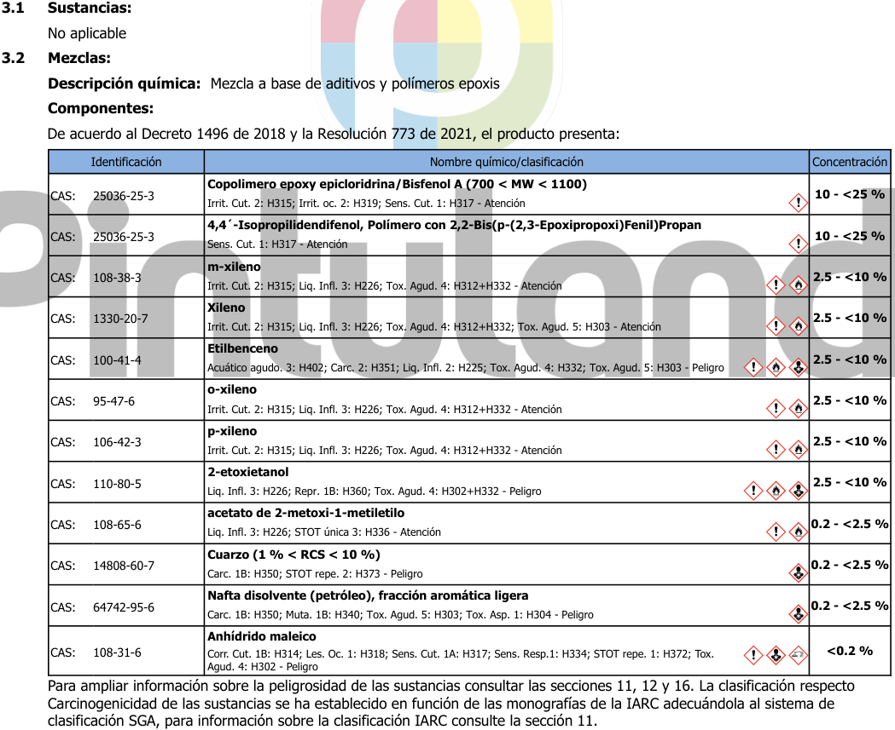
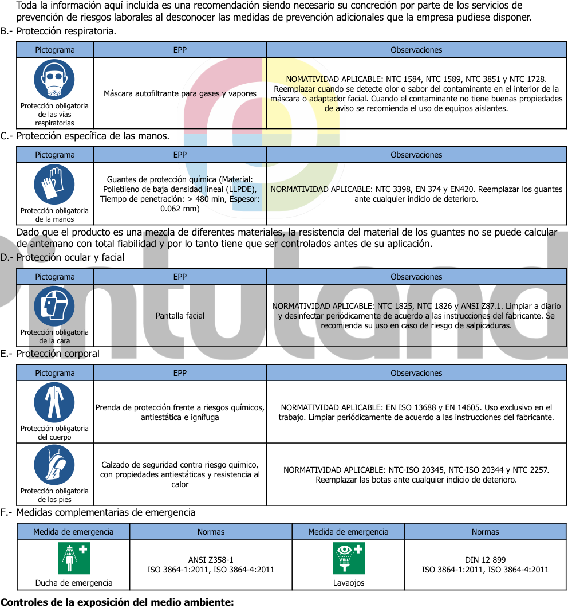
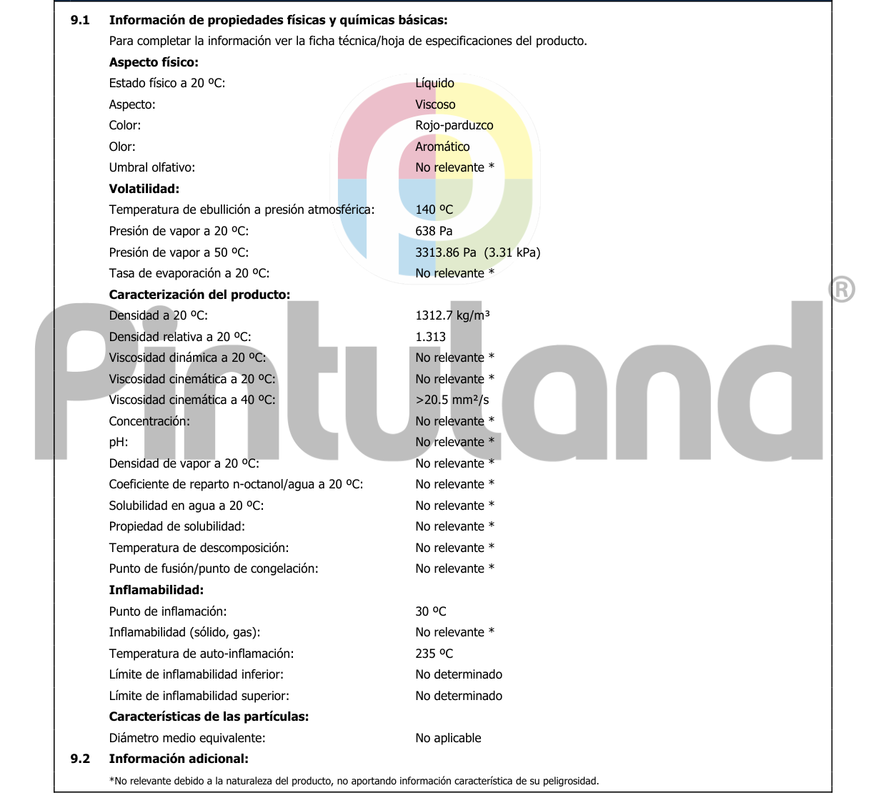
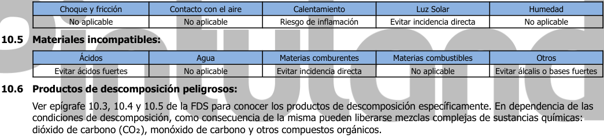
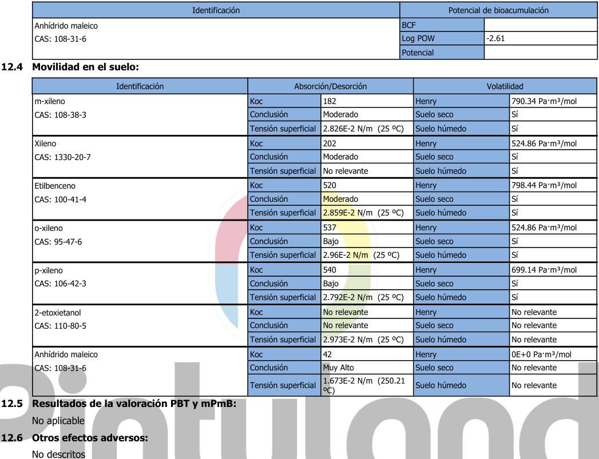
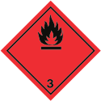

<!-- pagina: 1 -->
Ficha de datos de seguridad según Decreto 1496 de 2018 y Resolución 773 de 2021 

# **51330006 - PRIMER EPOXICO POLIAMIDA ROJO, Componente A** 

> Imagen (pág. 1). Sin texto legible por OCR; contenido gráfico no interpretado.

Emisión: 24/03/2022            Revisión: 5/10/2022            Versión: 3 (sustituye a 2) 

# SECCIÓN 1: IDENTIFICACIÓN DEL PRODUCTO 

**1.1 Identificador SGA del producto:** 51330006 - PRIMER EPOXICO POLIAMIDA ROJO, Componente A **Otros medios de identificación:** No relevante **1.2 Uso recomendado del producto químico y restricciones:** Usos pertinentes: Acabado bicomponente Usos desaconsejados: Todo aquel uso no especificado en este epígrafe ni en el epígrafe 7.3 **1.3 Datos sobre el proveedor:** QUIMICA COSMOS S.A. Autopista Bogota - Medellin, Km 2, Costado norte 250010 Cota - Cundinamarca - Colombia Tfno.: 8643322 laboratorio@pintuland.com.co / produccion@pintuland.com.co www.pintuland.com.co **1.4 Número de teléfono para emergencias:** 601 864 33 22, EXT 104 - 127 

# SECCIÓN 2: IDENTIFICACIÓN DEL PELIGRO O PELIGROS 

**2.1 Clasificación de la sustancia o de la mezcla: SGA:** La clasificación del producto se ha realizado conforme con al decreto 1496 de 2018 y la Resolución 773 de 2021, por el cual se adopta el Sistema Globalmente Armonizado de Clasificación y Etiquetado de Productos Químicos y se dictan otras disposiciones en materia de seguridad química. Carc. 1B: Carcinogenicidad, Categoría 1B, H350 Irrit. Cut. 2: Irritación cutánea, categoría 2, H315 Irrit. oc. 2: Irritación ocular, categoría 2, H319 Liq. Infl. 3: Líquidos inflamables, Categoría 3, H226 Muta. 1B: Mutageneidad en células germinales, Categoría 1B, H340 Repr. 1B: Tóxico para la reproducción, Categoría 1B, H360 Sens. Cut. 1A: Sensibilización cutánea, Categoría 1A, H317 Tox. Agud. 4: Toxicidad aguda por contacto con la piel, Categoría 4, H312 Tox. Agud. 4: Toxicidad aguda por ingestión, Categoría 4, H302 Tox. Agud. 4: Toxicidad aguda por inhalación, Categoría 4, H332 **2.2 Elementos de las etiquetas del SGA, incluidos los consejos de prudencia: SGA: Peligro** 

**Indicaciones de peligro:** 

Carc. 1B: H350 - Puede provocar cáncer. Irrit. Cut. 2: H315 - Provoca irritación cutánea. Irrit. oc. 2: H319 - Provoca irritación ocular grave. Liq. Infl. 3: H226 - Líquido y vapores inflamables. Muta. 1B: H340 - Puede provocar defectos genéticos. Repr. 1B: H360 - Puede perjudicar la fertilidad o dañar al feto. Sens. Cut. 1A: H317 - Puede provocar una reacción cutánea alérgica. Tox. Agud. 4: H312 - Nocivo en contacto con la piel. Tox. Agud. 4: H302 - Nocivo en caso de ingestión. Tox. Agud. 4: H332 - Nocivo si se inhala. **Consejos de prudencia:** 

- CONTINÚA EN LA SIGUIENTE PÁGINA - 

Emisión: 24/03/2022            Revisión: 5/10/2022            Versión: 3 (sustituye a 2) 

**Página 1/16** 

<!-- pagina: 2 -->
Ficha de datos de seguridad según Decreto 1496 de 2018 y Resolución 773 de 2021 

# **51330006 - PRIMER EPOXICO POLIAMIDA ROJO, Componente A** 

> Imagen (pág. 2). Sin texto legible por OCR; contenido gráfico no interpretado.

<!-- Start of picture text -->
OO o <!-- End of picture text -->

Emisión: 24/03/2022            Revisión: 5/10/2022            Versión: 3 (sustituye a 2) 

# SECCIÓN 2: IDENTIFICACIÓN DEL PELIGRO O PELIGROS (continúa) 

P101: Si se necesita consultar a un médico, tener a mano el recipiente o la etiqueta del producto. P102: Mantener fuera del alcance de los niños. 

P210: Mantener alejado del calor, superficies calientes, chispas llamas al descubierto y otras fuentes de ignición. No fumar. P264: Lavarse cuidadosamente después de la manipulación. 

P280: Usar guantes de protección/equipo de protección para la cara/ropa de protección/protección respiratoria/calzado de protección. P305+P351+P338: EN CASO DE CONTACTO CON LOS OJOS: Enjuagar con agua cuidadosamente durante varios minutos. Quitar las lentes de contacto cuando estén presentes y pueda hacerse con facilidad. Proseguir con el lavado. P370+P378: En caso de incendio: Utilizar extintor de polvo ABC para la extinción. P501: Eliminar el contenido/recipiente mediante el sistema de recogida selectiva habilitado en su municipio. **Sustancias que contribuyen a la clasificación** m-xileno; Xileno; Etilbenceno; o-xileno **2.3 Otros peligros que no conducen a una clasificación:** No relevante 

SECCIÓN 3: COMPOSICIÓN/INFORMACIÓN SOBRE LOS COMPONENTES 

> Imagen (pág. 2). OCR automático, revisar: «Sustancias: No aplicable Mezclas: Descripción quit Componentes: Mezcla a base de aditivos y polímeros epoxis De acuerdo al Decreto 1496 de 2018 y la Resolución 773 de 2021, el producto presenta: Copolimero epoxy epicloridrina/Bisfenol A (700 < MW < 1100) (Ss: 25086-25-3 Irrit. Cut. 2: H345; Init. oc. 2: H319; Sens. Cut. 1: H317 - Atención 10 - <2553 14,4" -Isopropilidendifenol, Polímero con 2,2-Bis(p-(2,3-Epoxipropoxi)Fenil)Propan lcas: 25036-25-3 Ls e Mención 10-<25% [Cas: — 108-38-3 at 2.5-<10% '*s Inrit, Cut, 2: H315; Lig. Infl. 3: H226; Tox. Agud. 4: H312+H332 - Atención & Xileno lcas: 1330-20-7 ] 2.5 - <10 % Inrt, Cut, 2: H315; Lig. Infl. 3: H226; Tox. Agud. 4: H312+H332; Tox. Agud. 5: H303 - Atención. <b Etilbenceno ro Cas: [acuático agudo. 3: 402; Care. 2: HBS1; Lig. Inf 2: 4225; Tox. Agud. 4: H332; Tox. Agud. 5: H303 = Peligro <1><@®> pS o-xileno 25-<10% Cas: 95475 ht 2: HS; UI 3: HS Tx qué 4: 420402 - Ancón &o)5"< CAS: | 106-42-3 Prxileno 25-<10% Int, Cut. 2: H315; Lig. Inf. 3: H226; Tox. Agud. 4: H312+H332 - Atención OZO 2-etoxietanol 25-<10% cas: 110805 gn 3 26; ep. 18: HBG; Tox, Ag 4: HATE Pero Hoe acetato de 2-metoxi-1-metiletilo o CAS: 108-65-6 Lig. Inf. 3: H226; STOT única 3: H336 - Atención ap? 25% 50850 Cuarzo (1 % < RCS < 10 %) 02. <250 IN paso, Sror ene 2: 1373 - Peo aa Nafta disolvente (petróleo), fracción aromática ligera 02-<250% cas: 64782-95-5 | te 4 50; uta, 10: HO; Tox Agu HOOD Ton ep. 1 HOO4- Plo gle? 'Anhídrido maleico CAS: — 108-31-6 Corr. Cut. 1B: H314; Les. Oc. 1: H318; Sens. Cut. 1A: H317; Sens. Resp.1: H334; STOT repe. 1: H372; Tox. OOS <0.2 % lagud. 4: H302 - Peligro Para ampliar información sobre la peligrosidad de las sustancias consultar las secciones 11, 12 y 16. La clasificación respecto Carcinogenicidad de las sustancias se ha establecido en función de las monografías de la IARC adecuándola al sistema de clasificación SGA, para información sobre la clasificación IARC consulte la sección 11.»

<!-- Start of picture text -->
3.1 Sustancias: No aplicable 3.2 Mezclas: Descripción química: Mezcla a base de aditivos y polímeros epoxis Componentes: De acuerdo al Decreto 1496 de 2018 y la Resolución 773 de 2021, el producto presenta: Identificación Nombre químico/clasificación Concentración Copolimero epoxy epicloridrina/Bisfenol A (700 < MW < 1100) CAS: 25036-25-3 10 - <25 % Irrit. Cut. 2: H315; Irrit. oc. 2: H319; Sens. Cut. 1: H317 - Atención IS E 4,4´-Isopropilidendifenol, Polímero con 2,2-Bis(p-(2,3-Epoxipropoxi)Fenil)Propan | CAS: 25036-25-3 10 - <25 % Sens. Cut. 1: H317 - Atención La BS ad| m-xileno =FE. imE o om4dal8 CAS: 108-38-3 2.5 - <10 % Alfalild Irrit. Cut. 2: H315; Liq. Infl. 3: H226; Tox. Agud. 4: H312+H332 - Atención Xileno CAS: 1330-20-7 2.5 - <10 % Irrit. Cut. 2: H315; Liq. Infl. 3: H226; Tox. Agud. 4: H312+H332; Tox. Agud. 5: H303 - Atención Etilbenceno MllVFVaTaYa CAS: 100-41-4 2.5 - <10 % Acuático agudo. 3: H402; Carc. 2: H351; Liq. Infl. 2: H225; Tox. Agud. 4: H332; Tox. Agud. 5: H303 - Peligro || BSO o-xileno ENN00 REEWeaBS EAASE CAS: 95-47-6 2.5 - <10 % Irrit. Cut. 2: H315; Liq. Infl. 3: H226; Tox. Agud. 4: H312+H332 - Atención A NY p-xileno A CAS: 106-42-3 2.5 - <10 % A Irrit. Cut. 2: H315; Liq. Infl. 3: H226; Tox. Agud. 4: H312+H332 - Atención 2-etoxietanol aa CAS: 110-80-5 2.5 - <10 % asado Liq. Infl. 3: H226; Repr. 1B: H360; Tox. Agud. 4: H302+H332 - Peligro acetato de 2-metoxi-1-metiletilo CAS: 108-65-6 0.2 - <2.5 % las Liq. Infl. 3: H226; STOT única 3: H336 - Atención Cuarzo (1 % < RCS < 10 %) CAS: 14808-60-7 0.2 - <2.5 % A Carc. 1B: H350; STOT repe. 2: H373 - Peligro Nafta disolvente (petróleo), fracción aromática ligera CAS: 64742-95-6 0.2 - <2.5 % E O Carc. 1B: H350; Muta. 1B: H340; Tox. Agud. 5: H303; Tox. Asp. 1: H304 - Peligro Anhídrido maleico CAS: 108-31-6 Corr. Cut. 1B: H314; Les. Oc. 1: H318; Sens. Cut. 1A: H317; Sens. Resp.1: H334; STOT repe. 1: H372; Tox. <0.2 % Agud. 4: H302 - Peligro Para ampliar información sobre la peligrosidad de las sustancias consultar las secciones 11, 12 y 16. La clasificación respecto ae| Carcinogenicidad de las sustancias se ha establecido en función de las monografías de la IARC adecuándola al sistema de clasificación SGA, para información sobre la clasificación IARC consulte la sección 11. <!-- End of picture text -->

- CONTINÚA EN LA SIGUIENTE PÁGINA - 

Emisión: 24/03/2022            Revisión: 5/10/2022            Versión: 3 (sustituye a 2) 

**Página 2/16** 

<!-- pagina: 3 -->
Ficha de datos de seguridad según Decreto 1496 de 2018 y Resolución 773 de 2021 

# **51330006 - PRIMER EPOXICO POLIAMIDA ROJO,** 

# **Componente A** 

> Imagen (pág. 3). Sin texto legible por OCR; contenido gráfico no interpretado.

Emisión: 24/03/2022            Revisión: 5/10/2022            Versión: 3 (sustituye a 2) 

# SECCIÓN 4: PRIMEROS AUXILIOS 

- **4.1 Descripción de los primeros auxilios necesarios:** 

Los síntomas como consecuencia de una intoxicación pueden presentarse con posterioridad a la exposición, por lo que, en caso de duda, exposición directa al producto químico o persistencia del malestar solicitar atención médica, mostrándole la FDS de este producto. **Por inhalación:** Sacar al afectado del lugar de exposición, suministrarle aire limpio y mantenerlo en reposo. En casos graves como parada cardiorespiratoria, se aplicarán técnicas de respiración artificial (respiración boca a boca, masaje cardíaco, suministro de oxígeno, etc.) requiriendo asistencia médica inmediata. **Por contacto con la piel:** Quitar la ropa y los zapatos contaminados, aclarar la piel o duchar al afectado si procede con abundante agua fría y jabón neutro. En caso de afección importante acudir al médico. Si el producto produce quemaduras o congelación, no se debe quitar la ropa debido a que podría empeorar la lesión producida si esta se encuentra pegada a la piel. En el caso de formarse ampollas en la piel, éstas nunca deben reventarse ya que aumentaría el riesgo de infección. **Por contacto con los ojos:** Enjuagar los ojos con abundante agua a temperatura ambiente al menos durante 15 minutos. Evitar que el afectado se frote o cierre los ojos. En el caso de que el accidentado use lentes de contacto, éstas deben retirarse siempre que no estén pegadas a los ojos, de otro modo podría producirse un daño adicional. En todos los casos, después del lavado, se debe acudir al médico lo más rápidamente posible con la FDS del producto. **Por ingestión/aspiración:** Requerir asistencia médica inmediata, mostrándole la FDS de este producto. No inducir al vómito, en el caso de que se produzca mantener inclinada la cabeza hacia delante para evitar la aspiración. En el caso de pérdida de consciencia no administrar nada por vía oral hasta la supervisión del médico. Enjuagar la boca y la garganta, ya que existe la posibilidad de que hayan sido afectadas en la ingestión. Mantener al afectado en reposo. **4.2 Síntomas/efectos más importantes, agudos o retardados:** 

Los efectos agudos y retardados son los indicados en las secciones 2 y 11 de la FDS. 

- **4.3 Indicación de la necesidad de recibir atención médica inmediata y, en su caso, de tratamiento especial:** No relevante 

# SECCIÓN 5: MEDIDAS DE LUCHA CONTRA INCENDIOS 

- **5.1 Medios de extinción apropiados: Medios de extinción apropiados:** Emplear preferentemente extintores de polvo polivalente (polvo ABC), alternativamente utilizar espuma física o extintores de dióxido de carbono (CO₂). **Medios de extinción no apropiados:** 

NO SE RECOMIENDA emplear agua a chorro como agente de extinción. 

**5.2 Peligros específicos del producto químico:** Como consecuencia de la combustión o descomposición térmica se generan subproductos de reacción que pueden resultar altamente tóxicos y, consecuentemente, pueden presentar un riesgo elevado para la salud. **5.3 Medidas especiales que deben tomar los equipos de lucha contra incendios:** En función de la magnitud del incendio puede hacerse necesario el uso de ropa protectora completa y equipo de respiración autónomo. Disponer de un mínimo de instalaciones de emergencia o elementos de actuación (mantas ignífugas, botiquín portátil,...). **Disposiciones adicionales:** 

Actuar conforme el Plan de Emergencia Interior y las Fichas Informativas sobre actuación ante accidentes y otras emergencias. Suprimir cualquier fuente de ignición. En caso de incendio, refrigerar los recipientes y tanques de almacenamiento de productos susceptibles a inflamación, explosión o BLEVE como consecuencia de elevadas temperaturas. Evitar el vertido de los productos empleados en la extinción del incendio al medio acuático. 

# SECCIÓN 6: MEDIDAS QUE DEBEN TOMARSE EN CASO DE VERTIDO ACCIDENTAL 

- **6.1 Precauciones personales, equipo protector y procedimiento de emergencia: Para el personal que no forma parte de los servicios de emergencia:** 

- CONTINÚA EN LA SIGUIENTE PÁGINA - 

Emisión: 24/03/2022            Revisión: 5/10/2022            Versión: 3 (sustituye a 2) 

**Página 3/16** 

<!-- pagina: 4 -->
Ficha de datos de seguridad según Decreto 1496 de 2018 y Resolución 773 de 2021 

# **51330006 - PRIMER EPOXICO POLIAMIDA ROJO,** 

# **Componente A** 

> Imagen (pág. 4). Sin texto legible por OCR; contenido gráfico no interpretado.

Emisión: 24/03/2022            Revisión: 5/10/2022            Versión: 3 (sustituye a 2) 

# SECCIÓN 6: MEDIDAS QUE DEBEN TOMARSE EN CASO DE VERTIDO ACCIDENTAL (continúa) 

Aislar las fugas siempre y cuando no suponga un riesgo adicional para las personas que desempeñen esta función. Evacuar la zona y mantener a las personas sin protección alejadas. Ante el contacto potencial con el producto derramado se hace obligatorio el uso de elementos de protección personal (ver sección 8 de la FDS). Evitar de manera prioritaria la formación de mezclas vaporaire inflamables, ya sea mediante ventilación o el uso de un agente inertizante. Suprimir cualquier fuente de ignición. Eliminar las cargas electroestáticas mediante la interconexión de todas las superficies conductoras sobre las que se puede formar electricidad estática, y estando a su vez el conjunto conectado a tierra. 

**Para el personal de emergencia:** 

Llevar puesto equipo de protección. Mantener alejadas las personas sin protección. Ver sección 8 de la FDS. 

- **6.2 Precauciones relativas al medio ambiente:** 

Se recomienda evitar el vertido tanto del producto como de su envase al medio ambiente. 

- **6.3 Métodos y materiales para la contención y limpieza de vertidos:** 

Se recomienda: 

Absorber el vertido mediante arena o absorbente inerte y trasladarlo a un lugar seguro. No absorber en serrín u otros absorbentes combustibles. Para cualquier consideración relativa a la eliminación consultar la sección 13 de la FDS. 

- **6.4 Referencias a otras secciones:** Ver secciones 8 y 13. 

# SECCIÓN 7: MANIPULACIÓN Y ALMACENAMIENTO 

- **7.1 Precauciones que se deben tomar para garantizar una manipulación segura:** 

   - A.- Precauciones generales 

Cumplir con la legislación vigente en materia de prevención de riesgos laborales. Mantener los recipientes herméticamente cerrados. Controlar los derrames y residuos, eliminándolos con métodos seguros (sección 6 de la FDS). Evitar el vertido libre desde el recipiente. Mantener orden y limpieza donde se manipulen productos peligrosos. 

B.- Recomendaciones técnicas para la prevención de incendios y explosiones. 

Trasvasar en lugares bien ventilados, preferentemente mediante extracción localizada. Controlar totalmente los focos de ignición (teléfonos móviles, chispas,…) y ventilar en las operaciones de limpieza. Evitar la existencia de atmósferas peligrosas en el interior de recipientes, aplicando en lo posible sistemas de inertización. Trasvasar a velocidades lentas para evitar la generación de cargas electroestáticas. Ante la posibilidad de existencia de cargas electroestáticas: asegurar una perfecta conexión equipotencial, utilizar siempre tomas de tierras, no emplear ropa de trabajo de fibras acrílicas, empleando preferiblemente ropa de algodón y calzado conductor. Cumplir con los requisitos esenciales de seguridad para equipos  y con las disposiciones mínimas para la protección de la seguridad y salud de los trabajadores. Consultar la sección 10 de la FDS sobre condiciones y materias que deben evitarse. 

- C.- Recomendaciones técnicas para prevenir riesgos ergonómicos y toxicológicos. 

LAS MUJERES EMBARAZADAS NO DEBEN EXPONERSE A ESTE PRODUCTO.  Manipular en lugares fijos que reúnan las debidas condiciones de seguridad (duchas de emergencia y lavaojos en las proximidades), empleando equipos de protección personal, en especial de cara y manos (ver sección 8 de la FDS). Limitar los trasvases manuales a recipientes de pequeñas cantidad. No comer, beber ni fumar en las zonas de trabajo 

lavarse las manos después de cada utilización, y despojarse de prendas de vestir y equipos de protección contaminados antes de entrar en las zonas para comer. 

- D.- Recomendaciones técnicas para prevenir riesgos medioambientales 

Se recomienda disponer de material absorbente en las proximidades del producto (ver epígrafe 6.3 de la FDS para mayor información) 

- **7.2 Condiciones de almacenamiento seguro, incluidas cualesquiera incompatibilidades:** 

A.- Medidas técnicas de almacenamiento Temperatura mínima: 4 ºC Temperatura máxima: 35 ºC Tiempo máximo: 24 meses 

B.- Condiciones generales de almacenamiento. 

Evitar fuentes de calor, radiación, electricidad estática y el contacto con alimentos. Para información adicional ver epígrafe 10.5 

- **7.3 Usos específicos finales:** 

   - Salvo las indicaciones ya especificadas no es preciso realizar ninguna recomendación especial en cuanto a los usos de este producto. 

- CONTINÚA EN LA SIGUIENTE PÁGINA - 

Emisión: 24/03/2022            Revisión: 5/10/2022            Versión: 3 (sustituye a 2) 

**Página 4/16** 

<!-- pagina: 5 -->
Ficha de datos de seguridad según Decreto 1496 de 2018 y Resolución 773 de 2021 

# **51330006 - PRIMER EPOXICO POLIAMIDA ROJO, Componente A** 

> Imagen (pág. 5). Sin texto legible por OCR; contenido gráfico no interpretado.

Emisión: 24/03/2022            Revisión: 5/10/2022            Versión: 3 (sustituye a 2) 

# SECCIÓN 8: CONTROLES DE EXPOSICIÓN/PROTECCIÓN PERSONAL 

### **8.1 Parámetros de control:** 

|Sustancias cuyos valores límite de exposición profesional han de controlarse en el ambiente de trab OSHA(Tablas Z):  |ajo: ||
|---|---|---|
|Identificación Valor  |es límite ambien |tales |
|m-xileno 8-hour TWA PEL|100ppm|435 mg/m³|
|CAS: 108-38-3 Ceiling Values - TWA PEL|||
|Xileno 8-hour TWA PEL |100ppm  |435 mg/m³  |
|CAS: 1330-20-7 Ceiling Values - TWA PEL ~~I~~  |||
|Etilbenceno 8-hour TWA PEL    |100ppm    |435 mg/m³   |
|CAS: 100-41-4 Ceiling Values - TWA PEL ~~I~~  || |
|o-xileno 8-hour TWA PEL    |100ppm   |435 mg/m³  |
|CAS: 95-47-6 Ceiling Values - TWA PEL   ||~~A~~|
|p-xileno 8-hour TWA PEL    |100ppm   |435 mg/m³  |
|CAS: 106-42-3 Ceiling Values - TWA PEL   ~~P~~ |||
|2-etoxietanol 8-hour TWA PEL  |200ppm  |740 mg/m³  |
|CAS: 110-80-5 Ceiling Values - TWA PEL  |||
|Anhídrido maleico 8-hour TWA PEL  |0.25ppm  |1 mg/m³  |
|CAS: 108-31-6 Ceiling Values - TWA PEL   |||
|ACGIH(2022): |||
|Identificación Valor|es límite ambien|tales|
|m-xileno TLV-TWA|100ppm||
|CAS: 108-38-3 TLV-STEL|150ppm||
|Xileno TLV-TWA|100ppm||
|CAS: 1330-20-7 TLV-STEL  |150ppm ||
|Etilbenceno TLV-TWA  |20ppm ||
|CAS: 100-41-4 TLV-STEL  |||
|o-xileno TLV-TWA  |100ppm ||
|CAS: 95-47-6 TLV-STEL  |150ppm ||
|p-xileno TLV-TWA|100ppm||
|CAS: 106-42-3 TLV-STEL|150ppm||
|2-etoxietanol TLV-TWA|5ppm||
|CAS: 110-80-5 TLV-STEL|||
|acetato de 2-metoxi-1-metiletilo TLV-TWA|50ppm||
|CAS: 108-65-6 TLV-STEL|75ppm||
|Cuarzo (1 % < RCS < 10 %) TLV-TWA||0.025 mg/m³|
|CAS: 14808-60-7 TLV-STEL|||
|Anhídrido maleico TLV-TWA CAS: 108-31-6 TLV-STEL|0.1ppm||

### **Valores límite biológicos:** 

|Indices de exposición biológicos(BEIs®)- ACGIH ||||
|---|---|---|---|
|Identificación|BEIs®|Determinante|Momento de muestreo|
|m-xileno CAS: 108-38-3|1500 mg/g (Creatinina)|Ácidos metilhipúricos en orina|Fin del turno|
|Xileno CAS: 1330-20-7|1500 mg/g (Creatinina)|Ácidos metilhipúricos en orina|Fin del turno|
|Etilbenceno CAS: 100-41-4|150 mg/g (Creatinina)|Suma de ácido mandélico y ácido fenilglioxílico en la orina|Fin del turno|
|o-xileno CAS: 95-47-6|1500 mg/g (Creatinina)|Ácidos metilhipúricos en orina|Fin del turno|
|p-xileno CAS: 106-42-3|1500 mg/g (Creatinina)|Ácidos metilhipúricos en orina|Fin del turno|
|2-etoxietanol CAS: 110-80-5|100 mg/g (Creatinina)|Ácido 2-etoxiacético en la orina|Al final del turno al final de la semana laboral|

- CONTINÚA EN LA SIGUIENTE PÁGINA - 

Emisión: 24/03/2022            Revisión: 5/10/2022            Versión: 3 (sustituye a 2) 

**Página 5/16** 

<!-- pagina: 6 -->
Ficha de datos de seguridad según Decreto 1496 de 2018 y Resolución 773 de 2021 

# **51330006 - PRIMER EPOXICO POLIAMIDA ROJO, Componente A** 

> Imagen (pág. 6). Sin texto legible por OCR; contenido gráfico no interpretado.

<!-- Start of picture text -->
OD ® <!-- End of picture text -->

Emisión: 24/03/2022            Revisión: 5/10/2022            Versión: 3 (sustituye a 2) 

# SECCIÓN 8: CONTROLES DE EXPOSICIÓN/PROTECCIÓN PERSONAL (continúa) 

### **8.2 Controles técnicos apropiados:** 

- A.- Medidas de protección individual, como equipo de protección personal (EPP) 

   - Realizar la identificación de los peligros y la valoración de los riesgos de acuerdo a la Guia técnica colombiana GTC 45. Como 

   - medida de prevención se recomienda la utilización de equipos de protección individual básicos. Para más información sobre los equipos de protección individual (almacenamiento, uso, limpieza, mantenimiento, clase de protección,…) consultar el folleto informativo facilitado por el fabricante del EPP. Las indicaciones contenidas en este punto se refieren al producto puro. Las medidas de protección para el producto diluido podrán variar en función de su grado de dilución, uso, método de aplicación, etc. Para determinar la obligación de instalación de duchas de emergencia y/o lavaojos en los almacenes se tendrá en cuenta la normativa referente al almacenamiento de productos químicos aplicable en cada caso. Para más información ver epígrafes 7.1 y 7.2 de la FDS. 

> Imagen (pág. 6). OCR automático, revisar: «B.- Toda la información aquí incluida es una recomendación siendo necesario su concreción por parte de los servicios de prevención de riesgos laborales al desconocer las medidas de prevención adicionales que la empresa pudiese disponer. Protección respiratoria. Máscara autofiltrante para gases y vapores Protección obligatoria de las vías respiratorias máscara o adaptador facial. Cuando el contaminante no tiene buenas propiedades NOMATIVIDAD APLICABLE: NTC 1584, NTC 1589, NTC 3851 y NTC 1728. Reemplazar cuando se detecte olor o sabor del contaminante en el interior de la de aviso se recomienda el uso de equipos aislantes. Protección específica de las manos. Guantes de protección química (Material: Polietileno de baja densidad lineal (LLPDE), Tiempo de penetración: > 480 min, Espesor: 0.062 mm) Protección obligatoria de la manos NORMATIVIDAD APLICABLE: NTC 3398, EN 374 y EN420. Reemplazar los guantes ante cualquier indicio de deterioro. y Protección obligatoria de la cara Pantalla facial Dado que el producto es una mezcla de diferentes materialesjlayresistencia del material de los guantes no se puede calcular: de/antemano con total fiabilidad y por lo tanto tiene que ser controlados antes de su aplicación. Protección ocular y facial NORMATIVIDAD APLICABLE: NTC 1825, NTC 1826 y ANSI 287.1. Limpiar a diario y desinfectar periódicamente de acuerdo a las instrucciones del fabricante. Se recomienda su uso en caso de riesgo de salpicaduras. Protección corporal Prenda de protección frente a riesgos químicos, antiestática e ignífuga Protección obligatoria del cuerpo NORMATIVIDAD APLICABLE: EN ISO 13688 y EN 14605. Uso exclusivo en el trabajo. Limpiar periódicamente de acuerdo a las instrucciones del fabricante. Calzado de seguridad contra riesgo químico, con propiedades antiestáticas y resistencia al . calor Protección obligatoria delos pies NORMATIVIDAD APLICABLE: NTC-ISO 20345, NTC-ISO 20344 y NTC 2257. Reemplazar las botas ante cualquier indicio de deterioro. Medidas complementarias de emergencia ANSI Z358-1 150 3864-1:2011, ISO 3864-4:2011 Ducha de emergencia Q* DIN 12 899 Y ISO 3864-1:2011, ISO 3864-4:2011 Lavaojos Controles de la exposición del medio ambiente:»

<!-- Start of picture text -->
Toda la información aquí incluida es una recomendación siendo necesario su concreción por parte de los servicios de prevención de riesgos laborales al desconocer las medidas de prevención adicionales que la empresa pudiese disponer. B.- Protección respiratoria. Pictograma EPP Observaciones NOMATIVIDAD APLICABLE: NTC 1584, NTC 1589, NTC 3851 y NTC 1728. Reemplazar cuando se detecte olor o sabor del contaminante en el interior de la Máscara autofiltrante para gases y vapores máscara o adaptador facial. Cuando el contaminante no tiene buenas propiedades Protección obligatoria de aviso se recomienda el uso de equipos aislantes. de las vías A respiratorias C.- Protección específica de las manos. Pictograma EPP Observaciones Guantes de protección química (Material: Polietileno de baja densidad lineal (LLPDE), NORMATIVIDAD APLICABLE: NTC 3398, EN 374 y EN420. Reemplazar los guantes Tiempo de penetración: > 480 min, Espesor: ante cualquier indicio de deterioro. Protección obligatoria 0.062 mm) STE de la manos Dado que el producto es una mezcla de diferentes materiales, la resistencia del material de los guantes no se puede calcular de antemano con total fiabilidad y por lo tanto tiene que ser controlados antes de su aplicación. D.- Protección ocular y facial Pictograma EPP Observaciones NORMATIVIDAD APLICABLE: NTC 1825, NTC 1826 y ANSI Z87.1. Limpiar a diario Pantalla facial y desinfectar periódicamente de acuerdo a las instrucciones del fabricante. Se recomienda su uso en caso de riesgo de salpicaduras. Protección obligatoria de la cara E.- Protección corporal Pictograma EPP Observaciones MITULUONO Prenda de protección frente a riesgos químicos, NORMATIVIDAD APLICABLE: EN ISO 13688 y EN 14605. Uso exclusivo en el antiestática e ignífuga trabajo. Limpiar periódicamente de acuerdo a las instrucciones del fabricante. Protección obligatoria CI del cuerpo Calzado de seguridad contra riesgo químico, NORMATIVIDAD APLICABLE: NTC-ISO 20345, NTC-ISO 20344 y NTC 2257. con propiedades antiestáticas y resistencia al calor Reemplazar las botas ante cualquier indicio de deterioro. Protección obligatoria CAN de los pies F.- Medidas complementarias de emergencia Medida de emergencia Normas Medida de emergencia Normas ANSI Z358-1 DIN 12 899 ISO 3864-1:2011, ISO 3864-4:2011 ISO 3864-1:2011, ISO 3864-4:2011 A Ducha de emergencia Lavaojos Controles de la exposición del medio ambiente: <!-- End of picture text -->

- CONTINÚA EN LA SIGUIENTE PÁGINA - 

Emisión: 24/03/2022            Revisión: 5/10/2022            Versión: 3 (sustituye a 2) 

**Página 6/16** 

<!-- pagina: 7 -->
Ficha de datos de seguridad según Decreto 1496 de 2018 y Resolución 773 de 2021 

# **51330006 - PRIMER EPOXICO POLIAMIDA ROJO, Componente A** 

> Imagen (pág. 7). Sin texto legible por OCR; contenido gráfico no interpretado.

Emisión: 24/03/2022            Revisión: 5/10/2022            Versión: 3 (sustituye a 2) 

SECCIÓN 8: CONTROLES DE EXPOSICIÓN/PROTECCIÓN PERSONAL (continúa) 

Se recomienda evitar el vertido tanto del producto como de su envase al medio ambiente. Para información adicional ver epígrafe 7.1.D de la FDS. **NTC 6018- Etiquetas ambientales tipo I. Sello ambiental colombiano. Criterios ambientales para pinturas y materiales de recubrimiento (determinados teóricamente conforme al ASTM D6886):** Compuestos orgánicos volátiles: 32.28 % peso Concentración C.O.V. a 20 ºC: 423.73 kg/m³  (423.73 g/L) 

SECCIÓN 9: PROPIEDADES FÍSICAS Y QUÍMICAS Y CARACTERÍSTICAS DE SEGURIDAD 

> Imagen (pág. 7). OCR automático, revisar: «9.1 9.2 Información de propiedades físicas y químicas básicas: Para completar la información ver la ficha técnica/hoja de especificaciones del producto. Aspecto físico: Estado físico a 20 °C: Liquido Aspecto: Viscoso Color: Rojo-parduzco Olor: Aromático Umbral olfativo: No relevante * Volatilidad: Temperatura de ebullición a presión atmosférica: 140 °C Presión de vapor a 20 °C: 638 Pa Presión de vapor a 50 °C: 3313.86 Pa (3.31 kPa) Tasa de evaporación a 20 °C: No relevante * Caracterización del producto: Densidad a 20 °C: 1312.7 kg/m? Densidad relativa a 20 °C: 1.313 Viscosidad dinámica a 20 °C: No relevante * Viscosidad cinematica a 20 °C: No relevante * Viscosidad cinemática a 40 °C: >20.5 mm?/s Concentración: No relevante * pH: No relevante * Densidad de vapor a 20 °C: No relevante * Coeficiente de reparto n-octanol/agua a 20 °C: No relevante * Solubilidad en agua a 20 °C: No relevante * Propiedad de solubilidad: No relevante * Temperatura de descomposición: No relevante * Punto de fusión/punto de congelación: No relevante * Inflamabilidad: Punto de inflamación: 30°C Inflamabilidad (sólido, gas): No relevante * Temperatura de auto-inflamación: 235 °C Limite de inflamabilidad inferior: No determinado Límite de inflamabilidad superior: No determinado Características de las partículas: Diámetro medio equivalente: No aplicable Información adicional: *No relevante debido a la naturaleza del producto, no aportando información característica de su peligrosidad.»

<!-- Start of picture text -->
9.1 Información de propiedades físicas y químicas básicas: Para completar la información ver la ficha técnica/hoja de especificaciones del producto. Aspecto físico: Estado físico a 20 ºC: Líquido Aspecto: Viscoso Color: Rojo-parduzco Olor: Aromático Umbral olfativo: No relevante * Volatilidad: Temperatura de ebullición a presión atmosférica: 140 ºC Presión de vapor a 20 ºC: 638 Pa Presión de vapor a 50 ºC: 3313.86 Pa  (3.31 kPa) Tasa de evaporación a 20 ºC: No relevante * Caracterización del producto: Densidad a 20 ºC: 1312.7 kg/m³ Densidad relativa a 20 ºC: 1.313 Viscosidad dinámica a 20 ºC: No relevante * Viscosidad cinemática a 20 ºC: No relevante * Viscosidad cinemática a 40 ºC: >20.5 mm²/s Concentración: No relevante * pH: No relevante * Densidad de vapor a 20 ºC: No relevante * Coeficiente de reparto n-octanol/agua a 20 ºC: No relevante * Solubilidad en agua a 20 ºC: No relevante * Propiedad de solubilidad: No relevante * Temperatura de descomposición: No relevante * Punto de fusión/punto de congelación: No relevante * Inflamabilidad: Punto de inflamación: 30 ºC Inflamabilidad (sólido, gas): No relevante * Temperatura de auto-inflamación: 235 ºC Límite de inflamabilidad inferior: No determinado Límite de inflamabilidad superior: No determinado Características de las partículas: Diámetro medio equivalente: No aplicable 9.2 Información adicional: *No relevante debido a la naturaleza del producto, no aportando información característica de su peligrosidad. <!-- End of picture text -->

- CONTINÚA EN LA SIGUIENTE PÁGINA - 

Emisión: 24/03/2022            Revisión: 5/10/2022            Versión: 3 (sustituye a 2) 

**Página 7/16** 

<!-- pagina: 8 -->
Ficha de datos de seguridad según Decreto 1496 de 2018 y Resolución 773 de 2021 

# **51330006 - PRIMER EPOXICO POLIAMIDA ROJO, Componente A** 

> Imagen (pág. 8). Sin texto legible por OCR; contenido gráfico no interpretado.

Emisión: 24/03/2022            Revisión: 5/10/2022            Versión: 3 (sustituye a 2) 

# SECCIÓN 9: PROPIEDADES FÍSICAS Y QUÍMICAS Y CARACTERÍSTICAS DE SEGURIDAD (continúa) 

**Información relativa a las clases de peligro físico:** Propiedades explosivas: No relevante * Propiedades comburentes: No relevante * Corrosivos para los metales: No relevante * Calor de combustión: No relevante * Aerosoles-porcentaje total (en masa) de componentes No relevante * inflamables: **Otras características de seguridad:** Tensión superficial a 20 ºC: No relevante * Índice de refracción: No relevante * 

*No relevante debido a la naturaleza del producto, no aportando información característica de su peligrosidad. 

# SECCIÓN 10: ESTABILIDAD Y REACTIVIDAD 

### **10.1 Reactividad:** 

No se esperan reacciones peligrosas si se cumplen las instrucciones técnicas de almacenamiento de productos químicos. Ver sección 7 de la FDS para mayor información. 

- **10.2 Estabilidad química:** 

Estable químicamente bajo las condiciones indicadas de almacenamiento, manipulación y uso. 

- **10.3 Posibilidad de reacciones peligrosas:** 

Bajo las condiciones indicadas no se esperan reacciones peligrosas ni polimerización peligrosa que puedan producir una presión o temperaturas excesivas. 

### **10.4 Condiciones que deben evitarse:** 

Aplicables para manipulación y almacenamiento a temperatura ambiente: 

> Imagen (pág. 8). OCR automático, revisar: «Choque y fricción Contacto con el aire Calentamiento Luz Solar Humedad No aplicable No aplicable Riesgo de inflamación Evitar incidencia directa No aplicable 10.5 Materiales incompatibles: Ácidos Agua Materias comburentes Materias combustibles Otros Evitar ácidos fuertes No aplicable Evitar incidencia directa No aplicable Evitar álcalis o bases fuertes 10.6 Productos de descompo: m peligrosos: Ver epígrafe 10.3, 10.4 y 10.5 de la FDS para conocer los productos de descomposición específicamente. En dependencia de las ion, como consecuencia de la misma pueden liberarse mezclas complejas de sustancias químicas: condiciones de descomposi dióxido de carbono (CO2), monóxido de carbono y otros compuestos orgánicos.»

<!-- Start of picture text -->
Choque y fricción Contacto con el aire Calentamiento Luz Solar Humedad No aplicable No aplicable Riesgo de inflamación Evitar incidencia directa No aplicable 10.5 Materiales incompatibles: Ácidos Agua Materias comburentes Materias combustibles Otros ESSE Evitar ácidos fuertes No aplicable Evitar incidencia directa No aplicable Evitar álcalis o bases fuertes 10.6 Productos de descomposición peligrosos: Ver epígrafe 10.3, 10.4 y 10.5 de la FDS para conocer los productos de descomposición específicamente. En dependencia de las condiciones de descomposición, como consecuencia de la misma pueden liberarse mezclas complejas de sustancias químicas: dióxido de carbono (CO₂), monóxido de carbono y otros compuestos orgánicos. <!-- End of picture text -->

# SECCIÓN 11: INFORMACIÓN TOXICOLÓGICA 

### **11.1 Información sobre las posibles vías de exposición:** 

No se dispone de datos experimentales del producto en sí mismo relativos a las propiedades toxicológicas 

- Contiene glicoles, posibilidad de efectos peligrosos para la salud, por lo que se recomienda no respirar sus vapores prolongadamente 

### **Efectos peligrosos para la salud:** 

En caso de exposición repetitiva, prolongada o a concentraciones superiores a las establecidas por los límites de exposición profesionales, pueden producirse efectos adversos para la salud en función de la vía de exposición: A- Ingestión (efecto agudo): 

   - Toxicidad aguda: La ingesta de una dosis considerable puede originar irritación de garganta, dolor abdominal, náuseas y vómitos. 

- Corrosividad/Irritabilidad: La ingesta de una dosis considerable puede originar irritación de garganta, dolor abdominal, náuseas y vómitos. 

- B- Inhalación (efecto agudo): 

- CONTINÚA EN LA SIGUIENTE PÁGINA - 

Emisión: 24/03/2022            Revisión: 5/10/2022            Versión: 3 (sustituye a 2) 

**Página 8/16** 

<!-- pagina: 9 -->
Ficha de datos de seguridad según Decreto 1496 de 2018 y Resolución 773 de 2021 

# **51330006 - PRIMER EPOXICO POLIAMIDA ROJO,** 

# **Componente A** 

> Imagen (pág. 9). Sin texto legible por OCR; contenido gráfico no interpretado.

Emisión: 24/03/2022            Revisión: 5/10/2022            Versión: 3 (sustituye a 2) 

SECCIÓN 11: INFORMACIÓN TOXICOLÓGICA (continúa) 

   - Toxicidad aguda: Una exposición a altas concentraciones pueden motivar depresión del sistema nervioso central ocasionando dolor de cabeza, mareos, vértigos, nauseas, vómitos, confusión y en caso de afección grave, pérdida de conciencia. 

   - Corrosividad/Irritabilidad: A la vista de los datos disponibles, no se cumplen los criterios de clasificación, sin embargo presenta sustancias clasificadas como peligrosas por este efecto. Para más información ver sección 3 de la FDS. 

- C- Contacto con la piel y los ojos (efecto agudo): 

   - Contacto con la piel: Produce inflamación cutánea. 

   - Contacto con los ojos: Produce lesiones oculares tras contacto. 

- D- Efectos CMR (carcinogenicidad, mutagenicidad y toxicidad para la reproducción): 

   - Carcinogenicidad: La exposición a este producto puede causar cáncer. Para más información sobre posibles efectos específicos sobre la salud ver sección 2 de la FDS. 

IARC: Nafta disolvente (petróleo), fracción aromática ligera (3); m-xileno (3); o-xileno (3); p-xileno (3); Etilbenceno (2B); Xileno (3); Hidrocarburos, C9-C12, n-alcanos, isoalcanos, cíclicos, aromáticos (2-25%) (3); Nafta disolvente (petróleo), fracción aromática ligera , < 0.1 % EC 200-753-7 (3); Cuarzo (1 % < RCS < 10 %) (1); Talco (3); Tolueno (3) 

   - Mutagenicidad: La exposición a este producto puede causar alteraciones genéticas. Para más información sobre posibles efectos específicos sobre la salud ver sección 2 de la FDS. 

   - Toxicidad para la reproducción: Puede perjudicar la fertilidad o dañar al feto 

- E- Efectos de sensibilización: 

   - Respiratoria: A la vista de los datos disponibles, no se cumplen los criterios de clasificación, sin embargo, presenta sustancias clasificadas como peligrosas con efectos sensibilizantes. Para más información ver sección 3 de la FDS. 

   - Cutánea: El contacto prolongado con la piel puede derivar en EPPsodios de dermatitis alérgicas de contacto. 

- F- Toxicidad específica en determinados órganos (STOT)-exposición única: 

A la vista de los datos disponibles, no se cumplen los criterios de clasificación, sin embargo, presenta sustancias clasificadas como peligrosas por inhalación. Para más información ver sección 3 de la FDS. 

- G- Toxicidad específica en determinados órganos (STOT)-exposición repetida: 

   - Toxicidad específica en determinados órganos (STOT)-exposición repetida: A la vista de los datos disponibles, no se cumplen los criterios de clasificación, sin embargo, presenta sustancias clasificadas como peligrosas por inhalación. Para más información ver sección 3 de la FDS. 

   - Piel: A la vista de los datos disponibles, no se cumplen los criterios de clasificación, no presentando sustancias clasificadas como peligrosas por este efecto. Para más información ver sección 3 de la FDS. 

H- Peligro por aspiración: 

A la vista de los datos disponibles, no se cumplen los criterios de clasificación, sin embargo presenta sustancias clasificadas como peligrosas por este efecto. Para más información ver sección 3 de la FDS. **Información adicional:** 

CAS 100-41-4 Etilbenceno: El etilbenceno presente en el producto es un componente del Xileno. El etilbenceno es un componente importante de los xilenos técnicos, la toxicología de estos productos fue revisada (WHO, 1997), IARC ha evaluado a los Xilenos como no clasificables en cuanto a su carcinogenicidad a los humanos (Grupo 3) (IARC, 1999) (Ref: Monografía IARC, Vol. 77, 2000; Vol. 71, 1999). 

### **Información toxicológica específica de las sustancias:** 

||Identificación|To|xicidad aguda|Género|
|---|---|---|---|---|
|m-xileno||DL50 oral|1590 mg/kg|Ratón|
|CAS: 108-38-3||DL50 cutánea|1100 mg/kg(ATEi)||
|||CL50 inhalación|11 mg/L (ATEi)||
|o-xileno||DL50 oral|1590 mg/kg|Ratón|
|CAS: 95-47-6||DL50 cutánea|1100 mg/kg(ATEi)||
|||CL50 inhalación|11 mg/L (ATEi)||
|p-xileno||DL50 oral|1590 mg/kg|Ratón|
|CAS: 106-42-3||DL50 cutánea|1100 mg/kg(ATEi)||
|||CL50 inhalación|11 mg/L (ATEi)||
|Etilbenceno||DL50 oral|3500 mg/kg|Rata|
|CAS: 100-41-4||DL50 cutánea|15354 mg/kg|Conejo|
|||CL50 inhalación|17.2 mg/L (4 h)|Rata|

- CONTINÚA EN LA SIGUIENTE PÁGINA - 

Emisión: 24/03/2022            Revisión: 5/10/2022            Versión: 3 (sustituye a 2) 

**Página 9/16** 

<!-- pagina: 10 -->
Ficha de datos de seguridad según Decreto 1496 de 2018 y Resolución 773 de 2021 

# **51330006 - PRIMER EPOXICO POLIAMIDA ROJO, Componente A** 

> Imagen (pág. 10). Sin texto legible por OCR; contenido gráfico no interpretado.

<!-- Start of picture text -->
OO O <!-- End of picture text -->

Emisión: 24/03/2022            Revisión: 5/10/2022            Versión: 3 (sustituye a 2) 

SECCIÓN 11: INFORMACIÓN TOXICOLÓGICA (continúa) 

|Identificación|To|xicidad aguda|Género|
|---|---|---|---|
|Xileno|DL50 oral|3523 mg/kg|Rata|
|CAS: 1330-20-7|DL50 cutánea|1100 mg/kg||
||CL50 inhalación  |11 mg/L (ATEi) ||
|acetato de 2-metoxi-1-metiletilo |DL50 oral  |8532 mg/kg |Rata |
|CAS: 108-65-6 |DL50 cutánea  |>5000 mg/kg |Rata |
||CL50 inhalación     |30 mg/L (4 h)  |Rata  |
|2-etoxietanol   |DL50 oral      |500 mg/kg(ATEi)   ||
|CAS: 110-80-5   |DL50 cutánea      |No relevante   ||
||CL50 inhalación    |3 mg/L (ATEi)  ||
|Nafta disolvente (petróleo), fracción aromática ligera  |DL50 oral    |3500 mg/kg  |Rata  |
|CAS: 64742-95-6 |DL50 cutánea    |No relevante   | |
||CL50 inhalación    |No relevante    |  |
|Anhídrido maleico  |DL50 oral     |1090 mg/kg     |Rata     |
|CAS: 108-31-6  |DL50 cutánea    |No relevante    |  |
||CL50 inhalación |No relevante  ||
|SECCIÓN 12: INFORMACIÓN ECOTOXICOLÓGICA||||

No se disponen de datos experimentales de la mezcla en sí misma relativos a las propiedades ecotoxicológicas. 

A la vista de los datos disponibles, no se cumplen los criterios de clasificación, sin embargo presenta sustancias clasificadas como peligrosas por este efecto. Para más información ver sección 3 de la FDS. 

### **12.1 Toxicidad:** 

### **Toxicidad aguda:** 

|Identificación  ||Concentración |Especie |Género |
|---|---|---|---|---|
|m-xileno  |CL50 |16 mg/L(96 h) |Carassius auratus |Pez |
|CAS: 108-38-3  |CE50 |9.56 mg/L(48 h) |Daphnia magna |Crustáceo |
||CE50  |No relevante  | | |
|Etilbenceno   |CL50  |42.3 mg/L(96 h)  |Pimephalespromelas   |Pez   |
|CAS: 100-41-4    |CE50   |75 mg/L(48 h)   |Daphnia magna   |Crustáceo   |
||CE50 |63 mg/L (3 h) |Chlorella vulgaris   |Alga   |
|o-xileno  |CL50  |16.1 mg/L(96 h)  |Lepomis macrochirus    |Pez    |
|CAS: 95-47-6  |CE50  |1.39 mg/L(48 h)  |Daphnia magna    |Crustáceo    |
||CE50  |No relevante  |||
|p-xileno  |CL50   |2.6 mg/L(96 h)   |Oncorhynchus mykiss    |Pez    |
|CAS: 106-42-3 |CE50  |8.5 mg/L(48 h)  |Daphnia magna   |Crustáceo   |
||CE50   |No relevante   | | |
|acetato de 2-metoxi-1-metiletilo  |CL50    |161 mg/L(96 h)    |Pimephalespromelas     |Pez     |
|CAS: 108-65-6 |CE50   |481 mg/L(48 h)    |Daphnia sp.    |Crustáceo    |
||CE50   |No relevante   |||
|Nafta disolvente (petróleo), fracción aromática ligera  |CL50    |320 mg/L(48 h)    |Leuciscus idus melanotos    |Pez    |
|CAS: 64742-95-6 |CE50   |170 mg/L(24 h)    |Daphnia magna   |Crustáceo   |
||CE50  |56 mg/L (72 h)  |Selenastrum capricornutum  |Alga  |
|**Toxicidad a largo plazo:**|||||
|Identificación||Concentración|Especie|Género|
|m-xileno|NOEC|0.714 mg/L|Danio rerio|Pez|
|CAS: 108-38-3|NOEC|1.57 mg/L|Daphnia magna|Crustáceo|
|Xileno|NOEC|1.3 mg/L|Oncorhynchus mykiss|Pez|
|CAS: 1330-20-7|NOEC|1.17 mg/L|Ceriodaphnia dubia|Crustáceo|
|Etilbenceno|NOEC|No relevante|||
|CAS: 100-41-4|NOEC|0.96 mg/L|Ceriodaphnia dubia|Crustáceo|

- CONTINÚA EN LA SIGUIENTE PÁGINA - 

Emisión: 24/03/2022            Revisión: 5/10/2022            Versión: 3 (sustituye a 2) 

**Página 10/16** 

<!-- pagina: 11 -->
Ficha de datos de seguridad según Decreto 1496 de 2018 y Resolución 773 de 2021 

# **51330006 - PRIMER EPOXICO POLIAMIDA ROJO, Componente A** 

> Imagen (pág. 11). Sin texto legible por OCR; contenido gráfico no interpretado.

Emisión: 24/03/2022            Revisión: 5/10/2022            Versión: 3 (sustituye a 2) 

SECCIÓN 12: INFORMACIÓN ECOTOXICOLÓGICA (continúa) 

||Identificación o-xileno|Concentración NOEC 1.3 mg/L|Especie Oncorhynchus mykiss|Género Pez|
|---|---|---|---|---|
||CAS: 95-47-6|NOEC 1.57 mg/L|Daphnia magna|Crustáceo|
||p-xileno|NOEC 0.714 mg/L|Danio rerio|Pez|
||CAS: 106-42-3|NOEC 1.57 mg/L|Daphnia magna|Crustáceo|
||acetato de 2-metoxi-1-metiletilo|NOEC 47.5 mg/L |Oryzias latipes |Pez |
||CAS: 108-65-6|NOEC 100 mg/L|Daphnia magna|Crustáceo|
|**12.2**|**Persistencia y degradabilidad:**||||
||**Información específica de las sustancias:**||||
||Identificación|Degradabilidad|Biodegradabilidad||
||Xileno|DBO5 No relevante|Concentración No rel|evante|
||CAS: 1330-20-7|DQO No relevante|Periodo 28 día|s|
|||DBO5/DQO No relevante  |% Biodegradado 88 %   ||
||Etilbenceno |DBO5 No relevante  |Concentración 100 m   |g/L  |
||CAS: 100-41-4 |DQO No relevante  |Periodo 14 día   |s  |
|||DBO5/DQO No relevante   |% Biodegradado 90 %     ||
||o-xileno  |DBO5 No relevante    |Concentración 36 mg      |/L    |
||CAS: 95-47-6 |DQO No relevante   |Periodo 28 día     |s   |
|||DBO5/DQO No relevante    |% Biodegradado 70 %     ||
||acetato de 2-metoxi-1-metiletilo   |DBO5 No relevante    |Concentración 785 m       |g/L    |
||CAS: 108-65-6  |DQO No relevante  |Periodo 8 días  ||
|||DBO5/DQO No relevante  |% Biodegradado 100 %  |  |
||Nafta disolvente (petróleo), fracción aromática ligera  |DBO5 0.19gO2/g   |Concentración No rel   |evante   |
||CAS: 64742-95-6 |DQO 0.44gO2/g  |Periodo No rel  |evante  |
|||DBO5/DQO 0.43   |% Biodegradado No rel     |evante   |
||Anhídrido maleico |DBO5 No relevante   |Concentración 33.33    |mg/L   |
||CAS: 108-31-6 |DQO No relevante  |Periodo 29 día   |s  |
|||DBO5/DQO No relevante  |% Biodegradado 98.19   |%  |
|**12.3**|**Potencial de bioacumulación:**||||
||**Información específica de las sustancias:**||||
||Identificación||Potencial de bioacumula|ción|
||m-xileno||BCF 15||
||CAS: 108-38-3||LogPOW 3.2||
||||Potencial Bajo ||
||Xileno ||BCF 9 ||
||CAS: 1330-20-7 ||LogPOW 2.77 ||
||||Potencial Bajo  ||
||Etilbenceno  | |BCF 1      ||
||CAS: 100-41-4 ||LogPOW 3.15 ||
||||Potencial Bajo  ||
||o-xileno  ||BCF 6  ||
||CAS: 95-47-6  | |LogPOW 3.12   ||
||| |Potencial Bajo   | |
||p-xileno  | |BCF 15   | |
||CAS: 106-42-3  | |LogPOW 3.15   | |
||||Potencial Bajo   ||
||acetato de 2-metoxi-1-metiletilo   ||BCF 1    ||
||CAS: 108-65-6   |  |LoPOW 043     ||
||  ||g  . Potencial Bajo   ||
||Nafta disolvente (petróleo), fracción aromática ligera ||BCF  ||
|| CAS: 64742-95-6 ||LogPOW 4  ||
||- CONTI |NÚA EN LA SIGUIENTE PÁGINA - |Potencial     ||
|Emisión:|24/03/2022            Revisión: 5/10/2022            V|ersión: 3 (sustituye a 2)||**Página 11/**|

**Página 11/16** 

<!-- pagina: 12 -->
Ficha de datos de seguridad según Decreto 1496 de 2018 y Resolución 773 de 2021 

# **51330006 - PRIMER EPOXICO POLIAMIDA ROJO, Componente A** 

> Imagen (pág. 12). Sin texto legible por OCR; contenido gráfico no interpretado.

<!-- Start of picture text -->
OO o <!-- End of picture text -->

Emisión: 24/03/2022            Revisión: 5/10/2022            Versión: 3 (sustituye a 2) 

# SECCIÓN 12: INFORMACIÓN ECOTOXICOLÓGICA (continúa) 

> Imagen (pág. 12). OCR automático, revisar: «12.4 12.5 12.6 Identificación Potencial de bioacumulación Anhídrido maleico BCF CAS: 108-31-6 Log POW 2.61 Potencial Movilidad en el suelo: Identificación Absorción/Desorción! Volatilidad m-xileno Koc 182 Henry 790.34 Pa'm?/mol CAS: 108-38-3 [Conclusión Moderado Suelo seco Ej "Tensión superficial |2.826E-2 N/m (25 °C) [Suelo húmedo sí Xileno Koc 202 Henry 524.86 Pa:m2/mol CAS: 1330-20-7 [Conclusión Moderado Suelo seco E "Tensión superficial | No relevante Suelo húmedo si Etibenceno Koc 520 Henry 798.44 Pa:m2/mol CAS: 100-41-4 [Conclusión Moderado Suelo seco si "Tensión superficial |2.859E-2 N/m (25 °C) [Suelo húmedo si o-xileno Koc 537 Henry 524.86 Pa:m2/mol CAS: 95-47-6 [Conclusión Bajo Suelo seco E "Tensión superficial |2.96E-2 N/m (25 oc) — [Suelo húmedo Ej paleno Koc 540 Henry 699.14 Pa'm2/mol CAS: 106-42-3 [Conclusión Bajo Suelo seco Ej "Tensión superficial |2.792E-2 N/m (25 °C) [Suelo húmedo si 2-etoxietanol Koc No relevante Henry No relevante CAS: 110-80-5 [Conclusión No relevante Suelo seco No relevante "Tensión superficial |2.973E-2 N/m (25 °C) [Suelo húmedo No relevante anhídrido maleico Koc 42 Henry OE-+0 Parm?/mol CAS: 108-31-6 [Conclusión Muy Alto Suelo seco No relevante Tensión superficial me Nim (250.21 [Suelo húmedo No relevante Resultados de la valoración PBT y mPmB: No aplicable Otros efectos adversos: No descritos»

<!-- Start of picture text -->
Identificación Potencial de bioacumulación Anhídrido maleico BCF CAS: 108-31-6 Log POW -2.61 Potencial 12.4 Movilidad en el suelo: Identificación Absorción/Desorción Volatilidad m-xileno Koc 182 Henry 790.34 Pa·m³/mol CAS: 108-38-3 Conclusión Moderado Suelo seco Sí Tensión superficial 2.826E-2 N/m  (25 ºC) Suelo húmedo Sí Xileno Koc 202 Henry 524.86 Pa·m³/mol O === === CAS: 1330-20-7 Conclusión Moderado Suelo seco Sí Tensión superficial No relevante Suelo húmedo Sí —— Etilbenceno Koc 520 Henry 798.44 Pa·m³/mol CAS: 100-41-4 Conclusión Moderado Suelo seco Sí Tensión superficial 2.859E-2 N/m  (25 ºC) Suelo húmedo Sí ES o-xileno Koc == SS 537 ====== Henry 524.86 Pa·m³/mol CAS: 95-47-6 Conclusión Bajo Suelo seco Sí Tensión superficial 2.96E-2 N/m  (25 ºC) Suelo húmedo Sí A. p-xileno Koc 540 == Henry | 699.14 Pa·m³/mol = CAS: 106-42-3 Conclusión Bajo Suelo seco Sí Tensión superficial 2.792E-2 N/m  (25 ºC) Suelo húmedo Sí ——— 2-etoxietanol Koc SS No relevante  === Henry No relevante CAS: 110-80-5 Conclusión No relevante Suelo seco No relevante Tensión superficial 2.973E-2 N/m  (25 ºC) Suelo húmedo No relevante —— Anhídrido maleico Koc 42 Henry 0E+0 Pa·m³/mol CAS: 108-31-6 Conclusión Muy Alto Suelo seco No relevante Tensión superficial 1.673E-2 N/m  (250.21 Suelo húmedo No relevante y ºC SS ) = 12.5 Resultados de la valoración PBT y mPmB: o SS === No aplicable 12.6 Otros efectos adversos: No descritos <!-- End of picture text -->

# SECCIÓN 13: INFORMACIÓN RELATIVA A LA ELIMINACIÓN DE LOS PRODUCTOS 

### **13.1 Métodos de eliminación:** 

### **Gestión del residuo (eliminación y valorización):** 

Consultar al gestor de residuos autorizado las operaciones de valorización y eliminación. En el caso de que el envase haya estado en contacto directo con el producto se gestionará del mismo modo que el propio producto, en caso contrario se gestionará como residuo no peligroso. Se desaconseja su vertido a cursos de agua. Ver epígrafe 6.2. 

### **Disposiciones legislativas relacionadas con la gestión de residuos:** 

Legislación relacionada con la gestión de residuos: 

Decreto 1076 de 2015 (Decreto único reglamentario del Sector Ambiente y Desarrollo Sostenible) 

# SECCIÓN 14: INFORMACIÓN RELATIVA AL TRANSPORTE 

**Transporte terrestre de mercancías peligrosas:** En aplicación a la norma técnica colombiana 1692: 

- CONTINÚA EN LA SIGUIENTE PÁGINA - 

Emisión: 24/03/2022            Revisión: 5/10/2022            Versión: 3 (sustituye a 2) 

**Página 12/16** 

<!-- pagina: 13 -->
Ficha de datos de seguridad según Decreto 1496 de 2018 y Resolución 773 de 2021 

# **51330006 - PRIMER EPOXICO POLIAMIDA ROJO, Componente A** 

> Imagen (pág. 13). Sin texto legible por OCR; contenido gráfico no interpretado.

Emisión: 24/03/2022            Revisión: 5/10/2022            Versión: 3 (sustituye a 2) 

SECCIÓN 14: INFORMACIÓN RELATIVA AL TRANSPORTE (continúa) 

||**14.1**|**Número ONU:**|UN1263|
|---|---|---|---|
||**14.2**|**Designación oficial de**|PINTURA|
||| **transporte de las Naciones**||
||| **Unidas:**||
||**14.3**|**Clase(s) relativas al** **transporte:** Etiquetas:|3 3|
||**14.4**|**Grupo de** **embalaje/envasado si se** **aplica:**|III|
||**14.5**|**Riesgos ambientales:**|No|
||**14.6**|**Precauciones especiales para**|**el usuario**|
|||Propiedades físico-químicas:|Ver sección 9|
||**14.7**|**Transporte a granel con**|No relevante|
|||**arreglo al anexo II de** **MARPOL 73/78 y al Código** **IBC:**||
|**Transporte ma**|**rítimo**|**de mercancías peligrosas:**||
|En aplicación al I|MDG 40|-20:||
||**14.1**|**Número ONU:**|UN1263|
||**14.2**|**Designación oficial de** **transporte de las Naciones**|PINTURA|
|||**Unidas:** ||
||**14.3**|**Clase(s) relativas al** **transporte:**|3|
|||Etiquetas:|3|
||**14.4**|**Grupo de**|III|
|||**embalaje/envasado si se** **aplica:**||
||**14.5**|**Contaminante marino:**|No|
||**14.6**|**Precauciones especiales para**|**el usuario**|
|||Disposiciones especiales:|223, 955, 163, 367|
|||Códigos FEm:|F-E, S-E|
|||Propiedades físico-químicas:|Ver sección 9|
|||Cantidades limitadas:|5 L|
|||Grupo de segregación:|No relevante|
||**14.7**|**Transporte a granel con** **arreglo al anexo II de** **MARPOL 73/78 y al Código** **IBC:**|No relevante|
|**Transporte aér**|**eo de**|**mercancías peligrosas:**||
|En aplicación al I|ATA/OA|CI 2023:||

- CONTINÚA EN LA SIGUIENTE PÁGINA - 

Emisión: 24/03/2022            Revisión: 5/10/2022            Versión: 3 (sustituye a 2) 

**Página 13/16** 

<!-- pagina: 14 -->
Ficha de datos de seguridad 

según Decreto 1496 de 2018 y Resolución 773 de 2021 

# **51330006 - PRIMER EPOXICO POLIAMIDA ROJO, Componente A** 

> Imagen (pág. 14). Sin texto legible por OCR; contenido gráfico no interpretado.

Emisión: 24/03/2022            Revisión: 5/10/2022            Versión: 3 (sustituye a 2) 

# SECCIÓN 14: INFORMACIÓN RELATIVA AL TRANSPORTE (continúa) 

> Imagen (pág. 14). Sin texto legible por OCR; contenido gráfico no interpretado.

|**14.1**|**Número ONU:**|UN1263|
|---|---|---|
|**14.2**|**Designación oficial de** **transporte de las Naciones** **Unidas:**|PINTURA|
|**14.3**|**Clase(s) relativas al** **transporte:**|3|
||Etiquetas:|3|
|**14.4**|**Grupo de** **embalaje/envasado si se** **aplica:**|III|
|**14.5**|**Riesgos ambientales:**|No|
|**14.6**|**Precauciones especiales para**|**el usuario**|
||Propiedades físico-químicas:|Ver sección 9|
|**14.7**|**Transporte a granel con** **arreglo al anexo II de** **MARPOL 73/78 y al Código** **IBC:**|No relevante|

# SECCIÓN 15: INFORMACIÓN SOBRE LA REGLAMENTACIÓN 

### **15.1 Disposiciones específicas sobre seguridad, salud y medio ambiente para el producto de que se trate:** - NTP (National Toxicology Program): _Cuarzo (1 % < RCS < 10 %) (14808-60-7)_ ; _Nafta disolvente (petróleo), fracción aromática ligera (64742-95-6)_ 

### **Disposiciones particulares en materia de protección de las personas o el medio ambiente:** 

Se recomienda emplear la información recopilada en esta hoja de datos de seguridad de materiales como datos de entrada en una evaluación de riesgos de las circunstancias locales con el objeto de establecer las medidas necesarias de prevención de riesgos para el manejo, utilización, almacenamiento y eliminación de este producto. **Otras legislaciones:** 

Resolución 0312 de 2019 – Nuevos estándares mínimos del SG-SST CONPES 3868 - Política de gestión del riesgo asociado al uso de sustancias químicas. Decreto 1079 de 2015 - Decreto único reglamentario del sector transporte NTC 1692 -Transporte de mercancías peligrosas. Definiciones, clasificación, marcado, etiquetado y rotulado NTC 4532- Transporte de mercancías peligrosas. Tarjetas de emergencia para transporte de materiales. Elaboración Decreto número 4741 de 2005 Decreto 1299 de 2008 -Reglamenta departamento de gestión ambiental de empresas a nivel industrial estado Decreto 321 de 1999  - Adopta el Plan Nacional de Contingencia contra derrames de hidrocarburos, derivados y sustancias nocivas. 

NTC 4702 - 1 -Embalaje y Envases para Transporte de Mercancías Peligrosas Clase 1. Explosivos NTC 4702 - 2 - Embalaje y Envases para Transporte de Mercancías Peligrosas Clase 2. Gases NTC 4702 - 3 - Embalaje y Envases para Transporte de Mercancías Peligrosas Clase 3. Líquidos Inflamables NTC 4702 - 4 - Embalaje y Envases para Transporte de Mercancías Peligrosas Clase 4. Sólidos Inflamables, Sustancias que presentan riesgo de combustión espontánea, sustancias que en contacto con el agua desprenden gases inflamables. NTC 4702 - 5 - Embalaje y Envases para Transporte de Mercancías Peligrosas Clase 5. Sustancias Comburentes y Peróxidos Orgánicos NTC 4702 - 6 - Embalaje y Envases para Transporte de Mercancías Peligrosas Clase 6. Sustancias Tóxicas e Infecciosas NTC 4702 - 8 - Embalaje y Envases para Transporte de Mercancías Peligrosas Clase 8. Sustancias Corrosivas NTC 4702 - 9 - Embalaje y Envases para Transporte de Mercancías Peligrosas Clase 9. Sustancias Peligrosas varias Ley 2041 de 2020 - Por medio de la cual se garantiza el derecho de las personas a desarrollarse física e intelectualmente en un ambiente libre de plomo, fijando límites para su contenido en productos comercializados en el país. 

# SECCIÓN 16: OTRAS INFORMACIONES 

### **Legislación aplicable a fichas de datos de seguridad:** 

Esta ficha de datos de seguridad se ha desarrollado de conformidad al Decreto 1496 de 2018 y a la Resolución 773 de 2021, contando con los elementos definidos en el ANEXO 4 - Guía para la elaboración de fichas de datos de seguridad (FDS) del Sistema Globalmente Armonizado de clasificación y etiquetado de productos químicos (SGA), sexta edición revisada (2015). **Textos de las frases legislativas contempladas en la sección 2:** 

- CONTINÚA EN LA SIGUIENTE PÁGINA - 

Emisión: 24/03/2022            Revisión: 5/10/2022            Versión: 3 (sustituye a 2) 

**Página 14/16** 

<!-- pagina: 15 -->
Ficha de datos de seguridad según Decreto 1496 de 2018 y Resolución 773 de 2021 

# **51330006 - PRIMER EPOXICO POLIAMIDA ROJO, Componente A** 

> Imagen (pág. 15). Sin texto legible por OCR; contenido gráfico no interpretado.

Emisión: 24/03/2022            Revisión: 5/10/2022            Versión: 3 (sustituye a 2) 

SECCIÓN 16: OTRAS INFORMACIONES (continúa) 

H317: Puede provocar una reacción cutánea alérgica. H340: Puede provocar defectos genéticos. H350: Puede provocar cáncer. H315: Provoca irritación cutánea. H360: Puede perjudicar la fertilidad o dañar al feto. H312: Nocivo en contacto con la piel. H302: Nocivo en caso de ingestión. H332: Nocivo si se inhala. H226: Líquido y vapores inflamables. H319: Provoca irritación ocular grave. **Textos de las frases legislativas contempladas en la sección 3:** Las frases indicadas no se refieren al producto en sí, son sólo a título informativo y hacen referencia a los componentes individuales que aparecen en la sección 3 **SGA:** Acuático agudo. 3: H402 - Nocivo para los organismos acuáticos. Carc. 1B: H350 - Puede provocar cáncer. Carc. 2: H351 - Susceptible de provocar cáncer. Corr. Cut. 1B: H314 - Provoca graves quemaduras en la piel y lesiones oculares. Irrit. Cut. 2: H315 - Provoca irritación cutánea. Irrit. oc. 2: H319 - Provoca irritación ocular grave. Les. Oc. 1: H318 - Provoca lesiones oculares graves. Liq. Infl. 2: H225 - Líquido y vapores muy inflamables. Liq. Infl. 3: H226 - Líquido y vapores inflamables. Muta. 1B: H340 - Puede provocar defectos genéticos. Repr. 1B: H360 - Puede perjudicar la fertilidad o dañar al feto. Sens. Cut. 1: H317 - Puede provocar una reacción cutánea alérgica. Sens. Cut. 1A: H317 - Puede provocar una reacción cutánea alérgica. Sens. Resp.1: H334 - Puede provocar síntomas de alergia o asma o dificultades respiratorias si se inhala. STOT repe. 1: H372 - Provoca daños en los órganos tras exposiciones prolongadas o repetidas (Inhalación). STOT repe. 2: H373 - Puede provocar daños en los órganos tras exposiciones prolongadas o repetidas (Inhalación). STOT única 3: H336 - Puede provocar somnolencia o vértigo. Tox. Agud. 4: H302 - Nocivo en caso de ingestión. Tox. Agud. 4: H302+H332 - Nocivo en caso de ingestión o si se inhala. Tox. Agud. 4: H312+H332 - Nocivo en contacto con la piel o si se inhala. Tox. Agud. 4: H332 - Nocivo si se inhala. Tox. Agud. 5: H303 - Puede ser nocivo en caso de ingestión. Tox. Asp. 1: H304 - Puede ser mortal en caso de ingestión y de penetración en las vías respiratorias. **Procedimiento de clasificación:** Skin Sens. 1A: Método de cálculo (SGA Rev. 6) Muta. 1B: Método de cálculo (SGA Rev. 6) Carc. 1B: Método de cálculo (SGA Rev. 6) Skin Irrit. 2: Método de cálculo (SGA Rev. 6) Repr. 1B: Método de cálculo (SGA Rev. 6) Acute Tox. 4: Método de cálculo (SGA Rev. 6) Acute Tox. 4: Método de cálculo (SGA Rev. 6) Acute Tox. 4: Método de cálculo (SGA Rev. 6) Flam. Liq. 3: Método de cálculo (2.6.4.3.) (SGA Rev.6) Eye Irrit. 2: Método de cálculo (SGA Rev. 6) **Consejos relativos a la formación:** Se recomienda formación mínima en materia de prevención de riesgos laborales al personal que va a manipular este producto, con la finalidad de facilitar la comprensión e interpretación de esta hoja de datos de seguridad de materiales, así como del etiquetado del producto. **Principales fuentes bibliográficas:** Ministerio de trabajo de la República de Colombia (https://www.mintrabajo.gov.co). Portal global de información sobre sustancias químicas - e-CHEM-PORTAL. Sistema de información sobre sustancias peligrosas-GESTIS. Agencia Internacional para la Investigación del Cáncer-IARC. Instituto Colombiano de Normas Técnicas y Certificación (ICONTEC). **Abreviaturas y acrónimos:** 

- CONTINÚA EN LA SIGUIENTE PÁGINA - 

Emisión: 24/03/2022            Revisión: 5/10/2022            Versión: 3 (sustituye a 2) 

**Página 15/16** 

<!-- pagina: 16 -->
Ficha de datos de seguridad según Decreto 1496 de 2018 y Resolución 773 de 2021 

# **51330006 - PRIMER EPOXICO POLIAMIDA ROJO, Componente A** 

> Imagen (pág. 16). Sin texto legible por OCR; contenido gráfico no interpretado.

<!-- Start of picture text -->
OO o <!-- End of picture text -->

Emisión: 24/03/2022            Revisión: 5/10/2022            Versión: 3 (sustituye a 2) 

# SECCIÓN 16: OTRAS INFORMACIONES (continúa) 

IMDG: Código Marítimo Internacional de Mercancías Peligrosas IATA: Asociación Internacional de Transporte Aéreo OACI: Organización de Aviación Civil Internacional DQO: Demanda Química de Oxígeno DBO5: Demanda Biológica de Oxígeno a los 5 días BCF: Factor de bioconcentración DL50: Dosis Letal 50 CL50: Concentración Letal 50 EC50: Concentración Efectiva 50 Log POW: Logaritmo Coeficiente Partición Octanol-Agua Koc: Coeficiente de Partición del Carbono Orgánico IARC: Centro Internacional de Investigaciones sobre el Cáncer 

## **Para solicitar la hoja de seguridad de un color específico, por favor diríjase al siguiente link: https://pintuland.com.co/form-consulta-tecnica/** 

Codigo Interno: CC-F-50 Ficha de datos de seguridad. 

FIN DE LA FICHA DE DATOS DE SEGURIDAD 

Emisión: 24/03/2022            Revisión: 5/10/2022            Versión: 3 (sustituye a 2) 

**Página 16/16** 
