<!-- pagina: 1 -->
Ficha de datos de seguridad según Decreto 1496 de 2018 

> Imagen (pág. 1). Sin texto legible por OCR; contenido gráfico no interpretado.

<!-- Start of picture text -->
[corona] <!-- End of picture text -->

# **PINTURA SEÑALIZACIÓN Y DEMARCACIÓN** 

# SECCIÓN 1: IDENTIFICACIÓN DEL PRODUCTO 

- **1.1 Identificador SGA del producto:** PINTURA SEÑALIZACIÓN Y DEMARCACIÓN **Otros medios de identificación:** No relevante 

- **1.2 Uso recomendado del producto químico y restricciones:** Usos pertinentes: Pintura para señalización de tráfico Usos desaconsejados: Todo aquel uso no especificado en este epígrafe ni en el epígrafe 7.3 

- **1.3 Datos sobre el proveedor:** CORLANC S.A.S. Carrera 48 N° 72 sur 01 Avenida Las Vegas 055450 Sabaneta - Antioquia - Colombia Tfno.: +57-4-3787800 materialesypinturascorona@corona.com.co https://www.corona.co 

- **1.4 Número de teléfono para emergencias:** CISTEMA - ARL SURA 018000511414 - 0314055911 

# SECCIÓN 2: IDENTIFICACIÓN DEL PELIGRO O PELIGROS 

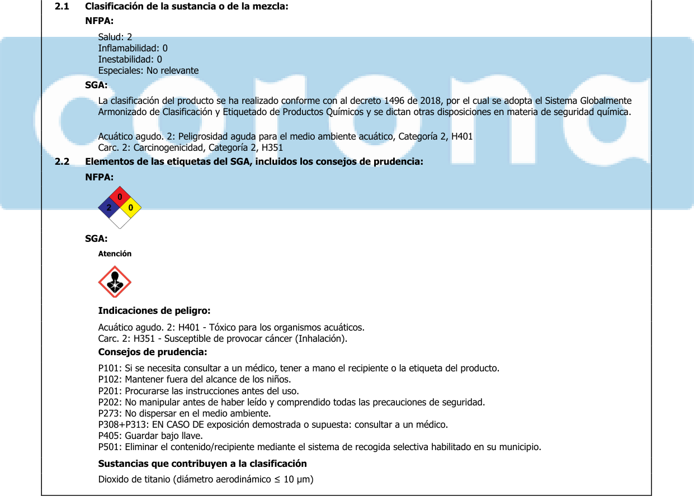

> Imagen (pág. 1). OCR automático, revisar: «2.1 2.2 Clasificación de la sustancia o de la mezcla: NFPA: Salud: 2 Inflamabilidad: 0 Inestabilidad: 0 Especiales: No relevante SGA: La clasificación del producto se ha realizado conforme con al decreto 1496 de 2018, por el cual se adopta el Sistema Globalmente Armonizado de Clasificación y Etiquetado de Productos Químicos y se dictan otras disposiciones en materia de seguridad química. Acuático agudo. 2: Peligrosidad aguda para el medio ambiente acuático, Categoría 2, H401 Carc. 2: Carcinogenicidad, Categoría 2, H351 Elementos de las etiquetas del SGA, incluidos los consejos de prudencia: NFPA: SGA: Atención Indicaciones de peligro: Acuático agudo. 2: H401 - Tóxico para los organismos acuáticos. Carc. 2: H351 - Susceptible de provocar cáncer (Inhalación). Consejos de prudencia: P101: Si se necesita consultar a un médico, tener a mano el recipiente o la etiqueta del producto. P102: Mantener fuera del alcance de los niños. P201: Procurarse las instrucciones antes del uso. P202: No manipular antes de haber leído y comprendido todas las precauciones de seguridad. P273: No dispersar en el medio ambiente. P308+P313: EN CASO DE exposición demostrada o supuesta: consultar a un médico. P405: Guardar bajo llave. P501: Eliminar el contenido/recipiente mediante el sistema de recogida selectiva habilitado en su municipio. Sustancias que contribuyen a la clasificación Dioxido de titanio (diámetro aerodinámico < 10 ym)»

<!-- Start of picture text -->
2.1  Clasificación de la sustancia o de la mezcla: NFPA: Salud: 2 Inflamabilidad: 0 Inestabilidad: 0 Especiales: No relevante SGA: La clasificación del producto se ha realizado conforme con al decreto 1496 de 2018, por el cual se adopta el Sistema Globalmente Armonizado de Clasificación y Etiquetado de Productos Químicos y se dictan otras disposiciones en materia de seguridad química. Acuático agudo. 2: Peligrosidad aguda para el medio ambiente acuático, Categoría 2, H401 Carc. 2: Carcinogenicidad, Categoría 2, H351 2.2  Elementos de las etiquetas del SGA, incluidos los consejos de prudencia: NFPA: + SGA: Atención Indicaciones de peligro: Acuático agudo. 2: H401 - Tóxico para los organismos acuáticos. Carc. 2: H351 - Susceptible de provocar cáncer (Inhalación). Consejos de prudencia: P101: Si se necesita consultar a un médico, tener a mano el recipiente o la etiqueta del producto. P102: Mantener fuera del alcance de los niños. P201: Procurarse las instrucciones antes del uso. P202: No manipular antes de haber leído y comprendido todas las precauciones de seguridad. P273: No dispersar en el medio ambiente. P308+P313: EN CASO DE exposición demostrada o supuesta: consultar a un médico. P405: Guardar bajo llave. P501: Eliminar el contenido/recipiente mediante el sistema de recogida selectiva habilitado en su municipio. Sustancias que contribuyen a la clasificación Dioxido de titanio (diámetro aerodinámico ≤ 10 μm) <!-- End of picture text -->

- CONTINÚA EN LA SIGUIENTE PÁGINA - 

Emisión: 07/11/2019            Revisión: 13/01/2022            Versión: 3 (sustituye a 2) 

**Página 1/10** 

<!-- pagina: 2 -->
Ficha de datos de seguridad según Decreto 1496 de 2018 

> Imagen (pág. 2). Sin texto legible por OCR; contenido gráfico no interpretado.

<!-- Start of picture text -->
[corona] <!-- End of picture text -->

# **PINTURA SEÑALIZACIÓN Y DEMARCACIÓN** 

# SECCIÓN 2: IDENTIFICACIÓN DEL PELIGRO O PELIGROS (continúa) 

|**2.3**|**Otro**|**s peligros que no**|**conducen a una clasificación:**||
|---|---|---|---|---|
||No re|levante|||
|SECC **3.1**|IÓN 3 **Sust** No ap|: COMPOSICIÓN **ancias:** licable|/INFORMACIÓN SOBRE LOS COMPONENTES||
|**3.2**|**Mezc**|**las:**|||
||**Desc** **Com**|**ripción química:** **ponentes:**|Mezcla acuosa a base de aditivos, cargas, coalescentes, pigmentos y resinas||
||De ac  |uerdo al Decreto 14  |96 de 2018, el producto presenta:  ||
||~~¡~~ |Identificación ~~IS~~ |Nombre químico/clasificación ~~E~~ |Concentración   |
||CAS:  |7732-18-5  |**Agua**  ~~E~~|**25 - <50 %**   |
||CAS:  |1317-65-3  |**Piedra caliza**  ~~AI~~|**25 - <50 %**   |
||CAS:  |No aplicable  ~~A ~~|**Polimero acrilico**  ~~O~~|**10 - <25 %**  |
||CAS:   |13463-67-7    |**Dioxido de titanio (diámetro aerodinámico ≤ 10 μm)** Carc. 2: H351 - Atención   ~~AA~~ |**2.5 - <10 %**     |
||CAS:  |67-63-0  ~~S~~|**Propan-2-ol** Irrit. oc. 2: H319; Liq. Infl. 2: H225; STOT única 3: H336 - Peligro  ~~NA~~|**1 - <2.5 %**   ~~VE~~|
||Para Carcin SGA, |ampliar información ogenicidad de las s para información so |sobre la peligrosidad de las sustancias consultar las secciones 11, 12 y 16. La clasificación respe ustancias se ha establecido en función de las monografías de la IARC adecuándola al sistema de bre la clasificación IARC consulte la sección 11. |cto clasificación  |

# SECCIÓN 4: PRIMEROS AUXILIOS 

**4.1 Descripción de los primeros auxilios necesarios:** Los síntomas como consecuencia de una intoxicación pueden presentarse con posterioridad a la exposición, por lo que, en caso de duda, exposición directa al producto químico o persistencia del malestar solicitar atención médica, mostrándole la FDS de este producto. **Por inhalación:** Se trata de un producto no clasificado como peligroso por inhalación, sin embargo, se recomienda en caso de síntomas de intoxicación sacar al afectado del lugar de exposición, suministrarle aire limpio y mantenerlo en reposo. Solicitar atención médica en el caso de que los síntomas persistan. **Por contacto con la piel:** En caso de contacto se recomienda limpiar la zona afecta con agua por arrastre y con jabón neutro. En caso de alteraciones en la piel (escozor, rojez, sarpullidos, ampollas…), acudir a consulta médica con esta Ficha de Datos de Seguridad **Por contacto con los ojos:** Enjuagar los ojos con abundante agua al menos durante 15 minutos. En el caso de que el accidentado use lentes de contacto, éstas deben retirarse siempre que no estén pegadas a los ojos, de otro modo podría producirse un daño adicional. En todos los casos, después del lavado, se debe acudir al médico lo más rápidamente posible con la FDS del producto. **Por ingestión/aspiración:** En caso de ingestión, solicitar asistencia médica inmediata mostrando la FDS de este producto. **4.2 Síntomas/efectos más importantes, agudos o retardados:** Los efectos agudos y retardados son los indicados en las secciones 2 y 11 de la FDS. **4.3 Indicación de la necesidad de recibir atención médica inmediata y, en su caso, de tratamiento especial:** No relevante 

SECCIÓN 5: MEDIDAS DE LUCHA CONTRA INCENDIOS 

Emisión: 07/11/2019            Revisión: 13/01/2022            Versión: 3 (sustituye a 2) 

- CONTINÚA EN LA SIGUIENTE PÁGINA - 

**Página 2/10** 

<!-- pagina: 3 -->
Ficha de datos de seguridad según Decreto 1496 de 2018 

**PINTURA SEÑALIZACIÓN Y DEMARCACIÓN** 

> Imagen (pág. 3). Sin texto legible por OCR; contenido gráfico no interpretado.

# SECCIÓN 5: MEDIDAS DE LUCHA CONTRA INCENDIOS (continúa) 

- **5.1 Medios de extinción apropiados:** 

## **Medios de extinción apropiados:** 

Producto no inflamable bajo condiciones normales de almacenamiento, manipulación y uso, conteniendo sustancias inflamables. En caso de inflamación como consecuencia de manipulación, almacenamiento o uso indebido emplear preferentemente extintores de polvo polivalente (polvo ABC). 

## **Medios de extinción no apropiados:** 

NO SE RECOMIENDA emplear agua a chorro como agente de extinción. 

- **5.2 Peligros específicos del producto químico:** 

Como consecuencia de la combustión o descomposición térmica se generan subproductos de reacción que pueden resultar altamente tóxicos y, consecuentemente, pueden presentar un riesgo elevado para la salud. 

- **5.3 Medidas especiales que deben tomar los equipos de lucha contra incendios:** 

En función de la magnitud del incendio puede hacerse necesario el uso de ropa protectora completa y equipo de respiración autónomo. Disponer de un mínimo de instalaciones de emergencia o elementos de actuación (mantas ignífugas, botiquín portátil,...). 

## **Disposiciones adicionales:** 

Actuar conforme el Plan de Emergencia Interior y las Fichas Informativas sobre actuación ante accidentes y otras emergencias. Suprimir cualquier fuente de ignición. En caso de incendio, refrigerar los recipientes y tanques de almacenamiento de productos susceptibles a inflamación, explosión o BLEVE como consecuencia de elevadas temperaturas. Evitar el vertido de los productos empleados en la extinción del incendio al medio acuático. 

# <mark>SECCIÓN 6: MEDIDAS QUE DEBEN TOMARSE EN CASO DE VERTIDO ACCIDENTAL</mark> 

**6.1 Precauciones personales, equipo protector y procedimiento de emergencia:** Aislar las fugas siempre y cuando no suponga un riesgo adicional para las personas que desempeñen esta función. Evacuar la zona y mantener a las personas sin protección alejadas. Ante el contacto potencial con el producto derramado se hace obligatorio el uso de elementos de protección personal (ver sección 8 de la FDS). Evitar de manera prioritaria la formación de mezclas vapor-aire inflamables, ya sea mediante ventilación o el uso de un agente inertizante. Suprimir cualquier fuente de ignición. Eliminar las cargas electroestáticas mediante la interconexión de todas las superficies conductoras sobre las que se puede formar electricidad estática, y estando a su vez el conjunto conectado a tierra. 

**6.2 Precauciones relativas al medio ambiente:** Evitar a toda costa cualquier tipo de vertido al medio acuático. Contener adecuadamente el producto absorbido/recogido en recipientes herméticamente precintables. Notificar a la autoridad competente en el caso de exposición al público en general o al medioambiente. 

- **6.3 Métodos y materiales para la contención y limpieza de vertidos:** Se recomienda: 

Absorber el vertido mediante arena o absorbente inerte y trasladarlo a un lugar seguro. No absorber en serrín u otros absorbentes combustibles. Para cualquier consideración relativa a la eliminación consultar la sección 13 de la FDS. 

- **6.4 Referencias a otras secciones:** Ver secciones 8 y 13. 

# SECCIÓN 7: MANIPULACIÓN Y ALMACENAMIENTO 

- **7.1 Precauciones que se deben tomar para garantizar una manipulación segura:** 

   - A.- Precauciones generales 

Cumplir con la legislación vigente en materia de prevención de riesgos laborales. Mantener los recipientes herméticamente cerrados. Controlar los derrames y residuos, eliminándolos con métodos seguros (sección 6 de la FDS). Evitar el vertido libre desde el recipiente. Mantener orden y limpieza donde se manipulen productos peligrosos. 

- B.- Recomendaciones técnicas para la prevención de incendios y explosiones. 

Evitar la evaporación del producto ya que contiene sustancias inflamables, las cuales pueden llegar a formar mezclas vapor/aire inflamables en presencia de fuentes de ignición. Controlar las fuentes de ignición (teléfonos móviles, chispas,...) y trasvasar a velocidades lentas para evitar la generación de cargas electroestáticas. Consultar la sección 10 sobre condiciones y materias que deben evitarse. 

C.- Recomendaciones técnicas para prevenir riesgos ergonómicos y toxicológicos. 

- CONTINÚA EN LA SIGUIENTE PÁGINA - 

Emisión: 07/11/2019            Revisión: 13/01/2022            Versión: 3 (sustituye a 2) 

**Página 3/10** 

<!-- pagina: 4 -->
Ficha de datos de seguridad según Decreto 1496 de 2018 

> Imagen (pág. 4). Sin texto legible por OCR; contenido gráfico no interpretado.

# **PINTURA SEÑALIZACIÓN Y DEMARCACIÓN** 

# SECCIÓN 7: MANIPULACIÓN Y ALMACENAMIENTO (continúa) 

Para control de exposición consultar la sección 8 de la FDS. No comer, beber ni fumar en las zonas de trabajo lavarse las manos después de cada utilización, y despojarse de prendas de vestir y equipos de protección contaminados antes de entrar en las zonas para comer. 

- D.- Recomendaciones técnicas para prevenir riesgos medioambientales 

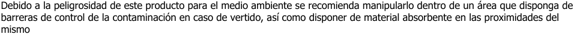

> Imagen (pág. 4). OCR automático, revisar: «Debido a la peligrosidad de este producto para el medio ambiente se recomienda manipularlo dentro de un área que disponga de barreras de control de la contaminación en caso de vertido, así como disponer de material absorbente en las proximidades del mismo»

<!-- Start of picture text -->
Debido a la peligrosidad de este producto para el medio ambiente se recomienda manipularlo dentro de un área que disponga de barreras de control de la contaminación en caso de vertido, así como disponer de material absorbente en las proximidades del mismo <!-- End of picture text -->

<!-- Start of picture text -->
7.2  Condiciones de almacenamiento seguro, incluidas cualesquiera incompatibilidades: <!-- End of picture text -->

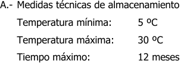

> Imagen (pág. 4). OCR automático, revisar: «A.- Medidas técnicas de almacenamiento Temperatura minima: 5C Temperatura maxima: 30 °C Tiempo maxim 12 meses»

<!-- Start of picture text -->
A.- Medidas técnicas de almacenamiento Temperatura mínima:  5 ºC Temperatura máxima:  30 ºC Tiempo máximo:  12 meses <!-- End of picture text -->

- B.- Condiciones generales de almacenamiento. 

Evitar fuentes de calor, radiación, electricidad estática y el contacto con alimentos. Para información adicional ver epígrafe 10.5 

<!-- Start of picture text -->
7.3  Usos específicos finales: <!-- End of picture text -->

Salvo las indicaciones ya especificadas no es preciso realizar ninguna recomendación especial en cuanto a los usos de este producto. 

# SECCIÓN 8: CONTROLES DE EXPOSICIÓN/PROTECCIÓN PERSONAL 

## **8.1 Parámetros de control:** 

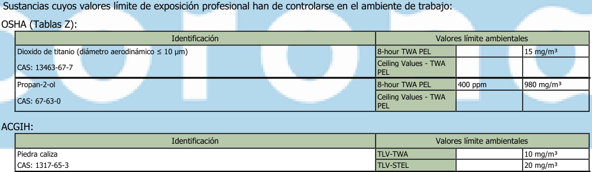

> Imagen (pág. 4). OCR automático, revisar: «Sustancias cuyos valores límite de exposición profesional han de controlarse en el ambiente de trabajo: OSHA (Tablas Z): Identificación Valores límite ambientales Dioxido de titanio (diámetro aerodinámico < 10 um) [8-hour TWA PEL 15 mg/ms 15% [Ceiling Values - TWA [CAS: 13463-67-7 en Propan-2-0l [8-hour TWA PEL. 400 ppm [980 mg/m? ron [Ceiling Values - TWA [CAS: 67-63-0 et ACGIH: Identificación Valores límite ambientales Piedra caliza [ToV-TWA 10 mg/m? CAS: 1317-65-3 [TLV-STEL 20 mg/m?»

<!-- Start of picture text -->
Sustancias cuyos valores límite de exposición profesional han de controlarse en el ambiente de trabajo: OSHA (Tablas Z): Identificación  Valores límite ambientales Dioxido de titanio (diámetro aerodinámico ≤ 10 μm)  8-hour TWA PEL  15 mg/m³ CAS: 13463-67-7  Ceiling Values - TWA PEL Propan-2-ol  8-hour TWA PEL  400 ppm  980 mg/m³ CAS: 67-63-0  Ceiling Values - TWA PEL ACGIH: AE Identificación  Valores límite ambientales  SÓ Piedra caliza  TLV-TWA  10 mg/m³ g/m³ m³ CAS: 1317-65-3  TLV-STEL  20 mg/m³ <!-- End of picture text -->

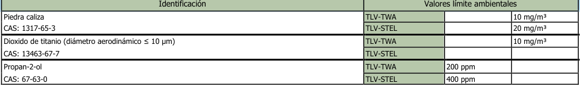

> Imagen (pág. 4). OCR automático, revisar: «Identificación Valores limite ambientales Piedra caliza [ToV-TWA 10 mg/m? CAS: 1317-65-3 [TLv-STEL [20 moms Dioxido de titanio (diámetro aerodinámico = 10 um) [TUV-TWA 10 mg/m? CAS: 13463-67-7 [Tuv-STEL Propan-2-01 [TuV-TWA 200 ppm CAS: 67-63-0 [TLV-STEL [400 ppm»

<!-- Start of picture text -->
Identificación  Valores límite ambientales Piedra caliza  TLV-TWA  10 mg/m³ g/m³ m³ CAS: 1317-65-3  TLV-STEL  20 mg/m³ Dioxido de titanio (diámetro aerodinámico ≤ 10 μm)  TLV-TWA  10 mg/m³ CAS: 13463-67-7  TLV-STEL Propan-2-ol  TLV-TWA  200 ppm CAS: 67-63-0  TLV-STEL  400 ppm <!-- End of picture text -->

<!-- Start of picture text -->
8.2  Controles técnicos apropiados: <!-- End of picture text -->

- A.- Medidas de protección individual, como equipo de protección personal (EPP) 

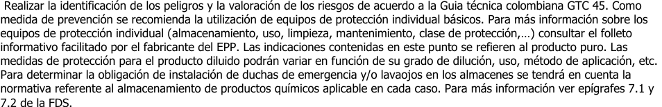

> Imagen (pág. 4). OCR automático, revisar: «Realizar la identificación de los peligros y la valoración de los riesgos de acuerdo a la Guia técnica colombiana GTC 45. Como medida de prevención se recomienda la utilización de equipos de protección individual básicos. Para más información sobre los equipos de protección individual (almacenamiento, uso, limpieza, mantenimiento, clase de protección,...) consultar el folleto informativo facilitado por el fabricante del EPP. Las indicaciones contenidas en este punto se refieren al producto puro. Las medidas de protección para el producto diluido podrán variar en función de su grado de dilución, uso, método de aplicación, etc. Para determinar la obligación de instalación de duchas de emergencia y/o lavaojos en los almacenes se tendrá en cuenta la normativa referente al almacenamiento de productos químicos aplicable en cada caso. Para más información ver epígrafes 7.1 y 7 2 de la FDS.»

<!-- Start of picture text -->
Realizar la identificación de los peligros y la valoración de los riesgos de acuerdo a la Guia técnica colombiana GTC 45. Como medida de prevención se recomienda la utilización de equipos de protección individual básicos. Para más información sobre los equipos de protección individual (almacenamiento, uso, limpieza, mantenimiento, clase de protección,…) consultar el folleto informativo facilitado por el fabricante del EPP. Las indicaciones contenidas en este punto se refieren al producto puro. Las medidas de protección para el producto diluido podrán variar en función de su grado de dilución, uso, método de aplicación, etc. Para determinar la obligación de instalación de duchas de emergencia y/o lavaojos en los almacenes se tendrá en cuenta la normativa referente al almacenamiento de productos químicos aplicable en cada caso. Para más información ver epígrafes 7.1 y 7.2 de la FDS. <!-- End of picture text -->

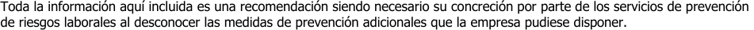

> Imagen (pág. 4). OCR automático, revisar: «Toda la información aquí incluida es una recomendación siendo necesario su concreción por parte de los servicios de prevención de riesgos laborales al desconocer las medidas de prevención adicionales que la empresa pudiese disponer.»

<!-- Start of picture text -->
Toda la información aquí incluida es una recomendación siendo necesario su concreción por parte de los servicios de prevención de riesgos laborales al desconocer las medidas de prevención adicionales que la empresa pudiese disponer. <!-- End of picture text -->

- B.- Protección respiratoria. 

<!-- Start of picture text -->
- CONTINÚA EN LA SIGUIENTE PÁGINA - <!-- End of picture text -->

Emisión: 07/11/2019            Revisión: 13/01/2022            Versión: 3 (sustituye a 2) 

**Página 4/10** 

<!-- pagina: 5 -->

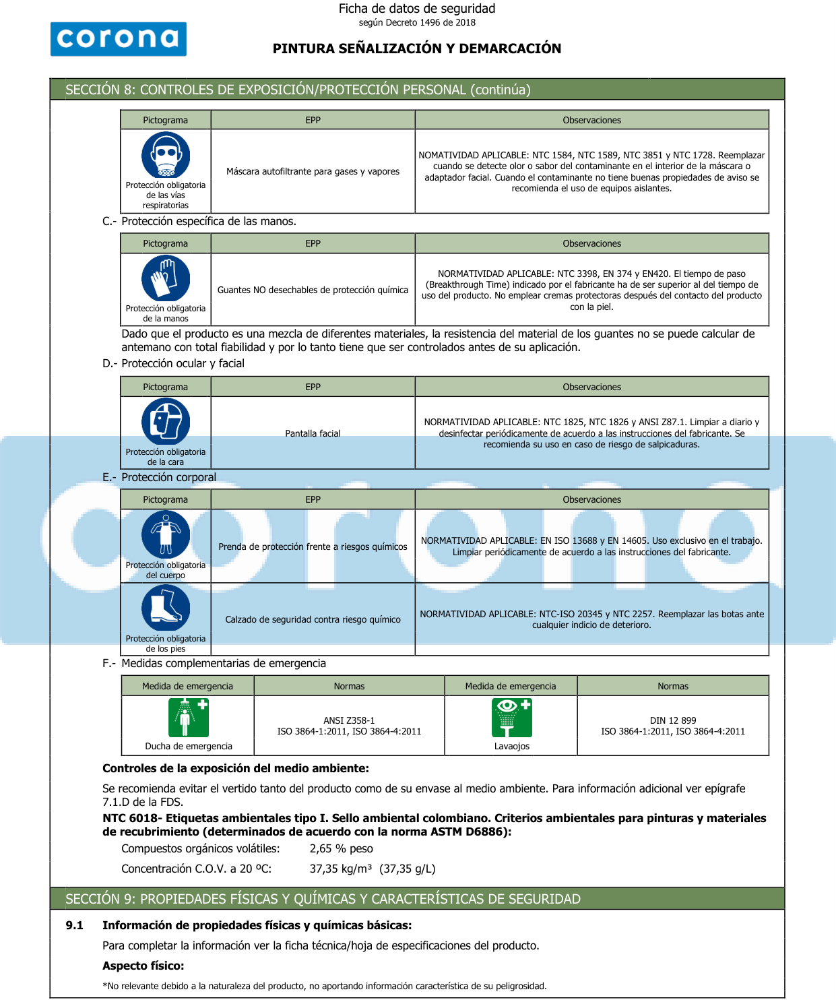

> Imagen (pág. 5). OCR automático, revisar: «Ficha de datos de seguridad según Decreto 1496 de 2018 [COrona| PINTURA SEÑALIZACIÓN Y DEMARCACIÓN DE EXPOSICION/PROTECCION PERSON. SECCIÓN 9: PROPIEDADES FÍSICAS Y QUÍMICAS Y CARACTERÍSTICAS DE Pictograma EPP Observaciones NOMATIVIDAD APLICABLE: NTC 1584, NTC 1589, NTC 3851 y NTC 1728. Reemplazar cuando se detecte olor o sabor del contaminante en el interior de la máscara o y Máscara autofiltrante para gases y vapores A ra autofiltrante para gases y vap: adaptador facial. Cuando el contaminante no tiene buenas propiedades de aviso se Protección obligatoria recomienda el uso de equipos alslantes. de las vías respiratorias C.- Protección específica de las manos. Pictograma EPP Observaciones NORMATIVIDAD APLICABLE: NTC 3398, EN 374 y EN420. El tiempo de paso (Breakthrough Time) indicado por el fabricante ha de ser superior al del tiempo de uso del producto. No emplear cremas protectoras después del contacto del producto Protección obligatoria con la piel. de la manos Dado que el producto es una mezcla de diferentes materiales, la resistencia del material de los guantes no se puede calcular de antemano con total fiabilidad y por lo tanto tiene que ser controlados antes de su aplicación. D.- Protección ocular y facial ¡Guantes NO desechables de protección química Pictograma EPP Observaciones NORMATIVIDAD APLICABLE: NTC 1825, NTC 1826 y ANSI 287.1. Limpiar a diario y Pantalla facial desinfectar periódicamente de acuerdo a las instrucciones del fabricante, Se . recomienda su uso en caso de riesgo de salpicaduras. Protección obligatoria de la cara E.- Protección corporal Pictograma EPP Observaciones NORMATIVIDAD APLICABLE: EN ISO 13688 y EN 14605. Uso exclusivo en el trabajo. ETE de PA Frente lisse auamos Limpiar periódicamente de acuerdo a las instrucciones del fabricante. Protección obligatoria del cuerpo NORMATIVIDAD APLICABLE: NTC-ISO 20345 y NTC 2257. Reemplazar las botas ante Calzado de seguridad contra riesgo químico ico dedo Protección obligatoria de los pies Medidas complementarias de emergencia Medida de emergencia Normas Medida de emergencia Normas O. + ANSI Z358-1 DIN 12 899 150 3864-1:2011, ISO 3864-4:2011 1SO 3864-1:2011, ISO 3864-4:2011 Ducha de emergencia Lavaojos Controles de la expo: mn del medio ambiente: Se recomienda evitar el vertido tanto del producto como de su envase al medio ambiente. Para información adicional ver epígrafe 7.1.D de la FDS. NTC 6018- Etiquetas ambientales tipo I. Sello ambiental colombiano. Criterios ambientales para pinturas y materiales de recubrimiento (determinados de acuerdo con la norma ASTM D6886) Compuestos orgánicos volátiles: 2,65 % peso Concentración C.O.V. a 20 °C: 37,35 kg/m? (37,35 g/L) 9.1 Información de propiedades físicas y químicas básicas: Para completar la información ver la ficha técnica/hoja de especificaciones del producto. Aspecto físico: *No relevante debido a la naturaleza del producto, no aportando información característica de su peligrosidad.»

<!-- Start of picture text -->
Ficha de datos de seguridad según Decreto 1496 de 2018 PINTURA SEÑALIZACIÓN Y DEMARCACIÓN SECCIÓN 8: CONTROLES DE EXPOSICIÓN/PROTECCIÓN PERSONAL (continúa) Pictograma  EPP  Observaciones NOMATIVIDAD APLICABLE: NTC 1584, NTC 1589, NTC 3851 y NTC 1728. Reemplazar cuando se detecte olor o sabor del contaminante en el interior de la máscara o Máscara autofiltrante para gases y vapores adaptador facial. Cuando el contaminante no tiene buenas propiedades de aviso se Protección obligatoria  recomienda el uso de equipos aislantes. de las vías [corona EI respiratorias C.- Protección específica de las manos. Pictograma  EPP  Observaciones NORMATIVIDAD APLICABLE: NTC 3398, EN 374 y EN420. El tiempo de paso (Breakthrough Time) indicado por el fabricante ha de ser superior al del tiempo de Guantes NO desechables de protección química uso del producto. No emplear cremas protectoras después del contacto del producto Protección obligatoria  con la piel. de la manos Dado que el producto es una mezcla de diferentes materiales, la resistencia del material de los guantes no se puede calcular de antemano con total fiabilidad y por lo tanto tiene que ser controlados antes de su aplicación. D.- Protección ocular y facial Pictograma  EPP  Observaciones NORMATIVIDAD APLICABLE: NTC 1825, NTC 1826 y ANSI Z87.1. Limpiar a diario y Pantalla facial  desinfectar periódicamente de acuerdo a las instrucciones del fabricante. Se recomienda su uso en caso de riesgo de salpicaduras. Protección obligatoria ACI de la cara E.- Protección corporal Pictograma  EPP  Observaciones NORMATIVIDAD APLICABLE: EN ISO 13688 y EN 14605. Uso exclusivo en el trabajo. Prenda de protección frente a riesgos químicos Limpiar periódicamente de acuerdo a las instrucciones del fabricante. Protección obligatoria del cuerpo NORMATIVIDAD APLICABLE: NTC-ISO 20345 y NTC 2257. Reemplazar las botas ante Calzado de seguridad contra riesgo químico cualquier indicio de deterioro. Protección obligatoria CIA de los pies F.- Medidas complementarias de emergencia Medida de emergencia  Normas  Medida de emergencia  Normas ANSI Z358-1  DIN 12 899 ISO 3864-1:2011, ISO 3864-4:2011  ISO 3864-1:2011, ISO 3864-4:2011 A] Ducha de emergencia  Lavaojos Controles de la exposición del medio ambiente: Se recomienda evitar el vertido tanto del producto como de su envase al medio ambiente. Para información adicional ver epígrafe 7.1.D de la FDS. NTC 6018- Etiquetas ambientales tipo I. Sello ambiental colombiano. Criterios ambientales para pinturas y materiales de recubrimiento (determinados de acuerdo con la norma ASTM D6886): Compuestos orgánicos volátiles:  2,65 % peso Concentración C.O.V. a 20 ºC:  37,35 kg/m³  (37,35 g/L) SECCIÓN 9: PROPIEDADES FÍSICAS Y QUÍMICAS Y CARACTERÍSTICAS DE SEGURIDAD 9.1  Información de propiedades físicas y químicas básicas: Para completar la información ver la ficha técnica/hoja de especificaciones del producto. Aspecto físico: *No relevante debido a la naturaleza del producto, no aportando información característica de su peligrosidad. <!-- End of picture text -->

<!-- Start of picture text -->
- CONTINÚA EN LA SIGUIENTE PÁGINA - <!-- End of picture text -->

Emisión: 07/11/2019            Revisión: 13/01/2022            Versión: 3 (sustituye a 2) 

**Página 5/10** 

<!-- pagina: 6 -->
Ficha de datos de seguridad según Decreto 1496 de 2018 

> Imagen (pág. 6). Sin texto legible por OCR; contenido gráfico no interpretado.

# **PINTURA SEÑALIZACIÓN Y DEMARCACIÓN** 

SECCIÓN 9: PROPIEDADES FÍSICAS Y QUÍMICAS Y CARACTERÍSTICAS DE SEGURIDAD (continúa) 

||Estado físico a 20 ºC:|Líquido|
|---|---|---|
||Aspecto:|Fluido|
||Color:|Blanco|
||Olor:|Característico|
||Umbral olfativo:|No relevante *|
||**Volatilidad:**||
||Temperatura de ebullición a presión atmosférica:|101 ºC|
||Presión de vapor a 20 ºC:|2405 Pa|
||Presión de vapor a 50 ºC:|12627,67 Pa  (12,63 kPa)|
||Tasa de evaporación a 20 ºC:|No relevante *|
||**Caracterización del producto:**||
||Densidad a 20 ºC:|1407,3 kg/m³|
||Densidad relativa a 20 ºC:|1,407|
||Viscosidad dinámica a 20 ºC:|No relevante *|
||Viscosidad cinemática a 20 ºC:|No relevante *|
||Viscosidad cinemática a 40 ºC:|No relevante *|
||Concentración:|54 - 56 g/L  (sustancia activa)|
||pH:|8,5 - 9,5|
||Densidad de vapor a 20 ºC:|No relevante *|
||Coeficiente de reparto n-octanol/agua a 20 ºC:|No relevante *|
||Solubilidad en agua a 20 ºC:||
||Propiedad de solubilidad:|No relevante *|
||Temperatura de descomposición:|No relevante *|
||Punto de fusión/punto de congelación:|No relevante *|
||Propiedades explosivas:|No relevante *|
||Propiedades comburentes:|No relevante *|
||**Inflamabilidad:**||
||Punto de inflamación:|No inflamable (>93 ºC)|
||Calor de combustión:|No relevante *|
||Inflamabilidad (sólido, gas):|No relevante *|
||Temperatura de auto-inflamación:|330 ºC|
||Límite de inflamabilidad inferior:|No relevante *|
||Límite de inflamabilidad superior:|No relevante *|
||**Explosividad:**||
||Límite inferior de explosividad:|No relevante *|
||Límite superior de explosividad:|No relevante *|
|**9.2**|**Información adicional:**||
||Tensión superficial a 20 ºC:|No relevante *|
||Índice de refracción:|No relevante *|
||*No relevante debido a la naturaleza del producto, no aportando i|nformación característica de su peligrosidad.|
|SEC|CIÓN 10: ESTABILIDAD Y REACTIVIDAD||

**10.1 Reactividad:** 

No se esperan reacciones peligrosas si se cumplen las instrucciones técnicas de almacenamiento de productos químicos. Ver sección 7 de la FDS para mayor información. 

**10.2 Estabilidad química:** 

- CONTINÚA EN LA SIGUIENTE PÁGINA - 

Emisión: 07/11/2019            Revisión: 13/01/2022            Versión: 3 (sustituye a 2) 

**Página 6/10** 

<!-- pagina: 7 -->

> Imagen (pág. 7). Sin texto legible por OCR; contenido gráfico no interpretado.

<!-- Start of picture text -->
Ficha de datos de seguridad <!-- End of picture text -->

<!-- Start of picture text -->
según Decreto 1496 de 2018 <!-- End of picture text -->

> Imagen (pág. 7). OCR automático, revisar: «> ácidos [Agua | Materiascomburentes Materias combustibles | Otros Evitar ácidos fuertes No aplicable Evitar incidencia directa No aplicable Evitar álcalis o bases fuertes»

<!-- Start of picture text -->
Ácidos  Agua  Materias comburentes  Materias combustibles  Otros | Evitar ácidos fuertes  No aplicable  Evitar incidencia directa  No aplicable  Evitar álcalis o bases fuertes <!-- End of picture text -->

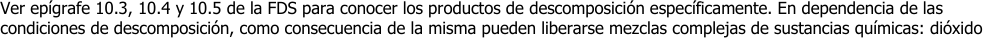

> Imagen (pág. 7). OCR automático, revisar: «Ver epigrafe 10.3, 10.4 y 10.5 de la FDS para conocer los productos de descomposición especificamente. En dependencia de las condiciones de descomposición, como consecuencia de la misma pueden liberarse mezclas complejas de sustancias químicas: dióxido»

<!-- Start of picture text -->
Ver epígrafe 10.3, 10.4 y 10.5 de la FDS para conocer los productos de descomposición específicamente. En dependencia de las condiciones de descomposición, como consecuencia de la misma pueden liberarse mezclas complejas de sustancias químicas: dióxido <!-- End of picture text -->

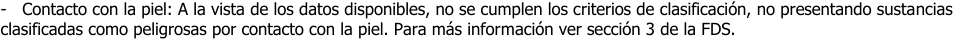

> Imagen (pág. 7). OCR automático, revisar: «- Contacto con la piel: A la vista de los datos disponibles, no se cumplen los criterios de clasificación, no presentando sustancias clasificadas como peligrosas por contacto con la piel. Para más información ver sección 3 de la FDS.»

<!-- Start of picture text -->
-   Contacto con la piel: A la vista de los datos disponibles, no se cumplen los criterios de clasificación, no presentando sustancias clasificadas como peligrosas por contacto con la piel. Para más información ver sección 3 de la FDS. <!-- End of picture text -->

- Carcinogenicidad: La exposición a este producto puede causar cáncer. Para más información sobre posibles efectos específicos sobre la salud ver sección 2 de la FDS. 

> Imagen (pág. 7). OCR automático, revisar: «- Toxicidad para la reproducción: A la vista de los datos disponibles, no se cumplen los criterios de clasificación, no presentando sustancias clasificadas como peligrosas por este efecto. Para más información ver sección 3 de la FDS.»

<!-- Start of picture text -->
-   Toxicidad para la reproducción: A la vista de los datos disponibles, no se cumplen los criterios de clasificación, no presentando sustancias clasificadas como peligrosas por este efecto. Para más información ver sección 3 de la FDS. <!-- End of picture text -->

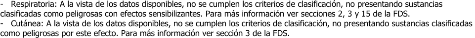

> Imagen (pág. 7). OCR automático, revisar: «- Respiratoria: A la vista de los datos disponibles, no se cumplen los criterios de clasificación, no presentando sustancias clasificadas como peligrosas con efectos sensibilizantes. Para más información ver secciones 2, 3 y 15 de la FDS. - Cutánea: A la vista de los datos disponibles, no se cumplen los criterios de clasificación, no presentando sustancias clasificadas como peligrosas por este efecto. Para más información ver sección 3 de la FDS.»

<!-- Start of picture text -->
-   Respiratoria: A la vista de los datos disponibles, no se cumplen los criterios de clasificación, no presentando sustancias clasificadas como peligrosas con efectos sensibilizantes. Para más información ver secciones 2, 3 y 15 de la FDS. -   Cutánea: A la vista de los datos disponibles, no se cumplen los criterios de clasificación, no presentando sustancias clasificadas como peligrosas por este efecto. Para más información ver sección 3 de la FDS. <!-- End of picture text -->

<!-- Start of picture text -->
- CONTINÚA EN LA SIGUIENTE PÁGINA - <!-- End of picture text -->

<!-- Start of picture text -->
Emisión: 07/11/2019            Revisión: 13/01/2022            Versión: 3 (sustituye a 2) <!-- End of picture text -->

**PINTURA SEÑALIZACIÓN Y DEMARCACIÓN** 

SECCIÓN 10: ESTABILIDAD Y REACTIVIDAD (continúa) Estable químicamente bajo las condiciones indicadas de almacenamiento, manipulación y uso. **10.3 Posibilidad de reacciones peligrosas:** Bajo las condiciones indicadas no se esperan reacciones peligrosas ni polimerización peligrosa que puedan producir una presión o temperaturas excesivas. **10.4 Condiciones que deben evitarse:** Aplicables para manipulación y almacenamiento a temperatura ambiente: Choque y fricción Contacto con el aire Calentamiento Luz Solar Humedad No aplicable No aplicable Precaución Precaución No aplicable **10.5 Materiales incompatibles:** Ácidos Agua Materias comburentes Materias combustibles Otros ~~|~~ Evitar ácidos fuertes No aplicable Evitar incidencia directa No aplicable Evitar álcalis o bases fuertes **10.6 Productos de descomposición peligrosos:** Ver epígrafe 10.3, 10.4 y 10.5 de la FDS para conocer los productos de descomposición específicamente. En dependencia de las condiciones de descomposición, como consecuencia de la misma pueden liberarse mezclas complejas de sustancias químicas: dióxido de carbono (CO2), monóxido de carbono y otros compuestos orgánicos. <mark>SECCIÓN 11: INFORMACIÓN TOXICOLÓGICA</mark> **11.1 Información sobre las posibles vías de exposición:** No se dispone de datos experimentales del producto en sí mismo relativos a las propiedades toxicológicas **Efectos peligrosos para la salud:** En caso de exposición repetitiva, prolongada o a concentraciones superiores a las establecidas por los límites de exposición profesionales, pueden producirse efectos adversos para la salud en función de la vía de exposición: A- Ingestión (efecto agudo): -   Toxicidad aguda: A la vista de los datos disponibles, no se cumplen los criterios de clasificación, no presentando sustancias clasificadas como peligrosas por ingestión. Para más información ver sección 3 de la FDS. -   Corrosividad/Irritabilidad: A la vista de los datos disponibles, no se cumplen los criterios de clasificación, no presentando sustancias clasificadas como peligrosas por este efecto. Para más información ver sección 3 de la FDS. B- Inhalación (efecto agudo): -   Toxicidad aguda: A la vista de los datos disponibles, no se cumplen los criterios de clasificación, no presentando sustancias clasificadas como peligrosas por inhalación. Para más información ver sección 3 de la FDS. -   Corrosividad/Irritabilidad: A la vista de los datos disponibles, no se cumplen los criterios de clasificación, no presentando sustancias clasificadas como peligrosas por este efecto. Para más información ver sección 3 de la FDS. C- Contacto con la piel y los ojos (efecto agudo): -   Contacto con la piel: A la vista de los datos disponibles, no se cumplen los criterios de clasificación, no presentando sustancias clasificadas como peligrosas por contacto con la piel. Para más información ver sección 3 de la FDS. -   Contacto con los ojos: A la vista de los datos disponibles, no se cumplen los criterios de clasificación, sin embargo presenta sustancias clasificadas como peligrosas por este efecto. Para más información ver sección 3 de la FDS. D- Efectos CMR (carcinogenicidad, mutagenicidad y toxicidad para la reproducción): Carcinogenicidad: La exposición a este producto puede causar cáncer. Para más información sobre posibles efectos específicos sobre la salud ver sección 2 de la FDS. IARC: White mineral oil, <=20.5mm2/s (40ºC) (3); Dioxido de titanio (diámetro aerodinámico ≤ 10 μm) (2B); Etanol (1); Propan-2-ol (3) -   Mutagenicidad: A la vista de los datos disponibles, no se cumplen los criterios de clasificación, no presentando sustancias clasificadas como peligrosas por este efecto. Para más información ver sección 3 de la FDS. -   Toxicidad para la reproducción: A la vista de los datos disponibles, no se cumplen los criterios de clasificación, no presentando sustancias clasificadas como peligrosas por este efecto. Para más información ver sección 3 de la FDS. E- Efectos de sensibilización: -   Respiratoria: A la vista de los datos disponibles, no se cumplen los criterios de clasificación, no presentando sustancias clasificadas como peligrosas con efectos sensibilizantes. Para más información ver secciones 2, 3 y 15 de la FDS. -   Cutánea: A la vista de los datos disponibles, no se cumplen los criterios de clasificación, no presentando sustancias clasificadas como peligrosas por este efecto. Para más información ver sección 3 de la FDS. F- Toxicidad específica en determinados órganos (STOT)-exposición única: ~~<u>aa</u>~~ - CONTINÚA EN LA SIGUIENTE PÁGINA - 

**Página 7/10** 

<!-- pagina: 8 -->
Ficha de datos de seguridad según Decreto 1496 de 2018 

> Imagen (pág. 8). Sin texto legible por OCR; contenido gráfico no interpretado.

# **PINTURA SEÑALIZACIÓN Y DEMARCACIÓN** 

# SECCIÓN 11: INFORMACIÓN TOXICOLÓGICA (continúa) 

A la vista de los datos disponibles, no se cumplen los criterios de clasificación, sin embargo, presenta sustancias clasificadas como peligrosas por inhalación. Para más información ver sección 3 de la FDS. 

- G- Toxicidad específica en determinados órganos (STOT)-exposición repetida: 

   - Toxicidad específica en determinados órganos (STOT)-exposición repetida: A la vista de los datos disponibles, no se cumplen los criterios de clasificación, no presentando sustancias clasificadas como peligrosas por este efecto. Para más información ver sección 3 de la FDS. 

   - Piel: A la vista de los datos disponibles, no se cumplen los criterios de clasificación, no presentando sustancias clasificadas como peligrosas por este efecto. Para más información ver sección 3 de la FDS. 

- H- Peligro por aspiración: 

A la vista de los datos disponibles, no se cumplen los criterios de clasificación, no presentando sustancias clasificadas como peligrosas por este efecto. Para más información ver sección 3 de la FDS. 

## **Información adicional:** 

CAS 13463-67-7 Dióxido de Titanio: IARC lista esta sustancia como un posible carcinógeno humano (grupo 2B), indicando que hay suficientes evidencias para considerarlo carcinógeno en animales pero insuficientes para considerarlo como carcinógeno para seres humanos. 

La monografía de IARC para esta sustancia indica que no hay exposición significativa al dióxido de titanio durante el uso normal de productos en los que dióxido de titanio está unido permanentemente a otros materiales, tales como pinturas (Ref: Monografía IARC, Vol. 93, 2010). 

El lijado repetido de las superficies de película seca puede producir riesgo de sobreexposición al polvo dependiendo de la duración y nivel de lijado, para evitarla deben tomarse las medidas de protección adecuadas. 

## **Información toxicológica específica de las sustancias:** 

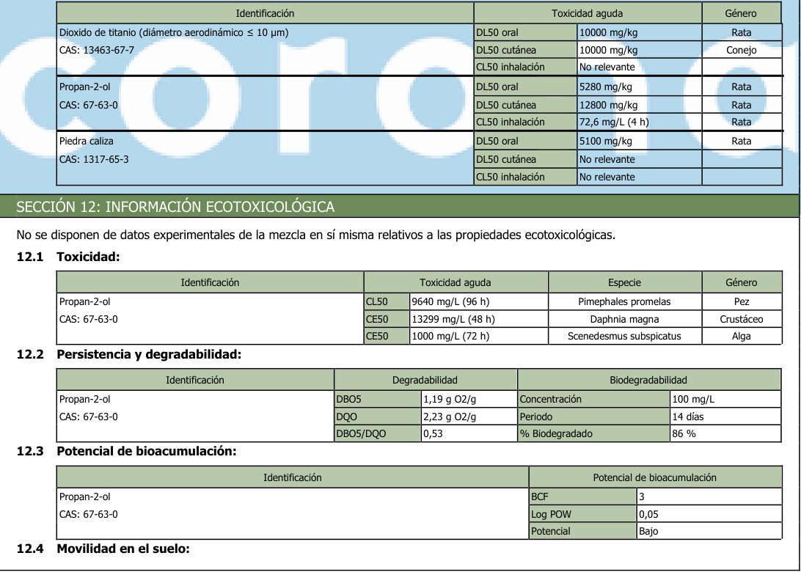

> Imagen (pág. 8). OCR automático, revisar: «Identificación Toxicidad aguda Género Dioxido de titanio (diámetro aerodinámico < 10 ym) DL5O oral 10000 mg/kg Rata CAS: 13463-67-7 DLSO cutánea 10000 mg/kg Conejo [CL5O inhalación No relevante Propan-2-01 DLSO oral 15280 mg/kg Rata CAS: 67-63-0 DLO cutánea 12800 mg/kg Rata [CL50 inhalación 172,6 mg/L (4 h) Rata Piedra caliza DLSO oral 5100 mg/kg Rata (CAS: 1317-65-3 DLSO cutánea No relevante [CL50 inhalación No relevante SECCIÓN 12: INFORMACIÓN ECOTOXICOLÓGICA No se disponen de datos experimentales de la mezcla en sí misma relativos a las propiedades ecotoxicológicas. 12.1 Identificación Toxicidad aguda Especie Género Propan-2-01 [eL5o [9640 mg/L (96 h) Pimephales promelas Pez CAS: 67-63-0 [ceso [13299 mg/L (48 h) Daphnia magna Crustáceo [ceso — [1000 mg/L (72 h) Scenedesmus subspicatus ‘Alga 12.2 Persistencia y degradabilidad: Identificación Degradabilidad Biodegradabilidad Propan-2-01 DBOS 1,19 g 02/g [Concentración 100 mg/L CAS: 67-63-0 DQo 2,23 g 02/9 Periodo 14 días DBO5/DQ0 0,53 [9% Biodegradado 86 % 12.3 Potencial de bioacumulación: Identificación Potencial de bioacumulación Propan-2-01 BCF 3 (CAS: 67-63-0 Log POW 0,05 Potencial Bajo»

<!-- Start of picture text -->
Identificación  Toxicidad aguda  Género Dioxido de titanio (diámetro aerodinámico ≤ 10 μm)  DL50 oral  10000 mg/kg  Rata CAS: 13463-67-7  DL50 cutánea  10000 mg/kg  Conejo CL50 inhalación  No relevante Propan-2-ol  DL50 oral  5280 mg/kg  Rata CAS: 67-63-0  DL50 cutánea  12800 mg/kg  Rata CL50 inhalación  72,6 mg/L (4 h)  Rata Piedra caliza  DL50 oral  5100 mg/kg  Rata CAS: 1317-65-3  DL50 cutánea  No relevante CL50 inhalación  No relevante SECCIÓN 12: INFORMACIÓN ECOTOXICOLÓGICA No se disponen de datos experimentales de la mezcla en sí misma relativos a las propiedades ecotoxicológicas. 12.1 Toxicidad: Identificación  Toxicidad aguda  Especie  Género Propan-2-ol  CL50  9640 mg/L (96 h)  Pimephales promelas  Pez CAS: 67-63-0  CE50  13299 mg/L (48 h)  Daphnia magna  Crustáceo A CE50  1000 mg/L (72 h)  Scenedesmus subspicatus  Alga 12.2 Persistencia y degradabilidad: Identificación  Degradabilidad  Biodegradabilidad Propan-2-ol  DBO5  1,19 g O2/g  Concentración  100 mg/L CAS: 67-63-0  DQO  2,23 g O2/g  Periodo  14 días DBO5/DQO  0,53  % Biodegradado  86 % 12.3 Potencial de bioacumulación: — = ===== Identificación  Potencial de bioacumulación Propan-2-ol  BCF  3 CAS: 67-63-0  Log POW  0,05 Potencial  Bajo 12.4 Movilidad en el suelo: <!-- End of picture text -->

- CONTINÚA EN LA SIGUIENTE PÁGINA - 

Emisión: 07/11/2019            Revisión: 13/01/2022            Versión: 3 (sustituye a 2) 

**Página 8/10** 

<!-- pagina: 9 -->
Ficha de datos de seguridad según Decreto 1496 de 2018 

> Imagen (pág. 9). Sin texto legible por OCR; contenido gráfico no interpretado.

# **PINTURA SEÑALIZACIÓN Y DEMARCACIÓN** 

# SECCIÓN 12: INFORMACIÓN ECOTOXICOLÓGICA (continúa) 

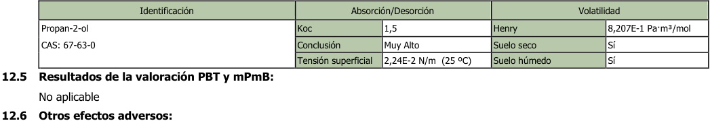

> Imagen (pág. 9). OCR automático, revisar: «12.5 12.6 Identificación Absorción/Desorción Volatilidad Propan-2-ol Koc 15 [Henry [8,207E-1 Pa‘m3/mol CAS: 67-63-0 [Conclusión Muy Alto [Suelo seco sí [Tensión superficial |2,24E-2 N/m (25°C) [Suelo húmedo sí Resultados de la valoración PBT y mPmB: No aplicable Otros efectos adversos:»

<!-- Start of picture text -->
Identificación  Absorción/Desorción  Volatilidad Propan-2-ol  Koc  1,5  Henry  8,207E-1 Pa·m³/mol CAS: 67-63-0  Conclusión  Muy Alto  Suelo seco  Sí Tensión superficial  2,24E-2 N/m  (25 ºC)  Suelo húmedo  Sí 12.5 Resultados de la valoración PBT y mPmB: No aplicable 12.6 Otros efectos adversos: <!-- End of picture text -->

No descritos 

# SECCIÓN 13: INFORMACIÓN RELATIVA A LA ELIMINACIÓN DE LOS PRODUCTOS 

**13.1 Métodos de eliminación:** 

## **Gestión del residuo (eliminación y valorización):** 

Consultar al gestor de residuos autorizado las operaciones de valorización y eliminación. En el caso de que el envase haya estado en contacto directo con el producto se gestionará del mismo modo que el propio producto, en caso contrario se gestionará como residuo no peligroso. Se desaconseja su vertido a cursos de agua. Ver epígrafe 6.2. 

**Disposiciones legislativas relacionadas con la gestión de residuos:** 

Legislación relacionada con la gestión de residuos: 

Decreto 1076 de 2015 (Decreto único reglamentario del Sector Ambiente y Desarrollo Sostenible) 

SECCIÓN 14: INFORMACIÓN RELATIVA AL TRANSPORTE 

Este producto no está regulado para su transporte ~~<u><mark>die,</mark></u>~~ SECCIÓN 15: INFORMACIÓN SOBRE LA REGLAMENTACIÓN ~~<u>e</u>~~ ~~<u><mark>ll E</mark></u>~~ 

**15.1 Disposiciones específicas sobre seguridad, salud y medio ambiente para el producto de que se trate:** NTP (National Toxicology Program): No relevante 

## **Disposiciones particulares en materia de protección de las personas o el medio ambiente:** 

Se recomienda emplear la información recopilada en esta hoja de datos de seguridad de materiales como datos de entrada en una evaluación de riesgos de las circunstancias locales con el objeto de establecer las medidas necesarias de prevención de riesgos para el manejo, utilización, almacenamiento y eliminación de este producto. **Otras legislaciones:** 

Resolución 0312 de 2019 – Nuevos estándares mínimos del SG-SST CONPES 3868 - Política de gestión del riesgo asociado al uso de sustancias químicas. Decreto 1079 de 2015 - Decreto único reglamentario del sector transporte NTC 1692 -Transporte de mercancías peligrosas. Definiciones, clasificación, marcado, etiquetado y rotulado NTC 4532- Transporte de mercancías peligrosas. Tarjetas de emergencia para transporte de materiales. Elaboración Decreto número 4741 de 2005 

Decreto 1299 de 2008 -Reglamenta departamento de gestión ambiental de empresas a nivel industrial estado Decreto 321 de 1999  - Adopta el Plan Nacional de Contingencia contra derrames de hidrocarburos, derivados y sustancias nocivas. NTC 4702 - 1 -Embalaje y Envases para Transporte de Mercancías Peligrosas Clase 1. Explosivos NTC 4702 - 2 - Embalaje y Envases para Transporte de Mercancías Peligrosas Clase 2. Gases NTC 4702 - 3 - Embalaje y Envases para Transporte de Mercancías Peligrosas Clase 3. Líquidos Inflamables NTC 4702 - 4 - Embalaje y Envases para Transporte de Mercancías Peligrosas Clase 4. Sólidos Inflamables, Sustancias que presentan riesgo de combustión espontánea, sustancias que en contacto con el agua desprenden gases inflamables. NTC 4702 - 5 - Embalaje y Envases para Transporte de Mercancías Peligrosas Clase 5. Sustancias Comburentes y Peróxidos Orgánicos NTC 4702 - 6 - Embalaje y Envases para Transporte de Mercancías Peligrosas Clase 6. Sustancias Tóxicas e Infecciosas NTC 4702 - 8 - Embalaje y Envases para Transporte de Mercancías Peligrosas Clase 8. Sustancias Corrosivas NTC 4702 - 9 - Embalaje y Envases para Transporte de Mercancías Peligrosas Clase 9. Sustancias Peligrosas varias 

Ley 2041 de 2020 - Por medio de la cual se garantiza el derecho de las personas a desarrollarse física e intelectualmente en un ambiente libre de plomo, fijando límites para su contenido en productos comercializados en el país. 

- CONTINÚA EN LA SIGUIENTE PÁGINA - 

Emisión: 07/11/2019            Revisión: 13/01/2022            Versión: 3 (sustituye a 2) 

**Página 9/10** 

<!-- pagina: 10 -->

> Imagen (pág. 10). OCR automático, revisar: «Ficha de datos de seguridad según Decreto 1496 de 2018»

<!-- Start of picture text -->
Ficha de datos de seguridad según Decreto 1496 de 2018 <!-- End of picture text -->

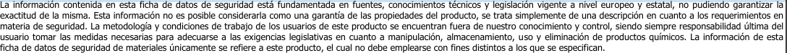

> Imagen (pág. 10). OCR automático, revisar: «La información contenida en esta ficha de datos de seguridad está fundamentada en fuentes, conocimientos técnicos y legislación vigente a nivel europeo y estatal, no pudiendo garantizar la exactitud de la misma. Esta información no es posible considerarla como una garantía de las propiedades del producto, se trata simplemente de una descripción en cuanto a los requerimientos en materia de seguridad. La metodología y condiciones de trabajo de los usuarios de este producto se encuentran fuera de nuestro conocimiento y control, siendo siempre responsabilidad última del usuario tomar las medidas necesarias para adecuarse a las exigencias legislativas en cuanto a manipulación, almacenamiento, uso y eliminación de productos químicos. La información de esta ficha de datos de seguridad de materiales únicamente se refiere a este producto, el cual no debe emplearse con fines distintos a los que se especifican.»

<!-- Start of picture text -->
La información contenida en esta ficha de datos de seguridad está fundamentada en fuentes, conocimientos técnicos y legislación vigente a nivel europeo y estatal, no pudiendo garantizar la exactitud de la misma. Esta información no es posible considerarla como una garantía de las propiedades del producto, se trata simplemente de una descripción en cuanto a los requerimientos en materia de seguridad. La metodología y condiciones de trabajo de los usuarios de este producto se encuentran fuera de nuestro conocimiento y control, siendo siempre responsabilidad última del usuario tomar las medidas necesarias para adecuarse a las exigencias legislativas en cuanto a manipulación, almacenamiento, uso y eliminación de productos químicos. La información de esta ficha de datos de seguridad de materiales únicamente se refiere a este producto, el cual no debe emplearse con fines distintos a los que se especifican. <!-- End of picture text -->

<!-- Start of picture text -->
Emisión: 07/11/2019            Revisión: 13/01/2022            Versión: 3 (sustituye a 2) <!-- End of picture text -->

según Decreto 1496 de 2018 **PINTURA SEÑALIZACIÓN Y DEMARCACIÓN** SECCIÓN 16: OTRAS INFORMACIONES **Legislación aplicable a fichas de datos de seguridad:** Esta hoja de datos de seguridad de materiales se ha desarrollado de acuerdo a la norma técnica colombiana NTC 4435:2010 **Textos de las frases legislativas contempladas en la sección 2:** H351: Susceptible de provocar cáncer (Inhalación). H401: Tóxico para los organismos acuáticos. **Textos de las frases legislativas contempladas en la sección 3:** Las frases indicadas no se refieren al producto en sí, son sólo a título informativo y hacen referencia a los componentes individuales que aparecen en la sección 3 **SGA:** Carc. 2: H351 - Susceptible de provocar cáncer (Inhalación). Irrit. oc. 2: H319 - Provoca irritación ocular grave. Liq. Infl. 2: H225 - Líquido y vapores muy inflamables. STOT única 3: H336 - Puede provocar somnolencia o vértigo. **Consejos relativos a la formación:** Se recomienda formación mínima en materia de prevención de riesgos laborales al personal que va a manipular este producto, con la finalidad de facilitar la comprensión e interpretación de esta hoja de datos de seguridad de materiales, así como del etiquetado del producto. **Principales fuentes bibliográficas:** Instituto Colombiano de Normas Técnicas y Certificación (ICONTEC). IARC: Agencia Internacional para la Investigación sobre Cáncer. OSHA: Occupational Safety and Health Administration, U.S Department of Labor. NTP: National Toxicology Program. TOXNET: Toxicology data network. **Abreviaturas y acrónimos:** IMDG: Código Marítimo Internacional de Mercancías Peligrosas IATA: Asociación Internacional de Transporte Aéreo OACI: Organización de Aviación Civil Internacional DQO: Demanda Química de Oxígeno DBO5: Demanda Biológica de Oxígeno a los 5 días BCF: Factor de bioconcentración DL50: Dosis Letal 50 CL50: Concentración Letal 50 EC50: Concentración Efectiva 50 Log POW: Logaritmo Coeficiente Partición Octanol-Agua Koc: Coeficiente de Partición del Carbono Orgánico La información contenida en esta ficha de datos de seguridad está fundamentada en fuentes, conocimientos técnicos y legislación vigente a nivel europeo y estatal, no pudiendo garantizar la exactitud de la misma. Esta información no es posible considerarla como una garantía de las propiedades del producto, se trata simplemente de una descripción en cuanto a los requerimientos en materia de seguridad. La metodología y condiciones de trabajo de los usuarios de este producto se encuentran fuera de nuestro conocimiento y control, siendo siempre responsabilidad última del usuario tomar las medidas necesarias para adecuarse a las exigencias legislativas en cuanto a manipulación, almacenamiento, uso y eliminación de productos químicos. La información de esta ficha de datos de seguridad de materiales únicamente se refiere a este producto, el cual no debe emplearse con fines distintos a los que se especifican. ~~=~~ 

FIN DE LA FICHA DE DATOS DE SEGURIDAD **Página 10/10** 
