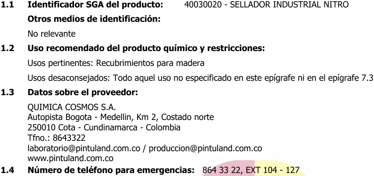
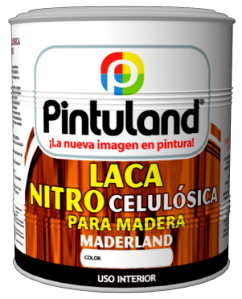
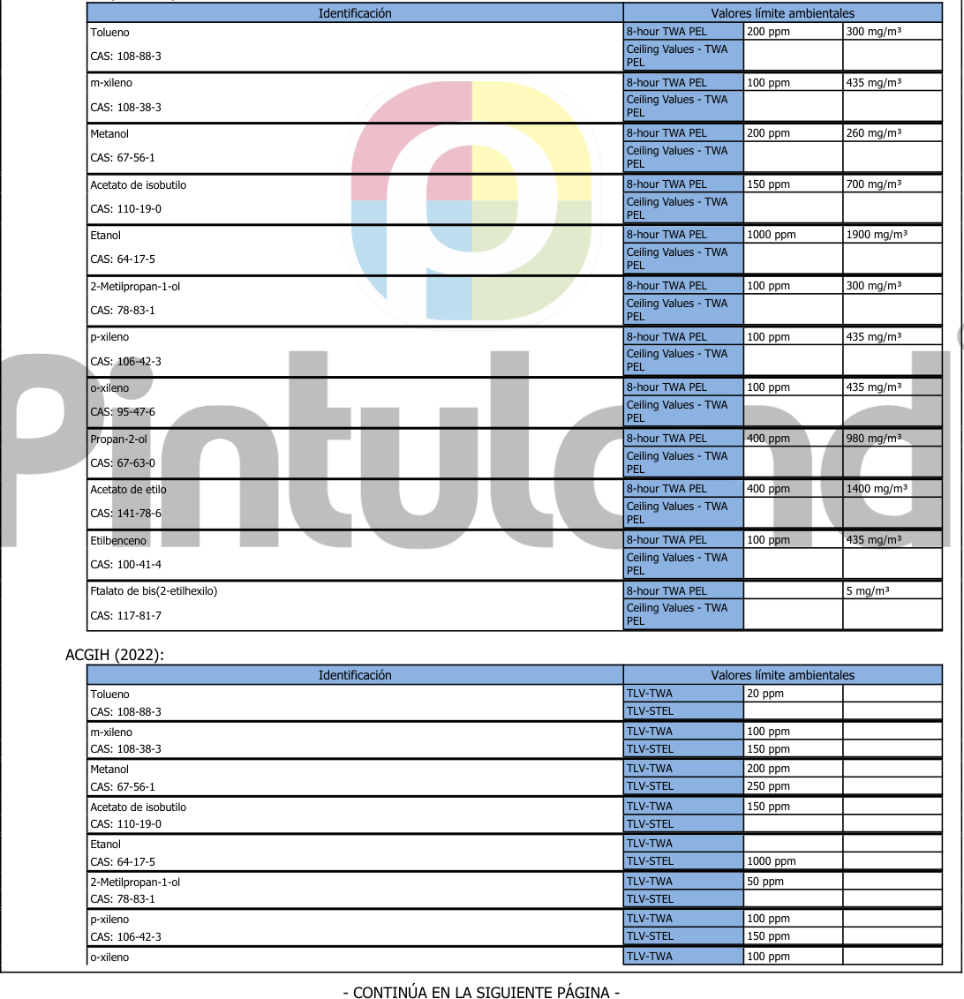
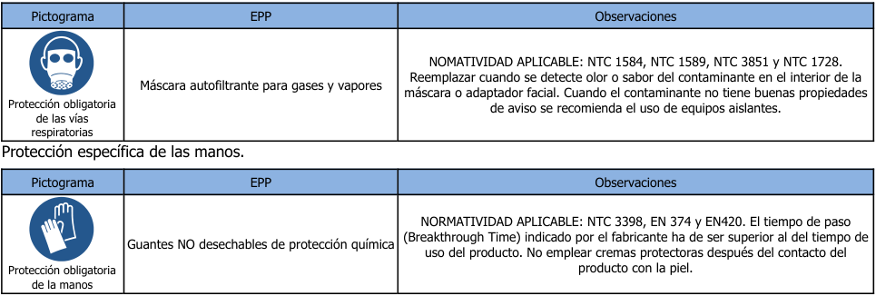
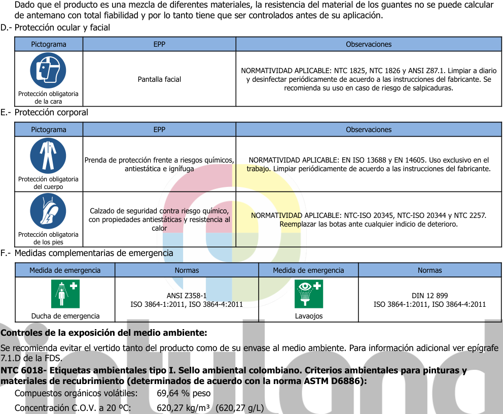
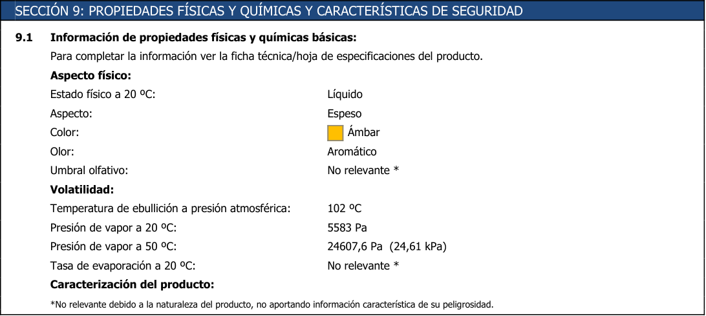
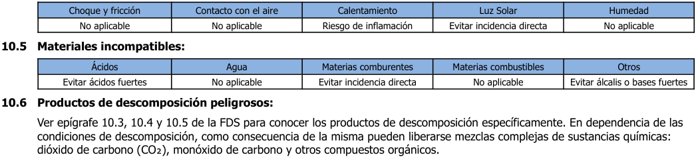
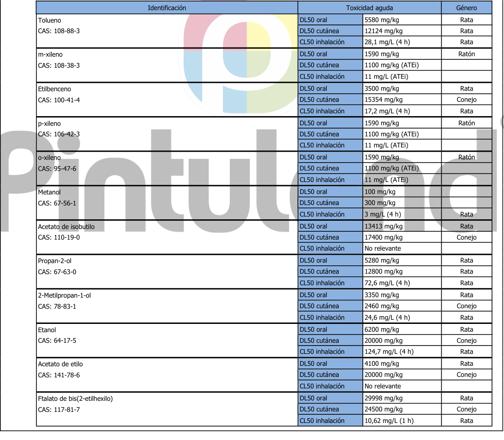
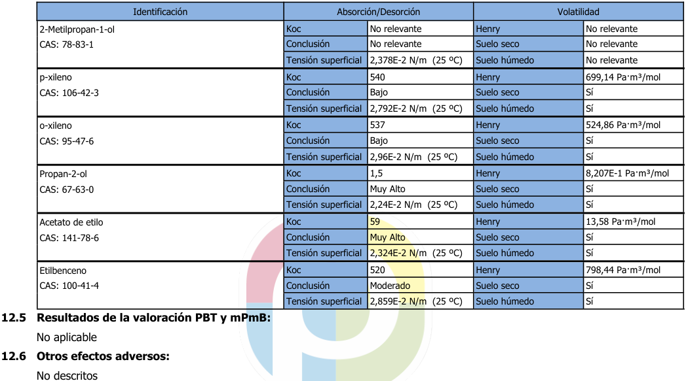
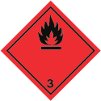

<!-- pagina: 1 -->
Ficha de datos de seguridad según Decreto 1496 de 2018 y Resolución 773 de 2021 

## **40030020 - SELLADOR INDUSTRIAL NITRO** 

> Imagen (pág. 1). Sin texto legible por OCR; contenido gráfico no interpretado.

Emisión: 24/03/2022            Revisión: 5/10/2022            Versión: 4 (sustituye a 3) 

## SECCIÓN 1: IDENTIFICACIÓN DEL PRODUCTO 

> Imagen (pág. 1). OCR automático, revisar: «Identificador SGA del producto: 40030020 - SELLADOR INDUSTRIAL NITRO Otros medios de identificación: No relevante Uso recomendado del producto químico y restricciones: Usos pertinentes: Recubrimientos para madera Usos desaconsejados: Todo aquel uso no especificado en este epígrafe ni en el epígrafe 7.3 Datos sobre el proveedor: QUIMICA COSMOS S.A. Autopista Bogota - Medellin, Km 2, Costado norte 250010 Cota - Cundinamarca - Colombia Tfno.: 8643322 laboratorio@pintuland.com.co / produccion@pintuland.com.co www.pintuland.com.co Número de teléfono para emergencias: 864 33 22, EXT 104 - 127»

<!-- Start of picture text -->
1.1 Identificador SGA del producto: 40030020 - SELLADOR INDUSTRIAL NITRO Otros medios de identificación: No relevante 1.2 Uso recomendado del producto químico y restricciones: Usos pertinentes: Recubrimientos para madera Usos desaconsejados: Todo aquel uso no especificado en este epígrafe ni en el epígrafe 7.3 1.3 Datos sobre el proveedor: QUIMICA COSMOS S.A. Autopista Bogota - Medellin, Km 2, Costado norte 250010 Cota - Cundinamarca - Colombia Tfno.: 8643322 laboratorio@pintuland.com.co / produccion@pintuland.com.co www.pintuland.com.co 1.4 Número de teléfono para emergencias: 864 33 22, EXT 104 - 127 <!-- End of picture text -->

> Imagen (pág. 1). Sin texto legible por OCR; contenido gráfico no interpretado.

<!-- Start of picture text -->
art YINTROFLACAcries <!-- End of picture text -->

## SECCIÓN 2: IDENTIFICACIÓN DEL PELIGRO O PELIGROS 

**2.1 Clasificación de la sustancia o de la mezcla: SGA:** La clasificación del producto se ha realizado conforme con al decreto 1496 de 2018 y la Resolución 773 de 2021, por el cual se adopta el Sistema Globalmente Armonizado de Clasificación y Etiquetado de Productos Químicos y se dictan otras disposiciones en materia de seguridad química. Acuático agudo. 3: Peligrosidad aguda para el medio ambiente acuático, Categoría 3, H402 Carc. 2: Carcinogenicidad, Categoría 2, H351 Irrit. Cut. 2: Irritación cutánea, categoría 2, H315 Les. Oc. 1: Lesiones oculares graves, Categoría 1, H318 Liq. Infl. 2: Líquidos inflamables, Categoría 2, H225 Repr. 1B: Tóxico para la reproducción, Categoría 1B, H360 STOT repe. 2: Toxicidad específica en determinados órganos (exposiciones repetidas), Categoría 2, H373 STOT única 2: Toxicidad específica en determinados órganos (exposición única), categoria 2, H371 STOT única 3: Toxicidad específica con efectos de somnolencia y vértigo (exposición única), Categoría 3, H336 Tox. Agud. 4: Toxicidad aguda por contacto con la piel, Categoría 4, H312 Tox. Agud. 4: Toxicidad aguda por ingestión, Categoría 4, H302 Tox. Agud. 4: Toxicidad aguda por inhalación, Categoría 4, H332 Tox. Asp. 1: Peligro por aspiración, Categoría 1, H304 **2.2 Elementos de las etiquetas del SGA, incluidos los consejos de prudencia: SGA: Peligro** 

**Indicaciones de peligro:** 

Acuático agudo. 3: H402 - Nocivo para los organismos acuáticos. Carc. 2: H351 - Susceptible de provocar cáncer. Irrit. Cut. 2: H315 - Provoca irritación cutánea. Les. Oc. 1: H318 - Provoca lesiones oculares graves. Liq. Infl. 2: H225 - Líquido y vapores muy inflamables. Repr. 1B: H360 - Puede perjudicar la fertilidad o dañar al feto. STOT repe. 2: H373 - Puede provocar daños en los órganos tras exposiciones prolongadas o repetidas. STOT única 2: H371 - Puede provocar daños en los órganos. STOT única 3: H336 - Puede provocar somnolencia o vértigo. Tox. Agud. 4: H312 - Nocivo en contacto con la piel. Tox. Agud. 4: H302 - Nocivo en caso de ingestión. Tox. Agud. 4: H332 - Nocivo si se inhala. Tox. Asp. 1: H304 - Puede ser mortal en caso de ingestión y de penetración en las vías respiratorias. 

- CONTINÚA EN LA SIGUIENTE PÁGINA - 

Emisión: 24/03/2022            Revisión: 5/10/2022            Versión: 4 (sustituye a 3) 

**Página 1/18** 

<!-- pagina: 2 -->
Ficha de datos de seguridad según Decreto 1496 de 2018 y Resolución 773 de 2021 

## **40030020 - SELLADOR INDUSTRIAL NITRO** 

> Imagen (pág. 2). Sin texto legible por OCR; contenido gráfico no interpretado.

<!-- Start of picture text -->
O6 0 <!-- End of picture text -->

Emisión: 24/03/2022            Revisión: 5/10/2022            Versión: 4 (sustituye a 3) 

## SECCIÓN 2: IDENTIFICACIÓN DEL PELIGRO O PELIGROS (continúa) 

### **Consejos de prudencia:** 

P101: Si se necesita consultar a un médico, tener a mano el recipiente o la etiqueta del producto. P102: Mantener fuera del alcance de los niños. 

P210: Mantener alejado del calor, superficies calientes, chispas llamas al descubierto y otras fuentes de ignición. No fumar. P264: Lavarse cuidadosamente después de la manipulación. 

P280: Usar guantes de protección/equipo de protección para la cara/ropa de protección/protección respiratoria/calzado de protección. 

P305+P351+P338: EN CASO DE CONTACTO CON LOS OJOS: Enjuagar con agua cuidadosamente durante varios minutos. Quitar las lentes de contacto cuando estén presentes y pueda hacerse con facilidad. Proseguir con el lavado. P370+P378: En caso de incendio: Utilizar extintor de polvo ABC para la extinción. 

P501: Eliminar el contenido/recipiente mediante el sistema de recogida selectiva habilitado en su municipio. 

**Sustancias que contribuyen a la clasificación** 

Tolueno; m-xileno; Metanol; Acetato de isobutilo 

- **2.3 Otros peligros que no conducen a una clasificación:** No relevante 

## SECCIÓN 3: COMPOSICIÓN/INFORMACIÓN SOBRE LOS COMPONENTES 

- **3.1 Sustancias:** No aplicable 

- **3.2 Mezclas:** 

**Descripción química:** Mezcla a base de aditivos, cargas, nitrocelulosas, pigmentos y resinas en disolventes 

- **Componentes:** 

De acuerdo al Decreto 1496 de 2018 y la Resolución 773 de 2021, el producto presenta: 

||Identificación  |Nombre químico/clasificación ~~PT~~   |Concentración  |
|---|---|---|---|
|CAS: ~~a~~  |108-88-3 ~~S~~  |**Tolueno** Acuático agudo. 2: H401; Irrit. Cut. 2: H315; Liq. Infl. 2: H225; Repr. 2: H361; STOT repe. 2: H373; STOT única 3: H336; Tox. Asp. 1: H304 - Peligro ~~|FF~~ ~~Fe~~ ~~_«5~~   |**10 - <25 %** ~~GF~~   |
|CAS:    |108-38-3   ~~P~~  |**m-xileno** Irrit. Cut. 2: H315; Liq. Infl. 3: H226; Tox. Agud. 4: H312+H332 - Atención       ~~EGAPR~~   |**10 - <25 %**  ~~E~~  |
|CAS:   |67-56-1    |**Metanol** Liq. Infl. 2: H225; STOT única 1: H370; Tox. Agud. 3: H301+H311+H331 - Peligro       |**2,5 - <10 %**    |
|CAS:   |110-19-0   ~~BE ~~ |**Acetato de isobutilo** Liq. Infl. 2: H225; STOT única 3: H336 - Peligro     ~~ER~~   |**2,5 - <10 %**    |
|CAS:    |64-17-5      |**Etanol** Irrit. oc. 2: H319; Liq. Infl. 2: H225 - Peligro           ~~NY~~|**2,5 - <10 %**    ~~A~~|
|CAS:    |78-83-1    |**2-Metilpropan-1-ol** Irrit. Cut. 2: H315; Les. Oc. 1: H318; Liq. Infl. 3: H226; STOT única 3: H335; STOT única 3: H336; Tox. Agud. 5: H303; Tox. Agud. 5: H313 - Peligro    ~~PIN~~   |**2,5 - <10 %**      |
|CAS:  |106-42-3  |**p-xileno** Irrit. Cut. 2: H315; Liq. Infl. 3: H226; Tox. Agud. 4: H312+H332 - Atención ~~A~~  |**2,5 - <10 %**   |
|CAS: |95-47-6 |**o-xileno** Irrit. Cut. 2: H315; Liq. Infl. 3: H226; Tox. Agud. 4: H312+H332 - Atención   ~~NN~~ |**2,5 - <10 %**   |
|CAS:  |67-63-0  |**Propan-2-ol** Irrit. oc. 2: H319; Liq. Infl. 2: H225; STOT única 3: H336 - Peligro ~~o~~ ~~a~~  |**2,5 - <10 %**  ~~a~~  |
|CAS:   |141-78-6   |**Acetato de etilo** Irrit. oc. 2: H319; Liq. Infl. 2: H225; STOT única 3: H336; Tox. Agud. 5: H303 - Peligro  ~~o~~   |**2,5 - <10 %**     |
|CAS:  |100-41-4  |**Etilbenceno** Acuático agudo. 3: H402; Carc. 2: H351; Liq. Infl. 2: H225; Tox. Agud. 4: H332; Tox. Agud. 5: H303 - Peligro   |**0,2 - <2,5 %**   |
|CAS:  |117-81-7  |**Ftalato de bis(2-etilhexilo)**    ~~IO~~|**0,2 - <2,5 %**  |
|||Carc. 2: H351; Repr. 1B: H360 - Peligro  ||
|Para Carci clasifi  |ampliar informa nogenicidad de cación SGA, par  | ción sobre la peligrosidad de las sustancias consultar las secciones 11, 12 y 16. La clasificación r las sustancias se ha establecido en función de las monografías de la IARC adecuándola al sistem a información sobre la clasificación IARC consulte la sección 11.  |especto a de  |

- CONTINÚA EN LA SIGUIENTE PÁGINA - 

Emisión: 24/03/2022            Revisión: 5/10/2022            Versión: 4 (sustituye a 3) 

**Página 2/18** 

<!-- pagina: 3 -->
Ficha de datos de seguridad según Decreto 1496 de 2018 y Resolución 773 de 2021 

## **40030020 - SELLADOR INDUSTRIAL NITRO** 

> Imagen (pág. 3). Sin texto legible por OCR; contenido gráfico no interpretado.

Emisión: 24/03/2022            Revisión: 5/10/2022            Versión: 4 (sustituye a 3) 

## SECCIÓN 4: PRIMEROS AUXILIOS 

- **4.1 Descripción de los primeros auxilios necesarios:** 

Los síntomas como consecuencia de una intoxicación pueden presentarse con posterioridad a la exposición, por lo que, en caso de duda, exposición directa al producto químico o persistencia del malestar solicitar atención médica, mostrándole la FDS de este producto. **Por inhalación:** Sacar al afectado del lugar de exposición, suministrarle aire limpio y mantenerlo en reposo. En casos graves como parada cardiorespiratoria, se aplicarán técnicas de respiración artificial (respiración boca a boca, masaje cardíaco, suministro de oxígeno, etc.) requiriendo asistencia médica inmediata. **Por contacto con la piel:** Quitar la ropa y los zapatos contaminados, aclarar la piel o duchar al afectado si procede con abundante agua fría y jabón neutro. En caso de afección importante acudir al médico. Si el producto produce quemaduras o congelación, no se debe quitar la ropa debido a que podría empeorar la lesión producida si esta se encuentra pegada a la piel. En el caso de formarse ampollas en la piel, éstas nunca deben reventarse ya que aumentaría el riesgo de infección. **Por contacto con los ojos:** Enjuagar los ojos con abundante agua a temperatura ambiente al menos durante 15 minutos. Evitar que el afectado se frote o cierre los ojos. En el caso de que el accidentado use lentes de contacto, éstas deben retirarse siempre que no estén pegadas a los ojos, de otro modo podría producirse un daño adicional. En todos los casos, después del lavado, se debe acudir al médico lo más rápidamente posible con la FDS del producto. **Por ingestión/aspiración:** Requerir asistencia médica inmediata, mostrándole la FDS de este producto. No inducir al vómito, en el caso de que se produzca mantener inclinada la cabeza hacia delante para evitar la aspiración. En el caso de pérdida de consciencia no administrar nada por vía oral hasta la supervisión del médico. Enjuagar la boca y la garganta, ya que existe la posibilidad de que hayan sido afectadas en la ingestión. Mantener al afectado en reposo. **4.2 Síntomas/efectos más importantes, agudos o retardados:** Los efectos agudos y retardados son los indicados en las secciones 2 y 11 de la FDS. **4.3 Indicación de la necesidad de recibir atención médica inmediata y, en su caso, de tratamiento especial:** No relevante 

## SECCIÓN 5: MEDIDAS DE LUCHA CONTRA INCENDIOS 

|**5.1**|**Medios de extinción apropiados:** **Medios de extinción apropiados:** Emplear preferentemente extintores de polvo polivalente (polvo ABC), alternativamente utilizar espuma física o extintores de dióxido de carbono (CO₂). **Medios de extinción no apropiados:**|
|---|---|
||NO SE RECOMIENDA emplear agua a chorro como agente de extinción.|
|**5.2**|**Peligros específicos del producto químico:**|
||Como consecuencia de la combustión o descomposición térmica se generan subproductos de reacción que pueden resultar altamente tóxicos y, consecuentemente, pueden presentar un riesgo elevado para la salud.|
|**5.3**|**Medidas especiales que deben tomar los equipos de lucha contra incendios:**|
||En función de la magnitud del incendio puede hacerse necesario el uso de ropa protectora completa y equipo de respiración autónomo. Disponer de un mínimo de instalaciones de emergencia o elementos de actuación (mantas ignífugas, botiquín portátil,...). **Disposiciones adicionales:**|

Actuar conforme el Plan de Emergencia Interior y las Fichas Informativas sobre actuación ante accidentes y otras emergencias. Suprimir cualquier fuente de ignición. En caso de incendio, refrigerar los recipientes y tanques de almacenamiento de productos susceptibles a inflamación, explosión o BLEVE como consecuencia de elevadas temperaturas. Evitar el vertido de los productos empleados en la extinción del incendio al medio acuático. 

## SECCIÓN 6: MEDIDAS QUE DEBEN TOMARSE EN CASO DE VERTIDO ACCIDENTAL 

- **6.1 Precauciones personales, equipo protector y procedimiento de emergencia: Para el personal que no forma parte de los servicios de emergencia:** 

- CONTINÚA EN LA SIGUIENTE PÁGINA - 

Emisión: 24/03/2022            Revisión: 5/10/2022            Versión: 4 (sustituye a 3) 

**Página 3/18** 

<!-- pagina: 4 -->
Ficha de datos de seguridad según Decreto 1496 de 2018 y Resolución 773 de 2021 

## **40030020 - SELLADOR INDUSTRIAL NITRO** 

> Imagen (pág. 4). Sin texto legible por OCR; contenido gráfico no interpretado.

<!-- Start of picture text -->
9909 0 <!-- End of picture text -->

Emisión: 24/03/2022            Revisión: 5/10/2022            Versión: 4 (sustituye a 3) 

## SECCIÓN 6: MEDIDAS QUE DEBEN TOMARSE EN CASO DE VERTIDO ACCIDENTAL (continúa) 

Aislar las fugas siempre y cuando no suponga un riesgo adicional para las personas que desempeñen esta función. Evacuar la zona y mantener a las personas sin protección alejadas. Ante el contacto potencial con el producto derramado se hace obligatorio el uso de elementos de protección personal (ver sección 8 de la FDS). Evitar de manera prioritaria la formación de mezclas vaporaire inflamables, ya sea mediante ventilación o el uso de un agente inertizante. Suprimir cualquier fuente de ignición. Eliminar las cargas electroestáticas mediante la interconexión de todas las superficies conductoras sobre las que se puede formar electricidad estática, y estando a su vez el conjunto conectado a tierra. 

### **Para el personal de emergencia:** 

Llevar puesto equipo de protección. Mantener alejadas las personas sin protección. Ver sección 8 de la FDS. 

- **6.2 Precauciones relativas al medio ambiente:** 

Evitar a toda costa cualquier tipo de vertido al medio acuático. Contener adecuadamente el producto absorbido/recogido en recipientes herméticamente precintables. Notificar a la autoridad competente en el caso de exposición al público en general o al medioambiente. 

- **6.3 Métodos y materiales para la contención y limpieza de vertidos:** 

Se recomienda: 

Absorber el vertido mediante arena o absorbente inerte y trasladarlo a un lugar seguro. No absorber en serrín u otros absorbentes combustibles. Para cualquier consideración relativa a la eliminación consultar la sección 13 de la FDS. 

- **6.4 Referencias a otras secciones:** Ver secciones 8 y 13. 

## SECCIÓN 7: MANIPULACIÓN Y ALMACENAMIENTO 

- **7.1 Precauciones que se deben tomar para garantizar una manipulación segura:** 

   - A.- Precauciones generales 

Cumplir con la legislación vigente en materia de prevención de riesgos laborales. Mantener los recipientes herméticamente cerrados. Controlar los derrames y residuos, eliminándolos con métodos seguros (sección 6 de la FDS). Evitar el vertido libre desde el recipiente. Mantener orden y limpieza donde se manipulen productos peligrosos. 

- B.- Recomendaciones técnicas para la prevención de incendios y explosiones. 

Trasvasar en lugares bien ventilados, preferentemente mediante extracción localizada. Controlar totalmente los focos de ignición (teléfonos móviles, chispas,…) y ventilar en las operaciones de limpieza. Evitar la existencia de atmósferas peligrosas en el interior de recipientes, aplicando en lo posible sistemas de inertización. Trasvasar a velocidades lentas para evitar la generación de cargas electroestáticas. Ante la posibilidad de existencia de cargas electroestáticas: asegurar una perfecta conexión equipotencial, utilizar siempre tomas de tierras, no emplear ropa de trabajo de fibras acrílicas, empleando preferiblemente ropa de algodón y calzado conductor. Cumplir con los requisitos esenciales de seguridad para equipos  y con las disposiciones mínimas para la protección de la seguridad y salud de los trabajadores. Consultar la sección 10 de la FDS sobre condiciones y materias que deben evitarse. 

- C.- Recomendaciones técnicas para prevenir riesgos ergonómicos y toxicológicos. 

LAS MUJERES EMBARAZADAS NO DEBEN EXPONERSE A ESTE PRODUCTO.  Manipular en lugares fijos que reúnan las debidas condiciones de seguridad (duchas de emergencia y lavaojos en las proximidades), empleando equipos de protección personal, en especial de cara y manos (ver sección 8 de la FDS). Limitar los trasvases manuales a recipientes de pequeñas cantidad. No comer, beber ni fumar en las zonas de trabajo 

lavarse las manos después de cada utilización, y despojarse de prendas de vestir y equipos de protección contaminados antes de entrar en las zonas para comer. 

- D.- Recomendaciones técnicas para prevenir riesgos medioambientales 

Debido a la peligrosidad de este producto para el medio ambiente se recomienda manipularlo dentro de un área que disponga de barreras de control de la contaminación en caso de vertido, así como disponer de material absorbente en las proximidades del mismo 

### **7.2 Condiciones de almacenamiento seguro, incluidas cualesquiera incompatibilidades:** 

- A.- Medidas técnicas de almacenamiento 

Temperatura mínima: 5 ºC Temperatura máxima: 30 ºC Tiempo máximo: 6 meses 

- B.- Condiciones generales de almacenamiento. 

Evitar fuentes de calor, radiación, electricidad estática y el contacto con alimentos. Para información adicional ver epígrafe 10.5 

- CONTINÚA EN LA SIGUIENTE PÁGINA - 

Emisión: 24/03/2022            Revisión: 5/10/2022            Versión: 4 (sustituye a 3) 

**Página 4/18** 

<!-- pagina: 5 -->
Ficha de datos de seguridad según Decreto 1496 de 2018 y Resolución 773 de 2021 

## **40030020 - SELLADOR INDUSTRIAL NITRO** 

> Imagen (pág. 5). Sin texto legible por OCR; contenido gráfico no interpretado.

Emisión: 24/03/2022            Revisión: 5/10/2022            Versión: 4 (sustituye a 3) 

## SECCIÓN 7: MANIPULACIÓN Y ALMACENAMIENTO (continúa) 

- **7.3 Usos específicos finales:** 

Salvo las indicaciones ya especificadas no es preciso realizar ninguna recomendación especial en cuanto a los usos de este producto. 

## SECCIÓN 8: CONTROLES DE EXPOSICIÓN/PROTECCIÓN PERSONAL 

### **8.1 Parámetros de control:** 

Sustancias cuyos valores límite de exposición profesional han de controlarse en el ambiente de trabajo: OSHA (Tablas Z): 

> Imagen (pág. 5). OCR automático, revisar: «Tolueno CAS: 108-88-3 m-xileno CAS: 108-38-3 Metanol CAS: 67-56-1 [Acetato de isobutilo CAS: 110-19-0 Etanol CAS: 64-17-5 2-Metilpropan-1-o1 CAS: 78-83-1 poxileno CAS: 406:42-3 fo-xileno CAS: 95:47:6 Propan-2-01 CAS: 67-63-0 [Acetato de etilo CAS: 141-78-6 Etilbenceno CAS: 100-41-4 Ftalato de bis(2-etilhexilo) (AS: 117-81-7 200 ppm [300 mg/m*. 100 ppm (435 mg/m? 200 ppm 260 mg/m? 150 ppm 700 mg/m? 1000 ppm 1900 mg/m 100 ppm [300 mg/m? 100 ppm (435 mg/m 100 ppm (435 mg/m? [400 ppm [980 mg/m*. [400 ppm 1400 mg/m 100 ppm. (435 mg/m? [5 mg/m? ACGIH (2022) CAS: 108-88-3 ‘m-xileno CAS: 108-38-3 Metanol CAS: 67-56-1 [Acetato de isobutilo (CAS: 110-19-0 Etanol CAS: 64-175 2-Metilpropan- CAS: 78-83-1 (CAS: 106-42-3 1000 ppm - CONTINÚA EN LA SIGUIENTE PAGINA -»

<!-- Start of picture text -->
Identificación Valores límite ambientales Tolueno 8-hour TWA PEL 200 ppm 300 mg/m³ CAS: 108-88-3 Ceiling Values - TWA PEL m-xileno 8-hour TWA PEL 100 ppm 435 mg/m³ CAS: 108-38-3 Ceiling Values - TWA A PEL Metanol 8-hour TWA PEL 200 ppm 260 mg/m³ CAS: 67-56-1 Ceiling Values - TWA PEL Acetato de isobutilo 8-hour TWA PEL er  150  ee ppm 700 mg/ ee m³ CAS: 110-19-0 Ceiling Values - TWA PEL II Etanol Ca AAA 8-hour TWA PEL 1000 ppm 1900 mg/m³ CAS: 64-17-5 Ceiling Values - TWA PEL AO 2-Metilpropan-1-ol 8-hour TWA PEL A eee 100  AA ppm 300 mg/m³ CAS: 78-83-1 Ceiling Values - TWA A p-xileno 8-hour TWA PELPEL + 100 ppm ee 435 mg/m³ CAS: 106-42-3 Ceiling Values - TWA Lee PEL o-xileno 8-hour TWA PEL 100 ppm 435 mg/m³ CAS: 95-47-6 Ceiling Values - TWA PEL Y Propan-2-ol 8-hour TWA PEL + 400  e ppm 980 mg/m³ CAS: 67-63-0 Ceiling Values - TWA PEL dla Acetato de etilo PABlO a'' 8-hour TWA PEL a 400 ppm nTaA 1400 mg/m³ CAS: 141-78-6 Ceiling Values - TWA PEL BIBLE Etilbenceno FA 8-hour TWA PEL ri 100 ppm 435 mg/m³ CAS: 100-41-4 Ceiling Values - TWA Io Ftalato de bis(2-etilhexilo) 8-hour TWA PELPEL re 5 mg/m³ CAS: 117-81-7 Ceiling Values - TWA IO PEL | ae ACGIH (2022): Identificación Valores límite ambientales Tolueno TLV-TWA 20 ppm CAS: 108-88-3 TLV-STEL m-xileno TLV-TWA 100 ppm CAS: 108-38-3 TLV-STEL 150 ppm Metanol TLV-TWA 200 ppm CAS: 67-56-1 TLV-STEL 250 ppm Acetato de isobutilo TLV-TWA 150 ppm —— CAS: 110-19-0 TLV-STEL === Etanol TLV-TWA CAS: 64-17-5 TLV-STEL 1000 ppm 2-Metilpropan-1-ol TLV-TWA 50 ppm —— CAS: 78-83-1 TLV-STEL === p-xileno TLV-TWA 100 ppm CAS: 106-42-3 TLV-STEL 150 ppm A o-xileno == TLV-TWA 100 ppm - CONTINÚA EN LA SIGUIENTE PÁGINA - <!-- End of picture text -->

Emisión: 24/03/2022            Revisión: 5/10/2022            Versión: 4 (sustituye a 3) 

**Página 5/18** 

<!-- pagina: 6 -->
Ficha de datos de seguridad según Decreto 1496 de 2018 y Resolución 773 de 2021 

## **40030020 - SELLADOR INDUSTRIAL NITRO** 

> Imagen (pág. 6). Sin texto legible por OCR; contenido gráfico no interpretado.

<!-- Start of picture text -->
OO o <!-- End of picture text -->

Emisión: 24/03/2022            Revisión: 5/10/2022            Versión: 4 (sustituye a 3) 

## SECCIÓN 8: CONTROLES DE EXPOSICIÓN/PROTECCIÓN PERSONAL (continúa) 

|ACGIH(2022):|Identificación||Valores límite ambi|entales|
|---|---|---|---|---|
|CAS: 95-47-6||TLV-STEL|150ppm||
|Propan-2-ol||TLV-TWA|200ppm||
|CAS: 67-63-0||TLV-STEL|400ppm||
|Acetato de etilo||TLV-TWA|150ppm||
|CAS: 141-78-6||TLV-STEL|||
|Etilbenceno||TLV-TWA|20ppm||
|CAS: 100-41-4||TLV-STEL|||
|Ftalato de bis(2-etilhexilo)||TLV-TWA||5 mg/m³|
|CAS: 117-81-7||TLV-STEL|||

### **Valores límite biológicos:** 

Indices de exposición biológicos (BEIs®) - ACGIH 

||Identificación|BEIs®|Determinante|Momento de muestreo|
|---|---|---|---|---|
|Tolueno CAS: 108-88-3||0,02 mg/L|Tolueno en sangre|Antes de la último turno de la semana de trabajo|
|m-xileno CAS: 108-38-3||1500 mg/g (Creatinina)|Ácidos metilhipúricos en orina|Fin del turno|
|Metanol CAS: 67-56-1||15 mg/L|Metanol en la orina|Fin del turno|
|p-xileno CAS: 106-42-3||1500 mg/g (Creatinina)|Ácidos metilhipúricos en orina|Fin del turno|
|o-xileno CAS: 95-47-6||1500 mg/g (Creatinina)|Ácidos metilhipúricos en orina|Fin del turno|
|Propan-2-ol CAS: 67-63-0||40 mg/L|Acetona en la orina|Al final del turno al final de la semana laboral|
|Etilbenceno CAS: 100-41-4||150 mg/g (Creatinina)|Suma de ácido mandélico y ácido fenilglioxílico en la orina|Fin del turno|

### **8.2** 

### **Controles técnicos apropiados:** 

A.- Medidas de protección individual, como equipo de protección personal (EPP) 

Realizar la identificación de los peligros y la valoración de los riesgos de acuerdo a la Guia técnica colombiana GTC 45. De acuerdo al orden de prioridad para el control de la exposición profesional se recomienda la extracción localizada en la zona de trabajo como medida de protección colectiva para evitar sobrepasar los límites de exposición profesional. Para más información sobre los equipos de protección individual (almacenamiento, uso, limpieza, mantenimiento, clase de 

protección,…) consultar el folleto informativo facilitado por el fabricante del EPP. Las indicaciones contenidas en este punto se refieren al producto puro. Las medidas de protección para el producto diluido podrán variar en función de su grado de dilución, uso, método de aplicación, etc. Para determinar la obligación de instalación de duchas de emergencia y/o lavaojos en los almacenes se tendrá en cuenta la normativa referente al almacenamiento de productos químicos aplicable en cada caso. Para más información Ver epígrafes 7.1 y 7.2 de la FDS. 

Toda la información aquí incluida es una recomendación siendo necesario su concreción por parte de los servicios de prevención de riesgos laborales al desconocer las medidas de prevención adicionales que la empresa pudiese disponer. 

B.- Protección respiratoria. 

> Imagen (pág. 6). OCR automático, revisar: «Pictograma EPP Observaciones Protección obligatoria de las vías respiratorias Máscara autofiltrante para gases y vapores NOMATIVIDAD APLICABLE: NTC 1584, NTC 1589, NTC 3851 y NTC 1728. Reemplazar cuando se detecte olor o sabor del contaminante en el interior de la máscara o adaptador facial. Cuando el contaminante no tiene buenas propiedades de aviso se recomienda el uso de equipos aislantes. Protección específica de las manos. Pictograma EPP Observaciones Proteccién obligatoria de la manos Guantes NO desechables de protección química NORMATIVIDAD APLICABLE: NTC 3398, EN 374 y EN420. El tiempo de paso (Breakthrough Time) indicado por el fabricante ha de ser superior al del tiempo de uso del producto. No emplear cremas protectoras después del contacto del producto con la piel.»

<!-- Start of picture text -->
Pictograma EPP Observaciones NOMATIVIDAD APLICABLE: NTC 1584, NTC 1589, NTC 3851 y NTC 1728. Reemplazar cuando se detecte olor o sabor del contaminante en el interior de la Máscara autofiltrante para gases y vapores máscara o adaptador facial. Cuando el contaminante no tiene buenas propiedades Protección obligatoria de aviso se recomienda el uso de equipos aislantes. de las vías respiratorias Protección específica de las manos. Pictograma EPP Observaciones NORMATIVIDAD APLICABLE: NTC 3398, EN 374 y EN420. El tiempo de paso (Breakthrough Time) indicado por el fabricante ha de ser superior al del tiempo de Guantes NO desechables de protección química uso del producto. No emplear cremas protectoras después del contacto del Protección obligatoria producto con la piel. de la manos <!-- End of picture text -->

C.- Protección específica de las manos. 

- CONTINÚA EN LA SIGUIENTE PÁGINA - 

Emisión: 24/03/2022            Revisión: 5/10/2022            Versión: 4 (sustituye a 3) 

**Página 6/18** 

<!-- pagina: 7 -->
Ficha de datos de seguridad según Decreto 1496 de 2018 y Resolución 773 de 2021 

## **40030020 - SELLADOR INDUSTRIAL NITRO** 

> Imagen (pág. 7). Sin texto legible por OCR; contenido gráfico no interpretado.

<!-- Start of picture text -->
O6 0 <!-- End of picture text -->

Emisión: 24/03/2022            Revisión: 5/10/2022            Versión: 4 (sustituye a 3) 

SECCIÓN 8: CONTROLES DE EXPOSICIÓN/PROTECCIÓN PERSONAL (continúa) 

> Imagen (pág. 7). OCR automático, revisar: «Dado que el producto es una mezcla de diferentes materiales, la resistencia del material de los guantes no se puede calcular de antemano con total fiabilidad y por lo tanto tiene que ser controlados antes de su aplicación. D.- Protección ocular y facial ‘an NORMATIVIDAD APLICABLE: NTC 1825, NTC 1826 y ANSI Z87.1. Limpiar a diario Pantalla facial y desinfectar periódicamente de acuerdo a las instrucciones del fabricante. Se > recomienda su uso en caso de riesgo de salpicaduras. Protección obligatoria de la cara E.- Protección corporal Prenda de protección frente a riesgos químicos,| NORMATIVIDAD APLICABLE: EN ISO 13688 y EN 14605. Uso exclusivo en el antiestática e ignifuga trabajo. Limpiar periódicamente de acuerdo a las instrucciones del fabricante. Protección obligatoria del cuerpo © Calzado de seguridad cal Esgo avi EE] NORMATIVIDAD APLICABLE: NTC-ISO 20345, NTC-ISO 20344 y NTC 2257. con propledades antics resis Reemplazar las botas ante cualquier indicio de deterioro. Protección obligatoria de los pies Medidas complementarias de emergencia q ANSI Z358-1 DIN 12 899 1SO 3864-1:2011, ISO 3864-4:2011 150 3864-1:2011, ISO 3864-4:2011 Ducha de emergencia Lavaojos Controles de la exposicién del medio ambiente: Se recomienda evitar el vertido tanto del producto como de su envase al medio ambiente. Para información adicional ver epígrafe 7.1.D de la FDS.. NTC 6018- Etiquetas ambientales tipo I. Sello ambiental colombiano. Criterios ambientales para pinturas y materiales de recubrimiento (determinados de acuerdo con la norma ASTM D6886): Compuestos orgánicos volátiles: 69,64 % peso Concentración C.O.V. a 20 °C: 620,27 kg/m, (620,27 g/L)»

<!-- Start of picture text -->
Dado que el producto es una mezcla de diferentes materiales, la resistencia del material de los guantes no se puede calcular de antemano con total fiabilidad y por lo tanto tiene que ser controlados antes de su aplicación. D.- Protección ocular y facial Pictograma EPP Observaciones NORMATIVIDAD APLICABLE: NTC 1825, NTC 1826 y ANSI Z87.1. Limpiar a diario Pantalla facial y desinfectar periódicamente de acuerdo a las instrucciones del fabricante. Se recomienda su uso en caso de riesgo de salpicaduras. Protección obligatoria Oo) de la cara E.- Protección corporal Pictograma EPP Observaciones Prenda de protección frente a riesgos químicos, NORMATIVIDAD APLICABLE: EN ISO 13688 y EN 14605. Uso exclusivo en el antiestática e ignífuga trabajo. Limpiar periódicamente de acuerdo a las instrucciones del fabricante. Protección obligatoria del cuerpo 0 Calzado de seguridad contra riesgo químico, ga NORMATIVIDAD APLICABLE: NTC-ISO 20345, NTC-ISO 20344 y NTC 2257. con propiedades antiestáticas y resistencia al calor Reemplazar las botas ante cualquier indicio de deterioro. Protección obligatoria O de los pies Ta) F.- Medidas complementarias de emergencia Medida de emergencia Normas Medida de emergencia Normas ANSI Z358-1 DIN 12 899 ISO 3864-1:2011, ISO 3864-4:2011 ISO 3864-1:2011, ISO 3864-4:2011 a Ducha de emergencia Lavaojos Controles de la exposición del medio ambiente: Se recomienda evitar el vertido tanto del producto como de su envase al medio ambiente. Para información adicional ver epígrafe 7.1.D de la FDS. NTC 6018- Etiquetas ambientales tipo I. Sello ambiental colombiano. Criterios ambientales para pinturas y materiales de recubrimiento (determinados de acuerdo con la norma ASTM D6886): Compuestos orgánicos volátiles: 69,64 % peso Concentración C.O.V. a 20 ºC: 620,27 kg/m³  (620,27 g/L) <!-- End of picture text -->

> Imagen (pág. 7). OCR automático, revisar: «SECCIÓN 9: PROPIEDADES FÍSICAS Y MICAS Y CARACTERÍSTICAS DE SEGURID; 9.1 Información de propiedades físicas y químicas básicas: Para completar la información ver la ficha técnica/hoja de especificaciones del producto. Aspecto físico: Estado físico a 20 °C: Líquido Aspecto: Espeso Color: [EJ ámbar Olor: Aromático Umbral olfativo: No relevante * Volatilidad: Temperatura de ebullición a presión atmosférica: 102 °C Presión de vapor a 20 °C: 5583 Pa Presión de vapor a 50 °C: 24607,6 Pa (24,61 kPa) Tasa de evaporación a 20 °C: No relevante * Caracterización del producto: *No relevante debido a la naturaleza del producto, no aportando información característica de su peligrosidad.»

<!-- Start of picture text -->
SECCIÓN 9: PROPIEDADES FÍSICAS Y QUÍMICAS Y CARACTERÍSTICAS DE SEGURIDAD 9.1 Información de propiedades físicas y químicas básicas: Para completar la información ver la ficha técnica/hoja de especificaciones del producto. Aspecto físico: Estado físico a 20 ºC: Líquido Aspecto: Espeso Color: Ámbar Olor: Aromático Umbral olfativo: No relevante * Volatilidad: Temperatura de ebullición a presión atmosférica: 102 ºC Presión de vapor a 20 ºC: 5583 Pa Presión de vapor a 50 ºC: 24607,6 Pa  (24,61 kPa) Tasa de evaporación a 20 ºC: No relevante * Caracterización del producto: *No relevante debido a la naturaleza del producto, no aportando información característica de su peligrosidad. <!-- End of picture text -->

- CONTINÚA EN LA SIGUIENTE PÁGINA - 

Emisión: 24/03/2022            Revisión: 5/10/2022            Versión: 4 (sustituye a 3) 

**Página 7/18** 

<!-- pagina: 8 -->
Ficha de datos de seguridad según Decreto 1496 de 2018 y Resolución 773 de 2021 

## **40030020 - SELLADOR INDUSTRIAL NITRO** 

> Imagen (pág. 8). Sin texto legible por OCR; contenido gráfico no interpretado.

<!-- Start of picture text -->
9909 0 <!-- End of picture text -->

Emisión: 24/03/2022            Revisión: 5/10/2022            Versión: 4 (sustituye a 3) 

SECCIÓN 9: PROPIEDADES FÍSICAS Y QUÍMICAS Y CARACTERÍSTICAS DE SEGURIDAD (continúa) 

||Densidad a 20 ºC:|890,4 kg/m³|
|---|---|---|
||Densidad relativa a 20 ºC:|0,89|
||Viscosidad dinámica a 20 ºC:|No relevante *|
||Viscosidad cinemática a 20 ºC:|No relevante *|
||Viscosidad cinemática a 40 ºC:|<20,5 mm²/s|
||Concentración:|No relevante *|
||pH:|No relevante *|
||Densidad de vapor a 20 ºC:|No relevante *|
||Coeficiente de reparto n-octanol/agua a 20 ºC:|No relevante *|
||Solubilidad en agua a 20 ºC:|No relevante *|
||Propiedad de solubilidad:|No relevante *|
||Temperatura de descomposición:|No relevante *|
||Punto de fusión/punto de congelación:|No relevante *|
||**Inflamabilidad:**||
||Punto de inflamación:|20 ºC|
||Inflamabilidad (sólido, gas):|No relevante *|
||Temperatura de auto-inflamación:|185 ºC|
||Límite de inflamabilidad inferior:|No determinado|
||Límite de inflamabilidad superior:|No determinado|
||**Características de las partículas:**||
||Diámetro medio equivalente:|No aplicable|
|**9.2**|**Información adicional:**||
||**Información relativa a las clases de peligro fí** |**sico:** |
||Propiedades explosivas:|No relevante *|
||Propiedades comburentes:|No relevante *|
||Corrosivos para los metales:|No relevante *|
||Calor de combustión:|No relevante *|
||Aerosoles-porcentaje total (en masa) de componen|tes No relevante *|
||inflamables:||
||**Otras características de seguridad:**||
||Tensión superficial a 20 ºC:|No relevante *|
||Índice de refracción:|No relevante *|
||*No relevante debido a la naturaleza del producto, no aportan|do información característica de su peligrosidad.|

## SECCIÓN 10: ESTABILIDAD Y REACTIVIDAD 

- **10.1 Reactividad:** 

- No se esperan reacciones peligrosas si se cumplen las instrucciones técnicas de almacenamiento de productos químicos. Ver sección 7 de la FDS para mayor información. 

- **10.2 Estabilidad química:** Estable químicamente bajo las condiciones indicadas de almacenamiento, manipulación y uso. 

- **10.3 Posibilidad de reacciones peligrosas:** Bajo las condiciones indicadas no se esperan reacciones peligrosas ni polimerización peligrosa que puedan producir una presión o temperaturas excesivas. 

- **10.4 Condiciones que deben evitarse:** Aplicables para manipulación y almacenamiento a temperatura ambiente: 

- CONTINÚA EN LA SIGUIENTE PÁGINA - 

Emisión: 24/03/2022            Revisión: 5/10/2022            Versión: 4 (sustituye a 3) 

**Página 8/18** 

<!-- pagina: 9 -->
Ficha de datos de seguridad según Decreto 1496 de 2018 y Resolución 773 de 2021 

## **40030020 - SELLADOR INDUSTRIAL NITRO** 

> Imagen (pág. 9). Sin texto legible por OCR; contenido gráfico no interpretado.

Emisión: 24/03/2022            Revisión: 5/10/2022            Versión: 4 (sustituye a 3) 

## SECCIÓN 10: ESTABILIDAD Y REACTIVIDAD (continúa) 

> Imagen (pág. 9). OCR automático, revisar: «Choque y fricción. Contacto con el aire Calentamiento Luz Solar Humedad No aplicable No aplicable Riesgo de inflamación Evitar incidencia directa No aplicable 10.5 Materiales incompatibles: Ácidos Agua Materias comburentes Materias combustibles Otros Evitar ácidos fuertes No aplicable Evitar incidencia directa No aplicable Evitar álcalis o bases fuertes 10.6 Productos de descomposición peligrosos: Ver epígrafe 10.3, 10.4 y 10.5 de la FDS para conocer los productos de descomposición específicamente. En dependencia de las condiciones de descomposición, como consecuencia de la misma pueden liberarse mezclas complejas de sustancias químicas: dióxido de carbono (CO2), monóxido de carbono y otros compuestos orgánicos.»

<!-- Start of picture text -->
Choque y fricción Contacto con el aire Calentamiento Luz Solar Humedad No aplicable No aplicable Riesgo de inflamación Evitar incidencia directa No aplicable 10.5 Materiales incompatibles: Ácidos Agua Materias comburentes Materias combustibles Otros Evitar ácidos fuertes No aplicable Evitar incidencia directa No aplicable Evitar álcalis o bases fuertes 10.6 SSS Productos de descomposición peligrosos: SSS Ver epígrafe 10.3, 10.4 y 10.5 de la FDS para conocer los productos de descomposición específicamente. En dependencia de las condiciones de descomposición, como consecuencia de la misma pueden liberarse mezclas complejas de sustancias químicas: dióxido de carbono (CO₂), monóxido de carbono y otros compuestos orgánicos. <!-- End of picture text -->

## SECCIÓN 11: INFORMACIÓN TOXICOLÓGICA 

### **11.1 Información sobre las posibles vías de exposición:** 

No se dispone de datos experimentales del producto en sí mismo relativos a las propiedades toxicológicas 

### **Efectos peligrosos para la salud:** 

En caso de exposición repetitiva, prolongada o a concentraciones superiores a las establecidas por los límites de exposición profesionales, pueden producirse efectos adversos para la salud en función de la vía de exposición: 

- A- Ingestión (efecto agudo): 

   - Toxicidad aguda: La ingesta de una dosis considerable puede originar irritación de garganta, dolor abdominal, náuseas y vómitos. 

   - Corrosividad/Irritabilidad: La ingesta de una dosis considerable puede originar irritación de garganta, dolor abdominal, náuseas y vómitos. 

- B- Inhalación (efecto agudo): 

   - Toxicidad aguda: Una exposición a altas concentraciones pueden motivar depresión del sistema nervioso central ocasionando dolor de cabeza, mareos, vértigos, nauseas, vómitos, confusión y en caso de afección grave, pérdida de conciencia. 

- Corrosividad/Irritabilidad: A la vista de los datos disponibles, no se cumplen los criterios de clasificación, sin embargo, presenta sustancias clasificadas como peligrosas por inhalación. Para más información ver sección 3 de la FDS. 

- C- Contacto con la piel y los ojos (efecto agudo): 

   - Contacto con la piel: Produce inflamación cutánea. 

   - Contacto con los ojos: Produce lesiones oculares importantes tras contacto. 

- D- Efectos CMR (carcinogenicidad, mutagenicidad y toxicidad para la reproducción): 

   - Carcinogenicidad: La exposición a este producto puede causar cáncer. Para más información sobre posibles efectos específicos sobre la salud ver sección 2 de la FDS. 

   - IARC: Tolueno (3); m-xileno (3); Etilbenceno (2B); p-xileno (3); o-xileno (3); Propan-2-ol (3); Etanol (1); Acetaldehído (2B); 

   - Ftalato de bis(2-etilhexilo) (2B) 

   - Mutagenicidad: A la vista de los datos disponibles, no se cumplen los criterios de clasificación, no presentando sustancias clasificadas como peligrosas por este efecto. Para más información ver sección 3 de la FDS. 

   - Toxicidad para la reproducción: Puede perjudicar la fertilidad o dañar al feto 

- E- Efectos de sensibilización: 

   - Respiratoria: A la vista de los datos disponibles, no se cumplen los criterios de clasificación, no presentando sustancias clasificadas como peligrosas con efectos sensibilizantes. Para más información ver secciones 2, 3 y 15 de la FDS. -   Cutánea: A la vista de los datos disponibles, no se cumplen los criterios de clasificación, no presentando sustancias clasificadas como peligrosas por este efecto. Para más información ver sección 3 de la FDS. 

- F- Toxicidad específica en determinados órganos (STOT)-exposición única: 

Una exposición a altas concentraciones pueden motivar depresión del sistema nervioso central ocasionando dolor de cabeza, mareos, vértigos, nauseas, vómitos, confusión y en caso de afección grave, pérdida de conciencia. 

G- Toxicidad específica en determinados órganos (STOT)-exposición repetida: 

- CONTINÚA EN LA SIGUIENTE PÁGINA - 

Emisión: 24/03/2022            Revisión: 5/10/2022            Versión: 4 (sustituye a 3) 

**Página 9/18** 

<!-- pagina: 10 -->
Ficha de datos de seguridad según Decreto 1496 de 2018 y Resolución 773 de 2021 

## **40030020 - SELLADOR INDUSTRIAL NITRO** 

> Imagen (pág. 10). Sin texto legible por OCR; contenido gráfico no interpretado.

<!-- Start of picture text -->
O0 4 <!-- End of picture text -->

Emisión: 24/03/2022            Revisión: 5/10/2022            Versión: 4 (sustituye a 3) 

## SECCIÓN 11: INFORMACIÓN TOXICOLÓGICA (continúa) 

   - Toxicidad específica en determinados órganos (STOT)-exposición repetida: Efectos nocivos para la salud en caso de ingestión, contacto con la piel o inhalación de forma repetitiva, produciendo depresión del sistema nervioso central ocasionando dolor de cabeza, mareos, vértigos, nauseas, vómitos, confusión y en caso de afección grave, pérdida de conciencia. 

   - Piel: A la vista de los datos disponibles, no se cumplen los criterios de clasificación, no presentando sustancias clasificadas como peligrosas por este efecto. Para más información ver sección 3 de la FDS. 

- H- Peligro por aspiración: 

La ingesta de una dosis considerable puede producir daño pulmonar. 

### **Información adicional:** 

CAS 100-41-4 Etilbenceno: El etilbenceno presente en el producto es un componente del Xileno. El etilbenceno es un componente importante de los xilenos técnicos, la toxicología de estos productos fue revisada (WHO, 1997), IARC ha evaluado a los Xilenos como no clasificables en cuanto a su carcinogenicidad a los humanos (Grupo 3) (IARC, 1999) (Ref: Monografía IARC, Vol. 77, 2000; Vol. 71, 1999). 

### **Información toxicológica específica de las sustancias:** 

> Imagen (pág. 10). OCR automático, revisar: «Tolueno CAS: 108-88-3 ‘m-xileno CAS: 108-38-3 Etilbenceno CAS: 100-41-4 p-xileno CAS: 106-42-3 ‘o-xileno, CAS: 95-47-6 ‘Metanol CAS: 67-56-1 ¡Acetato de isobutilo CAS: 110-19-0 Propan-2-ol CAS: 67-63-0 2-Metilpropan-1-ol CAS: 78-83-1 Etanol CAS: 64-17-5 [Acetato de etilo CAS: 141-78-6 Ftalato de bis(2-etilhexilo) CAS: 117-81-7 5580 mg/kg 12124 mg/kg 28,1 mg/L (4 h) 1590 mg/kg 1100 mg/kg (ATE) 11 mg/L (ATEi) 3500 mg/kg 15354 mg/kg 17,2 mg/L (4 h) 1590 mg/kg 1100 mg/kg (ATEI) 11 mg/L (ATEi) 1590 mg/kg, 1100 mg/kg (ATE) 11 mg/L (ATE) 100 mg/kg 100 mg/kg 3 mg/l (4 h) 13413 mg/kg 17400 mg/kg No relevante 5280 mg/kg 12800 mg/kg 72,6 mg/L (4 h) 3350 mg/kg 2460 mg/kg 24,6 mg/L (4 h) [6200 mg/kg 20000 mg/kg 124,7 mg/L (4 h) [4100 mg/kg 20000 mg/kg No relevante 29998 mg/kg 24500 mg/kg 10,62 mg/L (1 h)»

<!-- Start of picture text -->
Identificación Toxicidad aguda Género Tolueno DL50 oral 5580 mg/kg Rata CAS: 108-88-3 DL50 cutánea 12124 mg/kg Rata CL50 inhalación 28,1 mg/L (4 h) Rata m-xileno DL50 oral 1590 mg/kg Ratón CAS: 108-38-3 DL50 cutánea 1100 mg/kg (ATEi) CL50 inhalación 11 mg/L (ATEi) A Etilbenceno DL50 oral OS 3500 mg/kg > Rata CAS: 100-41-4 DL50 cutánea 15354 mg/kg Conejo CL50 inhalación 17,2 mg/L (4 h) Rata O p-xileno DL50 oral 1590 mg/kg Ratón CAS: 106-42-3 DL50 cutánea 1100 mg/kg (ATEi) CL50 inhalación 11 mg/L (ATEi) o-xileno DL50 oral 1590 mg/kg Ratón o 8s y os-— === CAS: 95-47-6 DL50 cutánea 1100 mg/kg (ATEi) CL50 inhalación 11 mg/L (ATEi) IVTN Metanol IWIF DL50 oral 100 mg/kg CAS: 67-56-1 DL50 cutánea 300 mg/kg CL50 inhalación 3 mg/L (4 h) Rata MII Acetato de isobutilo N O0It DL50 oral O 13413 m Fis g/kg Rata CAS: 110-19-0 DL50 cutánea 17400 mg/kg Conejo CL50 inhalación No relevante === Propan-2-ol DL50 oral 5280 mg/kg Rata CAS: 67-63-0 DL50 cutánea 12800 mg/kg Rata CL50 inhalación 72,6 mg/L (4 h) Rata 2-Metilpropan-1-ol DL50 oral 3350 mg/kg Rata IS === CAS: 78-83-1 DL50 cutánea 2460 mg/kg Conejo CL50 inhalación 24,6 mg/L (4 h) Rata Etanol DL50 oral 6200 mg/kg Rata IA === CAS: 64-17-5 DL50 cutánea 20000 mg/kg Conejo CL50 inhalación 124,7 mg/L (4 h) Rata Acetato de etilo DL50 oral 4100 mg/kg Rata IO === CAS: 141-78-6 DL50 cutánea 20000 mg/kg Conejo CL50 inhalación No relevante Ftalato de bis(2-etilhexilo) DL50 oral 29998 mg/kg Rata IS === CAS: 117-81-7 DL50 cutánea 24500 mg/kg Conejo CL50 inhalación 10,62 mg/L (1 h) Rata IS > <!-- End of picture text -->

- CONTINÚA EN LA SIGUIENTE PÁGINA - 

Emisión: 24/03/2022            Revisión: 5/10/2022            Versión: 4 (sustituye a 3) 

**Página 10/18** 

<!-- pagina: 11 -->
Ficha de datos de seguridad según Decreto 1496 de 2018 y Resolución 773 de 2021 

## **40030020 - SELLADOR INDUSTRIAL NITRO** 

> Imagen (pág. 11). Sin texto legible por OCR; contenido gráfico no interpretado.

<!-- Start of picture text -->
O0 4 <!-- End of picture text -->

Emisión: 24/03/2022            Revisión: 5/10/2022            Versión: 4 (sustituye a 3) 

## SECCIÓN 12: INFORMACIÓN ECOTOXICOLÓGICA 

No se disponen de datos experimentales de la mezcla en sí misma relativos a las propiedades ecotoxicológicas. 

**12.1 Toxicidad:** 

|**Toxicidad aguda:**||||
|---|---|---|---|
|Identificación|Concentración|Especie|Género|
|Tolueno CL50  |5,5 mg/L(96 h) |Oncorhynchus kisutch |Pez |
|CAS: 108-88-3 CE50  |3,78 mg/L(48 h) |Ceriodaphnia dubia |Crustáceo |
|CE50    |No relevante    | | |
|m-xileno CL50    |16 mg/L(96 h)    |Carassius auratus   |Pez   |
|CAS: 108-38-3 CE50    |9,56 mg/L(48 h)    |Daphnia magna   |Crustáceo   |
|CE50    |No relevante   | ||
|Metanol CL50    |15400 mg/L(96 h)   |Lepomis macrochirus   |Pez  |
|CAS: 67-56-1 CE50    |12000 mg/L(96 h)   |Nitrocra spinipes   |Crustáceo  |
|CE50  |530 mg/L (168 h) |Microcystis aeruginosa |Alga |
|Acetato de isobutilo CL50   |120 mg/L(48 h)   |Leuciscus idus   |Pez  |
|CAS: 110-19-0 CE50   |168 mg/L(24 h)   |Daphnia magna   |Crustáceo  |
|CE50  |80 mg/L (8 h)  |Scenedesmus quadricauda  |Alga  |
|Etanol CL50  |11000 mg/L(96 h)  |Alburnus alburnus  |Pez  |
|CAS: 64-17-5 CE50 |9268 mg/L(48 h) |Daphnia magna |Crustáceo |
|CE50   |1450 mg/L (192 h)  |Microcystis aeruginosa  |Alga  |
|2-Metilpropan-1-ol CL50    |2030 mg/L(96 h)   |Carassius auratus   |Pez   |
|CAS: 78-83-1 CE50    |1439 mg/L(48 h)   |Daphnia magna   |Crustáceo   |
|CE50     |1250 mg/L (48 h)   |Scenedesmus subspicatus   |Alga   |
|p-xileno CL50     |2,6 mg/L(96 h)   |Oncorhynchus mykiss   |Pez   |
|CAS: 106-42-3 CE50    |8,5 mg/L(48 h)  |Daphnia magna  |Crustáceo  |
|CE50     |No relevante   |||
|o-xileno CL50  |16,1 mg/L(96 h)   |Lepomis macrochirus  |Pez |
|CAS: 95-47-6 CE50  |1,39 mg/L(48 h)   |Daphnia magna  |Crustáceo |
|CE50   |No relevante    |||
|Propan-2-ol CL50    |9640 mg/L(96 h)     |Pimephalespromelas    |Pez   |
|CAS: 67-63-0 CE50    |13299 mg/L(48 h)    |Daphnia magna   |Crustáceo   |
|CE50   |1000 mg/L (72 h)   |Scenedesmus subspicatus   |Alga   |
|Acetato de etilo CL50   |230 mg/L(96 h)   |Pimephalespromelas   |Pez   |
|CAS: 141-78-6 CE50  |717 mg/L(48 h)  |Daphnia magna  |Crustáceo  |
|CE50 |3300 mg/L (48 h) |Scenedesmus subspicatus |Alga |
|Etilbenceno CL50   |42,3 mg/L(96 h)  |Pimephalespromelas  |Pez  |
|CAS: 100-41-4 CE50   |75 mg/L(48 h)  |Daphnia magna  |Crustáceo  |
|CE50  |63 mg/L (3 h) |Chlorella vulgaris |Alga |
|Ftalato de bis(2-etilhexilo) CL50   |7,5 mg/L(96 h)  |Pimephalespromelas  |Pez  |
|CAS: 117-81-7 CE50   |9,4 mg/L(48 h)  |Daphnia magna  |Crustáceo  |
|CE50 |100 mg/L (96 h) |Gymnodinium breve |Alga |
|**Toxicidad a largo plazo:**||||
|Identificación|Concentración|Especie|Género|
|m-xileno NOEC |0,714 mg/L |Danio rerio |Pez|
|CAS: 108-38-3 NOEC |1,57 mg/L |Daphnia magna |Crustáceo|
|Metanol NOEC  |15800 mg/L  |Oryzias latipes  |Pez|
|CAS: 67-56-1 NOEC  |122 mg/L  |Daphnia magna  |Crustáceo|
|Acetato de isobutilo NOEC  |No relevante  |||
|CAS: 110-19-0 NOEC   |23,2 mg/L  |Daphnia magna  |Crustáceo|
|Etanol NOEC   |250 mg/L   |Danio rerio   |Pez |
|CAS: 64-17-5 NOEC    |2 mg/L    |Ceriodaphnia dubia    |Crustáceo  |
|2-Metilpropan-1-ol NOEC |No relevante |||
|CAS: 78-83-1 NOEC |20 mg/L |Daphnia magna |Crustáceo |

- CONTINÚA EN LA SIGUIENTE PÁGINA - 

Emisión: 24/03/2022            Revisión: 5/10/2022            Versión: 4 (sustituye a 3) 

**Página 11/18** 

<!-- pagina: 12 -->
Ficha de datos de seguridad según Decreto 1496 de 2018 y Resolución 773 de 2021 

## **40030020 - SELLADOR INDUSTRIAL NITRO** 

> Imagen (pág. 12). Sin texto legible por OCR; contenido gráfico no interpretado.

Emisión: 24/03/2022            Revisión: 5/10/2022            Versión: 4 (sustituye a 3) 

SECCIÓN 12: INFORMACIÓN ECOTOXICOLÓGICA (continúa) 

||Identificación||Concentración|Especie Género|
|---|---|---|---|---|
||p-xileno|NOEC|0,714 mg/L|Danio rerio Pez|
||CAS: 106-42-3 |NOEC |1,57 mg/L |Daphnia magna Crustáceo |
||o-xileno |NOEC |1,3 mg/L |Oncorhynchus mykiss Pez |
||CAS: 95-47-6 |NOEC |1,57 mg/L  |Daphnia magna Crustáceo  |
||Acetato de etilo  |NOEC  |9,65 mg/L   |Pimephalespromelas Pez   |
||CAS: 141-78-6  |NOEC   |2,4 mg/L    |Daphnia magna Crustáceo     |
||Etilbenceno CAS: 100-41-4 ~~I~~|NOEC NOEC  |No relevante 0,96 mg/L   |Ceriodaphnia dubia Crustáceo   ~~O~~   |
||Ftalato de bis(2-etilhexilo) |NOEC   |No relevante   ||
||CAS: 117-81-7 |NOEC   |0,158 mg/L    |Daphnia magna Crustáceo     |
|**12.2**|**Persistencia y degradabilidad:**||||
||**Información específica de las sustancias:**||||
||Identificación|De|gradabilidad|Biodegradabilidad|
||Tolueno|DBO5|2,5gO2/g|Concentración 100 mg/L|
||CAS: 108-88-3|DQO|No relevante|Periodo 14 días|
|||DBO5/DQO |No relevante |% Biodegradado 100 % |
||Metanol |DBO5 |No relevante |Concentración 100 mg/L |
||CAS: 67-56-1 |DQO |1,42gO2/g |Periodo 14 días |
|||DBO5/DQO |No relevante |% Biodegradado 92 %  |
||Acetato de isobutilo   |DBO5  |No relevante  |Concentración No relevante   |
||CAS: 110-19-0   |DQO  |No relevante  |Periodo 20 días   |
|||DBO5/DQO |No relevante |% Biodegradado 81 %  |
||Etanol  |DBO5 |No relevante |Concentración 100 mg/L |
||CAS: 64-17-5  |DQO |No relevante |Periodo 14 días |
|| |DBO5/DQO   |No relevante   |% Biodegradado 89 %   |
||2-Metilpropan-1-ol   |DBO5  |0,4gO2/g   |Concentración 100 mg/L    |
||CAS: 78-83-1  |DQO  |2,41gO2/g   |Periodo 14 días   |
|||DBO5/DQO   |0,17    |% Biodegradado 90 %     |
||o-xileno    |DBO5    |No relevante     |Concentración 36 mg/L      |
||CAS: 95-47-6   |DQO   |No relevante    |Periodo 28 días     |
|| |DBO5/DQO   |No relevante    |% Biodegradado 70 %     |
||Propan-2-ol     |DBO5    |1,19gO2/g     |Concentración 100 mg/L      |
||CAS: 67-63-0     |DQO    |2,23gO2/g     |Periodo 14 días       |
|| |DBO5/DQO   |0,53   |% Biodegradado 86 %    |
||Acetato de etilo   |DBO5   |1,36gO2/g   |Concentración 100 mg/L    |
||CAS: 141-78-6   |DQO   |1,69gO2/g   |Periodo 14 días    |
||   |DBO5/DQO     |0,8    |% Biodegradado 83 %   |
||Etilbenceno      |DBO5      |No relevante     |Concentración 100 mg/L    |
||CAS: 100-41-4      |DQO      |No relevante     |Periodo 14 días    |
|||DBO5/DQO  |No relevante  |% Biodegradado 90 % |
||Ftalato de bis(2-etilhexilo)  |DBO5  |No relevante  |Concentración 100 mg/L |
||CAS: 117-81-7 |DQO  |No relevante  |Periodo 28 días ~~=~~|
|||DBO5/DQO  |No relevante  |% Biodegradado 69 % |
|**12.3**|**Potencial de bioacumulación:** ||  |   |
||**Información específica de las sustancias:**||||
||Identificación|||Potencial de bioacumulación|
||Tolueno|||BCF 90|
||CAS: 108-88-3|||LogPOW 273|
||||| , Potencial Moderado|

- CONTINÚA EN LA SIGUIENTE PÁGINA - 

Emisión: 24/03/2022            Revisión: 5/10/2022            Versión: 4 (sustituye a 3) 

**Página 12/18** 

<!-- pagina: 13 -->
Ficha de datos de seguridad según Decreto 1496 de 2018 y Resolución 773 de 2021 

## **40030020 - SELLADOR INDUSTRIAL NITRO** 

> Imagen (pág. 13). Sin texto legible por OCR; contenido gráfico no interpretado.

<!-- Start of picture text -->
O0 4 <!-- End of picture text -->

Emisión: 24/03/2022            Revisión: 5/10/2022            Versión: 4 (sustituye a 3) 

|SECC|IÓN 12: INFORMACIÓN ECOTOXICOLÓGICA(continúa) Identificación||Potencial de bioa|cumulación|
|---|---|---|---|---|
||m-xileno||BCF 15||
||CAS: 108-38-3||LogPOW 3,2||
||||Potencial Bajo ||
||Metanol ||BCF 3 ||
||CAS: 67-56-1 ||LogPOW -0,77 ||
||||Potencial Bajo  ||
||Acetato de isobutilo  ||BCF 10  ||
||CAS: 110-19-0  ||LogPOW 1,78  ||
||||Potencial Bajo  ||
||Etanol  ||BCF 3  ||
||CAS: 64-17-5  ||LogPOW -0,31  ||
||||Potencial Bajo  ||
||2-Metilpropan-1-ol   ||BCF 3  ||
||CAS: 78-83-1   ||LogPOW 0,76  ||
||||Potencial Bajo  ||
||p-xileno    ||BCF 15  ||
||CAS: 106-42-3    | |LogPOW 3,15  ||
||| |Potencial Bajo   | |
||o-xileno    | |BCF 6   | |
||CAS: 95-47-6    | |LogPOW 3,12   | |
||| |Potencial Bajo   | |
||Propan-2-ol   | |BCF 3   | |
||CAS: 67-63-0   | |LogPOW 0,05   | |
||||Potencial Bajo     ||
||Acetato de etilo  ||BCF 30   ||
||CAS: 141-78-6 ||LogPOW 0,73  ||
||||Potencial Moder     |ado    |
||Etilbenceno  ||BCF 1    ||
||CAS: 100-41-4  ||LogPOW 3,15    ||
||||Potencial Bajo   ||
||Ftalato de bis(2-etilhexilo)   ||BCF 14     ||
||CAS: 117-81-7  ||LogPOW 8    ||
||||Potencial Bajo  ||
|**12.4**|**Movilidad en el suelo:** ||||
||Identificación Absorci  |ón/Desorción |Volatili |dad |
||Tolueno Koc  |178 |Henry |672,8 Pa·m³/mol |
||CAS: 108-88-3 Conclusión  |Moderado |Suelo seco |Sí |
||Tensión superficial     |2,793E-2 N/m  (25 ºC    |) Suelo húmedo    |Sí    |
||m-xileno Koc     |182    |Henry    |790,34 Pa·m³/mol    |
||CAS: 108-38-3 Conclusión     |Moderado    |Suelo seco    |Sí    |
||Tensión superficial      |2,826E-2 N/m  (25 ºC      |) Suelo húmedo      |Sí      |
||Metanol Koc      |No relevante      |Henry      |No relevante      |
||CAS: 67-56-1 Conclusión      |No relevante      |Suelo seco      |No relevante      |
||Tensión superficial      |2,355E-2 N/m  (25 ºC     |) Suelo húmedo     |No relevante     |
||Acetato de isobutilo Koc    |No relevante   |Henry   |No relevante   |
||CAS: 110-19-0 Conclusión    |No relevante   |Suelo seco   |No relevante   |
||Tensión superficial     |2,297E-2 N/m  (25 ºC    |) Suelo húmedo    |No relevante    |
||Etanol Koc     |1    |Henry    |4,61E-1 Pa·m³/mol    |
||CAS: 64-17-5 Conclusión      |MuyAlto    |Suelo seco    |Sí    |
||Tensión superficial - CONTINÚA EN LA SIGU    |2,339E-2 N/m  (25 ºC IENTE PÁGINA -  |) Suelo húmedo  |Sí  ~~==~~|
|Emisión:|24/03/2022            Revisión: 5/10/2022            Versión: 4 (sustitu|ye a 3)||**Página 13/**|

**Página 13/18** 

<!-- pagina: 14 -->
Ficha de datos de seguridad según Decreto 1496 de 2018 y Resolución 773 de 2021 

# <u><mark>o</mark></u> ~~<u><mark>men</mark></u>~~ 

## **40030020 - SELLADOR INDUSTRIAL NITRO** 

Emisión: 24/03/2022            Revisión: 5/10/2022            Versión: 4 (sustituye a 3) 

> Imagen (pág. 14). Sin texto legible por OCR; contenido gráfico no interpretado.

<!-- Start of picture text -->
09 9 <!-- End of picture text -->

## SECCIÓN 12: INFORMACIÓN ECOTOXICOLÓGICA (continúa) 

> Imagen (pág. 14). OCR automático, revisar: «12.5 12.6 Identificación Absorción/Desorción Volatilidad 2-Metilpropan=1-01 Koc No relevante Henry No relevante CAS: 78-83-1 [Conclusión No relevante Suelo seco No relevante "Tensión superficial |2,378E-2 N/m (25°C) [Suelo húmedo No relevante p-xileno Koc 540 Henry 699,14 Pa'm3/mol CAS: 106-42-3 [Conclusión Bajo Suelo seco sí Tensión superficial |2,792E-2 N/m (25°C) [Suelo húmedo Sí ‘o-xileno Koc 537 Henry 524,86 Pam3/mol CAS: 95-47-6 [Conclusión Bajo Suelo seco sí Tensión superficial |2,96E-2 N/m (25°C) _ [Suelo húmedo Sí Propan-2-ol Koc 15 Henry 8,207E-1 Pa'm3/mol CAS: 67-63-0 [Conclusión Muy Alto Suelo seco Ej "Tensión superficial |2,24E-2 N/m (25°C) _ [Suelo húmedo si Acetato de etilo Koc 59 Henry 13,58 Pa'm3/mol CAS: 141-78-6 [Conclusión Muy Alto Suelo seco sí Tensión superficial |2,324E-2 N/m (25°C) [Suelo húmedo Sí Etilbenceno Koc 520 Henry 798,44 Pa'm3/mol CAS: 100-41-4 Conclusión Moderado ‘Suelo seco El Tensión superficial |2,859E-2 N/m (25°C) [Suelo húmedo Sí Resultados de la valoración PBT y mPmB: No aplicable Otros efectos adversos: No descritos»

<!-- Start of picture text -->
Identificación Absorción/Desorción Volatilidad 2-Metilpropan-1-ol Koc No relevante Henry No relevante CAS: 78-83-1 Conclusión No relevante Suelo seco No relevante Tensión superficial 2,378E-2 N/m  (25 ºC) Suelo húmedo No relevante p-xileno Koc 540 Henry 699,14 Pa·m³/mol A === === CAS: 106-42-3 Conclusión Bajo Suelo seco Sí Tensión superficial 2,792E-2 N/m  (25 ºC) Suelo húmedo Sí o-xileno Koc 537 Henry 524,86 Pa·m³/mol A === === CAS: 95-47-6 Conclusión Bajo Suelo seco Sí Tensión superficial 2,96E-2 N/m  (25 ºC) Suelo húmedo Sí A Propan-2-ol Koc ==  ====== 1,5 Henry 8,207E-1 Pa·m³/mol CAS: 67-63-0 Conclusión Muy Alto Suelo seco Sí Tensión superficial 2,24E-2 N/m  (25 ºC) Suelo húmedo Sí Acetato de etilo Koc 59 Henry 13,58 Pa·m³/mol — === CAS: 141-78-6 Conclusión Muy Alto Suelo seco Sí Tensión superficial 2,324E-2 N/m  (25 ºC) Suelo húmedo Sí Etilbenceno Koc 520 Henry 798,44 Pa·m³/mol y” SS == CAS: 100-41-4 Conclusión Moderado Suelo seco Sí A Tensión superficial == 2,859E-2 N/m  (25 ºC) Suelo húmedo == Sí 12.5 Resultados de la valoración PBT y mPmB: No aplicable 12.6 Otros efectos adversos: No descritos <!-- End of picture text -->

## SECCIÓN 13: INFORMACIÓN RELATIVA A LA ELIMINACIÓN DE LOS PRODUCTOS 

### **13.1 Métodos de eliminación: Gestión del residuo (eliminación y valorización):** 

Consultar al gestor de residuos autorizado las operaciones de valorización y eliminación. En el caso de que el envase haya estado en contacto directo con el producto se gestionará del mismo modo que el propio producto, en caso contrario se gestionará como residuo no peligroso. Se desaconseja su vertido a cursos de agua. Ver epígrafe 6.2. **Disposiciones legislativas relacionadas con la gestión de residuos:** Legislación relacionada con la gestión de residuos: 

Decreto 1076 de 2015 (Decreto único reglamentario del Sector Ambiente y Desarrollo Sostenible) 

## SECCIÓN 14: INFORMACIÓN RELATIVA AL TRANSPORTE 

**Transporte terrestre de mercancías peligrosas:** En aplicación a la norma técnica colombiana 1692: 

- CONTINÚA EN LA SIGUIENTE PÁGINA - 

Emisión: 24/03/2022            Revisión: 5/10/2022            Versión: 4 (sustituye a 3) 

**Página 14/18** 

<!-- pagina: 15 -->
Ficha de datos de seguridad según Decreto 1496 de 2018 y Resolución 773 de 2021 

## **40030020 - SELLADOR INDUSTRIAL NITRO** 

> Imagen (pág. 15). Sin texto legible por OCR; contenido gráfico no interpretado.

Emisión: 24/03/2022            Revisión: 5/10/2022            Versión: 4 (sustituye a 3) 

## SECCIÓN 14: INFORMACIÓN RELATIVA AL TRANSPORTE (continúa) 

||**14.1**|**Número ONU:**|UN1263|
|---|---|---|---|
||**14.2**|**Designación oficial de** **transporte de las Naciones** **Unidas:**|PINTURA|
||**14.3**|**Clase(s) relativas al** **transporte:** Etiquetas:|3 3|
||**14.4**|**Grupo de** **embalaje/envasado si se** **aplica:**|II|
||**14.5**|**Riesgos ambientales:**|No|
||**14.6**|**Precauciones especiales para**|**el usuario**|
|||Propiedades físico-químicas:|Ver sección 9|
||**14.7**|**Transporte a granel con**|No relevante|
|||**arreglo al anexo II de** **MARPOL 73/78 y al Código** **IBC:**||
|**Transporte ma**|**rítimo**|**de mercancías peligrosas:**||
|En aplicación al I|MDG 40|-20:||
||**14.1**|**Número ONU:**|UN1263|
||**14.2**|**Designación oficial de** **transporte de las Naciones**|PINTURA|
|||**Unidas:**||
||**14.3**|**Clase(s) relativas al** **transporte:**|3|
|||Etiquetas:|3|
||**14.4**|**Grupo de**|II|
|||**embalaje/envasado si se** **aplica:**||
||**14.5**|**Contaminante marino:**|No|
||**14.6**|**Precauciones especiales para**|**el usuario**|
|||Disposiciones especiales:|367, 163|
|||Códigos FEm:|F-E, S-E|
|||Propiedades físico-químicas:|Ver sección 9|
|||Cantidades limitadas:|5 L|
|||Grupo de segregación:|No relevante|
||**14.7**|**Transporte a granel con** **arreglo al anexo II de** **MARPOL 73/78 y al Código** **IBC:**|No relevante|
|**Transporte aér**|**eo de**|**mercancías peligrosas:**||
|En aplicación al I|ATA/OA|CI 2022:||

- CONTINÚA EN LA SIGUIENTE PÁGINA - 

Emisión: 24/03/2022            Revisión: 5/10/2022            Versión: 4 (sustituye a 3) 

**Página 15/18** 

<!-- pagina: 16 -->
Ficha de datos de seguridad según Decreto 1496 de 2018 y Resolución 773 de 2021 

## **40030020 - SELLADOR INDUSTRIAL NITRO** 

> Imagen (pág. 16). Sin texto legible por OCR; contenido gráfico no interpretado.

Emisión: 24/03/2022            Revisión: 5/10/2022            Versión: 4 (sustituye a 3) 

## SECCIÓN 14: INFORMACIÓN RELATIVA AL TRANSPORTE (continúa) 

> Imagen (pág. 16). Sin texto legible por OCR; contenido gráfico no interpretado.

|**14.1**|**Número ONU:**|UN1263|
|---|---|---|
|**14.2**|**Designación oficial de** **transporte de las Naciones** **Unidas:**|PINTURA|
|**14.3**|**Clase(s) relativas al** **transporte:**|3|
||Etiquetas:|3|
|**14.4**|**Grupo de** **embalaje/envasado si se** **aplica:**|II|
|**14.5**|**Riesgos ambientales:**|No|
|**14.6**|**Precauciones especiales para**|**el usuario**|
||Propiedades físico-químicas:|Ver sección 9|
|**14.7**|**Transporte a granel con** **arreglo al anexo II de** **MARPOL 73/78 y al Código** **IBC:**|No relevante|

## SECCIÓN 15: INFORMACIÓN SOBRE LA REGLAMENTACIÓN 

- **15.1 Disposiciones específicas sobre seguridad, salud y medio ambiente para el producto de que se trate:** - NTP (National Toxicology Program): _Ftalato de bis(2-etilhexilo) (117-81-7)_ 

### **Disposiciones particulares en materia de protección de las personas o el medio ambiente:** 

Se recomienda emplear la información recopilada en esta hoja de datos de seguridad de materiales como datos de entrada en una evaluación de riesgos de las circunstancias locales con el objeto de establecer las medidas necesarias de prevención de riesgos para el manejo, utilización, almacenamiento y eliminación de este producto. **Otras legislaciones:** 

Resolución 0312 de 2019 – Nuevos estándares mínimos del SG-SST CONPES 3868 - Política de gestión del riesgo asociado al uso de sustancias químicas. Decreto 1079 de 2015 - Decreto único reglamentario del sector transporte NTC 1692 -Transporte de mercancías peligrosas. Definiciones, clasificación, marcado, etiquetado y rotulado NTC 4532- Transporte de mercancías peligrosas. Tarjetas de emergencia para transporte de materiales. Elaboración Decreto número 4741 de 2005 Decreto 1299 de 2008 -Reglamenta departamento de gestión ambiental de empresas a nivel industrial estado Decreto 321 de 1999  - Adopta el Plan Nacional de Contingencia contra derrames de hidrocarburos, derivados y sustancias nocivas. NTC 4702 - 1 -Embalaje y Envases para Transporte de Mercancías Peligrosas Clase 1. Explosivos NTC 4702 - 2 - Embalaje y Envases para Transporte de Mercancías Peligrosas Clase 2. Gases NTC 4702 - 3 - Embalaje y Envases para Transporte de Mercancías Peligrosas Clase 3. Líquidos Inflamables NTC 4702 - 4 - Embalaje y Envases para Transporte de Mercancías Peligrosas Clase 4. Sólidos Inflamables, Sustancias que presentan riesgo de combustión espontánea, sustancias que en contacto con el agua desprenden gases inflamables. NTC 4702 - 5 - Embalaje y Envases para Transporte de Mercancías Peligrosas Clase 5. Sustancias Comburentes y Peróxidos Orgánicos 

NTC 4702 - 6 - Embalaje y Envases para Transporte de Mercancías Peligrosas Clase 6. Sustancias Tóxicas e Infecciosas NTC 4702 - 8 - Embalaje y Envases para Transporte de Mercancías Peligrosas Clase 8. Sustancias Corrosivas NTC 4702 - 9 - Embalaje y Envases para Transporte de Mercancías Peligrosas Clase 9. Sustancias Peligrosas varias Ley 2041 de 2020 - Por medio de la cual se garantiza el derecho de las personas a desarrollarse física e intelectualmente en un ambiente libre de plomo, fijando límites para su contenido en productos comercializados en el país. 

## SECCIÓN 16: OTRAS INFORMACIONES 

**Legislación aplicable a fichas de datos de seguridad:** 

Esta ficha de datos de seguridad se ha desarrollado de conformidad al Decreto 1496 de 2018 y a la Resolución 773 de 2021, contando con los elementos definidos en el ANEXO 4 - Guía para la elaboración de fichas de datos de seguridad (FDS) del Sistema Globalmente Armonizado de clasificación y etiquetado de productos químicos (SGA), sexta edición revisada (2015). **Textos de las frases legislativas contempladas en la sección 2:** 

- CONTINÚA EN LA SIGUIENTE PÁGINA - 

Emisión: 24/03/2022            Revisión: 5/10/2022            Versión: 4 (sustituye a 3) 

**Página 16/18** 

<!-- pagina: 17 -->
Ficha de datos de seguridad según Decreto 1496 de 2018 y Resolución 773 de 2021 

## **40030020 - SELLADOR INDUSTRIAL NITRO** 

> Imagen (pág. 17). Sin texto legible por OCR; contenido gráfico no interpretado.

Emisión: 24/03/2022            Revisión: 5/10/2022            Versión: 4 (sustituye a 3) 

SECCIÓN 16: OTRAS INFORMACIONES (continúa) 

H315: Provoca irritación cutánea. H360: Puede perjudicar la fertilidad o dañar al feto. H336: Puede provocar somnolencia o vértigo. H373: Puede provocar daños en los órganos tras exposiciones prolongadas o repetidas. H402: Nocivo para los organismos acuáticos. H351: Susceptible de provocar cáncer. H371: Puede provocar daños en los órganos. H318: Provoca lesiones oculares graves. H312: Nocivo en contacto con la piel. H302: Nocivo en caso de ingestión. H332: Nocivo si se inhala. H304: Puede ser mortal en caso de ingestión y de penetración en las vías respiratorias. H225: Líquido y vapores muy inflamables. **Textos de las frases legislativas contempladas en la sección 3:** Las frases indicadas no se refieren al producto en sí, son sólo a título informativo y hacen referencia a los componentes individuales que aparecen en la sección 3 **SGA:** Acuático agudo. 2: H401 - Tóxico para los organismos acuáticos. Acuático agudo. 3: H402 - Nocivo para los organismos acuáticos. Carc. 2: H351 - Susceptible de provocar cáncer. Irrit. Cut. 2: H315 - Provoca irritación cutánea. Irrit. oc. 2: H319 - Provoca irritación ocular grave. Les. Oc. 1: H318 - Provoca lesiones oculares graves. Liq. Infl. 2: H225 - Líquido y vapores muy inflamables. Liq. Infl. 3: H226 - Líquido y vapores inflamables. Repr. 1B: H360 - Puede perjudicar la fertilidad o dañar al feto. Repr. 2: H361 - Susceptible de perjudicar la fertilidad o dañar al feto. STOT repe. 2: H373 - Puede provocar daños en los órganos tras exposiciones prolongadas o repetidas. STOT única 1: H370 - Provoca daños en los órganos. STOT única 3: H335 - Puede irritar las vías respiratorias. STOT única 3: H336 - Puede provocar somnolencia o vértigo. Tox. Agud. 3: H301+H311+H331 - Tóxico en caso de ingestión, en contacto con la piel o si se inhala. Tox. Agud. 4: H312+H332 - Nocivo en contacto con la piel o si se inhala. Tox. Agud. 4: H332 - Nocivo si se inhala. Tox. Agud. 5: H303 - Puede ser nocivo en caso de ingestión. Tox. Agud. 5: H313 - Puede ser nocivo en contacto con la piel. Tox. Asp. 1: H304 - Puede ser mortal en caso de ingestión y de penetración en las vías respiratorias. **Procedimiento de clasificación:** Skin Irrit. 2: Método de cálculo (SGA Rev. 6) Repr. 1B: Método de cálculo (SGA Rev. 6) STOT SE 3: Método de cálculo (SGA Rev. 6) STOT RE 2: Método de cálculo (SGA Rev. 6) Carc. 2: Método de cálculo (SGA Rev. 6) STOT SE 2: Método de cálculo (SGA Rev. 6) Eye Dam. 1: Método de cálculo (SGA Rev. 6) Acute Tox. 4: Método de cálculo (SGA Rev. 6) Acute Tox. 4: Método de cálculo (SGA Rev. 6) Acute Tox. 4: Método de cálculo (SGA Rev. 6) Asp. Tox. 1: Método de cálculo (SGA Rev. 6) Flam. Liq. 2: Método de cálculo (2.6.4.3.) (SGA Rev.6) **Consejos relativos a la formación:** 

Se recomienda formación mínima en materia de prevención de riesgos laborales al personal que va a manipular este producto, con la finalidad de facilitar la comprensión e interpretación de esta hoja de datos de seguridad de materiales, así como del etiquetado del producto. **Principales fuentes bibliográficas:** Ministerio de trabajo de la República de Colombia (https://www.mintrabajo.gov.co). Portal global de información sobre sustancias químicas - e-CHEM-PORTAL. Sistema de información sobre sustancias peligrosas-GESTIS. Agencia Internacional para la Investigación del Cáncer-IARC. Instituto Colombiano de Normas Técnicas y Certificación (ICONTEC). **Abreviaturas y acrónimos:** 

- CONTINÚA EN LA SIGUIENTE PÁGINA - 

Emisión: 24/03/2022            Revisión: 5/10/2022            Versión: 4 (sustituye a 3) 

**Página 17/18** 

<!-- pagina: 18 -->
Ficha de datos de seguridad según Decreto 1496 de 2018 y Resolución 773 de 2021 

## **40030020 - SELLADOR INDUSTRIAL NITRO** 

> Imagen (pág. 18). Sin texto legible por OCR; contenido gráfico no interpretado.

Emisión: 24/03/2022            Revisión: 5/10/2022            Versión: 4 (sustituye a 3) 

## SECCIÓN 16: OTRAS INFORMACIONES (continúa) 

IMDG: Código Marítimo Internacional de Mercancías Peligrosas IATA: Asociación Internacional de Transporte Aéreo OACI: Organización de Aviación Civil Internacional DQO: Demanda Química de Oxígeno DBO5: Demanda Biológica de Oxígeno a los 5 días BCF: Factor de bioconcentración DL50: Dosis Letal 50 CL50: Concentración Letal 50 EC50: Concentración Efectiva 50 Log POW: Logaritmo Coeficiente Partición Octanol-Agua Koc: Coeficiente de Partición del Carbono Orgánico IARC: Centro Internacional de Investigaciones sobre el Cáncer 

> La información contenida en esta Ficha de datos de seguridad está fundamentada en fuentes, conocimientos técnicos y legislación vigente COLOMBIANA, no pudiendo garantizar la exactitud de la misma. Esta información no es posible considerarla como una garantía de las propiedades del producto, se trata simplemente de una descripción en cuanto a los requerimientos en materia de seguridad. La metodología y condiciones de trabajo de los usuarios de este producto se encuentran fuera de nuestro conocimiento y control, siendo siempre responsabilidad última del usuario tomar las medidas necesarias para adecuarse a las exigencias legislativas en cuanto a manipulación, almacenamiento, uso y eliminación de productos químicos. La información de esta ficha de seguridad únicamente se refiere a este producto, el cual no debe emplearse con fines distintos a los que se especifican. ~~IO~~ 

FIN DE LA FICHA DE DATOS DE SEGURIDAD 

Emisión: 24/03/2022            Revisión: 5/10/2022            Versión: 4 (sustituye a 3) 

**Página 18/18** 
