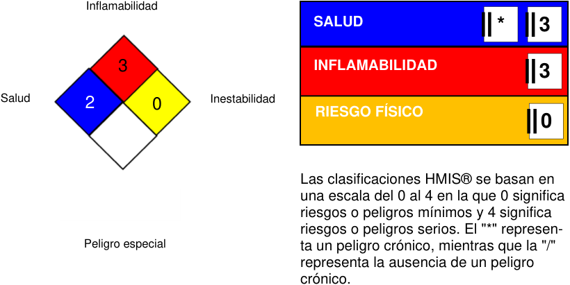

<!-- pagina: 1 -->
**FICHA DE DATOS DE SEGURIDAD** 

# **Esmalte Uretano  Part A** 

<u>Versión 4.0 Número de HDS: 000000613420</u> 

> Imagen (pág. 1). Sin texto legible por OCR; contenido gráfico no interpretado.

<!-- Start of picture text -->
dh <!-- End of picture text -->

<u>Fecha de revisión: 2023/09/30</u> 

## **SECCIÓN 1. IDENTIFICACIÓN DE LA SUSTANCIA QUÍMICA PELIGROSA O MEZCLA Y DEL PROVEEDOR O FABRICANTE** 

Nombre del producto : Esmalte Uretano  Part A 

|**Informaciones sobre el fabric**|**ante o el proveedor**|
|---|---|
|Compañía|: Sika Colombia S.A.S. Vereda Canavita km 20,5 Autopista Norte Tocancipá, Cundinamarca Colombia|
|Teléfono|: (57-1) 8786333|
|Teléfono de emergencia|: CISPROQUIM Bogotá: 2886012 / 2886355 Resto del país: 01 8000 916012|
|Dirección de correo electróni- co|: controlcalidad.lab@co.sika.com|
|Fax|: (57-1) 8786660|
|**Uso recomendado del produ**|**cto químico y restricciones de uso**|
|Uso del producto|: Protección de Corrosión|

## **SECCIÓN 2. IDENTIFICACIÓN DE LOS PELIGROS** 

**Clasificación según SGA (GHS)** Líquidos Inflamables : Categoría 3 Corrosión/irritación cutáneas : Categoría 3 Sensibilización cutánea : Categoría 1 Toxicidad a la reproducción : Categoría 2 Toxicidad sistémica específi: Categoría 3 (Sistema nervioso central) ca de órganos blanco - exposición única Toxicidad sistémica específi: Categoría 2 ca de órganos blanco - Exposiciones repetidas (Inhalación) Peligro de aspiración : Categoría 1 Peligro a corto plazo (agudo) : Categoría 3 para el medio ambiente acuático Peligro a largo plazo (crónico) : Categoría 3 para el medio ambiente acuá- 

<mark>1 / 13</mark> 

<!-- pagina: 2 -->
**FICHA DE DATOS DE SEGURIDAD** 

> Imagen (pág. 2). Sin texto legible por OCR; contenido gráfico no interpretado.

<!-- Start of picture text -->
de <!-- End of picture text -->

# **Esmalte Uretano  Part A** 

<u>Número de HDS: 000000613420</u> 

|Versión 4.0 tico **Etiqueta SGA (GHS)** Pictogramas de peligro|Número de HDS: 000000613420 Fecha de revisión: 202 : ooo|
|---|---|
|Palabra de advertencia|: Peligro|
|Indicaciones de peligro|: H226 Líquido y vapores inflamables. H304 Puede ser mortal en caso de ingestión y de penetración en las vías respiratorias. H316 Provoca una leve irritación cutánea. H317 Puede provocar una reacción cutánea alérgica. H336 Puede provocar somnolencia o vértigo. H361f Susceptible de perjudicar la fertilidad. H373 Puede provocar daños en los órganos tras exposiciones prolongadas o repetidas por inhalación. H412 Nocivo para los organismos acuáticos, con efectos noci- vos duraderos.|
|Consejos de prudencia|: **Prevención:** P201 Procurarse las instrucciones antes del uso. P202 No manipular antes de haber leído y comprendido todas las precauciones de seguridad. P210 Mantener alejado del calor, chispas, llamas al descubier- to, superficies calientes y otras fuentes de ignición. No fumar. P233 Mantener el recipiente herméticamente cerrado. P240 Toma de tierra y enlace equipotencial del recipiente y del equipo receptor. P241 Utilizar material eléctrico, de ventilación o de iluminación/ antideflagrante. P242 No utilizar herramientas que produzcan chispas. P243 Tomar medidas de precaución contra las descargas elec- trostáticas. P260 No respirar nieblas o vapores. P271 Utilizar sólo al aire libre o en un lugar bien ventilado. P272 La ropa de trabajo contaminada no debe salir del lugar de trabajo. P273 No dispersar en el medio ambiente. P280 Usar guantes/ ropa de protección/ equipo de protección para los ojos/ la cara. **Intervención:** P301 + P310 EN CASO DE INGESTIÓN: Llamar inmediata- mente a un CENTRO DE TOXICOLOGÍA o a un médico. P303 + P361 + P353 EN CASO DE CONTACTO CON LA PIEL (o el pelo): Quitar inmediatamente toda la ropa contaminada. Enjuagar la piel con agua. P304 + P340 + P312 EN CASO DE INHALACIÓN: Transportar a la persona al aire libre y mantenerla en una posición que le facilite la respiración.Llamar a un CENTRO DE TOXICOLOGÍA/médico/ si la persona se encuentra mal. P308 + P313 EN CASO DE exposición demostrada o supues- ta: consultar a un médico.|

<u>Fecha de revisión: 2023/09/30</u> 

<mark>2 / 13</mark> 

<!-- pagina: 3 -->
**FICHA DE DATOS DE SEGURIDAD** 

# **Esmalte Uretano  Part A** 

> Imagen (pág. 3). Sin texto legible por OCR; contenido gráfico no interpretado.

<u>Versión 4.0 Número de HDS: 000000613420 Fecha de revisión: 2023/09/30</u> 

P331 NO provocar el vómito. P333 + P313 En caso de irritación cutánea o sarpullido: consultar a un médico. P362 + P364 Quitar la ropa contaminada y lavarla antes de volverla a usar. P370 + P378 En caso de incendio: Utilizar arena seca, producto químico seco o espuma resistente al alcohol para la extinción. **Almacenamiento:** P403 + P233 Almacenar en un lugar bien ventilado. Mantener el recipiente herméticamente cerrado. P403 + P235 Almacenar en un lugar bien ventilado. Mantener fresco. P405 Guardar bajo llave. **Eliminación:** P501 Eliminar el contenido/ recipiente en una planta de eliminación de residuos aprobada. 

**Otros peligros no clasificables** No conocidos. 

## **SECCIÓN 3. COMPOSICIÓN/INFORMACIÓN SOBRE LOS INGREDIENTES** 

Sustancia / mezcla :  Mezcla **Componentes** 

|Nombre químico|CASNo.|Concentración(%w/w)|
|---|---|---|
|acetato den-butilo|123-86-4|>= 10-< 20|
|Nafta disolvente (petróleo), fracción aromática ligera; nafta de bajo punto de ebullición, sin especificar|64742-95-6|>= 5 -< 10|
|acetato de2-metoxi-1-metiletilo|108-65-6|>=5-<10|
|xileno|1330-20-7|>= 2,5-<5|
|acetato de propilo|109-60-4|>= 1 -<5|
|etilbenceno|100-41-4|>= 1 -< 2,5|
|sebacato de bis(1,2,2,6,6-pentametil-4- piperidilo)|41556-26-7|>= 0,25 -< 1|
|Poly(oxy-1,2-ethanediyl), .alpha.-[3-[3-(2H- benzotriazol-2-yl)-5-(1,1-dimethylethyl)-4- hydroxyphenyl]-1-oxopropyl]-.omega.-[3-[3-(2H- benzotriazol-2-yl)-5-(1,1-dimethylethyl)-4- hydroxyphenyl]-1-oxopropoxy]-|104810-47-1|>= 0,25 -< 1|
|Poly(oxy-1,2-ethanediyl), .alpha.-[3-[3-(2H- benzotriazol-2-yl)-5-(1,1-dimethylethyl)-4- hydroxyphenyl]-1-oxopropyl]-.omega.-hydroxy-|104810-48-2|>= 0,25 -< 1|
|sebacato de metilo y 1,2,2,6,6-pentametil-4- piperidilo|82919-37-7|>= 0,1 -< 0,25|
|metacrilato demetilo|80-62-6|>=0,1 -<0,25|

## **SECCIÓN 4. PRIMEROS AUXILIOS** 

Consejos generales : Retire a la persona de la zona peligrosa. 

<mark>3 / 13</mark> 

<!-- pagina: 4 -->
**FICHA DE DATOS DE SEGURIDAD** 

# **Esmalte Uretano  Part A** 

> Imagen (pág. 4). Sin texto legible por OCR; contenido gráfico no interpretado.

<u>Versión 4.0 Número de HDS: 000000613420 Fecha de revisión: 2023/09/30</u> 

||Consulte a un médico. Muéstrele esta hoja de seguridad al doctor que esté de servi- cio.|
|---|---|
|En caso de inhalación |: Salga al aire libre. Consultar a un médico después de una exposición importan- te.|
|En caso de contacto con la piel |: Quítese inmediatamente la ropa y zapatos contaminados. Elimínelo lavando con jabón y mucha agua. Si persisten los síntomas, llame a un médico.|
|En caso de contacto con los ojos |: Quítese los lentes de contacto. Manténgase el ojo bien abierto mientras se lava. Si persiste la irritación de los ojos, consulte a un especialista.|
|En caso de ingestión |: Lávese la boca con agua y después beba agua abundante. No provoque vómitos. No dé leche ni bebidas alcohólicas. Nunca debe administrarse nada por la boca a una persona inconsciente. Lleve al afectado enseguida a un hospital.|
|Síntomas y efectos más im- portante, agudos y retarda- dos|: Puede ser mortal en caso de ingestión y de penetración en las vías respiratorias. Provoca una leve irritación cutánea. Puede provocar una reacción cutánea alérgica. Puede provocar somnolencia o vértigo. Susceptible de perjudicar la fertilidad. Puede provocar daños en los órganos tras exposiciones pro- longadas o repetidas por inhalación. Riesgo de lesiones pulmonares graves (por aspiración). efectos sensibilizantes Su inhalación puede causar edema pulmonar y neumonía. Reacciones alérgicas Falta de coordinación Vértigo Vea la Sección 11 para obtener información detallada sobre la salud y los síntomas.|
|Notas especiales para un medico tratante|: Trate sintomáticamente. |

## **SECCIÓN 5. MEDIDAS CONTRA INCENDIOS** 

|Medios de extinción apropia- dos |: Espuma resistente a los alcoholes Dióxido de carbono (CO2) Producto químico seco|
|---|---|
|Agentes de extinción inapro- piados|: Agua Chorro de agua de gran volumen|
|Peligros específicos durante|: No use un chorro compacto de agua ya que puede dispersar|
|la extincion de incendios|y extender el fuego.|
|Productos de combustión|:  No se conocen productos de combustión peligrosos|

<mark>4 / 13</mark> 

<!-- pagina: 5 -->
**FICHA DE DATOS DE SEGURIDAD** 

# **Esmalte Uretano  Part A** 

> Imagen (pág. 5). Sin texto legible por OCR; contenido gráfico no interpretado.

<u>Versión 4.0 Número de HDS: 000000613420 Fecha de revisión: 2023/09/30</u> 

|peligrosos||
|---|---|
|Métodos específicos de ex- tinción|: Utilice rocío de agua para enfriar los recipientes cerrados. |
|Equipo de protección espe- cial para los bomberos|: En caso de incendio, utilice un equipo respiratorio autónomo. |

## **SECCIÓN 6. MEDIDAS QUE DEBEN TOMARSE EN CASO DE DERRAME ACCIDENTAL O FUGA ACCIDENTAL** 

|Precauciones personales, equipo de protección y pro- cedimientos de emergencia|: Utilice equipo de protección personal. Retire todas las fuentes de ignición. Negar el acceso a personas sin protección.|
|---|---|
|Precauciones relativas al medio ambiente|: Evite que el producto vaya al alcantarillado. Si el producto contamina los ríos, lagos o alcantarillados, in- formar a las autoridades respectivas.|
|Métodos y materiales de contención y limpieza|: Contener y recoger el derrame con material absorbente que no sea combustible (p. ej. arena, tierra, barro de diatomeas, vermiculita), y meterlo en un envase para su eliminación de acuerdo con las reglamentaciones locales y nacionales (ver sección 13).|

## **SECCIÓN 7. MANEJO Y ALMACENAMIENTO** 

Sugerencias para la protec:  Utilice un equipo a prueba de explosiones. ción contra incendios y exMantener alejado del calor/ de chispas/ de llamas al descuplosiones bierto/ de superficies calientes. No fumar. Tomar medidas de precaución contra la acumulación de cargas electrostáticas. Consejos para una manipu: No respire los vapores ni la niebla de la pulverización. lación segura Evitar sobrepasar los límites dados de exposición profesional (ver sección 8). Evitar todo contacto con los ojos, la piel o la ropa. Ver sección 8 para el equipo de protección personal. Las personas que hayan tenido problemas de sensibilisación de la piel, asma, alergías, enfermedades respiratorias crónicas o recurrentes, no deben ser empleadas en ninguna parte del proceso en la cual esté utilizada esta preparación. Fumar, comer y beber debe prohibirse en el área de aplicación. Tomar medidas de precaución contra las descargas electrostáticas. Abra el tambor con precaución, ya que el contenido puede estar presurizado. Adopte las acciones necesarias para evitar descargas de electricidad estática (que podrían ocasionar la inflamación de los vapores orgánicos). Cuando se manejen productos químicos, siga las medidas estándar de higiene. 

Condiciones para el almace: Almacénelo en el envase original. 

<mark>5 / 13</mark> 

<!-- pagina: 6 -->
**FICHA DE DATOS DE SEGURIDAD** 

# **Esmalte Uretano  Part A** 

<u>Versión 4.0</u> 

> Imagen (pág. 6). Sin texto legible por OCR; contenido gráfico no interpretado.

<u>Número de HDS: 000000613420 Fecha de revisión: 2023/09/30</u> 

namiento seguro Mantenga en un lugar bien ventilado. Los contenedores que se abren deben ser cuidadosamente resellados y mantenerlos en posición vertical para evitar fugas. Observar las indicaciones de la etiqueta. Almacenar en conformidad con la reglamentación local. 

**SECCIÓN 8. CONTROLES DE EXPOSICIÓN/PROTECCIÓN PERSONAL** 

## **Componentes con parámetros de control en el área de trabajo** 

|Componentes|CAS No.|Tipo de valor (Forma de exposición)|Parámetros de control / Concen- traciónpermisible|Bases|
|---|---|---|---|---|
|acetato den-butilo|123-86-4|TWA|50 ppm|ACGIH|
|||STEL|150 ppm|ACGIH|
|xileno|1330-20-7|TWA|20 ppm|ACGIH|
|acetato de propilo|109-60-4|TWA|100 ppm|ACGIH|
|||STEL|150 ppm|ACGIH|
|etilbenceno|100-41-4|TWA|20 ppm|ACGIH|

## **Límites biológicos de exposición ocupacional** 

|Componentes|CAS No.|Parámetros de control|Análisis biológico|Tiempo de toma de mues- tras|Concentra- ción permisi- ble|Bases|
|---|---|---|---|---|---|---|
|xileno|1330-20-7|Acidos me- tilhipúricos|Orina|Al final del turno (Tan pronto como sea posible después de que cese la exposi- ción)|1.5 g/g crea- tinina|ACGIH BEI|
|etilbenceno|100-41-4|Suma del ácido man- délico y el ácido fenil- glioxílico|Orina|Al final del turno (Tan pronto como sea posible después de que cese la exposi- ción)|0.15 g/g creatinina|ACGIH BEI|

**Protección personal** 

Protección respiratoria 

: Utilice protección respiratoria a menos que exista una ventilación de escape adecuada o que la evaluación de la exposición indique que el nivel de exposición está dentro de las pautas recomendadas. 

La clase de filtro para el respirador debe ser adecuada para la concentración máxima prevista del contaminante 

<mark>6 / 13</mark> 

<!-- pagina: 7 -->
**FICHA DE DATOS DE SEGURIDAD** 

> Imagen (pág. 7). Sin texto legible por OCR; contenido gráfico no interpretado.

<!-- Start of picture text -->
| <!-- End of picture text -->

# **Esmalte Uretano  Part A** 

|Versión 4.0|Número de HDS: 000000613420 Fecha de revisión: 2|
|---|---|
||(gas/vapor/aerosol/partículas) que puede presentarse al ma- nejar el producto. Si se excede esta concentración, se debe utilizar un aparato respiratorio autónomo.|
|Protección de las manos|: Guantes químico-resistentes e impermeables que cumplan con estándares aprobados deben ser utilizados cuando se manejen productos químicos y la evaluación del riesgo indica que es necesario.|
|Protección de los ojos|: Equipo de protección ocular que cumpla con estándares aprobados debe ser utilizado cuando la evaluación del riesgo indica que es necesario.|
|Protección de la piel y del cuerpo|: Elegir la protección para el cuerpo según sus caraterísticas, la concentración y la cantidad de sustancias peligrosas, y el lugar específico de trabajo.|
|Medidas de higiene|: Manipúlelo con las precauciones de higiene industrial ade- cuadas, y respete las prácticas de seguridad. No coma ni beba durante su utilización. No fume durante su utilización. Lavarse las manos antes de los descansos y después de terminar la jornada laboral.|

<u>Fecha de revisión: 2023/09/30</u> 

## **SECCIÓN 9. PROPIEDADES FÍSICAS Y QUÍMICAS** 

Aspecto : líquido Color :  varios Olor :  disolvente Umbral de olor :  Sin datos disponibles pH : No aplicable Punto de fusión/rango / Punto : Sin datos disponibles de congelación Punto / intervalo de ebullición : Sin datos disponibles Punto de inflamación : 36 °C (36 °C) Tasa de evaporación :  Sin datos disponibles Inflamabilidad (sólido, gas) : Sin datos disponibles Límite superior de explosivi: 7 %(V) dad / Límite de inflamabilidad superior Límite inferior de explosividad : 0,8 %(V) / Límite de inflamabilidad inferior Presión de vapor : 12,4989 hPa 

<mark>7 / 13</mark> 

<!-- pagina: 8 -->
**FICHA DE DATOS DE SEGURIDAD** 

# **Esmalte Uretano  Part A** 

<u>Versión 4.0 Número de HDS: 000000613420</u> 

> Imagen (pág. 8). Sin texto legible por OCR; contenido gráfico no interpretado.

<!-- Start of picture text -->
| <!-- End of picture text -->

<u>Fecha de revisión: 2023/09/30</u> 

|Densidad relativa de vapor|:|Sin datos disponibles|
|---|---|---|
|Densidad|:|1,3 g/cm3 (20 °C (20 °C))|
|Solubilidad|||
|Hidrosolubilidad|:|insoluble|
|Solubilidad en otros disol- ventes|:|Sin datos disponibles|
|Coeficiente de reparto n- octanol/agua|:|Sin datos disponibles|
|Temperatura de ignición es- |:|333 °C|
|pontánea|||
|Temperatura de descomposi- ción|:|Sin datos disponibles|
|Viscosidad|||
|Viscosidad, dinámica|:|Sin datos disponibles|
|Viscosidad, cinemática|:|880 mm2/s|
|Propiedades explosivas|:|Sin datos disponibles|
|Propiedades comburentes|:|Sin datos disponibles|

## **SECCIÓN 10. ESTABILIDAD Y REACTIVIDAD** 

Reactividad :  No se conoce ninguna reacción peligrosa bajo condiciones de uso normal. Estabilidad química :  El producto es químicamente estable. Posibilidad de reacciones : Estable bajo las condiciones de almacenamiento recomendapeligrosas das. Los vapores pueden formar una mezcla explosiva con el aire. Condiciones que deben evi: Calor, llamas y chispas. tarse Materiales incompatibles :  Sin datos disponibles 

## **SECCIÓN 11. INFORMACIÓN TOXICOLÓGICA** 

## **Toxicidad aguda** 

No se clasifica debido a la falta de datos. 

**<u>Componentes:</u> acetato de n-butilo:** Toxicidad oral aguda :  DL50 Oral (Rata): > 5.000 mg/kg Toxicidad aguda por inhala:  CL50 (Rata): 23,4 mg/l ción Tiempo de exposición: 4 h Prueba de atmosfera: vapor Toxicidad dérmica aguda :  LD50 Dermico (Conejo): > 5.000 mg/kg 

<mark>8 / 13</mark> 

<!-- pagina: 9 -->
**FICHA DE DATOS DE SEGURIDAD** 

# **Esmalte Uretano  Part A** 

<u>Versión 4.0 Número de HDS: 000000613420</u> 

> Imagen (pág. 9). Sin texto legible por OCR; contenido gráfico no interpretado.

<!-- Start of picture text -->
| <!-- End of picture text -->

<u>Fecha de revisión: 2023/09/30</u> 

|**Nafta disolvente (petróleo),** **especificar:**|**fracción aromática ligera; nafta de bajo punto de ebullición, sin**|
|---|---|
|Toxicidad oral aguda|:  DL50 Oral (Rata): > 2.000 mg/kg|
|Toxicidad dérmica aguda|:  LD50 Dermico (Conejo): > 2.000 mg/kg|
|**acetato de 2-metoxi-1-metile**|**tilo:**|
|Toxicidad oral aguda|:  DL50 Oral (Rata): > 5.000 mg/kg|
|Toxicidad dérmica aguda|:  LD50 Dermico (Conejo): > 5.000 mg/kg|
|**xileno:**||
|Toxicidad oral aguda|:  DL50 Oral (Rata): 3.523 mg/kg|
|**etilbenceno:**||
|Toxicidad oral aguda|:  DL50 Oral (Rata): 3.500 mg/kg|
|Toxicidad dérmica aguda|:  LD50 Dermico (Conejo): 5.510 mg/kg|
|**metacrilato de metilo:** Toxicidad oral aguda|:  DL50 Oral (Rata): > 5.000 mg/kg|
|Toxicidad aguda por inhala- ción|:  CL50 (Rata): 29,8 mg/l Tiempo de exposición: 4 h Prueba de atmosfera: vapor|
|Toxicidad dérmica aguda|:  LD50 Dermico (Conejo): > 5.000 mg/kg|

## **Corrosión o irritación cutáneas** 

Provoca una leve irritación cutánea. 

## **Lesiones oculares graves/irritación ocular** 

No se clasifica debido a la falta de datos. 

## **Sensibilización respiratoria o cutánea** 

## **Sensibilización cutánea** 

Puede provocar una reacción cutánea alérgica. 

## **Sensibilización respiratoria** 

No se clasifica debido a la falta de datos. 

## **Mutagenicidad en células germinales** 

No se clasifica debido a la falta de datos. 

## **Carcinogenicidad** 

No se clasifica debido a la falta de datos. 

**Toxicidad para la reproducción** 

Susceptible de perjudicar la fertilidad. 

## **Toxicidad sistémica específica de órganos blanco - exposición única** 

Puede provocar somnolencia o vértigo. 

## **Toxicidad sistémica específica de órganos blanco - exposiciones repetidas** 

Puede provocar daños en los órganos tras exposiciones prolongadas o repetidas por inhalación. 

<mark>9 / 13</mark> 

<!-- pagina: 10 -->
**FICHA DE DATOS DE SEGURIDAD** 

# **Esmalte Uretano  Part A** 

<u>Versión 4.0 Número de HDS: 000000613420</u> 

> Imagen (pág. 10). Sin texto legible por OCR; contenido gráfico no interpretado.

<!-- Start of picture text -->
| <!-- End of picture text -->

<u>Fecha de revisión: 2023/09/30</u> 

## **Toxicidad por aspiración** 

Puede ser mortal en caso de ingestión y de penetración en las vías respiratorias. 

## **SECCIÓN 12. INFORMACIÓN ECOTOXICOLOGICA** 

## **Ecotoxicidad** 

|**Componentes:**|||
|---|---|---|
|**acetato de n-butilo:**|||
|Toxicidad para las al- gas/plantas acuáticas|:|CE50 (Desmodesmus subspicatus (alga verde)): 647,7 mg/l Tiempo de exposición: 72 h|
|**Nafta disolvente (petróleo), fr** **especificar:** Toxicidad para las al- gas/plantas acuáticas|**a** :|**cción aromática ligera; nafta de bajo punto de ebullición, sin** (Pseudokirchneriella subcapitata (alga verde)): 2,6 - 2,9 mg/l Tiempo de exposición: 72 h|
|**xileno:**|||
|Toxicidad para peces (Toxi- cidad crónica)|:|NOEC (Oncorhynchus mykiss (trucha irisada)): > 1,3 mg/l Tiempo de exposición: 56 d|
|Toxicidad para la dafnia y otros invertebrados acuáticos (Toxicidad crónica) **metacrilato de metilo:**|:|NOEC (Daphnia (Dafnia)): 1,17 mg/l Tiempo de exposición: 7 d|
|Toxicidad para peces|:|NOEC (Danio rerio (pez zebra)): 9,4 mg/l|
|Toxicidad para la dafnia y otros invertebrados acuáticos|:|CE50 (Daphnia magna (Pulga de mar grande)): 69 mg/l Tiempo de exposición: 48 h Método: Directriz de Prueba de la OCDE 202|
|||NOEC: 37 mg/l Tiempo de exposición: 21 d Método: Directriz de Prueba de la OCDE 202|
|Toxicidad para la dafnia y otros invertebrados acuáticos (Toxicidad crónica)|:|NOEC (Daphnia magna (Pulga de mar grande)): 37 mg/l Tiempo de exposición: 21 d|

## **Persistencia y degradabilidad** 

Sin datos disponibles 

## **Potencial de bioacumulación** 

Sin datos disponibles 

## **Movilidad en el suelo** 

Sin datos disponibles 

## **Otros efectos adversos** 

## **<u>Producto:</u>** 

Información ecológica com:  No se puede excluir un peligro para el medio ambiente en el plementaria caso de una manipulación o eliminación no profesional. Nocivo para los organismos acuáticos, con efectos nocivos duraderos. 

<mark>10 / 13</mark> 

<!-- pagina: 11 -->
**FICHA DE DATOS DE SEGURIDAD** 

<u>Número de HDS: 000000613420</u> 

<u>Versión 4.0</u> 

# **Esmalte Uretano  Part A** 

> Imagen (pág. 11). Sin texto legible por OCR; contenido gráfico no interpretado.

<u>Fecha de revisión: 2023/09/30</u> 

## **SECCIÓN 13. INFORMACIÓN RELATIVA A LA ELIMINACIÓN DE LOS PRODUCTOS** 

## **Métodos de eliminación** 

Residuos : Envíese a una compañía autorizada para la gestión de residuos. Evite que el producto penetre en los desagües, tuberías, o la tierra (suelos). No contamine los estanques, cursos de agua o zanjas con el producto químico o el contendor utilizado. Envases contaminados : Vacíe el contenido restante. Eliminar como producto no usado. No reutilice los recipientes vacíos. No queme, ni utilice un soplete de corte, en el tambor vacío. 

## **SECCIÓN 14. INFORMACIÓN RELATIVA AL TRANSPORTE** 

## **Regulaciones internacionales** 

**UNRTDG** Número ONU : UN 1263 Designación oficial de trans: PAINT porte (Solvesso 150) Clase : 3 Grupo de embalaje : III Etiquetas : 3 **IATA-DGR** No. UN/ID : UN 1263 Designación oficial de trans: Paint porte (Solvesso 150) Clase : 3 Grupo de embalaje : III Etiquetas : Flammable Liquids Instrucción de embalaje : 366 (avión de carga) Instrucción de embalaje : 355 (avión de pasajeros) **Código-IMDG** Número ONU : UN 1263 Designación oficial de trans: PAINT porte (Solvesso 150) Clase : 3 Grupo de embalaje : III Etiquetas : 3 Código EmS : F-E, S-E Contaminante marino : no 

## **Transporte a granel de acuerdo a instrumentos IMO** 

No aplicable para el producto tal y como se proveyó. 

<mark>11 / 13</mark> 

<!-- pagina: 12 -->
**FICHA DE DATOS DE SEGURIDAD** 

# **Esmalte Uretano  Part A** 

<u>Versión 4.0</u> 

<u>Número de HDS: 000000613420</u> 

> Imagen (pág. 12). Sin texto legible por OCR; contenido gráfico no interpretado.

<!-- Start of picture text -->
| <!-- End of picture text -->

<u>Fecha de revisión: 2023/09/30</u> 

## **Precauciones especiales para los usuarios** 

La(s) clasificación(es) de transporte presente(s) tienen solamente propósitos informativos y se basa(n) únicamente en las propiedades del material sin envasar/embalar, descritas dentro de esta Hoja de Datos de Seguridad. Las clasificaciones de transporte pueden variar según el modo de transporte, el tamaño del envase/embalaje y las variaciones en los reglamentos regionales o del país. 

## **SECCIÓN 15. INFORMACIÓN REGLAMENTARIA** 

## **Reglamentación medioambiental, seguridad y salud específica para la sustancia o mezcla** 

Convención Internacional sobre las Armas Químicas : No aplicable (CWC) Programas sobre los Productos Químicos Tóxicos y los Precursores (Louisiana Administrative Code, Title 33,Part V Section 10101 et. seq.) Sustancias y productos químicos controlados por el : acetato de n-butilo Ministerio de Justicia xileno 

- : acetato de n-butilo xileno acetato de propilo 2-metilpropan-1-ol tolueno 

Listado de Sustancias incluídas como Sustancias de Control Especial y Sometidas a Fiscalización por el Ministerio de Salud y Protección Social 

- : No aplicable 

Resolución 2715 de 2014 Por la cual se establecen las : No aplicable sustancias que deben ser objeto de registro de control de venta al menudeo, con base en los criterios de clasificación que se definen. 

## **SECCIÓN 16. OTRA INFORMACIÓN INCLUIDAS LAS RELATIVAS A LA PREPARACIÓN Y ACTUALIZACIÓN DE LAS HOJAS DE DATOS DE SEGURIDAD** 

Fecha de revisión formato de fecha 

- :  2023/09/30 

- : aaaa/mm/dd 

## **Información adicional** 

<mark>12 / 13</mark> 

<!-- pagina: 13 -->
**FICHA DE DATOS DE SEGURIDAD** 

# **Esmalte Uretano  Part A** 

## <u>Versión 4.0</u> 

<u>Número de HDS: 000000613420</u> 

> Imagen (pág. 13). Sin texto legible por OCR; contenido gráfico no interpretado.

<!-- Start of picture text -->
A <!-- End of picture text -->

<u>Fecha de revisión: 2023/09/30</u> 

## **NFPA:** 

## **HMIS® IV:** 

> Imagen (pág. 13). OCR automático, revisar: «Salud Inflamabilidad Peligro especial Inestabilidad SALUD RIESGO FÍSICO INFLAMABILIDAD 13 | Las clasificaciones HMIS® se basan en una escala del 0 al 4 en la que 0 significa riesgos o peligros mínimos y 4 significa riesgos o peligros serios. El "*" represen- ta un peligro crónico, mientras que la "/" representa la ausencia de un peligro crónico.»

<!-- Start of picture text -->
Inflamabilidad SALUD  * 3 3 INFLAMABILIDAD  3 Salud  2  0 Inestabilidad RIESGO FÍSICO 0 y = Las clasificaciones HMIS® se basan en una escala del 0 al 4 en la que 0 significa riesgos o peligros mínimos y 4 significa riesgos o peligros serios. El "*" represen- Peligro especial ta un peligro crónico, mientras que la "/" representa la ausencia de un peligro crónico. <!-- End of picture text -->

## **Texto completo de otras abreviaturas** 

- ACGIH : Valores límite (TLV) de la ACGIH,USA ACGIH BEI : ACGIH - Índices  Biológicos de Exposición (BEI) ACGIH / TWA : Tiempo promedio ponderado ACGIH / STEL : Límite de exposición a corto plazo ADR : Accord européen relatif au transport international des marchandises Dangereuses par Route 

- CAS : Chemical Abstracts Service DNEL : Derived no-effect level EC50 : Half maximal effective concentration GHS : Globally Harmonized System IATA : International Air Transport Association IMDG : International Maritime Code for Dangerous Goods LD50 : Median lethal dosis (the amount of a material, given all at once, which causes the death of 50% (one half) of a group of test animals) 

- LC50 : Median lethal concentration (concentrations of the chemical in air that kills 50% of the test animals during the observation period) 

- MARPOL : International Convention for the Prevention of Pollution from Ships, 1973 as modified by the Protocol of 1978 

- OEL : Occupational Exposure Limit PBT : Persistent, bioaccumulative and toxic PNEC : Predicted no effect concentration REACH : Regulation (EC) No 1907/2006 of the European Parliament and of the Council of 18 December 2006 concerning the Registration, Evaluation, Authorisation and Restriction of Chemicals (REACH), establishing a European Chemicals Agency 

- SVHC : Substances of Very High Concern vPvB : Very persistent and very bioaccumulative 

La informacion contenida en este ficha de datos de seguridad corresponde a nuestro nivel de conocimiento en el momento de su publicacion. Quedan excluidas todas las garantias. Se aplicaran nuestras condiciones generales de venta en vigor. Por favor, consulte la Hoja de Datos del Producto  antes de su uso y procesamiento. CO / 1X 

<mark>13 / 13</mark> 
