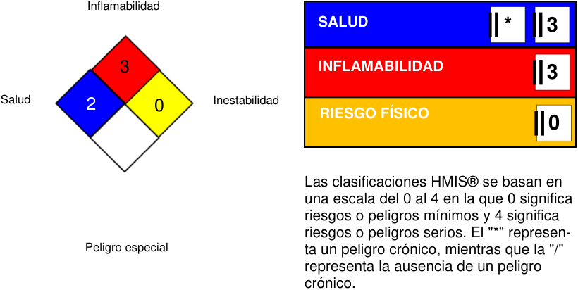

<!-- pagina: 1 -->
**FICHA DE DATOS DE SEGURIDAD** 

# **Sikafloor®-2430  Part B** 

<u>Versión 3.0 Número de HDS: 100000030203</u> 

> Imagen (pág. 1). Sin texto legible por OCR; contenido gráfico no interpretado.

<!-- Start of picture text -->
| <!-- End of picture text -->

<u>Fecha de revisión: 2023/08/15</u> 

### **SECCIÓN 1. IDENTIFICACIÓN DE LA SUSTANCIA QUÍMICA PELIGROSA O MEZCLA Y DEL PROVEEDOR O FABRICANTE** 

Nombre del producto : Sikafloor®-2430  Part B 

**Informaciones sobre el fabricante o el proveedor** Compañía : Sika Colombia S.A.S. Vereda Canavita km 20,5 Autopista Norte Tocancipá, Cundinamarca Colombia Teléfono : (57-1) 8786333 Teléfono de emergencia : CISPROQUIM Bogotá: 2886012 / 2886355 Resto del país: 01 8000 916012 Dirección de correo electróni: controlcalidad.lab@co.sika.com co Fax : (57-1) 8786660 **Uso recomendado del producto químico y restricciones de uso** Uso del producto : Catalizador 

### **SECCIÓN 2. IDENTIFICACIÓN DE LOS PELIGROS** 

**Clasificación según SGA (GHS)** Líquidos Inflamables : Categoría 3 Toxicidad aguda (Inhalación) : Categoría 4 Toxicidad aguda (Cutáneo) : Categoría 4 Corrosión/irritación cutáneas : Categoría 2 Lesiones oculares gra: Categoría 1 ves/irritación ocular Toxicidad sistémica específi: Categoría 3 (Sistema respiratorio) ca de órganos blanco - exposición única Toxicidad sistémica específi: Categoría 2 ca de órganos blanco - Exposiciones repetidas (Inhalación) Peligro a corto plazo (agudo) : Categoría 2 para el medio ambiente acuático Peligro a largo plazo (crónico) : Categoría 3 

<mark>1 / 12</mark> 

<!-- pagina: 2 -->
**FICHA DE DATOS DE SEGURIDAD** 

# **Sikafloor®-2430  Part B** 

### <u>Versión 3.0</u> 

### <u>Número de HDS: 100000030203</u> 

> Imagen (pág. 2). Sin texto legible por OCR; contenido gráfico no interpretado.

<!-- Start of picture text -->
de <!-- End of picture text -->

<u>Fecha de revisión: 2023/08/15</u> 

|para el medio ambiente acuá- tico **Etiqueta SGA (GHS)** Pictogramas de peligro : 9990|
|---|
|Palabra de advertencia : Peligro|
|Indicaciones de peligro : H226 Líquido y vapores inflamables. H312 + H332 Nocivo en contacto con la piel o si se inhala. H315 Provoca irritación cutánea. H318 Provoca lesiones oculares graves. H335 Puede irritar las vías respiratorias. H373 Puede provocar daños en los órganos tras exposiciones prolongadas o repetidas por inhalación. H401 Tóxico para los organismos acuáticos. H412 Nocivo para los organismos acuáticos, con efectos noci- vos duraderos.|
|Consejos de prudencia : **Prevención:** P210 Mantener alejado del calor, chispas, llamas al descubier- to, superficies calientes y otras fuentes de ignición. No fumar. P233 Mantener el recipiente herméticamente cerrado. P240 Toma de tierra y enlace equipotencial del recipiente y del equipo receptor. P241 Utilizar material eléctrico, de ventilación o de iluminación/ antideflagrante. P242 No utilizar herramientas que produzcan chispas. P243 Tomar medidas de precaución contra las descargas elec- trostáticas. P260 No respirar nieblas o vapores. P264 Lavarse la piel cuidadosamente después de la manipula- ción. P271 Utilizar sólo al aire libre o en un lugar bien ventilado. P273 No dispersar en el medio ambiente. P280 Usar guantes/ ropa de protección/ equipo de protección para los ojos/ la cara. **Intervención:** P303 + P361 + P353 EN CASO DE CONTACTO CON LA PIEL (o el pelo): Quitar inmediatamente toda la ropa contaminada. Enjuagar la piel con agua. P304 + P340 + P312 EN CASO DE INHALACIÓN: Transportar a la persona al aire libre y mantenerla en una posición que le facilite la respiración.Llamar a un CENTRO DE TOXICOLOGÍA/médico/ si la persona se encuentra mal. P305 + P351 + P338 + P310 EN CASO DE CONTACTO CON LOS OJOS: Enjuagar con agua cuidadosamente durante varios minutos. Quitar las lentes de contacto cuando estén presentes y pueda hacerse con facilidad. Proseguir con el lavado. Llamar inmediatamente a un CENTRO DE TOXICOLOGÍA o a un mé- dico. P314 Consultar a un médico si la persona se encuentra mal.|

<mark>2 / 12</mark> 

<!-- pagina: 3 -->
**FICHA DE DATOS DE SEGURIDAD** 

> Imagen (pág. 3). Sin texto legible por OCR; contenido gráfico no interpretado.

<!-- Start of picture text -->
de <!-- End of picture text -->

# **Sikafloor®-2430  Part B** 

|Versión 3.0|Número de HDS: 100000030203 Fecha de revisión: 20|
|---|---|
||P332 + P313 En caso de irritación cutánea: consultar a un médico. P362 + P364 Quitar la ropa contaminada y lavarla antes de volverla a usar. P370 + P378 En caso de incendio: Utilizar arena seca, produc- to químico seco o espuma resistente al alcohol para la extin- ción.|
||**Almacenamiento:**|
||P403 + P233 Almacenar en un lugar bien ventilado. Mantener el recipiente herméticamente cerrado. P403 + P235 Almacenar en un lugar bien ventilado. Mantener fresco. P405 Guardar bajo llave.|
||**Eliminación:**|
||P501 Eliminar el contenido/ recipiente en una planta de elimi- nación de residuos aprobada.|

<u>Fecha de revisión: 2023/08/15</u> 

**Otros peligros no clasificables** No conocidos. 

### **SECCIÓN 3. COMPOSICIÓN/INFORMACIÓN SOBRE LOS INGREDIENTES** 

|Sustancia / mezcla **Componentes**|:  Mezcla|||
|---|---|---|---|
|Nombre químico ||CASNo. |Concentración(%w/w) |
|xileno ||1330-20-7 |>=50-<70 |
|Poliaminoamida ||No asignado |>= 10-<20 |
|etilbenceno ||100-41-4 |>= 10-<20 |
|2-metilpropan-1-ol ||78-83-1 |>=5-<10 |

### **SECCIÓN 4. PRIMEROS AUXILIOS** 

|Consejos generales|: Retire a la persona de la zona peligrosa. Consulte a un médico. Muéstrele esta hoja de seguridad al doctor que esté de servi- cio.|
|---|---|
|En caso de inhalación |: Salga al aire libre. Consultar a un médico después de una exposición importan- te.|
|En caso de contacto con la piel |: Quítese inmediatamente la ropa y zapatos contaminados. Elimínelo lavando con jabón y mucha agua. Si persisten los síntomas, llame a un médico.|
|En caso de contacto con los ojos |: Incluso pequeñas salpicaduras en los ojos pueden causar daños irreversibles en los tejidos y ceguera. En caso de contacto con los ojos, lávelos inmediata y abun- dantemente con agua y acuda a un médico. Continúe lavando los ojos en el trayecto al hospital. Quítese los lentes de contacto. Manténgase el ojo bien abierto mientras se lava.|

<mark>3 / 12</mark> 

<!-- pagina: 4 -->
**FICHA DE DATOS DE SEGURIDAD** 

# **Sikafloor®-2430  Part B** 

> Imagen (pág. 4). Sin texto legible por OCR; contenido gráfico no interpretado.

<u>Versión 3.0 Número de HDS: 100000030203 Fecha de revisión: 2023/08/15</u> 

|En caso de ingestión |:|Lávese la boca con agua y después beba agua abundante. No dé leche ni bebidas alcohólicas. Nunca debe administrarse nada por la boca a una persona inconsciente. Consulte al médico.|
|---|---|---|
|Síntomas y efectos más im- portante, agudos y retarda- dos|:|Nocivo en contacto con la piel o si se inhala. Provoca irritación cutánea. Provoca lesiones oculares graves. Puede irritar las vías respiratorias. Puede provocar daños en los órganos tras exposiciones pro- longadas o repetidas por inhalación. efectos irritantes Tos Desordenes respiratorios Lacrimación excesiva Dolor de cabeza Dermatitis Trastornos cutáneos Vea la Sección 11 para obtener información detallada sobre la salud y los síntomas.|
|Notas especiales para un medico tratante|:|Trate sintomáticamente. |

### **SECCIÓN 5. MEDIDAS CONTRA INCENDIOS** 

|Medios de extinción apropia- dos |: Espuma resistente a los alcoholes Dióxido de carbono (CO2) Producto químico seco|
|---|---|
|Agentes de extinción inapro- piados|: Agua Chorro de agua de gran volumen|
|Peligros específicos durante la extincion de incendios|: No use un chorro compacto de agua ya que puede dispersar y extender el fuego.|
|Productos de combustión peligrosos|:  No se conocen productos de combustión peligrosos|
|Métodos específicos de ex- tinción|: Utilice rocío de agua para enfriar los recipientes cerrados. |
|Equipo de protección espe- cial para los bomberos|: En caso de incendio, utilice un equipo respiratorio autónomo. |

### **SECCIÓN 6. MEDIDAS QUE DEBEN TOMARSE EN CASO DE DERRAME ACCIDENTAL O FUGA ACCIDENTAL** 

Precauciones personales, : Utilice equipo de protección personal. equipo de protección y proRetire todas las fuentes de ignición. cedimientos de emergencia Negar el acceso a personas sin protección. Precauciones relativas al : Evite que el producto vaya al alcantarillado. 

<mark>4 / 12</mark> 

<!-- pagina: 5 -->
**FICHA DE DATOS DE SEGURIDAD** 

# **Sikafloor®-2430  Part B** 

> Imagen (pág. 5). Sin texto legible por OCR; contenido gráfico no interpretado.

|Versión 3.0|Número de HDS: 100000030203 Fecha de revisión: 2023/08/15|
|---|---|
|medio ambiente|Si el producto contamina los ríos, lagos o alcantarillados, in- formar a las autoridades respectivas.|
|Métodos y materiales de contención y limpieza|: Contener y recoger el derrame con material absorbente que no sea combustible (p. ej. arena, tierra, barro de diatomeas, vermiculita), y meterlo en un envase para su eliminación de acuerdo con las reglamentaciones locales y nacionales (ver sección 13).|
|**SECCIÓN 7. MANEJO Y ALMAC** |**ENAMIENTO** |
|Sugerencias para la protec- ción contra incendios y ex- plosiones|:  Utilice un equipo a prueba de explosiones. Mantener alejado del calor/ de chispas/ de llamas al descu- bierto/ de superficies calientes. No fumar. Tomar medidas de precaución contra la acumulación de car- gas electrostáticas.|
|Consejos para una manipu- lación segura|: No respire los vapores ni la niebla de la pulverización. Evitar sobrepasar los límites dados de exposición profesional (ver sección 8). Evitar todo contacto con los ojos, la piel o la ropa. Ver sección 8 para el equipo de protección personal. Fumar, comer y beber debe prohibirse en el área de aplica- ción. Tomar medidas de precaución contra las descargas electros- táticas. Provea de suficiente intercambio de aire y/o de extracción en los lugares de trabajo. Abra el tambor con precaución, ya que el contenido puede estar presurizado. Adopte las acciones necesarias para evitar descargas de electricidad estática (que podrían ocasionar la inflamación de los vapores orgánicos). Cuando se manejen productos químicos, siga las medidas estándar de higiene.|
|Condiciones para el almace- namiento seguro|: Almacénelo en el envase original. Mantenga en un lugar bien ventilado. Los contenedores que se abren deben ser cuidadosamente resellados y mantenerlos en posición vertical para evitar fu- gas. Observar las indicaciones de la etiqueta. Almacenar en conformidad con la reglamentación local.|

**SECCIÓN 8. CONTROLES DE EXPOSICIÓN/PROTECCIÓN PERSONAL** 

### **Componentes con parámetros de control en el área de trabajo** 

|Componentes|CAS No.|Tipo de valor (Forma de exposición)|Parámetros de control / Concen- traciónpermisible|Bases|
|---|---|---|---|---|
|xileno|1330-20-7|TWA|20 ppm|ACGIH|
|etilbenceno|100-41-4|TWA|20 ppm|ACGIH|
|2-metilpropan-1-ol|78-83-1|TWA|50 ppm|ACGIH|

<mark>5 / 12</mark> 

<!-- pagina: 6 -->
**FICHA DE DATOS DE SEGURIDAD** 

# **Sikafloor®-2430  Part B** 

<u>Versión 3.0</u> 

<u>Número de HDS: 100000030203</u> 

> Imagen (pág. 6). Sin texto legible por OCR; contenido gráfico no interpretado.

<u>Fecha de revisión: 2023/08/15</u> 

|**Límites biológicos de ex**|**posición oc**|**upacional**|||||
|---|---|---|---|---|---|---|
|Componentes|CAS No.|Parámetros de control|Análisis biológico|Tiempo de toma de mues- tras|Concentra- ción permisi- ble|Bases|
|xileno|1330-20-7|Acidos me- tilhipúricos|Orina|Al final del turno (Tan pronto como sea posible después de que cese la exposi- ción)|1.5 g/g crea- tinina|ACGIH BEI|
|etilbenceno|100-41-4|Suma del ácido man- délico y el ácido fenil- glioxílico|Orina|Al final del turno (Tan pronto como sea posible después de que cese la exposi- ción)|0.15 g/g creatinina|ACGIH BEI|
|**Protección personal**|||||||
|Protección respiratoria|: Utili laci ción pau La c la c (ga neja utili|ce protección ón de escape indique que tas recomend lase de filtro oncentración s/vapor/aeros r el producto. zar un aparato|respiratoria adecuada o el nivel de e adas. para el resp máxima pre ol/partículas Si se exced respiratori|a menos qu que la eval xposición es irador debe vista del con ) que puede e esta conc o autónomo.|e exista una v uación de la e tá dentro de la ser adecuada taminante presentarse a entración, se d |enti- xposi- s para l ma- ebe|
|Protección de las manos|: Gua con man que|ntes químico estándares a ejen product es necesario|-resistentes probados d os químicos .|e impermea eben ser utili y la evaluac|bles que cump zados cuando ión del riesgo|lan se indica|
|Protección de los ojos|: Equ apr indi|ipo de protec obados debe ca que es nec|ción ocular ser utilizado esario.|que cumpla cuando la e|con estándare valuación del r|s iesgo|
|Protección de la piel y del cuerpo| : Ele la c luga|gir la protecció oncentración r específico d|n para el cu y la cantidad e trabajo.|erpo según de sustanc|sus carateríst ias peligrosas,|icas, y el|
|Medidas de higiene|: Man cua No No Lav|ipúlelo con la das, y respete coma ni beba fume durante arse las mano|s precaucio las práctic durante su su utilizació s antes de l|nes de higie as de seguri utilización. n. os descanso|ne industrial a dad. s y después d|de- e|

<mark>6 / 12</mark> 

<!-- pagina: 7 -->
**FICHA DE DATOS DE SEGURIDAD** 

<u>Versión 3.0 Número de HDS: 100000030203</u> 

# **Sikafloor®-2430  Part B** 

> Imagen (pág. 7). Sin texto legible por OCR; contenido gráfico no interpretado.

<u>Fecha de revisión: 2023/08/15</u> 

terminar la jornada laboral. 

### **SECCIÓN 9. PROPIEDADES FÍSICAS Y QUÍMICAS** 

Aspecto : líquido Color :  varios Olor :  característico Umbral de olor :  Sin datos disponibles pH : 8 Punto de fusión/rango / Punto : Sin datos disponibles de congelación Punto / intervalo de ebullición : Sin datos disponibles Punto de inflamación : 28 °C (28 °C) Tasa de evaporación :  Sin datos disponibles Inflamabilidad (sólido, gas) : Sin datos disponibles Límite superior de explosivi: 6,2 %(V) dad / Límite de inflamabilidad superior Límite inferior de explosividad : 1 %(V) / Límite de inflamabilidad inferior Presión de vapor : 11,9999 hPa Densidad relativa de vapor : Sin datos disponibles Densidad : aprox. 1,5 g/cm3 (20 °C (20 °C)) Solubilidad Hidrosolubilidad : insoluble Solubilidad en otros disol: Sin datos disponibles ventes Coeficiente de reparto n- : Sin datos disponibles octanol/agua Temperatura de ignición es: 415 °C pontánea Temperatura de descomposi:  Sin datos disponibles ción Viscosidad Viscosidad, dinámica : Sin datos disponibles Viscosidad, cinemática : > 20,5 mm2/s ( 40 °C (40 °C)) Propiedades explosivas : Sin datos disponibles 

<mark>7 / 12</mark> 

<!-- pagina: 8 -->
**FICHA DE DATOS DE SEGURIDAD** 

# **Sikafloor®-2430  Part B** 

|Versión 3.0|Número de HDS: 100000030203|
|---|---|
|Propiedades comburentes|: Sin datos disponibles|

> Imagen (pág. 8). Sin texto legible por OCR; contenido gráfico no interpretado.

<!-- Start of picture text -->
| <!-- End of picture text -->

<u>Fecha de revisión: 2023/08/15</u> 

### **SECCIÓN 10. ESTABILIDAD Y REACTIVIDAD** 

|Reactividad |:  No se conoce ninguna reacción peligrosa bajo condiciones de uso normal.|
|---|---|
|Estabilidad química|:  El producto es químicamente estable.|
|Posibilidad de reacciones peligrosas |: Estable bajo las condiciones de almacenamiento recomenda- das. Los vapores pueden formar una mezcla explosiva con el aire.|
|Condiciones que deben evi- tarse|: Calor, llamas y chispas. |
|Materiales incompatibles|:  Sin datos disponibles|

### **SECCIÓN 11. INFORMACIÓN TOXICOLÓGICA** 

### **Toxicidad aguda** 

Nocivo en contacto con la piel o si se inhala. 

|**Componentes:**||
|---|---|
|**xileno:**||
|Toxicidad oral aguda|:  DL50 Oral (Rata): 3.523 mg/kg|
|**etilbenceno:**||
|Toxicidad oral aguda|:  DL50 Oral (Rata): 3.500 mg/kg|
|Toxicidad dérmica aguda|:  LD50 Dermico (Conejo): 5.510 mg/kg|

### **Corrosión o irritación cutáneas** 

Provoca irritación cutánea. 

### **Lesiones oculares graves/irritación ocular** 

Provoca lesiones oculares graves. 

### **Sensibilización respiratoria o cutánea** 

### **Sensibilización cutánea** 

No se clasifica debido a la falta de datos. 

### **Sensibilización respiratoria** 

No se clasifica debido a la falta de datos. 

### **Mutagenicidad en células germinales** 

No se clasifica debido a la falta de datos. 

### **Carcinogenicidad** 

No se clasifica debido a la falta de datos. 

### **Toxicidad para la reproducción** 

No se clasifica debido a la falta de datos. 

<mark>8 / 12</mark> 

<!-- pagina: 9 -->
**FICHA DE DATOS DE SEGURIDAD** 

# **Sikafloor®-2430  Part B** 

<u>Versión 3.0 Número de HDS: 100000030203</u> 

> Imagen (pág. 9). Sin texto legible por OCR; contenido gráfico no interpretado.

<!-- Start of picture text -->
| <!-- End of picture text -->

<u>Fecha de revisión: 2023/08/15</u> 

**Toxicidad sistémica específica de órganos blanco - exposición única** 

Puede irritar las vías respiratorias. 

**Toxicidad sistémica específica de órganos blanco - exposiciones repetidas** 

Puede provocar daños en los órganos tras exposiciones prolongadas o repetidas por inhalación. 

### **Toxicidad por aspiración** 

No se clasifica debido a la falta de datos. 

### **SECCIÓN 12. INFORMACIÓN ECOTOXICOLOGICA** 

### **Ecotoxicidad** 

**<u>Componentes:</u> xileno:** Toxicidad para peces (Toxi: NOEC (Oncorhynchus mykiss (trucha irisada)): > 1,3 mg/l cidad crónica) Tiempo de exposición: 56 d Toxicidad para la dafnia y : NOEC (Daphnia (Dafnia)): 1,17 mg/l otros invertebrados acuáticos Tiempo de exposición: 7 d (Toxicidad crónica) 

**Persistencia y degradabilidad** Sin datos disponibles 

**Potencial de bioacumulación** Sin datos disponibles 

### **Movilidad en el suelo** Sin datos disponibles **Otros efectos adversos** 

### **<u>Producto:</u>** 

Información ecológica com:  No se puede excluir un peligro para el medio ambiente en el plementaria caso de una manipulación o eliminación no profesional. Nocivo para los organismos acuáticos, con efectos nocivos duraderos. 

### **SECCIÓN 13. INFORMACIÓN RELATIVA A LA ELIMINACIÓN DE LOS PRODUCTOS** 

### **Métodos de eliminación** 

Residuos : Envíese a una compañía autorizada para la gestión de residuos. Evite que el producto penetre en los desagües, tuberías, o la tierra (suelos). No contamine los estanques, cursos de agua o zanjas con el producto químico o el contendor utilizado. Envases contaminados : Vacíe el contenido restante. Eliminar como producto no usado. No reutilice los recipientes vacíos. No queme, ni utilice un soplete de corte, en el tambor vacío. 

<mark>9 / 12</mark> 

<!-- pagina: 10 -->
**FICHA DE DATOS DE SEGURIDAD** 

# **Sikafloor®-2430  Part B** 

<u>Versión 3.0 Número de HDS: 100000030203</u> 

> Imagen (pág. 10). Sin texto legible por OCR; contenido gráfico no interpretado.

<!-- Start of picture text -->
Le <!-- End of picture text -->

<u>Fecha de revisión: 2023/08/15</u> 

### **SECCIÓN 14. INFORMACIÓN RELATIVA AL TRANSPORTE** 

### **Regulaciones internacionales** 

|**UNRTDG**|||
|---|---|---|
|Número ONU|:|UN 1263|
|Designación oficial de trans- porte|:|PAINT RELATED MATERIAL|
|Clase|:|3|
|Grupo de embalaje|:|III|
|Etiquetas|:|3|
|**IATA-DGR**|||
|No. UN/ID|:|UN 1263|
|Designación oficial de trans-|:|Paint related material|
|porte|||
|Clase|:|3|
|Grupo de embalaje|:|III|
|Etiquetas|:|Flammable Liquids|
|Instrucción de embalaje|:|366|
|(avión de carga)|||
|Instrucción de embalaje|:|355|
|(avión de pasajeros)|||
|**Código-IMDG**|||
|Número ONU|:|UN 1263|
|Designación oficial de trans- porte|:|PAINT RELATED MATERIAL|
|Clase|:|3|
|Grupo de embalaje|:|III|
|Etiquetas|:|3|
|Código EmS|:|F-E,S-E|
|Contaminante marino|:|no|

### **Transporte a granel de acuerdo a instrumentos IMO** 

No aplicable para el producto tal y como se proveyó. 

### **Precauciones especiales para los usuarios** 

La(s) clasificación(es) de transporte presente(s) tienen solamente propósitos informativos y se basa(n) únicamente en las propiedades del material sin envasar/embalar, descritas dentro de esta Hoja de Datos de Seguridad. Las clasificaciones de transporte pueden variar según el modo de transporte, el tamaño del envase/embalaje y las variaciones en los reglamentos regionales o del país. 

### **SECCIÓN 15. INFORMACIÓN REGLAMENTARIA** 

### **Reglamentación medioambiental, seguridad y salud específica para la sustancia o mezcla** 

Convención Internacional sobre las Armas Químicas : No aplicable (CWC) Programas sobre los Productos Químicos Tóxicos y los Precursores (Louisiana Administrative Code, Title 33,Part V Section 10101 et. seq.) Sustancias y productos químicos controlados por el : xileno Ministerio de Justicia 2-metilpropan-1-ol 

: xileno 2-metilpropan-1-ol 

Listado de Sustancias incluídas como Sustancias de Control Especial y Sometidas a Fiscalización por el Ministerio de Salud y Protección Social 

: No aplicable 

<mark>10 / 12</mark> 

<!-- pagina: 11 -->
**FICHA DE DATOS DE SEGURIDAD** 

# **Sikafloor®-2430  Part B** 

<u>Versión 3.0 Número de HDS: 100000030203</u> 

> Imagen (pág. 11). Sin texto legible por OCR; contenido gráfico no interpretado.

<!-- Start of picture text -->
A <!-- End of picture text -->

<u>Fecha de revisión: 2023/08/15</u> 

Resolución 2715 de 2014 Por la cual se establecen las : No aplicable sustancias que deben ser objeto de registro de control de venta al menudeo, con base en los criterios de clasificación que se definen. 

### **SECCIÓN 16. OTRA INFORMACIÓN INCLUIDAS LAS RELATIVAS A LA PREPARACIÓN Y ACTUALIZACIÓN DE LAS HOJAS DE DATOS DE SEGURIDAD** 

Fecha de revisión formato de fecha 

- :  2023/08/15 

- : aaaa/mm/dd 

### **Información adicional** 

**NFPA:** 

### **HMIS® IV:** 

> Imagen (pág. 11). OCR automático, revisar: «Salud Inflamabilidad Peligro especial Inestabilidad SALUD RIESGO FÍSICO INFLAMABILIDAD 13 | Las clasificaciones HMIS® se basan en una escala del 0 al 4 en la que 0 significa riesgos o peligros mínimos y 4 significa riesgos o peligros serios. El "*" represen- ta un peligro crónico, mientras que la "/" representa la ausencia de un peligro crónico.»

<!-- Start of picture text -->
Inflamabilidad SALUD  * 3 3 INFLAMABILIDAD 3 Salud  2  0 Inestabilidad RIESGO FÍSICO 0 y = Las clasificaciones HMIS® se basan en una escala del 0 al 4 en la que 0 significa riesgos o peligros mínimos y 4 significa riesgos o peligros serios. El "*" represen- Peligro especial ta un peligro crónico, mientras que la "/" representa la ausencia de un peligro crónico. <!-- End of picture text -->

- **Texto completo de otras abreviaturas** ACGIH : Valores límite (TLV) de la ACGIH,USA ACGIH BEI : ACGIH - Índices  Biológicos de Exposición (BEI) ACGIH / TWA : Tiempo promedio ponderado ADR : Accord européen relatif au transport international des marchandises Dangereuses par Route 

- CAS : Chemical Abstracts Service DNEL : Derived no-effect level EC50 : Half maximal effective concentration GHS : Globally Harmonized System IATA : International Air Transport Association IMDG : International Maritime Code for Dangerous Goods LD50 : Median lethal dosis (the amount of a material, given all at once, which causes the death of 50% (one half) of a group of test animals) 

- LC50 : Median lethal concentration (concentrations of the chemical in air that kills 50% of the test animals during the observation period) 

- MARPOL : International Convention for the Prevention of Pollution from Ships, 1973 as modified by the Protocol of 1978 

<mark>11 / 12</mark> 

<!-- pagina: 12 -->

> Imagen (pág. 12). Sin texto legible por OCR; contenido gráfico no interpretado.

<!-- Start of picture text -->
| <!-- End of picture text -->

## **FICHA DE DATOS DE SEGURIDAD** 

# **Sikafloor®-2430  Part B** 

|Versión 3.0|Número de HDS: 100000030203 Fecha de revisión:|
|---|---|
|OEL|: Occupational Exposure Limit|
|PBT|: Persistent, bioaccumulative and toxic|
|PNEC|: Predicted no effect concentration|
|REACH|: Regulation (EC) No 1907/2006 of the European Parliament|
||and of the Council of 18 December 2006 concerning the Re- gistration, Evaluation, Authorisation and Restriction of Chemi-|
||cals (REACH), establishing a European Chemicals Agency|
|SVHC|: Substances of Very High Concern|
|vPvB|: Very persistent and very bioaccumulative|

<u>Fecha de revisión: 2023/08/15</u> 

La informacion contenida en este ficha de datos de seguridad corresponde a nuestro nivel de conocimiento en el momento de su publicacion. Quedan excluidas todas las garantias. Se aplicaran nuestras condiciones generales de venta en vigor. Por favor, consulte la Hoja de Datos del Producto  antes de su uso y procesamiento. CO / 1X 

<mark>12 / 12</mark> 
