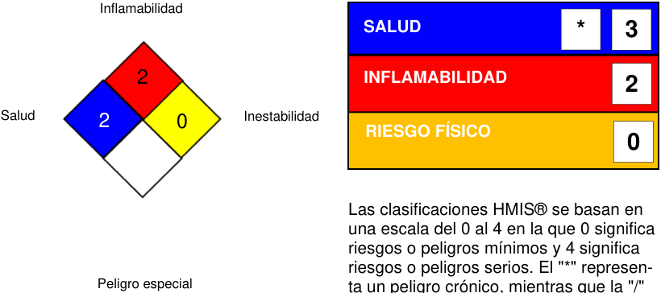

<!-- pagina: 1 -->
**HOJA DE DATOS DE SEGURIDAD** 

# **Sikafloor®-161  Part A** 

<u>Versión 2.0 Número de HDS: 100000027041</u> 

> Imagen (pág. 1). Sin texto legible por OCR; contenido gráfico no interpretado.

<!-- Start of picture text -->
de <!-- End of picture text -->

<u>Fecha de revisión: 2023/05/05</u> 

### **SECCIÓN 1. IDENTIFICACIÓN DE LA SUSTANCIA QUÍMICA PELIGROSA O MEZCLA Y DEL PROVEEDOR O FABRICANTE** 

Nombre del producto : Sikafloor®-161  Part A 

### **Informaciones sobre el fabricante o el proveedor** 

|Compañía|: Sika Colombia S.A.S. Vereda Canavita km 20,5 Autopista Norte Tocancipá, Cundinamarca Colombia|
|---|---|
|Teléfono|: (57-1) 8786333|
|Teléfono de emergencia|: CISPROQUIM Bogotá: 2886012 / 2886355 Resto del país: 01 8000 916012|
|Dirección de correo electróni- co|: controlcalidad.lab@co.sika.com|
|Fax|: (57-1) 8786660|
|**Uso recomendado del produ**|**cto químico y restricciones de uso**|
|Uso del producto|: Revestimiento de poliuretano|

### **SECCIÓN 2. IDENTIFICACIÓN DE LOS PELIGROS** 

### **Clasificación según SGA (GHS)** 

Líquidos Inflamables : Categoría 4 Corrosión/irritación cutáneas : Categoría 2 Lesiones oculares gra: Categoría 2A ves/irritación ocular Sensibilización cutánea : Categoría 1 Peligro a corto plazo (agudo) : Categoría 2 para el medio ambiente acuático Peligro a largo plazo (crónico) : Categoría 2 para el medio ambiente acuático **Etiqueta SGA (GHS)** Pictogramas de peligro : Palabra de advertencia : Atención <u>99</u> 

### **Etiqueta SGA (GHS)** 

<mark>1 / 11</mark> 

<!-- pagina: 2 -->
**HOJA DE DATOS DE SEGURIDAD** 

# **Sikafloor®-161  Part A** 

> Imagen (pág. 2). Sin texto legible por OCR; contenido gráfico no interpretado.

<!-- Start of picture text -->
de <!-- End of picture text -->

|Versión 2.0|Número de HDS: 100000027041 Fecha de revisión: 2023/05/05|
|---|---|
|Indicaciones de peligro|: H227 Líquido combustible. H315 Provoca irritación cutánea. H317 Puede provocar una reacción cutánea alérgica. H319 Provoca irritación ocular grave. H411 Tóxico para los organismos acuáticos, con efectos noci- vos duraderos.|
|Consejos de prudencia|: **Prevención:** P210 Mantener alejado del calor, chispas, llamas al descubier- to, superficies calientes y otras fuentes de ignición. No fumar. P261 Evitar respirar nieblas o vapores. P264 Lavarse la piel cuidadosamente después de la manipula- ción. P272 La ropa de trabajo contaminada no debe salir del lugar de trabajo. P273 No dispersar en el medio ambiente. P280 Usar guantes/ ropa de protección/ equipo de protección para los ojos/ la cara. **Intervención:** P302 + P352 EN CASO DE CONTACTO CON LA PIEL: Lavar con abundante agua. P305 + P351 + P338 EN CASO DE CONTACTO CON LOS OJOS: Enjuagar con agua cuidadosamente durante varios minutos. Quitar las lentes de contacto cuando estén presentes y pueda hacerse con facilidad. Proseguir con el lavado. P333 + P313 En caso de irritación cutánea o sarpullido: consul- tar a un médico. P337 + P313 Si la irritación ocular persiste, consultar a un mé- dico. P362 + P364 Quitar la ropa contaminada y lavarla antes de volverla a usar. P370 + P378 En caso de incendio: Utilizar arena seca, produc- to químico seco o espuma resistente al alcohol para la extin- ción. P391 Recoger los vertidos.|
||**Almacenamiento:** P403 Almacenar en un lugar bien ventilado.|
||**Eliminación:**|
||P501 Eliminar el contenido/ recipiente en una planta de elimi-|
||nación de residuos aprobada.|

### **Otros peligros no clasificables** 

No conocidos. 

### **SECCIÓN 3. COMPOSICIÓN/INFORMACIÓN SOBRE LOS INGREDIENTES** 

Sustancia / mezcla 

:  Mezcla 

**Componentes** 

|Nombre químico |CASNo. |Concentración(%w/w) |
|---|---|---|
|Producto de reacción: bisfenol-A- (epiclorhidrina);resina epoxídica (pesomolecu- ~~A~~|25068-38-6 |>= 30 -< 50 |

<mark>2 / 11</mark> 

<!-- pagina: 3 -->

> Imagen (pág. 3). Sin texto legible por OCR; contenido gráfico no interpretado.

<!-- Start of picture text -->
Le <!-- End of picture text -->

## **HOJA DE DATOS DE SEGURIDAD** 

# **Sikafloor®-161  Part A** 

<u>Número de HDS: 100000027041</u> 

|Versión 2.0 Número de HDS|: 100000027041|Fecha de revisión: 202|
|---|---|---|
|lar medio en número≤ 700) |||
|producto de reacción: bisfenol-F-epiclorhidrina; resinas epoxi(pesomolecular medio <= 700) |9003-36-5 |>= 5 -< 10 |
|alcoholbencílico |100-51-6 |>= 1 -< 5 |
|etanol |64-17-5 |>= 1 -< 5 |
|ácidos grasos, C14-18 e insaturados de C16- 18, tratados conácidomaleico |85711-46-2 |>= 0,1 -< 1 |

<u>Fecha de revisión: 2023/05/05</u> 

### **SECCIÓN 4. PRIMEROS AUXILIOS** 

Consejos generales : Retire a la persona de la zona peligrosa. Consulte a un médico. Muéstrele esta hoja de seguridad al doctor que esté de servicio. En caso de inhalación : Salga al aire libre. Consultar a un médico después de una exposición importante. En caso de contacto con la : Quítese inmediatamente la ropa y zapatos contaminados. piel Elimínelo lavando con jabón y mucha agua. Si persisten los síntomas, llame a un médico. En caso de contacto con los : Enjuagar inmediatamente los ojos con agua abundante. ojos Quítese los lentes de contacto. Manténgase el ojo bien abierto mientras se lava. Si persiste la irritación de los ojos, consulte a un especialista. En caso de ingestión : Lávese la boca con agua y después beba agua abundante. No dé leche ni bebidas alcohólicas. Nunca debe administrarse nada por la boca a una persona inconsciente. Consulte al médico. Síntomas y efectos más im: efectos irritantes portante, agudos y retardaefectos sensibilizantes dos Reacciones alérgicas Lacrimación excesiva Dermatitis Vea la Sección 11 para obtener información detallada sobre la salud y los síntomas. Provoca irritación cutánea. Puede provocar una reacción cutánea alérgica. Provoca irritación ocular grave. Notas especiales para un : Trate sintomáticamente. medico tratante 

### **SECCIÓN 5. MEDIDAS CONTRA INCENDIOS** 

Medios de extinción apropia: Dióxido de carbono (CO2) dos Agentes de extinción inapro: Agua piados 

<mark>3 / 11</mark> 

<!-- pagina: 4 -->
**HOJA DE DATOS DE SEGURIDAD** 

# **Sikafloor®-161  Part A** 

> Imagen (pág. 4). Sin texto legible por OCR; contenido gráfico no interpretado.

<u>Versión 2.0 Número de HDS: 100000027041 Fecha de revisión: 2023/05/05</u> 

|Peligros específicos durante la extincion de incendios|: No permita que la escorrentía posterior al control del incendio entre a los desagües o cursos de agua.|
|---|---|
|Productos de combustión peligrosos|:  No se conocen productos de combustión peligrosos|
|Métodos específicos de ex- tinción |: El agua de la extinción debe recogerse por separado, no debe penetrar en el alcantarillado. Los restos del incendio, así como el agua de extinción conta- minada, deben eliminarse según las normas locales en vigor.|
|Equipo de protección espe- cial para los bomberos|: En caso de incendio, utilice un equipo respiratorio autónomo. |

### **SECCIÓN 6. MEDIDAS QUE DEBEN TOMARSE EN CASO DE DERRAME ACCIDENTAL O FUGA ACCIDENTAL** 

|Precauciones personales, equipo de protección y pro- cedimientos de emergencia|: Utilice equipo de protección personal. Negar el acceso a personas sin protección.|
|---|---|
|Precauciones relativas al medio ambiente|: No lo vierta en el agua superficial o el sistema de alcantarilla- do sanitario. Si el producto contamina los ríos, lagos o alcantarillados, in- formar a las autoridades respectivas.|
|Métodos y materiales de contención y limpieza|: Recójalo con un producto absorbente inerte (por ejemplo, arena, silicagel, aglutinante de ácidos, aglutinante universal, aserrín). Guarde en contenedores apropiados y cerrados para su eli- minación.|

### **SECCIÓN 7. MANEJO Y ALMACENAMIENTO** 

Sugerencias para la protec:  Medidas normales preventivas para la protección contra inción contra incendios y excendios. plosiones Consejos para una manipu: Evitar sobrepasar los límites dados de exposición profesional lación segura (ver sección 8). Evitar todo contacto con los ojos, la piel o la ropa. Ver sección 8 para el equipo de protección personal. Las personas que hayan tenido problemas de sensibilisación de la piel, asma, alergías, enfermedades respiratorias crónicas o recurrentes, no deben ser empleadas en ninguna parte del proceso en la cual esté utilizada esta preparación. Fumar, comer y beber debe prohibirse en el área de aplicación. Cuando se manejen productos químicos, siga las medidas estándar de higiene. Condiciones para el almace: Almacénelo en el envase original. namiento seguro Mantenga en un lugar bien ventilado. Los contenedores que se abren deben ser cuidadosamente 

<mark>4 / 11</mark> 

<!-- pagina: 5 -->
## **HOJA DE DATOS DE SEGURIDAD** 

# **Sikafloor®-161  Part A** 

<u>Versión 2.0 Número de HDS: 100000027041</u> 

> Imagen (pág. 5). Sin texto legible por OCR; contenido gráfico no interpretado.

<!-- Start of picture text -->
| <!-- End of picture text -->

<u>Fecha de revisión: 2023/05/05</u> 

resellados y mantenerlos en posición vertical para evitar fugas. Observar las indicaciones de la etiqueta. Almacenar en conformidad con la reglamentación local. 

### **SECCIÓN 8. CONTROLES DE EXPOSICIÓN/PROTECCIÓN PERSONAL** 

### **Componentes con parámetros de control en el área de trabajo** 

No contiene sustancias con valores límite de exposición laboral. 

|**Protección personal**||
|---|---|
|Protección respiratoria|: Utilice protección respiratoria a menos que exista una venti- lación de escape adecuada o que la evaluación de la exposi- ción indique que el nivel de exposición está dentro de las pautas recomendadas. La clase de filtro para el respirador debe ser adecuada para la concentración máxima prevista del contaminante (gas/vapor/aerosol/partículas) que puede presentarse al ma- nejar el producto. Si se excede esta concentración, se debe utilizar un aparato respiratorio autónomo.|
|Protección de las manos|: Guantes químico-resistentes e impermeables que cumplan con estándares aprobados deben ser utilizados cuando se manejen productos químicos y la evaluación del riesgo indica que es necesario.|
|Protección de los ojos|: Equipo de protección ocular que cumpla con estándares aprobados debe ser utilizado cuando la evaluación del riesgo indica que es necesario.|
|Protección de la piel y del cuerpo|: Elegir la protección para el cuerpo según sus caraterísticas, la concentración y la cantidad de sustancias peligrosas, y el lugar específico de trabajo.|
|Medidas de higiene|: Manipúlelo con las precauciones de higiene industrial ade- cuadas, y respete las prácticas de seguridad. No coma ni beba durante su utilización. No fume durante su utilización. Lavarse las manos antes de los descansos y después de terminar la jornada laboral.|

### **SECCIÓN 9. PROPIEDADES FÍSICAS Y QUÍMICAS** 

Aspecto : líquido viscoso Color :  varios Olor :  característico Umbral de olor :  Sin datos disponibles pH : No aplicable Punto de fusión/rango / Punto : Sin datos disponibles 

<mark>5 / 11</mark> 

<!-- pagina: 6 -->
**HOJA DE DATOS DE SEGURIDAD** 

# **Sikafloor®-161  Part A** 

<u>Versión 2.0 Número de HDS: 100000027041</u> 

> Imagen (pág. 6). Sin texto legible por OCR; contenido gráfico no interpretado.

<!-- Start of picture text -->
| <!-- End of picture text -->

<u>Fecha de revisión: 2023/05/05</u> 

|de congelación Punto / intervalo de ebullición|:|Sin datos disponibles|
|---|---|---|
|Punto de inflamación|:|> 70 °C (70 °C)|
|Tasa de evaporación|:|Sin datos disponibles|
|Inflamabilidad (sólido, gas)|:|Sin datos disponibles|
|Límite superior de explosivi- dad / Límite de inflamabilidad superior|:|Sin datos disponibles|
|Límite inferior de explosividad / Límite de inflamabilidad infe- rior|:|Sin datos disponibles|
|Presión de vapor|:|0,01 hPa|
|Densidad relativa de vapor|:|Sin datos disponibles|
|Densidad|:|1,61 g/cm3 (20 °C (20 °C))|
|Solubilidad|||
|Hidrosolubilidad|:|insoluble|
|Solubilidad en otros disol- ventes|:|Sin datos disponibles|
|Coeficiente de reparto n- octanol/agua|:|Sin datos disponibles|
| Temperatura de ignición es- pontánea|:|Sin datos disponibles|
|Temperatura de descomposi- ción|:|Sin datos disponibles|
|Viscosidad|||
|Viscosidad, dinámica|:|Sin datos disponibles|
|Viscosidad, cinemática|:|> 20,5 mm2/s ( 40 °C (40 °C))|
|Propiedades explosivas|:|Sin datos disponibles|
|Propiedades comburentes|:|Sin datos disponibles|

### **SECCIÓN 10. ESTABILIDAD Y REACTIVIDAD** 

Reactividad :  No se conoce ninguna reacción peligrosa bajo condiciones de uso normal. Estabilidad química :  El producto es químicamente estable. Posibilidad de reacciones : Estable bajo las condiciones de almacenamiento recomendapeligrosas das. Condiciones que deben evi: Sin datos disponibles tarse 

<mark>6 / 11</mark> 

<!-- pagina: 7 -->
**HOJA DE DATOS DE SEGURIDAD** 

# **Sikafloor®-161  Part A** 

<u>Versión 2.0 Número de HDS: 100000027041</u> 

> Imagen (pág. 7). Sin texto legible por OCR; contenido gráfico no interpretado.

<!-- Start of picture text -->
| <!-- End of picture text -->

<u>Fecha de revisión: 2023/05/05</u> 

Materiales incompatibles :  Sin datos disponibles 

### **SECCIÓN 11. INFORMACIÓN TOXICOLÓGICA** 

### **Toxicidad aguda** 

No clasificado según la información disponible. 

**<u>Componentes:</u> Producto de reacción: bisfenol-A-(epiclorhidrina); resina epoxídica (peso molecular medio en número ≤ 700):** Toxicidad oral aguda :  DL50 Oral (Rata): > 5.000 mg/kg Toxicidad dérmica aguda :  LD50 Dermico (Conejo): > 20.000 mg/kg **alcohol bencílico:** Toxicidad oral aguda :  DL50 Oral (Rata): 1.620 mg/kg Toxicidad aguda por inhala:  CL50 (Rata): > 4,178 mg/l ción Tiempo de exposición: 4 h Prueba de atmosfera: polvo/niebla 

### **Corrosión o irritación cutáneas** 

Provoca irritación cutánea. 

### **Lesiones oculares graves/irritación ocular** 

Provoca irritación ocular grave. 

### **Sensibilización respiratoria o cutánea** 

### **Sensibilización cutánea** 

Puede provocar una reacción cutánea alérgica. 

### **Sensibilización respiratoria** 

No clasificado según la información disponible. 

### **Mutagenicidad en células germinales** 

No clasificado según la información disponible. 

### **Carcinogenicidad** 

No clasificado según la información disponible. 

### **Toxicidad para la reproducción** 

No clasificado según la información disponible. 

### **Toxicidad sistémica específica de órganos blanco - exposición única** 

No clasificado según la información disponible. 

### **Toxicidad sistémica específica de órganos blanco - exposiciones repetidas** 

No clasificado según la información disponible. 

### **Toxicidad por aspiración** 

No clasificado según la información disponible. 

<mark>7 / 11</mark> 

<!-- pagina: 8 -->
**HOJA DE DATOS DE SEGURIDAD** 

<u>Número de HDS: 100000027041</u> 

<u>Versión 2.0</u> 

# **Sikafloor®-161  Part A** 

> Imagen (pág. 8). Sin texto legible por OCR; contenido gráfico no interpretado.

<u>Fecha de revisión: 2023/05/05</u> 

### **SECCIÓN 12. INFORMACIÓN ECOTOXICOLOGICA** 

### **Ecotoxicidad** 

**<u>Componentes:</u> Producto de reacción: bisfenol-A-(epiclorhidrina); resina epoxídica (peso molecular medio en número ≤ 700):** Toxicidad para peces :  CL50 (Oncorhynchus mykiss (trucha irisada)): 2 mg/l Tiempo de exposición: 96 h Toxicidad para la dafnia y :  CE50 (Daphnia magna (Pulga de mar grande)): 1,8 mg/l otros invertebrados acuáticos Tiempo de exposición: 48 h **alcohol bencílico:** Toxicidad para peces :  CL50 (Pez): > 100 mg/l Tiempo de exposición: 96 h Toxicidad para la dafnia y :  CE50 (Daphnia magna (Pulga de mar grande)): > 100 mg/l otros invertebrados acuáticos Tiempo de exposición: 48 h **ácidos grasos, C14-18 e insaturados de C16-18, tratados con ácido maleico:** Toxicidad para la dafnia y :  CE50 (Daphnia magna (Pulga de mar grande)): > 100 mg/l otros invertebrados acuáticos Tiempo de exposición: 48 h Toxicidad para las al:  ErC50 (Pseudokirchneriella subcapitata (alga verde)): > 100 gas/plantas acuáticas mg/l Tiempo de exposición: 72 h 

### **Persistencia y degradabilidad** 

Sin datos disponibles 

### **Potencial de bioacumulación** 

Sin datos disponibles 

**Movilidad en el suelo** Sin datos disponibles 

### **Otros efectos adversos** 

### **<u>Producto:</u>** 

Información ecológica com:  No se puede excluir un peligro para el medio ambiente en el plementaria caso de una manipulación o eliminación no profesional. Tóxico para los organismos acuáticos, con efectos nocivos duraderos. 

### **SECCIÓN 13. INFORMACIÓN RELATIVA A LA ELIMINACIÓN DE LOS PRODUCTOS** 

### **Métodos de eliminación** 

Residuos : Envíese a una compañía autorizada para la gestión de residuos. Evite que el producto penetre en los desagües, tuberías, o la tierra (suelos). No contamine los estanques, cursos de agua o zanjas con el 

<mark>8 / 11</mark> 

<!-- pagina: 9 -->
**HOJA DE DATOS DE SEGURIDAD** 

# **Sikafloor®-161  Part A** 

<u>Versión 2.0 Número de HDS: 100000027041</u> 

> Imagen (pág. 9). Sin texto legible por OCR; contenido gráfico no interpretado.

<!-- Start of picture text -->
| <!-- End of picture text -->

<u>Fecha de revisión: 2023/05/05</u> 

producto químico o el contendor utilizado. Envases contaminados : Vacíe el contenido restante. Eliminar como producto no usado. No reutilice los recipientes vacíos. No queme, ni utilice un soplete de corte, en el tambor vacío. 

### **SECCIÓN 14. INFORMACIÓN RELATIVA AL TRANSPORTE** 

### **Regulaciones internacionales** 

**UNRTDG** Número ONU : UN 3082 Designación oficial de trans: ENVIRONMENTALLY HAZARDOUS SUBSTANCE, LIQUID, porte N.O.S. (D.E.R. 331 Epoxy Resin) Clase : 9 Grupo de embalaje : III Etiquetas : 9 **IATA-DGR** No. UN/ID : UN 3082 Designación oficial de trans: Environmentally hazardous substance, liquid, n.o.s. porte (D.E.R. 331 Epoxy Resin) Clase : 9 Grupo de embalaje : III Etiquetas : Miscellaneous Instrucción de embalaje : 964 (avión de carga) Instrucción de embalaje : 964 (avión de pasajeros) **Código-IMDG** Número ONU : UN 3082 Designación oficial de trans: ENVIRONMENTALLY HAZARDOUS SUBSTANCE, LIQUID, porte N.O.S. (D.E.R. 331 Epoxy Resin) Clase : 9 Grupo de embalaje : III Etiquetas : 9 Código EmS : F-A, S-F Contaminante marino : no 

### **Transporte a granel de acuerdo a instrumentos IMO** 

No aplicable para el producto tal y como se proveyó. 

### **Precauciones especiales para los usuarios** 

La(s) clasificación(es) de transporte presente(s) tienen solamente propósitos informativos y se basa(n) únicamente en las propiedades del material sin envasar/embalar, descritas dentro de esta Hoja de Datos de Seguridad. Las clasificaciones de transporte pueden variar según el modo de transporte, el tamaño del envase/embalaje y las variaciones en los reglamentos regionales o del país. 

<mark>9 / 11</mark> 

<!-- pagina: 10 -->
**HOJA DE DATOS DE SEGURIDAD** 

<u>Número de HDS: 100000027041</u> 

<u>Versión 2.0</u> 

# **Sikafloor®-161  Part A** 

> Imagen (pág. 10). Sin texto legible por OCR; contenido gráfico no interpretado.

<!-- Start of picture text -->
A. <!-- End of picture text -->

<u>Fecha de revisión: 2023/05/05</u> 

### **SECCIÓN 15. INFORMACIÓN REGLAMENTARIA** 

### **Reglamentación medioambiental, seguridad y salud específica para la sustancia o mezcla** 

Convención Internacional sobre las Armas Químicas (CWC) Programas sobre los Productos Químicos Tóxicos y los Precursores (Louisiana Administrative Code, Title 33,Part V Section 10101 et. seq.) Reglamentación sobre el control de la importación, fabricación, venta, distribución, transporte y uso de sustancias que pueden ser utilizadas para el procesamiento de drogas que producen dependencia. 

- : No aplicable 

- : Nafta disolvente (petróleo), fracción aromática ligera; nafta de bajo punto de ebullición, sin especificar xileno acetato de etilo tolueno 

Resolución 2715 de 2014 Por la cual se establecen las sustancias que deben ser objeto de registro de control de venta al menudeo, con base en los criterios de clasificación que se definen. 

- : No aplicable 

### **SECCIÓN 16. OTRA INFORMACIÓN INCLUIDAS LAS RELATIVAS A LA PREPARACIÓN Y ACTUALIZACIÓN DE LAS HOJAS DE DATOS DE SEGURIDAD** 

- Fecha de revisión :  2023/05/05 formato de fecha : aaaa/mm/dd 

### **Información adicional** 

**NFPA:** 

### **HMIS® IV:** 

> Imagen (pág. 10). OCR automático, revisar: «Inflamabilidad Salud Inestabilidad Peligro especial «uo mE RIESGO FÍSICO INFLAMABILIDAD 2 | Las clasificaciones HMIS® se basan en una escala del 0 al 4 en la que 0 significa riesgos o peligros mínimos y 4 significa riesgos o peligros serios. El "*" represen- ta un peliaro crónico. mientras que la "/"»

<!-- Start of picture text -->
Inflamabilidad SALUD  * 3 2 INFLAMABILIDAD 2 Salud  2  0 Inestabilidad RIESGO FÍSICO 0 y = Las clasificaciones HMIS® se basan en una escala del 0 al 4 en la que 0 significa riesgos o peligros mínimos y 4 significa riesgos o peligros serios. El "*" represen- Peligro especial ta un peligro crónico, mientras que la "/" <!-- End of picture text -->

Las clasificaciones HMIS® se basan en una escala del 0 al 4 en la que 0 significa riesgos o peligros mínimos y 4 significa riesgos o peligros serios. El "*" representa un peligro crónico, mientras que la "/" representa la ausencia de un peligro crónico. 

### **Texto completo de otras abreviaturas** 

- ADR : Accord européen relatif au transport international des marchandises Dangereuses par Route 

- CAS : Chemical Abstracts Service DNEL : Derived no-effect level EC50 : Half maximal effective concentration 

<mark>10 / 11</mark> 

<!-- pagina: 11 -->
**HOJA DE DATOS DE SEGURIDAD** 

# **Sikafloor®-161  Part A** 

<u>Versión 2.0 Número de HDS: 100000027041</u> 

> Imagen (pág. 11). Sin texto legible por OCR; contenido gráfico no interpretado.

<!-- Start of picture text -->
| <!-- End of picture text -->

<u>Fecha de revisión: 2023/05/05</u> 

|GHS|: Globally Harmonized System|
|---|---|
|IATA|: International Air Transport Association|
|IMDG|: International Maritime Code for Dangerous Goods|
|LD50|: Median lethal dosis (the amount of a material, given all at once, which causes the death of 50% (one half) of a group of test animals)|
|LC50|: Median lethal concentration (concentrations of the chemical in air that kills 50% of the test animals during the observation period)|
|MARPOL|: International Convention for the Prevention of Pollution from Ships, 1973 as modified by the Protocol of 1978|
|OEL|: Occupational Exposure Limit|
|PBT|: Persistent, bioaccumulative and toxic|
|PNEC|: Predicted no effect concentration|
|REACH|: Regulation (EC) No 1907/2006 of the European Parliament and of the Council of 18 December 2006 concerning the Re- gistration, Evaluation, Authorisation and Restriction of Chemi- cals (REACH), establishing a European Chemicals Agency|
|SVHC|: Substances of Very High Concern|
|vPvB|: Very persistent and very bioaccumulative|

La informacion contenida en este ficha de datos de seguridad corresponde a nuestro nivel de conocimiento en el momento de su publicacion. Quedan excluidas todas las garantias. Se aplicaran nuestras condiciones generales de venta en vigor. Por favor, consulte la Hoja de Datos del Producto  antes de su uso y procesamiento. CO / 1X 

<mark>11 / 11</mark> 
