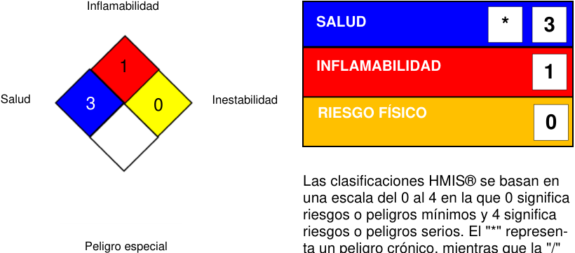

<!-- pagina: 1 -->
**HOJA DE DATOS DE SEGURIDAD** 

**Sikafloor®-161/264  Part B** 

> Imagen (pág. 1). Sin texto legible por OCR; contenido gráfico no interpretado.

<!-- Start of picture text -->
| <!-- End of picture text -->

<u>Versión 2.0 Número de HDS: 100000034346</u> 

<u>Fecha de revisión: 2023/07/25</u> 

## **SECCIÓN 1. IDENTIFICACIÓN DE LA SUSTANCIA QUÍMICA PELIGROSA O MEZCLA Y DEL PROVEEDOR O FABRICANTE** 

Nombre del producto : Sikafloor®-161/264  Part B 

|**Informaciones sobre el fabric**|**ante o el proveedor**|
|---|---|
|Compañía|: Sika Colombia S.A.S. Vereda Canavita km 20,5 Autopista Norte Tocancipá, Cundinamarca Colombia|
|Teléfono|: (57-1) 8786333|
|Teléfono de emergencia|: CISPROQUIM Bogotá: 2886012 / 2886355 Resto del país: 01 8000 916012|
|Dirección de correo electróni- co|: controlcalidad.lab@co.sika.com|
|Fax|: (57-1) 8786660|
|**Uso recomendado del produ**|**cto químico y restricciones de uso**|
|Uso del producto|: Revestimiento de epoxi|

## **SECCIÓN 2. IDENTIFICACIÓN DE LOS PELIGROS** 

**Clasificación según SGA (GHS)** Toxicidad aguda (Oral) : Categoría 4 Toxicidad aguda (Inhalación) : Categoría 4 Corrosión/irritación cutáneas : Sub-categoría 1B Lesiones oculares gra: Categoría 1 ves/irritación ocular Sensibilización cutánea : Categoría 1 Carcinogenicidad : Categoría 2 Toxicidad a la reproducción : Categoría 2 Peligro a corto plazo (agudo) : Categoría 2 para el medio ambiente acuático Peligro a largo plazo (crónico) : Categoría 2 para el medio ambiente acuático 

<mark>1 / 12</mark> 

<!-- pagina: 2 -->
**HOJA DE DATOS DE SEGURIDAD** 

# **Sikafloor®-161/264  Part B** 

<u>Número de HDS: 100000034346</u> 

<u>Versión 2.0</u> 

> Imagen (pág. 2). Sin texto legible por OCR; contenido gráfico no interpretado.

<!-- Start of picture text -->
de <!-- End of picture text -->

<u>Fecha de revisión: 2023/07/25</u> 

|**Etiqueta SGA (GHS)** Pictogramas de peligro|: SOOO|
|---|---|
|Palabra de advertencia|: Peligro|
|Indicaciones de peligro|: H302 + H332 Nocivo en caso de ingestión o si se inhala. H314 Provoca graves quemaduras en la piel y lesiones ocula- res. H317 Puede provocar una reacción cutánea alérgica. H351 Susceptible de provocar cáncer. H361fd Susceptible de perjudicar la fertilidad. Susceptible de dañar al feto. H411 Tóxico para los organismos acuáticos, con efectos noci- vos duraderos.|
|Consejos de prudencia|: **Prevención:** P201 Procurarse las instrucciones antes del uso. P202 No manipular antes de haber leído y comprendido todas las precauciones de seguridad. P261 Evitar respirar nieblas o vapores. P264 Lavarse la piel cuidadosamente después de la manipula- ción. P270 No comer, beber o fumar mientras se manipula este pro- ducto. P271 Utilizar sólo al aire libre o en un lugar bien ventilado. P272 La ropa de trabajo contaminada no debe salir del lugar de trabajo. P273 No dispersar en el medio ambiente. P280 Usar guantes/ ropa de protección/ equipo de protección para los ojos/ la cara. **Intervención:** P301 + P312 + P330 EN CASO DE INGESTIÓN: Llamar a un CENTRO DE TOXICOLOGÍA o a un médico si la persona se encuentra mal. Enjuagarse la boca. P301 + P330 + P331 EN CASO DE INGESTIÓN: Enjuagar la boca. NO provocar el vómito. P303 + P361 + P353 EN CASO DE CONTACTO CON LA PIEL (o el pelo): Quitar inmediatamente toda la ropa contaminada. Enjuagar la piel con agua. P304 + P340 + P310 EN CASO DE INHALACIÓN: Transportar a la persona al aire libre y mantenerla en una posición que le facilite la respiración. Llamar inmediatamente a un CENTRO DE TOXICOLOGÍA/ médico. P305 + P351 + P338 + P310 EN CASO DE CONTACTO CON LOS OJOS: Enjuagar con agua cuidadosamente durante varios minutos. Quitar las lentes de contacto cuando estén presentes y pueda hacerse con facilidad. Proseguir con el lavado. Llamar inmediatamente a un CENTRO DE TOXICOLOGÍA o a un mé- dico. P308 + P313 EN CASO DE exposición demostrada o supues- ta: consultar a un médico. P333 + P313 En caso de irritación cutánea o sarpullido: consul-|

<mark>2 / 12</mark> 

<!-- pagina: 3 -->
**HOJA DE DATOS DE SEGURIDAD** 

# **Sikafloor®-161/264  Part B** 

> Imagen (pág. 3). Sin texto legible por OCR; contenido gráfico no interpretado.

<u>Versión 2.0 Número de HDS: 100000034346 Fecha de revisión: 2023/07/25</u> tar a un médico. P362 + P364 Quitar la ropa contaminada y lavarla antes de volverla a usar. P391 Recoger los vertidos. **Almacenamiento:** P405 Guardar bajo llave. **Eliminación:** P501 Eliminar el contenido/ recipiente en una planta de eliminación de residuos aprobada. **Otros peligros no clasificables** No conocidos. 

## **SECCIÓN 3. COMPOSICIÓN/INFORMACIÓN SOBRE LOS INGREDIENTES** 

Sustancia / mezcla :  Mezcla 

**Componentes** 

|Nombre químico|CASNo.|Concentración(%w/w)|
|---|---|---|
|alcoholbencílico|100-51-6|>=30-< 50|
|3-aminometil-3,5,5-trimetilciclohexilamina|2855-13-2|>= 10-<20|
|m-fenilenbis(metilamina)|1477-55-0|>= 10-<20|
|Producto de reacción: bisfenol-A- (epiclorhidrina); resina epoxídica (peso molecu- lar medio en número≤ 700)|25068-38-6|>= 10 -< 20|
|Nafta disolvente (petróleo), fracción aromática pesada; queroseno, sinespecificar|64742-94-5|>= 5 -< 10|
|nonilfenol|25154-52-3|>=3-< 5|
|2,4,6-tris(dimetilaminometil)fenol|90-72-2|>=3-< 5|
|naftaleno|91-20-3|>=0,25-<1|

## **SECCIÓN 4. PRIMEROS AUXILIOS** 

- Consejos generales : Retire a la persona de la zona peligrosa. Consulte a un médico. Muéstrele esta hoja de seguridad al doctor que esté de servicio. 

- En caso de inhalación : Salga al aire libre. Consultar a un médico después de una exposición importante. 

- En caso de contacto con la : Quítese inmediatamente la ropa y zapatos contaminados. piel Elimínelo lavando con jabón y mucha agua. Es necesario un tratamiento médico inmediato ya que las corrosiones de la piel no tratadas son heridas difíciles y cicatrizan lentamente. 

- En caso de contacto con los : Incluso pequeñas salpicaduras en los ojos pueden causar ojos daños irreversibles en los tejidos y ceguera. En caso de contacto con los ojos, lávelos inmediata y abundantemente con agua y acuda a un médico. Continúe lavando los ojos en el trayecto al hospital. 

<mark>3 / 12</mark> 

<!-- pagina: 4 -->
**HOJA DE DATOS DE SEGURIDAD** 

# **Sikafloor®-161/264  Part B** 

> Imagen (pág. 4). Sin texto legible por OCR; contenido gráfico no interpretado.

|Versión 2.0|Número de HDS: 100000034346 Fecha de revisión: 2023/07/25|
|---|---|
||Quítese los lentes de contacto. Manténgase el ojo bien abierto mientras se lava.|
|En caso de ingestión |: Lávese la boca con agua y después beba agua abundante. No provoque vómitos. No dé leche ni bebidas alcohólicas. Nunca debe administrarse nada por la boca a una persona inconsciente. Lleve al afectado enseguida a un hospital.|
|Síntomas y efectos más im- portante, agudos y retarda- dos|: Los daños a la salud pueden retardarse. efectos corrosivos efectos sensibilizantes Molestias gastrointestinales Desordenes respiratorios Reacciones alérgicas Dolor de cabeza Dermatitis Vea la Sección 11 para obtener información detallada sobre la salud y los síntomas. Nocivo en caso de ingestión o si se inhala. Puede provocar una reacción cutánea alérgica. Provoca lesiones oculares graves. Susceptible de provocar cáncer. Susceptible de perjudicar la fertilidad. Susceptible de dañar al feto. Provoca quemaduras graves.|
|Notas especiales para un medico tratante|: Trate sintomáticamente. |

## **SECCIÓN 5. MEDIDAS CONTRA INCENDIOS** 

|Medios de extinción apropia- dos|: Use medidas de extinción que sean apropiadas a las circuns- tancias locales y de sus alrededores.|
|---|---|
|Peligros específicos durante la extincion de incendios|: No permita que la escorrentía posterior al control del incendio entre a los desagües o cursos de agua.|
|Productos de combustión peligrosos|:  No se conocen productos de combustión peligrosos|
|Métodos específicos de ex- tinción |: El agua de la extinción debe recogerse por separado, no debe penetrar en el alcantarillado. Los restos del incendio, así como el agua de extinción conta- minada, deben eliminarse según las normas locales en vigor.|
|Equipo de protección espe- cial para los bomberos|: En caso de incendio, utilice un equipo respiratorio autónomo. |

## **SECCIÓN 6. MEDIDAS QUE DEBEN TOMARSE EN CASO DE DERRAME ACCIDENTAL O FUGA ACCIDENTAL** 

Precauciones personales, : Utilice equipo de protección personal. equipo de protección y proNegar el acceso a personas sin protección. 

<mark>4 / 12</mark> 

<!-- pagina: 5 -->
**HOJA DE DATOS DE SEGURIDAD** 

# **Sikafloor®-161/264  Part B** 

> Imagen (pág. 5). Sin texto legible por OCR; contenido gráfico no interpretado.

<u>Versión 2.0 Número de HDS: 100000034346 Fecha de revisión: 2023/07/25</u> 

|cedimientos de emergencia||
|---|---|
|Precauciones relativas al medio ambiente|: No lo vierta en el agua superficial o el sistema de alcantarilla- do sanitario. Si el producto contamina los ríos, lagos o alcantarillados, in- formar a las autoridades respectivas.|
|Métodos y materiales de contención y limpieza|: Recójalo con un producto absorbente inerte (por ejemplo, arena, silicagel, aglutinante de ácidos, aglutinante universal, aserrín). Guarde en contenedores apropiados y cerrados para su eli- minación.|

## **SECCIÓN 7. MANEJO Y ALMACENAMIENTO** 

|Sugerencias para la protec- ción contra incendios y ex- plosiones|:|Medidas normales preventivas para la protección contra in- cendios.|
|---|---|---|
|Consejos para una manipu- lación segura|:|Evitar sobrepasar los límites dados de exposición profesional (ver sección 8). Evitar todo contacto con los ojos, la piel o la ropa. Ver sección 8 para el equipo de protección personal. Las personas que hayan tenido problemas de sensibilisación de la piel, asma, alergías, enfermedades respiratorias cróni- cas o recurrentes, no deben ser empleadas en ninguna parte del proceso en la cual esté utilizada esta preparación. Fumar, comer y beber debe prohibirse en el área de aplica- ción. Provea de suficiente intercambio de aire y/o de extracción en los lugares de trabajo. Cuando se manejen productos químicos, siga las medidas estándar de higiene.|
|Condiciones para el almace- namiento seguro|:|Almacénelo en el envase original. Conserve el envase herméticamente cerrado en un lugar seco y bien ventilado. Los contenedores que se abren deben ser cuidadosamente resellados y mantenerlos en posición vertical para evitar fu- gas. Observar las indicaciones de la etiqueta. Almacenar en conformidad con la reglamentación local.|

**SECCIÓN 8. CONTROLES DE EXPOSICIÓN/PROTECCIÓN PERSONAL** 

**Componentes con parámetros de control en el área de trabajo** 

|Componentes|CAS No.|Tipo de valor (Forma de exposición)|Parámetros de control / Concen- traciónpermisible|Bases|
|---|---|---|---|---|
|m-fenilenbis(metilamina)|1477-55-0|C|0,018 ppm|ACGIH|
|naftaleno|91-20-3|TWA|10 ppm|ACGIH|
|**Protección personal**|||||
|Protección respiratoria|: Utilice protec|ción respiratoria|a menos que exista|una venti-|

<mark>5 / 12</mark> 

<!-- pagina: 6 -->
**HOJA DE DATOS DE SEGURIDAD** 

# **Sikafloor®-161/264  Part B** 

## <u>Versión 2.0 Número de HDS: 100000034346</u> 

> Imagen (pág. 6). Sin texto legible por OCR; contenido gráfico no interpretado.

<!-- Start of picture text -->
| <!-- End of picture text -->

<u>Fecha de revisión: 2023/07/25</u> 

||lación de escape adecuada o que la evaluación de la exposi- ción indique que el nivel de exposición está dentro de las pautas recomendadas. La clase de filtro para el respirador debe ser adecuada para la concentración máxima prevista del contaminante (gas/vapor/aerosol/partículas) que puede presentarse al ma- nejar el producto. Si se excede esta concentración, se debe utilizar un aparato respiratorio autónomo.|
|---|---|
|Protección de las manos|: Guantes químico-resistentes e impermeables que cumplan con estándares aprobados deben ser utilizados cuando se manejen productos químicos y la evaluación del riesgo indica que es necesario.|
|Protección de los ojos|: Equipo de protección ocular que cumpla con estándares aprobados debe ser utilizado cuando la evaluación del riesgo indica que es necesario.|
|Protección de la piel y del cuerpo|: Elegir la protección para el cuerpo según sus caraterísticas, la concentración y la cantidad de sustancias peligrosas, y el lugar específico de trabajo.|
|Medidas de higiene|: Manipúlelo con las precauciones de higiene industrial ade- cuadas, y respete las prácticas de seguridad. No coma ni beba durante su utilización. No fume durante su utilización. Lavarse las manos antes de los descansos y después de terminar la jornada laboral.|

## **SECCIÓN 9. PROPIEDADES FÍSICAS Y QUÍMICAS** 

Aspecto : líquido Color :  amarillo Olor :  similar a una amina Umbral de olor :  Sin datos disponibles pH : no determinado Punto de fusión/rango / Punto : Sin datos disponibles de congelación Punto / intervalo de ebullición : Sin datos disponibles Punto de inflamación : > 93,3 °C (93,3 °C) (Método: copa cerrada) Tasa de evaporación :  Sin datos disponibles Inflamabilidad (sólido, gas) : Sin datos disponibles Límite superior de explosivi: Sin datos disponibles dad / Límite de inflamabilidad superior 

<mark>6 / 12</mark> 

<!-- pagina: 7 -->
**HOJA DE DATOS DE SEGURIDAD** 

> Imagen (pág. 7). Sin texto legible por OCR; contenido gráfico no interpretado.

<!-- Start of picture text -->
| <!-- End of picture text -->

# **Sikafloor®-161/264  Part B** 

|ón 2.0|Número de HDS: 100000034346 Fecha de revisión: 20|
|---|---|
|Límite inferior de explosividad / Límite de inflamabilidad infe- rior|: Sin datos disponibles|
|Presión de vapor|: 2 hPa|
|Densidad relativa de vapor|: Sin datos disponibles|
|Densidad|: aprox. 0,99 g/cm3 (20 °C (20 °C))|
|Solubilidad||
|Hidrosolubilidad|: insoluble|
|Solubilidad en otros disol- |: Sin datos disponibles|
|ventes||
|Coeficiente de reparto n-|: Sin datos disponibles|
|octanol/agua||
|Temperatura de ignición es- |: Sin datos disponibles|
|pontánea||
|Temperatura de descomposi- |:  Sin datos disponibles|
|ción||
|Viscosidad||
|Viscosidad, dinámica|: Sin datos disponibles|
|Viscosidad, cinemática|: > 20,5 mm2/s ( 40 °C (40 °C))|
|Propiedades explosivas|: Sin datos disponibles|
|Propiedades comburentes **CIÓN 10. ESTABILIDAD Y RE**|: Sin datos disponibles **ACTIVIDAD**|
|Reactividad |:  No se conoce ninguna reacción peligrosa bajo condiciones de uso normal.|
|Estabilidad química|:  El producto es químicamente estable.|
|Posibilidad de reacciones peligrosas|: Estable bajo las condiciones de almacenamiento recomenda- das.|
|Condiciones que deben evi- tarse|: Sin datos disponibles |
|Materiales incompatibles|:  Sin datos disponibles|

<u>Versión 2.0</u> 

<u>Fecha de revisión: 2023/07/25</u> 

## **SECCIÓN 10. ESTABILIDAD Y REACTIVIDAD** 

## **SECCIÓN 11. INFORMACIÓN TOXICOLÓGICA** 

**Toxicidad aguda** 

Nocivo en caso de ingestión o si se inhala. 

**<u>Componentes:</u> alcohol bencílico:** Toxicidad oral aguda :  DL50 Oral (Rata): 1.620 mg/kg 

<mark>7 / 12</mark> 

<!-- pagina: 8 -->
**HOJA DE DATOS DE SEGURIDAD** 

# **Sikafloor®-161/264  Part B** 

<u>Versión 2.0 Número de HDS: 100000034346</u> 

> Imagen (pág. 8). Sin texto legible por OCR; contenido gráfico no interpretado.

<!-- Start of picture text -->
| <!-- End of picture text -->

<u>Fecha de revisión: 2023/07/25</u> 

Toxicidad aguda por inhala:  CL50 (Rata): > 4,178 mg/l ción Tiempo de exposición: 4 h Prueba de atmosfera: polvo/niebla **3-aminometil-3,5,5-trimetilciclohexilamina:** Toxicidad oral aguda :  DL50 Oral (Rata): 1.030 mg/kg Toxicidad aguda por inhala:  CL50 (Rata): > 10 mg/l ción Tiempo de exposición: 4 h Prueba de atmosfera: polvo/niebla Toxicidad dérmica aguda :  DL50 (Conejo): > 2.000 - 5.000 mg/kg **m-fenilenbis(metilamina):** Toxicidad oral aguda :  DL50 Oral (Rata): 930 mg/kg Toxicidad aguda por inhala:  CL50 (Rata): 1,34 mg/l ción Tiempo de exposición: 4 h Prueba de atmosfera: polvo/niebla Valoración: Corrosivo para el tracto respiratorio. Toxicidad dérmica aguda :  LD50 Dermico (Rata): > 3.100 mg/kg **Producto de reacción: bisfenol-A-(epiclorhidrina); resina epoxídica (peso molecular medio en número ≤ 700):** Toxicidad oral aguda :  DL50 Oral (Rata): > 5.000 mg/kg Toxicidad dérmica aguda :  LD50 Dermico (Conejo): > 20.000 mg/kg **2,4,6-tris(dimetilaminometil)fenol:** Toxicidad oral aguda :  DL50 Oral (Rata): 2.169 mg/kg 

## **Corrosión o irritación cutáneas** 

Provoca quemaduras graves. 

## **<u>Componentes:</u> 2,4,6-tris(dimetilaminometil)fenol:** 

Especies : Conejo Valoración : Corrosivo Método : Directrices de prueba OECD 404 

## **Lesiones oculares graves/irritación ocular** 

Provoca lesiones oculares graves. 

## **<u>Componentes:</u>** 

## **2,4,6-tris(dimetilaminometil)fenol:** 

Especies : Conejo Valoración : Provoca lesiones oculares graves. 

## **Sensibilización respiratoria o cutánea** 

## **Sensibilización cutánea** 

Puede provocar una reacción cutánea alérgica. 

## **Sensibilización respiratoria** 

No clasificado según la información disponible. 

<mark>8 / 12</mark> 

<!-- pagina: 9 -->
**HOJA DE DATOS DE SEGURIDAD** 

# **Sikafloor®-161/264  Part B** 

<u>Versión 2.0 Número de HDS: 100000034346</u> 

> Imagen (pág. 9). Sin texto legible por OCR; contenido gráfico no interpretado.

<u>Fecha de revisión: 2023/07/25</u> 

## **Mutagenicidad en células germinales** 

No clasificado según la información disponible. 

## **Carcinogenicidad** 

Susceptible de provocar cáncer. 

## **Toxicidad para la reproducción** 

Susceptible de perjudicar la fertilidad. Susceptible de dañar al feto. 

**Toxicidad sistémica específica de órganos blanco - exposición única** 

No clasificado según la información disponible. 

## **Toxicidad sistémica específica de órganos blanco - exposiciones repetidas** 

No clasificado según la información disponible. 

## **Toxicidad por aspiración** 

No clasificado según la información disponible. 

## **SECCIÓN 12. INFORMACIÓN ECOTOXICOLOGICA** 

**Ecotoxicidad** **<u>Componentes:</u> alcohol bencílico:** Toxicidad para peces :  CL50 (Pez): > 100 mg/l Tiempo de exposición: 96 h Toxicidad para la dafnia y :  CE50 (Daphnia magna (Pulga de mar grande)): > 100 mg/l otros invertebrados acuáticos Tiempo de exposición: 48 h **3-aminometil-3,5,5-trimetilciclohexilamina:** Toxicidad para las al:  ErC50 (Desmodesmus subspicatus (alga verde)): > 10 - 100 gas/plantas acuáticas mg/l Tiempo de exposición: 72 h NOEC (Desmodesmus subspicatus (alga verde)): 1,5 mg/l Tiempo de exposición: 72 h **m-fenilenbis(metilamina):** Toxicidad para peces :  CL50 (Oryzias latipes (medaka)): > 10 - 100 mg/l Tiempo de exposición: 96 h Toxicidad para la dafnia y :  CE50 (Daphnia magna (Pulga de mar grande)): > 10 - 100 otros invertebrados acuáticos mg/l Tiempo de exposición: 48 h **Producto de reacción: bisfenol-A-(epiclorhidrina); resina epoxídica (peso molecular medio en número ≤ 700):** Toxicidad para peces :  CL50 (Oncorhynchus mykiss (trucha irisada)): 2 mg/l Tiempo de exposición: 96 h Toxicidad para la dafnia y :  CE50 (Daphnia magna (Pulga de mar grande)): 1,8 mg/l otros invertebrados acuáticos Tiempo de exposición: 48 h **2,4,6-tris(dimetilaminometil)fenol:** Toxicidad para las al:  CE50 (Scenedesmus capricornutum (alga dulceacuícola)): > gas/plantas acuáticas 10 - 100 mg/l Tiempo de exposición: 72 h 

<mark>9 / 12</mark> 

<!-- pagina: 10 -->
**HOJA DE DATOS DE SEGURIDAD** 

# **Sikafloor®-161/264  Part B** 

<u>Versión 2.0 Número de HDS: 100000034346</u> 

> Imagen (pág. 10). Sin texto legible por OCR; contenido gráfico no interpretado.

<!-- Start of picture text -->
| <!-- End of picture text -->

<u>Fecha de revisión: 2023/07/25</u> 

**naftaleno:** Factor-M (Toxicidad acuática : 1 aguda) Factor-M (Toxicidad acuática : 1 crónica) 

**Persistencia y degradabilidad** Sin datos disponibles **Potencial de bioacumulación** Sin datos disponibles **Movilidad en el suelo** Sin datos disponibles 

**Otros efectos adversos** **<u>Producto:</u>** Información ecológica com:  No se puede excluir un peligro para el medio ambiente en el plementaria caso de una manipulación o eliminación no profesional. Tóxico para los organismos acuáticos, con efectos nocivos duraderos. 

## **SECCIÓN 13. INFORMACIÓN RELATIVA A LA ELIMINACIÓN DE LOS PRODUCTOS** 

**Métodos de eliminación** Residuos : Envíese a una compañía autorizada para la gestión de residuos. Evite que el producto penetre en los desagües, tuberías, o la tierra (suelos). No contamine los estanques, cursos de agua o zanjas con el producto químico o el contendor utilizado. Envases contaminados : Vacíe el contenido restante. Eliminar como producto no usado. No reutilice los recipientes vacíos. 

## **SECCIÓN 14. INFORMACIÓN RELATIVA AL TRANSPORTE** 

## **Regulaciones internacionales** 

**UNRTDG** Número ONU : UN 3066 Designación oficial de trans: PAINT RELATED MATERIAL porte (D.E.R. 331 Epoxy Resin) Clase : 8 Grupo de embalaje : III Etiquetas : 8 **IATA-DGR** No. UN/ID : UN 3066 

<mark>10 / 12</mark> 

<!-- pagina: 11 -->
**HOJA DE DATOS DE SEGURIDAD** 

# **Sikafloor®-161/264  Part B** 

<u>Número de HDS: 100000034346</u> 

## <u>Versión 2.0</u> 

> Imagen (pág. 11). Sin texto legible por OCR; contenido gráfico no interpretado.

<!-- Start of picture text -->
| <!-- End of picture text -->

<u>Fecha de revisión: 2023/07/25</u> 

|Designación oficial de trans- porte|: Paint related material|
|---|---|
||(D.E.R. 331 Epoxy Resin)|
|Clase|: 8|
|Grupo de embalaje|: III|
|Etiquetas|: Corrosive|
|Instrucción de embalaje|: 856|
|(avión de carga)||
|Instrucción de embalaje|: 852|
|(avión de pasajeros)||
|**Código-IMDG**||
|Número ONU|: UN 3066|
|Designación oficial de trans-|: PAINT RELATED MATERIAL|
|porte|(D.E.R. 331 Epoxy Resin)|
|Clase|: 8|
|Grupo de embalaje|: III|
|Etiquetas|: 8|
|Código EmS|: F-A, S-B|
|Contaminante marino|: no|

## **Transporte a granel de acuerdo a instrumentos IMO** 

No aplicable para el producto tal y como se proveyó. 

## **Precauciones especiales para los usuarios** 

La(s) clasificación(es) de transporte presente(s) tienen solamente propósitos informativos y se basa(n) únicamente en las propiedades del material sin envasar/embalar, descritas dentro de esta Hoja de Datos de Seguridad. Las clasificaciones de transporte pueden variar según el modo de transporte, el tamaño del envase/embalaje y las variaciones en los reglamentos regionales o del país. 

## **SECCIÓN 15. INFORMACIÓN REGLAMENTARIA** 

## **Reglamentación medioambiental, seguridad y salud específica para la sustancia o mezcla** 

Convención Internacional sobre las Armas Químicas : No aplicable (CWC) Programas sobre los Productos Químicos Tóxicos y los Precursores (Louisiana Administrative Code, Title 33,Part V Section 10101 et. seq.) Reglamentación sobre el control de la importación, : No aplicable fabricación, venta, distribución, transporte y uso de sustancias que pueden ser utilizadas para el procesamiento de drogas que producen dependencia. 

: No aplicable 

Resolución 2715 de 2014 Por la cual se establecen las : No aplicable sustancias que deben ser objeto de registro de control de venta al menudeo, con base en los criterios de clasificación que se definen. 

## **SECCIÓN 16. OTRA INFORMACIÓN INCLUIDAS LAS RELATIVAS A LA PREPARACIÓN Y ACTUALIZACIÓN DE LAS HOJAS DE DATOS DE SEGURIDAD** 

Fecha de revisión formato de fecha 

:  2023/07/25 : aaaa/mm/dd 

## **Información adicional** 

<mark>11 / 12</mark> 

<!-- pagina: 12 -->
**HOJA DE DATOS DE SEGURIDAD** 

# **Sikafloor®-161/264  Part B** 

<u>Número de HDS: 100000034346</u> 

## <u>Versión 2.0</u> 

> Imagen (pág. 12). Sin texto legible por OCR; contenido gráfico no interpretado.

<!-- Start of picture text -->
A <!-- End of picture text -->

<u>Fecha de revisión: 2023/07/25</u> 

## **NFPA:** 

## **HMIS® IV:** 

> Imagen (pág. 12). OCR automático, revisar: «Inflamabilidad Salud Inestabilidad Peligro especial INFLAMABILIDAD RIESGO FÍSICO “HO Las clasificaciones HMIS® se basan en una escala del 0 al 4 en la que 0 significa riesgos o peligros mínimos y 4 significa riesgos o peligros serios. El "*" represen- ta un peliaro crónico. mientras que la "/"»

<!-- Start of picture text -->
Inflamabilidad SALUD  * 3 1 INFLAMABILIDAD 1 Salud  3  0 Inestabilidad RIESGO FÍSICO 0 y = Las clasificaciones HMIS® se basan en una escala del 0 al 4 en la que 0 significa riesgos o peligros mínimos y 4 significa riesgos o peligros serios. El "*" represen- Peligro especial ta un peligro crónico, mientras que la "/" <!-- End of picture text -->

Las clasificaciones HMIS® se basan en una escala del 0 al 4 en la que 0 significa riesgos o peligros mínimos y 4 significa riesgos o peligros serios. El "*" representa un peligro crónico, mientras que la "/" representa la ausencia de un peligro crónico. 

## **Texto completo de otras abreviaturas** 

ACGIH : Valores límite (TLV) de la ACGIH,USA ACGIH / TWA : Tiempo promedio ponderado ACGIH / C : Valor techo (C) ADR : Accord européen relatif au transport international des marchandises Dangereuses par Route CAS : Chemical Abstracts Service DNEL : Derived no-effect level EC50 : Half maximal effective concentration GHS : Globally Harmonized System IATA : International Air Transport Association IMDG : International Maritime Code for Dangerous Goods LD50 : Median lethal dosis (the amount of a material, given all at once, which causes the death of 50% (one half) of a group of test animals) LC50 : Median lethal concentration (concentrations of the chemical in air that kills 50% of the test animals during the observation period) MARPOL : International Convention for the Prevention of Pollution from Ships, 1973 as modified by the Protocol of 1978 OEL : Occupational Exposure Limit PBT : Persistent, bioaccumulative and toxic PNEC : Predicted no effect concentration REACH : Regulation (EC) No 1907/2006 of the European Parliament and of the Council of 18 December 2006 concerning the Registration, Evaluation, Authorisation and Restriction of Chemicals (REACH), establishing a European Chemicals Agency SVHC : Substances of Very High Concern vPvB : Very persistent and very bioaccumulative 

La informacion contenida en este ficha de datos de seguridad corresponde a nuestro nivel de conocimiento en el momento de su publicacion. Quedan excluidas todas las garantias. Se aplicaran nuestras condiciones generales de venta en vigor. Por favor, consulte la Hoja de Datos del Producto  antes de su uso y procesamiento. CO / 1X 

<mark>12 / 12</mark> 
