<!-- pagina: 1 -->
Ficha de datos de seguridad según Decreto 1496 de 2018 y Resolución 773 de 2021 

> Imagen (pág. 1). Sin texto legible por OCR; contenido gráfico no interpretado.

<!-- Start of picture text -->
[corona] <!-- End of picture text -->

# **PINTURA ALTA COBERTURA** 

# SECCIÓN 1: IDENTIFICACIÓN DEL PRODUCTO 

- **1.1 Identificador SGA del producto:** 321654 - PINTURA ALTA COBERTURA **Otros medios de identificación:** No relevante 

- **1.2 Uso recomendado del producto químico y restricciones:** Usos pertinentes: Pintura decorativa Usos desaconsejados: Todo aquel uso no especificado en este epígrafe ni en el epígrafe 7.3 

**1.3 Datos sobre el proveedor:** CORLANC S.A.S. Carrera 48 N° 72 sur 01 Avenida Las Vegas 055450 Sabaneta - Antioquia - Colombia Tfno.: +57-4-3787800 materialesypinturascorona@corona.com.co https://www.corona.co **1.4 Número de teléfono para emergencias:** SISTEMA - ARL SURA 018000511414 - 0314055911 

# SECCIÓN 2: IDENTIFICACIÓN DEL PELIGRO O PELIGROS 

**2.1 Clasificación de la sustancia o de la mezcla: NFPA:** Salud: 2 Inflamabilidad: 0 Inestabilidad: 0 Especiales: No relevante **SGA:** La clasificación del producto se ha realizado conforme con al decreto 1496 de 2018 y la Resolución 773 de 2021, por el cual se adopta el Sistema Globalmente Armonizado de Clasificación y Etiquetado de Productos Químicos y se dictan otras disposiciones en materia de seguridad química. Carc. 2: Carcinogenicidad, Categoría 2, H351 **2.2 Elementos de las etiquetas del SGA, incluidos los consejos de prudencia: NFPA:** e **SGA: Atención** 

> Imagen (pág. 1). Sin texto legible por OCR; contenido gráfico no interpretado.

<!-- Start of picture text -->
5 <!-- End of picture text -->

> Imagen (pág. 1). Sin texto legible por OCR; contenido gráfico no interpretado.

> Imagen (pág. 1). Sin texto legible por OCR; contenido gráfico no interpretado.

> Imagen (pág. 1). Sin texto legible por OCR; contenido gráfico no interpretado.

> Imagen (pág. 1). Sin texto legible por OCR; contenido gráfico no interpretado.

> Imagen (pág. 1). Sin texto legible por OCR; contenido gráfico no interpretado.

> Imagen (pág. 1). Sin texto legible por OCR; contenido gráfico no interpretado.

> Imagen (pág. 1). Sin texto legible por OCR; contenido gráfico no interpretado.

> Imagen (pág. 1). Sin texto legible por OCR; contenido gráfico no interpretado.

**Indicaciones de peligro:** Carc. 2: H351 - Susceptible de provocar cáncer (Inhalación). **Consejos de prudencia:** P101: Si se necesita consultar a un médico, tener a mano el recipiente o la etiqueta del producto. P102: Mantener fuera del alcance de los niños. P201: Procurarse las instrucciones antes del uso. P202: No manipular antes de haber leído y comprendido todas las precauciones de seguridad. P308+P313: EN CASO DE exposición demostrada o supuesta: consultar a un médico. P405: Guardar bajo llave. P501: Eliminar el contenido/recipiente mediante el sistema de recogida selectiva habilitado en su municipio. **Sustancias que contribuyen a la clasificación** Dioxido de titanio (diámetro aerodinámico ≤ 10 μm) **2.3 Otros peligros que no conducen a una clasificación:** No relevante 

- CONTINÚA EN LA SIGUIENTE PÁGINA - 

Emisión: 05/06/2019            Revisión: 17/05/2023            Versión: 5 (sustituye a 4) 

**Página 1/10** 

<!-- pagina: 2 -->
Ficha de datos de seguridad según Decreto 1496 de 2018 y Resolución 773 de 2021 

> Imagen (pág. 2). Sin texto legible por OCR; contenido gráfico no interpretado.

# **PINTURA ALTA COBERTURA** 

# SECCIÓN 3: COMPOSICIÓN/INFORMACIÓN SOBRE LOS COMPONENTES 

- **3.1 Sustancias:** No aplicable 

|**3.2**|**Mezc**|**las:**||||
|---|---|---|---|---|---|
||**Desc** **Com**|**ripción química:** **ponentes:**|Mezcla acuosa a base de aditivos, cargas, coalescentes, pigmentos y resinas|||
||De ac |uerdo al Decreto 14   |96 de 2018 y la Resolución 773 de 2021, el producto presenta:   ||  |
|||Identificación |Nombre químico/clasificación ||Concentración  |
||CAS: |7732-18-5 |**Agua** ||**30 - <50 %**  |
||CAS: |1317-65-3 |**Piedra caliza** ||**15 - <30 %** |
||CAS: |1332-58-7 |**Caolin** ||**5 - <15 %** |
||CAS:  |13463-67-7  |**Dioxido de titanio (diámetro aerodinámico ≤ 10 μm)** Carc. 2: H351 - Atención   ||**5 - <15 %**  |
||CAS: |55406-53-6 |**Butilcarbamato de 3-iodo-2-propinilo** Acuático agudo. 1: H400; Les. Oc. 1: H318; Sens. Cut. 1: H317; STOT única 3: H335; Tox. Agud. 4: H302+H332; Tox. Agud. 5: H313 - Peligro  ||**<5 %** |
||Para Carci SGA, |ampliar información nogenicidad de las s para información so |sobre la peligrosidad de las sustancias consultar las secciones 11, 12 y 16. La cla ustancias se ha establecido en función de las monografías de la IARC adecuándol bre la clasificación IARC consulte la sección 11.  |sificación respe a al sistema de |cto clasificación |

# SECCIÓN 4: PRIMEROS AUXILIOS 

## **4.1 Descripción de los primeros auxilios necesarios:** 

- Los síntomas como consecuencia de una intoxicación pueden presentarse con posterioridad a la exposición, por lo que, en caso de duda, exposición directa al producto químico o persistencia del malestar solicitar atención médica, mostrándole la FDS de este producto. 

## **Por inhalación:** 

Se trata de un producto no clasificado como peligroso por inhalación, sin embargo, se recomienda en caso de síntomas de intoxicación sacar al afectado del lugar de exposición, suministrarle aire limpio y mantenerlo en reposo. Solicitar atención médica en el caso de que los síntomas persistan. 

## **Por contacto con la piel:** 

Se trata de un producto no clasificado como peligroso en contacto con la piel. Sin embargo, se recomienda en caso de contacto con la piel quitar la ropa y los zapatos contaminados, aclarar la piel o duchar al afectado si procede con abundante agua fría y jabón neutro. En caso de afección importante acudir al médico. 

## **Por contacto con los ojos:** 

Enjuagar los ojos con abundante agua al menos durante 15 minutos. En el caso de que el accidentado use lentes de contacto, éstas deben retirarse siempre que no estén pegadas a los ojos, de otro modo podría producirse un daño adicional. En todos los casos, después del lavado, se debe acudir al médico lo más rápidamente posible con la FDS del producto. 

## **Por ingestión/aspiración:** 

No inducir al vómito, en el caso de que se produzca mantener inclinada la cabeza hacia delante para evitar la aspiración. Mantener al afectado en reposo. Enjuagar la boca y la garganta, ya que existe la posibilidad de que hayan sido afectadas en la ingestión. 

- **4.2 Síntomas/efectos más importantes, agudos o retardados:** 

Los efectos agudos y retardados son los indicados en las secciones 2 y 11 de la FDS. 

- **4.3 Indicación de la necesidad de recibir atención médica inmediata y, en su caso, de tratamiento especial:** No relevante 

# SECCIÓN 5: MEDIDAS DE LUCHA CONTRA INCENDIOS 

## **5.1 Medios de extinción apropiados:** 

- CONTINÚA EN LA SIGUIENTE PÁGINA - 

Emisión: 05/06/2019            Revisión: 17/05/2023            Versión: 5 (sustituye a 4) 

**Página 2/10** 

<!-- pagina: 3 -->
Ficha de datos de seguridad según Decreto 1496 de 2018 y Resolución 773 de 2021 

> Imagen (pág. 3). Sin texto legible por OCR; contenido gráfico no interpretado.

# **PINTURA ALTA COBERTURA** 

# SECCIÓN 5: MEDIDAS DE LUCHA CONTRA INCENDIOS (continúa) 

Producto no inflamable bajo condiciones normales de almacenamiento, manipulación y uso. En caso de inflamación como consecuencia de manipulación, almacenamiento o uso indebido emplear preferentemente extintores de polvo polivalente (polvo ABC). 

## **Medios de extinción no apropiados:** 

   - No relevante 

- **5.2 Peligros específicos del producto químico:** 

Como consecuencia de la combustión o descomposición térmica se generan subproductos de reacción que pueden resultar altamente tóxicos y, consecuentemente, pueden presentar un riesgo elevado para la salud. 

- **5.3 Medidas especiales que deben tomar los equipos de lucha contra incendios:** 

En función de la magnitud del incendio puede hacerse necesario el uso de ropa protectora completa y equipo de respiración autónomo. Disponer de un mínimo de instalaciones de emergencia o elementos de actuación (mantas ignífugas, botiquín portátil,...). 

## **Disposiciones adicionales:** 

Actuar conforme el Plan de Emergencia Interior y las Fichas Informativas sobre actuación ante accidentes y otras emergencias. Suprimir cualquier fuente de ignición. En caso de incendio, refrigerar los recipientes y tanques de almacenamiento de productos susceptibles a inflamación, explosión o BLEVE como consecuencia de elevadas temperaturas. Evitar el vertido de los productos empleados en la extinción del incendio al medio acuático. 

# SECCIÓN 6: MEDIDAS QUE DEBEN TOMARSE EN CASO DE VERTIDO ACCIDENTAL 

- **6.1 Precauciones personales, equipo protector y procedimiento de emergencia: Para el personal que no forma parte de los servicios de emergencia:** 

Aislar las fugas siempre y cuando no suponga un riesgo adicional para las personas que desempeñen esta función. Ante la exposición potencial con el producto derramado se hace obligatorio el uso de elementos de protección personal (ver sección 8 de la FDS). Evacuar la zona y mantener a las personas sin protección alejadas. **Para el personal de emergencia:** 

- Llevar puesto equipo de protección. Mantener alejadas las personas sin protección. Ver sección 8 de la FDS. 

- **6.2 Precauciones relativas al medio ambiente:** 

Se recomienda evitar el vertido tanto del producto como de su envase al medio ambiente. 

- **6.3 Métodos y materiales para la contención y limpieza de vertidos:** Se recomienda: 

Absorber el vertido mediante arena o absorbente inerte y trasladarlo a un lugar seguro. No absorber en serrín u otros absorbentes combustibles. Para cualquier consideración relativa a la eliminación consultar la sección 13 de la FDS. 

- **6.4 Referencias a otras secciones:** 

Ver secciones 8 y 13. 

# SECCIÓN 7: MANIPULACIÓN Y ALMACENAMIENTO 

- **7.1 Precauciones que se deben tomar para garantizar una manipulación segura:** 

   - A.- Precauciones generales 

Cumplir con la legislación vigente en materia de prevención de riesgos laborales en cuanto a manipulación manual de cargas. Mantener orden, limpieza y eliminar por métodos seguros (sección 6 de la FDS). B.- Recomendaciones técnicas para la prevención de incendios y explosiones. Producto no inflamable bajo condiciones normales de almacenamiento, manipulación y uso. Se recomienda trasvasar a velocidades lentas para evitar la generación de cargas electroestáticas que pudieran afectar a productos inflamables. Consultar la sección 10 de la FDS sobre condiciones y materias que deben evitarse. 

- C.- Recomendaciones técnicas para prevenir riesgos ergonómicos y toxicológicos. 

   - Para control de exposición consultar la sección 8 de la FDS. No comer, beber ni fumar en las zonas de trabajo lavarse las manos después de cada utilización, y despojarse de prendas de vestir y equipos de protección contaminados antes de 

   - entrar en las zonas para comer. 

- D.- Recomendaciones técnicas para prevenir riesgos medioambientales 

   - Se recomienda disponer de material absorbente en las proximidades del producto (ver epígrafe 6.3 de la FDS para mayor información) 

- CONTINÚA EN LA SIGUIENTE PÁGINA - 

Emisión: 05/06/2019            Revisión: 17/05/2023            Versión: 5 (sustituye a 4) 

**Página 3/10** 

Ficha de datos de seguridad 

<!-- pagina: 4 -->
según Decreto 1496 de 2018 y Resolución 773 de 2021 

> Imagen (pág. 4). Sin texto legible por OCR; contenido gráfico no interpretado.

<!-- Start of picture text -->
[corona <!-- End of picture text -->

# **PINTURA ALTA COBERTURA** 

# SECCIÓN 7: MANIPULACIÓN Y ALMACENAMIENTO (continúa) 

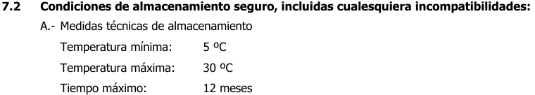

> Imagen (pág. 4). OCR automático, revisar: «7.2 Condiciones de almacenamiento seguro, incluidas cualesquiera incompatibilidades: A.- Medidas técnicas de almacenamiento Temperatura mínima: 50 Temperatura maxima: 30%C Tiempo máximo: 12 meses»

<!-- Start of picture text -->
7.2  Condiciones de almacenamiento seguro, incluidas cualesquiera incompatibilidades: A.- Medidas técnicas de almacenamiento Temperatura mínima:  5 ºC Temperatura máxima:  30 ºC Tiempo máximo:  12 meses <!-- End of picture text -->

- B.- Condiciones generales de almacenamiento. 

   - Evitar fuentes de calor, radiación, electricidad estática y el contacto con alimentos. Para información adicional ver epígrafe 10.5 

<!-- Start of picture text -->
7.3  Usos específicos finales: <!-- End of picture text -->

Salvo las indicaciones ya especificadas no es preciso realizar ninguna recomendación especial en cuanto a los usos de este producto. 

# SECCIÓN 8: CONTROLES DE EXPOSICIÓN/PROTECCIÓN PERSONAL 

- **8.1 Parámetros de control:** 

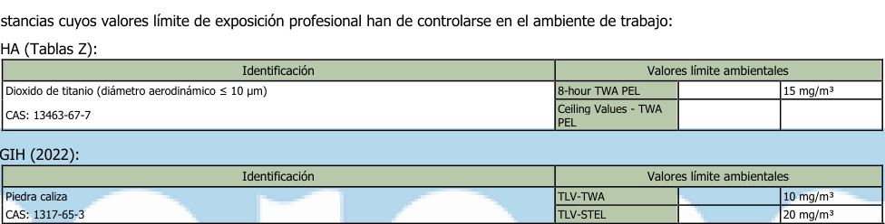

> Imagen (pág. 4). OCR automático, revisar: «stancias cuyos valores límite de exposición profesional han de controlarse en el ambiente de trabajo: HA (Tablas Z): Identificación Valores límite ambientales Dioxido de titanio (diámetro aerodinámico < 10 um) 8-hour TWA PEL 15 mg/m? 67: [Ceiling Values - TWA CAS: 13463-67-7 eat GIH (2022): Identificación Valores límite ambientales Piedra caliza [mv-rwa, 10 mg/m? CAS: 1317-65-3 TLv-STEL 20 mg/m?»

<!-- Start of picture text -->
Sustancias cuyos valores límite de exposición profesional han de controlarse en el ambiente de trabajo: OSHA (Tablas Z): (Tablas Z): Tablas Z): ): : Identificación  Valores límite ambientales Dioxido de titanio (diámetro aerodinámico ≤ 10 μm)  8-hour TWA PEL  15 mg/m³ CAS: 13463-67-7  Ceiling Values - TWA PEL ACGIH (2022): (2022): 2022): ): : — e Identificación  Valores límite ambientales Piedra caliza  TLV-TWA  10 mg/m³ g/m³ /m³ CAS: 1317-65-3  TLV-STEL  20 mg/m³ <!-- End of picture text -->

Sustancias cuyos valores límite de exposición profesional han de controlarse en el ambiente de trabajo: 

<!-- Start of picture text -->
OSHA (Tablas Z): (Tablas Z): Tablas Z): ): : <!-- End of picture text -->

<!-- Start of picture text -->
ACGIH (2022): (2022): 2022): ): : <!-- End of picture text -->

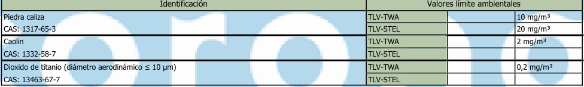

> Imagen (pág. 4). OCR automático, revisar: «Identificación Valores limite ambientales Piedra caliza [TUV-TWA 10 mg/m? CAS: 1317-65-3 [Tuv-sTEL [20 mg/m Caolin [TuV-TWA 2 mg/m [CAS: 1332-58-7 [ruv-sTEL Dioxido de titanio (diámetro aerodinámico = 10 um) [TUV-TWA 0,2 mg/m CAS: 13463-67-7. [TLv-sTEL»

<!-- Start of picture text -->
Identificación  Valores límite ambientales Piedra caliza  TLV-TWA  10 mg/m³ g/m³ /m³ CAS: 1317-65-3  TLV-STEL  20 mg/m³ Caolin  TLV-TWA  2 mg/m³ CAS: 1332-58-7  TLV-STEL Dioxido de titanio (diámetro aerodinámico ≤ 10 μm)  TLV-TWA  0,2 mg/m³ CAS: 13463-67-7  TLV-STEL <!-- End of picture text -->

<!-- Start of picture text -->
8.2  Controles técnicos apropiados: <!-- End of picture text -->

- A.- Medidas de protección individual, como equipo de protección personal (EPP) 

Realizar la identificación de los peligros y la valoración de los riesgos de acuerdo a la Guia técnica colombiana GTC 45. Como medida de prevención se recomienda la utilización de equipos de protección individual básicos. Para más información sobre los equipos de protección individual (almacenamiento, uso, limpieza, mantenimiento, clase de protección,…) consultar el folleto informativo facilitado por el fabricante del EPP. Las indicaciones contenidas en este punto se refieren al producto puro. Las medidas de protección para el producto diluido podrán variar en función de su grado de dilución, uso, método de aplicación, etc. Para determinar la obligación de instalación de duchas de emergencia y/o lavaojos en los almacenes se tendrá en cuenta la normativa referente al almacenamiento de productos químicos aplicable en cada caso. Para más información ver epígrafes 7.1 y 7.2 de la FDS. 

Toda la información aquí incluida es una recomendación siendo necesario su concreción por parte de los servicios de prevención de riesgos laborales al desconocer las medidas de prevención adicionales que la empresa pudiese disponer. 

- B.- Protección respiratoria. 

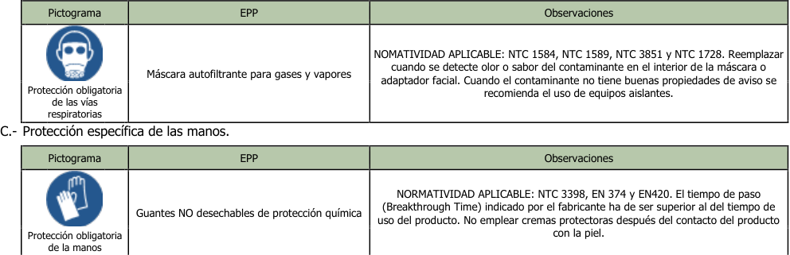

> Imagen (pág. 4). OCR automático, revisar: «Pictograma EPP Observaciones NOMATIVIDAD APLICABLE: NTC 1584, NTC 1589, NTC 3851 y NTC 1728. Reemplazar Máscara autofitrante para gases y vapores cuando se detecte olor o sabor del contaminante en el interior de la máscara o ra autofiltrante para gases y vap adaptador facial. Cuando el contaminante no tiene buenas propiedades de aviso se Protección obligatoria recomienda el uso de equipos aislantes. de las vías respiratorias. Protección específica de las manos. Pictograma EPP Observaciones NORMATIVIDAD APLICABLE: NTC 3398, EN 374 y EN420. El tiempo de paso (Breakthrough Time) indicado por el fabricante ha de ser superior al del tiempo de uso del producto. No emplear cremas protectoras después del contacto del producto Protección obligatoria con la piel. de la manos ¡Guantes NO desechables de protección química»

<!-- Start of picture text -->
Pictograma  EPP  Observaciones NOMATIVIDAD APLICABLE: NTC 1584, NTC 1589, NTC 3851 y NTC 1728. Reemplazar cuando se detecte olor o sabor del contaminante en el interior de la máscara o Máscara autofiltrante para gases y vapores adaptador facial. Cuando el contaminante no tiene buenas propiedades de aviso se Protección obligatoria  recomienda el uso de equipos aislantes. de las vías respiratorias C.- Protección específica de las manos. Pictograma  EPP  Observaciones NORMATIVIDAD APLICABLE: NTC 3398, EN 374 y EN420. El tiempo de paso (Breakthrough Time) indicado por el fabricante ha de ser superior al del tiempo de Guantes NO desechables de protección química uso del producto. No emplear cremas protectoras después del contacto del producto Protección obligatoria  con la piel. de la manos <!-- End of picture text -->

> Imagen (pág. 4). OCR automático, revisar: «- CONTINUA EN LA SIGUIENTE PAGINA -»

<!-- Start of picture text -->
- CONTINÚA EN LA SIGUIENTE PÁGINA - <!-- End of picture text -->

<!-- Start of picture text -->
Emisión: 05/06/2019            Revisión: 17/05/2023            Versión: 5 (sustituye a 4) <!-- End of picture text -->

**Página 4/10** 

Ficha de datos de seguridad 

<!-- pagina: 5 -->
según Decreto 1496 de 2018 y Resolución 773 de 2021 

> Imagen (pág. 5). Sin texto legible por OCR; contenido gráfico no interpretado.

<!-- Start of picture text -->
[corona] <!-- End of picture text -->

# **PINTURA ALTA COBERTURA** 

# SECCIÓN 8: CONTROLES DE EXPOSICIÓN/PROTECCIÓN PERSONAL (continúa) 

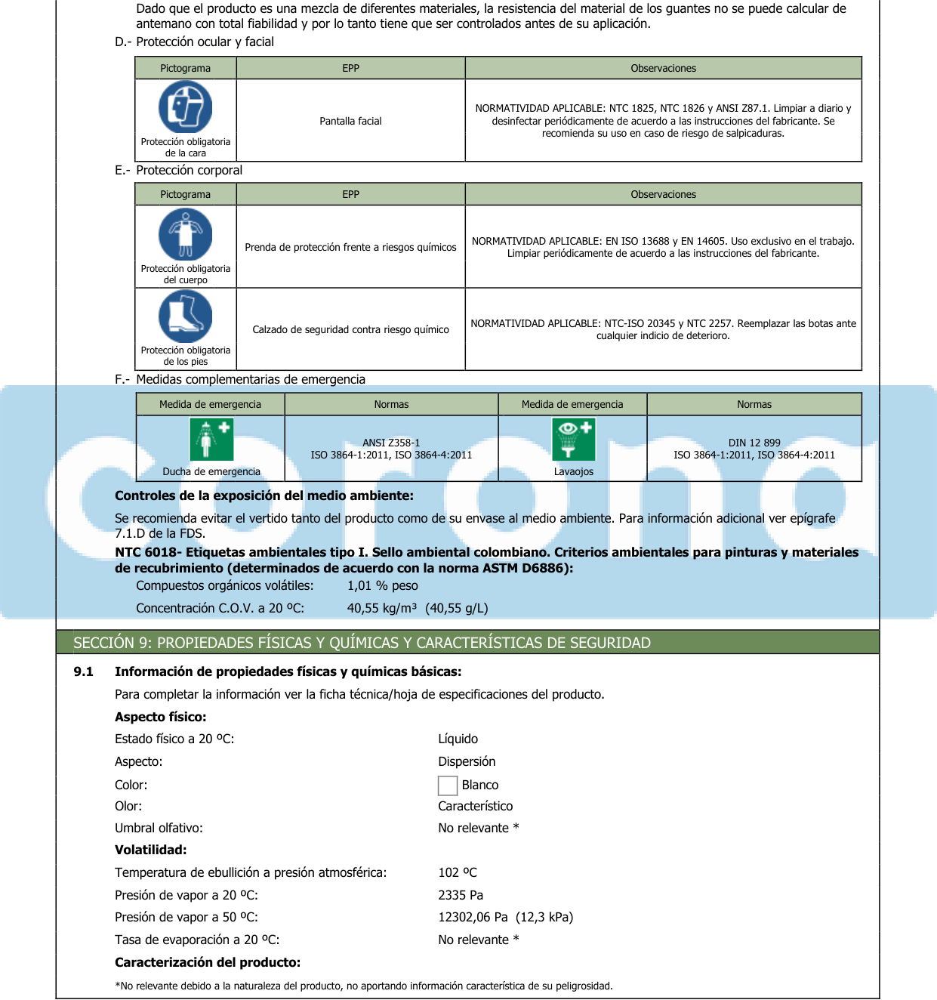

> Imagen (pág. 5). OCR automático, revisar: «Dado que el producto es una mezcla de diferentes materiales, la resistencia del material de los guantes no se puede calcular de antemano con total fiabilidad y por lo tanto tiene que ser controlados antes de su aplicación. D.- Protección ocular y facial Pictograma EPP Observaciones ain NORMATIVIDAD APLICABLE: NTC 1825, NTC 1826 y ANSI 287.1. Limpiar a diario y Pantalla facial desinfectar periódicamente de acuerdo a las instrucciones del fabricante. Se . recomienda su uso en caso de riesgo de salpicaduras. Protección obligatoria dela cara E.- Protección corporal Pictograma EPP Observaciones Protección obligatoria del cuerpo Prenda de protección frente a riesgos químicos NORMATIVIDAD APLICABLE: EN ISO 13688 y EN 14605. Uso exclusivo en el trabajo. Limpiar periódicamente de acuerdo a las instrucciones del fabricante. Protección obligatoria de los pies Calzado de seguridad contra riesgo químico NORMATIVIDAD APLICABLE: NTC-ISO 20345 y NTC 2257. Reemplazar las botas ante cualquier indicio de deterioro. n Medidas complementarias de emergencia Medida de emergencia Normas Medida de emergencia Normas + Ot ANSI 2358-1 DIN 12 899 150 3864-1:2011, ISO 3864-4:2011 150 3864-1:2011, ISO 3864-4:2011 Ducha de emergencia Lavaojos Controles de la exposición del medio ambiente: Se recomienda evitar el vertido tanto del producto como de su envase al medio ambiente. Para información adicional ver epígrafe 7.1.D de la FDS. NTC 6018- Etiquetas ambientales tipo I. Sello ambiental colombiano. Criterios ambientales para pinturas y materiales de recubrimiento (determinados de acuerdo con la norma ASTM D6886): Compuestos orgánicos volátiles: 1,01 % peso 40,55 kg/m? (40,55 g/L) Concentración C.O.V. a 20 °C: SECCIÓN 9: PROPIEDADES FÍSICAS Y QUÍMICAS Y CARACTERÍSTICAS DE 9.1 Información de propiedades físicas y químicas básicas: Para completar la información ver la ficha técnica/hoja de especificaciones del producto. Aspecto físico: Estado físico a 20 °C: Aspecto: Color: Olor: Umbral olfativo: Volatilidad: Temperatura de ebullición a presión atmosférica: Presión de vapor a 20 °C: Presión de vapor a 50 °C: Tasa de evaporación a 20 °C: Caracterización del producto: Liquid lo Dispersión "| Blanco Característico No rel levante * 102 °C 2335 Pa 12302,06 Pa (12,3 kPa) No rel levante * *No relevante debido a la naturaleza del producto, no aportando información característica de su peligrosidad.»

<!-- Start of picture text -->
Dado que el producto es una mezcla de diferentes materiales, la resistencia del material de los guantes no se puede calcular de antemano con total fiabilidad y por lo tanto tiene que ser controlados antes de su aplicación. D.- Protección ocular y facial Pictograma  EPP  Observaciones NORMATIVIDAD APLICABLE: NTC 1825, NTC 1826 y ANSI Z87.1. Limpiar a diario y Pantalla facial  desinfectar periódicamente de acuerdo a las instrucciones del fabricante. Se recomienda su uso en caso de riesgo de salpicaduras. Protección obligatoria de la cara CAM E.- Protección corporal Pictograma  EPP  Observaciones NORMATIVIDAD APLICABLE: EN ISO 13688 y EN 14605. Uso exclusivo en el trabajo. Prenda de protección frente a riesgos químicos Limpiar periódicamente de acuerdo a las instrucciones del fabricante. Protección obligatoria CAM del cuerpo NORMATIVIDAD APLICABLE: NTC-ISO 20345 y NTC 2257. Reemplazar las botas ante Calzado de seguridad contra riesgo químico cualquier indicio de deterioro. Protección obligatoria CA de los pies F.- Medidas complementarias de emergencia Medida de emergencia  Normas  Medida de emergencia  Normas ANSI Z358-1  DIN 12 899 ISO 3864-1:2011, ISO 3864-4:2011  ISO 3864-1:2011, ISO 3864-4:2011 AA Ducha de emergencia  Lavaojos  AA Controles de la exposición del medio ambiente: Se recomienda evitar el vertido tanto del producto como de su envase al medio ambiente. Para información adicional ver epígrafe 7.1.D de la FDS. NTC 6018- Etiquetas ambientales tipo I. Sello ambiental colombiano. Criterios ambientales para pinturas y materiales de recubrimiento (determinados de acuerdo con la norma ASTM D6886): Compuestos orgánicos volátiles:  1,01 % peso Concentración C.O.V. a 20 ºC:  40,55 kg/m³  (40,55 g/L) SECCIÓN 9: PROPIEDADES FÍSICAS Y QUÍMICAS Y CARACTERÍSTICAS DE SEGURIDAD 9.1  Información de propiedades físicas y químicas básicas: Para completar la información ver la ficha técnica/hoja de especificaciones del producto. Aspecto físico: Estado físico a 20 ºC:  Líquido Aspecto:  Dispersión Color:  Blanco Olor:  Característico Umbral olfativo:  No relevante * Volatilidad: Temperatura de ebullición a presión atmosférica:  102 ºC Presión de vapor a 20 ºC:  2335 Pa Presión de vapor a 50 ºC:  12302,06 Pa  (12,3 kPa) Tasa de evaporación a 20 ºC:  No relevante * Caracterización del producto: *No relevante debido a la naturaleza del producto, no aportando información característica de su peligrosidad. <!-- End of picture text -->

- CONTINÚA EN LA SIGUIENTE PÁGINA - 

Emisión: 05/06/2019            Revisión: 17/05/2023            Versión: 5 (sustituye a 4) 

**Página 5/10** 

Ficha de datos de seguridad 

<!-- pagina: 6 -->
según Decreto 1496 de 2018 y Resolución 773 de 2021 

> Imagen (pág. 6). Sin texto legible por OCR; contenido gráfico no interpretado.

# **PINTURA ALTA COBERTURA** 

SECCIÓN 9: PROPIEDADES FÍSICAS Y QUÍMICAS Y CARACTERÍSTICAS DE SEGURIDAD (continúa) 

|Densidad a 20 ºC:|1451,1 kg/m³|
|---|---|
|Densidad relativa a 20 ºC:|1,451|
|Viscosidad dinámica a 20 ºC:|No relevante *|
|Viscosidad cinemática a 20 ºC:|No relevante *|
|Viscosidad cinemática a 40 ºC:|No relevante *|
|Concentración:|No relevante *|
|pH:|No relevante *|
|Densidad de vapor a 20 ºC:|No relevante *|
|Coeficiente de reparto n-octanol/agua a 20 ºC:|No relevante *|
|Solubilidad en agua a 20 ºC:|No relevante *|
|Propiedad de solubilidad:|No relevante *|
|Temperatura de descomposición:|No relevante *|
|Punto de fusión/punto de congelación:|No relevante *|
|**Inflamabilidad:**||
|Punto de inflamación:|No inflamable (>93 ºC)|
|Inflamabilidad (sólido, gas):|No relevante *|
|Temperatura de auto-inflamación:|330 ºC|
|Límite de inflamabilidad inferior:|No relevante *|
|Límite de inflamabilidad superior:|No relevante *|
|**Características de las partículas:**||
|Diámetro medio equivalente:|No aplicable|
|**9.2** **Información adicional:**||
|**Información relativa a las clases de peligro físico:**||
|Propiedades explosivas:|No relevante *|
|Propiedades comburentes:|No relevante *|
|Corrosivos para los metales:|No relevante *|
|Calor de combustión:|No relevante *|
|Aerosoles-porcentaje total (en masa) de componentes |No relevante *|
|inflamables:||
|**Otras características de seguridad:**||
|Tensión superficial a 20 ºC:|No relevante *|
|Índice de refracción:|No relevante *|
|*No relevante debido a la naturaleza del producto, no aportando infor|mación característica de su peligrosidad.|
|SECCIÓN 10: ESTABILIDAD Y REACTIVIDAD||

|**10.1**|**Reactividad:**||||
|---|---|---|---|---|
|**10.2**|No se esperan reacciones p 7 de la FDS para mayor info **Estabilidad química:**|eligrosas si se cumplen las i rmación.|nstrucciones técnicas de almacenamiento de product|os químicos. Ver sección|
||Estable químicamente bajo l|as condiciones indicadas de|almacenamiento, manipulación y uso.||
|**10.3**|**Posibilidad de reacciones**|**peligrosas:**|||
||Bajo las condiciones indicad temperaturas excesivas.|as no se esperan reaccione|s peligrosas ni polimerización peligrosa que puedan p|roducir una presión o|
|**10.4**|**Condiciones que deben e** Aplicables para manipulació |**vitarse:** n y almacenamiento a temp|eratura ambiente:||
||Choque y fricción|Contacto con el aire|Calentamiento Luz Solar|Humedad|
||No aplicable|No aplicable|No aplicable No aplicable|No aplicable|
||| - CONTINÚA|   EN LA SIGUIENTE PÁGINA -||

Emisión: 05/06/2019            Revisión: 17/05/2023            Versión: 5 (sustituye a 4) **Página 6/10** 

<!-- pagina: 7 -->

> Imagen (pág. 7). Sin texto legible por OCR; contenido gráfico no interpretado.

<!-- Start of picture text -->
Ficha de datos de seguridad <!-- End of picture text -->

<!-- Start of picture text -->
según Decreto 1496 de 2018 y Resolución 773 de 2021 <!-- End of picture text -->

<!-- Start of picture text -->
PINTURA ALTA COBERTURA <!-- End of picture text -->

> Imagen (pág. 7). OCR automático, revisar: «E el Acidos Agua Materias comburentes Materias combustibles Otros Evitar ácidos fuertes No aplicable No aplicable No aplicable Evitar álcalis o bases fuertes»

<!-- Start of picture text -->
Ácidos  Agua  Materias comburentes  Materias combustibles  Otros Evitar ácidos fuertes  No aplicable  No aplicable  No aplicable  Evitar álcalis o bases fuertes <!-- End of picture text -->

- condiciones de descomposición, como consecuencia de la misma pueden liberarse mezclas complejas de sustancias químicas: dióxido 

<!-- Start of picture text -->
-   Corrosividad/Irritabilidad: A la vista de los datos disponibles, no se cumplen los criterios de clasificación, sin embargo, presenta <!-- End of picture text -->

<!-- Start of picture text -->
-   Carcinogenicidad: La exposición a este producto puede causar cáncer. Para más información sobre posibles efectos específicos <!-- End of picture text -->

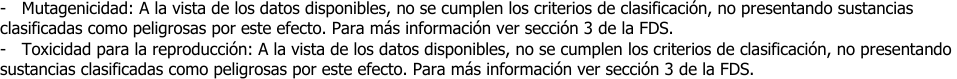

> Imagen (pág. 7). OCR automático, revisar: «- Mutagenicidad: A la vista de los datos disponibles, no se cumplen los criterios de clasificación, no presentando sustancias clasificadas como peligrosas por este efecto, Para más información ver sección 3 de la FDS. - Toxicidad para la reproducción: A la vista de los datos disponibles, no se cumplen los criterios de clasificación, no presentando sustancias clasificadas como peligrosas por este efecto. Para más información ver sección 3 de la FDS.»

<!-- Start of picture text -->
-   Mutagenicidad: A la vista de los datos disponibles, no se cumplen los criterios de clasificación, no presentando sustancias clasificadas como peligrosas por este efecto. Para más información ver sección 3 de la FDS. -   Toxicidad para la reproducción: A la vista de los datos disponibles, no se cumplen los criterios de clasificación, no presentando sustancias clasificadas como peligrosas por este efecto. Para más información ver sección 3 de la FDS. <!-- End of picture text -->

> Imagen (pág. 7). OCR automático, revisar: «A la vista de los datos disponibles, no se cumplen los criterios de clasificación, sin embargo, presenta sustancias clasificadas como peligrosas por inhalación. Para más información ver sección 3 de la FDS.»

<!-- Start of picture text -->
A la vista de los datos disponibles, no se cumplen los criterios de clasificación, sin embargo, presenta sustancias clasificadas como peligrosas por inhalación. Para más información ver sección 3 de la FDS. <!-- End of picture text -->

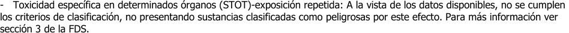

> Imagen (pág. 7). OCR automático, revisar: «- Toxicidad especifica en determinados órganos (STOT)-exposición repetida: A la vista de los datos disponibles, no se cumplen los criterios de clasificación, no presentando sustancias clasificadas como peligrosas por este efecto. Para más información ver sección 3 de la FDS.»

<!-- Start of picture text -->
-   Toxicidad específica en determinados órganos (STOT)-exposición repetida: A la vista de los datos disponibles, no se cumplen los criterios de clasificación, no presentando sustancias clasificadas como peligrosas por este efecto. Para más información ver sección 3 de la FDS. <!-- End of picture text -->

<!-- Start of picture text -->
- CONTINÚA EN LA SIGUIENTE PÁGINA - <!-- End of picture text -->

<!-- Start of picture text -->
Emisión: 05/06/2019            Revisión: 17/05/2023            Versión: 5 (sustituye a 4) <!-- End of picture text -->

SECCIÓN 10: ESTABILIDAD Y REACTIVIDAD (continúa) **10.5 Materiales incompatibles:** Ácidos Agua Materias comburentes Materias combustibles Otros Evitar ácidos fuertes No aplicable No aplicable No aplicable Evitar álcalis o bases fuertes **10.6 Productos de descomposición peligrosos:** Ver epígrafe 10.3, 10.4 y 10.5 de la FDS para conocer los productos de descomposición específicamente. En dependencia de las condiciones de descomposición, como consecuencia de la misma pueden liberarse mezclas complejas de sustancias químicas: dióxido de carbono (CO₂), monóxido de carbono y otros compuestos orgánicos. <mark>SECCIÓN 11: INFORMACIÓN TOXICOLÓGICA</mark> **11.1 Información sobre las posibles vías de exposición:** No se dispone de datos experimentales del producto en sí mismo relativos a las propiedades toxicológicas **Efectos peligrosos para la salud:** En caso de exposición repetitiva, prolongada o a concentraciones superiores a las establecidas por los límites de exposición profesionales, pueden producirse efectos adversos para la salud en función de la vía de exposición: A- Ingestión (efecto agudo): -   Toxicidad aguda: A la vista de los datos disponibles, no se cumplen los criterios de clasificación, sin embargo, presenta sustancias clasificadas como peligrosas por ingestión. Para más información ver sección 3 de la FDS. -   Corrosividad/Irritabilidad: A la vista de los datos disponibles, no se cumplen los criterios de clasificación, no presentando sustancias clasificadas como peligrosas por este efecto. Para más información ver sección 3 de la FDS. B- Inhalación (efecto agudo): -   Toxicidad aguda: A la vista de los datos disponibles, no se cumplen los criterios de clasificación, sin embargo, presenta sustancias clasificadas como peligrosas por inhalación. Para más información ver sección 3 de la FDS. -   Corrosividad/Irritabilidad: A la vista de los datos disponibles, no se cumplen los criterios de clasificación, sin embargo, presenta sustancias clasificadas como peligrosas por inhalación. Para más información ver sección 3 de la FDS. C- Contacto con la piel y los ojos (efecto agudo): -   Contacto con la piel: A la vista de los datos disponibles, no se cumplen los criterios de clasificación, sin embargo, presenta sustancias clasificadas como peligrosas por contacto con la piel. Para más información ver sección 3 de la FDS. -   Contacto con los ojos: A la vista de los datos disponibles, no se cumplen los criterios de clasificación, sin embargo presenta sustancias clasificadas como peligrosas por este efecto. Para más información ver sección 3 de la FDS. D- Efectos CMR (carcinogenicidad, mutagenicidad y toxicidad para la reproducción): -   Carcinogenicidad: La exposición a este producto puede causar cáncer. Para más información sobre posibles efectos específicos sobre la salud ver sección 2 de la FDS. IARC: White mineral oil, <=20.5mm2/s (40ºC) (3); Dioxido de titanio (diámetro aerodinámico ≤ 10 μm) (2B); Destilados (petróleo), fracción ligera tratada con hidrógeno (3) -   Mutagenicidad: A la vista de los datos disponibles, no se cumplen los criterios de clasificación, no presentando sustancias clasificadas como peligrosas por este efecto. Para más información ver sección 3 de la FDS. -   Toxicidad para la reproducción: A la vista de los datos disponibles, no se cumplen los criterios de clasificación, no presentando sustancias clasificadas como peligrosas por este efecto. Para más información ver sección 3 de la FDS. E- Efectos de sensibilización: -   Respiratoria: A la vista de los datos disponibles, no se cumplen los criterios de clasificación, no presentando sustancias clasificadas como peligrosas con efectos sensibilizantes. Para más información ver secciones 2, 3 y 15 de la FDS. -   Cutánea: A la vista de los datos disponibles, no se cumplen los criterios de clasificación, sin embargo, presenta sustancias clasificadas como peligrosas con efectos sensibilizantes. Para más información ver sección 3 de la FDS. F- Toxicidad específica en determinados órganos (STOT)-exposición única: A la vista de los datos disponibles, no se cumplen los criterios de clasificación, sin embargo, presenta sustancias clasificadas como peligrosas por inhalación. Para más información ver sección 3 de la FDS. G- Toxicidad específica en determinados órganos (STOT)-exposición repetida: -   Toxicidad específica en determinados órganos (STOT)-exposición repetida: A la vista de los datos disponibles, no se cumplen los criterios de clasificación, no presentando sustancias clasificadas como peligrosas por este efecto. Para más información ver sección 3 de la FDS. -   Piel: A la vista de los datos disponibles, no se cumplen los criterios de clasificación, no presentando sustancias clasificadas como peligrosas por este efecto. Para más información ver sección 3 de la FDS. H- Peligro por aspiración: ~~<u>Sar</u>~~ - CONTINÚA EN LA SIGUIENTE PÁGINA - 

**Página 7/10** 

<!-- pagina: 8 -->
Ficha de datos de seguridad según Decreto 1496 de 2018 y Resolución 773 de 2021 

> Imagen (pág. 8). Sin texto legible por OCR; contenido gráfico no interpretado.

# **PINTURA ALTA COBERTURA** 

# SECCIÓN 11: INFORMACIÓN TOXICOLÓGICA (continúa) 

A la vista de los datos disponibles, no se cumplen los criterios de clasificación, no presentando sustancias clasificadas como peligrosas por este efecto. Para más información ver sección 3 de la FDS. 

## **Información adicional:** 

CAS 13463-67-7 Dióxido de Titanio: IARC lista esta sustancia como un posible carcinógeno humano (grupo 2B), indicando que hay suficientes evidencias para considerarlo carcinógeno en animales pero insuficientes para considerarlo como carcinógeno para seres humanos. 

La monografía de IARC para esta sustancia indica que no hay exposición significativa al dióxido de titanio durante el uso normal de productos en los que dióxido de titanio está unido permanentemente a otros materiales, tales como pinturas (Ref: Monografía IARC, Vol. 93, 2010). 

El lijado repetido de las superficies de película seca puede producir riesgo de sobreexposición al polvo dependiendo de la duración y nivel de lijado, para evitarla deben tomarse las medidas de protección adecuadas. 

## **Información toxicológica específica de las sustancias:** 

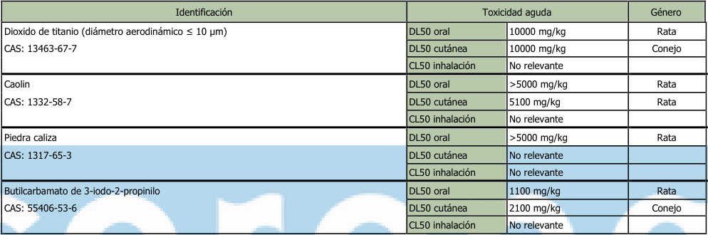

> Imagen (pág. 8). OCR automático, revisar: «Identificación Toxicidad aguda Género Dioxido de titanio (diámetro aerodinámico < 10 ym) DLSO oral 10000 mg/kg Rata CAS: 13463-67-7 DLO cutánea 10000 mg/kg Conejo [CLSO inhalación No relevante [Caolin DL5O oral >5000 mg/kg Rata (CAS: 1332-58-7 DL5O cutánea 5100 mg/kg Rata [CLSO inhalación No relevante Piedra caliza DLSO oral >5000 mg/kg Rata CAS: 1317-65-3 DLSO cutánea No relevante [CL50 inhalación No relevante Butilcarbamato de 3-iodo-2-propinilo DLS5O oral 1100 mg/kg Rata CAS: 55406-53-6 DLSO cutánea 2100 mg/kg Conejo [CL50 inhalación No relevante»

<!-- Start of picture text -->
Identificación  Toxicidad aguda  Género Dioxido de titanio (diámetro aerodinámico ≤ 10 μm)  DL50 oral  10000 mg/kg  Rata CAS: 13463-67-7  DL50 cutánea  10000 mg/kg  Conejo CL50 inhalación  No relevante Caolin  DL50 oral  >5000 mg/kg  Rata CAS: 1332-58-7  DL50 cutánea  5100 mg/kg  Rata CL50 inhalación  No relevante Piedra caliza  DL50 oral  >5000 mg/kg  Rata CAS: 1317-65-3  DL50 cutánea  No relevante CL50 inhalación  No relevante Butilcarbamato de 3-iodo-2-propinilo  DL50 oral  1100 mg/kg  Rata CAS: 55406-53-6  DL50 cutánea  2100 mg/kg  Conejo CL50 inhalación  No relevante <!-- End of picture text -->

# SECCIÓN 12: INFORMACIÓN ECOTOXICOLÓGICA 

No se disponen de datos experimentales de la mezcla en sí misma relativos a las propiedades ecotoxicológicas. 

## **12.1 Toxicidad:** 

<!-- Start of picture text -->
No disponible <!-- End of picture text -->

<!-- Start of picture text -->
12.3 Potencial de bioacumulación: <!-- End of picture text -->

<!-- Start of picture text -->
Información específica de las sustancias: <!-- End of picture text -->

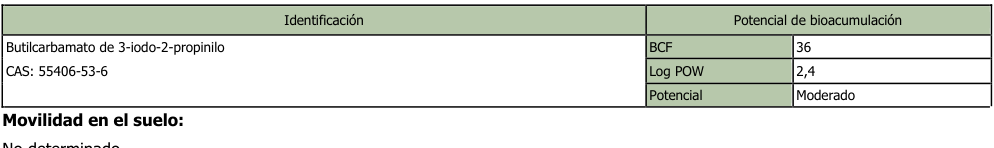

> Imagen (pág. 8). OCR automático, revisar: «Identificación Potencial de bioacumulación Butilcarbamato de 3-iodo-2-propinilo BCF 36 (CAS: 55406-53-6 Log POW 2,4 Potencial Moderado idad en el suelo: Mo»

<!-- Start of picture text -->
Identificación  Potencial de bioacumulación Butilcarbamato de 3-iodo-2-propinilo  BCF  36 CAS: 55406-53-6  Log POW  2,4 Potencial  Moderado es 12.4 Movilidad en el suelo: —— <!-- End of picture text -->

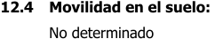

> Imagen (pág. 8). OCR automático, revisar: «12.4 Movilidad en el suelo: No determinado»

<!-- Start of picture text -->
12.4 Movilidad en el suelo: No determinado <!-- End of picture text -->

Emisión: 05/06/2019            Revisión: 17/05/2023            Versión: 5 (sustituye a 4) 

**Toxicidad aguda:** 

Identificación Concentración Especie Género Caolin CL50 No relevante CAS: 1332-58-7 CE50 1100 mg/L (48 h) Daphnia pulex Crustáceo CE50 No relevante Butilcarbamato de 3-iodo-2-propinilo CL50 0,07 mg/L (96 h) Oncorhynchus mykiss Pez CAS: 55406-53-6 CE50 0,09 mg/L (96 h) Mysidopsis bahia Crustáceo CE50 0,05 mg/L (72 h) Scenedesmus subspicatus Alga **Toxicidad a largo plazo:** Identificación Concentración Especie Género Butilcarbamato de 3-iodo-2-propinilo NOEC 0,0084 mg/L Pimephales promelas Pez ~~<u>o</u>~~ CAS: 55406-53-6 NOEC 0,0499 mg/L Daphnia magna Crustáceo 

**12.2 Persistencia y degradabilidad:** 

- CONTINÚA EN LA SIGUIENTE PÁGINA - 

**Página 8/10** 

<!-- pagina: 9 -->
Ficha de datos de seguridad según Decreto 1496 de 2018 y Resolución 773 de 2021 

**PINTURA ALTA COBERTURA** 

> Imagen (pág. 9). Sin texto legible por OCR; contenido gráfico no interpretado.

# SECCIÓN 12: INFORMACIÓN ECOTOXICOLÓGICA (continúa) 

## **12.5 Resultados de la valoración PBT y mPmB:** 

No aplicable 

## **12.6 Otros efectos adversos:** 

No descritos 

# <mark>SECCIÓN 13: INFORMACIÓN RELATIVA A LA ELIMINACIÓN DE LOS PRODUCTOS</mark> 

## **13.1 Métodos de eliminación:** 

## **Gestión del residuo (eliminación y valorización):** 

Consultar al gestor de residuos autorizado las operaciones de valorización y eliminación. En el caso de que el envase haya estado en contacto directo con el producto se gestionará del mismo modo que el propio producto, en caso contrario se gestionará como residuo no peligroso. Se desaconseja su vertido a cursos de agua. Ver epígrafe 6.2. 

## **Disposiciones legislativas relacionadas con la gestión de residuos:** 

Legislación relacionada con la gestión de residuos: 

Decreto 1076 de 2015 (Decreto único reglamentario del Sector Ambiente y Desarrollo Sostenible) 

# SECCIÓN 14: INFORMACIÓN RELATIVA AL TRANSPORTE 

Este producto no está regulado para su transporte 

# SECCIÓN 15: INFORMACIÓN SOBRE LA REGLAMENTACIÓN 

## **15.1 Disposiciones específicas sobre seguridad, salud y medio ambiente para el producto de que se trate:** 

- NTP (National Toxicology Program): No relevante 

## **Disposiciones particulares en materia de protección de las personas o el medio ambiente:** 

Se recomienda emplear la información recopilada en esta hoja de datos de seguridad de materiales como datos de entrada en una evaluación de riesgos de las circunstancias locales con el objeto de establecer las medidas necesarias de prevención de riesgos para el manejo, utilización, almacenamiento y eliminación de este producto. **Otras legislaciones:** 

Resolución 0312 de 2019 – Nuevos estándares mínimos del SG-SST CONPES 3868 - Política de gestión del riesgo asociado al uso de sustancias químicas. Decreto 1079 de 2015 - Decreto único reglamentario del sector transporte NTC 1692 -Transporte de mercancías peligrosas. Definiciones, clasificación, marcado, etiquetado y rotulado NTC 4532- Transporte de mercancías peligrosas. Tarjetas de emergencia para transporte de materiales. Elaboración Decreto número 4741 de 2005 Decreto 1299 de 2008 -Reglamenta departamento de gestión ambiental de empresas a nivel industrial estado Decreto 321 de 1999  - Adopta el Plan Nacional de Contingencia contra derrames de hidrocarburos, derivados y sustancias nocivas. NTC 4702 - 1 -Embalaje y Envases para Transporte de Mercancías Peligrosas Clase 1. Explosivos NTC 4702 - 2 - Embalaje y Envases para Transporte de Mercancías Peligrosas Clase 2. Gases NTC 4702 - 3 - Embalaje y Envases para Transporte de Mercancías Peligrosas Clase 3. Líquidos Inflamables NTC 4702 - 4 - Embalaje y Envases para Transporte de Mercancías Peligrosas Clase 4. Sólidos Inflamables, Sustancias que presentan riesgo de combustión espontánea, sustancias que en contacto con el agua desprenden gases inflamables. NTC 4702 - 5 - Embalaje y Envases para Transporte de Mercancías Peligrosas Clase 5. Sustancias Comburentes y Peróxidos Orgánicos NTC 4702 - 6 - Embalaje y Envases para Transporte de Mercancías Peligrosas Clase 6. Sustancias Tóxicas e Infecciosas NTC 4702 - 8 - Embalaje y Envases para Transporte de Mercancías Peligrosas Clase 8. Sustancias Corrosivas NTC 4702 - 9 - Embalaje y Envases para Transporte de Mercancías Peligrosas Clase 9. Sustancias Peligrosas varias 

Ley 2041 de 2020 - Por medio de la cual se garantiza el derecho de las personas a desarrollarse física e intelectualmente en un ambiente libre de plomo, fijando límites para su contenido en productos comercializados en el país. 

# SECCIÓN 16: OTRAS INFORMACIONES 

**Legislación aplicable a fichas de datos de seguridad:** 

- CONTINÚA EN LA SIGUIENTE PÁGINA - 

Emisión: 05/06/2019            Revisión: 17/05/2023            Versión: 5 (sustituye a 4) 

**Página 9/10** 

<!-- pagina: 10 -->
Ficha de datos de seguridad según Decreto 1496 de 2018 y Resolución 773 de 2021 **PINTURA ALTA COBERTURA** 

> Imagen (pág. 10). Sin texto legible por OCR; contenido gráfico no interpretado.

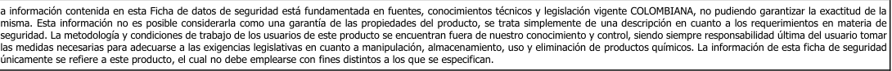

> Imagen (pág. 10). OCR automático, revisar: «a información contenida en esta Ficha de datos de seguridad está fundamentada en fuentes, conocimientos técnicos y legislación vigente COLOMBIANA, no pudiendo garantizar la exactitud de la misma. Esta información no es posible consideraría como una garantía de las propiedades del producto, se trata simplemente de una descripción en cuanto a los requerimientos en materia de seguridad. La metodología y condiciones de trabajo de los usuarios de este producto se encuentran fuera de nuestro conocimiento y control, siendo siempre responsabilidad última del usuario tomar las medidas necesarias para adecuarse a las exigencias legislativas en cuanto a manipulación, almacenamiento, uso y eliminación de productos químicos. La información de esta ficha de seguridad únicamente se refiere a este producto, el cual no debe emplearse con fines distintos a los que se especifican»

<!-- Start of picture text -->
a información contenida en esta Ficha de datos de seguridad está fundamentada en fuentes, conocimientos técnicos y legislación vigente COLOMBIANA, no pudiendo garantizar la exactitud de la misma. Esta información no es posible considerarla como una garantía de las propiedades del producto, se trata simplemente de una descripción en cuanto a los requerimientos en materia de seguridad. La metodología y condiciones de trabajo de los usuarios de este producto se encuentran fuera de nuestro conocimiento y control, siendo siempre responsabilidad última del usuario tomar las medidas necesarias para adecuarse a las exigencias legislativas en cuanto a manipulación, almacenamiento, uso y eliminación de productos químicos. La información de esta ficha de seguridad únicamente se refiere a este producto, el cual no debe emplearse con fines distintos a los que se especifican. <!-- End of picture text -->

<!-- Start of picture text -->
Emisión: 05/06/2019            Revisión: 17/05/2023            Versión: 5 (sustituye a 4) <!-- End of picture text -->

SECCIÓN 16: OTRAS INFORMACIONES (continúa) Esta ficha de datos de seguridad se ha desarrollado de conformidad al Decreto 1496 de 2018 y a la Resolución 773 de 2021, contando con los elementos definidos en el ANEXO 4 - Guía para la elaboración de fichas de datos de seguridad (FDS) del Sistema Globalmente Armonizado de clasificación y etiquetado de productos químicos (SGA), sexta edición revisada (2015). **Textos de las frases legislativas contempladas en la sección 2:** H351: Susceptible de provocar cáncer (Inhalación). **Textos de las frases legislativas contempladas en la sección 3:** Las frases indicadas no se refieren al producto en sí, son sólo a título informativo y hacen referencia a los componentes individuales que aparecen en la sección 3 **SGA:** Acuático agudo. 1: H400 - Muy tóxico para los organismos acuáticos. Carc. 2: H351 - Susceptible de provocar cáncer (Inhalación). Les. Oc. 1: H318 - Provoca lesiones oculares graves. Sens. Cut. 1: H317 - Puede provocar una reacción cutánea alérgica. STOT única 3: H335 - Puede irritar las vías respiratorias. Tox. Agud. 4: H302+H332 - Nocivo en caso de ingestión o si se inhala. Tox. Agud. 5: H313 - Puede ser nocivo en contacto con la piel. **Procedimiento de clasificación:** Carc. 2: Método de cálculo (SGA Rev. 6) **Consejos relativos a la formación:** Se recomienda formación mínima en materia de prevención de riesgos laborales al personal que va a manipular este producto, con la finalidad de facilitar la comprensión e interpretación de esta hoja de datos de seguridad de materiales, así como del etiquetado del producto. **Principales fuentes bibliográficas:** Ministerio de trabajo de la República de Colombia (https://www.mintrabajo.gov.co). Portal global de información sobre sustancias químicas - e-CHEM-PORTAL. Sistema de información sobre sustancias peligrosas-GESTIS. Agencia Internacional para la Investigación del Cáncer-IARC. Instituto Colombiano de Normas Técnicas y Certificación (ICONTEC). **Abreviaturas y acrónimos:** IMDG: Código Marítimo Internacional de Mercancías Peligrosas IATA: Asociación Internacional de Transporte Aéreo OACI: Organización de Aviación Civil Internacional DQO: Demanda Química de Oxígeno DBO5: Demanda Biológica de Oxígeno a los 5 días BCF: Factor de bioconcentración DL50: Dosis Letal 50 CL50: Concentración Letal 50 EC50: Concentración Efectiva 50 Log POW: Logaritmo Coeficiente Partición Octanol-Agua Koc: Coeficiente de Partición del Carbono Orgánico IARC: Centro Internacional de Investigaciones sobre el Cáncer a información contenida en esta Ficha de datos de seguridad está fundamentada en fuentes, conocimientos técnicos y legislación vigente COLOMBIANA, no pudiendo garantizar la exactitud de la misma. Esta información no es posible considerarla como una garantía de las propiedades del producto, se trata simplemente de una descripción en cuanto a los requerimientos en materia de seguridad. La metodología y condiciones de trabajo de los usuarios de este producto se encuentran fuera de nuestro conocimiento y control, siendo siempre responsabilidad última del usuario tomar las medidas necesarias para adecuarse a las exigencias legislativas en cuanto a manipulación, almacenamiento, uso y eliminación de productos químicos. La información de esta ficha de seguridad únicamente se refiere a este producto, el cual no debe emplearse con fines distintos a los que se especifican. ~~a~~ 

FIN DE LA FICHA DE DATOS DE SEGURIDAD **Página 10/10** 
