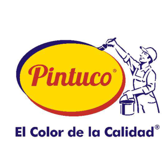

<!-- pagina: 1 -->

> Imagen (pág. 1). OCR automático, revisar: «5 Pintuco pun Cre): El Color de la Calidad”»

<!-- Start of picture text -->
ch EA El Color de la Calidad” <!-- End of picture text -->

# **FICHA DE DATOS DE SEGURIDAD** 

PQ CORROTEC PREMIUM 507 GRIS 

## **Sección 1. Identificación** 

**Identificador SGA del :** PQ CORROTEC PREMIUM 507 GRIS **producto SDS code :** 507 

### **<mark>Usos pertinentes identificados de la sustancia o de la mezcla y usos desaconsejados</mark>** 

|**Usos identificados** **Usos contraindicados**|
|---|

Uso profesional Uso industrial Uso por el consumidor **Usos contraindicados** Todos los demás usos **Uso del producto :** Recubrimiento base disolvente para uso interior y exterior. 

### **Datos sobre el proveedor** 

Compañía Global de Pinturas S.A.S. Autopista Medellín Bogotá Km 37. Vía Belén Rionegro Km 1. 054040 Rionegro - Antioquia - Colombia 01 8000 111 247 Medellín 604 325 2523 www.pintuco.com **Dirección de e-mail de la :** PSRA.southamerica@akzonobel.com **persona responsable de esta FDS Teléfono de emergencias :** CISTEMA SURA Colombia al 018000 51 14 14, fuera de Colombia (0574) 4444578 **(con horas de** 24 horas **funcionamiento)** 

|**_Fecha de emisión/Fecha de revisión_**|**:**_2-5-2024_|**_Versión_** **_:_**_1_|
|---|---|---|
|**_Fecha de la emisión anterior_**|**_:_**_No hay validación anterior_|_1/17_|

> Imagen (pág. 1). Sin texto legible por OCR; contenido gráfico no interpretado.

<!-- pagina: 2 -->
_PQ CORROTEC PREMIUM 507 GRIS_ 

## **Sección 2. Identificación de los peligros** 

|**Clasificación de la** **sustancia o de la mezcla**|LÍQUIDOS INFLAMABLES - Categoría 3 IRRITACIÓN CUTÁNEA - Categoría 2 IRRITACIÓN OCULAR - Categoría 2A SENSIBILIZACIÓN RESPIRATORIA - Categoría 1 SENSIBILIZACIÓN CUTÁNEA - Categoría 1 MUTAGENICIDAD EN CÉLULAS GERMINALES - Categoría 1B CARCINOGENICIDAD - Categoría 1A TOXICIDAD PARA LA REPRODUCCIÓN - Categoría 2 TOXICIDAD ESPECÍFICA EN DETERMINADOS ÓRGANOS (STOT) - EXPOSICIONES REPETIDAS - Categoría 2 PELIGRO ACUÁTICO A CORTO PLAZO (AGUDO) - Categoría 3 PELIGRO ACUÁTICO A LARGO PLAZO (CRÓNICO) - Categoría 3 **:**|
|---|---|
|**Elementos de las etiquetas d**|**el SGA**|
|**Pictogramas de peligro**|**:**|
|**Palabra de advertencia** **Indicaciones de peligro**|**:** Peligro **:** H226 - Líquidos y vapores inflamables. H315 - Provoca irritación cutánea. H317 - Puede provocar una reacción alérgica en la piel. H319 - Provoca irritación ocular grave. H334 - Puede provocar síntomas de alergia o asma o dificultades respiratorias en caso de inhalación. H340 - Puede provocar defectos genéticos. H350 - Puede provocar cáncer. H361 - Se sospecha que puede perjudicar la fertilidad o dañar el feto. H373 - Puede provocar daños en los órganos tras exposiciones prolongadas o repetidas. (sistema nervioso central (SNC)) H412 - Nocivo para los organismos acuáticos, con efectos nocivos duraderos.|
|**Consejos de prudencia**||
|**General**|**:** P102 - Mantener fuera del alcance de los niños. P101 - Si se necesita consejo médico, tener a mano el envase o la etiqueta.|
|**Prevención**|**:** P201 - Solicitar instrucciones especiales antes del uso. P280 - Usar guantes de protección, ropa de protección e equipo de protección para la cara o los ojos. P284 - Llevar equipo de protección respiratoria. P210 - Mantener alejado del calor, de superficies calientes, de chispas, de llamas abiertas y de cualquier otra fuente de ignición. No fumar. P273 - Evitar su liberación al medio ambiente. P260 - No respirar los vapores.|
|| P264 - Lavarse las manos concienzudamente tras la manipulación.|
|**Respuesta**|**:** P308 + P313 - EN CASO DE exposición manifiesta o presunta: Consultar a un médico. P304 + P340 - EN CASO DE INHALACIÓN: Transportar a la persona al aire libre y mantenerla en una posición que le facilite la respiración. P342 + P311 - En caso de síntomas respiratorios: Llamar a un CENTRO DE INFORMACIÓN TOXICOLÓGICA o a un médico. P362 + P364 - Quitar las prendas contaminadas y lavarlas antes de volver a usarlas. P302 + P352 - EN CASO DE CONTACTO CON LA PIEL: Lavar con abundante agua. P333 + P313 - En caso de irritación o erupción cutánea: Consultar a un médico. P305 + P351 + P338 - EN CASO DE CONTACTO CON LOS OJOS: Aclarar cuidadosamente con agua durante varios minutos. Quitar las lentes de contacto, si lleva y resulta fácil. Seguir aclarando. P337 + P313 - Si persiste la irritación ocular: Consultar a un médico.|
|**_Fecha de emisión/Fecha de revisión_**|**:**_2-5-2024_ **_Versión_** **_:_**_1_|
|**_Fecha de la emisión anterior_**|**_:_**_No hay validación anterior_ _2/17_|

<!-- pagina: 3 -->
_PQ CORROTEC PREMIUM 507 GRIS_ 

## **Sección 2. Identificación de los peligros** 

- **Almacenamiento :** P405 - Guardar bajo llave. P403 + P235 - Almacenar en un lugar bien ventilado. Mantener en lugar fresco. 

- **Eliminación :** P501 - Eliminar el contenido / el recipiente en conformidad con las reglamentaciones locales y nacionales. 

**Otros peligros que no conducen a una clasificación** 

- **:** No se conoce ninguno. 

## **Sección 3. Composición/información sobre los componentes** 

- **Sustancia/preparado :** Mezcla **Otros medios de :** No disponible. **identificación** 

|**Nombre del ingrediente**|**Número de CAS**|**Concentración**|
|---|---|---|
|gasolina|86290-81-5|≤5|
|disolvente de Stoddard|8052-41-3|≤5|
|ácidos grasos, aceite de resina|61790-12-3|≤5|
|anhídrido ftalico|85-44-9|<3|
|ligroína|8032-32-4|≤1|
|benceno|71-43-2|<1|
|bis(2-etilhexanoato) de cobalto|136-52-7|<0.3|
|tetraóxido de bario y diboro|13701-59-2|<0.3|

**No hay ningún ingrediente adicional presente que, bajo el conocimiento actual del proveedor y en las concentraciones aplicables, sea clasificado como de riesgo para la salud o el medio ambiente y por lo tanto deban ser reportados en esta sección.** 

**Los límites de exposición laboral, en caso de existir, figuran en la sección 8.** 

## **Sección 4. Primeros auxilios** 

### **<mark>Descripción de los primeros auxilios necesarios</mark>** 

- **Contacto con los ojos :** Enjuaguar los ojos inmediatamente con mucha agua, levantando de vez en cuando los párpados superior e inferior.  Verificar si la víctima lleva lentes de contacto y en este caso, retirárselas.  Continúe enjuagando por lo menos durante 10 minutos. Procurar atención médica. 

### **Por inhalación** 

- **:** Transportar a la víctima al exterior y mantenerla en reposo en una posición confortable para respirar.  Si se sospecha que los vapores continúan presentes, la persona encargada del rescate deberá usar una máscara adecuada o un aparato de respiración autónoma.  Si no hay respiración, ésta es irregular u ocurre un paro respiratorio, el personal capacitado debe proporcionar respiración artificial u oxígeno.  Puede ser peligroso para la persona que proporcione ayuda al dar respiración boca a boca.  Procurar atención médica.  En caso necesario, llamar a un centro de información toxicológica o a un médico.  Si está inconsciente, coloque en posición de recuperación y consiga atención médica inmediatamente.  Asegure una buena circulación de aire.  Aflojar todo lo que pudiera estar apretado, como el cuello de una camisa, una corbata, un cinturón.  En el caso de que existan molestias o síntomas, evite más exposición. 

|**_Fecha de emisión/Fecha de revisión_**|**:**_2-5-2024_|**_Versión_** **_:_**_1_|
|---|---|---|
|**_Fecha de la emisión anterior_**|**_:_**_No hay validación anterior_|_3/17_|

> Imagen (pág. 3). Sin texto legible por OCR; contenido gráfico no interpretado.

<!-- pagina: 4 -->
_PQ CORROTEC PREMIUM 507 GRIS_ 

|**Sección 4. Primero**|**s auxilios**|
|---|---|
|**Contacto con la piel**|Lavar con agua y jabón abundantes.  Quítese la ropa y calzado contaminados. Lave bien la ropa contaminada con agua antes de quitársela, o use guantes. Continúe enjuagando por lo menos durante 10 minutos.  Procurar atención médica. En el caso de que existan molestias o síntomas, evite más exposición.  Lavar la ropa antes de volver a usarla.  Limpiar completamente el calzado antes de volver a usarlo. **:**|
|**Ingestión**|Lave la boca con agua.  Retirar las prótesis dentales si es posible.  Si se ha ingerido material y la persona expuesta está consciente, suminístrele pequeñas cantidades de agua para beber.  Deje de proporcionarle agua si la persona expuesta se encuentra mal ya que los vómitos pueden ser peligrosos.  No inducir al vómito a menos que lo indique expresamente el personal médico.  Si vomita, mantener la cabeza baja de manera que el vómito no entre en los pulmones.  Procurar atención médica.  No suministrar nada por vía oral a una persona inconsciente.  Si está inconsciente, coloque en posición de recuperación y consiga atención médica inmediatamente.  Asegure una buena circulación de aire.  Aflojar todo lo que pudiera estar apretado, como el cuello de una camisa, una corbata, un cinturón. **:**|
|**Síntomas/efectos más import**|**antes, agudos o retardados**|
|**Efectos agudos potenciales**|**para la salud**|
|**Contacto con los ojos**|Provoca irritación ocular grave. **:**|
|**Por inhalación**|**:** Puede provocar síntomas de alergia o asma o dificultades respiratorias en caso de inhalación.|
|**Ingestión** **Contacto con la piel**|No se conocen efectos significativos o riesgos críticos. **:** **:** Provoca irritación cutánea.  Puede provocar una reacción alérgica en la piel.|
|**Signos/síntomas de sobreex**|**posición**|
|**Contacto con los ojos**|**:** Los síntomas adversos pueden incluir los siguientes: dolor o irritación lagrimeo rojez|
|**Por inhalación**|Los síntomas adversos pueden incluir los siguientes: Jadeos y dificultades para respirar asma reducción de peso fetal incremento de muertes fetales malformaciones esqueléticas **:**|
|**Contacto con la piel**| Los síntomas adversos pueden incluir los siguientes: irritación rojez reducción de peso fetal incremento de muertes fetales malformaciones esqueléticas **:**|
|**Ingestión**|Los síntomas adversos pueden incluir los siguientes: reducción de peso fetal incremento de muertes fetales malformaciones esqueléticas **:**|
|**Indicación de la necesidad de**|**recibir atención médica inmediata y, en su caso, de tratamiento especial**|
|**Notas para el médico**|**:** Tratar sintomáticamente.  Contactar un especialista en tratamientos de envenenamientos inmediatamente si se ha ingerido o inhalado una gran cantidad.|
|**Tratamientos específicos**| **:** No hay un tratamiento específico.|
|**Protección del personal de** **primeros auxilios** |**:** No se debe realizar ninguna acción que suponga un riesgo personal o sin formación adecuada.  Si se sospecha que los vapores continúan presentes, la persona encargada del rescate deberá usar una máscara adecuada o un aparato de respiración autónoma.  Puede ser peligroso para la persona que proporcione ayuda al dar respiración boca a boca.  Lave bien la ropa contaminada con agua antes de quitársela, o use guantes. |
|**_Fecha de emisión/Fecha de revisión_**|**:**_2-5-2024_ **_Versión_** **_:_**_1_|
|**_Fecha de la emisión anterior_**|**_:_**_No hay validación anterior_ _4/17_|

<!-- pagina: 5 -->
_PQ CORROTEC PREMIUM 507 GRIS_ 

## **Sección 4. Primeros auxilios** 

**Vea la sección 11 para la Información Toxicológica** 

|**Sección 5. Medidas**|**de lucha contra incendios**|
|---|---|
|**Medios de extinción**||
|**Medios de extinción** **apropiados** |Utilizar polvos químicos secos,CO₂,agua pulverizada (niebla de agua) o espuma. **:**|
|**Medios de extinción no** **apropiados** |No usar chorro de agua. **:**|
|**Peligros específicos del** **producto químico** |Líquidos y vapores inflamables.  Los residuos líquidos que se filtran en el alcantarillado pueden causar un riesgo de incendio o de explosión.  La presión puede aumentar y el contenedor puede explotar en caso de calentamiento o incendio, con el riesgo de producirse una explosión.  Este material es nocivo para la vida acuática con efectos de larga duración.  Se debe impedir que el agua de extinción de incendios contaminada con este material entre en vías de agua, drenajes o alcantarillados. **:**|
|**Productos de** **descomposición térmica** **peligrosos** |Los productos de descomposición pueden incluir los siguientes materiales: dióxido de carbono monóxido de carbono compuestos halogenados óxido/óxidos metálico/metálicos **:**|
|**Medidas especiales que** **deben tomar los equipos de** **lucha contra incendios** |En caso de incendio, aislar rápidamente la zona, evacuando a todas las personas de las proximidades del lugar del incidente.  No se debe realizar ninguna acción que suponga un riesgo personal o sin formación adecuada.  Desplazar los contenedores lejos del incendio si puede hacerse sin peligro.  Use agua pulverizada para refrigerar los envases expuestos al fuego. **:**|
|**Equipo de protección** **especial para el personal de** **lucha contra incendios** |Los bomberos deben llevar equipo de protección apropiado y un equipo de respiración autónomo con una máscara facial completa que opere en modo de presión positiva. **:**|
|**Sección 6. Medidas**|**en caso de vertido accidental**|
|**Precauciones personales, equ**|**ipo de protección y procedimientos de emergencia**|
|**Para el personal que no** **forma parte de los** **servicios de emergencia**|**:** No se debe realizar ninguna acción que suponga un riesgo personal o sin formación adecuada.  Evacuar los alrededores.  No deje que entre el personal innecesario y sin protección.  No toque o camine sobre el material derramado.  Apagar todas las fuentes de ignición.  Ni bengalas, ni humo, ni llamas en en el área de riesgo.  Evite respirar vapor o neblina.  Proporcione ventilación adecuada.  Llevar un aparato de respiración apropiado cuando el sistema de ventilación sea inadecuado.  Llevar puesto un equipo de protección individual adecuado.|
|**Para el personal de** **emergencia** |**:** Si se necesitan prendas especiales para gestionar el vertido, tomar en cuenta las informaciones recogidas en la Sección 8 en relación a los materiales adecuados y no adecuados.  Consultar también la información mencionada en “Para el personal que no forma parte de los servicios de emergencia”.|
|**Precauciones relativas al** **medio ambiente** |**:** Evitar la dispersión del material derramado, su contacto con el suelo, las vias fluviales, las tuberías de desagüe y las alcantarillas.  Informar a las autoridades pertinentes si el producto ha causado contaminación medioambiental (alcantarillas, vias fluviales, suelo o aire).  Material contaminante del agua.  Puede ser dañino para el medio ambiente si es liberado en cantidades grandes.|

### **<mark>Métodos y material de contención y de limpieza</mark>** 

|**_Fecha de emisión/Fecha de revisión_**|**:**_2-5-2024_|**_Versión_** **_:_**_1_|
|---|---|---|
|**_Fecha de la emisión anterior_**|**_:_**_No hay validación anterior_|_5/17_|

> Imagen (pág. 5). Sin texto legible por OCR; contenido gráfico no interpretado.

<!-- pagina: 6 -->
_PQ CORROTEC PREMIUM 507 GRIS_ 

## **Sección 6. Medidas en caso de vertido accidental** 

|**Derrame pequeño**|Detener la fuga si esto no presenta ningún riesgo.  Retire los envases del área del derrame.  Use herramientas a prueba de chispas y equipo a prueba de explosión. Diluir con agua y fregar si es soluble en agua.  Alternativamente, o si es insoluble en agua, absorber con un material seco inerte y colocar en un contenedor de residuos adecuado.  Elimine por medio de un contratista autorizado para la eliminación. **:**|
|---|---|
|**Gran derrame**|Detener la fuga si esto no presenta ningún riesgo.  Retire los envases del área del derrame.  Use herramientas a prueba de chispas y equipo a prueba de explosión. Aproximarse al vertido en el sentido del viento.  Evite que se introduzca en alcantarillas, canales de agua, sótanos o áreas reducidas.  Lave los vertidos hacia una planta de tratamiento de efluentes o proceda como se indica a continuación. Detener y recoger los derrames con materiales absorbentes no combustibles, como arena, tierra, vermiculita o tierra de diatomeas, y colocar el material en un envase para desecharlo de acuerdo con las normativas locales (ver Sección 13).  Elimine por medio de un contratista autorizado para la eliminación.  El material absorbente contaminado puede presentar el mismo riesgo que el producto derramado.  Nota: Ver la Sección 1 para información sobre los contactos de emergencia y la Sección 13 para la eliminación de los residuos. **:**|

## **Sección 7. Manipulación y almacenamiento** 

- **<mark>Precauciones para una manipulación segura</mark> Medidas de protección :** Usar un equipo de proteccion personal adecuado (Consultar Sección 8). Personas con un historial de problemas de sensibilización de la piel o asma, alergias o enfermedades respiratorias crónicas o recurrentes no deberían ser empleadas en cualquier proceso en el cual este producto es utilizado. Evítese la exposición - recábense instrucciones especiales antes del uso. Evite la exposición durante el embarazo. No manipular la sustancia antes de haber leído y comprendido todas las instrucciones de seguridad. No introducir en ojos en la piel o en la ropa. No respire los vapores o nieblas. No ingerir. Evitar su liberación al medio ambiente. Use sólo con ventilación adecuada. Llevar un aparato de respiración apropiado cuando el sistema de ventilación sea inadecuado. No entre en áreas de almacenamiento y espacios cerrados a menos que estén ventilados adecuadamente. Consérvese en su envase original o en uno alternativo aprobado fabricado en un material compatible, manteniéndose bien cerrado cuando no esté en uso. Mantener alejado del calor, chispas, llamas al descubierto, o de cualquier otra fuente de ignición. Use equipo eléctrico (de ventilación, iluminación y manipulación de materiales) a prueba de explosiones. Utilizar únicamente herramientas que no produzcan chispas. Tomar medidas de precaución contra la acumulación de cargas electrostáticas. Los envases vacíos retienen resíduos del producto y pueden ser peligrosos. No vuelva a usar el envase. 

- **Información relativa a :** Deberá prohibirse comer, beber o fumar en los lugares donde se manipula, **higiene en el trabajo de** almacena o trata este producto.  Los trabajadores deberan lavarse las manos y la **forma general** cara antes de comer, beber o fumar.  Retirar el equipo de protección y las ropas contaminadas antes de acceder a zonas donde se coma.  Consultar también en la Sección 8 la información adicional sobre medidas higiénicas. 

- **Condiciones de :** Almacenar conforme a las normativas locales.  Almacenar en un área separada y **almacenamiento seguro,** homologada.  Almacenar en el contenedor original protegido de la luz directa del sol **incluidas posibles** en un área seca, fresca y bien ventilada, separado de materiales incompatibles (ver **incompatibilidades** Sección 10) y comida y bebida.  Guardar bajo llave.  Eliminar todas las fuentes de ignición.  Manténgase alejado de los materiales oxidantes.  Mantener el contenedor bien cerrado y sellado hasta el momento de usarlo.  Los envases abiertos deben cerrarse perfectamente con cuidado y mantenerse en posición vertical para evitar derrames.  No almacenar en contenedores sin etiquetar.  Utilícese un envase de seguridad adecuado para evitar la contaminación del medio ambiente.  Antes de manipularlo o utilizarlo vea en la sección 10 los materiales incompatibles. 

### **Condiciones de almacenamiento seguro, incluidas posibles incompatibilidades** 

|**_Fecha de emisión/Fecha de revisión_**|**:**_2-5-2024_|**_Versión_** **_:_**_1_|
|---|---|---|
|**_Fecha de la emisión anterior_**|**_:_**_No hay validación anterior_|_6/17_|

> Imagen (pág. 6). Sin texto legible por OCR; contenido gráfico no interpretado.

<!-- pagina: 7 -->
_PQ CORROTEC PREMIUM 507 GRIS_ ~~<u>Cd</u>~~ **Sección 8. Controles de exposición/protección individual** ~~<u>|</u>~~ 

|**Parámetros de control** **Límites de exposición profesional**||
|---|---|
|**Nombre del ingrediente**|**Límites de exposición**|
|gasolina|**ACGIH TLV (Estados Unidos, 1/2022).** TWA: 300 ppm 8 horas. TWA: 890 mg/m³ 8 horas. STEL: 500 ppm 15 minutos. STEL: 1480 mg/m³ 15 minutos.|
|disolvente de Stoddard|**ACGIH TLV (Estados Unidos, 1/2022).** TWA: 525 mg/m³ 8 horas. TWA: 100 ppm 8 horas.|
|ácidos grasos, aceite de resina|**ACGIH TLV (Estados Unidos).** TWA: 5 mg/m³ 8 horas. STEL: 10 mg/m³ 15 minutos.|
|anhídrido ftalico|**ACGIH TLV (Estados Unidos, 1/2022).** **Absorbido a través de la piel.** **Sensibilizante por contacto con la piel.** **Sensibilizante si se inhala.** TWA: 0.002 mg/m³ 8 horas. Forma: Inhalable fraction and vapor STEL: 0.005 mg/m³ 15 minutos. Forma: Inhalable fraction and vapor|
|ligroína|**ACGIH TLV (Estados Unidos).** TWA: 300 ppm 8 horas.|
|benceno|**ACGIH TLV (Estados Unidos, 1/2022).** **Absorbido a través de la piel.** TWA: 0.5 ppm 8 horas. TWA: 1.6 mg/m³ 8 horas. STEL: 2.5 ppm 15 minutos. STEL: 8 mg/m³ 15 minutos.|
|bis(2-etilhexanoato) de cobalto|**ACGIH TLV (Estados Unidos, 1/2022).** **[cobalt and inorganic compounds]** **Sensibilizante por contacto con la piel.** **Sensibilizante si se inhala.** TWA: 0.02 mg/m³, (as Co) 8 horas.|
|tetraóxido de bario y diboro|**ACGIH TLV (Estados Unidos, 1/2022).** **[Barium and soluble compounds]** TWA: 0.5 mg/m³, (as Ba) 8 horas.|

- **Controles técnicos :** Use sólo con ventilación adecuada.  Utilizar aislamientos de áreas de producción, **apropiados** sistemas de ventilación locales, u otros procedimientos de ingeniería para mantener la exposición del obrero a los contaminantes aerotransportados por debajo de todos los límites recomendados o estatutarios.  Los controles de ingeniería también deben mantener el gas, vapor o polvo por debajo del menor límite de explosión. Utilizar equipo de ventilación anti-explosión. 

- **Controles de exposición :** Se deben verificar las emisiones de los equipos de ventilación o de los procesos de **medioambiental** trabajo para verificar que cumplen con los requisitos de la legislación de protección del medio ambiente.  En algunos casos para reducir las emisiones hasta un nivel aceptable, será necesario usar depuradores de humo, filtros o modificar el diseño del equipo del proceso. 

### **<mark>Medidas de protección individual</mark>** 

|**_Fecha de emisión/Fecha de revisión_**|**:**_2-5-2024_|**_Versión_** **_:_**_1_|
|---|---|---|
|**_Fecha de la emisión anterior_**|**_:_**_No hay validación anterior_|_7/17_|

> Imagen (pág. 7). Sin texto legible por OCR; contenido gráfico no interpretado.

<!-- pagina: 8 -->
_PQ CORROTEC PREMIUM 507 GRIS_ 

## **Sección 8. Controles de exposición/protección individual** 

|**Medidas higiénicas**|Lave las manos, antebrazos y cara completamente después de manejar productos químicos, antes de comer, fumar y usar el lavabo y al final del período de trabajo. Usar las técnicas apropiadas para eliminar ropa contaminada.  Las prendas de trabajo contaminadas no podrán sacarse del lugar de trabajo.  Lavar las ropas contaminadas antes de volver a usarlas.  Verifique que las estaciones de lavado de ojos y duchas de seguridad se encuentren cerca de las estaciones de trabajo. **:**|
|---|---|
|**Protección de los ojos/la** **cara**|Se debe usar un equipo protector ocular que cumpla con las normas aprobadas cuando una evaluación del riesgo indique que es necesario, a fin de evitar toda exposición a salpicaduras del líquido, lloviznas, gases o polvos.  Si es posible el contacto, se debe utilizar la siguiente protección, salvo que la valoración indique un grado de protección más alto:  gafas protectoras contra salpicaduras químicas. **:**|
|**Protección de la piel**||
|**Protección de las manos**|Si una evaluación del riesgo indica que es necesario, se deben usar guantes químico-resistentes e impenetrables que cumplan con las normas aprobadas siempre que se manejen productos químicos.  Tomando en consideración los parámetros especificados por el fabricante de los guantes, comprobar durante el uso que los guantes siguen conservando sus propiedades protectoras.  Hay que observar que el tiempo de paso de cualquier material utilizado con guantes puede ser diferente para distintos fabricantes de guantes.  En el caso de mezclas, consistentes en varias sustancias, no es posible estimar de manera exacta, el tiempo de protección que ofrecen los guantes. **:**|
|**Protección corporal**|Antes de utilizar este producto se debe seleccionar equipo protector personal para el cuerpo basándose en la tarea a ejecutar y los riesgos involucrados y debe ser aprobado por un especialista.  Cuando haya riesgo de ignición a consecuencia de cargas electrostáticas, utilizar indumentaria de protección antiestática.  Para ofrecer la máxima protección frente a descargas electrostáticas, la indumentaria debe incluir monos, botas y guantes con propiedades antiestáticas. **:**|
|**Otro tipo de protección** **cutánea**|**:** Se deben elegir el calzado adecuado y cualquier otra medida de protección cutánea necesaria dependiendo de la tarea que se lleve a cabo y de los riesgos implicados. Tales medidas deben ser aprobadas por un especialista antes de proceder a la manipulación de este producto.|
|**Protección respiratoria**|Basándose en la evaluación de los riesgos y la exposición, seleccionar un respirador que satisfaga los estándares o certificaciones apropiados.  Los respiradores deben usarse de conformidad con un programa de protección respiratoria para asegurar su adecuación, formación y otros aspectos del buen uso. Llevar un respirador conforme a la norma EN140 con filtro de tipo A/P2 o mejor. El lijado en seco, el cortado con llama y/o el soldado de películas secas de pintura producirá polvo y/o humos nocivos. Un lijado o matizado húmedos son preferibles si es posible. Si no puede evitarse la exposición por la ventilación de extracción debe usarse adecuado equipo de protección respiratoria. **:**|
|**Sección 9. Propie** **seguridad**|**dades físicas y químicas y características de**|

|Las condiciones de medición de lo contrario.|todas las propiedades son a temperatura y presión estándar a menos que se indique|
|---|---|
|**Aspecto**||
|**Estado físico**|Líquido. **:**|
|**Color**|Gris. **:**|
|**Olor**|Característico. **:**|
|**Umbral olfativo**|No disponible. **:**|
|**pH**|No disponible. **:**|
|**Punto de fusión/punto de** **congelación**|No disponible. **:**|
|**Punto de ebullición, punto** **de ebullición inicial e** **intervalo de ebullición**|**:** 100°C (212°F)|
|**_Fecha de emisión/Fecha de revisión_** **_Fecha de la emisión anterior_**|**:**_2-5-2024_ **_:_**_No hay validación anterior_ **_Versión_** **_:_**_1_ _8/17_|

<!-- pagina: 9 -->
_PQ CORROTEC PREMIUM 507 GRIS_ 

## **Sección 9. Propiedades físicas y químicas y características de seguridad** 

**Punto de inflamación :** Vaso cerrado: 46°C (114.8°F) **Tasa de evaporación :** No disponible. **Inflamabilidad :** No disponible. **Límite superior e inferior de :** Intervalo más amplio conocido: Punto mínimo: 0.6%  Punto maximo: 8% (disolvente **explosividad** de Stoddard) **Presión de vapor :** 

||**Pr**|**esión de va**|**por a 20 ºC**|
|---|---|---|---|
|**Nombre del ingrediente**|**mm Hg**|**kPa**|**Método**|
|nafta disolvente (petróleo), fracción alifática intermedia|1.5 a 4.5|0.2 a 0.6||
|nafta disolvente (petróleo), fracción alifática intermedia|1.5 a 4.5|0.2 a 0.6||
|disolvente de Stoddard|0.75 a 10.5|0.1 a 1.4||

**Densidad de vapor relativa :** No disponible. **Densidad :** 1.19 g/cm³ **Solubilidad(es) : Soporte Resultado** agua fría No soluble [OECD (TG 105)] **Coeficiente de reparto: n- :** No aplicable. **octanol/agua Temperatura de auto: inflamación** 

**Nombre del ingrediente °C °F** disolvente de Stoddard 230 a 240 446 a 464 nafta disolvente (petróleo), fracción alifática >220 >428 intermedia nafta disolvente (petróleo), fracción alifática >220 >428 intermedia **Temperatura de :** No disponible. **descomposición Viscosidad :** Cinemática (temperatura ambiente): 1349 mm2 /s (1349 cSt) Cinemática (40°C (104°F)): 201 mm2 /s (201 cSt) **<mark>Características de las partículas</mark> Tamaño de partícula medio :** No aplicable. **Porcentaje de partículas :** 0 **con diámetro aerodinámico ≤ 10 μm** 

## **Sección 10. Estabilidad y reactividad** 

**Reactividad :** No hay datos de ensayo disponibles sobre la reactividad de este producto o sus componentes. **Estabilidad química :** El producto es estable. **Posibilidad de reacciones :** En condiciones normales de almacenamiento y uso, no se producen reacciones **peligrosas** peligrosas. **_Fecha de emisión/Fecha de revisión_ :** _2-5-2024_ **_Versión :_** _1_ **_Fecha de la emisión anterior :_** _No hay validación anterior 9/17_ 

<!-- pagina: 10 -->
_PQ CORROTEC PREMIUM 507 GRIS_ 

## **Sección 10. Estabilidad y reactividad** 

**Condiciones que deben evitarse** 

- **:** Evitar todas las fuentes posibles de ignición (chispa o llama).  No someta a presión, corte, suelde, suelde con latón,  taladre, esmerile o exponga los envases al calor o fuentes térmicas. 

**Materiales incompatibles** 

   - **:** Reactivo o incompatible con los siguientes materiales: materiales oxidantes 

- **Productos de :** En condiciones normales de almacenamiento y uso, no se deberían formar **descomposición peligrosos** productos de descomposición peligrosos. 

## **Sección 11. Información toxicológica** 

**<mark>Información sobre los efectos toxicológicos</mark>** 

### **<mark>Toxicidad aguda</mark>** 

|**Nombre del producto o** **ingrediente**|**Resultado**|**Especie**|**s**|**Dosis**|**Exposición**|
|---|---|---|---|---|---|
|gasolina ácidos grasos, aceite de resina|DL50 Oral DL50 Oral|Rata Rata||13.6 g/kg >10000 mg/kg|- -|
|anhídrido ftalico|DL50 Intraperitoneal DL50 Oral DL50 Oral DL50 Rectal|Cobaya Ratón Rata Ratón||100 mg/kg 1500 mg/kg 1530 mg/kg 400 mg/kg|- - - -|
|bis(ortofosfato) de tricinc|DL50 Intraperitoneal |Ratón ||552 mg/kg |-|
|ligroína|DL50 Intraperitoneal CL50 Por inhalación Gas. DL50 Intravenosa|Rata Rata Ratón||551 mg/kg 3400 ppm 40 mg/kg|- 4 horas -|
|benceno|CL50 Por inhalación Gas. DL50 Cutánea DL50 Intraperitoneal|Rata Ratón Ratón||10000 ppm 48 mg/kg 340 mg/kg|7 horas - -|
||DL50 Intraperitoneal|Rata||1100 µg/kg|-|
||DL50 Oral|Ratón||4700 mg/kg|-|
||DL50 Oral |Rata ||1 mL/kg |-|
||DL50 Oral|Rata||930 mg/kg|-|
||DL50 Oral|Rata||1800 mg/kg|-|
||DL50 Oral|Rata||6400 mg/kg|-|
|bis(2-etilhexanoato) de |DL50 Cutánea|Conejo||>5 g/kg|-|
|cobalto||||||
||DL50 Oral|Rata||1.22 g/kg|-|
|tetraóxido de bario y diboro|DL50 Oral |Ratón ||640 mg/kg |-|
|butanona-oxima|DL50 Oral DL50 Cutánea|Rata Conejo||3800 mg/kg 200 uL/kg|- -|
||DL50 Intraperitoneal DL50 Oral |Ratón Ratón||200 mg/kg 1 g/kg |- -|
||DL50 Oral|Rata||930 mg/kg|-|
||DL50 Subcutánea |Ratón||2700 mg/kg |-|
||DL50 Subcutánea|Rata||2702 mg/kg|-|
|**Irritación/Corrosión**||||||
|**Nombre del producto o** **ingrediente**|**Resultado**|**Especies**|**Puntu**|**ación Exposición**|**Observación**|
|disolvente de Stoddard|Ojos - Irritante moderado|Conejo|-|24 horas 50 m|0 -|
|anhídrido ftalico|Ojos - Irritante moderado|Conejo|-|g 24 horas 50 mg| -|
|benceno|Ojos - Irritante moderado Ojos - Muy irritante|Conejo Conejo|- -|88 mg 24 horas 2 mg|- -|
||Piel - Irritante leve|Conejo|-|24 horas 15| -|
|||||mg||
|**_Fecha de emisión/Fecha de revisión_**|**:**_2-5-2024_||**_Versión_**|**_:_**_1_||
|**_Fecha de la emisión anterior_**|**_:_**_No hay validación anterior_||_10/17_|||

<!-- pagina: 11 -->
_PQ CORROTEC PREMIUM 507 GRIS_ 

## **Sección 11. Información toxicológica** 

|butanona-oxima|Piel - Irritante leve Piel - Irritante moderado Ojos - Muy irritante|Rata Conejo Conejo|- 8 horas 60 Ul - - 24 horas 20 mg - - 100 Ul -|
|---|---|---|---|

### **<mark>Sensibilización</mark>** 

No disponible. 

### **<mark>Mutagénesis</mark>** No disponible. **<mark>Carcinogenicidad</mark>** 

No disponible. 

### **<mark>Clasificación</mark>** 

|**Nombre del producto o ingrediente**|**IARC**|
|---|---|
|benceno|1|
|bis(2-etilhexanoato) de cobalto|2B|

### **<mark>Toxicidad para la reproducción</mark>** 

|No disponible.||||
|---|---|---|---|
|**Teratogenicidad**||||
|No disponible.||||
|**Toxicidad específica en determinad**|**os órganos (STOT)– exposición ún**|**ica**||
|**Nombre**|**Categoría**|**Vía de** **exposición**|**Órganos destino**|
|gasolina anhídrido ftalico butanona-oxima|Categoría 3 Categoría 3 Categoría 1 Categoría 3|- - -|Efectos narcóticos Irritación de las vías respiratorias tracto respiratorio superior Efectos narcóticos|

### **<mark>Toxicidad específica en determinados órganos (STOT)</mark> –** **<mark>exposición repetida</mark>** 

|**Nombre**|**Categoría**|**Vía de** **exposición**|**Órganos destino**|
|---|---|---|---|
|nafta disolvente (petróleo), fracción alifática intermedia|Categoría 1|-|sistema nervioso central (SNC)|
|disolvente de Stoddard|Categoría 1|inhalación|sistema nervioso central (SNC)|
|benceno|Categoría 1|-|-|
|butanona-oxima| Categoría 2|-|sistema sanguíneo|

### **<mark>Peligro de aspiración</mark>** 

|**Nombre**|**Resultado**|
|---|---|
|nafta disolvente (petróleo), fracción alifática intermedia nafta disolvente (petróleo), fracción alifática intermedia gasolina disolvente de Stoddard|PELIGRO POR ASPIRACIÓN - Categoría 1 PELIGRO POR ASPIRACIÓN - Categoría 1 PELIGRO POR ASPIRACIÓN - Categoría 1 PELIGRO POR ASPIRACIÓN - Categoría 1 |
|ligroína|PELIGRO POR ASPIRACIÓN - Categoría 1 |
|benceno|PELIGRO POR ASPIRACIÓN - Categoría 1|

|**Información sobre posibles** **vías de exposición**|**:** No disponible.||
|---|---|---|
|**Efectos agudos potenciales p**|**ara la salud**||
|**Contacto con los ojos**|Provoca irritación ocular grave. **:**||
|**_Fecha de emisión/Fecha de revisión_**|**:**_2-5-2024_|**_Versión_** **_:_**_1_|
|**_Fecha de la emisión anterior_**|**_:_**_No hay validación anterior_|_11/17_|

> Imagen (pág. 11). Sin texto legible por OCR; contenido gráfico no interpretado.

<!-- pagina: 12 -->
_PQ CORROTEC PREMIUM 507 GRIS_ 

|**Sección 11. Infor**|**mación toxicológica**|
|---|---|
|**Por inhalación**|**:** Puede provocar síntomas de alergia o asma o dificultades respiratorias en caso de inhalación.|
|**Contacto con la piel**|**:** Provoca irritación cutánea.  Puede provocar una reacción alérgica en la piel.|
|**Ingestión**|No se conocen efectos significativos o riesgos críticos. **:**|
|**Síntomas relacionados con**|**las características físicas, químicas y toxicológicas**|
|**Contacto con los ojos**|**:** Los síntomas adversos pueden incluir los siguientes: dolor o irritación lagrimeo|
||rojez|
|**Por inhalación**|Los síntomas adversos pueden incluir los siguientes: Jadeos y dificultades para respirar asma reducción de peso fetal incremento de muertes fetales malformaciones esqueléticas **:**|
|**Contacto con la piel**|Los síntomas adversos pueden incluir los siguientes: irritación rojez reducción de peso fetal incremento de muertes fetales malformaciones esqueléticas **:**|
|**Ingestión**|Los síntomas adversos pueden incluir los siguientes: reducción de peso fetal incremento de muertes fetales malformaciones esqueléticas **:**|
|**Efectos retardados e inmedi** **plazo**|**atos, así como efectos crónicos producidos por una exposición a corto y largo**|
|**Exposición a corto plazo**||
|**Posibles efectos** **inmediatos**|**:** No disponible.|
|**Posibles efectos** **retardados**|**:** No disponible.|
|**Exposición a largo plazo**||
|**Posibles efectos** **inmediatos**|**:** No disponible.|
|**Posibles efectos** **retardados**|**:** No disponible.|
|**Efectos crónicos potencial**|**es para la salud**|
|No disponible.||
|**General**|Puede provocar daños en los órganos tras exposiciones prolongadas o repetidas. Una vez producida la sensibilización, podría observarse una reacción alérgica grave al exponerse posteriormente a niveles muy bajos. **:**|
|**Carcinogenicidad**|Puede provocar cáncer.  El riesgo de cáncer depende de la duración y el grado de exposición. **:**|
|**Mutagénesis**|Puede provocar defectos genéticos. **:**|
|**Toxicidad para la** **reproducción**|**:** Se sospecha que puede perjudicar la fertilidad o dañar el feto.|

### **<mark>Medidas numéricas de toxicidad Estimaciones de toxicidad aguda</mark>** 

|**_Fecha de emisión/Fecha de revisión_**|**:**_2-5-2024_|**_Versión_** **_:_**_1_|
|---|---|---|
|**_Fecha de la emisión anterior_**|**_:_**_No hay validación anterior_|_12/17_|

> Imagen (pág. 12). Sin texto legible por OCR; contenido gráfico no interpretado.

<!-- pagina: 13 -->
_PQ CORROTEC PREMIUM 507 GRIS_ 

## **Sección 11. Información toxicológica** 

|**Nombre del producto o ingrediente**|**Oral (mg/** **kg)**|**Cutánea** **(mg/kg)**|**Inhalación** **(gases)** **(ppm)**|**Inhalación** **(vapores)** **(mg/l)**|**Inhalación** **(polvos y** **nieblas)** **(mg/l)**|
|---|---|---|---|---|---|
|Producto tal y como suministrado nafta disolvente (petróleo), fracción alifática intermedia|28990.7 N/A|14610.9 1100|N/A N/A|146.1 11|N/A N/A|
|gasolina anhídrido ftalico|13600 500|N/A N/A|N/A N/A|N/A N/A|N/A N/A|
|tetraóxido de bario y diboro butanona-oxima|100 100|N/A 1100|N/A N/A|N/A N/A|1.5 N/A|

**Sección 12. Información ecológica** 

|**Toxicidad**||||
|---|---|---|---|
|**Nombre del producto o** **ingrediente**|**Resultado**|**Especies**|**Exposición**|
|anhídrido ftalico|Agudo EC50 4140 µg/l Agua fresca Agudo EC50 78530 µg/l Agua fresca Agudo EC50 147 µg/l Agua fresca|Algas - Pseudokirchneriella subcapitata Algas - Pseudokirchneriella subcapitata Algas - Pseudokirchneriella subcapitata|96 horas 96 horas 96 horas|
|bis(ortofosfato) de tricinc benceno|Agudo CL50 90 µg/l Agua fresca Agudo EC50 29000 µg/l Agua fresca Agudo EC50 1600000 µg/l Agua fresca Agudo EC50 9.23 mg/l Agua fresca Agudo EC50 10 mg/l Agua fresca Agudo EC50 11.73 mg/l Agua fresca Agudo EC50 10 mg/l Agua fresca Agudo EC50 10000 µg/l Agua fresca Agudo CL50 21 mg/l Agua marina Agudo CL50 42000 µg/l Agua fresca Agudo CL50 35 ppm Agua marina Agudo CL50 35000 µg/l Agua marina Agudo CL50 33000 µg/l Agua marina Agudo CL50 5.8 ul/L Agua marina Agudo CL50 5.28 ul/L Agua fresca Agudo CL50 5900 µg/l Agua fresca Agudo CL50 5300 µg/l Agua fresca Agudo CL50 5.55 ul/L Agua marina Crónico NOEC 98 mg/l Agua fresca Crónico NOEC 98 mg/l Agua fresca|Pescado - Oncorhynchus mykiss  Algas - Pseudokirchneriella subcapitata Algas - Selenastrum sp. Dafnia - Daphnia magna - Neonato Dafnia - Daphnia magna - Neonato Dafnia - Daphnia magna - Neonato Dafnia - Daphnia magna - Neonato Dafnia - Daphnia magna - Juvenil (Nuevo, Cría, Destetado) Crustáceos - Artemia salina Crustáceos - Gammarus pulex Crustáceos - Palaemonetes pugio - Adulto Crustáceos - Palaemonetes pugio Crustáceos - Palaemonetes pugio Pescado - Morone saxatilis - Juvenil (Nuevo, Cría, Destetado) Pescado - Oncorhynchus gorbuscha - Alevín Pescado - Oncorhynchus mykiss  Pescado - Oncorhynchus mykiss - Juvenil (Nuevo, Cría, Destetado) Pescado - Oncorhynchus nerka - Smolt Dafnia - Daphnia magna Dafnia - Daphnia magna|96 horas 72 horas 96 horas 48 horas 48 horas 48 horas 48 horas 48 horas 48 horas 48 horas 48 horas 48 horas 48 horas 96 horas 96 horas  96 horas 96 horas 96 horas 21 días 21 días|
||Crónico NOEC 1.5 a 5.4 ul/L Agua|Pescado - Morone saxatilis -|4 semanas|
|**_Fecha de emisión/Fecha de revisión_**|**:**_2-5-2024_|**_Versión_** **_:_**_1_||
|**_Fecha de la emisión anterior_**|**_:_**_No hay validación anterior_|_13/17_||

<!-- pagina: 14 -->
_PQ CORROTEC PREMIUM 507 GRIS_ 

## **Sección 12. Información ecológica** 

||marina Crónico NOEC 3.6 a 8.1 ul/L Agua marina|Juvenil (Nuevo, Cría, Destetado) Pescado - Morone saxatilis - Juvenil (Nuevo, Cría, Destetado)|4 semanas|
|---|---|---|---|
|tetraóxido de bario y diboro|Agudo EC50 20.3 ppm Agua fresca Agudo CL50 151 ppm Agua fresca|Dafnia - Daphnia magna Pescado - Lepomis macrochirus|48 horas 96 horas|
||Agudo CL50 62 ppm Agua fresca Agudo CL50 145 mg/l Agua fresca|Pescado - Oncorhynchus mykiss  Pescado - Rasbora heteromorpha|96 horas 96 horas|
|butanona-oxima|Agudo CL50 843000 µg/l Agua fresca|Pescado - Pimephales promelas|96 horas|

### **<mark>Persistencia/degradabilidad</mark>** 

No disponible. 

### **<mark>Potencial de bioacumulación</mark>** 

|**Nombre del producto o** **ingrediente**|**LogPow**|**FBC**|**Potencial**|
|---|---|---|---|
|gasolina disolvente de Stoddard anhídrido ftalico|2 a 7 3.16 a 7.06 1.6|10 a 2500 - 3.4|alta alta bajo|
|bis(ortofosfato) de tricinc ligroína|- -|60960 10 a 2500|alta alta|
|benceno|2.13|11|bajo|
|bis(2-etilhexanoato) de cobalto|-|15600|alta|
|butanona-oxima|0.63|2.5 a 5.8|bajo|

### **<mark>Movilidad en el suelo</mark> Coeficiente de partición :** No disponible. **tierra/agua (KOC)** 

**Otros efectos adversos :** No se conocen efectos significativos o riesgos críticos. 

## **Sección 13. Consideraciones relativas a la eliminación** 

**Métodos de eliminación :** Evitar o minimizar la generación de residuos cuando sea posible.  La eliminación de este producto, sus soluciones y cualquier derivado deben cumplir siempre con los requisitos de la legislación de protección del medio ambiente y eliminación de desechos y todos los requisitos de las autoridades locales.  Desechar los sobrantes y productos no reciclables por medio de un constratista autorizado a su eliminación. Los residuos no se deben tirar por la alcantarilla sin tratar a menos que sean compatibles con los requisitos de todas las autoridades con jurisdicción.  Los envases residuales deben reciclarse.  Sólo se deben contemplar la incineración o el enterramiento cuando el reciclaje no sea factible.  Elimínense los residuos del producto y sus recipientes con todas las precauciones posibles.  Deben tomarse precauciones cuando se manipulen recipientes vaciados que no hayan sido limpiados o enjuagados.  Los envases vacíos o los revestimentos pueden retener residuos del producto.  El vapor procedente de residuos del producto puede crear una atmósfera altamente inflamable o explosiva en el interior del recipiente.  No cortar, soldar ni esmerilar recipientes usados salvo que se hayan limpiado a fondo por dentro.  Evitar la dispersión del material derramado, su contacto con el suelo, las vias fluviales, las tuberías de desagüe y las alcantarillas. 

|**_Fecha de emisión/Fecha de revisión_**|**:**_2-5-2024_|**_Versión_** **_:_**_1_|
|---|---|---|
|**_Fecha de la emisión anterior_**|**_:_**_No hay validación anterior_|_14/17_|

> Imagen (pág. 14). Sin texto legible por OCR; contenido gráfico no interpretado.

<!-- pagina: 15 -->
_PQ CORROTEC PREMIUM 507 GRIS_ ~~<u>HA A A AAAAA</u>~~ **Sección 14. Información relativa al transporte** 

||**Carretera - UN** |**Marítimo - IMDG** **Aéreo - IATA** |
|---|---|---|
|**Número ONU** ~~I~~|UN1263 ~~s~~|UN1263 UN1263 ~~.”|~~|
|**Designación** **oficial de** **transporte de las** **Naciones Unidas**   |PINTURAS   |PINTURAS PAINT  ~~O~~ |
|**Clase(s) de** **peligro para el** **transporte** ~~+~~|3 ~~.~~|3 3 ~~..~~|
|**Grupo de embalaje**  |III  |III III  |
|**Peligros para el** **medio ambiente** ~~OOOO~~|No. ~~IESO~~|No. No. ~~OSOS E~~|
|**Información adicio** **IMDG** |**Programas de e** **Excepción** **de líq** regulación en em **nal** **:** |**mergencia**F-E, _S-E_ **uido viscoso**Este líquido viscoso de clase 3 no está sujeto a balajes de hasta 450 l según 2.3.2.5. |
|**Precauciones partic** **para los usuarios**|**ulares** **Transporte dent** recipientes cerra transportan el pro **:**|**ro de las premisas de usuarios:**siempre transporte en dos que estén verticales y seguros. Asegurar que las personas que ducto conocen qué hacer en caso de un accidente o derrame.|
|**Transporte a granel** **los instrumentos de** |**según** **la IMO** **:** No disponible. ||
|**Sección 15. I** ~~>~~|**nformación regla** |**mentaria** ~~>]~~|

|**Lista de inventario**||
|---|---|
|**Australia**|**:** No determinado.|
|**Canadá**|**:** No determinado.|
|**China**|**:** No determinado.|
|**Unión Económica** **Euroasiática**|**: Inventario de la Federación Rusa**: No determinado.|
|**Japón**|**: Inventario de Sustancias de Japón (CSCL)**: No determinado. **Inventario de Sustancias de Japón (ISHL)**: No determinado.|
|**Nueva Zelandia**|**:** No determinado.|
|**Filipinas**|**:** No determinado.|
|**República de Corea**|**:** No determinado.|
|**Taiwán**|**:** No determinado.|
|**Tailandia**|**:** No determinado.|
|**Turquía**|**:** No determinado.|
|**Estados Unidos**|**:** No determinado.|
|**Vietnam**|**:** No determinado.|

|**_Fecha de emisión/Fecha de revisión_**|**:**_2-5-2024_|**_Versión_** **_:_**_1_|
|---|---|---|
|**_Fecha de la emisión anterior_**|**_:_**_No hay validación anterior_|_15/17_|

> Imagen (pág. 15). Sin texto legible por OCR; contenido gráfico no interpretado.

<!-- pagina: 16 -->
_PQ CORROTEC PREMIUM 507 GRIS_ 

## **Sección 15. Información reglamentaria** 

**Regulaciones Nacionales: El receptor debería verificar la posible existencia de regulaciones locales aplicables al producto químico.** 

**Decreto 1496 del 2018 Por el cual se adopta el Sistema Globalmente Armonizado de Clasificación y Etiquetado de Productos Químicos y se dictan otras disposiciones en materia de seguridad química. Decreto 0773 del 2021 Por la cual se definen las acciones que deben desarrollar los empleadores para la aplicación del Sistema Globalmente Armonizado (SGA) de Clasificación y Etiquetado de Productos Químicos en los lugares de trabajo y se dictan otras disposiciones en materia de seguridad química.** 

## **Sección 16. Otra información** 

**<mark>Historial</mark> Fecha de impresión :** 6-5-2024 **Fecha de emisión/ Fecha :** 2-5-2024 **de revisión Fecha de la emisión :** No hay validación anterior **anterior Versión :** 1 **Unique ID :** 4E8F22E7220C1EEF828C00037AB8833F **Clave para las :** ETA = Estimación de Toxicidad Aguda **abreviaciones** FBC = Factor de Bioconcentración SGA - Sistema Globalmente Armonizado de clasificación y etiquetado de productos químicos IATA = Asociación de Transporte Aéreo Internacional IBC = Contenedor Intermedio para Productos a Granel IMDG = Código Marítimo Internacional de Mercancías Peligrosas Log Kow = logaritmo del coeficiente de reparto octanol/agua MARPOL = Convenio Internacional para Prevenir la Contaminación por los Buques, 1973 con el Protocolo de 1978. ("Marpol" = polución marina) N/A = No disponible SGG = Grupo de segregación ONU = Organización de las Naciones Unidas 

### **<mark>Procedimiento utilizado para obtener la clasificación</mark>** 

|**Clasificación**|**Justificación**|
|---|---|
|LÍQUIDOS INFLAMABLES - Categoría 3 IRRITACIÓN CUTÁNEA - Categoría 2 |En base a datos de ensayos Método de cálculo|
|IRRITACIÓN OCULAR - Categoría 2A |Método de cálculo|
|SENSIBILIZACIÓN RESPIRATORIA - Categoría 1 |Método de cálculo|
|SENSIBILIZACIÓN CUTÁNEA - Categoría 1 |Método de cálculo|
|MUTAGENICIDAD EN CÉLULAS GERMINALES - Categoría 1B|Método de cálculo|
|CARCINOGENICIDAD - Categoría 1A |Método de cálculo|
|TOXICIDAD PARA LA REPRODUCCIÓN - Categoría 2 |Método de cálculo|
|TOXICIDAD ESPECÍFICA EN DETERMINADOS ÓRGANOS (STOT) - EXPOSICIONES REPETIDAS - Categoría 2 |Método de cálculo|
|PELIGRO ACUÁTICO A CORTO PLAZO (AGUDO) - Categoría 3 |Método de cálculo|
|PELIGRO ACUÁTICO A LARGO PLAZO (CRÓNICO) - Categoría 3|Método de cálculo|

### **Indica la información que ha cambiado desde la edición de la versión anterior.** 

### **<mark>Aviso al lector</mark>** 

### PARA USO PROFESIONAL SOLAMENTE 

NOTA IMPORTANTE:  La información en esta hoja de datos no pretende ser exhaustiva y está basada en el estado actual de nuestro conocimiento y en las leyes vigentes : cualquier persona usando el producto para cualquier otro propósito que el especificamente recomendado en la hoja técnica de datos,  sin primero obtener nuestra confirmación escrita de la idoneidad para el propósito pretendido, lo hará bajo su propia cuenta y riesgo. Es siempre responsabilidad del usuario seguir todos los pasos necesarios para cumplir toda la serie de demandas de las leyes locales y la legislación. Siempre lea la hoja de datos de seguridad y la hoja técnica de datos para este producto, si están disponibles. Todo consejo que demos o cualquier declaración hecha por nosotros acerca del producto (tanto en esta hoja técnica o en otro lugar distinto) es correcto según nuestro mejor conocimiento pero nosotros no tenemos control sobre la calidad o el estado del substrato ni de los muchos factores que afectan al uso y aplicación del 

|**_Fecha de emisión/Fecha de revisión_**|**:**_2-5-2024_|**_Versión_** **_:_**_1_|
|---|---|---|
|**_Fecha de la emisión anterior_**|**_:_**_No hay validación anterior_|_16/17_|

> Imagen (pág. 16). Sin texto legible por OCR; contenido gráfico no interpretado.

<!-- pagina: 17 -->
_PQ CORROTEC PREMIUM 507 GRIS_ 

## **Sección 16. Otra información** 

producto. Por consiguiente, a menos que especificamente lo acordemos por escrito de otro modo, no aceptamos ninguna responsabilidad en todo lo que sea relacionado con las prestaciones técnicas del producto  o por cualquier pérdida o daño emanado del uso del producto. Todos los productos suministrados y los consejos técnicos dados están sujetos a nuestros plazos de tiempo normales y condiciones de venta. Debería solicitar una copia de este documento y revisarlo cuidadosamente. La información contenida en esta hoja técnica está sujeta a modificación de cuando en cuando a las luces de la experencia y de nuestra política de continuo desarrollo. Es responsabilidad del usuario verificar que esta hoja técnica es la actual antes de usar el producto. 

Las marcas de fábrica mencionadas en esta hoja técnica son marcas registradas o licenciatarias de Akzo Nobel. 

> Imagen (pág. 17). Sin texto legible por OCR; contenido gráfico no interpretado.

**_Fecha de emisión/Fecha de revisión_ :** _2-5-2024_ **_Versión :_** _1_ **_Fecha de la emisión anterior :_** _No hay validación anterior 17/17_ 
