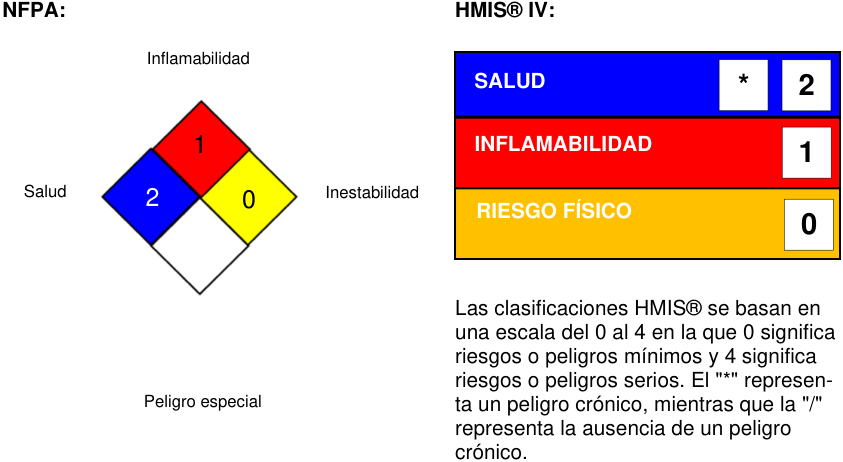

<!-- pagina: 1 -->
**FICHA DE DATOS DE SEGURIDAD** 

Número de HDS: 000000611764 Versión 2.3 

# **Sikafloor®-510  Part A** 

> Imagen (pág. 1). Sin texto legible por OCR; contenido gráfico no interpretado.

<!-- Start of picture text -->
dh <!-- End of picture text -->

Fecha de revisión: 2024/09/23 

## **SECCIÓN 1. IDENTIFICACION DEL PRODUCTO** 

Nombre del producto : Sikafloor®-510  Part A 

## **Informaciones sobre el fabricante o el proveedor** 

|Compañía|:|Sika Colombia S.A.S. Vereda Canavita km 20,5 Autopista Norte Tocancipá, Cundinamarca Colombia|
|---|---|---|
|Teléfono|:|(57-1) 8786333|
|Teléfono de emergencia|:|CISPROQUIM Bogotá: 2886012 / 2886355 Resto del país: 01 8000 916012|
|Dirección de correo electróni- co|:|controlcalidad.lab@co.sika.com|
|Fax|:|(57-1) 8786660|
|**Uso recomendado del produ**|**cto**|**químico y restricciones de uso**|
|Uso del producto|:|Revestimiento de poliuretano|

## **SECCIÓN 2. IDENTIFICACIÓN DEL PELIGRO O PELIGROS** 

## **Clasificación según SGA (GHS)** 

Corrosión/irritación cutáneas : Categoría 3 Sensibilización cutánea : Categoría 1 Toxicidad a la reproducción : Categoría 2 Peligro a corto plazo (agudo) : Categoría 3 para el medio ambiente acuático Peligro a largo plazo (crónico) : Categoría 3 para el medio ambiente acuático 

## **Etiqueta SGA (GHS)** 

Pictogramas de peligro : 

> Imagen (pág. 1). Sin texto legible por OCR; contenido gráfico no interpretado.

> Imagen (pág. 1). Sin texto legible por OCR; contenido gráfico no interpretado.

<mark>1 / 10</mark> 

<!-- pagina: 2 -->
**FICHA DE DATOS DE SEGURIDAD** 

Número de HDS: 000000611764 

# **Sikafloor®-510  Part A** 

Versión 2.3 

> Imagen (pág. 2). Sin texto legible por OCR; contenido gráfico no interpretado.

Fecha de revisión: 2024/09/23 

|Palabra de advertencia|: Atención|
|---|---|
|Indicaciones de peligro|: H316 Provoca una leve irritación cutánea. H317 Puede provocar una reacción cutánea alérgica. H361f Susceptible de perjudicar la fertilidad. H412 Nocivo para los organismos acuáticos, con efectos noci- vos duraderos.|
|Consejos de prudencia|: **Prevención:** P201 Procurarse las instrucciones antes del uso. P202 No manipular antes de haber leído y comprendido todas las precauciones de seguridad. P261 Evitar respirar nieblas o vapores. P272 La ropa de trabajo contaminada no debe salir del lugar de trabajo. P273 No dispersar en el medio ambiente. P280 Usar guantes/ ropa de protección/ equipo de protección para los ojos/ la cara.|
||**Intervención:** P302 + P352 EN CASO DE CONTACTO CON LA PIEL: Lavar con abundante agua. P308 + P313 EN CASO DE exposición demostrada o supues- ta: consultar a un médico. P333 + P313 En caso de irritación cutánea o sarpullido: consul- tar a un médico. P362 + P364 Quitar la ropa contaminada y lavarla antes de volverla a usar.|
||**Almacenamiento:** P405 Guardar bajo llave. **Eliminación:**|
||P501 Eliminar el contenido/ recipiente en una planta de elimi- nación de residuos aprobada.|

**Otros peligros no clasificables** Ninguno conocido. 

## **SECCIÓN 3. COMPOSICIÓN/INFORMACION SOBRE LOS COMPONENTES** 

|Sustancia / mezcla :  Mezcla|||
|---|---|---|
|**Componentes** |||
|Nombre químico |CASNo. |Concentración(%w/w) |
|Bis(4-(1,2-bis(etoxicarbonil)etilamino)-3- metilciclohexil)metano |136210-32-7 |>= 30 -< 50 |
|N,N'-(metilendiciclohexano-4,1-diil)bis-DL- aspartato de tetraetilo |136210-30-5 |>= 30 -< 50 |
|acetato de2-metoxi-1-metiletilo |108-65-6 |>=5-< 10 |
|fumarato de dietilo |623-91-6 |>= 2,5-<5 |
|sebacato de bis(1,2,2,6,6-pentametil-4- piperidilo) |41556-26-7 |>= 0,25 -< 1 |
|sebacato de metilo y 1,2,2,6,6-pentametil-4- piperidilo |82919-37-7 |>= 0,1 -< 0,25 |
|2 /|10||

<!-- pagina: 3 -->
**FICHA DE DATOS DE SEGURIDAD** 

Versión 2.3 

# **Sikafloor®-510  Part A** 

Número de HDS: 000000611764 

> Imagen (pág. 3). Sin texto legible por OCR; contenido gráfico no interpretado.

Fecha de revisión: 2024/09/23 

**SECCIÓN 4. PRIMEROS AUXILIOS** 

|Consejos generales|: Retire a la persona de la zona peligrosa. Consulte a un médico. Muéstrele esta hoja de seguridad al doctor que esté de servi- cio.|
|---|---|
|En caso de inhalación |: Salga al aire libre. Consultar a un médico después de una exposición importan- te.|
|En caso de contacto con la piel |: Quítese inmediatamente la ropa y zapatos contaminados. Elimínelo lavando con jabón y mucha agua. Si persisten los síntomas, llame a un médico.|
|En caso de contacto con los ojos |: Quítese los lentes de contacto. Manténgase el ojo bien abierto mientras se lava. Si persiste la irritación de los ojos, consulte a un especialista.|
|En caso de ingestión |: Lávese la boca con agua y después beba agua abundante. No dé leche ni bebidas alcohólicas. Nunca debe administrarse nada por la boca a una persona inconsciente. Consulte al médico.|
|Síntomas y efectos más im- portante, agudos y retarda- dos|: efectos sensibilizantes Reacciones alérgicas Vea la Sección 11 para obtener información detallada sobre la salud y los síntomas. Provoca una leve irritación cutánea. Puede provocar una reacción cutánea alérgica. Susceptible de perjudicar la fertilidad.|
|Notas especiales para un medico tratante|: Trate sintomáticamente. |

## **SECCIÓN 5. MEDIDAS DE LUCHA CONTRA INCENDIOS** 

|Medios de extinción apropia- dos|:|Use medidas de extinción que sean apropiadas a las circuns- tancias locales y de sus alrededores.|
|---|---|---|
|Productos de combustión peligrosos|:|No se conocen productos de combustión peligrosos|
|Métodos específicos de ex- tinción|:|Procedimiento estándar para incendios químicos.|
|Equipo de protección espe- cial para los bomberos|:|En caso de incendio, utilice un equipo respiratorio autónomo. |

## **SECCIÓN 6. MEDIDAS QUE DEBEN TOMARSE EN CASO DE VERTIDO ACCIDENTAL** 

Precauciones personales, : Utilice equipo de protección personal. equipo de protección y proNegar el acceso a personas sin protección. cedimientos de emergencia 

<mark>3 / 10</mark> 

<!-- pagina: 4 -->
**FICHA DE DATOS DE SEGURIDAD** 

# **Sikafloor®-510  Part A** 

Versión 2.3 

> Imagen (pág. 4). Sin texto legible por OCR; contenido gráfico no interpretado.

Número de HDS: 000000611764 Fecha de revisión: 2024/09/23 

|Precauciones relativas al medio ambiente|: No lo vierta en el agua superficial o el sistema de alcantarilla- do sanitario. Si el producto contamina los ríos, lagos o alcantarillados, in- formar a las autoridades respectivas.|
|---|---|
|Métodos y materiales de contención y limpieza|: Recójalo con un producto absorbente inerte (por ejemplo, arena, silicagel, aglutinante de ácidos, aglutinante universal, aserrín). Guarde en contenedores apropiados y cerrados para su eli- minación.|
|**CIÓN 7. MANIPULACIÓN Y A** Sugerencias para la protec- ción contra incendios y ex- plosiones|**LMACENAMIENTO** :  Medidas normales preventivas para la protección contra in- cendios.|
|Consejos para una manipu- lación segura|: Evitar sobrepasar los límites dados de exposición profesional (ver sección 8). Evitar todo contacto con los ojos, la piel o la ropa. Ver sección 8 para el equipo de protección personal. Las personas que hayan tenido problemas de sensibilisación de la piel, asma, alergías, enfermedades respiratorias cróni- cas o recurrentes, no deben ser empleadas en ninguna parte del proceso en la cual esté utilizada esta preparación. Fumar, comer y beber debe prohibirse en el área de aplica- ción. Cuando se manejen productos químicos, siga las medidas estándar de higiene.|
|Condiciones para el almace- namiento seguro |: Conserve el envase herméticamente cerrado en un lugar seco y bien ventilado. Los contenedores que se abren deben ser cuidadosamente resellados y mantenerlos en posición vertical para evitar fu- gas. Almacenar en conformidad con la reglamentación local.|

## **SECCIÓN 7. MANIPULACIÓN Y ALMACENAMIENTO** 

## **SECCIÓN 8. CONTROLES DE EXPOSICIÓN/PROTECCIÓN PERSONAL** 

## **Componentes con parámetros de control en el área de trabajo** 

No contiene sustancias con valores límite de exposición laboral. 

|**Protección personal**||
|---|---|
|Protección respiratoria|: Utilice protección respiratoria a menos que exista una venti- lación de escape adecuada o que la evaluación de la exposi- ción indique que el nivel de exposición está dentro de las pautas recomendadas. La clase de filtro para el respirador debe ser adecuada para la concentración máxima prevista del contaminante (gas/vapor/aerosol/partículas) que puede presentarse al ma- nejar el producto. Si se excede esta concentración, se debe utilizar un aparato respiratorio autónomo.|

<mark>4 / 10</mark> 

<!-- pagina: 5 -->
**FICHA DE DATOS DE SEGURIDAD** 

# **Sikafloor®-510  Part A** 

Versión 2.3 

Número de HDS: 000000611764 

> Imagen (pág. 5). Sin texto legible por OCR; contenido gráfico no interpretado.

<!-- Start of picture text -->
| <!-- End of picture text -->

Fecha de revisión: 2024/09/23 

|Protección de las manos|: Guantes químico-resistentes e impermeables que cumplan con estándares aprobados deben ser utilizados cuando se manejen productos químicos y la evaluación del riesgo indica que es necesario.|
|---|---|
|Protección de los ojos|: Equipo de protección ocular que cumpla con estándares aprobados debe ser utilizado cuando la evaluación del riesgo indica que es necesario.|
|Protección de la piel y del cuerpo|: Elegir la protección para el cuerpo según sus caraterísticas, la concentración y la cantidad de sustancias peligrosas, y el lugar específico de trabajo.|
|Medidas de higiene|: Manipúlelo con las precauciones de higiene industrial ade- cuadas, y respete las prácticas de seguridad. No coma ni beba durante su utilización. No fume durante su utilización. Lavarse las manos antes de los descansos y después de terminar la jornada laboral.|

## **SECCIÓN 9. PROPIEDADES FÍSICAS Y QUÍMICAS** 

Aspecto : líquido Color :  varios Olor :  Sin datos disponibles Umbral de olor :  Sin datos disponibles pH : No aplicable Punto de fusión/ rango / Pun: Sin datos disponibles to de congelación Punto / intervalo de ebullición : Sin datos disponibles Punto de inflamación : no se inflama Tasa de evaporación :  Sin datos disponibles Inflamabilidad (sólido, gas) : Sin datos disponibles Límite superior de explosivi: Sin datos disponibles dad / Límite de inflamabilidad superior Límite inferior de explosividad : Sin datos disponibles / Límite de inflamabilidad inferior Presión de vapor : 3,1 hPa Densidad relativa de vapor : Sin datos disponibles Densidad : 1,4 g/cm3 (20 °C (20 °C)) 

<mark>5 / 10</mark> 

<!-- pagina: 6 -->
**FICHA DE DATOS DE SEGURIDAD** 

# **Sikafloor®-510  Part A** 

Versión 2.3 

Número de HDS: 000000611764 

> Imagen (pág. 6). Sin texto legible por OCR; contenido gráfico no interpretado.

<!-- Start of picture text -->
| <!-- End of picture text -->

Fecha de revisión: 2024/09/23 

|Solubilidad Hidrosolubilidad|: insoluble|
|---|---|
|Solubilidad en otros disol- ventes|: Sin datos disponibles|
|Coeficiente de reparto n- octanol/agua|: Sin datos disponibles|
|Temperatura de ignición es- pontánea|: Sin datos disponibles|
|Temperatura de descomposi- ción|:  Sin datos disponibles|
|Viscosidad||
|Viscosidad, dinámica|: Sin datos disponibles|
|Viscosidad, cinemática|: > 7 mm2/s ( 40 °C (40 °C))|
|Propiedades explosivas|: Sin datos disponibles|
|Propiedades comburentes|: Sin datos disponibles|

## **SECCIÓN 10. ESTABILIDAD Y REACTIVIDAD** 

|Reactividad |:|No se conoce ninguna reacción peligrosa bajo condiciones de uso normal.|
|---|---|---|
|Estabilidad química|:|El producto es químicamente estable.|
|Posibilidad de reacciones peligrosas|:|Sin riesgos a mencionar especialmente.|
|Condiciones que deben evi- tarse|:|Sin datos disponibles |
|Materiales incompatibles|:|Sin datos disponibles|
|Productos de descomposición peligrosos|:|No se conocen productos de descomposición peligrosos.|

## **SECCIÓN 11. INFORMACIÓN TOXICOLÓGICA** 

**Toxicidad aguda** 

No se clasifica debido a la falta de datos. 

**<u>Componentes:</u> acetato de 2-metoxi-1-metiletilo:** Toxicidad oral aguda :  DL50 Oral (Rata): > 5.000 mg/kg Toxicidad dérmica aguda :  LD50 Dermico (Conejo): > 5.000 mg/kg **fumarato de dietilo:** Toxicidad oral aguda :  DL50 Oral (Rata): 1.367 mg/kg 

<mark>6 / 10</mark> 

<!-- pagina: 7 -->
**FICHA DE DATOS DE SEGURIDAD** 

# **Sikafloor®-510  Part A** 

Versión 2.3 

Número de HDS: 000000611764 

> Imagen (pág. 7). Sin texto legible por OCR; contenido gráfico no interpretado.

<!-- Start of picture text -->
| <!-- End of picture text -->

Fecha de revisión: 2024/09/23 

## **Corrosión o irritación cutáneas** 

Provoca una leve irritación cutánea. 

## **Lesiones oculares graves/irritación ocular** 

No se clasifica debido a la falta de datos. 

## **Sensibilización respiratoria o cutánea** 

## **Sensibilización cutánea** 

Puede provocar una reacción cutánea alérgica. 

## **Sensibilización respiratoria** 

No se clasifica debido a la falta de datos. 

## **Mutagenicidad en células germinales** 

No se clasifica debido a la falta de datos. 

## **Carcinogenicidad** 

No se clasifica debido a la falta de datos. 

## **Toxicidad para la reproducción** 

Susceptible de perjudicar la fertilidad. 

## **Toxicidad sistémica específica de órganos blanco - exposición única** 

No se clasifica debido a la falta de datos. 

## **Toxicidad sistémica específica de órganos blanco - exposiciones repetidas** 

No se clasifica debido a la falta de datos. 

## **Toxicidad por aspiración** 

No se clasifica debido a la falta de datos. 

## **SECCIÓN 12. INFORMACIÓN ECOTOXICOLOGICA** 

## **Ecotoxicidad** 

**<u>Componentes:</u> fumarato de dietilo:** Toxicidad para peces :  CL50 (Pez): 2,4 mg/l Tiempo de exposición: 72 h 

## **Persistencia y degradabilidad** 

Sin datos disponibles 

## **Potencial de bioacumulación** 

Sin datos disponibles 

## **Movilidad en el suelo** 

Sin datos disponibles 

## **Otros efectos adversos** 

## **<u>Producto:</u>** 

Información ecológica com:  No se puede excluir un peligro para el medio ambiente en el plementaria caso de una manipulación o eliminación no profesional. Nocivo para los organismos acuáticos, con efectos nocivos duraderos. 

<mark>7 / 10</mark> 

<!-- pagina: 8 -->
**FICHA DE DATOS DE SEGURIDAD** 

Número de HDS: 000000611764 Versión 2.3 

# **Sikafloor®-510  Part A** 

> Imagen (pág. 8). Sin texto legible por OCR; contenido gráfico no interpretado.

Fecha de revisión: 2024/09/23 

## **SECCIÓN 13. INFORMACIÓN RELATIVA A LA ELIMINACIÓN DE LOS PRODUCTOS** 

|**Métodos de eliminación**||
|---|---|
|Residuos|: Envíese a una compañía autorizada para la gestión de resi- duos.|
||Evite que el producto penetre en los desagües, tuberías, o la tierra (suelos). No contamine los estanques, cursos de agua o zanjas con el producto químico o el contendor utilizado.|
|Envases contaminados|: Vacíe el contenido restante. Eliminar como producto no usado.|
||No reutilice los recipientes vacíos.|

## **SECCIÓN 14. INFORMACIÓN RELATIVA AL TRANSPORTE** 

## **Regulaciones internacionales** 

**UNRTDG** No regulado como mercancía peligrosa **IATA-DGR** No regulado como mercancía peligrosa 

**Código-IMDG** No regulado como mercancía peligrosa 

**Transporte a granel de acuerdo a instrumentos IMO** 

No aplicable para el producto tal y como se proveyó. 

## **Precauciones especiales para los usuarios** 

No aplicable 

## **SECCIÓN 15. INFORMACIÓN SOBRE LA REGLAMENTACION** 

## **Reglamentación medioambiental, seguridad y salud específica para la sustancia o mezcla** 

Convención Internacional sobre las Armas Químicas : No aplicable (CWC) Programas sobre los Productos Químicos Tóxicos y los Precursores (Louisiana Administrative Code, Title 33,Part V Section 10101 et. seq.) Sustancias y productos químicos controlados por el : No aplicable Ministerio de Justicia Listado de Sustancias incluídas como Sustancias de : No aplicable Control Especial y Sometidas a Fiscalización por el Ministerio de Salud y Protección Social Resolución 2715 de 2014 Por la cual se establecen las : No aplicable sustancias que deben ser objeto de registro de control de venta al menudeo, con base en los criterios de clasificación que se definen. 

<mark>8 / 10</mark> 

<!-- pagina: 9 -->
**FICHA DE DATOS DE SEGURIDAD** 

Número de HDS: 000000611764 Versión 2.3 

# **Sikafloor®-510  Part A** 

> Imagen (pág. 9). Sin texto legible por OCR; contenido gráfico no interpretado.

<!-- Start of picture text -->
A <!-- End of picture text -->

Fecha de revisión: 2024/09/23 

## **SECCIÓN 16. OTRAS INFORMACIONES** 

- Fecha de revisión : 2024/09/23 formato de fecha : aaaa/mm/dd **Información adicional** 

> Imagen (pág. 9). OCR automático, revisar: «NFPA: Salud Inflamabilidad Peligro especial Inestabilidad HMIS® IV: SALUD INFLAMABILIDAI RIESGO FÍSICO Las clasificaciones HMIS® se basan en una escala del 0 al 4 en la que 0 significa riesgos o peligros mínimos y 4 significa riesgos o peligros serios. El "*" represen- ta un peligro crónico, mientras que la "/" representa la ausencia de un peligro crónico.»

<!-- Start of picture text -->
NFPA:  HMIS® IV: Inflamabilidad SALUD  * 2 1 INFLAMABILIDAD 1 Salud  2  0 Inestabilidad RIESGO FÍSICO 0 y = Las clasificaciones HMIS® se basan en una escala del 0 al 4 en la que 0 significa riesgos o peligros mínimos y 4 significa riesgos o peligros serios. El "*" represen- Peligro especial ta un peligro crónico, mientras que la "/" representa la ausencia de un peligro crónico. <!-- End of picture text -->

## **Texto completo de otras abreviaturas** 

- ADR : Accord européen relatif au transport international des marchandises Dangereuses par Route 

- CAS : Chemical Abstracts Service DNEL : Derived no-effect level EC50 : Half maximal effective concentration GHS : Globally Harmonized System IATA : International Air Transport Association IMDG : International Maritime Code for Dangerous Goods LD50 : Median lethal dosis (the amount of a material, given all at once, which causes the death of 50% (one half) of a group of test animals) 

- LC50 : Median lethal concentration (concentrations of the chemical in air that kills 50% of the test animals during the observation period) 

- MARPOL : International Convention for the Prevention of Pollution from Ships, 1973 as modified by the Protocol of 1978 

- OEL : Occupational Exposure Limit PBT : Persistent, bioaccumulative and toxic PNEC : Predicted no effect concentration REACH : Regulation (EC) No 1907/2006 of the European Parliament and of the Council of 18 December 2006 concerning the Registration, Evaluation, Authorisation and Restriction of Chemicals (REACH), establishing a European Chemicals Agency 

- SVHC : Substances of Very High Concern vPvB : Very persistent and very bioaccumulative 

<mark>9 / 10</mark> 

<!-- pagina: 10 -->
**FICHA DE DATOS DE SEGURIDAD** 

# **Sikafloor®-510  Part A** 

Número de HDS: 000000611764 Versión 2.3 

> Imagen (pág. 10). Sin texto legible por OCR; contenido gráfico no interpretado.

<!-- Start of picture text -->
| <!-- End of picture text -->

Fecha de revisión: 2024/09/23 

La informacion contenida en este ficha de datos de seguridad corresponde a nuestro nivel de conocimiento en el momento de su publicacion. Quedan excluidas todas las garantias. Se aplicaran nuestras condiciones generales de venta en vigor. Por favor, consulte la Hoja de Datos del Producto  antes de su uso y procesamiento. CO / 1X 

<mark>10 / 10</mark> 
