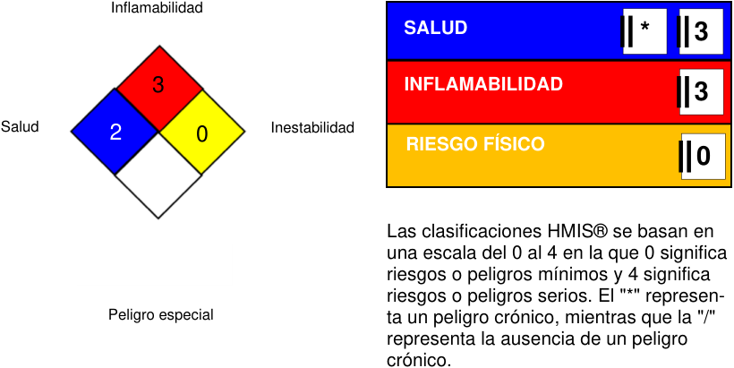

<!-- pagina: 1 -->
**FICHA DE DATOS DE SEGURIDAD** 

# **Esmalte Epóxico  Part A** 

<u>Versión 2.0 Número de HDS: 000000613416</u> 

> Imagen (pág. 1). Sin texto legible por OCR; contenido gráfico no interpretado.

<!-- Start of picture text -->
de <!-- End of picture text -->

<u>Fecha de revisión: 2024/04/08</u> 

## **SECCIÓN 1. IDENTIFICACIÓN DE LA SUSTANCIA QUÍMICA PELIGROSA O MEZCLA Y DEL PROVEEDOR O FABRICANTE** 

Nombre del producto : Esmalte Epóxico  Part A 

|**Informaciones sobre el fabric**|**ante o el proveedor**|
|---|---|
|Compañía|: Sika Colombia S.A.S. Vereda Canavita km 20,5 Autopista Norte Tocancipá, Cundinamarca Colombia|
|Teléfono|: (57-1) 8786333|
|Teléfono de emergencia|: CISPROQUIM Bogotá: 2886012 / 2886355 Resto del país: 01 8000 916012|
|Dirección de correo electróni- co|: controlcalidad.lab@co.sika.com|
|Fax|: (57-1) 8786660|

## **SECCIÓN 2. IDENTIFICACIÓN DE LOS PELIGROS** 

## **Clasificación según SGA (GHS)** 

|Líquidos Inflamables|:|Categoría 2|
|---|---|---|
|Corrosión/irritación cutáneas|:|Categoría 2|
|Lesiones oculares gra- ves/irritación ocular|:|Categoría 2A|
|Sensibilización cutánea|:|Categoría 1|
|Toxicidad a la reproducción|:|Categoría 2|
|Toxicidad sistémica específi- ca de órganos blanco - Expo- siciones repetidas|:|Categoría 2|
|Peligro de aspiración|:|Categoría 1|
|Peligro a corto plazo (agudo) para el medio ambiente acuá- tico|:|Categoría 3|

## **Etiqueta SGA (GHS)** 

Pictogramas de peligro : <u>oo</u> 

<mark>1 / 13</mark> 

<!-- pagina: 2 -->
**FICHA DE DATOS DE SEGURIDAD** 

> Imagen (pág. 2). Sin texto legible por OCR; contenido gráfico no interpretado.

<!-- Start of picture text -->
| <!-- End of picture text -->

# **Esmalte Epóxico  Part A** 

|Versión 2.0|Número de HDS: 000000613416 Fecha de revisión: 202|
|---|---|
|Palabra de advertencia|: Peligro|
|Indicaciones de peligro|: H225 Líquido y vapores muy inflamables. H304 Puede ser mortal en caso de ingestión y de penetración en las vías respiratorias. H315 Provoca irritación cutánea. H317 Puede provocar una reacción cutánea alérgica. H319 Provoca irritación ocular grave. H361f Susceptible de perjudicar la fertilidad. H373 Puede provocar daños en los órganos tras exposiciones prolongadas o repetidas. H402 Nocivo para los organismos acuáticos.|
|Consejos de prudencia|: **Prevención:** P201 Procurarse las instrucciones antes del uso. P202 No manipular antes de haber leído y comprendido todas las precauciones de seguridad. P210 Mantener alejado del calor, chispas, llamas al descubier- to, superficies calientes y otras fuentes de ignición. No fumar. P233 Mantener el recipiente herméticamente cerrado. P240 Toma de tierra y enlace equipotencial del recipiente y del equipo receptor. P241 Utilizar material eléctrico, de ventilación o de iluminación/ antideflagrante. P242 No utilizar herramientas que produzcan chispas. P243 Tomar medidas de precaución contra las descargas elec- trostáticas. P260 No respirar nieblas o vapores. P264 Lavarse la piel cuidadosamente después de la manipula- ción. P272 La ropa de trabajo contaminada no debe salir del lugar de trabajo. P273 No dispersar en el medio ambiente. P280 Usar guantes/ ropa de protección/ equipo de protección para los ojos/ la cara. **Intervención:** P301 + P310 EN CASO DE INGESTIÓN: Llamar inmediata- mente a un CENTRO DE TOXICOLOGÍA o a un médico. P303 + P361 + P353 EN CASO DE CONTACTO CON LA PIEL (o el pelo): Quitar inmediatamente toda la ropa contaminada. Enjuagar la piel con agua. P305 + P351 + P338 EN CASO DE CONTACTO CON LOS OJOS: Enjuagar con agua cuidadosamente durante varios minutos. Quitar las lentes de contacto cuando estén presentes y pueda hacerse con facilidad. Proseguir con el lavado. P308 + P313 EN CASO DE exposición demostrada o supues- ta: consultar a un médico. P331 NO provocar el vómito. P333 + P313 En caso de irritación cutánea o sarpullido: consul- tar a un médico. P337 + P313 Si la irritación ocular persiste, consultar a un mé- dico. P362 + P364 Quitar la ropa contaminada y lavarla antes de volverla a usar. P370 + P378 En caso de incendio: Utilizar arena seca, produc- to químico seco o espuma resistente al alcohol para la extin-|

<u>Fecha de revisión: 2024/04/08</u> 

<mark>2 / 13</mark> 

<!-- pagina: 3 -->
**FICHA DE DATOS DE SEGURIDAD** 

# **Esmalte Epóxico  Part A** 

> Imagen (pág. 3). Sin texto legible por OCR; contenido gráfico no interpretado.

|Versión 2.0 Número de HDS: 000000613416 Fecha de revisión: 2024/04/08|
|---|
|ción.|
|**Almacenamiento:**|
|P403 + P235 Almacenar en un lugar bien ventilado. Mantener fresco. P405 Guardar bajo llave.|
|**Eliminación:**|
|P501 Eliminar el contenido/ recipiente en una planta de elimi- nación de residuos aprobada.|
|**Otros peligros no clasificables**|
|No conocidos.|

## **SECCIÓN 3. COMPOSICIÓN/INFORMACIÓN SOBRE LOS INGREDIENTES** 

|Sustancia / mezcla :  Mezcla|||
|---|---|---|
|**Componentes**|||
|Nombre químico|CASNo.|Concentración(%w/w)|
|Producto de reacción: bisfenol-A- (epiclorhidrina); resina epoxídica (peso molecu- lar medio en número≤ 700)|25068-38-6|>= 50 -< 70|
|o-xileno|95-47-6|>= 10-<20|
|acetato den-butilo|123-86-4|>=5-<10|
|xileno|1330-20-7|>=5-<10|
|melamina|108-78-1|>= 1 -< 5|
|di-n-butilamina|111-92-2|>=0,1 -<1|

## **SECCIÓN 4. PRIMEROS AUXILIOS** 

- Consejos generales : Retire a la persona de la zona peligrosa. Consulte a un médico. Muéstrele esta hoja de seguridad al doctor que esté de servicio. 

- En caso de inhalación : Salga al aire libre. Consultar a un médico después de una exposición importante. 

- En caso de contacto con la : Quítese inmediatamente la ropa y zapatos contaminados. piel Elimínelo lavando con jabón y mucha agua. Si persisten los síntomas, llame a un médico. 

- En caso de contacto con los : Enjuagar inmediatamente los ojos con agua abundante. ojos Quítese los lentes de contacto. Manténgase el ojo bien abierto mientras se lava. Si persiste la irritación de los ojos, consulte a un especialista. 

- En caso de ingestión : Lávese la boca con agua y después beba agua abundante. No provoque vómitos. No dé leche ni bebidas alcohólicas. Nunca debe administrarse nada por la boca a una persona inconsciente. Lleve al afectado enseguida a un hospital. 

<mark>3 / 13</mark> 

<!-- pagina: 4 -->
**FICHA DE DATOS DE SEGURIDAD** 

# **Esmalte Epóxico  Part A** 

> Imagen (pág. 4). Sin texto legible por OCR; contenido gráfico no interpretado.

<u>Versión 2.0 Número de HDS: 000000613416 Fecha de revisión: 2024/04/08</u> 

|Síntomas y efectos más im- portante, agudos y retarda- dos|:|Puede ser mortal en caso de ingestión y de penetración en las vías respiratorias. Provoca irritación cutánea. Puede provocar una reacción cutánea alérgica. Provoca irritación ocular grave. Susceptible de perjudicar la fertilidad. Puede provocar daños en los órganos tras exposiciones pro- longadas o repetidas. Riesgo de lesiones pulmonares graves (por aspiración). efectos irritantes efectos sensibilizantes Su inhalación puede causar edema pulmonar y neumonía. Reacciones alérgicas Lacrimación excesiva Dermatitis Vea la Sección 11 para obtener información detallada sobre la salud y los síntomas.|
|---|---|---|
|Notas especiales para un medico tratante|:|Trate sintomáticamente. |

## **SECCIÓN 5. MEDIDAS CONTRA INCENDIOS** 

|Medios de extinción apropia- dos |: Espuma resistente a los alcoholes Dióxido de carbono (CO2) Producto químico seco|
|---|---|
|Agentes de extinción inapro- piados|: Agua Chorro de agua de gran volumen|
|Peligros específicos durante la extincion de incendios|: No use un chorro compacto de agua ya que puede dispersar y extender el fuego.|
|Productos de combustión peligrosos|:  No se conocen productos de combustión peligrosos|
|Métodos específicos de ex- tinción|: Utilice rocío de agua para enfriar los recipientes cerrados. |
|Equipo de protección espe- cial para los bomberos|: En caso de incendio, utilice un equipo respiratorio autónomo. |

## **SECCIÓN 6. MEDIDAS QUE DEBEN TOMARSE EN CASO DE DERRAME ACCIDENTAL O FUGA ACCIDENTAL** 

|Precauciones personales, equipo de protección y pro- cedimientos de emergencia|: Utilice equipo de protección personal. Retire todas las fuentes de ignición. Negar el acceso a personas sin protección.|
|---|---|
|Precauciones relativas al medio ambiente|: Evite que el producto vaya al alcantarillado. Si el producto contamina los ríos, lagos o alcantarillados, in- formar a las autoridades respectivas.|
|Métodos y materiales de|: Contener y recoger el derrame con material absorbente que|

<mark>4 / 13</mark> 

<!-- pagina: 5 -->
**FICHA DE DATOS DE SEGURIDAD** 

# **Esmalte Epóxico  Part A** 

> Imagen (pág. 5). Sin texto legible por OCR; contenido gráfico no interpretado.

|Versión 2.0|Número de HDS: 000000613416 Fecha de revisión: 2024/04/08|
|---|---|
|contención y limpieza|no sea combustible (p. ej. arena, tierra, barro de diatomeas, vermiculita), y meterlo en un envase para su eliminación de acuerdo con las reglamentaciones locales y nacionales (ver sección 13).|
|**SECCIÓN 7. MANEJO Y ALMACE** Sugerencias para la protec- ción contra incendios y ex- plosiones|**NAMIENTO** :  Utilice un equipo a prueba de explosiones. Mantener alejado del calor/ de chispas/ de llamas al descu- bierto/ de superficies calientes. No fumar. Tomar medidas de precaución contra la acumulación de car- gas electrostáticas.|
|Consejos para una manipu- lación segura|: No respire los vapores ni la niebla de la pulverización. Evitar sobrepasar los límites dados de exposición profesional (ver sección 8). Evitar todo contacto con los ojos, la piel o la ropa. Ver sección 8 para el equipo de protección personal. Las personas que hayan tenido problemas de sensibilisación de la piel, asma, alergías, enfermedades respiratorias cróni- cas o recurrentes, no deben ser empleadas en ninguna parte del proceso en la cual esté utilizada esta preparación. Fumar, comer y beber debe prohibirse en el área de aplica- ción. Tomar medidas de precaución contra las descargas electros- táticas. Abra el tambor con precaución, ya que el contenido puede estar presurizado. Adopte las acciones necesarias para evitar descargas de electricidad estática (que podrían ocasionar la inflamación de los vapores orgánicos). Cuando se manejen productos químicos, siga las medidas estándar de higiene.|
|Condiciones para el almace- namiento seguro|: Almacénelo en el envase original. Almacénelo en un lugar fresco. Mantenga en un lugar bien ventilado. Los contenedores que se abren deben ser cuidadosamente resellados y mantenerlos en posición vertical para evitar fu- gas. Observar las indicaciones de la etiqueta. Almacenar en conformidad con la reglamentación local.|

**SECCIÓN 8. CONTROLES DE EXPOSICIÓN/PROTECCIÓN PERSONAL** 

**Componentes con parámetros de control en el área de trabajo** 

|Componentes|CAS No.|Tipo de valor (Forma de exposición)|Parámetros de control / Concen- traciónpermisible|Bases|
|---|---|---|---|---|
|o-xileno|95-47-6|TWA|20 ppm|ACGIH|
|acetato den-butilo|123-86-4|TWA|50 ppm|ACGIH|
|||STEL|150 ppm|ACGIH|
|xileno|1330-20-7|TWA|20 ppm|ACGIH|

<mark>5 / 13</mark> 

<!-- pagina: 6 -->
**FICHA DE DATOS DE SEGURIDAD** 

# **Esmalte Epóxico  Part A** 

> Imagen (pág. 6). Sin texto legible por OCR; contenido gráfico no interpretado.

|Versión 2.0 **Límites biológicos de ex**   |Núme **posición o**   |ro de HDS: 0 **cupacional**   |0000061341   |6   |Fecha de revi  |sión: 2024/04/08  |
|---|---|---|---|---|---|---|
|Componentes |CAS No. |Parámetros de control |Análisis biológico |Tiempo de toma de mues- tras |Concentra- ción permisi- ble |Bases |
|o-xileno |95-47-6 |Acidos me- tilhipúricos |Orina |Al final del turno (Tan pronto como sea posible después de que cese la exposi- ción) |1.5 g/g crea- tinina |ACGIH BEI |
|||Acidos me- tilhipúricos |<** Phrase language not avai- lable: [ 1X ] CUST - TD-95185 **> | Al final del turno (Tan pronto como sea posible después de que cese la exposi- ción) |1.500 mg/g ||
|xileno |1330-20-7  |Acidos me- tilhipúricos |Orina |Al final del turno (Tan pronto como sea posible después de que cese la exposi- ción) |1.5 g/g crea- tinina |ACGIH BEI |
|**Protección personal** Protección respiratoria |: Util laci ció pau La la c (ga nej utili |ice protección ón de escape n indique que tas recomend clase de filtro oncentración s/vapor/aeros ar el producto. zar un aparat |respiratoria adecuada o el nivel de ex adas. para el respi máxima prev ol/partículas) Si se exced o respiratorio |a menos qu que la eval posición es rador debe ista del con que puede e esta conc autónomo. |e exista una v uación de la ex tá dentro de la ser adecuada p taminante presentarse al entración, se d   |enti- posi- s ara ma- ebe |
|Protección de las manos|: Gu con ma que|antes químico estándares a nejen product es necesario|-resistentes probados de os químicos .|e impermea ben ser utili y la evaluac|bles que cump zados cuando ión del riesgo i|lan se ndica|
|Protección de los ojos|: Eq apr|uipo de protec obados debe|ción ocular q ser utilizado|ue cumpla cuando la e|con estándares valuación del r| iesgo|

<mark>6 / 13</mark> 

<!-- pagina: 7 -->
**FICHA DE DATOS DE SEGURIDAD** 

> Imagen (pág. 7). Sin texto legible por OCR; contenido gráfico no interpretado.

<!-- Start of picture text -->
| <!-- End of picture text -->

# **Esmalte Epóxico  Part A** 

<u>Versión 2.0 Número de HDS: 000000613416 Fecha de revisión: 2024/04/08</u> indica que es necesario. Protección de la piel y del : Elegir la protección para el cuerpo según sus caraterísticas, cuerpo la concentración y la cantidad de sustancias peligrosas, y el lugar específico de trabajo. Medidas de higiene : Manipúlelo con las precauciones de higiene industrial adecuadas, y respete las prácticas de seguridad. No coma ni beba durante su utilización. No fume durante su utilización. Lavarse las manos antes de los descansos y después de terminar la jornada laboral. 

<u>Fecha de revisión: 2024/04/08</u> 

## **SECCIÓN 9. PROPIEDADES FÍSICAS Y QUÍMICAS** 

Aspecto : líquido Color :  varios Olor :  característico Umbral de olor :  Sin datos disponibles pH : No aplicable Punto de fusión/rango / Punto : Sin datos disponibles de congelación Punto / intervalo de ebullición : Sin datos disponibles Punto de inflamación : 12,5 °C (12,5 °C) (Método: copa cerrada) Tasa de evaporación :  Sin datos disponibles Inflamabilidad (sólido, gas) : Sin datos disponibles Límite superior de explosivi: 7 %(v) dad / Límite de inflamabilidad superior Límite inferior de explosividad : 1 %(v) / Límite de inflamabilidad inferior Presión de vapor : 12,4989 hPa Densidad relativa de vapor : Sin datos disponibles Densidad : 1,03 g/cm3 (20 °C (20 °C)) Solubilidad Hidrosolubilidad : insoluble Solubilidad en otros disol: Sin datos disponibles ventes Coeficiente de reparto n- : Sin datos disponibles 

<mark>7 / 13</mark> 

<!-- pagina: 8 -->
**FICHA DE DATOS DE SEGURIDAD** 

# **Esmalte Epóxico  Part A** 

<u>Versión 2.0 Número de HDS: 000000613416</u> 

> Imagen (pág. 8). Sin texto legible por OCR; contenido gráfico no interpretado.

<!-- Start of picture text -->
| <!-- End of picture text -->

<u>Fecha de revisión: 2024/04/08</u> 

|octanol/agua Temperatura de ignición es-|:|415 °C|
|---|---|---|
|pontánea|||
|Temperatura de descomposi- |:|Sin datos disponibles|
|ción|||
|Viscosidad|||
|Viscosidad, dinámica|:|Sin datos disponibles|
|Viscosidad, cinemática|:|582,524 mm2/s ( 20 °C (20 °C))|
|Propiedades explosivas|:|Sin datos disponibles|
|Propiedades comburentes|:|Sin datos disponibles|
|**CIÓN 10. ESTABILIDAD Y RE** Reactividad |**AC** :|**TIVIDAD** No se conoce ninguna reacción peligrosa bajo condiciones de uso normal.|
|Estabilidad química|:|El producto es químicamente estable.|
|Posibilidad de reacciones peligrosas |:|Estable bajo las condiciones de almacenamiento recomenda- das. Los vapores pueden formar una mezcla explosiva con el aire.|
|Condiciones que deben evi- tarse|:|Calor, llamas y chispas. |
|Materiales incompatibles|:|Sin datos disponibles|
|Productos de descomposición peligrosos|:|No se conocen productos de descomposición peligrosos.|

## **SECCIÓN 10. ESTABILIDAD Y REACTIVIDAD** 

## **SECCIÓN 11. INFORMACIÓN TOXICOLÓGICA** 

## **Toxicidad aguda** 

No se clasifica debido a la falta de datos. 

**<u>Componentes:</u> acetato de n-butilo:** Toxicidad oral aguda :  DL50 Oral (Rata): > 5.000 mg/kg Toxicidad aguda por inhala:  CL50 (Rata): 23,4 mg/l ción Tiempo de exposición: 4 h Prueba de atmosfera: vapor Toxicidad dérmica aguda :  LD50 Dermico (Conejo): > 5.000 mg/kg **xileno:** Toxicidad oral aguda :  DL50 Oral (Rata): 3.523 mg/kg **melamina:** Toxicidad oral aguda :  DL50 Oral (Rata): 3.161 mg/kg Toxicidad aguda por inhala:  CL50 (Rata): 5,190 mg/l 

<mark>8 / 13</mark> 

<!-- pagina: 9 -->
**FICHA DE DATOS DE SEGURIDAD** 

# **Esmalte Epóxico  Part A** 

|Versión 2.0|Número de HDS: 000000613416|
|---|---|
|ción|Tiempo de exposición: 4 h Prueba de atmosfera: polvo/niebla|
|**di-n-butilamina:** Toxicidad oral aguda|:  DL50 Oral (Rata): 550 mg/kg|
|Toxicidad aguda por inhala- ción|:  CL50 (Rata): 1,15 mg/l Tiempo de exposición: 4 h Prueba de atmosfera: vapor|
|Toxicidad dérmica aguda|:  LD50 Dermico (Conejo): 768 mg/kg|

> Imagen (pág. 9). Sin texto legible por OCR; contenido gráfico no interpretado.

<!-- Start of picture text -->
| <!-- End of picture text -->

<u>Fecha de revisión: 2024/04/08</u> 

## **Corrosión o irritación cutáneas** 

Provoca irritación cutánea. 

## **Lesiones oculares graves/irritación ocular** 

Provoca irritación ocular grave. 

## **Sensibilización respiratoria o cutánea** 

## **Sensibilización cutánea** 

Puede provocar una reacción cutánea alérgica. 

## **Sensibilización respiratoria** 

No se clasifica debido a la falta de datos. 

## **Mutagenicidad en células germinales** 

No se clasifica debido a la falta de datos. 

## **Carcinogenicidad** 

No se clasifica debido a la falta de datos. 

## **Toxicidad para la reproducción** 

Susceptible de perjudicar la fertilidad. 

## **Toxicidad sistémica específica de órganos blanco - exposición única** 

No se clasifica debido a la falta de datos. 

## **Toxicidad sistémica específica de órganos blanco - exposiciones repetidas** 

Puede provocar daños en los órganos tras exposiciones prolongadas o repetidas. 

## **Toxicidad por aspiración** 

Puede ser mortal en caso de ingestión y de penetración en las vías respiratorias. 

## **SECCIÓN 12. INFORMACIÓN ECOTOXICOLOGICA** 

## **Ecotoxicidad** 

|**Componentes:**||
|---|---|
|**acetato de n-butilo:**||
|Toxicidad para las al- gas/plantas acuáticas|:  CE50 (Desmodesmus subspicatus (alga verde)): 647,7 mg/l Tiempo de exposición: 72 h|
|**xileno:**||
|Toxicidad para peces (Toxi-|: NOEC (Oncorhynchus mykiss (trucha irisada)): > 1,3 mg/l|
|cidad crónica)|Tiempo de exposición: 56 d|
|Toxicidad para la dafnia y|: NOEC (Daphnia (Dafnia)): 1,17 mg/l|

<mark>9 / 13</mark> 

<!-- pagina: 10 -->
**FICHA DE DATOS DE SEGURIDAD** 

> Imagen (pág. 10). Sin texto legible por OCR; contenido gráfico no interpretado.

<!-- Start of picture text -->
| <!-- End of picture text -->

# **Esmalte Epóxico  Part A** 

<u>Versión 2.0 Número de HDS: 000000613416</u> otros invertebrados acuáticos Tiempo de exposición: 7 d (Toxicidad crónica) **Persistencia y degradabilidad** Sin datos disponibles **Potencial de bioacumulación** Sin datos disponibles **Movilidad en el suelo** Sin datos disponibles **Otros efectos adversos** **<u>Producto:</u>** Información ecológica com:  No existe ningún dato disponible para ese producto. plementaria 

<u>Fecha de revisión: 2024/04/08</u> 

## **SECCIÓN 13. INFORMACIÓN RELATIVA A LA ELIMINACIÓN DE LOS PRODUCTOS** 

**Métodos de eliminación** Residuos : Envíese a una compañía autorizada para la gestión de residuos. Evite que el producto penetre en los desagües, tuberías, o la tierra (suelos). No contamine los estanques, cursos de agua o zanjas con el producto químico o el contendor utilizado. Envases contaminados : Vacíe el contenido restante. Eliminar como producto no usado. No reutilice los recipientes vacíos. No queme, ni utilice un soplete de corte, en el tambor vacío. 

## **SECCIÓN 14. INFORMACIÓN RELATIVA AL TRANSPORTE** 

## **Regulaciones internacionales** 

**UNRTDG** Número ONU : UN 1263 Designación oficial de trans: PAINT porte (producto de reacción: bisfenol-A-epiclorhidrina y resinas epoxi (peso molecular medio 700 - 1100)) Clase : 3 Grupo de embalaje : III Etiquetas : 3 **IATA-DGR** No. UN/ID : UN 1263 Designación oficial de trans: Paint porte (epoxy resin) Clase : 3 Grupo de embalaje : III 

<mark>10 / 13</mark> 

<!-- pagina: 11 -->
**FICHA DE DATOS DE SEGURIDAD** 

# **Esmalte Epóxico  Part A** 

|Versión 2.0|Número de HDS: 000000613416|
|---|---|
|Etiquetas |: Flammable Liquids |
|Instrucción de embalaje (avión de carga) |: 366|
|Instrucción de embalaje (avión de pasajeros)|: 355|
|**Código-IMDG**||
|Número ONU|: UN 1263|
|Designación oficial de trans-|: PAINT|
|porte |(epoxy resin) |
|Clase|: 3|
|Grupo de embalaje|: III|
|Etiquetas|: 3|
|Código EmS|: F-E,S-E|
|Contaminante marino|: no|

> Imagen (pág. 11). Sin texto legible por OCR; contenido gráfico no interpretado.

<!-- Start of picture text -->
| <!-- End of picture text -->

<u>Fecha de revisión: 2024/04/08</u> 

## **Transporte a granel de acuerdo a instrumentos IMO** 

No aplicable para el producto tal y como se proveyó. 

## **Precauciones especiales para los usuarios** 

La(s) clasificación(es) de transporte presente(s) tienen solamente propósitos informativos y se basa(n) únicamente en las propiedades del material sin envasar/embalar, descritas dentro de esta Hoja de Datos de Seguridad. Las clasificaciones de transporte pueden variar según el modo de transporte, el tamaño del envase/embalaje y las variaciones en los reglamentos regionales o del país. 

## **SECCIÓN 15. INFORMACIÓN REGLAMENTARIA** 

## **Reglamentación medioambiental, seguridad y salud específica para la sustancia o mezcla** 

Decreto 1477-2014: Tabla de Enfermedades Ocupa: o-xileno cionales 

Convención Internacional sobre las Armas Químicas (CWC) Programas sobre los Productos Químicos Tóxicos y los Precursores (Louisiana Administrative Code, Title 33,Part V Section 10101 et. seq.) Sustancias y productos químicos controlados por el Ministerio de Justicia 

- : No aplicable 

: acetato de n-butilo xileno 

Listado de Sustancias incluídas como Sustancias de Control Especial y Sometidas a Fiscalización por el Ministerio de Salud y Protección Social 

- : No aplicable 

Resolución 2715 de 2014 Por la cual se establecen las sustancias que deben ser objeto de registro de control de venta al menudeo, con base en los criterios de clasificación que se definen. 

: No aplicable 

## **SECCIÓN 16. OTRA INFORMACIÓN INCLUIDAS LAS RELATIVAS A LA PREPARACIÓN Y ACTUALIZACIÓN DE LAS HOJAS DE DATOS DE SEGURIDAD** 

Fecha de revisión formato de fecha 

:  2024/04/08 : aaaa/mm/dd 

## **Información adicional** 

<mark>11 / 13</mark> 

<!-- pagina: 12 -->
**FICHA DE DATOS DE SEGURIDAD** 

# **Esmalte Epóxico  Part A** 

## <u>Versión 2.0</u> 

<u>Número de HDS: 000000613416</u> 

> Imagen (pág. 12). Sin texto legible por OCR; contenido gráfico no interpretado.

<!-- Start of picture text -->
A <!-- End of picture text -->

<u>Fecha de revisión: 2024/04/08</u> 

## **NFPA:** 

## **HMIS® IV:** 

> Imagen (pág. 12). OCR automático, revisar: «Salud Inflamabilidad Peligro especial Inestabilidad SALUD RIESGO FÍSICO INFLAMABILIDAD 13 | Las clasificaciones HMIS® se basan en una escala del 0 al 4 en la que 0 significa riesgos o peligros mínimos y 4 significa riesgos o peligros serios. El "*" represen- ta un peligro crónico, mientras que la "/" representa la ausencia de un peligro crónico.»

<!-- Start of picture text -->
Inflamabilidad SALUD  * 3 3 INFLAMABILIDAD  3 Salud  2  0 Inestabilidad RIESGO FÍSICO 0 y = Las clasificaciones HMIS® se basan en una escala del 0 al 4 en la que 0 significa riesgos o peligros mínimos y 4 significa riesgos o peligros serios. El "*" represen- Peligro especial ta un peligro crónico, mientras que la "/" representa la ausencia de un peligro crónico. <!-- End of picture text -->

## **Texto completo de otras abreviaturas** 

ACGIH : Valores límite (TLV) de la ACGIH,USA ACGIH BEI : ACGIH - Índices  Biológicos de Exposición (BEI) ACGIH / TWA : Tiempo promedio ponderado ACGIH / STEL : Límite de exposición a corto plazo ADR : Accord européen relatif au transport international des marchandises Dangereuses par Route CAS : Chemical Abstracts Service DNEL : Derived no-effect level EC50 : Half maximal effective concentration GHS : Globally Harmonized System IATA : International Air Transport Association IMDG : International Maritime Code for Dangerous Goods LD50 : Median lethal dosis (the amount of a material, given all at once, which causes the death of 50% (one half) of a group of test animals) LC50 : Median lethal concentration (concentrations of the chemical in air that kills 50% of the test animals during the observation period) MARPOL : International Convention for the Prevention of Pollution from Ships, 1973 as modified by the Protocol of 1978 OEL : Occupational Exposure Limit PBT : Persistent, bioaccumulative and toxic PNEC : Predicted no effect concentration REACH : Regulation (EC) No 1907/2006 of the European Parliament and of the Council of 18 December 2006 concerning the Registration, Evaluation, Authorisation and Restriction of Chemicals (REACH), establishing a European Chemicals Agency SVHC : Substances of Very High Concern vPvB : Very persistent and very bioaccumulative 

La informacion contenida en este ficha de datos de seguridad corresponde a nuestro nivel de conocimiento en el momento de su publicacion. Quedan excluidas todas las garantias. Se aplicaran nuestras condiciones generales de venta en vigor. Por favor, consulte la Hoja de Datos del Producto  antes de su uso y procesamiento. 

<mark>12 / 13</mark> 

<!-- pagina: 13 -->
**FICHA DE DATOS DE SEGURIDAD** 

# **Esmalte Epóxico  Part A** 

<u>Versión 2.0 Número de HDS: 000000613416</u> 

> Imagen (pág. 13). Sin texto legible por OCR; contenido gráfico no interpretado.

<!-- Start of picture text -->
| <!-- End of picture text -->

<u>Fecha de revisión: 2024/04/08</u> 

CO / 1X 

<mark>13 / 13</mark> 
