<!-- pagina: 1 -->
Ficha de datos de seguridad según Decreto 1496 de 2018 y Resolución 773 de 2021 

> Imagen (pág. 1). Sin texto legible por OCR; contenido gráfico no interpretado.

<!-- Start of picture text -->
[corona] <!-- End of picture text -->

# **ESMALTE METAL MASTER PREMIUM** 

# SECCIÓN 1: IDENTIFICACIÓN DEL PRODUCTO 

- **1.1 Identificador SGA del producto:** ESMALTE METAL MASTER PREMIUM **Otros medios de identificación:** No relevante 

- **1.2 Uso recomendado del producto químico y restricciones:** Usos pertinentes (Uso por el consumidor): Recubrimiento, protección y decoración para sustratos al exterior. Usos desaconsejados: Todo aquel uso no especificado en este epígrafe ni en el epígrafe 7.3 

- **1.3 Datos sobre el proveedor:** 

CORLANC S.A.S. Carrera 48 N° 72 sur 01 Avenida Las Vegas 055450 Sabaneta - Antioquia - Colombia Tfno.: +57-4-3787800 materialesypinturascorona@corona.com.co https://www.corona.co **1.4 Número de teléfono para emergencias:** CISTEMA - ARL SURA 018000511414 - 0314055911 

# SECCIÓN 2: IDENTIFICACIÓN DEL PELIGRO O PELIGROS 

**2.1 Clasificación de la sustancia o de la mezcla: SGA:** La clasificación del producto se ha realizado conforme con al decreto 1496 de 2018 y la Resolución 773 de 2021, por el cual se adopta el Sistema Globalmente Armonizado de Clasificación y Etiquetado de Productos Químicos y se dictan otras disposiciones en materia de seguridad química. Acuático agudo. 3: Peligrosidad aguda para el medio ambiente acuático, Categoría 3, H402 Acuático crónico. 3: Peligrosidad crónica para el medio ambiente acuático, Categoría 3, H412 Carc. 1B: Carcinogenicidad, Categoría 1B, H350 Irrit. Cut. 2: Irritación cutánea, categoría 2, H315 Liq. Infl. 3: Líquidos inflamables, Categoría 3, H226 Muta. 1B: Mutagenicidad en células germinales, Categoría 1B, H340 Sens. Cut. 1A: Sensibilización cutánea, Categoría 1A, H317 Tox. Asp. 1: Peligro por aspiración, Categoría 1, H304 **2.2 Elementos de las etiquetas del SGA, incluidos los consejos de prudencia: SGA:** 

**Peligro** 

> Imagen (pág. 1). Sin texto legible por OCR; contenido gráfico no interpretado.

> Imagen (pág. 1). Sin texto legible por OCR; contenido gráfico no interpretado.

> Imagen (pág. 1). Sin texto legible por OCR; contenido gráfico no interpretado.

> Imagen (pág. 1). Sin texto legible por OCR; contenido gráfico no interpretado.

> Imagen (pág. 1). Sin texto legible por OCR; contenido gráfico no interpretado.

> Imagen (pág. 1). Sin texto legible por OCR; contenido gráfico no interpretado.

> Imagen (pág. 1). Sin texto legible por OCR; contenido gráfico no interpretado.

> Imagen (pág. 1). Sin texto legible por OCR; contenido gráfico no interpretado.

> Imagen (pág. 1). Sin texto legible por OCR; contenido gráfico no interpretado.

## **Indicaciones de peligro:** 

Acuático agudo. 3: H402 - Nocivo para los organismos acuáticos. Acuático crónico. 3: H412 - Nocivo para los organismos acuáticos, con efectos nocivos duraderos. Carc. 1B: H350 - Puede provocar cáncer. Irrit. Cut. 2: H315 - Provoca irritación cutánea. Liq. Infl. 3: H226 - Líquido y vapores inflamables. Muta. 1B: H340 - Puede provocar defectos genéticos. Sens. Cut. 1A: H317 - Puede provocar una reacción cutánea alérgica. Tox. Asp. 1: H304 - Puede ser mortal en caso de ingestión y de penetración en las vías respiratorias. **Consejos de prudencia:** P101: Si se necesita consultar a un médico, tener a mano el recipiente o la etiqueta del producto. P102: Mantener fuera del alcance de los niños. P210: Mantener alejado del calor, superficies calientes, chispas llamas al descubierto y otras fuentes de ignición. No fumar. P264: Lavarse cuidadosamente después de la manipulación. P280: Usar guantes de protección/equipo de protección para la cara/ropa de protección/protección respiratoria/calzado de protección. P302+P352: EN CASO DE CONTACTO CON LA PIEL: Lavar con abundante agua. P370+P378: En caso de incendio: UtilizarExtintor de espuma (AB), Extintor de Polvo Químico Seco (ABC), Extintor de dióxido de carbono (BC) para la extinción. P501: Eliminar el contenido/recipiente mediante el sistema de recogida selectiva habilitado en su municipio. 

- CONTINÚA EN LA SIGUIENTE PÁGINA - 

Emisión: 24/06/2024            Revisión: 28/02/2025            Versión: 4 (sustituye a 3) 

**Página 1/14** 

<!-- pagina: 2 -->
Ficha de datos de seguridad según Decreto 1496 de 2018 y Resolución 773 de 2021 

> Imagen (pág. 2). Sin texto legible por OCR; contenido gráfico no interpretado.

<!-- Start of picture text -->
[corona] <!-- End of picture text -->

# **ESMALTE METAL MASTER PREMIUM** 

# <mark>SECCIÓN 2: IDENTIFICACIÓN DEL PELIGRO O PELIGROS (continúa)</mark> 

- **Sustancias que contribuyen a la clasificación** Destilados (petróleo), fracción ligera tratada con hidrógeno (60 ºC < fp < 93 ºC); Destilados (petróleo), fracción ligera tratada con hidrógeno; Dioxido de titanio (diámetro aerodinámico ≤ 10 μm); Oxima de 2-butanona 

- **2.3 Otros peligros que no conducen a una clasificación:** No relevante 

# SECCIÓN 3: COMPOSICIÓN/INFORMACIÓN SOBRE LOS COMPONENTES 

- **3.1 Sustancias:** No relevante 

- **3.2 Mezclas: Descripción química:** Mezcla acuosa a base de productos químicos para recubrimientos **Componentes:** 

De acuerdo al Decreto 1496 de 2018 y la Resolución 773 de 2021, el producto presenta: 

|Identificación ~~A ~~ |Nombre químico/clasificación ~~O~~ |Concentración   ~~E~~ |
|---|---|---|
|CAS: 64742-47-8   |**Destilados (petróleo), fracción ligera tratada con hidrógeno (60 ºC < fp < 93 ºC)** Liq. Infl. 4: H227; Tox. Asp. 1: H304 - Peligro   ~~A~~ |**10 - <20 %**     |
||**Destilados (petróleo), fracción ligera tratada con hidrógeno**   ||
|CAS: 64742-47-8  |Acuático agudo. 2: H401; Acuático crónico. 2: H411; Irrit. Cut. 2: H315; Liq. Infl. 3: H226; STOT única 3: H336; Tox. Asp. 1: H304 - Peligro   |**10 - <20 %**   |
|CAS: 13463-67-7 |**Dioxido de titanio (diámetro aerodinámico ≤ 10 μm)** Carc. 2: H351 - Atención   |**5 - <10 %**  |
|CAS: 96-29-7 ~~a~~ |**Oxima de 2-butanona** Carc. 1B: H350; Irrit. Cut. 2: H315; Les. Oc. 1: H318; Liq. Infl. 4: H227; Sens. Cut. 1: H317; STOT repe. 2: H373; STOT única 1: H370; STOT única 3: H336; Tox. Agud. 3: H301; Tox. Agud. 4: H312 - Peligro ~~a~~ ~~alaTav~~   |**<5 %** ~~a~~  |
|CAS: 111-84-2    |**Nonano** Acuático agudo. 1: H400; Acuático crónico. 1: H410; Irrit. Cut. 2: H315; Liq. Infl. 3: H226; STOT única 3: H336; Tox. Asp. 1: H304 - Peligro      ~~ASS~~    |**<5 %**      |
|CAS: 22464-99-9 |**Ácido 2-etilhexanoico, sal de circonio** Repr. 2: H361; Tox. Agud. 5: H303 - Atención   ~~IE~~ |**<5 %**   |
|CAS: 136-52-7  |**Bis(2-etilhexanoato) de cobalto** Acuático agudo. 1: H400; Acuático crónico. 3: H412; Carc. 2: H351; Irrit. oc. 2: H319; Repr. 1B: H360; Sens. Cut. 1A: H317 - Peligro      ~~€~~|**<5 %**      |
|CAS: 64742-48-9 |**Nafta (petróleo), fracción pesada tratada con hidrógeno** C 1B H350 Mt 1B H340 T Ad 5 H313 T A 1 H304  Pli ~~>~~|**<5 %**  |
|Para ampliar info Carcinogenicidad SGA, para inform |arc. : ; ua. : ; ox. gu. : ; ox. sp. :  - egro rmación sobre la peligrosidad de las sustancias consultar las secciones 11, 12 y 16. La clasificación de las sustancias se ha establecido en función de las monografías de la IARC adecuándola al siste ación sobre la clasificación IARC consulte la sección 11. |respecto ma de clasificación  |

# SECCIÓN 4: PRIMEROS AUXILIOS 

## **4.1 Descripción de los primeros auxilios necesarios:** 

Los síntomas como consecuencia de una intoxicación pueden presentarse con posterioridad a la exposición, por lo que, en caso de duda, exposición directa al producto químico o persistencia del malestar solicitar atención médica, mostrándole la FDS de este producto. **Por inhalación:** Sacar al afectado del lugar de exposición, suministrarle aire limpio y mantenerlo en reposo. En casos graves como parada cardiorespiratoria, se aplicarán técnicas de respiración artificial si se tiene la formación adecuada (masaje cardíaco, suministro de oxígeno, etc.) requiriendo asistencia médica inmediata. **Por contacto con la piel:** Quitar la ropa y los zapatos contaminados, aclarar la piel o duchar al afectado si procede con abundante agua fría y jabón neutro. En caso de afección importante acudir al médico. Si el producto produce quemaduras o congelación, no se debe quitar la ropa debido a que podría empeorar la lesión producida si esta se encuentra pegada a la piel. En el caso de formarse ampollas en la piel, éstas nunca deben reventarse ya que aumentaría el riesgo de infección. **Por contacto con los ojos:** 

- CONTINÚA EN LA SIGUIENTE PÁGINA - 

Emisión: 24/06/2024            Revisión: 28/02/2025            Versión: 4 (sustituye a 3) 

**Página 2/14** 

<!-- pagina: 3 -->
Ficha de datos de seguridad según Decreto 1496 de 2018 y Resolución 773 de 2021 

> Imagen (pág. 3). Sin texto legible por OCR; contenido gráfico no interpretado.

# **ESMALTE METAL MASTER PREMIUM** 

# SECCIÓN 4: PRIMEROS AUXILIOS (continúa) 

Enjuagar los ojos con abundante agua a temperatura ambiente al menos durante 15 minutos. Evitar que el afectado se frote o cierre los ojos. En el caso de que el accidentado use lentes de contacto, éstas deben retirarse siempre que no estén pegadas a los ojos, de otro modo podría producirse un daño adicional. En todos los casos, después del lavado, se debe acudir al médico lo más rápidamente posible con la FDS del producto. **Por ingestión/aspiración:** Requerir asistencia médica inmediata, mostrándole la FDS de este producto. No inducir al vómito, en el caso de que se produzca mantener inclinada la cabeza hacia delante para evitar la aspiración. En el caso de pérdida de consciencia no administrar nada por vía oral hasta la supervisión del médico. Enjuagar la boca y la garganta, ya que existe la posibilidad de que hayan sido afectadas en la ingestión. Mantener al afectado en reposo. 

- **4.2 Síntomas/efectos más importantes, agudos o retardados:** 

Los efectos agudos y retardados son los indicados en las secciones 2 y 11 de la FDS. 

- **4.3 Indicación de la necesidad de recibir atención médica inmediata y, en su caso, de tratamiento especial:** No relevante 

# SECCIÓN 5: MEDIDAS DE LUCHA CONTRA INCENDIOS 

**5.1 Medios de extinción apropiados: Medios de extinción apropiados:** Extintor de espuma (AB), Extintor de Polvo Químico Seco (ABC), Extintor de dióxido de carbono (BC) **Medios de extinción no apropiados:** 

Agua a chorro 

**5.2 Peligros específicos del producto químico:** Como consecuencia de la combustión o descomposición térmica se generan subproductos de reacción que pueden resultar altamente tóxicos y, consecuentemente, pueden presentar un riesgo elevado para la salud. **5.3 Medidas especiales que deben tomar los equipos de lucha contra incendios:** En función de la magnitud del incendio puede hacerse necesario el uso de ropa protectora completa y equipo de respiración autónomo. Disponer de un mínimo de instalaciones de emergencia o elementos de actuación (mantas ignífugas, botiquín portátil,...). 

## **Disposiciones adicionales:** 

Actuar conforme el Plan de Emergencia Interior y las Fichas Informativas sobre actuación ante accidentes y otras emergencias. Suprimir cualquier fuente de ignición. En caso de incendio, refrigerar los recipientes y tanques de almacenamiento de productos susceptibles a inflamación, explosión o BLEVE como consecuencia de elevadas temperaturas. Evitar el vertido de los productos empleados en la extinción del incendio al medio acuático. 

# SECCIÓN 6: MEDIDAS QUE DEBEN TOMARSE EN CASO DE VERTIDO ACCIDENTAL 

## **6.1 Precauciones personales, equipo protector y procedimiento de emergencia:** 

## **Para el personal que no forma parte de los servicios de emergencia:** 

Aislar las fugas siempre y cuando no suponga un riesgo adicional para las personas que desempeñen esta función. Evacuar la zona y mantener a las personas sin protección alejadas. Ante el contacto potencial con el producto derramado se hace obligatorio el uso de elementos de protección personal (ver sección 8 de la FDS). Evitar de manera prioritaria la formación de mezclas vapor-aire inflamables, ya sea mediante ventilación o el uso de un agente inertizante. Suprimir cualquier fuente de ignición. Eliminar las cargas electroestáticas mediante la interconexión de todas las superficies conductoras sobre las que se puede formar electricidad estática, y estando a su vez el conjunto conectado a tierra. 

## **Para el personal de emergencia:** 

Llevar puesto equipo de protección. Mantener alejadas las personas sin protección. Ver sección 8 de la FDS. 

**6.2 Precauciones relativas al medio ambiente:** Evitar a toda costa cualquier tipo de vertido al medio acuático. Contener adecuadamente el producto absorbido/recogido en recipientes herméticamente precintables. Notificar a la autoridad competente en el caso de exposición al público en general o al medioambiente. **6.3 Métodos y materiales para la contención y limpieza de vertidos:** Se recomienda: 

Emisión: 24/06/2024            Revisión: 28/02/2025            Versión: 4 (sustituye a 3) 

- CONTINÚA EN LA SIGUIENTE PÁGINA - 

**Página 3/14** 

<!-- pagina: 4 -->
Ficha de datos de seguridad según Decreto 1496 de 2018 y Resolución 773 de 2021 

> Imagen (pág. 4). Sin texto legible por OCR; contenido gráfico no interpretado.

# **ESMALTE METAL MASTER PREMIUM** 

# SECCIÓN 6: MEDIDAS QUE DEBEN TOMARSE EN CASO DE VERTIDO ACCIDENTAL (continúa) 

Evitar la entrada del producto en desagües, alcantarillados o corrientes de agua.  Absorber el vertido mediante arena o absorbente inerte y trasladarlo a un lugar seguro. No absorber en serrín u otros absorbentes combustibles. Recoger el producto en recipientes adecuados y gestionarlo de acuerdo a legislación vigente. Vertidos en agua o mar: Pequeños vertidos: Contener el derrame con barreras o equipos similares. Utilice absorbentes adecuados para su recogida y trate el residuo de acuerdo a la legislación vigente. Grandes vertidos: Si es posible, contenga el vertido en aguas abiertas mediante barreras u otros equipos similares. Si no es posible, procure controlar su extensión y recoja el producto con medios mecánicos adecuados. Consulte siempre a expertos antes de utilizar dispersantes y asegúrese de que dispone de las autorizaciones necesarias si se van a utilizar. Trate el residuo de acuerdo a la legislación vigente. **6.4 Referencias a otras secciones:** Ver secciones 8 y 13. SECCIÓN 7: MANIPULACIÓN Y ALMACENAMIENTO **7.1 Precauciones que se deben tomar para garantizar una manipulación segura:** A.- Precauciones generales Cumplir con la legislación vigente en materia de prevención de riesgos laborales. Mantener los recipientes herméticamente cerrados. Controlar los derrames y residuos, eliminándolos con métodos seguros (sección 6 de la FDS). Evitar el vertido libre desde el recipiente. Mantener orden y limpieza donde se manipulen productos peligrosos. B.- Recomendaciones técnicas para la prevención de incendios y explosiones. Trasvasar en lugares bien ventilados, preferentemente mediante extracción localizada. Controlar totalmente los focos de ignición (teléfonos móviles, chispas,…) y ventilar en las operaciones de limpieza. Evitar la existencia de atmósferas peligrosas en el interior de recipientes, aplicando en lo posible sistemas de inertización. Trasvasar a velocidades lentas para evitar la generación de cargas electroestáticas. Ante la posibilidad de existencia de cargas electroestáticas: asegurar una perfecta conexión equipotencial, utilizar siempre tomas de tierras, no emplear ropa de trabajo de fibras acrílicas, empleando preferiblemente ropa de algodón y calzado conductor. Cumplir con los requisitos esenciales de seguridad para equipos  y con las disposiciones mínimas para la protección de la seguridad y salud de los trabajadores. Consultar la sección 10 de la FDS sobre condiciones y materias que deben evitarse. C.- Recomendaciones técnicas para prevenir riesgos ergonómicos y toxicológicos. Para control de exposición consultar la sección 8 de la FDS. No comer, beber ni fumar en las zonas de trabajo lavarse las manos después de cada utilización, y despojarse de prendas de vestir y equipos de protección contaminados antes de entrar en las zonas para comer. D.- Recomendaciones técnicas para prevenir riesgos medioambientales Debido a la peligrosidad de este producto para el medio ambiente se recomienda manipularlo dentro de un área que disponga de barreras de control de la contaminación en caso de vertido, así como disponer de material absorbente en las proximidades del mismo **7.2 Condiciones de almacenamiento seguro, incluidas cualesquiera incompatibilidades:** A.- Requisitos de almacenamiento específicos Temperatura mínima: 5 ºC Temperatura máxima: 30 ºC Tiempo máximo: 12 meses B.- Condiciones generales de almacenamiento. Evitar fuentes de calor, radiación, electricidad estática y el contacto con alimentos. Para información adicional ver epígrafe 10.5 

## **7.3 Usos específicos finales:** 

Salvo las indicaciones ya especificadas no es preciso realizar ninguna recomendación especial en cuanto a los usos de este producto. 

# <mark>SECCIÓN 8: CONTROLES DE EXPOSICIÓN/PROTECCIÓN PERSONAL</mark> 

## **8.1 Parámetros de control:** 

Sustancias cuyos valores límite de exposición profesional han de controlarse en el ambiente de trabajo: 

- CONTINÚA EN LA SIGUIENTE PÁGINA - 

Emisión: 24/06/2024            Revisión: 28/02/2025            Versión: 4 (sustituye a 3) 

**Página 4/14** 

<!-- pagina: 5 -->
Ficha de datos de seguridad según Decreto 1496 de 2018 y Resolución 773 de 2021 

> Imagen (pág. 5). Sin texto legible por OCR; contenido gráfico no interpretado.

# **ESMALTE METAL MASTER PREMIUM** 

SECCIÓN 8: CONTROLES DE EXPOSICIÓN/PROTECCIÓN PERSONAL (continúa) 

<!-- Start of picture text -->
OSHA (Tablas Z): <!-- End of picture text -->

<!-- Start of picture text -->
8.2 <!-- End of picture text -->

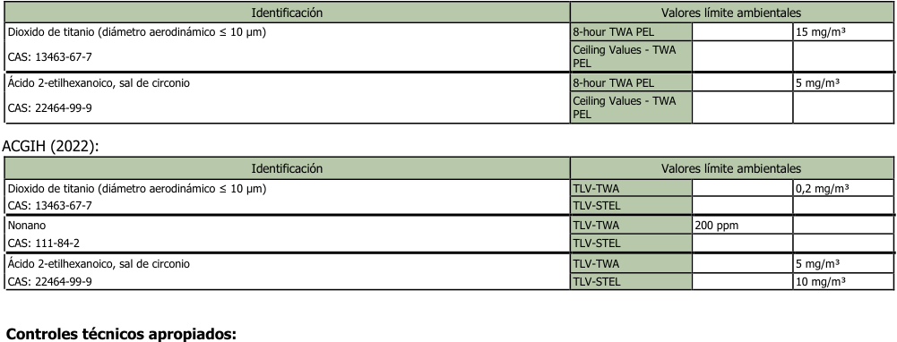

> Imagen (pág. 5). OCR automático, revisar: «Identificación Valores límite ambientales Dioxido de titanio (diámetro aerodinámico < 10 um) [8-hour TWA PEL 15 mg/m? (Ceiling Values - TWA (CAS: 13463-67-7 fev Ácido 2-etilhexanoico, sal de circonio [8-hour TWA PEL 5 mg/m Cas: 2464509 Cin Vals TWA ACGIH (2022): Identificación Valores límite ambientales Dioxido de titanio (diámetro aerodinámico < 10 um) [Tov-TwA 0,2 mg/m? (CAS: 13463-67-7 [Tuv-STEL Nonano [ruv-TWwa 200 ppm (CAS: 111-84-2 [TLV-STEL Ácido 2-etihexanoico, sal de circonio [TLV-TWA 5 mg/m [CAS: 22464-99-9 [TLV-STEL 10 mg/m? Controles técnicos apropiados:»

<!-- Start of picture text -->
Identificación  Valores límite ambientales Dioxido de titanio (diámetro aerodinámico ≤ 10 μm)  8-hour TWA PEL  15 mg/m³ CAS: 13463-67-7  Ceiling Values - TWA PEL Ácido 2-etilhexanoico, sal de circonio  8-hour TWA PEL  5 mg/m³ CAS: 22464-99-9  Ceiling Values - TWA PEL ——<—_— ACGIH (2022): Identificación  Valores límite ambientales Dioxido de titanio (diámetro aerodinámico ≤ 10 μm)  TLV-TWA  0,2 mg/m³ CAS: 13463-67-7  TLV-STEL Nonano  TLV-TWA  200 ppm CAS: 111-84-2  TLV-STEL Ácido 2-etilhexanoico, sal de circonio  TLV-TWA  5 mg/m³ === Controles técnicos apropiados:  CAS: 22464-99-9  TLV-STEL  == 10 mg/m³ <!-- End of picture text -->

<!-- Start of picture text -->
A.- Medidas de protección individual, como equipo de protección personal (EPP) <!-- End of picture text -->

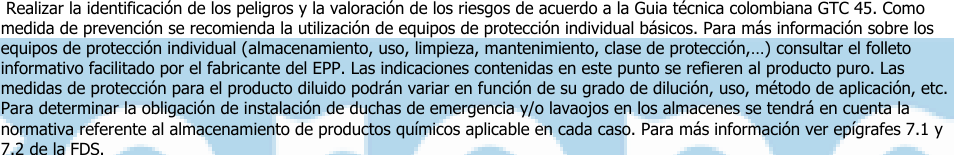

> Imagen (pág. 5). OCR automático, revisar: «Realizar la identificación de los peligros y la valoración de los riesgos de acuerdo a la Guia técnica colombiana GTC 45. Como medida de prevención se recomienda la utilización de equipos de protección individual básicos. Para más información sobre los equipos de protección individual (almacenamiento, uso, limpieza, mantenimiento, clase de protección,...) consultar el folleto informativo facilitado por el fabricante del EPP. Las indicaciones contenidas en este punto se refieren al producto puro. Las medidas de protección para el producto diluido podrán variar en función de su grado de dilución, uso, método de aplicación, etc. Para determinar la obligación de instalación de duchas de emergencia y/o lavaojos en los almacenes se tendrá en cuenta la normativa referente al almacenamiento de productos químicos aplicable en cada caso. Para más información ver epígrafes 7.1 y 7.2 de la FDS.»

<!-- Start of picture text -->
Realizar la identificación de los peligros y la valoración de los riesgos de acuerdo a la Guia técnica colombiana GTC 45. Como medida de prevención se recomienda la utilización de equipos de protección individual básicos. Para más información sobre los equipos de protección individual (almacenamiento, uso, limpieza, mantenimiento, clase de protección,…) consultar el folleto informativo facilitado por el fabricante del EPP. Las indicaciones contenidas en este punto se refieren al producto puro. Las medidas de protección para el producto diluido podrán variar en función de su grado de dilución, uso, método de aplicación, etc. Para determinar la obligación de instalación de duchas de emergencia y/o lavaojos en los almacenes se tendrá en cuenta la normativa referente al almacenamiento de productos químicos aplicable en cada caso. Para más información ver epígrafes 7.1 y 7.2 de la FDS. <!-- End of picture text -->

> Imagen (pág. 5). OCR automático, revisar: «Toda la información aqui incluida es una recomendación siendo necesario su concreción por parte de los servicios de prevención de riesgos laborales al desconocer las medidas de prevención adicionales que la empresa pudiese disponer.»

<!-- Start of picture text -->
Toda la información aquí incluida es una recomendación siendo necesario su concreción por parte de los servicios de prevención de riesgos laborales al desconocer las medidas de prevención adicionales que la empresa pudiese disponer. <!-- End of picture text -->

<!-- Start of picture text -->
B.- Protección respiratoria. <!-- End of picture text -->

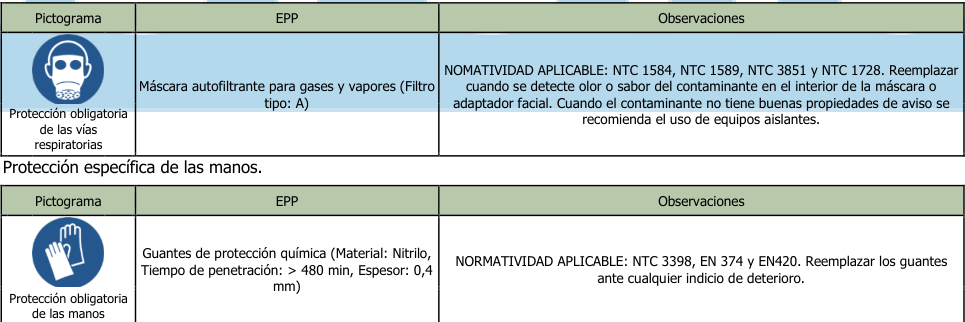

> Imagen (pág. 5). OCR automático, revisar: «Pictograma EPP Observaciones NOMATIVIDAD APLICABLE: NTC 1584, NTC 1589, NTC 3851 y NTC 1728. Reemplazar Máscara autofiltrante para gases y vapores (Filtro] cuando se detecte olor o sabor del contaminante en el interior de la máscara o . tipo: A) adaptador facial. Cuando el contaminante no tiene buenas propiedades de aviso se Protección obligatoria recomienda el uso de equipos aislantes. de las vías respiratorias Protección específica de las manos. Pictograma EPP Observaciones Guantes de protección química (Material: Nitro, Tiempo de penetración: > 480 min, Espesor: 0,4 mm) NORMATIVIDAD APLICABLE: NTC 3398, EN 374 y EN420. Reemplazar los guantes ante cualquier indicio de deterioro. Protección obligatoria de las manos»

<!-- Start of picture text -->
Pictograma  EPP  Observaciones NOMATIVIDAD APLICABLE: NTC 1584, NTC 1589, NTC 3851 y NTC 1728. Reemplazar Máscara autofiltrante para gases y vapores (Filtro  cuando se detecte olor o sabor del contaminante en el interior de la máscara o tipo: A)  adaptador facial. Cuando el contaminante no tiene buenas propiedades de aviso se Protección obligatoria  recomienda el uso de equipos aislantes. de las vías respiratorias C.- Protección específica de las manos. Pictograma  EPP  Observaciones Guantes de protección química (Material: Nitrilo, NORMATIVIDAD APLICABLE: NTC 3398, EN 374 y EN420. Reemplazar los guantes Tiempo de penetración: > 480 min, Espesor: 0,4 ante cualquier indicio de deterioro. mm) Protección obligatoria de las manos <!-- End of picture text -->

<!-- Start of picture text -->
C.- Protección específica de las manos. <!-- End of picture text -->

> Imagen (pág. 5). OCR automático, revisar: «Dado que el producto es una mezcla de diferentes materiales, la resistencia del material de los guantes no se puede calcular de antemano con total fiabilidad y por lo tanto tiene que ser controlados antes de su aplicación.»

<!-- Start of picture text -->
Dado que el producto es una mezcla de diferentes materiales, la resistencia del material de los guantes no se puede calcular de antemano con total fiabilidad y por lo tanto tiene que ser controlados antes de su aplicación. <!-- End of picture text -->

<!-- Start of picture text -->
D.- Protección ocular y facial <!-- End of picture text -->

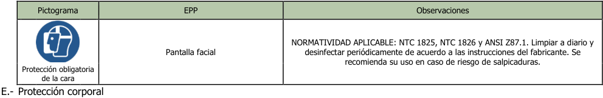

> Imagen (pág. 5). OCR automático, revisar: «Protección obligatoria de la cara Pictograma EPP Observaciones NORMATIVIDAD APLICABLE: NTC 1825, NTC 1826 y ANSI 287.1. Limpiar a diario y Pantalla facial desinfectar periódicamente de acuerdo a las instrucciones del fabricante. Se recomienda su uso en caso de riesgo de salpicaduras. E.- Protección corporal»

<!-- Start of picture text -->
Pictograma  EPP  Observaciones NORMATIVIDAD APLICABLE: NTC 1825, NTC 1826 y ANSI Z87.1. Limpiar a diario y Pantalla facial  desinfectar periódicamente de acuerdo a las instrucciones del fabricante. Se recomienda su uso en caso de riesgo de salpicaduras. Protección obligatoria de la cara E.- Protección corporal <!-- End of picture text -->

<!-- Start of picture text -->
- CONTINÚA EN LA SIGUIENTE PÁGINA - <!-- End of picture text -->

Emisión: 24/06/2024            Revisión: 28/02/2025            Versión: 4 (sustituye a 3) 

**Página 5/14** 

<!-- pagina: 6 -->

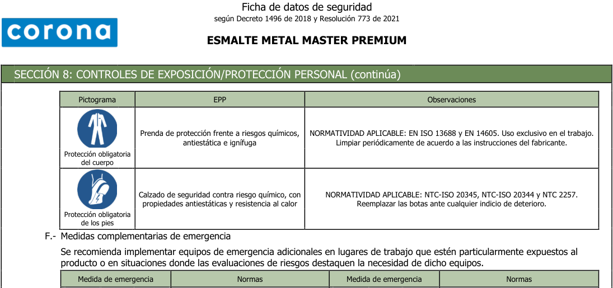

> Imagen (pág. 6). OCR automático, revisar: «O Protección obligatoria del cuerpo Ficha de datos de seguridad según Decreto 1496 de 2018 y Resolución 773 de 2021 ESMALTE METAL MASTER PREMIUM Prenda de protección frente a riesgos químicos, antiestática e ignifuga NORMATIVIDAD APLICABLE: EN ISO 13688 y EN 14605. Uso exclusivo en el trabajo. Limpiar periódicamente de acuerdo a las instrucciones del fabricante. © Protección obligatoria de los pies Calzado de seguridad contra riesgo químico, con propiedades antiestáticas y resistencia al calor NORMATIVIDAD APLICABLE: NTC-ISO 20345, NTC-ISO 20344 y NTC 2257. Reemplazar las botas ante cualquier indicio de deterioro. F.- Medidas complementarias de emergencia Se recomienda implementar equipos de emergencia adicionales en lugares de trabajo que estén particularmente expuestos al producto o en situaciones donde las evaluaciones de riesgos destaquen la necesidad de dicho equipos.»

<!-- Start of picture text -->
Ficha de datos de seguridad según Decreto 1496 de 2018 y Resolución 773 de 2021 ESMALTE METAL MASTER PREMIUM SECCIÓN 8: CONTROLES DE EXPOSICIÓN/PROTECCIÓN PERSONAL (continúa) Pictograma  EPP  Observaciones Prenda de protección frente a riesgos químicos,  NORMATIVIDAD APLICABLE: EN ISO 13688 y EN 14605. Uso exclusivo en el trabajo. antiestática e ignífuga  Limpiar periódicamente de acuerdo a las instrucciones del fabricante. Protección obligatoria [corona] C del cuerpo  I Calzado de seguridad contra riesgo químico, con  NORMATIVIDAD APLICABLE: NTC-ISO 20345, NTC-ISO 20344 y NTC 2257. propiedades antiestáticas y resistencia al calor  Reemplazar las botas ante cualquier indicio de deterioro. Protección obligatoria CI de los pies F.- Medidas complementarias de emergencia Se recomienda implementar equipos de emergencia adicionales en lugares de trabajo que estén particularmente expuestos al producto o en situaciones donde las evaluaciones de riesgos destaquen la necesidad de dicho equipos. Medida de emergencia  Normas  Medida de emergencia  Normas <!-- End of picture text -->

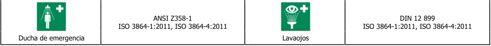

> Imagen (pág. 6). OCR automático, revisar: «ANSI 2358-1 DIN 12 899 ISO 3864-1:2011, ISO 3864-4:2011 Y ISO 3864-1:2011, ISO 3864-4:2011 Ducha de emergencia Lavaojos»

<!-- Start of picture text -->
ANSI Z358-1  DIN 12 899 ISO 3864-1:2011, ISO 3864-4:2011  ISO 3864-1:2011, ISO 3864-4:2011 o Ducha de emergencia  A) Lavaojos <!-- End of picture text -->

**Controles de la exposición del medio ambiente:** 

Se recomienda evitar el vertido tanto del producto como de su envase al medio ambiente. Para información adicional ver epígrafe 7.1.D de la FDS. **NTC 6018- Etiquetas ambientales tipo I. Sello ambiental colombiano. Criterios ambientales para pinturas y materiales de recubrimiento (determinados teóricamente conforme al ASTM D6886):** Compuestos orgánicos volátiles: 27,75 % peso Concentración C.O.V. a 20 ºC: 479,14 kg/m³  (479,14 g/L) 

# SECCIÓN 9: PROPIEDADES FÍSICAS Y QUÍMICAS Y CARACTERÍSTICAS DE SEGURIDAD 

## **9.1 Información de propiedades físicas y químicas básicas:** 

Para completar la información ver la ficha técnica/hoja de especificaciones del producto. 

**Aspecto físico:** Estado físico a 20 ºC: Líquido Aspecto: No relevante  * Color: No relevante  * Olor: No relevante  * Umbral olfativo: No relevante  * **Volatilidad:** Temperatura de ebullición a presión atmosférica: 134 ºC Presión de vapor a 20 ºC: 2157 Pa Presión de vapor a 50 ºC: 11370,58 Pa  (11,37 kPa) Tasa de evaporación a 20 ºC: No relevante  * **Caracterización del producto:** Densidad a 20 ºC: 1107,1 kg/m³ Densidad relativa a 20 ºC: 1,107 Viscosidad dinámica a 20 ºC: No relevante  * Viscosidad cinemática a 20 ºC: No relevante  * Viscosidad cinemática a 40 ºC: <20,5 mm²/s Concentración: No relevante  * pH: No relevante  * *No relevante debido a la naturaleza del producto, no aportando información característica de su peligrosidad. 

- CONTINÚA EN LA SIGUIENTE PÁGINA - 

Emisión: 24/06/2024            Revisión: 28/02/2025            Versión: 4 (sustituye a 3) 

**Página 6/14** 

<!-- pagina: 7 -->
Ficha de datos de seguridad según Decreto 1496 de 2018 y Resolución 773 de 2021 

> Imagen (pág. 7). Sin texto legible por OCR; contenido gráfico no interpretado.

# **ESMALTE METAL MASTER PREMIUM** 

# SECCIÓN 9: PROPIEDADES FÍSICAS Y QUÍMICAS Y CARACTERÍSTICAS DE SEGURIDAD (continúa) 

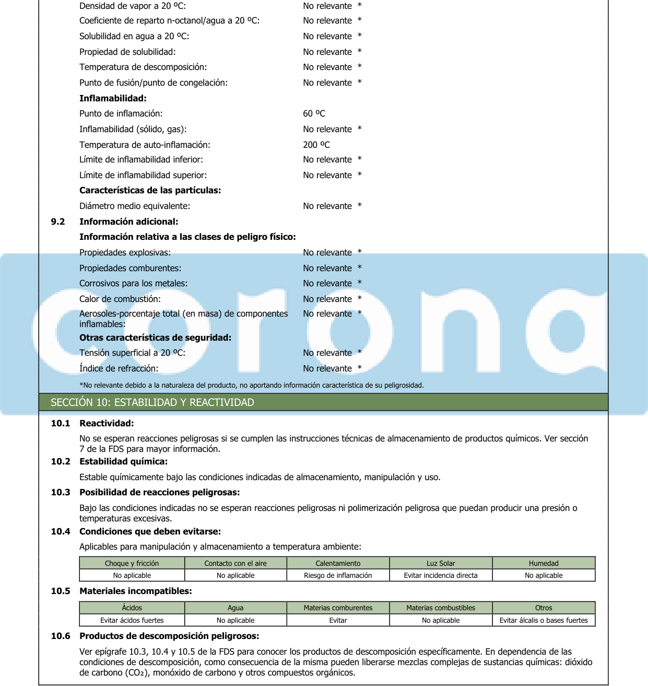

> Imagen (pág. 7). OCR automático, revisar: «* Densidad de vapor a 20 °C: No relevante Coeficiente de reparto n-octanol/agua a 20 °C: No relevante * Solubilidad en agua a 20 °C: No relevante * Propiedad de solubilidad: No relevante * Temperatura de descomposición: No relevante * Punto de fusión/punto de congelación: No relevante * Inflamabilidad: Punto de inflamación: 60 °C Inflamabilidad (sólido, gas): No relevante * Temperatura de auto-inflamación: 200 °C Límite de inflamabilidad inferior: No relevante * Límite de inflamabilidad superior: No relevante * Características de las partículas: Diámetro medio equivalente: No relevante * 9.2 Información a Información relativa a las clases de peligro fi: ional: Propiedades explosivas: No relevante * Propiedades comburentes: No relevante * Corrosivos para los metales: No relevante * Calor de combustión: No relevante * Aerosoles-porcentaje total (en masa) de componentes No relevante * inflamables: Otras características de seguridad: Tensión superficial a 20 °C: No relevante * Indice de refraccién: No relevante * *No relevante debido a la naturaleza del producto, no aportando información característica de su peligrosidad. SECCIÓN 10: ESTABILIDAD Y REACTIVIDAD 10.1 Reactividad: No se esperan reacciones peligrosas si se cumplen las instrucciones técnicas de almacenamiento de productos químicos. Ver sección 7 de la FDS para mayor información. 10.2 Estabilidad química: Estable químicamente bajo las condiciones indicadas de almacenamiento, manipulación y uso. 10.3 Posibilidad de reacciones peligrosas: Bajo las condiciones indicadas no se esperan reacciones peligrosas ni polimerización peligrosa que puedan producir una presión o temperaturas excesivas. 10.4 Condiciones que deben evitarse: Aplicables para manipulación y almacenamiento a temperatura ambiente: Choque y fricción Contacto con el aire Calentamiento Luz Solar Humedad No aplicable No aplicable Riesgo de inflamación Evitar incidencia directa No aplicable 10.5 Materiales incompatibles: Ácidos Agua Materias comburentes Materias combustibles Otros Evitar ácidos fuertes No aplicable Evitar No aplicable Evitar álcalis o bases fuertes 10.6 Productos de descomposición peligrosos: Ver epígrafe 10.3, 10.4 y 10.5 de la FDS para conocer los productos de descomposición específicamente. En dependencia de las condiciones de descomposición, como consecuencia de la misma pueden liberarse mezclas complejas de sustancias químicas: dióxido de carbono (CO2), monóxido de carbono y otros compuestos orgánicos.»

<!-- Start of picture text -->
Densidad de vapor a 20 ºC:  No relevante  * Coeficiente de reparto n-octanol/agua a 20 ºC:  No relevante  * Solubilidad en agua a 20 ºC:  No relevante  * Propiedad de solubilidad:  No relevante  * Temperatura de descomposición:  No relevante  * Punto de fusión/punto de congelación:  No relevante  * Inflamabilidad: Punto de inflamación:  60 ºC Inflamabilidad (sólido, gas):  No relevante  * Temperatura de auto-inflamación:  200 ºC Límite de inflamabilidad inferior:  No relevante  * Límite de inflamabilidad superior:  No relevante  * Características de las partículas: Diámetro medio equivalente:  No relevante  * 9.2  Información adicional: Información relativa a las clases de peligro físico: Propiedades explosivas:  No relevante  * Propiedades comburentes:  No relevante  * Corrosivos para los metales:  No relevante  * Calor de combustión:  No relevante  * Aerosoles-porcentaje total (en masa) de componentes  No relevante  * inflamables: Otras características de seguridad: Tensión superficial a 20 ºC:  No relevante  * Índice de refracción:  No relevante  * *No relevante debido a la naturaleza del producto, no aportando información característica de su peligrosidad. SECCIÓN 10: ESTABILIDAD Y REACTIVIDAD 10.1 Reactividad: No se esperan reacciones peligrosas si se cumplen las instrucciones técnicas de almacenamiento de productos químicos. Ver sección 7 de la FDS para mayor información. 10.2 Estabilidad química: Estable químicamente bajo las condiciones indicadas de almacenamiento, manipulación y uso. 10.3 Posibilidad de reacciones peligrosas: Bajo las condiciones indicadas no se esperan reacciones peligrosas ni polimerización peligrosa que puedan producir una presión o temperaturas excesivas. 10.4 Condiciones que deben evitarse: Aplicables para manipulación y almacenamiento a temperatura ambiente: Choque y fricción  Contacto con el aire  Calentamiento  Luz Solar  Humedad No aplicable  No aplicable  Riesgo de inflamación  Evitar incidencia directa  No aplicable 10.5 Materiales incompatibles: Ácidos  Agua  Materias comburentes  Materias combustibles  Otros | Evitar ácidos fuertes  No aplicable  Evitar  No aplicable  Evitar álcalis o bases fuertes 10.6 Productos de descomposición peligrosos: Ver epígrafe 10.3, 10.4 y 10.5 de la FDS para conocer los productos de descomposición específicamente. En dependencia de las condiciones de descomposición, como consecuencia de la misma pueden liberarse mezclas complejas de sustancias químicas: dióxido de carbono (CO₂), monóxido de carbono y otros compuestos orgánicos. <!-- End of picture text -->

- CONTINÚA EN LA SIGUIENTE PÁGINA - 

Emisión: 24/06/2024            Revisión: 28/02/2025            Versión: 4 (sustituye a 3) 

**Página 7/14** 

<!-- pagina: 8 -->
Ficha de datos de seguridad según Decreto 1496 de 2018 y Resolución 773 de 2021 

> Imagen (pág. 8). Sin texto legible por OCR; contenido gráfico no interpretado.

# **ESMALTE METAL MASTER PREMIUM** 

# SECCIÓN 11: INFORMACIÓN TOXICOLÓGICA 

## **11.1 Información sobre las posibles vías de exposición:** 

No se dispone de datos experimentales del producto en sí mismo relativos a las propiedades toxicológicas 

## **Efectos peligrosos para la salud:** 

En caso de exposición repetitiva, prolongada o a concentraciones superiores a las establecidas por los límites de exposición profesionales, pueden producirse efectos adversos para la salud en función de la vía de exposición: A- Ingestión (efecto agudo): 

-   Toxicidad aguda: A la vista de los datos disponibles, no se cumplen los criterios de clasificación, sin embargo, presenta sustancias clasificadas como peligrosas por ingestión. Para más información ver sección 3 de la FDS. -   Corrosividad/Irritabilidad: La ingesta de una dosis considerable puede originar irritación de garganta, dolor abdominal, náuseas y vómitos. B- Inhalación (efecto agudo): 

-   Toxicidad aguda: A la vista de los datos disponibles, no se cumplen los criterios de clasificación, no presentando sustancias clasificadas como peligrosas por inhalación. Para más información ver sección 3 de la FDS. -   Corrosividad/Irritabilidad: A la vista de los datos disponibles, no se cumplen los criterios de clasificación, no presentando sustancias clasificadas como peligrosas por este efecto. Para más información ver sección 3 de la FDS. 

- C- Contacto con la piel y los ojos (efecto agudo): 

   - Contacto con la piel: Produce inflamación cutánea. 

- Contacto con los ojos: A la vista de los datos disponibles, no se cumplen los criterios de clasificación, sin embargo presenta sustancias clasificadas como peligrosas por este efecto. Para más información ver sección 3 de la FDS. 

- D- Efectos CMR (carcinogenicidad, mutagenicidad y toxicidad para la reproducción): 

-   Carcinogenicidad: La exposición a este producto puede causar cáncer. Para más información sobre posibles efectos específicos sobre la salud ver sección 2 de la FDS. IARC: Destilados (petróleo), fracción ligera tratada con hidrógeno (60 ºC < fp < 93 ºC) (3); Nafta (petróleo), fracción pesada tratada con hidrógeno (3); Cuarzo (1 % < RCS < 10 %) (1); Nafta (petróleo), fracción pesada tratada con hidrógeno, < 0.1 % EC 200-753-7 (3); Bis(2-etilhexanoato) de cobalto (2B); Destilados (petróleo), fracción ligera tratada con hidrógeno (3); Dioxido de titanio (diámetro aerodinámico ≤ 10 μm) (2B); Talco (3) -   Mutagenicidad: La exposición a este producto puede causar alteraciones genéticas. Para más información sobre posibles efectos específicos sobre la salud ver sección 2 de la FDS. -   Toxicidad para la reproducción: A la vista de los datos disponibles, no se cumplen los criterios de clasificación, sin embargo presenta sustancias clasificadas como peligrosas por este efecto. Para más información ver sección 3 de la FDS. 

E- Efectos de sensibilización: 

-   Respiratoria: A la vista de los datos disponibles, no se cumplen los criterios de clasificación, no presentando sustancias clasificadas como peligrosas con efectos sensibilizantes. Para más información ver secciones 2, 3 y 15 de la FDS. -   Cutánea: El contacto prolongado con la piel puede derivar en EPPsodios de dermatitis alérgicas de contacto. F- Toxicidad específica en determinados órganos (STOT)-exposición única: 

A la vista de los datos disponibles, no se cumplen los criterios de clasificación, sin embargo, presenta sustancias clasificadas como peligrosas por una única exposición. Para más información ver sección 3 de la FDS. 

G- Toxicidad específica en determinados órganos (STOT)-exposición repetida: 

-   Toxicidad específica en determinados órganos (STOT)-exposición repetida: A la vista de los datos disponibles, no se cumplen los criterios de clasificación, sin embargo, presenta sustancias clasificadas como peligrosas por exposición repetitiva. Para más información ver sección 3 de la FDS. -   Piel: A la vista de los datos disponibles, no se cumplen los criterios de clasificación, no presentando sustancias clasificadas como peligrosas por este efecto. Para más información ver sección 3 de la FDS. 

H- Peligro por aspiración: 

Puede ser mortal en caso de ingestión y penetración en las vías respiratorias. 

**Información adicional:** 

- CONTINÚA EN LA SIGUIENTE PÁGINA - 

Emisión: 24/06/2024            Revisión: 28/02/2025            Versión: 4 (sustituye a 3) 

**Página 8/14** 

<!-- pagina: 9 -->
Ficha de datos de seguridad según Decreto 1496 de 2018 y Resolución 773 de 2021 

> Imagen (pág. 9). Sin texto legible por OCR; contenido gráfico no interpretado.

# **ESMALTE METAL MASTER PREMIUM** 

# SECCIÓN 11: INFORMACIÓN TOXICOLÓGICA (continúa) 

CAS 13463-67-7 Dióxido de Titanio: IARC lista esta sustancia como un posible carcinógeno humano (grupo 2B), indicando que hay suficientes evidencias para considerarlo carcinógeno en animales pero insuficientes para considerarlo como carcinógeno para seres humanos. 

La monografía de IARC para esta sustancia indica que no hay exposición significativa al dióxido de titanio durante el uso normal de productos en los que dióxido de titanio está unido permanentemente a otros materiales, tales como pinturas (Ref: Monografía IARC, Vol. 93, 2010). 

El lijado repetido de las superficies de película seca puede producir riesgo de sobreexposición al polvo dependiendo de la duración y nivel de lijado, para evitarla deben tomarse las medidas de protección adecuadas. **Información toxicológica específica de las sustancias:** 

|Identificación|Toxi|cidad aguda|Género|
|---|---|---|---|
|Oxima de 2-butanona|DL50 oral|100 mg/kg||
|CAS: 96-29-7|DL50 cutánea|1100 mg/kg||
||CL50 inhalación|||
|Dioxido de titanio (diámetro aerodinámico ≤ 10 μm)|DL50 oral|10000 mg/kg|Rata|
|CAS: 13463-67-7|DL50 cutánea|10000 mg/kg|Conejo|
||CL50 inhalación|||
|Nonano|DL50 oral|>5000 mg/kg|Rata|
|CAS: 111-84-2|DL50 cutánea|||
||CL50 inhalación|||
|Ácido 2-etilhexanoico, sal de circonio|DL50 oral|2043 mg/kg|Rata|
|CAS: 22464-99-9|DL50 cutánea|||
||CL50 inhalación|||
|Nafta (petróleo), fracción pesada tratada con hidrógeno|DL50 oral|>5000 mg/kg|Rata|
|CAS: 64742-48-9|DL50 cutánea|>5000 mg/kg|Conejo|
||CL50 inhalación|||

# SECCIÓN 12: INFORMACIÓN ECOTOXICOLÓGICA 

No se disponen de datos experimentales de la mezcla en sí misma relativos a las propiedades ecotoxicológicas. 

Nocivo para los organismos acuáticos, con efectos nocivos duraderos. 

## **12.1 Toxicidad:** 

## **Toxicidad aguda:** 

|Identificación||Concentración|Especie|Género|
|---|---|---|---|---|
|Destilados (petróleo), fracción ligera tratada con hidrógeno|CL50|>1 - 10 mg/L (96 h)||Pez|
|CAS: 64742-47-8|CE50|>1 - 10 mg/L (48 h)||Crustáceo|
||CE50|>1 - 10 mg/L (72 h)||Alga|
|Oxima de 2-butanona|CL50|843 mg/L (96 h)|Pimephales promelas|Pez|
|CAS: 96-29-7|CE50|750 mg/L (48 h)|Daphnia magna|Crustáceo|
||CE50|83 mg/L (72 h)|Scenedesmus subspicatus|Alga|
|Nonano|CL50|No relevante|||
|CAS: 111-84-2|CE50|0,2 mg/L (48 h)|Daphnia magna|Crustáceo|
||CE50|No relevante|||
|Ácido 2-etilhexanoico, sal de circonio|CL50|270 mg/L (96 h)|N/A|Pez|
|CAS: 22464-99-9|CE50|No relevante|||
||CE50|No relevante|||
|Bis(2-etilhexanoato) de cobalto|CL50|No relevante|||
|CAS: 136-52-7|CE50|No relevante|||
||CE50|0,144 mg/L (72 h)|Pseudokirchneriella subcapitata|Alga|
|Nafta (petróleo), fracción pesada tratada con hidrógeno|CL50|2200 mg/L (96 h)|Pimephales promelas|Pez|
|CAS: 64742-48-9|CE50|1000 mg/L (96 h)|Daphnia magna|Crustáceo|
||CE50|No relevante|||
|**Toxicidad a largo plazo:**|||||

- CONTINÚA EN LA SIGUIENTE PÁGINA - 

Emisión: 24/06/2024            Revisión: 28/02/2025            Versión: 4 (sustituye a 3) 

**Página 9/14** 

<!-- pagina: 10 -->
Ficha de datos de seguridad según Decreto 1496 de 2018 y Resolución 773 de 2021 

> Imagen (pág. 10). Sin texto legible por OCR; contenido gráfico no interpretado.

# **ESMALTE METAL MASTER PREMIUM** 

SECCIÓN 12: INFORMACIÓN ECOTOXICOLÓGICA (continúa) 

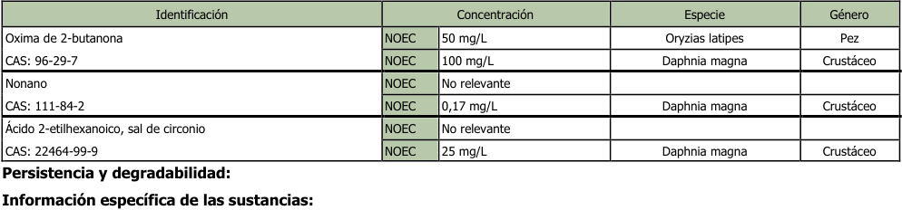

> Imagen (pág. 10). OCR automático, revisar: «Identificación Concentración Especie Género 'Oxima de 2-butanona INOEC [50 mg/L Oryzias latipes Pez [CAS: 96-29-7 INOEC [100 mg/L Daphnia magna Crustáceo Nonano INOEC [No relevante (CAS: 111-84-2 INOEC [0,17 mg/L Daphnia magna Crustáceo Ácido 2-etilhexanoico, sal de circonio INOEC [No relevante [CAS: 22464-99-9 INOEC [25 mg/L Daphnia magna Crustáceo Persistencia y degradabilidad: Información específica de las sustancias:»

<!-- Start of picture text -->
Identificación  Concentración  Especie  Género Oxima de 2-butanona  NOEC  50 mg/L  Oryzias latipes  Pez CAS: 96-29-7  NOEC  100 mg/L  Daphnia magna  Crustáceo Nonano  NOEC  No relevante CAS: 111-84-2  NOEC  0,17 mg/L  Daphnia magna  Crustáceo Ácido 2-etilhexanoico, sal de circonio  NOEC  No relevante CAS: 22464-99-9  NOEC  25 mg/L  Daphnia magna  Crustáceo 12.2 Persistencia y degradabilidad: Información específica de las sustancias: <!-- End of picture text -->

<!-- Start of picture text -->
12.2 Persistencia y degradabilidad: <!-- End of picture text -->

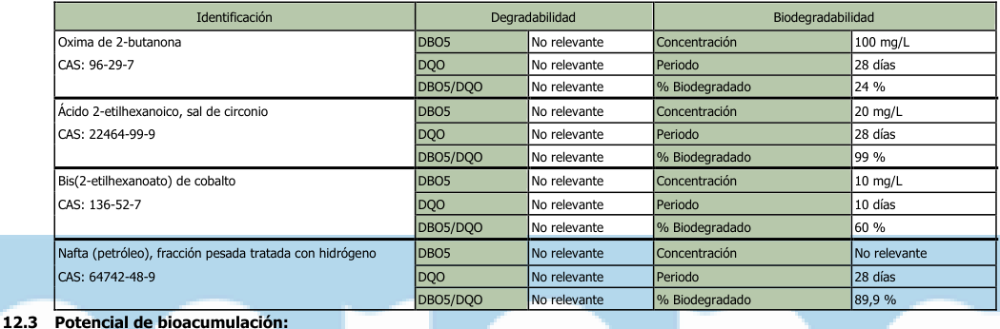

> Imagen (pág. 10). OCR automático, revisar: «Identificación Degradabilidad Biodegradabilidad 'Oxima de 2-butanona [DBOS No relevante [Concentración 100 mg/L CAS: 96-29-7 [DQO No relevante Periodo 28 días DBO5/DQ0 No relevante (% Biodegradado 24 % Ácido 2-etilhexanoico, sal de circonio DBOS No relevante [Concentración 20 mg/L CAS: 22464-99-9 DQo No relevante Periodo 28 días [pBOS/DQO, No relevante 1% Biodegradado 99 % Bis(2-etilhexanoato) de cobalto DBOS No relevante [Concentración 10 mg/L CAS: 136-52-7 [DQO No relevante Periodo 10 días [DBOS/DQO. No relevante 1% Biodegradado 60% Nafta (petróleo), fracción pesada tratada con hidrógeno DBOS No relevante [Concentración No relevante CAS: 64742-48-9 DQO No relevante Periodo 28 días DBO5/DQ0 [No relevante 1% Biodegradado 89,9 % I de bioacumula:»

<!-- Start of picture text -->
Identificación  Degradabilidad  Biodegradabilidad Oxima de 2-butanona  DBO5  No relevante  Concentración  100 mg/L CAS: 96-29-7  DQO  No relevante  Periodo  28 días DBO5/DQO  No relevante  % Biodegradado  24 % Ácido 2-etilhexanoico, sal de circonio  DBO5  No relevante  Concentración  20 mg/L CAS: 22464-99-9  DQO  No relevante  Periodo  28 días DBO5/DQO  No relevante  % Biodegradado  99 % Bis(2-etilhexanoato) de cobalto  DBO5  No relevante  Concentración  10 mg/L CAS: 136-52-7  DQO  No relevante  Periodo  10 días DBO5/DQO  No relevante  % Biodegradado  60 % Nafta (petróleo), fracción pesada tratada con hidrógeno  DBO5  No relevante  Concentración  No relevante CAS: 64742-48-9  DQO  No relevante  Periodo  28 días DBO5/DQO  No relevante  % Biodegradado  89,9 % 12.3 Potencial de bioacumulación: <!-- End of picture text -->

## **Información específica de las sustancias:** 

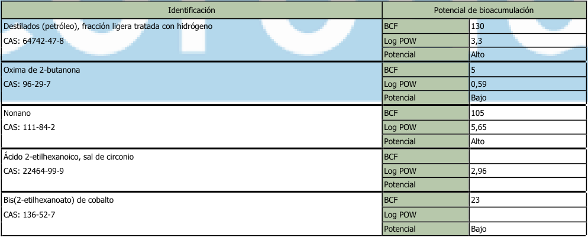

> Imagen (pág. 10). OCR automático, revisar: «Identificación Potencial de bioacumulación Destilados (petróleo), fracción ligera tratada con hidrógeno. BCF 130 (CAS: 64742-47-8, Log POW 3,3 Potencial [alto JOxima de 2-butanona BCF 5 CAS: 96-29-7 Log POW 0,59 Potencial Bajo Nonano BCF 105 CAS: 111-84-2 Log POW 5,65 Potencial [Alto Ácido 2-etilhexanoico, sal de circonio BCF (CAS: 22464-99-9 Log POW 2,96 Potencial Bis(2-etilhexanoato) de cobalto BCF 23 (CAS: 136-52-7 Log POW Potencial Bajo»

<!-- Start of picture text -->
Identificación  Potencial de bioacumulación Destilados (petróleo), fracción ligera tratada con hidrógeno  BCF  130 CAS: 64742-47-8  Log POW  3,3 Potencial  Alto Oxima de 2-butanona  BCF  5 CAS: 96-29-7  Log POW  0,59 Potencial  Bajo Nonano  BCF  105 CAS: 111-84-2  Log POW  5,65 Potencial  Alto Ácido 2-etilhexanoico, sal de circonio  BCF CAS: 22464-99-9  Log POW  2,96 Potencial Bis(2-etilhexanoato) de cobalto  BCF  23 CAS: 136-52-7  Log POW Potencial  Bajo <!-- End of picture text -->

<!-- Start of picture text -->
12.4 Movilidad en el suelo: <!-- End of picture text -->

Emisión: 24/06/2024            Revisión: 28/02/2025            Versión: 4 (sustituye a 3) 

Identificación Absorción/Desorción Volatilidad Oxima de 2-butanona Koc 3 Henry No relevante CAS: 96-29-7 Conclusión Muy Alto Suelo seco No relevante Tensión superficial 2,57E-2 N/m  (25 ºC) Suelo húmedo No relevante Nonano Koc 796 Henry No relevante CAS: 111-84-2 Conclusión Bajo Suelo seco No relevante Tensión superficial 2,243E-2 N/m  (25 ºC) Suelo húmedo No relevante Ácido 2-etilhexanoico, sal de circonio Koc No relevante Henry 2,94E-1 Pa·m³/mol CAS: 22464-99-9 Conclusión No relevante Suelo seco Sí Tensión superficial No relevante Suelo húmedo Sí ~~<u>CES)</u>~~ 

- CONTINÚA EN LA SIGUIENTE PÁGINA - 

**Página 10/14** 

<!-- pagina: 11 -->
Ficha de datos de seguridad según Decreto 1496 de 2018 y Resolución 773 de 2021 

Consultar al gestor de residuos autorizado las operaciones de valorización y eliminación. En el caso de que el envase haya estado en contacto directo con el producto se gestionará del mismo modo que el propio producto, en caso contrario se gestionará como residuo no peligroso. Se desaconseja su vertido a cursos de agua. Ver epígrafe 6.2. 

según Decreto 1496 de 2018 y Resolución 773 de 2021 **ESMALTE METAL MASTER PREMIUM** SECCIÓN 12: INFORMACIÓN ECOTOXICOLÓGICA (continúa) Identificación Absorción/Desorción Volatilidad Nafta (petróleo), fracción pesada tratada con hidrógeno Koc 100 Henry No relevante CAS: 64742-48-9 Conclusión Alto Suelo seco No relevante Tensión superficial No relevante Suelo húmedo No relevante **12.5 Resultados de la valoración PBT y mPmB:** No relevante **12.6 Otros efectos adversos:** No descritos SECCIÓN 13: INFORMACIÓN RELATIVA A LA ELIMINACIÓN DE LOS PRODUCTOS **13.1 Métodos de eliminación: Gestión del residuo (eliminación y valorización):** Consultar al gestor de residuos autorizado las operaciones de valorización y eliminación. En el caso de que el envase haya estado en contacto directo con el producto se gestionará del mismo modo que el propio producto, en caso contrario se gestionará como residuo no peligroso. Se desaconseja su vertido a cursos de agua. Ver epígrafe 6.2. **Disposiciones legislativas relacionadas con la gestión de residuos:** Legislación relacionada con la gestión de residuos: Decreto 1076 de 2015 (Decreto único reglamentario del Sector Ambiente y Desarrollo Sostenible) SECCIÓN 14: INFORMACIÓN RELATIVA AL TRANSPORTE **Transporte terrestre de mercancías peligrosas:** En aplicación a la norma técnica colombiana 1692: **14.1 Número ONU:** UN1263 **14.2 Designación oficial de** PINTURA **transporte de las Naciones Unidas: 14.3 Clase(s) relativas al** 3 **transporte:** Etiquetas: 3 **14.4 Grupo de embalaje/envasado** III **si se aplica: 14.5 Riesgos ambientales:** No **14.6 Precauciones especiales para el usuario** Propiedades físico-químicas: Ver sección 9 **14.7 Transporte a granel con** No relevante **arreglo al anexo II de MARPOL 73/78 y al Código IBC: Transporte marítimo de mercancías peligrosas:** En aplicación al IMDG 41-22: ~~—~~ [corona] 

- CONTINÚA EN LA SIGUIENTE PÁGINA - 

Emisión: 24/06/2024            Revisión: 28/02/2025            Versión: 4 (sustituye a 3) 

**Página 11/14** 

<!-- pagina: 12 -->
Ficha de datos de seguridad según Decreto 1496 de 2018 y Resolución 773 de 2021 

> Imagen (pág. 12). Sin texto legible por OCR; contenido gráfico no interpretado.

# **ESMALTE METAL MASTER PREMIUM** 

# SECCIÓN 14: INFORMACIÓN RELATIVA AL TRANSPORTE (continúa) 

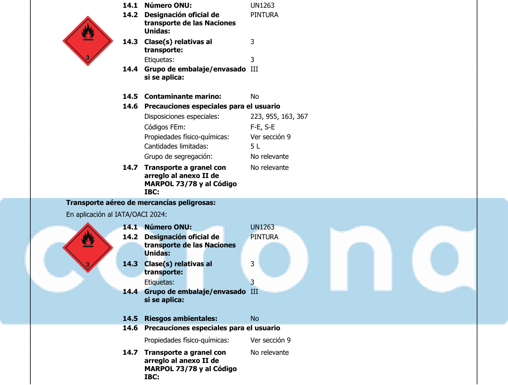

> Imagen (pág. 12). OCR automático, revisar: «14.1 Número ONU: UN1263 14.2 Designación oficial de PINTURA transporte de las Naciones Unidas: 14.3 Clase(s) relativas al 3 transporte: Etiquetas: 3 14.4 Grupo de embalaje/envasado III si se aplica: 14.5 Contaminante marino: No 14.6 Precauciones especiales para el usuario Disposiciones especiales: 223, 955, 163, 367 Códigos FEm: F-E, S-E Propiedades físico-químicas: Ver sección 9 Cantidades limitadas: SL Grupo de segregación: No relevante 14.7 Transporte a granel con No relevante arreglo al anexo II de MARPOL 73/78 y al Código IBC: Transporte aéreo de mercancias peligrosas: En aplicación al IATA/OACI 2024: 14.1 Número ONU: UN1263 14.2 Designación oficial de PINTURA transporte de las Naciones Unidas: 14.3 Clase(s) relativas al 3 transporte: Etiquetas: 3 14.4 Grupo de embalaje/envasado III si se aplica: 14.5 Riesgos ambientales: No 14.6 Precauciones especiales para el usuario Propiedades físico-químicas: Ver sección 9 14.7 Transporte a granel con No relevante arreglo al anexo II de MARPOL 73/78 y al Código IBC:»

<!-- Start of picture text -->
14.1 Número ONU:  UN1263 14.2 Designación oficial de  PINTURA transporte de las Naciones Unidas: 14.3 Clase(s) relativas al  3 transporte: Etiquetas:  3 14.4 Grupo de embalaje/envasado  III si se aplica: 14.5 Contaminante marino:  No 14.6 Precauciones especiales para el usuario Disposiciones especiales:  223, 955, 163, 367 Códigos FEm:  F-E, S-E Propiedades físico-químicas:  Ver sección 9 Cantidades limitadas:  5 L Grupo de segregación:  No relevante 14.7 Transporte a granel con  No relevante arreglo al anexo II de MARPOL 73/78 y al Código IBC: Transporte aéreo de mercancías peligrosas: En aplicación al IATA/OACI 2024: 14.1 Número ONU:  UN1263 14.2 Designación oficial de  PINTURA transporte de las Naciones Unidas: 14.3 Clase(s) relativas al  3 transporte: Etiquetas:  3 14.4 Grupo de embalaje/envasado  III si se aplica: 14.5 Riesgos ambientales:  No 14.6 Precauciones especiales para el usuario Propiedades físico-químicas:  Ver sección 9 14.7 Transporte a granel con  No relevante arreglo al anexo II de MARPOL 73/78 y al Código IBC: <!-- End of picture text -->

SECCIÓN 15: INFORMACIÓN SOBRE LA REGLAMENTACIÓN **15.1 Disposiciones específicas sobre seguridad, salud y medio ambiente para el producto de que se trate:** - NTP (National Toxicology Program): Bis(2-etilhexanoato) de cobalto (136-52-7) ; Nafta (petróleo), fracción pesada tratada con hidrógeno (64742-48-9) **Disposiciones particulares en materia de protección de las personas o el medio ambiente:** Se recomienda emplear la información recopilada en esta hoja de datos de seguridad de materiales como datos de entrada en una evaluación de riesgos de las circunstancias locales con el objeto de establecer las medidas necesarias de prevención de riesgos para el manejo, utilización, almacenamiento y eliminación de este producto. **Otras legislaciones:** Resolución 0312 de 2019 – Nuevos estándares mínimos del SG-SST CONPES 3868 - Política de gestión del riesgo asociado al uso de sustancias químicas. Decreto 1079 de 2015 - Decreto único reglamentario del sector transporte NTC 1692 -Transporte de mercancías peligrosas. Definiciones, clasificación, marcado, etiquetado y rotulado NTC 4532- Transporte de mercancías peligrosas. Tarjetas de emergencia para transporte de materiales. Elaboración Decreto número 4741 de 2005 ~~NS~~ 

- CONTINÚA EN LA SIGUIENTE PÁGINA - **Página 12/14** 

Emisión: 24/06/2024            Revisión: 28/02/2025            Versión: 4 (sustituye a 3) 

<!-- pagina: 13 -->
Ficha de datos de seguridad según Decreto 1496 de 2018 y Resolución 773 de 2021 

**ESMALTE METAL MASTER PREMIUM** 

> Imagen (pág. 13). Sin texto legible por OCR; contenido gráfico no interpretado.

# SECCIÓN 15: INFORMACIÓN SOBRE LA REGLAMENTACIÓN (continúa) 

Decreto 1299 de 2008 -Reglamenta departamento de gestión ambiental de empresas a nivel industrial estado Decreto 321 de 1999  - Adopta el Plan Nacional de Contingencia contra derrames de hidrocarburos, derivados y sustancias nocivas. NTC 4702 - 1 -Embalaje y Envases para Transporte de Mercancías Peligrosas Clase 1. Explosivos NTC 4702 - 2 - Embalaje y Envases para Transporte de Mercancías Peligrosas Clase 2. Gases NTC 4702 - 3 - Embalaje y Envases para Transporte de Mercancías Peligrosas Clase 3. Líquidos Inflamables NTC 4702 - 4 - Embalaje y Envases para Transporte de Mercancías Peligrosas Clase 4. Sólidos Inflamables, Sustancias que presentan riesgo de combustión espontánea, sustancias que en contacto con el agua desprenden gases inflamables. NTC 4702 - 5 - Embalaje y Envases para Transporte de Mercancías Peligrosas Clase 5. Sustancias Comburentes y Peróxidos Orgánicos NTC 4702 - 6 - Embalaje y Envases para Transporte de Mercancías Peligrosas Clase 6. Sustancias Tóxicas e Infecciosas NTC 4702 - 8 - Embalaje y Envases para Transporte de Mercancías Peligrosas Clase 8. Sustancias Corrosivas NTC 4702 - 9 - Embalaje y Envases para Transporte de Mercancías Peligrosas Clase 9. Sustancias Peligrosas varias Ley 2041 de 2020 - Por medio de la cual se garantiza el derecho de las personas a desarrollarse física e intelectualmente en un ambiente libre de plomo, fijando límites para su contenido en productos comercializados en el país. 

# SECCIÓN 16: OTRAS INFORMACIONES 

**Legislación aplicable a fichas de datos de seguridad:** Esta ficha de datos de seguridad se ha desarrollado de conformidad al Decreto 1496 de 2018 y a la Resolución 773 de 2021, contando con los elementos definidos en el ANEXO 4 - Guía para la elaboración de fichas de datos de seguridad (FDS) del Sistema Globalmente Armonizado de clasificación y etiquetado de productos químicos (SGA), sexta edición revisada (2015). **Textos de las frases legislativas contempladas en la sección 2:** H402: Nocivo para los organismos acuáticos. H412: Nocivo para los organismos acuáticos, con efectos nocivos duraderos. H340: Puede provocar defectos genéticos. H350: Puede provocar cáncer. H317: Puede provocar una reacción cutánea alérgica. H315: Provoca irritación cutánea. H304: Puede ser mortal en caso de ingestión y de penetración en las vías respiratorias. H226: Líquido y vapores inflamables. **Textos de las frases legislativas contempladas en la sección 3:** Las frases indicadas no se refieren al producto en sí, son sólo a título informativo y hacen referencia a los componentes individuales que aparecen en la sección 3 **SGA:** Acuático agudo. 1: H400 - Muy tóxico para los organismos acuáticos. Acuático agudo. 2: H401 - Tóxico para los organismos acuáticos. Acuático crónico. 1: H410 - Muy tóxico para los organismos acuáticos, con efectos nocivos duraderos. Acuático crónico. 2: H411 - Tóxico para los organismos acuáticos, con efectos nocivos duraderos. Acuático crónico. 3: H412 - Nocivo para los organismos acuáticos, con efectos nocivos duraderos. Carc. 1B: H350 - Puede provocar cáncer. Carc. 2: H351 - Susceptible de provocar cáncer (Inhalación). Carc. 2: H351 - Susceptible de provocar cáncer. Irrit. Cut. 2: H315 - Provoca irritación cutánea. Irrit. oc. 2: H319 - Provoca irritación ocular grave. Les. Oc. 1: H318 - Provoca lesiones oculares graves. Liq. Infl. 3: H226 - Líquido y vapores inflamables. Liq. Infl. 4: H227 - Líquido combustible. Muta. 1B: H340 - Puede provocar defectos genéticos. Repr. 1B: H360 - Puede perjudicar la fertilidad o dañar al feto. Repr. 2: H361 - Susceptible de perjudicar la fertilidad o dañar al feto. Sens. Cut. 1: H317 - Puede provocar una reacción cutánea alérgica. Sens. Cut. 1A: H317 - Puede provocar una reacción cutánea alérgica. STOT repe. 2: H373 - Puede provocar daños en los órganos tras exposiciones prolongadas o repetidas. STOT única 1: H370 - Provoca daños en los órganos. STOT única 3: H336 - Puede provocar somnolencia o vértigo. Tox. Agud. 3: H301 - Tóxico en caso de ingestión. Tox. Agud. 4: H312 - Nocivo en contacto con la piel. Tox. Agud. 5: H303 - Puede ser nocivo en caso de ingestión. Tox. Agud. 5: H313 - Puede ser nocivo en contacto con la piel. Tox. Asp. 1: H304 - Puede ser mortal en caso de ingestión y de penetración en las vías respiratorias. 

**Procedimiento de clasificación:** 

- CONTINÚA EN LA SIGUIENTE PÁGINA - 

Emisión: 24/06/2024            Revisión: 28/02/2025            Versión: 4 (sustituye a 3) 

**Página 13/14** 

<!-- pagina: 14 -->

> Imagen (pág. 14). OCR automático, revisar: «Ficha de datos de seguridad según Decreto 1496 de 2018 y Resolución 773 de 2021»

<!-- Start of picture text -->
Ficha de datos de seguridad según Decreto 1496 de 2018 y Resolución 773 de 2021 <!-- End of picture text -->

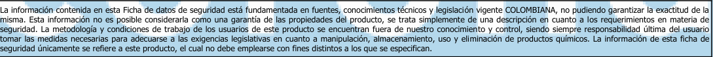

> Imagen (pág. 14). OCR automático, revisar: «La información contenida en esta Ficha de datos de seguridad está fundamentada en fuentes, conocimientos técnicos y legislación vigente COLOMBIANA, no pudiendo garantizar la exactitud de la misma. Esta información no es posible considerarla como una garantía de las propiedades del producto, se trata simplemente de una descripción en cuanto a los requerimientos en materia de seguridad. La metodología y condiciones de trabajo de los usuarios de este producto se encuentran fuera de nuestro conocimiento y control, siendo siempre responsabilidad última del usuario tomar las medidas necesarias para adecuarse a las exigencias legislativas en cuanto a manipulación, almacenamiento, uso y eliminación de productos químicos. La información de esta ficha de seguridad únicamente se refiere a este producto, el cual no debe emplearse con fines distintos a los que se especifican.»

<!-- Start of picture text -->
La información contenida en esta Ficha de datos de seguridad está fundamentada en fuentes, conocimientos técnicos y legislación vigente COLOMBIANA, no pudiendo garantizar la exactitud de la misma. Esta información no es posible considerarla como una garantía de las propiedades del producto, se trata simplemente de una descripción en cuanto a los requerimientos en materia de seguridad. La metodología y condiciones de trabajo de los usuarios de este producto se encuentran fuera de nuestro conocimiento y control, siendo siempre responsabilidad última del usuario tomar las medidas necesarias para adecuarse a las exigencias legislativas en cuanto a manipulación, almacenamiento, uso y eliminación de productos químicos. La información de esta ficha de seguridad únicamente se refiere a este producto, el cual no debe emplearse con fines distintos a los que se especifican. <!-- End of picture text -->

<!-- Start of picture text -->
Emisión: 24/06/2024            Revisión: 28/02/2025            Versión: 4 (sustituye a 3) <!-- End of picture text -->

según Decreto 1496 de 2018 y Resolución 773 de 2021 **ESMALTE METAL MASTER PREMIUM** SECCIÓN 16: OTRAS INFORMACIONES (continúa) Aquatic Chronic 3: Método de cálculo (SGA Rev. 6) Muta. 1B: Método de cálculo (SGA Rev. 6) Carc. 1B: Método de cálculo (SGA Rev. 6) Skin Sens. 1A: Método de cálculo (SGA Rev. 6) Skin Irrit. 2: Método de cálculo (SGA Rev. 6) Asp. Tox. 1: Método de cálculo (SGA Rev. 6) Flam. Liq. 3: Método de cálculo (2.6.4.3.) (SGA Rev.6) **Consejos relativos a la formación:** Se recomienda formación mínima en materia de prevención de riesgos laborales al personal que va a manipular este producto, con la finalidad de facilitar la comprensión e interpretación de esta hoja de datos de seguridad de materiales, así como del etiquetado del producto. **Principales fuentes bibliográficas:** Ministerio de trabajo de la República de Colombia (https://www.mintrabajo.gov.co). Portal global de información sobre sustancias químicas - e-CHEM-PORTAL. Sistema de información sobre sustancias peligrosas-GESTIS. Agencia Internacional para la Investigación del Cáncer-IARC. Instituto Colombiano de Normas Técnicas y Certificación (ICONTEC). **Abreviaturas y acrónimos:** IMDG: Código Marítimo Internacional de Mercancías Peligrosas IATA: Asociación Internacional de Transporte Aéreo OACI: Organización de Aviación Civil Internacional DQO: Demanda Química de Oxígeno DBO5: Demanda Biológica de Oxígeno a los 5 días BCF: Factor de bioconcentración DL50: Dosis Letal 50 CL50: Concentración Letal 50 EC50: Concentración Efectiva 50 Log POW: Logaritmo Coeficiente Partición Octanol-Agua Koc: Coeficiente de Partición del Carbono Orgánico IARC: Centro Internacional de Investigaciones sobre el Cáncer La información contenida en esta Ficha de datos de seguridad está fundamentada en fuentes, conocimientos técnicos y legislación vigente COLOMBIANA, no pudiendo garantizar la exactitud de la misma. Esta información no es posible considerarla como una garantía de las propiedades del producto, se trata simplemente de una descripción en cuanto a los requerimientos en materia de seguridad. La metodología y condiciones de trabajo de los usuarios de este producto se encuentran fuera de nuestro conocimiento y control, siendo siempre responsabilidad última del usuario tomar las medidas necesarias para adecuarse a las exigencias legislativas en cuanto a manipulación, almacenamiento, uso y eliminación de productos químicos. La información de esta ficha de seguridad únicamente se refiere a este producto, el cual no debe emplearse con fines distintos a los que se especifican. ~~=~~ 

FIN DE LA FICHA DE DATOS DE SEGURIDAD **Página 14/14** 
