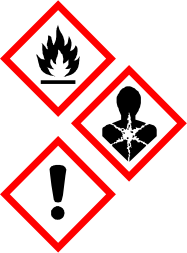
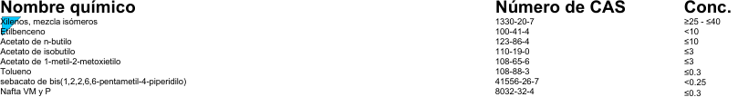

<!-- pagina: 1 -->

> Imagen (pág. 1). Sin texto legible por OCR; contenido gráfico no interpretado.

<!-- Start of picture text -->
AkzoNobel <!-- End of picture text -->

|**FICHA**|**DE DATOS DE SEGURIDAD**|
|---|---|
|MADETE |C POLIURETANO LACA SEMIMATE INCOLORO P-402  |
|**Sección 1. Identific** |**ación**  |
|**Nombre del producto** |**:**MADETEC POLIURETANO LACA SEMIMATE INCOLORO P-402  |
|**Uso recomendado de la sust**|**ancia química peligrosa o mezcla, y restricciones de uso**  |
||**Usos identificados**|
|Uso profesional Uso industrial  ||
|Uso por parte del consumidor |**Usos contraindicados**  ~~A~~|
|**Uso del producto**  |**:**  Recubrimiento base disolvente para uso interior y exterior.  |
|**Datos del proveedor o** **fabricante**|**:**  Autopista Medellín Bogotá Km 37  Vía Belén Rionegro Km 1  054040 Rionegro - Antioquia - Colombia 01 8000 111 247  |
|**Dirección de e-mail de la**|**:**  Medellín 604 325 2523|
|**persona responsable de** **esta FDS**|PSRA.southamerica@akzonobel.com|
|**Número de teléfono en** **caso de emergencia**|**:**  018000111247|
|**Sección 2. Identific** ~~A~~|**ación de los peligros**  ~~)~~|
|**INEN 2266:2013:**  **La clasificación de este prod** **2013.** |**ucto ha sido realizada según la NORMA TÉCNICA ECUATORIANA NTE INEN 2266:** |
|**Clasificación de la**  **sustancia química**  **peligrosa o mezcla**|**:**  LÍQUIDOS INFLAMABLES - Categoría 3  TOXICIDAD AGUDA (dérmica) - Categoría 5  IRRITACIÓN CUTÁNEA - Categoría 2  IRRITACIÓN OCULAR - Categoría 2A  MUTAGENICIDAD EN CÉLULAS GERMINALES - Categoría 1B  CARCINOGENICIDAD - Categoría 1B  TOXICIDAD ESPECÍFICA DE ÓRGANOS BLANCO (EXPOSICIÓN ÚNICA) (Irritación de las vías respiratorias) - Categoría 3|
|**Ingredientes de toxicidad** **desconocida**|**:**  0%|
|**Ingredientes de** **ecotoxicidad desconocida**|**:**0%|
|**Elementos de las etiquetas d**|**el SGA**|
|**Pictogramas de peligro**|**:**  ~~O~~OD |
|**_Fecha de emisión/Fecha de revisión_** ~~É~~|**:**_28-8-2025_ **_Fecha de la edición anterior_** **_:_**_17-1-2025_ **_Versión_** **_:_**_2_ _1/16_  ~~—~~ ~~2]~~|

<!-- pagina: 2 -->
_MADETEC POLIURETANO LACA SEMIMATE INCOLORO P-402_ 

|**Sección 2. Identifi**|**cación de los peligros**|
|---|---|
|**Palabra de advertencia** **Indicaciones de peligro**|**:**  **:**  Peligro  H226 - Líquido y vapores inflamables.  H313 - Puede ser nocivo en contacto con la piel. H315 - Provoca irritación cutánea.  H319 - Provoca irritación ocular grave.  H335 - Puede irritar las vías respiratorias.  H340 - Puede provocar defectos genéticos.  H350 - Puede provocar cáncer.|
|**Consejos de prudencia**  **Prevención**|**:**  P201 - Procurarse las instrucciones antes del uso.  P280 - Usar guantes de protección, ropa de protección e equipo de protección para la cara o los ojos.  P210 - Mantener alejado del calor, chispas, llamas al descubierto, superficies calientes y otras fuentes de ignición. No fumar.  P261 - Evitar respirar vapor.  P264 - Lavarse cuidadosamente las manos después de la manipulación.|
|**Intervención/Respuesta**|**:**  P308 + P313 - En caso de exposición demostrada o supuesta: Consultar a un médico.  P304 + P312 - En caso de inhalación: Llamar a un centro de toxicología o a un médico si la persona se siente mal.  P362 + P364 - Quitar la ropa contaminada y lavarla antes de volverla a usar.  P302 + P312 + P352 - En caso de contacto con la piel: Llamar a un centro de toxicología o a un médico si la persona se siente mal. Lavar con abundante agua. P305 + P351 + P338 - En caso de contacto con los ojos: Enjuagar con agua cuidadosamente durante varios minutos. Quitar los lentes de contacto, cuando estén presentes y pueda hacerse con facilidad. Proseguir con el lavado.  P337 + P313 - Si la irritación ocular persiste: Consultar a un médico.|
|**Almacenamiento**|**:**  P403 + P233 - Almacenar en un lugar bien ventilado. Mantener el recipiente herméticamente cerrado.  P403 + P235 - Mantener fresco.|
|**Eliminación**|**:**  P501 - Eliminar el contenido y el recipiente en conformidad con las reglamentaciones locales, regionales, nacionales e internacionales.|
|**Otros peligros que no** **contribuyen en la** **clasificación**|**:**  No se conoce ninguno.|
|**Sección 3. Compo**|**sición / información sobre los componentes**|
|**Sustancia/mezcla**|**:**  Mezcla|
|**Otros medios de** **identificación**|**:**  No disponible.|

|**Nombre de ingrediente**|**%**|**Número CAS**|
|---|---|---|
|Xilenos, mezcla isómeros|≥25 - ≤40|1330-20-7|
|Etilbenceno|<10|100-41-4|
|Acetato de n-butilo|≤10|123-86-4|
|Acetato de isobutilo|≤3|110-19-0|
|Acetato de 1-metil-2-metoxietilo|≤3|108-65-6|
|Tolueno|≤0.3|108-88-3|
|sebacato de bis(1,2,2,6,6-pentametil-4-piperidilo)|<0.25|41556-26-7|
|Nafta VM y P|≤0.3|8032-32-4|

**No hay ningún ingrediente adicional presente que, bajo el conocimiento actual del proveedor y en las concentraciones aplicables, sea clasificado como de riesgo para la salud o el medio ambiente y por lo tanto deban ser reportados en esta sección.** 

**Los límites de exposición laboral, en caso de existir, figuran en la sección 8.** 

**_Fecha de emisión/Fecha de revisión_** 

**:** _28-8-2025_ **_Fecha de la edición anterior_** 

**_:_** _17-1-2025_ **_Versión :_** _2 2/16_ 

<!-- pagina: 3 -->
_MADETEC POLIURETANO LACA SEMIMATE INCOLORO P-402_ 

|**Sección 4. Primer**|**os auxilios**|
|---|---|
|**Descripción de los primeros**|**auxilios**|
|**Contacto con los ojos**|**:**  Lave abundantemente con agua por lo menos 15 minutos, levantando los párpados superior e inferior de vez en cuando.  Verificar si la víctima lleva lentes de contacto y en este caso, retirárselas. Procurar atención médica.|
|**Por inhalación**|**:**  Procurar atención médica. Si es necesario, llame a un Centro de Control de Envenenamiento o a un médico.  Transportar la víctima al aire libre y mantenerla en reposo en una posición que le facilite la respiración. Si se sospecha que los vapores continúan presentes, la persona encargada del rescate deberá usar una máscara adecuada o un aparato de respiración autónoma. Si no hay respiración, ésta es irregular u ocurre un paro respiratorio, el personal capacitado debe proporcionar respiración artificial u oxígeno. Puede ser peligroso para la persona que proporcione ayuda dar respiración boca a boca. Si está inconsciente, coloque en posición de recuperación y obtenga atención médica inmediatamente. Asegure una buena circulación de aire. Aflojar todo lo que pudiera estar apretado, como el cuello de una camisa, una corbata, un cinturón.|
|**Contacto con la piel**|**:**  Procurar atención médica. Llamar a un Centro de Control de Envenenamiento o a un médico. Lave la piel contaminada con suficiente agua.  Quítese la ropa y calzado contaminados. Lave bien la ropa contaminada con agua antes de quitársela, o use guantes. Continúe enjuagando por lo menos por 10 minutos. Las quemaduras químicas se deben tratar inmediatamente por un médico. Lavar la ropa antes de volver a usarla. Limpiar el calzado completamente antes de volver a usarlo. Obtenga atención médica si se produce irritación.|
|**Ingestión**  **Síntomas y efectos más imp**|**:**  Procurar atención médica. Llamar a un Centro de Control de Envenenamiento o a un médico. Lave la boca con agua.  Retirar las prótesis dentales si es posible. Si se ha ingerido el material y la persona expuesta está consciente, proporcione cantidades pequeñas de agua para beber. Deténgase si la persona expuesta se siente descompuesta porque vomitar sería peligroso. No inducir al vómito a menos que lo indique expresamente el personal médico. En caso de vómito, se debe mantener la cabeza baja de manera que el vómito no entre en los pulmones. Las quemaduras químicas se deben tratar inmediatamente por un médico. No suministrar nada por vía oral a una persona inconsciente. Si está inconsciente, coloque en posición de recuperación y obtenga atención médica inmediatamente. Asegure una buena circulación de aire. Aflojar todo lo que pudiera estar apretado, como el cuello de una camisa, una corbata, un cinturón.  **ortantes, agudos o crónicos**|
|**Efectos agudos potenciale**|**s en la salud**|
|**Contacto con los ojos**|**:**  Provoca irritación ocular grave.|
|**Por inhalación**|**:**  Puede irritar las vías respiratorias.|
|**Contacto con la piel**  |**:**  Puede ser nocivo en contacto con la piel. Provoca irritación cutánea.  |
|**Ingestión**|**:**  No se conocen efectos significativos o riesgos críticos.|
|**Signos/síntomas de sobre** |**exposición**  |
|**Contacto con los ojos**|**:**Los síntomas adversos pueden incluir los siguientes:  dolor o irritación  lagrimeo  enrojecimiento|
|**Por inhalación**|Los síntomas adversos pueden incluir los siguientes:  irritación del tracto respiratorio  tos **:**|
|**Contacto con la piel**|**:**  Los síntomas adversos pueden incluir los siguientes: irritación  enrojecimiento|
|**Ingestión**|**:**  Ningún dato específico.|
|**Indicación de la necesidad**|**de recibir atención médica inmediata y, en su caso, de tratamiento especial**|
|**Notas para el médico**|**:**Tratar sintomáticamente. Contactar un especialista en tratamientos de envenenamientos inmediatamente si se ha ingerido o inhalado una gran cantidad.|

**_Fecha de emisión/Fecha de revisión_** 

**:** _28-8-2025_ **_Fecha de la edición anterior :_** _17-1-2025_ **_Versión :_** _2 3/16_ 

<!-- pagina: 4 -->
_MADETEC POLIURETANO LACA SEMIMATE INCOLORO P-402_ 

|**Sección 4. Primero**|**s auxilios**|
|---|---|
|**Tratamientos específicos**  |**:**  No hay un tratamiento específico.|
|**Protección del personal de** **primeros auxilios**  |**:**  No se tomará ninguna medida que implique algún riesgo personal o que no contemple el entrenamiento adecuado. Si se sospecha que los vapores continúan presentes, la persona encargada del rescate deberá usar una máscara adecuada o un aparato de respiración autónoma. Puede ser peligroso para la persona que proporcione ayuda dar respiración boca a boca. Lave bien la ropa contaminada con agua antes de quitársela, o use guantes.|
|**Vea la sección 11 para la Infor**|**mación Toxicológica**|
|**Sección 5. Medidas**|**contra incendios**|
|**Medios de extinción**||
|**Medios de extinción** **apropiados**  **Medios no apropiados de** **extinción**   |**:**  **:**  Utilizar polvo químico seco,CO₂,agua pulverizada o espuma (neblina).  No usar chorro de agua.|
|**Peligros específicos de la** **sustancia química** **peligrosa o mezcla**  |**:**  Líquido y vapores inflamables. Los residuos líquidos que se filtran en el alcantarillado pueden causar un riesgo de incendio o de explosión. En caso de incendio o calentamiento, ocurrirá un aumento de presión y el recipiente estallará, con el riesgo de que ocurra una explosión.|
|**Productos de** **descomposición térmica** **peligrosos**  |**:**  Los productos de descomposición pueden incluir los siguientes materiales: dióxido de carbono  monóxido de carbono  óxido/óxidos metálico/metálicos|
|**Medidas especiales que**  **deberán seguir los grupos**  **de combate contra incendio**  |**:**  En caso de incendio, aísle rápidamente la zona evacuando a todas las personas de  las proximidades del lugar del incidente. No se tomará ninguna medida que  implique algún riesgo personal o que no contemple el entrenamiento adecuado.  Desplazar los contenedores lejos del incendio si esto puede hacerse sin riesgo.  Use agua pulverizada para refrigerar los envases expuestos al fuego.|
|**Equipo de protección**  **especial para los bomberos**  |**:**  Los bomberos deben llevar equipo de protección apropiado y un equipo de  respiración autónomo con una máscara facial completa que opere en modo de  presiónpositiva.|
|**Sección 6. Medidas** **accidental**|**que deben tomarse en caso de derrame o fuga**|
|**Precauciones personales, equ**|**ipo de protección y procedimiento de emergencia**|
|**Para personal de no**   **emergencia**|**:**  No se tomará ninguna medida que implique algún riesgo personal o que no contemple el entrenamiento adecuado. Evacuar los alrededores.  No deje que entre el personal innecesario y sin protección. No toque o camine sobre el material  derramado. Apagar todas las fuentes de ignición. No permitir el uso de bengalas, fumar, o el encendido de llamas en el área de peligro. Evite respirar vapor o neblina. Proporcione ventilación adecuada. Llevar un aparato de respiración apropiado cuando el sistema de ventilación sea inadecuado. Llevar puestos equipos de protección personal adecuados.|
|**Para el personal de**  **respuesta a emergencias**  |**:**    Si fuera necesario usar ropa especial para hacer frente al derrame, se tomará en  cuenta la información de la Sección 8 sobre los materiales adecuados y no  adecuados. Consultar también la información bajo "Para personal de no  emergencia".|
|**Precauciones relativas al** **medio ambiente**  |**:**  Evite la dispersión del material derramado, su contacto con el suelo, el medio acuático, los desagües y las alcantarillas. Informe a las autoridades pertinentes si el producto ha causado polución medioambiental (alcantarillas, canales, tierra o aire).|

**_Fecha de emisión/Fecha de revisión_ :** _28-8-2025_ **_Fecha de la edición anterior_** 

**_:_** _17-1-2025_ **_Versión :_** _2_ 

_4/16_ 

<!-- pagina: 5 -->
_MADETEC POLIURETANO LACA SEMIMATE INCOLORO P-402_ 

|**Sección 6. Medidas que deben tomarse en caso de derrame o fuga**|
|---|
|**accidental**|

|**Métodos y materiales para la**|**contención y limpieza de derrames o fugas**|
|---|---|
|**Derrame pequeño**|**:**  Detener la fuga si esto no presenta ningún riesgo. Retire los envases del área del derrame. Use herramientas a prueba de chispas y equipo a prueba de explosión. Diluir con agua y fregar si es soluble en agua. Alternativamente, o si es insoluble en agua, absorber con un material seco inerte y colocar en un contenedor de residuos adecuado. Disponga por medio de un contratista autorizado para la disposición.|
|**Gran derrame**|**:**  Detener la fuga si esto no presenta ningún riesgo. Retire los envases del área del derrame. Use herramientas a prueba de chispas y equipo a prueba de explosión. Aproximarse al vertido en el sentido del viento. Evite la entrada en alcantarillas, canales de agua, sótanos o áreas reducidas. Trate los derrames en una planta de tratamiento de aguas residuales o proceda tal como se indica a continuación. Detener y recoger los derrames con materiales absorbentes no combustibles, como arena, tierra, vermiculita o tierra de diatomeas, y colocar el material en un envase para desecharlo de acuerdo con las normativas locales (ver la Sección 13). Disponga por medio de un contratista autorizado para la disposición. El material absorbente contaminado puede presentar el mismo riesgo que el producto derramado. Nota: Véase la Sección 1 para información de contacto de emergencia y la Sección 13 para eliminación de desechos.|
|**Sección 7. Manejo **|**y almacenamiento**|
|**Precauciones que se deben**|**tomar para garantizar un manejo seguro**|
|**Medidas de protección**|**:**Use el equipo de protección personal adecuado (vea la Sección 8). Evítese la exposición - recábense instrucciones especiales antes del uso. No manipular antes de haber leído y comprendido todas las precauciones de seguridad. No introducir en ojos o en la piel o ropa. No ingerir. Evite respirar vapor o neblina. Use sólo con ventilación adecuada. Llevar un aparato de respiración apropiado cuando el sistema de ventilación sea inadecuado. No entre en áreas de almacenamiento y espacios cerrados a menos que estén ventilados adecuadamente. Mantener en el recipiente original o en uno alternativo autorizado hecho de material compatible, conservar herméticamente cerrado cuando no esté en uso. Mantener alejado del calor,  chispas, llamas al descubierto, o de cualquier otra fuente de ignición. Use equipo eléctrico (de ventilación, iluminación y manipulación de materiales) a prueba de explosiones. No utilizar herramientas que produzcan chispas. Evitar la acumulación de cargas electrostáticas. Los envases vacíos retienen resíduos del producto y pueden ser peligrosos. No vuelva a usar el envase.|
|**Orientaciones sobre**  **higiene ocupacional** **general**|**:**  Está prohibido comer, beber o fumar en los lugares donde se manipula, almacena o  trata este producto. Las personas que trabajan con este producto deberán lavarse  las manos y la cara antes comer, beber o fumar. Quitar la ropa contaminada y el equipo de protección antes de entrar a las áreas de comedor.  Véase también la Sección 8 acerca de la información adicional sobre las medidas higiénicas.|
|**Condiciones de** **almacenamiento seguro,** **incluida cualquier** **incompatibilidad**|**:**  Conservar de acuerdo con las normas locales. Almacenar en un área separada y homologada. Almacenar en el contenedor original protegido de la luz directa del sol en un área seca, fresca y bien ventilada, separado de materiales incompatibles (ver Sección 10) y comida y bebida. Guardar bajo llave. Eliminar todas las fuentes de ignición. Mantener separado de materiales oxidantes. Mantener el contenedor bien cerrado y sellado hasta el momento de usarlo. Los envases que han sido abiertos deben cerrarse cuidadosamente y mantenerse en posición vertical para evitar derrames. No almacenar en contenedores sin etiquetar. Utilícese un envase de seguridad adecuado para evitar la contaminación del medio ambiente. Consulte la Sección 10 para obtener información acerca de los materiales no compatibles previo al manejo o uso.|

**_Fecha de emisión/Fecha de revisión_** 

**:** _28-8-2025_ **_Fecha de la edición anterior_** 

**_Versión :_** _2_ 

_5/16_ 

**_:_** _17-1-2025_ 

<!-- pagina: 6 -->
_MADETEC POLIURETANO LACA SEMIMATE INCOLORO P-402_ 

# **Sección 8. Controles de exposición / protección personal** 

|**Parámetros de control**  **Límites de exposición laboral**|||
|---|---|---|
|**Nombre de ingrediente**|**Número** **de CAS**|**Límites de exposición**|
|Xilenos, mezcla isómeros|1330-20-7|**(Estados Unidos, 1/2023). [p-xylene and** **ntaining p-xylene] Ototoxicante.**  m 8 horas.  **ACGIH TLV** **mixtures co**  TWA: 20 pp|
|Etilbenceno|100-41-4|**(Estados Unidos, 1/2023). Ototoxicante.**  m 8 horas.    **ACGIH TLV** TWA 20|
|Acetato de n-butilo|123-86-4| **(Estados Unidos, 1/2023). [Butyl acetates]**  ppm 15 minutos.  m 8 horas :  pp  **ACGIH TLV** STEL: 150 |
|Acetato de isobutilo|110-19-0|.  **(Estados Unidos, 1/2023). [Butyl acetates]**  ppm 15 minutos.  m 8 horas.  TWA: 50 pp  **ACGIH** **TLV** STEL: 150 TWA: 50|
|Tolueno|108-88-3|**(Estados Unidos, 1/2023). Ototoxicante.**  m 8 horas.  pp  **ACGIH TLV** |
|Nafta VM y P|8032-32-4|**(Estados Unidos).**  pm 8 horas.  TWA: 20 pp  **ACGIH TLV** TWA: 300p|
|**Controles técnicos** **apropiados**|**:**  Use sólo con ventilaci ventilación locales, u o exposición del obrero los límites recomenda deben mantener el ga Utilizar equipo de vent|ón adecuada. Utilizar recintos de proceso, sistemas de tros procedimientos de ingeniería para mantener la a los contaminantes aerotransportados por debajo de todos dos o estatutarios. Los controles de ingeniería también s, vapor o polvo por debajo del menor límite de explosión. ilación anti-explosión.|
|**Control de la exposición** **medioambiental**  **Medidas de protección individ**|**:**  Emisiones de los equi evaluados para verific protección del medio a eliminadores de humo para reducir las emisi **ual**|pos de ventilación o de procesos de trabajo deben ser ar que cumplen con los requisitos de la legislación de mbiente. En algunos casos será necesario el uso de , filtros o modificaciones del diseño del equipo del proceso ones a un nivel aceptable.|
|**Medidas higiénicas** |**:**  Lave las manos, anteb químicos, antes de co Usar las técnicas apro contaminadas antes d ojos y duchas de segu|razos y cara completamente después de manejar productos mer, fumar y usar el lavabo y al final del período de trabajo. piadas para remover ropa contaminada. Lavar las ropas e volver a usarlas. Verifique que las estaciones de lavado de ridad se encuentren cerca de las estaciones de trabajo.|
|**Protección de los ojos y la**  **cara**|**:**  Equipo protector ocula cuando una evaluació exposición a salpicadu posibilidad de contact protección, a menos q protección: gafas pro|r que cumpla con las normas aprobadas debe ser usado  n del riesgo indique que es necesario para evitar toda  ras del líquido, lloviznas, gases o polvos. Si existe la  o con el producto se debe usar el siguiente equipo de  ue la evaluación del riesgo exija un grado superior de  tectoras contra salpicaduras químicas.|
|**Protección de la piel**|||
|**Protección de las manos**|Guantes impermeable normas aprobadas de si una evaluación del r parámetros especifica el uso si aún mantiene que el tiempo de pene cada fabricante. En el puede estimar con exa **:**|s y resistentes a productos químicos que cumplan con las ben ser usados siempre que se manejen productos químicos iesgo indica que es necesario. Teniendo en cuenta los dos por el fabricante de los guantes, se debe verificar durante n sus propiedades protectoras.  Es preciso tener presente tración para el material de los guantes puede ser diferente en caso de mezclas formadas por varias sustancias no se ctitud el periodo de tiempo de protección de los guantes.|

**_Fecha de emisión/Fecha de revisión_** 

**:** _28-8-2025_ **_Fecha de la edición anterior :_** _17-1-2025_ 

**_Versión :_** _2_ 

_6/16_ 

<!-- pagina: 7 -->
_MADETEC POLIURETANO LACA SEMIMATE INCOLORO P-402_ 

# **Sección 8. Controles de exposición / protección personal** 

|**Protección del cuerpo**|Antes de utilizar este producto se debe seleccionar equipo protector personal para  el cuerpo basándose en la tarea a ejecutar y los riesgos involucrados y debe ser aprobado por un especialista. Cuando existe riesgo de ignición debido a la electricidad estática, se requiere el uso de ropa antiestática de protección. Para obtener el máximo nivel de protección contra descargas electrostáticas es preciso usar overoles, botas y guantes antiestáticos. **:**|
|---|---|
|**Otro tipo de protección**  **para la piel**|**:**  Antes de manipular este producto se debe elegir el calzado apropiado y cualquier  otra medida adicional de protección de la piel basadas en la tarea que se realice y  los riesgos asociados, para lo cual se contará con la aprobación de un especialista.|
|**Protección de las vías**  **respiratorias**|**:**  Con base en el riesgo y el potencial de la exposición, seleccione un respirador que  cumpla la norma o la certificación apropiada. Los respiradores se deben usar de  acuerdo con un programa de protección respiratoria para asegurar el ajuste  adecuado, la capacitación y otros aspectos importantes de uso. Wear a respirator conforming to EN140 with type A/P2 filter or better. El lijado en seco, el cortado con llama y/o el soldado de películas secas de pintura producirá polvo y/o humos nocivos. Un lijado o matizado húmedos son preferibles si es posible. Si no puede evitarse la exposición por la ventilación de extracción debe usarse adecuado equipo de protección respiratoria.|
|**Sección 9. Propied** |**ades físicas y químicas y características de**|
|**seguridad**||
|Las condiciones de la medición indique lo contrario.  |de todas las propiedades son a temperatura y presión estándares, a menos que se|
|**Apariencia**||
|**Estado físico**|**:**  Líquido.|
|**Color**|**:**  Incoloro.|
|**Olor**|**:**  Característico.|
|**Umbral del olor**|**:**  No disponible.|
|**pH**|**:**  No disponible.|
|**Punto de fusión/punto de**|**:**  No disponible.|
|**congelación**||
|**Punto de ebullición, punto**  |**:**  126°C (258.8°F)|
|**de ebullición inicial e** ||
|**intervalo de ebullición**||
|**Punto de inflamación**|**:**  Vaso cerrado: 24°C (75.2°F)|
|**Velocidad de evaporación**|**:**  No disponible.|
|**Inflamabilidad**|**:**  No disponible.|
|**Límite superior e inferior de**  **explosión**|**:**  Rango máximo conocido: Punto mínimo: 2.4% Punto maximo: 10.5% (Acetato de  isobutilo)|
|**Presión de**|**:**|
|**vapor**||
||**ASTM D 5191**  **Presión del vapor a 20 ˚C**|
||**Nombre de ingrediente**  **mm Hg**  **kPa**|
||Acetato de isobutilo 15.75134 2.1|
||Acetato de n-butilo 11.25096  1.5|
||~~Etilbenceno~~ 9.30076  ~~1.2~~|
|**Densidad de vapor relativa**|**:**  No disponible.|
|**Densidad**|**:**  1.008 g/cm³|
|**Solubilidad(es)**|**:**|
|**Medio**|**Resultado**|
|agua fría|No soluble [OECD (TG 105)]|

**_Fecha de emisión/Fecha de revisión_ :** _28-8-2025_ **_Fecha de la edición anterior :_** _17-1-2025_ **_Versión :_** _2 7/16_ 

<!-- pagina: 8 -->
|_MADETEC POLIURETANO LACA SEM_ **Sección 9. Propied** **seguridad**|_IMATE INCOLORO P-402_  **ades físicas y químicas y características de**|
|---|---|
|**Coeficiente de partición: n-** **octanol/agua**|**:**  No aplicable.|
|**Temperatura de ignición** **espontánea**|**:**|
|**Nombre de ingrediente**|**°C**  **°F**|
|Acetato de 1-metil-2-metoxietilo|333 631.4|
|Acetato de n-butilo|415 779|
|Acetato de isobutilo|~~430~~ ~~806~~|
|**Temperatura de** **descomposición**|**:**No disponible.|
|**Viscosidad**|Cinemática (temperatura ambiente): 440 mm2/s (440 cSt)  Cinemática (40°C (104°F)): 134 mm2/s (134 cSt)  **:**|
|**Características de las partícul**|**as**|
|**Tamaño mediano de** **partículas**|**:**No aplicable.|
|**Porcentaje de partículas** **con diámetro aerodinámico** **≤10 μm**|**:**0|
|**Sección 10. Estabi**|**lidad y reactividad**|
|**Reactividad**|**:**  No existen resultados específicos de ensayos respecto a la reactividad del este producto o sus ingredientes.|
|**Estabilidad química**|**:**  El producto es estable.|
|**Posibilidad de reacciones** **peligrosas**|**:**  En condiciones normales de almacenamiento y uso, no ocurre reacción peligrosa.|
|**Condiciones que deberán** **evitarse**|**:**  Evitar todas las fuentes posibles de ignición (chispa o llama). No someta a presión, corte, suelde, suelde con latón, taladre, esmerile o exponga los envases al calor o fuentes térmicas.|
|**Materiales incompatibles**|**:**  Reactivo o incompatible con los siguientes materiales: materiales oxidantes|
|**Productos de** **descomposición peligrosos**|**:**  Bajo condiciones normales de almacenamiento y uso, no se deben producir productos de descomposición peligrosos.|
|**Sección 11. Inform**|**ación toxicológica**|

### **Información sobre efectos toxicológicos** 

### **Toxicidad aguda** 

|**Nombre de producto o** **ingrediente**|**Resultado**|**Especies**|**Dosis**|**Exposición**|
|---|---|---|---|---|
|Xilenos, mezcla isómeros Etilbenceno|DL50 Oral  DL50 Subcutánea  CL50 Por inhalación Gas. CL50 Por inhalación Vapor CL50 Por inhalación Vapor DL50 Cutánea  DL50 Cutánea  DL50 Intraperitoneal  DL50 Oral|Rata Rata Conejo  Ratón Rata Conejo Conejo Ratón Rata|4300 mg/kg 1700 mg/kg 4000 ppm  35500 mg/m³ 55000 mg/m³  >5000 mg/kg  17800 uL/kg 2624 uL/kg 3500 mg/kg|-  -  4 horas 2 horas 2 horas  -  -  -  -|
|**_~~Fecha de emisión/Fecha de revisión~~_**|**~~:~~**_~~28-8-2025~~_ **_~~Fecha de la edic~~_**|**_~~ión anterior~~_** **_~~:~~_**_~~17-1~~_|_~~-2025~~_ |**_~~Versión~~_** **_~~:~~_**_~~2~~_ _~~8/16~~_|

<!-- pagina: 9 -->
_MADETEC POLIURETANO LACA SEMIMATE INCOLORO P-402_ 

|**Sección 11. Infor**|**mación toxicológi**   |**ca**  |||
|---|---|---|---|---|
|Acetato de n-butilo Acetato de isobutilo  Tolueno  Nafta VM y P|DL50 Oral DL50 Oral DL50 Cutánea  DL50 Oral  DL50 Oral  CL50 Por inhalación Vapor  DL50 Cutánea  DL50 Intraperitoneal DL50 Intravenosa  DL50 Oral  DL50 Subcutánea  CL50 Por inhalación Gas. |Rata Rata Conejo  Conejo Rata Rata Conejo Rata Rata Rata Ratón Rata |3500 mg/kg 10768 mg/kg >17400 mg/kg 4763 mg/kg 13400 mg/kg 49 g/m³  14100 uL/kg 1332 mg/kg 1960 mg/kg 636 mg/kg 2250 mg/kg 3400 ppm    -  -  -  -  -  4 -  -  -  -  -  4|         horas            horas|
||DL50 Intravenosa|Ratón|40 mg/kg -||
|**Irritación/Corrosión**|||||
|**Nombre de producto o** **ingrediente**|**Resultado**|**Especies**|**Puntuación**  **Exposición**|**Observación**|
|Xilenos, mezcla isómeros  Etilbenceno|Ojos - Irritante leve  Ojos - Irritante fuerte  Piel - Irritante leve  Piel - Irritante moderado Piel - Irritante moderado  Ojos - Irritante fuerte Piel - Irritante leve|Conejo Conejo  Rata Conejo Conejo  Conejo Conejo|-  -  -  -  -  -  -  87 mg  24 horas 5 mg  8 horas 60 Ul 100 %  24 horas 500 mg  500 mg  24 horas 15 mg|-  -  -  -  -  -  -|
|Acetato de n-butilo|Ojos - Irritante moderado Piel - Irritante moderado|Conejo Conejo|-  -    100 mg  24 horas 500 m|-  -|
|Acetato de isobutilo|Ojos - Irritante moderado Piel - Irritante leve  Piel - Irritante moderado|Conejo Conejo Conejo|-  -  -  g  24 horas 500 mg  500 mg  24 horas 500 |-  -  -|
|Tolueno|Ojos - Irritante leve  Ojos - Irritante leve  Ojos - Irritante fuerte  Piel - Irritante leve  Piel - Irritante moderado  Piel - Irritante moderado|Conejo Conejo Conejo  Conejo Conejo  Conejo|-  -  -  -  -  -  mg  0.5 minutos 100 mg  870 ug  24 horas 2 mg  435 mg  24 horas 20 mg  500 mg|-  -  -  -  -  -|
|**Sensibilización cutánea o r**|**espiratoria**||||

No disponible. 

### **Mutagenicidad** 

No disponible. 

### **Carcinogenicidad** 

No disponible. 

### **Toxicidad reproductiva** 

|**Nombre de producto o** **ingrediente**|**Toxicidad** **materna**|**Fertilidad**|**Tóxico para** **el desarrollo**|**Especies**|**Dosis**|**Exposición**|
|---|---|---|---|---|---|---|
|**Teratogenicidad**  Tolueno|-|-|Positivo|Rata|Por inhalación: 2261 mg/  m³|-|

**_Fecha de emisión/Fecha de revisión_ :** _28-8-2025_ **_Fecha de la edición anterior_** 

**_:_** _17-1-2025_ **_Versión :_** _2 9/16_ 

<!-- pagina: 10 -->
_MADETEC POLIURETANO LACA SEMIMATE INCOLORO P-402_ 

# **Sección 11. Información toxicológica** 

|No disponible.  **Toxicidad específica de órganos blanco (exposici**  |**ón única)**   | | |
|---|---|---|---|
|**Nombre**  |**Categoría**  |**Ruta de** **exposición**  |**Órganos vitales**  |
|Xilenos, mezcla isómeros  Acetato de n-butilo  Acetato de isobutilo  Acetato de 1-metil-2-metoxietilo Tolueno  |Categoría 3  Categoría 3 Categoría 3 Categoría 3 Categoría 3  |-  -  -  -  -  |Irritación de las vías respiratorias Efecto narcótico Efecto narcótico Efecto narcótico Efecto narcótico  |
|**Toxicidad específica de órganos blanco (exposici**   |**ones repetidas)**    |  |  |
|**Nombre**  |**Categoría**  |**Ruta de** **exposición**  |**Órganos vitales**  |
|Etilbenceno Tolueno  |Categoría 2 Categoría 2  |-  inhalación  |órganos auditivos cerebral nervous system  |
|**Peligro de aspiración**   ||||
|**Nombre**  |**Re** |**sultado**  ||
|Xilenos, mezcla isómeros Etilbenceno  Tolueno  Nafta VM y P  ~~=~~|PE PE PE PE |LIGRO POR ASP LIGRO POR ASP LIGRO POR ASP LIGRO POR ASP |IRACIÓN - Categoría 1 IRACIÓN - Categoría 1 IRACIÓN - Categoría 1 IRACIÓN - Categoría 1  |
|**Información sobre las** **posibles vías de ingreso**  **:**No disponible.||||
|**Efectos agudos potenciales en la salud** ||||
|**Contacto con los ojos**  **:**  Provoca irritación oc|ular grave.|||
|**Por inhalación**  **:**  Puede irritar las vías|respiratorias.|||
|**Contacto con la piel**  **:**  Puede ser nocivo en|contacto con la piel.|Provoca irritación|cutánea.|
|**Ingestión**  **:**  No se conocen efec|tos significativos o ries|gos críticos.||

### **Síntomas relacionados con las características físicas, químicas y toxicológicas** 

|**Contacto con los ojos**|**:**Los síntomas adversos pueden incluir los siguientes:  dolor o irritación  lagrimeo  enrojecimiento|
|---|---|
|**Por inhalación**|Los síntomas adversos pueden incluir los siguientes:  irritación del tracto respiratorio  tos **:**|
|**Contacto con la piel**|**:**  Los síntomas adversos pueden incluir los siguientes: irritación  enrojecimiento|
|**Ingestión**|**:**  Ningún dato específico.|
|**Efectos inmediatos y retard** **plazo**|**ados, así como efectos crónicos producidos por una exposición a corto y largo**|
|**Exposición a corto plazo**||
|**Efectos potenciales** **inmediatos**|**:**No disponible.|
|**Efectos potenciales** **retardados**|**:**No disponible.|
|**Exposición a largo plazo**||

**_Fecha de emisión/Fecha de revisión_ :** _28-8-2025_ **_Fecha de la edición anterior :_** _17-1-2025_ **_Versión :_** _2_ 

_10/16_ 

<!-- pagina: 11 -->
_MADETEC POLIURETANO LACA SEMIMATE INCOLORO P-402_ 

# **Sección 11. Información toxicológica** 

|**Efectos potenciales** **inmediatos**|**:**No disponible.|
|---|---|
|**Efectos potenciales** **retardados**|**:**No disponible.|
|**Efectos crónicos potencial**|**es en la salud**|
|No disponible.||
|**Generales**|**:**  No se conocen efectos significativos o riesgos críticos.|
|**Carcinogenicidad**|**:**  Puede provocar cáncer. El riesgo de cáncer depende de la duración y el grado de exposición.|
|**Mutagenicidad**|**:**  Puede provocar defectos genéticos.|
|**Toxicidad reproductiva**|**:**  No se conocen efectos significativos o riesgos críticos.|

### **Medidas numéricas de toxicidad (tales como estimaciones de toxicidad aguda) Estimaciones de toxicidad aguda** 

|**Nombre de producto o ingrediente**|**Oral (mg/** **kg)**|**Cutánea** **(mg/kg)**|**Inhalación** **(gases)**  **(ppm)**|**Inhalación**  **(vapores)** **(mg/l)**|**Inhalación** **(polvos y** **nieblas)**  **(mg/l)**|
|---|---|---|---|---|---|
|Producto tal y como suministrado|N/A|3107.5|N/A|25.2|N/A|
|Xilenos, mezcla isómeros|N/A|1100|N/A|11|N/A|
|Etilbenceno|N/A|N/A|N/A|11|N/A|

**Sección 12. Información ecotoxicológica** 

|**Toxicidad**||||
|---|---|---|---|
|**Nombre de producto o** **ingrediente**|**Resultado**|**Especies**|**Exposición**|
|**_~~Fecha de emisión/Fecha de revisió~~_** Xilenos, mezcla isómeros  Etilbenceno|**_~~n~~_** **~~:~~**_~~28-8-2025~~_ **_~~Fecha de la edición anteri~~_** Agudo EC50 90 mg/l Agua fresca Agudo CL50 8.5 ppm Agua de mar  Agudo CL50 8500 µg/l Agua de mar Agudo CL50 16940 µg/l Agua fresca Agudo CL50 15700 µg/l Agua fresca  Agudo CL50 20870 µg/l Agua fresca Agudo CL50 19000 µg/l Agua fresca Agudo CL50 13400 µg/l Agua fresca Agudo EC50 4600 µg/l Agua fresca  Agudo EC50 5400 µg/l Agua fresca  Agudo EC50 3600 µg/l Agua fresca Agudo EC50 4900 µg/l Agua de mar Agudo EC50 7700 µg/l Agua de mar Agudo EC50 6.53 mg/l Agua de mar  Agudo EC50 13.3 mg/l Agua de mar Agudo EC50 2.97 mg/l Agua fresca Agudo EC50 2.93 mg/l Agua fresca Agudo CL50 8.78 mg/l Agua de mar|**_~~or~~_** **_~~:~~_**_~~17-1-2025~~_ **_~~Versión~~_** Crustáceos - Cypris subglobosa Crustáceos - Palaemonetes pugio - Adulto  Crustáceos - Palaemonetes pugio  Pez - Carassius auratus  Pez - Lepomis macrochirus - Juvenil (Nuevo, Cría, Destetado) Pez - Lepomis macrochirus  Pez - Lepomis macrochirus  Pez - Pimephales promelas Algas - Pseudokirchneriella subcapitata  Algas - Pseudokirchneriella subcapitata  Algas - Pseudokirchneriella subcapitata  Algas - Skeletonema costatum Algas - Skeletonema costatum Crustáceos - Artemia sp. - Nauplio  Crustáceos - Artemia sp. - Nauplio  Dafnia - Daphnia magna - Neonato  Dafnia - Daphnia magna - Neonato  Crustáceos - Artemia sp. -|**_~~:~~_**_~~2~~_ _~~11/16~~_  48 horas 48 horas  48 horas 96 horas 96 horas  96 horas 96 horas 96 horas 72 horas  72 horas  96 horas 72 horas 96 horas 48 horas  48 horas 48 horas 48 horas 48 horas|

<!-- pagina: 12 -->
_MADETEC POLIURETANO LACA SEMIMATE INCOLORO P-402_ 

|**Sección 12. Info**|**rmación ecotoxicológica**|Nauplio||
|---|---|---|---|
||Agudo CL50 13.3 mg/l Agua de mar|Crustáceos - Artemia sp. - Nauplio|48 horas|
||Agudo CL50 40000 µg/l Agua de mar Agudo CL50 18.4 mg/l Agua fresca|Crustáceos - Cancer magister - Zoea  Dafnia - Daphnia magna - Neonato|48 horas 48 horas|
||Agudo CL50 13.9 mg/l Agua fresca|Dafnia - Daphnia magna - |48 horas|
||Agudo CL50 75000 µg/l Agua fresca|Neonato  Dafnia - Daphnia magna|48 horas|
||Agudo CL50 5100 µg/l Agua de mar| Pez - Menidia menidia|96 horas|
||Agudo CL50 4.3 ul/L Agua de mar|Pez - Morone saxatilis - Juvenil (Nuevo, Cría, Destetado)|96 horas|
||Agudo CL50 4200 µg/l Agua fresca Agudo CL50 9090 µg/l Agua fresca|Pez - Oncorhynchus mykiss  Pez - Pimephales promelas  |96 horas 96 horas|
||Agudo CL50 9100 µg/l Agua fresca|Pez - Pimephales promelas|96 horas|
|Acetato de n-butilo| Agudo CL50 32 mg/l Agua de mar|Crustáceos - Artemia salina  |48 horas|
||Agudo CL50 62000 µg/l Agua fresca|Pez - Danio rerio|96 horas|
|Tolueno| Agudo EC50 12500 µg/l Agua fresca|Algas - Pseudokirchneriella subcapitata|72 horas|
||Agudo EC50 16500 µg/l Agua fresca|Crustáceos - Gammarus pseudolimnaeus - Adulto|48 horas|
||Agudo EC50 11600 µg/l Agua fresca| Crustáceos - Gammarus seudolimnaeus - Adulto|48 horas|
||Agudo EC50 6.88 mg/l Agua fresca|p  Dafnia - Daphnia magna - Neonato|48 horas 48 horas|
||Agudo EC50 6.56 mg/l Agua fresca|Dafnia - Daphnia magna - ||
||Agudo EC50 19600 µg/l Agua fresca|Neonato  Dafnia - Daphnia magna - Larva|48 horas|
||Agudo EC50 6000 µg/l Agua fresca| Dafnia - Daphnia magna -  Juvenil (Nuevo, Cría, Destetado)|48 horas|
||Agudo EC50 6780 µg/l Agua fresca| Pez - Oncorhynchus mykiss - Juvenil (Nuevo, Cría, Destetado)|96 horas|
||Agudo CL50 56.3 ppm Agua de mar| Crustáceos - Americamysis bahia|48 horas|
||Agudo CL50 15.5 ppm Agua de mar| Crustáceos - Palaemonetes pugio - Adulto|48 horas|
||Agudo CL50 15500 µg/l Agua de mar| Crustáceos - Palaemonetes |48 horas|
||Agudo CL50 86.3 mg/l Agua fresca|pugio  Dafnia - Daphnia magna - |48 horas|
||Agudo CL50 6410 µg/l Agua de mar|Neonato  Pez - Oncorhynchus gorbuscha -|96 horas|
||Agudo CL50 5500 µg/l Agua fresca| Alevín  Pez - Oncorhynchus kisutch -|96 horas|
||Agudo CL50 5800 µg/l Agua fresca| Alevín  Pez - Oncorhynchus mykiss|96 horas|
||Agudo CL50 6780 µg/l Agua fresca| Pez - Oncorhynchus mykiss - Juvenil (Nuevo, Cría, Destetado)|96 horas|
||Crónico NOEC 2 mg/l Agua fresca|Dafnia - Daphnia magna  |21 días|
|| Crónico NOEC 1000µg/l Agua fresca|Dafnia - Daphnia magna|21 días|

**Persistencia y degradabilidad** No disponible. 

**Potencial de bioacumulación** 

**_Fecha de emisión/Fecha de revisión_ :** _28-8-2025_ **_Fecha de la edición anterior :_** _17-1-2025_ 

**_Versión :_** _2 12/16_ 

<!-- pagina: 13 -->
_MADETEC POLIURETANO LACA SEMIMATE INCOLORO P-402_ 

# **Sección 12. Información ecotoxicológica** 

|**Nombre de producto o** **ingrediente**|**LogPow**|**FBC**|**Potencial**|
|---|---|---|---|
|Xilenos, mezcla isómeros|3.12|8.1 a 25.9|bajo|
|Etilbenceno|3.6|-|bajo|
|Acetato de n-butilo|2.3|-|bajo|
|Acetato de isobutilo|2.3|-|bajo|
|Acetato de 1-metil-|1.2|-|bajo|
|2-metoxietilo||||
|Tolueno|2.73|90|bajo|
|Nafta VM y P|-|10 a 2500|alta|

- **Movilidad en el suelo Coeficiente de partición :** No disponible. **tierra/agua (KOC)** 

### **Otros efectos adversos** 

- **:** No se conocen efectos significativos o riesgos críticos. 

# **Sección 13. Información relativa a la eliminación de los productos** 

- **Métodos de eliminación :** Se debe evitar o minimizar la generación de desechos cuando sea posible. La eliminación de este producto, sus soluciones y cualquier derivado deben cumplir siempre con los requisitos de la legislación de protección del medio ambiente y eliminación de desechos y todos los requisitos de las autoridades locales. Disponga del sobrante y productos no reciclables por medio de un contratista autorizado para la disposición. Los residuos no se deben tirar por la alcantarilla sin tratar a menos que sean compatibles con los requisitos de todas las autoridades con jurisdicción. Los envases desechados se deben reciclar. Sólo se deben contemplar la incineración o el enterramiento cuando el reciclaje no sea factible. Elimínense los residuos del producto y sus recipientes con todas las precauciones posibles. Se tendrá cuidado cuando se manipulen recipientes vacíos que no se hayan limpiado o enjuagado. Los envases vacíos o los revestimentos pueden retener residuos del producto. El vapor de los residuos del producto puede crear un ambiente altamente inflamable o explosivo dentro del recipiente. No recortar, soldar o triturar los recipientes usados a menos que se hayan limpiado a fondo en su interior. Evite la dispersión del material derramado, su contacto con el suelo, el medio acuático, los desagües y las alcantarillas. 

# **Sección 14. Información relativa al transporte** 

|||**Marítimo - IMDG**|
|---|---|---|
|**Número ONU**|UN1263|UN1263|
|**Designación** **oficial de** **transporte**|PINTURA|PINTURA|
|**Clase(s) relativas** **al transporte**|3|3|
|**Grupo de embalaje**|III|III|
|**Riesgos** **ambientales**|No.|No.|

### **Información adicional** 

**Risk number** 30 

**IMDG : Programas de emergencia** F-E, _S-E_ 

|**_Fecha de emisión/Fecha de revisión_**|**:**_28-8-2025_|**_Fecha de la edición anterior_**|**_:_**_17-1-2025_|**_Versión_** **_:_**_2_|_13/16_|
|---|---|---|---|---|---|

<!-- pagina: 14 -->
_MADETEC POLIURETANO LACA SEMIMATE INCOLORO P-402_ 

# **Sección 14. Información relativa al transporte** 

**Exención de líquido viscoso** Este líquido viscoso Clase 3 no está sujeto a reglamentaciones en empaques de hasta 450 l según 2.3.2.5. 

|**Precauciones especiales** **para el usuario**|**:**  **Transporte dentro de las instalaciones de usuarios:**siempre transporte en recipientes cerrados que estén verticales y seguros. Asegurar que las personas que transportan el producto conocen qué hacer en caso de un accidente o derrame.|
|---|---|
|**Transporte a granel de** **acuerdo con instrumentos** **IMO**  **Sección 15. Inform**|**:**  No disponible. **ación Reglamentaria**|
|NTE INEN 2266: Norma Técni Almacenamiento y Manejo de|ca Ecuatoriana - Transporte,  Materiales Peligrosos - Requisitos.|
|**Lista de inventario**||
|**Australia**|**:**  No determinado.|
|**Canadá**|**:**  No determinado.|
|**China**|**:**  No determinado.|
|**Unión Económica**  **Euroasiática**|**:**  **Inventario de la Federación Rusa**: No determinado.|
|**Japón**|**:  Inventario de Sustancias de Japón (CSCL)**: No determinado.  **Inventario de Sustancias de Japón (ISHL)**: No determinado.|
|**Nueva Zelandia**|**:**  No determinado.|
|**Filipinas**|**:**  No determinado.|
|**República de Corea**|**:**  No determinado.|
|**Taiwán**|**:**  No determinado.|
|**Tailandia**|**:**  No determinado.|
|**Turquía**|**:**  No determinado.|
|**Estados Unidos**|**:**  No determinado.|
|**Vietnam**|**:**  No determinado.|
|**Regulaciones Nacionales: El** **al producto químico.**|**receptor debería verificar la posible existencia de regulaciones locales aplicables**|
|**NTE INEN 2266: Norma Técn** **Requisitos.**|**ica Ecuatoriana - Transporte, Almacenamiento y Manejo de Materiales Peligrosos -**|

|**Sección 16. Otra in**|**formaciones**|
|---|---|
|**Historial**||
|**Fecha de impresión**|**:**  28-8-2025|
|**Fecha de emisión/ Fecha** **de revisión**|**:**  28-8-2025|
|**Fecha de la edición** **anterior**|**:**  17-1-2025|
|**Versión**|**:**  2|
|**Unique ID**|**:**|
|**Explicación de Abreviaturas**|**:**  ETA = Estimación de Toxicidad Aguda  FBC = Factor de Bioconcentración  SGA = Sistema Globalmente Armonizado  IATA = Asociación de Transporte Aéreo Internacional  IBC = Contenedor Intermedio para Productos a Granel  IMDG = Código Marítimo Internacional de Mercancías Peligrosas  Log Kow = logaritmo del coeficiente de reparto octanol/agua  MARPOL = Convenio Internacional para Prevenir la Contaminación por los Buques,|

**_Fecha de emisión/Fecha de revisión_ :** _28-8-2025_ **_Fecha de la edición anterior :_** _17-1-2025_ **_Versión :_** _2 14/16_ 

<!-- pagina: 15 -->
_MADETEC POLIURETANO LACA SEMIMATE INCOLORO P-402_ 

# **Sección 16. Otra informaciones** 

1973 con el Protocolo de 1978. ("Marpol" = polución marina) 

N/A = No disponible SGG = Grupo de segregación ONU = Organización de las Naciones Unidas 

### **Procedimiento utilizado para obtener la clasificación** 

|**Clasificación**|**Justificación**|
|---|---|
|LÍQUIDOS INFLAMABLES - Categoría 3|En base a datos de ensayos|
|TOXICIDAD AGUDA (dérmica) - Categoría 5  IRRITACIÓN CUTÁNEA - Categoría 2  IRRITACIÓN OCULAR - Categoría 2A  |Método de cálculo  Método de cálculo  Método de cálculo|
|MUTAGENICIDAD EN CÉLULAS GERMINALES - Categoría 1B|Método de cálculo|
|CARCINOGENICIDAD - Categoría 1B  TOXICIDAD ESPECÍFICA DE ÓRGANOS BLANCO (EXPOSICIÓN ÚNICA)|Método de cálculo  Método de cálculo|
|(Irritación de las vías respiratorias) - Categoría 3||

### **Indica la información que ha cambiado desde la edición de la versión anterior.** 

### **Aviso al lector** 

### PARA USO PROFESIONAL SOLAMENTE 

NOTA IMPORTANTE: La información en esta hoja de datos no pretende ser exhaustiva y está basada en el estado actual de nuestro conocimiento y en las leyes vigentes : cualquier persona usando el producto para cualquier otro propósito que el especificamente recomendado en la hoja técnica de datos, sin primero obtener nuestra confirmación escrita de la idoneidad para el propósito pretendido, lo hará bajo su propia cuenta y riesgo. Es siempre responsabilidad del usuario seguir todos los pasos necesarios para cumplir toda la serie de demandas de las leyes locales y la legislación. Siempre lea la hoja de datos de seguridad y la hoja técnica de datos para este producto, si están disponibles. Todo consejo que demos o cualquier declaración hecha por nosotros acerca del producto (tanto en esta hoja técnica o en otro lugar distinto) es correcto según nuestro mejor conocimiento pero nosotros no tenemos control sobre la calidad o el estado del substrato ni de los muchos factores que afectan al uso y aplicación del producto. Por consiguiente, a menos que especificamente lo acordemos por escrito de otro modo, no aceptamos ninguna responsabilidad en todo lo que sea relacionado con las prestaciones técnicas del producto o por cualquier pérdida o daño emanado del uso del producto. Todos los productos suministrados y los consejos técnicos dados están sujetos a nuestros plazos de tiempo normales y condiciones de venta. Debería solicitar una copia de este documento y revisarlo cuidadosamente. La información contenida en esta hoja técnica está sujeta a modificación de cuando en cuando a las luces de la experencia y de nuestra política de continuo desarrollo. Es responsabilidad del usuario verificar que esta hoja técnica es la actual antes de usar el producto. 

Las marcas de fábrica mencionadas en esta hoja técnica son marcas registradas o licenciatarias de Akzo Nobel. 

**_Fecha de emisión/Fecha de revisión_ :** _28-8-2025_ **_Fecha de la edición anterior :_** _17-1-2025_ 

**_Versión :_** _2_ 

_15/16_ 

<!-- pagina: 16 -->
_MADETEC POLIURETANO LACA SEMIMATE INCOLORO P-402_ 

> Imagen (pág. 16). Sin texto legible por OCR; contenido gráfico no interpretado.

> Imagen (pág. 16). Sin texto legible por OCR; contenido gráfico no interpretado.

Uso profesional Uso industrial **Código del producto** SAMPLE_N2320018 00P-402-A-4 

### **Peligro** 

**Peligro Fabricante:** Autopista Medellín Bogotá Km 37 Líquido y vapores inflamables. Puede ser nocivo en contacto Vía Belén Rionegro Km 1 con la piel. Provoca irritación cutánea. Provoca irritación 054040 Rionegro - Antioquia - Colombia ocular grave. Puede irritar las vías respiratorias. Puede 01 8000 111 247 provocar defectos genéticos. Puede provocar cáncer. Medellín 604 325 2523 PSRA.southamerica@akzonobel. Procurarse las instrucciones antes del uso. Usar guantes de com protección, ropa de protección e equipo de protección para la **Teléfono de emergencia:** cara o los ojos. Mantener alejado del calor, chispas, llamas al **018000111247** descubierto, superficies calientes y otras fuentes de ignición. No fumar. Evitar respirar vapor. En caso de exposición demostrada o supuesta: Consultar a un médico. Almacenar en un lugar bien ventilado. Mantener fresco. 

> Imagen (pág. 16). OCR automático, revisar: «Nombre quimico Gs rzcacinaos Acetato de ruta neato de odio hoatao de ‘-moti-2-matoxetio Tolo sobacalo de is(122.55-pentamti4pipeido) Nafta VM y P Numero de CAS 1390207 100444 123964 10190 108656 108.883 41596287 fossa Conc. 225-240 E 0 2 3 203 as re»

<!-- Start of picture text -->
Nombre químico  Número de CAS  Conc. Xilenos, mezcla isómeros 1330-20-7 ≥25 - ≤40 Etilbenceno 100-41-4 <10 Acetato de n-butilo 123-86-4 ≤10 Acetato de isobutilo 110-19-0 ≤3 Acetato de 1-metil-2-metoxietilo 108-65-6 ≤3 Tolueno 108-88-3 ≤0.3 sebacato de bis(1,2,2,6,6-pentametil-4-piperidilo) 41556-26-7 <0.25 Nafta VM y P 8032-32-4 ≤0.3 <!-- End of picture text -->

## **UN1263 MADETEC POLIURETANO LACA SEMIMATE** **~~INCOLORO P-402~~** 

**_Fecha de emisión/Fecha de revisión_** 

**:** _28-8-2025_ **_Fecha de la edición anterior_** 

**_Versión :_** _2_ 

_16/16_ 

**_:_** _17-1-2025_ 

<!-- pagina: 17 -->